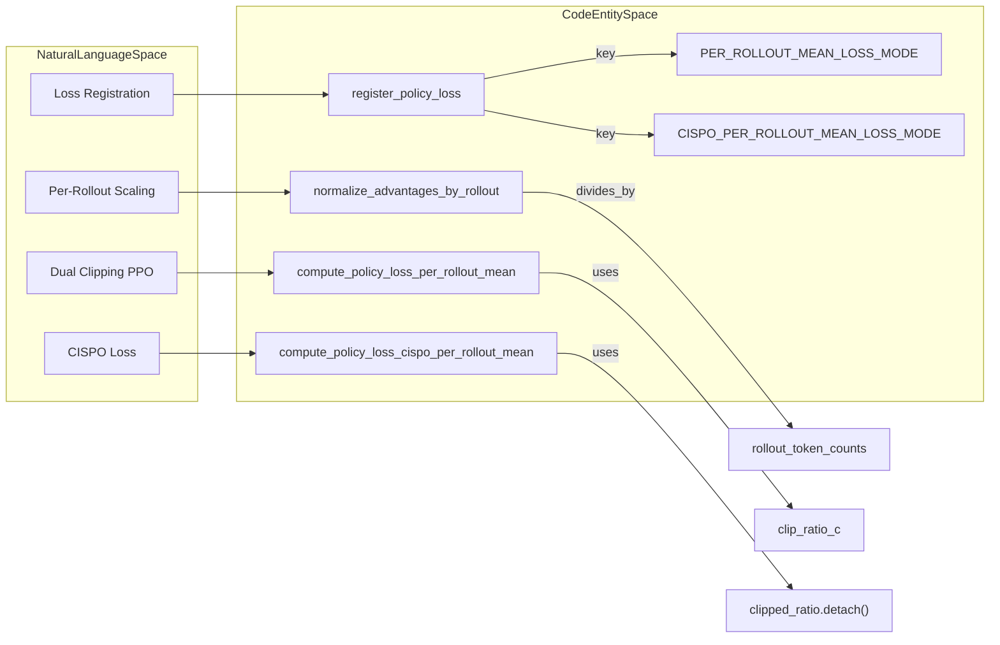
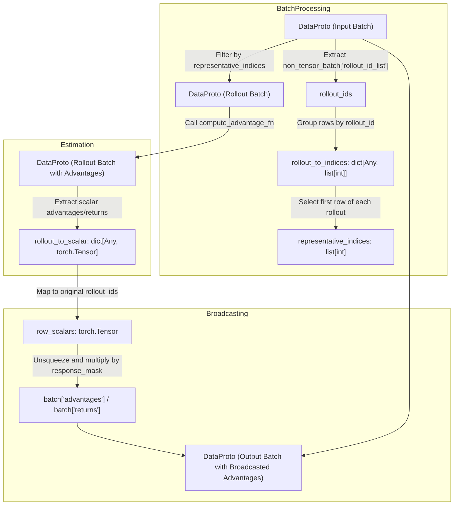

<!-- source: DeepWiki mcp.deepwiki.com · repo microsoft/agent-lightning · page 4.3 Per-Rollout Loss & Advantage · fetched 2026-10-26 -->

# Per-Rollout Loss & Advantage

Relevant source files

The following files were used as context for generating this wiki page:

- [agentlightning/verl/per_rollout_loss.py](agentlightning/verl/per_rollout_loss.py)
- [agentlightning/verl/rollout_level_advantage.py](agentlightning/verl/rollout_level_advantage.py)
- [tests/verl/test_per_rollout_loss.py](tests/verl/test_per_rollout_loss.py)

This page documents the custom PPO loss and advantage computation mechanisms in Agent Lightning, specifically designed for per-rollout normalization and outcome-based reward broadcasting. These features enable stable training for agentic tasks where a single rollout may consist of multiple triplets (turns) sharing a common final outcome.

## Per-Rollout Mean Loss

The `per_rollout_mean` loss mode is a custom PPO policy loss implementation that normalizes advantages at the rollout level rather than the token level. This is registered in the VERL `POLICY_LOSS_REGISTRY` under the key `PER_ROLLOUT_MEAN_LOSS_MODE` [agentlightning/verl/per_rollout_loss.py:13-13]().

### Advantage Normalization
The `normalize_advantages_by_rollout` function ensures that each row's advantage is normalized by its rollout's total token count and the number of trained rows in the batch [agentlightning/verl/per_rollout_loss.py:17-42]().

1.  **Token Counting**: It calculates the total number of valid tokens (masked by `response_mask`) for every row [agentlightning/verl/per_rollout_loss.py:30-30]().
2.  **Aggregation**: It sums these counts across all rows belonging to the same `rollout_id` [agentlightning/verl/per_rollout_loss.py:31-35]().
3.  **Scaling**: It divides the advantages by the product of the rollout's total token count and the `num_trained_rows` (batch size) [agentlightning/verl/per_rollout_loss.py:37-42]().

Sources: [agentlightning/verl/per_rollout_loss.py:17-42](), [tests/verl/test_per_rollout_loss.py:36-58]()

### Policy Loss Calculation
The `compute_policy_loss_per_rollout_mean` function implements a dual-clipped PPO loss [agentlightning/verl/per_rollout_loss.py:45-90]().

*   **Dual Clipping**: In addition to standard PPO clipping (`clip_ratio`), it introduces `clip_ratio_c` (default 3.0). If the advantage is negative, the loss is clipped to prevent excessively large gradient updates from very small probabilities [agentlightning/verl/per_rollout_loss.py:58-78]().
*   **KL Capture**: It calculates the approximate KL divergence between the old and new policies for monitoring [agentlightning/verl/per_rollout_loss.py:64-66]().
*   **Masked Sum**: Unlike standard PPO which often uses `masked_mean`, this mode uses `verl_F.masked_sum` because the advantages have already been pre-normalized by the rollout token counts [agentlightning/verl/per_rollout_loss.py:84-84](), [tests/verl/test_per_rollout_loss.py:73-73]().

Sources: [agentlightning/verl/per_rollout_loss.py:45-90](), [tests/verl/test_per_rollout_loss.py:60-74]()

### CISPO Per-Rollout Mean Loss
The `compute_policy_loss_cispo_per_rollout_mean` function implements a Clipped Importance-Sampling Policy Optimization (CISPO) loss, also with rollout-normalized advantages [agentlightning/verl/per_rollout_loss.py:93-132]().

*   **Clipped Ratio Detachment**: The clipped importance-sampling ratio (`clipped_ratio`) is detached, meaning that clipped tokens still contribute to the policy gradient signal, but no gradient flows through the ratio itself [agentlightning/verl/per_rollout_loss.py:118-118]().
*   **PPO KL**: Similar to the standard PPO loss, it computes the approximate KL divergence for monitoring [agentlightning/verl/per_rollout_loss.py:116-116]().
*   **Masked Sum**: The policy gradient loss is computed using `verl_F.masked_sum` [agentlightning/verl/per_rollout_loss.py:125-125]().

Sources: [agentlightning/verl/per_rollout_loss.py:93-132]()

---

## Rollout-Level Advantage

`compute_rollout_level_advantage` is used to broadcast a single scalar advantage (typically derived from a final reward) to all triplets within a multi-turn rollout. This is particularly useful for GRPO (Group Relative Policy Optimization) where advantages are computed relative to a group of rollouts for the same prompt [agentlightning/verl/rollout_level_advantage.py:15-26]().

### Data Flow & Validation
The function processes a `DataProto` batch through several stages:

1.  **Rollout Grouping**: Rows are grouped by `rollout_id_list` [agentlightning/verl/rollout_level_advantage.py:41-43]().
2.  **Constraint Validation**:
    *   **Same UID**: All triplets in a rollout must share the same `uid` (or `data_id_list`) [agentlightning/verl/rollout_level_advantage.py:31-35](), [agentlightning/verl/rollout_level_advantage.py:49-49](), [agentlightning/verl/rollout_level_advantage.py:114-118]().
    *   **Same Reward**: All triplets must have the same total `token_level_rewards` sum, ensuring the advantage is consistent across the trajectory [agentlightning/verl/rollout_level_advantage.py:50-50](), [agentlightning/verl/rollout_level_advantage.py:120-126]().
3.  **Collapsed Estimation**: A "representative" batch containing only one row per rollout is sent to the underlying `adv_estimator` (e.g., GRPO) [agentlightning/verl/rollout_level_advantage.py:52-61]().
4.  **Broadcasting**: The resulting scalar advantage is extracted and broadcasted back to all original rows, masked by their respective `response_mask` [agentlightning/verl/rollout_level_advantage.py:63-72]().

Sources: [agentlightning/verl/rollout_level_advantage.py:15-97](), [tests/verl/test_rollout_level_advantage.py:74-115]()

---

## Technical Architecture & Entity Mapping

### Loss Implementation Mapping
This diagram maps the natural language requirements for per-rollout loss to the code entities that implement them.

**Diagram: Loss Implementation Mapping**

Sources: [agentlightning/verl/per_rollout_loss.py:13-15](), [agentlightning/verl/per_rollout_loss.py:17-42](), [agentlightning/verl/per_rollout_loss.py:45-90](), [agentlightning/verl/per_rollout_loss.py:93-132]()

### Advantage Broadcasting Flow
The following diagram illustrates how advantages are collapsed for estimation and then broadcasted back to the full batch, linking concepts to code entities.

**Diagram: Advantage Broadcasting Flow**

Sources: [agentlightning/verl/rollout_level_advantage.py:27-85](), [agentlightning/verl/rollout_level_advantage.py:129-160]()

---

## Implementation Details

### Key Functions & Parameters

| Function | File | Description |
| :--- | :--- | :--- |
| `normalize_advantages_by_rollout` | `per_rollout_loss.py` | Scales advantages by `1 / (rollout_tokens * batch_size)` [agentlightning/verl/per_rollout_loss.py:17-42](). |
| `compute_policy_loss_per_rollout_mean` | `per_rollout_loss.py` | PPO policy loss with `clip_ratio_c` and masked sum [agentlightning/verl/per_rollout_loss.py:45-90](). |
| `compute_policy_loss_cispo_per_rollout_mean` | `per_rollout_loss.py` | CISPO policy loss with detached clipped ratio and masked sum [agentlightning/verl/per_rollout_loss.py:93-132](). |
| `compute_rollout_level_advantage` | `rollout_level_advantage.py` | Main entry point for outcome-style advantage broadcasting [agentlightning/verl/rollout_level_advantage.py:15-26](). |
| `_extract_rollout_scalars` | `rollout_level_advantage.py` | Validates that all tokens in a rollout row have the same advantage value [agentlightning/verl/rollout_level_advantage.py:129-149](). |

### Configuration Requirements
*   **Loss Mode**: Set `actor_rollout_ref.ppo_loss_mode` to `per_rollout_mean` or `cispo_per_rollout_mean` in the Hydra config to enable the custom loss.
*   **Advantage Estimator**: When using `compute_rollout_level_advantage`, the `adv_estimator` is typically `grpo` to facilitate group-based relative rewards [agentlightning/verl/rollout_level_advantage.py:64-64]().
*   **Clip Ratio C**: The `clip_ratio_c` parameter in the actor config controls the lower-bound clipping for negative advantages in `per_rollout_mean` loss [agentlightning/verl/per_rollout_loss.py:60-61]().

Sources: [agentlightning/verl/per_rollout_loss.py:13-15](), [agentlightning/verl/per_rollout_loss.py:55-61](), [agentlightning/verl/rollout_level_advantage.py:15-36]()

---

