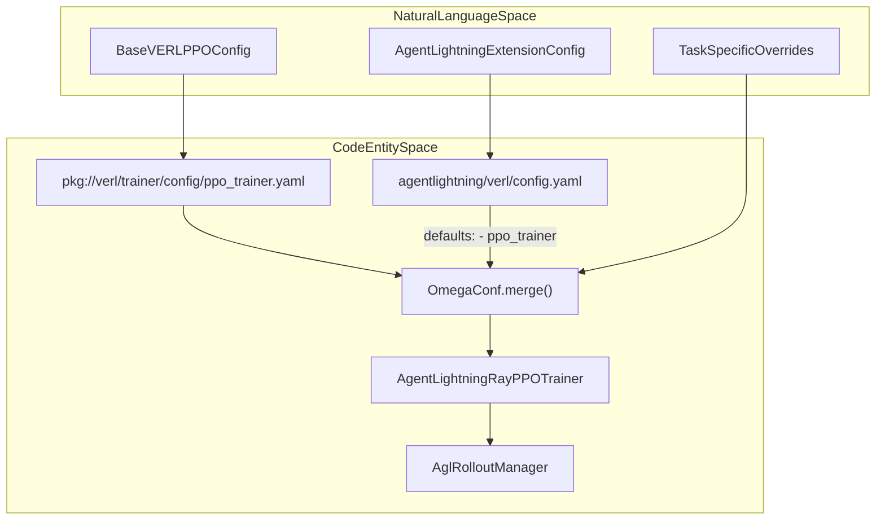
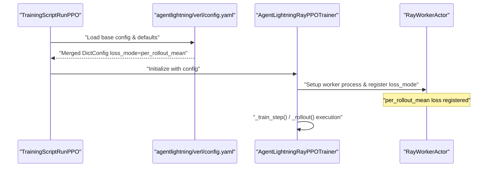

<!-- source: DeepWiki mcp.deepwiki.com · repo microsoft/agent-lightning · page 4.4 VERL Configuration · fetched 2026-10-26 -->

# VERL Configuration

Relevant source files

The following files were used as context for generating this wiki page:

- [agentlightning/verl/config.yaml](agentlightning/verl/config.yaml)
- [docs/00-installation.md](docs/00-installation.md)
- [docs/05-basics.md](docs/05-basics.md)
- [docs/20-trainer-configuration.md](docs/20-trainer-configuration.md)

This page provides a technical reference for the configuration system used to integrate Agent Lightning with the VERL (Versatile REINFORCEMENT Learning) framework. It covers the `agentlightning` configuration block, overrides for standard PPO behavior, and the mechanism for merging Hydra configurations in `agentlightning/verl/config.yaml`.

## Configuration Structure & Hydra Integration

Agent Lightning extends the standard VERL PPO configuration using Hydra's searchpath mechanism. The core configuration resides in `agentlightning/verl/config.yaml`, which specifies the search path pointing to `pkg://verl/trainer/config` and loads `ppo_trainer` via Hydra defaults [agentlightning/verl/config.yaml:1-8]().

Sources: `[agentlightning/verl/config.yaml:1-8]()`, `[docs/20-trainer-configuration.md:3-37]()`

### The `agentlightning` Block

This block controls the connection to the API server, defines rollout timeouts, and configures the execution environment for agents (Local vs. Kubernetes).

| Key | Type | Description |
|:---|:---|:---|
| `agl_base_url` | `str` | The base URL of the `agl-server` (e.g., `http://localhost:8080`). [agentlightning/verl/config.yaml:13]() |
| `agl_key` | `str` | Bearer token for authentication with the `agl-server`. [agentlightning/verl/config.yaml:14]() |
| `hooks` | `str \| null` | Path to a `RolloutHooks` implementation (e.g., `module:ClassName`). [agentlightning/verl/config.yaml:15]() |
| `rollout_timeout_seconds` | `int` | Maximum time allowed for an agent rollout before it is marked as failed. [agentlightning/verl/config.yaml:16]() |
| `local.agent_class` | `str \| null` | The agent class to load for local execution. [agentlightning/verl/config.yaml:18]() |
| `local.env_map` | `dict` | Mapping of dataset fields to environment variables for local agents. [agentlightning/verl/config.yaml:19]() |
| `k8s.job_template_path` | `str \| null` | Path to the Jinja2 template for Kubernetes Job manifests. [agentlightning/verl/config.yaml:21]() |
| `reward_fillna_value` | `float` | Value used to fill rewards if an agent fails to report one (default `0.0`). [agentlightning/verl/config.yaml:22]() |
| `max_ppo_update_times` | `int \| null` | Optional limit on PPO update iterations. [agentlightning/verl/config.yaml:23]() |
| `trace_aggregator.level` | `str` | `transition` (step-by-step) or `trajectory` (full multi-turn history). [agentlightning/verl/config.yaml:25]() |
| `trace_aggregator.trajectory_max_prompt_length` | `int` | Limits the initial prompt length in trajectory mode. [agentlightning/verl/config.yaml:26]() |
| `trace_aggregator.trajectory_max_response_length` | `int` | Limits the response length in trajectory mode. [agentlightning/verl/config.yaml:27]() |
| `async_rollout.enabled` | `bool` | Whether to use non-blocking rollout dispatch. [agentlightning/verl/config.yaml:29]() |
| `async_rollout.async_train_batch_size` | `int \| null` | Batch size for asynchronous training. [agentlightning/verl/config.yaml:30]() |

Sources: `[agentlightning/verl/config.yaml:12-31]()`, `[docs/20-trainer-configuration.md:11-30]()`

### Actor, Rollout, and Algorithm Overrides

Agent Lightning applies specific overrides to the `actor_rollout_ref` and `algorithm` blocks to ensure PPO updates are compatible with external agentic rollouts:

*   **`algorithm.enable_rollout_level_advantage: true`**: Enables rollout-level advantage broadcasting across tokens [agentlightning/verl/config.yaml:9-10]().
*   **`actor.calculate_entropy: true`**: Enables entropy calculation on actor outputs [agentlightning/verl/config.yaml:36-37]().
*   **`actor.policy_loss.loss_mode: per_rollout_mean`**: Configures the PPO actor to use a custom loss calculation where advantages are normalized by the number of tokens in a rollout rather than the global batch size [agentlightning/verl/config.yaml:38-39]().
*   **`rollout.mode: async`**: Forces the VERL internal rollout mode to `async` [agentlightning/verl/config.yaml:40-41]().

Sources: `[agentlightning/verl/config.yaml:9-11]()`, `[agentlightning/verl/config.yaml:35-41]()`

### Trace Aggregator & Asynchronous Training Settings

The `trace_aggregator` and `async_rollout` sub-blocks control how raw events from `agl-server` are transformed into VERL training samples.

*   **Trajectory Mode**: The default `trajectory` mode merges multi-turn calls into a single sequence, using `trajectory_max_prompt_length` and `trajectory_max_response_length` [agentlightning/verl/config.yaml:24-27]().
*   **Async Rollout**: When `agentlightning.async_rollout.enabled` is `true`, the trainer can dispatch rollouts asynchronously with an optional `async_train_batch_size` [agentlightning/verl/config.yaml:28-30]().

Sources: `[agentlightning/verl/config.yaml:24-31]()`, `[docs/20-trainer-configuration.md:120-148]()`

## Configuration Merging & Data Flow

Training scripts use `OmegaConf` and Hydra to merge the base VERL configuration with Agent Lightning defaults and task-specific overrides.

### Configuration Merging Architecture

Sources: `[agentlightning/verl/config.yaml:1-8]()`, `[docs/20-trainer-configuration.md:3-37]()`

### `build_config()` in Example Scripts

Example training scripts, such as `examples/calc_x/train_calc_agent.py`, define a `build_config()` function to construct the final configuration. This function performs the following steps:

1.  **Locate Base Config**: It uses `importlib.resources.files("agentlightning.verl")` to find the `agentlightning/verl` package directory.
2.  **Initialize Hydra**: `hydra.initialize_config_dir()` is used to set up Hydra's configuration directory.
3.  **Compose Base Config**: `hydra.compose(config_name="config")` loads the base configuration, which includes `ppo_trainer` defaults and `agentlightning/verl/config.yaml` [agentlightning/verl/config.yaml:1-8]().
4.  **Apply Example Overrides**: A dictionary of example-specific overrides is created. These overrides can dynamically adjust parameters like `actor_rollout_ref.model.path`, `agentlightning.agl_base_url`, and `agentlightning.async_rollout.enabled` based on command-line arguments.
5.  **Merge Configurations**: `OmegaConf.merge()` combines the base Hydra configuration, the example-specific overrides, and any command-line overrides provided as dot-list arguments.

This process ensures that the final configuration passed to `run_ppo()` is a comprehensive `OmegaConf` object reflecting all default, Agent Lightning, and task-specific settings.

Sources: `[agentlightning/verl/config.yaml:1-8]()`, `[docs/20-trainer-configuration.md:3-37]()`

## Key Implementation Entities & Runtime Wiring

The configuration directly dictates the behavior of `AgentLightningRayPPOTrainer` and its associated rollout managers.

*   **Gateway Management**: The trainer uses `agl_base_url` and `agl_key` from `agentlightning` to communicate with the server (`agl-server`) [docs/20-trainer-configuration.md:41-48]().
*   **Custom Policy Loss Registration**: The setting `loss_mode: per_rollout_mean` maps to custom PPO loss handlers executed across Ray workers [agentlightning/verl/config.yaml:38-39]().

### Trainer Instantiation and Loss Registration Flow

Sources: `[agentlightning/verl/config.yaml:35-41]()`, `[docs/20-trainer-configuration.md:31-35]()`

---

