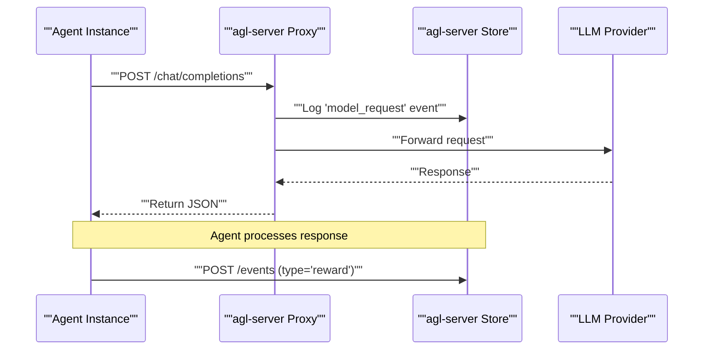

<!-- source: DeepWiki mcp.deepwiki.com · repo microsoft/agent-lightning · page 5 Writing Agents · fetched 2026-10-26 -->

# Writing Agents

<details>
<summary>Relevant source files</summary>

The following files were used as context for generating this wiki page:

- [agentlightning/controller/local_reconciler.py](agentlightning/controller/local_reconciler.py)
- [examples/calc_x/README.md](examples/calc_x/README.md)
- [examples/calc_x/calc_agent.py](examples/calc_x/calc_agent.py)
- [examples/calc_x/run_local.sh](examples/calc_x/run_local.sh)
- [examples/calc_x/run_minikube.sh](examples/calc_x/run_minikube.sh)
- [examples/calc_x/train_calc_agent.py](examples/calc_x/train_calc_agent.py)
- [tests/controller/test_local_reconciler.py](tests/controller/test_local_reconciler.py)
- [tests/controller/test_local_reconciler_env.py](tests/controller/test_local_reconciler_env.py)

</details>


This page serves as a high-level guide to implementing agents in Agent Lightning v1.0. Agents interact with the training infrastructure through the **Agent Contract**, which standardizes environment variables, LLM proxy routing, and reward event reporting. 

For deep technical details, refer to the child pages:
- **[Agent Contract & Environment Variables](#5.1)** — Detailed environment variables (`AGL_OPENAI_BASE_URL`, `AGL_EVENT_URL`, `AGL_KEY`), `env_map` resolution, reward event formats, and model request capture.
- **[Local Agent Pattern](#5.2)** — Implementing local agent classes, subprocess bootstrap, async `run()` patterns, and error handling with examples like GSM8K and ScienceWorld.
- **[Kubernetes Agent Pattern](#5.3)** — Writing K8s-deployed agents using Jinja2 `job-template.yaml` files, environment injection, and sandbox lifecycle management.

---

## The Agent Contract

The agent contract establishes the runtime conventions for how an agent receives its task and connects to `agl-server` and `agl-controller`.

### Environment Variables
Agents are instantiated with specific environment variables injected by the controller [agentlightning/controller/local_reconciler.py:63-74]():
*   `AGL_OPENAI_BASE_URL`: The OpenAI-compatible proxy endpoint configured with rollout context [tests/controller/test_local_reconciler_env.py:62]().
*   `AGL_EVENT_URL`: The ingestion endpoint where agents post completion or reward events [tests/controller/test_local_reconciler_env.py:63]().
*   `AGL_KEY`: The authentication bearer token shared with the server [tests/controller/test_local_reconciler_env.py:61](). This key is automatically added as an `Authorization: Bearer` header by `AgentLightningSyncClient` and `AgentLightningAsyncClient`.

### Task Input Mapping
Task inputs are mapped into environment variables using the `env_map` configuration (e.g., mapping `input.question` to `QUESTION` and `input.result` to `RESULT`) [examples/calc_x/train_calc_agent.py:91-95](). The reconciler resolves these paths at spawn time [agentlightning/controller/local_reconciler.py:63-91]().

### Reward Reporting
Upon task completion, agents evaluate their output and post a reward event to `AGL_EVENT_URL` [examples/calc_x/calc_agent.py:68-76]().

For details, see [Agent Contract & Environment Variables](#5.1).

Sources: [agentlightning/controller/local_reconciler.py:63-91](), [examples/calc_x/calc_agent.py:68-76](), [examples/calc_x/train_calc_agent.py:91-95](), [tests/controller/test_local_reconciler_env.py:61-63]()

---

## Agent Execution Architecture

The following diagrams bridge developer intent in Natural Language Space to concrete code entities in Code Entity Space.

### System Entity Mapping: Agent Execution
```mermaid
graph TD
    subgraph "Natural Language Space"
        INTENT1[""Run a Calc-X Agent on this Question""]
    end

    subgraph "Code Entity Space"
        AC[""agent_class (examples.calc_x.calc_agent.Agent)""]
        LR[""LocalReconciler (agentlightning.controller.local_reconciler)""]
        WORKER["""_run_local_reconciler_worker() (agentlightning.controller.local_reconciler)"""]
        AGENT["""Agent.run() (examples.calc_x.calc_agent)"""]
    end

    INTENT1 --> AC
    AC -->|""loaded by""| LR
    LR -->|""spawns""| WORKER
    WORKER -->|""instantiates & invokes""| AGENT
```
Sources: [agentlightning/controller/local_reconciler.py:35-50](), [agentlightning/controller/local_reconciler.py:94-104](), [examples/calc_x/calc_agent.py:18-80]()

### System Entity Mapping: Reward Reporting & Telemetry
```mermaid
graph TD
    subgraph "Natural Language Space"
        INTENT2[""Post scalar evaluation reward to server""]
    end

    subgraph "Code Entity Space"
        CALC["""Agent.run() (examples.calc_x.calc_agent)"""]
        HTTP["""httpx.post() (httpx)"""]
        EVT["""AGL_EVENT_URL (os.environ)"""]
        SRV["""agl-server Event Ingestion Endpoint""]
    end

    INTENT2 --> CALC
    CALC -->|""triggers""| HTTP
    HTTP -->|""targets""| EVT
    EVT -->|""delivers payload""| SRV
```
Sources: [examples/calc_x/calc_agent.py:68-76]()

---

## Local Agent Pattern

Local agents are implemented as Python classes executed as subprocesses by the `LocalReconciler` [agentlightning/controller/local_reconciler.py:3-4](). 

- **Execution**: The worker function dynamically loads the class specified by `agent_class` and invokes its `run()` method [agentlightning/controller/local_reconciler.py:35-46]().
- **Async Support**: If `run()` is a coroutine or awaitable, it is executed via `asyncio.run()` [agentlightning/controller/local_reconciler.py:44-46]().

For details, see [Local Agent Pattern](#5.2).

Sources: [agentlightning/controller/local_reconciler.py:3-4](), [agentlightning/controller/local_reconciler.py:35-50]()

---

## Kubernetes Agent Pattern

For agents requiring sandboxed execution, strict isolation, or heavy dependencies (such as tool-use or bash execution environments), the Kubernetes pattern is used.

- **Templates**: The `K8sReconciler` renders Jinja2 job manifests from a `job_template_path` specified in the rollout config [examples/calc_x/train_calc_agent.py:96-98]().
- **Lifecycle**: Containers receive proxy credentials and environment variables through automated injection, reporting events directly back to `agl-server`.

For details, see [Kubernetes Agent Pattern](#5.3).

Sources: [examples/calc_x/train_calc_agent.py:96-98]()

---

## LLM Interaction & Telemetry

Agents must route all LLM requests through the proxy specified by `AGL_OPENAI_BASE_URL` rather than calling third-party APIs directly [tests/controller/test_local_reconciler_env.py:62]().

### Data Flow: Proxy and Events

Sources: [tests/controller/test_local_reconciler_env.py:62]()

### Key Benefits of the Proxy:
1.  **Automatic Tracing**: Every completion request is recorded as a `model_request` event for reinforcement learning datasets.
2.  **Trainer Coordination**: Allows the VERL trainer to pause inference during policy weight updates.
3.  **Token Capture**: Captures exact prompt and response tokens for advantage calculation and policy loss estimation.

Sources: [tests/controller/test_local_reconciler_env.py:62]()

---

