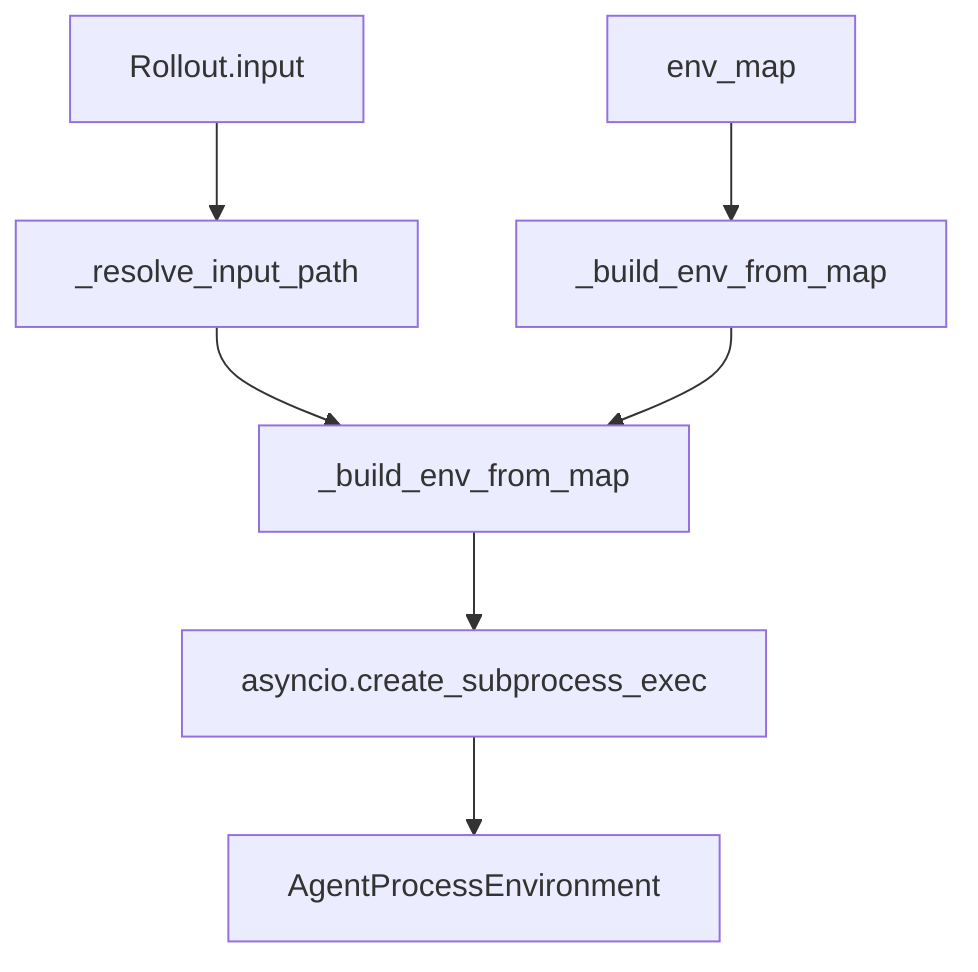
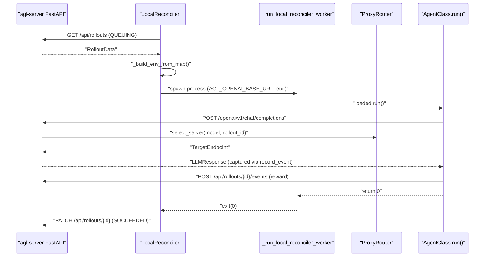

<!-- source: DeepWiki mcp.deepwiki.com · repo microsoft/agent-lightning · page 5.1 Agent Contract & Environment Variables · fetched 2026-10-26 -->

# Agent Contract & Environment Variables

<details>
<summary>Relevant source files</summary>

The following files were used as context for generating this wiki page:

- [agentlightning/controller/local_reconciler.py](agentlightning/controller/local_reconciler.py)
- [agentlightning/schemas.py](agentlightning/schemas.py)
- [tests/controller/test_local_reconciler.py](tests/controller/test_local_reconciler.py)
- [tests/controller/test_local_reconciler_env.py](tests/controller/test_local_reconciler_env.py)
- [tests/server/test_endpoints.py](tests/server/test_endpoints.py)
- [tests/verl/test_agl_rollout_manager.py](tests/verl/test_agl_rollout_manager.py)

</details>


## Purpose & Scope
This page documents the agent contract, which defines the runtime interface between the `agl-controller` and agent code executing within a rollout. This contract decouples agent implementations from the underlying reinforcement learning infrastructure while providing secure, unified access to the LLM proxy, event logging system, and task-specific inputs.

**Sources:**
- `agentlightning/controller/local_reconciler.py:63-91`
- `tests/controller/test_local_reconciler_env.py:61-63`

---

## Core Environment Variables

When the `agl-controller` spawns an agent process (via `LocalReconciler` or `K8sReconciler`), it injects three core environment variables. These supply the agent with credentials and endpoint URLs to communicate with `agl-server`.

| Variable | Description | Source |
| :--- | :--- | :--- |
| `AGL_OPENAI_BASE_URL` | The OpenAI-compatible proxy URL containing rollout and attempt identifiers. | [tests/controller/test_local_reconciler_env.py:62-62]() |
| `AGL_EVENT_URL` | The REST endpoint for posting reward and custom telemetry events. | [tests/controller/test_local_reconciler_env.py:63-63]() |
| `AGL_KEY` | The bearer token or secret key used for server authentication. | [tests/controller/test_local_reconciler_env.py:61-61]() |

### Proxy URL Structure
The `AGL_OPENAI_BASE_URL` follows a standardized routing pattern that allows the `agl-server` gateway to capture and attribute all LLM generations:
`{base_url}/proxy/rollout/{rollout_id}/attempt/{attempt_id}/mode/{mode}/openai/v1` [tests/controller/test_local_reconciler_env.py:62-62]()

*   `rollout_id`: Unique identifier for the active rollout instance [tests/controller/test_local_reconciler_env.py:62-62]().
*   `attempt_id`: Identifier distinguishing retries or re-evaluations (defaults to `"0"`) [tests/controller/test_local_reconciler_env.py:62-62]().
*   `mode`: Execution mode, typically `train` or `val`, determining model pool routing [tests/controller/test_local_reconciler_env.py:62-62]().

**Sources:**
- `tests/controller/test_local_reconciler_env.py:61-63`

---

## Input Mapping (`env_map`)

Agents frequently require task-specific inputs (e.g., a math problem statement, document text, or system prompt). The `env_map` configuration option allows mapping fields from the `rollout.input` payload directly into environment variables using dot-notation paths [agentlightning/controller/local_reconciler.py:63-74]().

### Resolution Logic
The `_resolve_input_path()` function parses field navigation rules:
1. If the path is `"input"`, the complete input dictionary/object is returned [agentlightning/controller/local_reconciler.py:77-79]().
2. If the path starts with `"input."`, it traverses dictionaries or list indexes [agentlightning/controller/local_reconciler.py:80-91]().
3. Non-string resolved values are automatically serialized via `json.dumps()` before assignment [agentlightning/controller/local_reconciler.py:70-73]().

### Data Flow: Input to Environment

Title: "Input Resolution and Code Entity Mapping"

**Sources:**
- `agentlightning/controller/local_reconciler.py:63-91`

---

## Event Reporting Contract

Agents communicate outcomes and execution states back to the server via the `AGL_EVENT_URL`.

### Reward Event Format
For reinforcement learning updates, agents must report scalar rewards by posting an event matching the `EventCreate` schema [agentlightning/schemas.py:29-34]():

```json
{
  "event_type": "reward",
  "data": {
    "value": 1.0,
    "source": "evaluator",
    "reason": "Correct answer verified"
  }
}
```
*   `value` (float): The scalar reward consumed by the training adapter [agentlightning/schemas.py:56-63]().
*   `event_type`: Must be `"reward"` so the training bridge can extract it during rollout processing [agentlightning/schemas.py:13-20]().

### Automatic Model Request Capture & Triplet Formatting
Agents do not need to manually log LLM prompts and responses. When an agent invokes the OpenAI-compatible proxy at `AGL_OPENAI_BASE_URL`, the server automatically records a `model_request` event structured via `ModelRequestData` [agentlightning/schemas.py:36-54]().

When the VERL training integration queries rollout events, the server transforms raw events into a compact triplet format:
*   **Model Requests**: Trimmed to isolate `prompt_token_ids`, `response_token_ids`, and extracted `response_log_probs` [tests/verl/test_agl_rollout_manager.py:148-160]().
*   **Rewards**: Trimmed to preserve only the scalar `value` and metadata [tests/verl/test_agl_rollout_manager.py:87-87]().

### Chat vs. Completions Modes
The proxy and event ingestion layer support both chat and completions generation formats:
*   **Chat Schema**: Extracts logprobs from `logprobs.content` (structured list of token logprob dictionaries).
*   **Completions Schema**: Extracts logprobs from `logprobs.token_logprobs` (list of float scores).

**Sources:**
- `agentlightning/schemas.py:13-67`
- `tests/verl/test_agl_rollout_manager.py:55-160`

---

## Implementation Context

Agent execution is orchestrated by the controller and managed via subprocesses or container tasks.

Title: "Agent Execution Sequence and Code Entity Mapping"


**Sources:**
- `agentlightning/controller/local_reconciler.py:35-51`
- `agentlightning/controller/local_reconciler.py:125-189`
- `tests/controller/test_local_reconciler_env.py:61-64`

---

