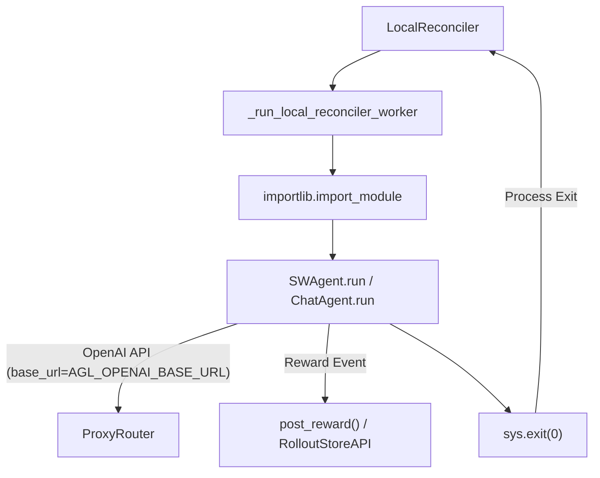
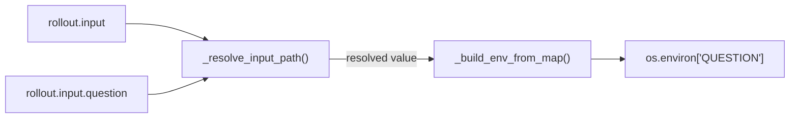

<!-- source: DeepWiki mcp.deepwiki.com · repo microsoft/agent-lightning · page 5.2 Local Agent Pattern · fetched 2026-10-26 -->

# Local Agent Pattern

<details>
<summary>Relevant source files</summary>

The following files were used as context for generating this wiki page:

- [examples/gsm8k/README.md](examples/gsm8k/README.md)
- [examples/gsm8k/gsm8k_agent.py](examples/gsm8k/gsm8k_agent.py)
- [examples/gsm8k/run_local.sh](examples/gsm8k/run_local.sh)
- [examples/gsm8k/train_gsm8k_agent.py](examples/gsm8k/train_gsm8k_agent.py)
- [examples/science_world/README.md](examples/science_world/README.md)
- [examples/science_world/agents/sw_agent.py](examples/science_world/agents/sw_agent.py)
- [examples/science_world/train_sw_agent.py](examples/science_world/train_sw_agent.py)

</details>


## Purpose and Scope

The **Local Agent Pattern** is the primary mechanism for executing agent rollouts as local subprocesses on the host machine managed by the controller. This pattern supports rapid development, debugging, and single-node GPU training where Kubernetes orchestration is unnecessary. 

In this pattern, the controller manages a local process pool, spawning short-lived Python subprocesses for each rollout attempt. These subprocesses communicate with the server to perform LLM inference via the OpenAI-compatible proxy and report terminal rewards.

Sources: [examples/gsm8k/run_local.sh:41-45]()

---

## Agent Class Implementation

To implement a local agent, define a Python class adhering to the Agent Lightning execution contract.

### Class Structure and the `run()` Method

A local agent exposes an `async def run(self) -> None` method as its primary entry point [examples/science_world/agents/sw_agent.py:101-101](). 

When the controller initiates a rollout, it dynamically imports the target class, instantiates it, and invokes `run()`. The agent logic executes the following sequence:
1. **Input Retrieval**: Reads task specification parameters from environment variables injected via `env_map` [examples/science_world/agents/sw_agent.py:104-106]().
2. **LLM Interaction**: Uses `AsyncOpenAI` pointing to `AGL_OPENAI_BASE_URL` to route requests through the local proxy [examples/gsm8k/gsm8k_agent.py:85-91]().
3. **Reward Reporting**: POSTs a reward payload to `AGL_EVENT_URL` before completion [examples/gsm8k/gsm8k_agent.py:63-74]().

### Configuration via `agent_class`

The agent is selected in training configurations through the `agent_class` setting under `agentlightning.local`, specified as `module.path:ClassName` [examples/science_world/train_sw_agent.py:183-183]().

| Config Key | Description | Code Reference / Example |
| :--- | :--- | :--- |
| `agent_class` | Fully qualified path to the agent class | `examples.gsm8k.gsm8k_agent.ChatAgent` [examples/gsm8k/train_gsm8k_agent.py:91-91]() |
| `env_map` | Mapping from rollout dataset attributes to environment variables | `QUESTION: input.question` [examples/gsm8k/train_gsm8k_agent.py:93-94]() |

Sources: [examples/gsm8k/train_gsm8k_agent.py:90-96](), [examples/science_world/agents/sw_agent.py:9-26](), [examples/science_world/train_sw_agent.py:183-184]()

---

## Subprocess Bootstrap & Data Flow

The local controller polls the server for queued rollouts and spawns a separate worker subprocess for each rollout instance.

### Execution Flow Diagram

This diagram bridges natural language concepts to concrete code entities involved in local subprocess bootstrapping and execution, referencing `sw_agent.py` and `gsm8k_agent.py`.

**Diagram: Local Agent Subprocess Lifecycle**

Sources: [examples/gsm8k/gsm8k_agent.py:63-112](), [examples/science_world/agents/sw_agent.py:98-111]()

### Environment Mapping Data Flow

The environment builder extracts properties from rollout configuration payloads and populates the child process environment.

**Diagram: Data Model to Environment Mapping**

Sources: [examples/gsm8k/train_gsm8k_agent.py:92-95]()

---

## Concrete Examples

### GSM8K ChatAgent and CompletionAgent

The GSM8K implementations (`ChatAgent` and `CompletionAgent`) execute single-turn reasoning loops over chat or completion endpoints [examples/gsm8k/gsm8k_agent.py:77-144]().
* **Input Extraction**: Reads `QUESTION` and `ANSWER` from environment variables [examples/gsm8k/gsm8k_agent.py:81-82]().
* **Inference**: Uses `AsyncOpenAI` pointing to `AGL_OPENAI_BASE_URL` with strict timeouts [examples/gsm8k/gsm8k_agent.py:87-92]().
* **Reward Calculation**: Compares normalized prediction strings against ground truth and reports binary outcomes via `post_reward()` [examples/gsm8k/gsm8k_agent.py:63-74]().

### ScienceWorld SWAgent

`SWAgent` demonstrates a multi-turn environment interaction pattern [examples/science_world/agents/sw_agent.py:98-205]().
* **Environment Initialization**: Instantiates `ScienceWorldEnv` locally within the subprocess [examples/science_world/agents/sw_agent.py:133-134]().
* **History Maintenance**: Appends user observations and assistant action outputs to a growing `messages` list to preserve token continuity for trajectory aggregation [examples/science_world/agents/sw_agent.py:144-197]().
* **Reward Reporting**: Computes final normalized task scores and reports rewards upon episode termination [examples/science_world/agents/sw_agent.py:140-169]().

Sources: [examples/gsm8k/gsm8k_agent.py:77-144](), [examples/science_world/agents/sw_agent.py:98-205]()

---

## Best Practices & Error Handling

### Error Handling & Timeouts
* Wrap LLM calls with `asyncio.wait_for` to prevent hanging subprocesses [examples/gsm8k/gsm8k_agent.py:92-105]().
* Unhandled exceptions or non-zero exit codes cause the controller to mark the rollout as `FAILED`.
* Subprocesses exceeding rollout timeout thresholds are terminated via process group signals.

### Proxy Integration
* Always target `AGL_OPENAI_BASE_URL` provided in environment variables to ensure requests link properly to rollout tracing states [examples/science_world/agents/sw_agent.py:110-131]().

### Reward Event Payload Structure
Reward events require a JSON structure containing `event_type: "reward"` and a numeric scalar inside the `data` field [examples/gsm8k/gsm8k_agent.py:68-71]().

```python
httpx.post(
    event_url,
    json={
        "event_type": "reward",
        "data": {"value": reward_value},
    },
    headers={"Authorization": f"Bearer {agl_key}"}
)
```

Sources: [examples/gsm8k/gsm8k_agent.py:63-74](), [examples/science_world/agents/sw_agent.py:110-131]()

---

