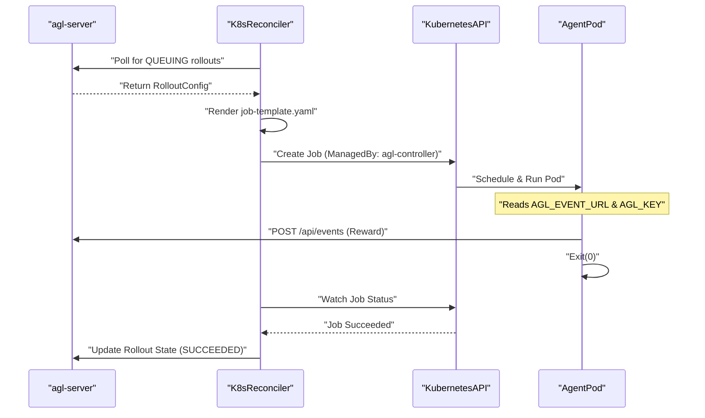
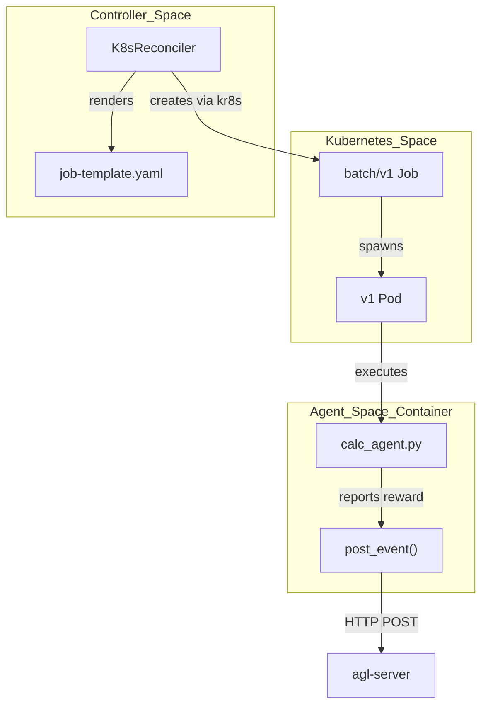

<!-- source: DeepWiki mcp.deepwiki.com · repo microsoft/agent-lightning · page 5.3 Kubernetes Agent Pattern · fetched 2026-10-26 -->

# Kubernetes Agent Pattern

<details>
<summary>Relevant source files</summary>

The following files were used as context for generating this wiki page:

- [examples/calc_x/Dockerfile](examples/calc_x/Dockerfile)
- [examples/calc_x/job-template.yaml](examples/calc_x/job-template.yaml)
- [examples/llm-in-sandbox/.gitignore](examples/llm-in-sandbox/.gitignore)
- [examples/llm-in-sandbox/Dockerfile.agent](examples/llm-in-sandbox/Dockerfile.agent)
- [examples/swe_smith/job-template-openai.yaml](examples/swe_smith/job-template-openai.yaml)

</details>


The **Kubernetes Agent Pattern** enables Agent Lightning to scale rollout execution across a Kubernetes cluster via `agl-controller`. Unlike the local runner which spawns subprocesses, the Kubernetes runner treats each rollout attempt as a discrete Kubernetes `Job`. This pattern is essential for resource-intensive agents (such as those requiring sandboxed code execution or complex tool environments) and provides strict resource and process isolation between rollout attempts.

Sources: [examples/calc_x/job-template.yaml:1-23](), [examples/swe_smith/job-template-openai.yaml:1-66]()

## Job Template System

The `K8sReconciler` uses Jinja2 templates to render Kubernetes Job manifests dynamically. This allows runtime injection of rollout-specific metadata and task inputs into the Pod specification.

### Jinja2 Template Format
The template typically resides in a `job-template.yaml` file (e.g., in `examples/calc_x/job-template.yaml` [examples/calc_x/job-template.yaml:1-23]() or `examples/swe_smith/job-template-openai.yaml` [examples/swe_smith/job-template-openai.yaml:1-66]()). The reconciler provides a rendering context containing the `input` object (rollout task data) and environment configurations.

Key template configurations include:
*   **`metadata.name`**: Set to `auto` or dynamically named for automatic generation by the controller [examples/calc_x/job-template.yaml:4](), [examples/swe_smith/job-template-openai.yaml:7]().
*   **`backoffLimit: 0`**: Prevents Kubernetes from automatically retrying a failed Job, leaving retry management to Agent Lightning [examples/calc_x/job-template.yaml:6](), [examples/swe_smith/job-template-openai.yaml:9]().
*   **`restartPolicy: Never`**: Ensures that a failing container does not restart inside the same Pod, preserving the "one attempt, one pod" isolation model [examples/calc_x/job-template.yaml:9](), [examples/swe_smith/job-template-openai.yaml:15]().

Sources: [examples/calc_x/job-template.yaml:1-23](), [examples/swe_smith/job-template-openai.yaml:1-20]()

### The `yaml_escape` Filter
To prevent YAML injection vulnerabilities or syntax errors when task data contains special characters (such as quotes or newlines), the reconciler exposes a `yaml_escape` filter. This filter must be applied to all environment variable mappings derived from task inputs [examples/calc_x/job-template.yaml:15-19]().

```yaml
env:
  - name: QUESTION
    value: {{ input.question | yaml_escape }}
  - name: RESULT
    value: {{ input.result | yaml_escape }}
```
Sources: [examples/calc_x/job-template.yaml:15-19]()

## Environment Variable Injection

The `K8sReconciler` injects standard AGL system environment variables into every container spawned by the Job. These variables allow the agent code to connect back to `agl-server` for LLM inference proxying and event reporting.

| Variable | Description |
| :--- | :--- |
| `AGL_OPENAI_BASE_URL` | The proxy URL for LLM requests. |
| `AGL_EVENT_URL` | The endpoint for reporting reward and diagnostic events. |
| `AGL_KEY` | The bearer token for authentication against `agl-server`. |
| `QUESTION` / `RESULT` | Task-specific parameters injected via the Jinja2 template [examples/calc_x/job-template.yaml:16-19](). |
| `AGL_TASK_INPUT` | Task input string or problem statement used by complex coding agents [examples/swe_smith/job-template-openai.yaml:22-23](). |

Sources: [examples/calc_x/job-template.yaml:15-19](), [examples/swe_smith/job-template-openai.yaml:21-23]()

## Dockerfile Patterns for Agent Images

Agent images must package all required libraries, tooling, and agent scripts.

### Pattern: Sandbox with Pre-installed Dependencies
For agents requiring complex computational or isolated environments (such as `llm-in-sandbox`), the Dockerfile pattern (`Dockerfile.agent`) uses multi-stage or layered dependency installation:
1.  **System Packages**: Installs base utilities like `git`, `curl`, and `build-essential` [examples/llm-in-sandbox/Dockerfile.agent:13-15]().
2.  **Package Managers**: Installs `uv` for accelerated Python package installation [examples/llm-in-sandbox/Dockerfile.agent:17]().
3.  **Vendored Libraries**: Copies sandbox source code into `/opt/llm-in-sandbox` and installs it in editable mode [examples/llm-in-sandbox/Dockerfile.agent:25-26]().
4.  **Compilation**: Pre-compiles Python source files using `compileall` to minimize container startup latency [examples/llm-in-sandbox/Dockerfile.agent:34-35]().

For simpler environments like `calc_x`, a minimal Python image with `sympy`, `autogen-agentchat`, and `mcp-server-calculator` is built via `Dockerfile` [examples/calc_x/Dockerfile:5-17]().

Sources: [examples/calc_x/Dockerfile:1-26](), [examples/llm-in-sandbox/Dockerfile.agent:1-37]()

## Implementation & Data Flow

### K8s Agent Lifecycle
The following sequence diagram illustrates how `agl-controller` manages the lifecycle of a Kubernetes-backed agent rollout.

Title: "K8s Rollout Lifecycle"

Sources: [examples/calc_x/job-template.yaml:1-23](), [examples/swe_smith/job-template-openai.yaml:1-66]()

### Code Entity Mapping
This diagram maps natural-language architectural concepts to the underlying code entities used in the Kubernetes Agent Pattern, bridging Natural Language Space to Code Entity Space.

Title: "K8s Entity Mapping"

Sources: [examples/calc_x/job-template.yaml:1-23](), [examples/calc_x/Dockerfile:1-26]()

## Concrete Examples

### Calc-X Agent
The Calc-X agent uses a compact Kubernetes Job template that passes the math `QUESTION` and expected `RESULT` as environment variables [examples/calc_x/job-template.yaml:15-19](). The container executes `calc_agent.py`, leveraging `mcp-server-calculator` and `autogen` for tool-use reasoning [examples/calc_x/Dockerfile:10-18]().

Sources: [examples/calc_x/job-template.yaml:1-23](), [examples/calc_x/Dockerfile:1-26]()

### LLM-in-Sandbox Agent
The `llm-in-sandbox` example packages a specialized testbed environment with vendored libraries and an explicit entrypoint runner script (`/app/runner.py`) [examples/llm-in-sandbox/Dockerfile.agent:30-37](). The runner script configures LLM environment variables, executes the agent via a subprocess, extracts the answer, computes a reward, and posts events back to `agl-server`.

Sources: [examples/llm-in-sandbox/Dockerfile.agent:1-37]()

## Job Lifecycle Management

The `agl-controller` manages cleanup and synchronization for Kubernetes Jobs using explicit lifecycle configurations:
*   **`backoffLimit: 0`**: Guarantees that a container failure surfaces immediately as a Job failure rather than triggering pod recreation loops [examples/calc_x/job-template.yaml:6]().
*   **`restartPolicy: Never`**: Keeps pod status isolated for controller reconciliation [examples/calc_x/job-template.yaml:9]().
*   **TTL and Cleanup**: Handled via parameters like `ttl_after_finished` to automatically prune completed Job resources from the cluster and prevent API server congestion.

Sources: [examples/calc_x/job-template.yaml:1-23](), [examples/swe_smith/job-template-openai.yaml:1-66]()

---

