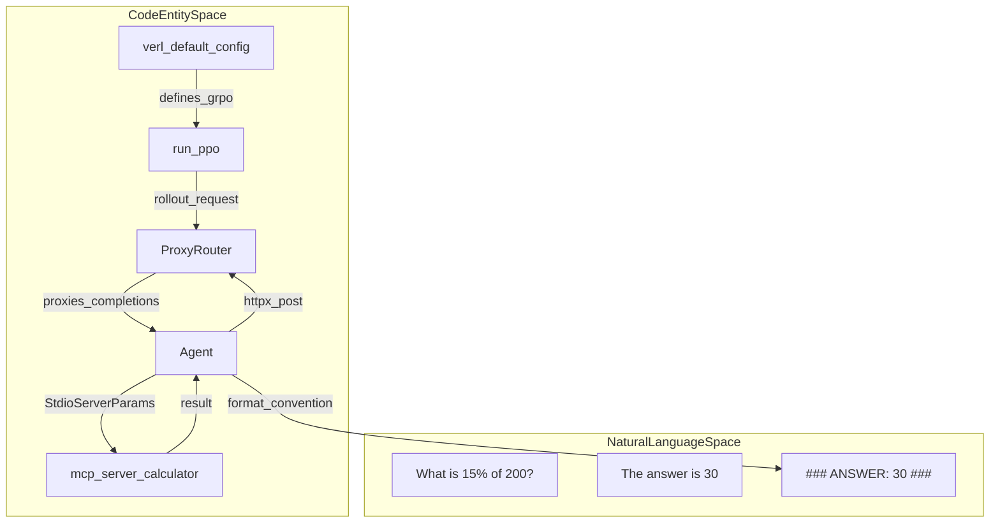
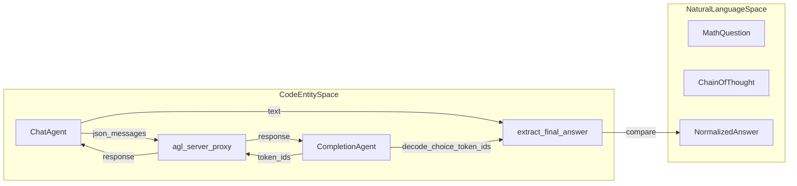

<!-- source: DeepWiki mcp.deepwiki.com · repo microsoft/agent-lightning · page 6.1 Math & Tool-Use Examples · fetched 2026-10-26 -->

# Math & Tool-Use Examples

Relevant source files

The following files were used as context for generating this wiki page:

- [docs/55-example-gsm8k.md](docs/55-example-gsm8k.md)
- [examples/calc_x/README.md](examples/calc_x/README.md)
- [examples/calc_x/calc_agent.py](examples/calc_x/calc_agent.py)
- [examples/calc_x/data/sample.jsonl](examples/calc_x/data/sample.jsonl)
- [examples/calc_x/eval_utils.py](examples/calc_x/eval_utils.py)
- [examples/calc_x/run_local.sh](examples/calc_x/run_local.sh)
- [examples/calc_x/run_minikube.sh](examples/calc_x/run_minikube.sh)
- [examples/calc_x/train_calc_agent.py](examples/calc_x/train_calc_agent.py)
- [examples/gsm8k/README.md](examples/gsm8k/README.md)
- [examples/gsm8k/gsm8k_agent.py](examples/gsm8k/gsm8k_agent.py)
- [examples/gsm8k/run_local.sh](examples/gsm8k/run_local.sh)
- [examples/gsm8k/train_gsm8k_agent.py](examples/gsm8k/train_gsm8k_agent.py)

This page provides a technical deep dive into the mathematical reasoning and tool-use examples provided in the Agent Lightning repository. These examples demonstrate how to bridge agentic workflows—ranging from single-turn QA to multi-turn tool use—with the **VERL** (PPO/GRPO) training backend using the `agl-server` and `agl-controller` architecture.

Sources: [examples/calc_x/train_calc_agent.py:13-100](), [examples/gsm8k/train_gsm8k_agent.py:20-98]()

---

## Calc-X: Math Reasoning with AutoGen + MCP

The Calc-X example trains an agent to solve mathematical reasoning problems using a calculator tool accessed via the Model Context Protocol (MCP). It supports both local process execution and Kubernetes-based rollout orchestration [examples/calc_x/train_calc_agent.py:89-98]().

### Implementation Details
The training entrypoint `train_calc_agent.py` configures the VERL training loop to use **GRPO** (Group Relative Policy Optimization) by default [examples/calc_x/train_calc_agent.py:21-24]().

*   **Dataset Preparation:** Data is loaded from Parquet files using `HuggingFaceDataset.from_parquet` [examples/calc_x/train_calc_agent.py:167-174](). The expected files include training and validation datasets containing math questions and ground-truth results [examples/calc_x/train_calc_agent.py:201-205]().
*   **Agent Logic:** The `Agent` class in `calc_agent.py` uses `AssistantAgent` from `autogen_agentchat` and an `OpenAIChatCompletionClient` pointed at the AGL proxy [examples/calc_x/calc_agent.py:18-22](), [examples/calc_x/calc_agent.py:42-54]().
*   **Tooling:** It spawns a `mcp_server_calculator` via `StdioServerParams` with a 120-second timeout [examples/calc_x/calc_agent.py:31-35]().
*   **Reward Mechanism:** The agent extracts the answer using a `### ANSWER: <answer> ###` regex pattern [examples/calc_x/calc_agent.py:64-65](). It calculates a binary reward (1.0 for success, 0.0 for failure) using `scalar_are_results_same` with a relative tolerance of `1e-2` [examples/calc_x/eval_utils.py:43-69](), [examples/calc_x/eval_utils.py:72-74]().
*   **Event Reporting:** Rewards are posted to the `agl-server` via the `AGL_EVENT_URL` using `httpx.post` [examples/calc_x/calc_agent.py:68-76]().

Sources: [examples/calc_x/train_calc_agent.py:21-24](), [examples/calc_x/train_calc_agent.py:167-174](), [examples/calc_x/train_calc_agent.py:201-205](), [examples/calc_x/calc_agent.py:18-22](), [examples/calc_x/calc_agent.py:31-35](), [examples/calc_x/calc_agent.py:42-54](), [examples/calc_x/calc_agent.py:64-65](), [examples/calc_x/eval_utils.py:43-69](), [examples/calc_x/eval_utils.py:72-74](), [examples/calc_x/calc_agent.py:68-76]()

### Execution Modes
1.  **Local Mode:** Orchestrated by `run_local.sh`, which starts `agl-server`, `agl-controller` (local runner), and Ray before launching the training script [examples/calc_x/run_local.sh:13-52]().
2.  **K8s Mode:** Orchestrated by `run_minikube.sh`. It builds a Docker image `calc-x-agent:dev` via `minikube image build` and configures the `agl-controller` to use the `k8s` runner [examples/calc_x/run_minikube.sh:13-55]().

Sources: [examples/calc_x/run_local.sh:13-52](), [examples/calc_x/run_minikube.sh:13-55]()

### Data Flow: Calc-X Rollout
The following diagram maps the relationship between the training configuration and the runtime execution entities.

Sources: [examples/calc_x/train_calc_agent.py:20-100](), [examples/calc_x/calc_agent.py:18-76](), [examples/calc_x/run_minikube.sh:31-55]()

---

## GSM8K: Grade-School Math QA

The GSM8K example demonstrates a simpler, single-turn reasoning task. It is used to showcase the flexibility of the `agl-server` proxy in handling different OpenAI API styles [examples/gsm8k/train_gsm8k_agent.py:123-127]().

### API Modes
The example supports two distinct interaction patterns configured via the `api` parameter in `build_config` [examples/gsm8k/train_gsm8k_agent.py:101-139]():

1.  **Chat Completions API:** The `ChatAgent` uses the standard `client.chat.completions.create` method [examples/gsm8k/gsm8k_agent.py:77-112]().
2.  **Completions API (Token-in/Token-out):** The `CompletionAgent` tokenizes the prompt locally using `transformers.AutoTokenizer` via `encode_prompt` [examples/gsm8k/gsm8k_agent.py:40-42](), sends raw token IDs to the proxy, and decodes the response token IDs using `decode_choice_token_ids` [examples/gsm8k/gsm8k_agent.py:45-53](), [examples/gsm8k/gsm8k_agent.py:114-144]().

Sources: [examples/gsm8k/train_gsm8k_agent.py:101-139](), [examples/gsm8k/gsm8k_agent.py:40-42](), [examples/gsm8k/gsm8k_agent.py:45-53](), [examples/gsm8k/gsm8k_agent.py:77-112](), [examples/gsm8k/gsm8k_agent.py:114-144]()

### Dataset and Configuration
*   **Loading:** The `load_gsm8k_dataset` function extracts the ground truth from the `#### <answer>` format common in the GSM8K dataset using `extract_gsm8k_answer` [examples/gsm8k/train_gsm8k_agent.py:15-17](), [examples/gsm8k/train_gsm8k_agent.py:142-153]().
*   **Environment Mapping:** The `env_map` configuration in `verl_default_config` links dataset fields (`input.question`, `input.answer`) to environment variables (`QUESTION`, `ANSWER`) that the agent reads at runtime [examples/gsm8k/train_gsm8k_agent.py:20-98]() [examples/gsm8k/train_gsm8k_agent.py:90-96]().
*   **Trace Aggregation:** Configured at the `trajectory` level to capture the full reasoning chain for reinforcement learning [examples/gsm8k/train_gsm8k_agent.py:81-85]().

Sources: [examples/gsm8k/train_gsm8k_agent.py:15-17](), [examples/gsm8k/train_gsm8k_agent.py:20-98](), [examples/gsm8k/train_gsm8k_agent.py:81-85](), [examples/gsm8k/train_gsm8k_agent.py:90-96](), [examples/gsm8k/train_gsm8k_agent.py:142-153]()

### Code Entity Mapping: GSM8K Agent Interaction

Sources: [examples/gsm8k/gsm8k_agent.py:23-53](), [examples/gsm8k/gsm8k_agent.py:77-144](), [examples/gsm8k/train_gsm8k_agent.py:142-153]()

---

## Key Implementation Patterns

### Answer Formatting & Extraction
Both examples enforce a specific output format to simplify reward calculation. The agents provide an `output_format` string in the prompt instructions [examples/calc_x/calc_agent.py:36-39](), [examples/gsm8k/gsm8k_agent.py:55-60]().

*   **Pattern:** `### ANSWER: <answer> ###`
*   **Extraction Logic:** A regex pattern `r"###\s*ANSWER:\s*(.+?)(\s*###|$)"` is used to isolate the prediction in both `gsm8k_agent.py` [examples/gsm8k/gsm8k_agent.py:26-28]() and `calc_agent.py` [examples/calc_x/calc_agent.py:64-65]().

Sources: [examples/calc_x/calc_agent.py:36-39](), [examples/calc_x/calc_agent.py:64-65](), [examples/gsm8k/gsm8k_agent.py:26-28](), [examples/gsm8k/gsm8k_agent.py:55-60]()

### Reward Calculation & Reporting
Rewards are calculated by comparing the model's extracted answer to the dataset's ground truth.
*   **Calc-X:** Uses `scalar_are_results_same` with a relative tolerance [examples/calc_x/eval_utils.py:43-69](), [examples/calc_x/eval_utils.py:72-74]().
*   **GSM8K:** Uses `normalize_answer` which strips commas and whitespace before comparison [examples/gsm8k/gsm8k_agent.py:36-37](), [examples/gsm8k/gsm8k_agent.py:64]().
*   **Reporting:** Both agents use `httpx.post` to send a JSON payload containing `event_type: "reward"` and the scalar value to the `agl-server` [examples/gsm8k/gsm8k_agent.py:63-74](), [examples/calc_x/calc_agent.py:68-76]().

Sources: [examples/calc_x/eval_utils.py:43-69](), [examples/calc_x/eval_utils.py:72-74](), [examples/calc_x/calc_agent.py:68-76](), [examples/gsm8k/gsm8k_agent.py:36-37](), [examples/gsm8k/gsm8k_agent.py:63-74]()

### Orchestration Scripts
The `run_local.sh` and `run_minikube.sh` scripts follow a standard lifecycle:
1.  **Cleanup:** Kill existing `agl-server`, `agl-controller`, and `ray` processes via `pkill` and `ray stop` [examples/calc_x/run_local.sh:13-21](), [examples/gsm8k/run_local.sh:13-20]().
2.  **Services:** Start `ray` head node, `agl-server` (FastAPI), and `agl-controller` (Local or K8s Reconciler) [examples/calc_x/run_local.sh:28-46](), [examples/gsm8k/run_local.sh:27-45]().
3.  **Health Check:** Poll the `/healthz` endpoint until the server is ready [examples/calc_x/run_local.sh:37-40](), [examples/gsm8k/run_local.sh:36-39]().
4.  **Training:** Execute the Python training script with the configured `agl-base-url` and `agl-key` [examples/gsm8k/run_local.sh:47-51](), [examples/calc_x/run_local.sh:48-52]().

Sources: [examples/calc_x/run_local.sh:13-52](), [examples/gsm8k/run_local.sh:13-51]()

---

