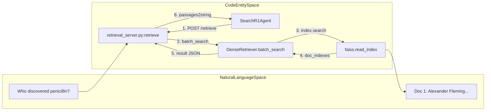
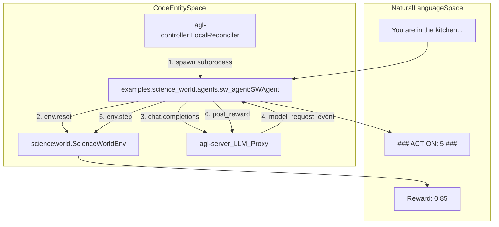

<!-- source: DeepWiki mcp.deepwiki.com · repo microsoft/agent-lightning · page 6.2 Search & Retrieval Examples · fetched 2026-10-26 -->

# Search & Retrieval Experiment Examples

Relevant source files

The following files were used as context for generating this wiki page:

- [docs/65-example-search-r1.md](docs/65-example-search-r1.md)
- [examples/science_world/README.md](examples/science_world/README.md)
- [examples/science_world/agents/sw_agent.py](examples/science_world/agents/sw_agent.py)
- [examples/science_world/train_sw_agent.py](examples/science_world/train_sw_agent.py)
- [examples/search_r1/README.md](examples/search_r1/README.md)
- [examples/search_r1/agents/search_r1_agent.py](examples/search_r1/agents/search_r1_agent.py)
- [examples/search_r1/data_process.sh](examples/search_r1/data_process.sh)
- [examples/search_r1/retrieval_launch.sh](examples/search_r1/retrieval_launch.sh)
- [examples/search_r1/retrieval_server.py](examples/search_r1/retrieval_server.py)
- [examples/search_r1/run.sh](examples/search_r1/run.sh)
- [examples/search_r1/train_search_r1_agent.py](examples/search_r1/train_search_r1_agent.py)

## Purpose and Scope

This page provides a technical walkthrough of advanced reinforcement learning examples in Agent Lightning, focusing on multi-turn retrieval-augmented reasoning (`Search-R1`) and text-based environment interaction (`ScienceWorld`). These examples demonstrate how to utilize the `agl-server` proxy for tool-calling, external service integration, and trajectory-level credit assignment.

Sources: [examples/search_r1/README.md:1-3](), [examples/science_world/README.md:1-3]()

---

## Search-R1: Retrieval-Augmented Reasoning

The Search-R1 example implements a multi-turn agent that uses an external search engine to answer complex questions. It is based on the Llama-3.2-3B model and uses `llama3_json` tool calling for search actions [examples/search_r1/train_search_r1_agent.py:13-47]().

### Retrieval Infrastructure

Search-R1 requires a dedicated retrieval server to provide external knowledge:
*   **Data Preparation**: `data_process.sh` downloads the Wiki-18 corpus and a pre-computed FAISS index [examples/search_r1/data_process.sh:13-77](). It also creates a dedicated `retriever` conda environment with `faiss-gpu` and required transformer dependencies [examples/search_r1/data_process.sh:43-58]().
*   **Retrieval Server**: `retrieval_server.py` hosts a FastAPI application (`app`) that uses `DenseRetriever` to search the FAISS index using E5 dense embeddings [examples/search_r1/retrieval_server.py:99-143]().
*   **Launch Utility**: `retrieval_launch.sh` activates the retriever environment and starts `retrieval_server.py` on port 8000 with GPU acceleration for FAISS [examples/search_r1/retrieval_launch.sh:1-34]().

Sources: [examples/search_r1/data_process.sh:13-77](), [examples/search_r1/retrieval_server.py:99-143](), [examples/search_r1/retrieval_launch.sh:1-34]()

### Search-R1 Retrieval Flow

Title: "Search-R1 Retrieval Data Flow"

Sources: [examples/search_r1/agents/search_r1_agent.py:105-139](), [examples/search_r1/retrieval_server.py:124-157]()

### SearchR1Agent Implementation

The agent logic coordinates multi-turn text generation and external retrieval calls [examples/search_r1/agents/search_r1_agent.py:121-140]().
*   **Action Extraction**: `extract_action` uses regular expressions to identify `<search>` or `<answer>` tags in model outputs [examples/search_r1/agents/search_r1_agent.py:81-87]().
*   **Retrieval Call**: `retrieve_doc` dispatches queries to the retrieval endpoint via `httpx` and formats retrieved passages into string snippets using `passages2string` [examples/search_r1/agents/search_r1_agent.py:90-118]().
*   **Execution Loop**: `execute_response` parses the action, performs searches if needed, and formats environment feedback inside `<information>` tags for subsequent LLM turns [examples/search_r1/agents/search_r1_agent.py:121-140]().

Sources: [examples/search_r1/agents/search_r1_agent.py:81-140]()

### Training Configuration

Training utilizes GRPO with `llama3_json` tool choice enabled in the vLLM engine [examples/search_r1/train_search_r1_agent.py:24-47](). It employs `trajectory` level trace aggregation to capture the full multi-turn reasoning process in a single training row [examples/search_r1/train_search_r1_agent.py:92-96]().

Sources: [examples/search_r1/train_search_r1_agent.py:24-105]()

---

## ScienceWorld: Text-Based RL

ScienceWorld trains an agent to solve science tasks in a simulated text environment, highlighting trajectory-level aggregation and GRPO optimization [examples/science_world/train_sw_agent.py:93-109]().

### SWAgent and Environment Interaction

The `SWAgent` interacts with `ScienceWorldEnv` through a constrained action space [examples/science_world/agents/sw_agent.py:98-134]().
1.  **Environment Setup**: The agent boots `ScienceWorldEnv` and loads the task and variation based on environment variables (`TASK_NAME`, `VARIATION_IDX`) injected by the `agl-controller` [examples/science_world/agents/sw_agent.py:104-134]().
2.  **Prompt Construction**: The agent presents a list of valid actions to the model, which must respond using the `### ACTION: <number> ###` format [examples/science_world/agents/sw_agent.py:47-63]().
3.  **Step & Reward**: The agent steps the environment using `env.step(action_str)` and posts a normalized reward (`final_score / 100`) via `httpx` to `AGL_EVENT_URL` upon completion [examples/science_world/agents/sw_agent.py:168-182]().

Sources: [examples/science_world/agents/sw_agent.py:98-182]()

### ScienceWorld System Diagram

Title: "ScienceWorld Multi-Turn Rollout Flow"

Sources: [examples/science_world/agents/sw_agent.py:98-182](), [examples/science_world/train_sw_agent.py:165-189]()

### Trajectory Aggregation

Because ScienceWorld episodes span multiple turns, the configuration uses `trace_aggregator.level = "trajectory"` [examples/science_world/train_sw_agent.py:169-175](). This merges all turns of an episode into a single sequence, allowing the PPO/GRPO trainer to perform multi-turn credit assignment.

Sources: [examples/science_world/train_sw_agent.py:165-175]()

---

## Retrieval & Action Mapping

Both examples map natural language outputs to specific environment actions or tool calls:

| Example | Action Format | Execution Mechanism | Response Parsing |
| :--- | :--- | :--- | :--- |
| **Search-R1** | `<search>query</search>` | `httpx` call to `retrieval_server.py` [examples/search_r1/agents/search_r1_agent.py:105-118]() | `extract_action` (Regex) [examples/search_r1/agents/search_r1_agent.py:81-87]() |
| **ScienceWorld** | `### ACTION: N ###` | `env.step(action_str)` [examples/science_world/agents/sw_agent.py:168]() | `_parse_action_index` (Regex) [examples/science_world/agents/sw_agent.py:88-95]() |

Sources: [examples/search_r1/agents/search_r1_agent.py:81-118](), [examples/science_world/agents/sw_agent.py:88-95](), [examples/science_world/agents/sw_agent.py:168]()

---

## Orchestration Scripts

Both examples provide shell scripts to orchestrate the three-service architecture locally:
*   **Search-R1**: `examples/search_r1/run.sh` starts `agl-server`, `agl-controller` (local runner), and `train_search_r1_agent.py` in sequence with health checks [examples/search_r1/run.sh:22-42]().
*   **ScienceWorld**: `examples/science_world/run_local.sh` performs similar orchestration, while `train_sw_agent.py` dynamically generates datasets from task names and variation counts [examples/science_world/train_sw_agent.py:3-20]().

Sources: [examples/search_r1/run.sh:22-42](), [examples/science_world/train_sw_agent.py:3-20]()

---

