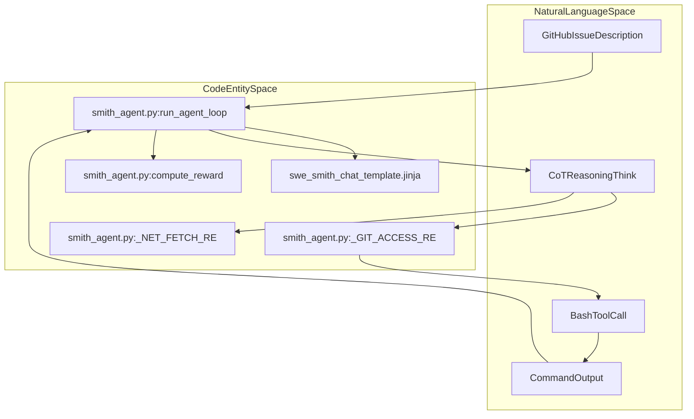
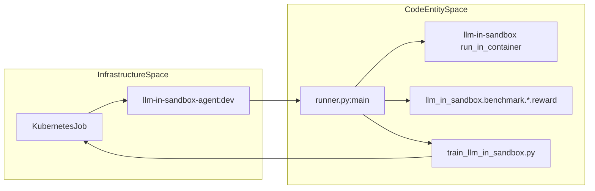

<!-- source: DeepWiki mcp.deepwiki.com · repo microsoft/agent-lightning · page 6.3 Coding Agent Examples · fetched 2026-10-26 -->

# Coding Agent Examples

Relevant source files

The following files were used as context for generating this wiki page:

- [docs/70-example-llm-in-sandbox.md](docs/70-example-llm-in-sandbox.md)
- [docs/76-example-coding-agent-moe.md](docs/76-example-coding-agent-moe.md)
- [docs/README.md](docs/README.md)
- [examples/llm-in-sandbox/README.md](examples/llm-in-sandbox/README.md)
- [examples/llm-in-sandbox/agents/runner.py](examples/llm-in-sandbox/agents/runner.py)
- [examples/llm-in-sandbox/job-template.yaml](examples/llm-in-sandbox/job-template.yaml)
- [examples/llm-in-sandbox/run.sh](examples/llm-in-sandbox/run.sh)
- [examples/llm-in-sandbox/train_llm_in_sandbox.py](examples/llm-in-sandbox/train_llm_in_sandbox.py)
- [examples/swe_smith/README.md](examples/swe_smith/README.md)
- [examples/swe_smith/agents/smith_agent.py](examples/swe_smith/agents/smith_agent.py)
- [examples/swe_smith/run.sh](examples/swe_smith/run.sh)
- [examples/swe_smith/run_moe.sh](examples/swe_smith/run_moe.sh)
- [examples/swe_smith/swe_smith_chat_template.jinja](examples/swe_smith/swe_smith_chat_template.jinja)
- [examples/swe_smith/train_smith_agent_moe.py](examples/swe_smith/train_smith_agent_moe.py)
- [tests/examples/test_swe_smith_agent.py](tests/examples/test_swe_smith_agent.py)
- [tests/examples/test_swe_smith_images.py](tests/examples/test_swe_smith_images.py)

This page covers the implementation and training of high-capability coding agents within the Agent Lightning framework. It focuses on two primary examples: **SWE-smith**, a multi-turn software engineering agent capable of resolving GitHub issues in containerized testbeds with bash action spaces and Megatron/MoE support, and **LLM-in-Sandbox**, a containerized benchmarking suite for biomedical, chemical, and mathematical coding tasks deployed via Kubernetes Jobs.

---

## SWE-smith Coding Agent

The SWE-smith agent (`smith_agent.py`) is designed to solve real-world software engineering problems by interacting with a bash action space. It operates within specialized Docker containers that provide the necessary environment for specific repositories [tests/examples/test_swe_smith_images.py:1-153]().

### Agent Architecture and Action Space
The agent utilizes a multi-turn loop to explore the codebase, edit files, and run tests. It employs a custom chat template (`swe_smith_chat_template.jinja`) that supports system instructions, tool definitions, and `<think>` tags for Chain-of-Thought reasoning [examples/swe_smith/swe_smith_chat_template.jinja:1-11](), [examples/swe_smith/swe_smith_chat_template.jinja:29-32]().

To prevent reward hacking and ensure realistic training, the agent environment implements several strict safety mechanisms:
* **Git Blocking**: Commands matching `_GIT_INVOKE_RE` and `_GIT_ACCESS_RE` are blocked at the shell level to prevent the agent from inspecting hidden git metadata or the ground-truth fix [examples/swe_smith/agents/smith_agent.py:42-50]().
* **Network Isolation**: Network fetch utilities matching `_NET_FETCH_RE` and Python networking modules matching `_PY_NET_RE` are blocked to prevent external solution retrieval [examples/swe_smith/agents/smith_agent.py:55-74]().
* **Tamper Protection**: Attempts to modify test configuration files or test-harness files matching `_TEST_TAMPER_RE` are detected and blocked [examples/swe_smith/agents/smith_agent.py:77-82]().

Additionally, context overflow handling (such as HTTP 400 responses from vLLM when prompts exceed `max_model_len`) is tested explicitly to ensure episodes terminate cleanly without appending empty assistant turns [tests/examples/test_swe_smith_agent.py:61-76]().

### Megatron and Mixture-of-Experts (MoE) Variant
For large-scale training with massive models like Qwen3.5-35B-A3B, SWE-smith provides a specialized Megatron configuration (`train_smith_agent_moe.py` and `run_moe.sh`) [examples/swe_smith/train_smith_agent_moe.py:1-170](), [examples/swe_smith/run_moe.sh:1-9](). This variant configures tensor parallelism, expert parallelism, router replay (`R3`), and CISPO per-rollout mean loss modes to handle MoE scaling efficiently across cluster nodes [examples/swe_smith/train_smith_agent_moe.py:24-119]().

The `run_moe.sh` script sets `AGL_INCLUDE_ROUTED_EXPERTS=true` [examples/swe_smith/run_moe.sh:8](), which instructs the `agl-server`'s `ProxyRouter` to include routed experts in the response [agentlightning/server/proxy.py:47](), [agentlightning/server/proxy.py:74](). The `train_smith_agent_moe.py` script then configures the Megatron actor to use `R3` mode for router replay [examples/swe_smith/train_smith_agent_moe.py:104](). This ensures that during the actor update, the same experts selected during the vLLM rollout are replayed, which is crucial for effective MoE training [docs/76-example-coding-agent-moe.md:27-29]().

### Natural Language to Code Entity Mapping (SWE-smith)

Title: "SWE-smith Execution and Validation Flow"

Sources: [examples/swe_smith/agents/smith_agent.py:42-82](), [examples/swe_smith/agents/smith_agent.py:89-180](), [examples/swe_smith/swe_smith_chat_template.jinja:1-68]()

---

## LLM-in-Sandbox

The LLM-in-Sandbox example demonstrates how to wrap a complex vendored library into an Agent Lightning rollout. It is primarily used for specialized benchmarks in biomedicine (`biomed_mini`), chemistry (`chem_mini`), mathematics (`math_mini`), instruct pretrain (`instruct_pretrain`), and long-context evaluation (`long_context_mini`) [examples/llm-in-sandbox/agents/runner.py:20-26]().

### Kubernetes Execution Pattern
LLM-in-Sandbox uses the Kubernetes reconciler to spawn agents as Kubernetes Jobs. The `job-template.yaml` file defines the pod specification, injecting task metadata (`DATA_FOLDER_NAME`, `DATA_FILENAME`, `DATA_INDEX`) via environment variables using the `yaml_escape` filter [examples/llm-in-sandbox/job-template.yaml:1-28](). The `run.sh` script orchestrates the local minikube environment, building the `llm-in-sandbox-agent:dev` Docker image and starting the `agl-server` and `agl-controller` before initiating training [examples/llm-in-sandbox/run.sh:26-56]().

### Implementation Details
* **Runner Adapter**: `runner.py` acts as the bridge between the sandbox container and Agent Lightning. It loads task inputs from `AGL_TASK_INPUT`, configures environment variables via `configure_llm_env()`, and invokes `llm-in-sandbox run_in_container` [examples/llm-in-sandbox/agents/runner.py:34-40](), [examples/llm-in-sandbox/agents/runner.py:78-98](). The `configure_llm_env` function sets up environment variables like `LLM_NAME`, `LLM_BASE_URL`, and `LLM_API_KEY` for the `llm-in-sandbox` library, potentially overriding them with Agent Lightning specific environment variables such as `AGL_OPENAI_MODEL_PREFIX` or `AGL_OPENAI_BASE_URL` [examples/llm-in-sandbox/agents/runner.py:78-87]().
* **Reward Computation**: After execution, the runner extracts the final answer using `ANSWER_RE` and imports the domain-specific reward module from `REWARD_MODULES` to compute the score via `compute_score` [examples/llm-in-sandbox/agents/runner.py:107-129]().
* **Event Posting**: Rewards and agent outputs are posted back to the AGL Gateway using `post_event()` over HTTP with bearer token authentication [examples/llm-in-sandbox/agents/runner.py:132-154]().

### Infrastructure to Code Entity Mapping (LLM-in-Sandbox)

Title: "LLM-in-Sandbox Job Lifecycle and Execution Flow"

Sources: [examples/llm-in-sandbox/train_llm_in_sandbox.py:1-195](), [examples/llm-in-sandbox/agents/runner.py:1-201](), [examples/llm-in-sandbox/job-template.yaml:1-28]()

---

