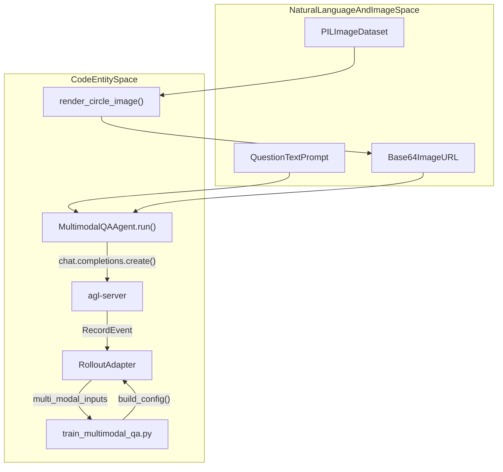
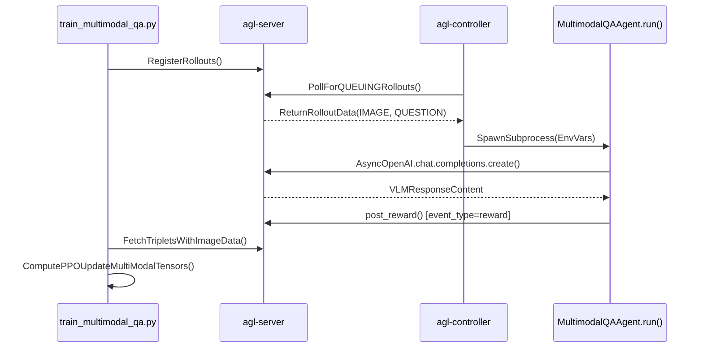

<!-- source: DeepWiki mcp.deepwiki.com · repo microsoft/agent-lightning · page 6.4 Multimodal QA Example · fetched 2026-10-26 -->

# Multimodal QA Example

<details>
<summary>Relevant source files</summary>

The following files were used as context for generating this wiki page:

- [agentlightning/verl/rollout_adapter.py](agentlightning/verl/rollout_adapter.py)
- [docs/80-example-multimodal-qa.md](docs/80-example-multimodal-qa.md)
- [examples/multimodal_qa/README.md](examples/multimodal_qa/README.md)
- [examples/multimodal_qa/multimodal_qa_agent.py](examples/multimodal_qa/multimodal_qa_agent.py)
- [examples/multimodal_qa/run_local.sh](examples/multimodal_qa/run_local.sh)
- [examples/multimodal_qa/train_multimodal_qa.py](examples/multimodal_qa/train_multimodal_qa.py)
- [tests/verl/test_rollout_adapter.py](tests/verl/test_rollout_adapter.py)

</details>


The Multimodal QA example demonstrates the integration of **multimodal (image) reinforcement learning** within the Agent Lightning framework [docs/80-example-multimodal-qa.md:7-10](). It provides a complete pipeline for training Vision-Language Models (VLMs) using synthetic image data, exercising the full multimodal data path from agent rollout to VLM training forward pass [docs/80-example-multimodal-qa.md:7-10]().

## Overview and Purpose

The primary goal of this example is to validate that image data captured during agent rollouts is correctly processed, aligned with token sequences, and fed into the trainer's forward pass as `multi_modal_inputs` (including `pixel_values` and `image_grid_thw`) with appropriate `mrope` (Multimodal Rotary Positional Embedding) position IDs [docs/80-example-multimodal-qa.md:9-10]().

### Key Features
*   **Synthetic Dataset**: Generates 256x256 images containing 1–5 red circles using `PIL` in `examples/multimodal_qa/train_multimodal_qa.py` [examples/multimodal_qa/train_multimodal_qa.py:25-44]().
*   **Multimodal Data Path**: Recovers image URLs from `model_request` events and converts them into tensors for training [docs/80-example-multimodal-qa.md:9-10]().
*   **Rule-based Reward**: Scores agents based on their ability to count the circles correctly via `examples/multimodal_qa/multimodal_qa_agent.py` [examples/multimodal_qa/multimodal_qa_agent.py:70-72]().
*   **Transition Aggregation**: Specifically requires `transition` level trace aggregation to maintain image-to-token alignment [examples/multimodal_qa/train_multimodal_qa.py:130-134]().

Sources: [docs/80-example-multimodal-qa.md:7-10](), [examples/multimodal_qa/train_multimodal_qa.py:25-134](), [examples/multimodal_qa/multimodal_qa_agent.py:70-72]()

---

## System Architecture and Data Flow

The Multimodal QA example follows the standard Agent Lightning three-service architecture, specialized for vision inputs.

Title: Multimodal Data Path Architecture

Sources: [examples/multimodal_qa/train_multimodal_qa.py:25-60](), [examples/multimodal_qa/multimodal_qa_agent.py:35-72](), [docs/80-example-multimodal-qa.md:9-10]()

---

## Implementation Details

### Synthetic Dataset Generation
The dataset is generated in-memory at startup by `examples/multimodal_qa/train_multimodal_qa.py` [examples/multimodal_qa/train_multimodal_qa.py:47-60](). Each sample consists of a 256x256 white background with a random number of non-overlapping red circles rendered via `render_circle_image()` [examples/multimodal_qa/train_multimodal_qa.py:25-44](). The image is encoded as a base64 `data:image/png;base64` URL [examples/multimodal_qa/train_multimodal_qa.py:44]().

### MultimodalQAAgent and image_url Parts
The `MultimodalQAAgent` class in `examples/multimodal_qa/multimodal_qa_agent.py` implements the agent logic [examples/multimodal_qa/multimodal_qa_agent.py:35-72](). It retrieves the image and question from environment variables (mapped via `env_map`) and calls the proxied VLM using `AsyncOpenAI` [examples/multimodal_qa/multimodal_qa_agent.py:41-52]().

*   **Content Parts**: The agent sends the image using the `image_url` content type alongside text in the OpenAI-compatible chat messages list [examples/multimodal_qa/multimodal_qa_agent.py:58-63]().
*   **Rule-Based Reward**: A simple regex utility `extract_first_integer()` parses the VLM's response, awarding `1.0` for a correct count and `0.0` otherwise via `post_reward()` [examples/multimodal_qa/multimodal_qa_agent.py:17-33](), [examples/multimodal_qa/multimodal_qa_agent.py:70-72]().

Sources: [examples/multimodal_qa/train_multimodal_qa.py:25-60](), [examples/multimodal_qa/multimodal_qa_agent.py:17-72]()

---

## Training Configuration & Multimodal Mechanics

The training script `examples/multimodal_qa/train_multimodal_qa.py` builds the configuration by overriding default VERL parameters for multimodal tasks via `verl_default_config()` and `build_config()` [examples/multimodal_qa/train_multimodal_qa.py:63-183]().

### Transition Aggregation Requirement
Multimodal training rows require transition-level aggregation because trajectory-level merging breaks the image-to-token alignment [examples/multimodal_qa/train_multimodal_qa.py:130-134](). The configuration explicitly sets:
```yaml
agentlightning:
  trace_aggregator:
    level: transition
```
If image-bearing traces are aggregated at the trajectory level, `RolloutAdapter` raises an error [docs/80-example-multimodal-qa.md:42]().

### mrope Position IDs and multi_modal_inputs
As implemented in the VERL integration layer, the training data batch incorporates `multi_modal_inputs` (`pixel_values` and `image_grid_thw`) in `non_tensor_batch` and `position_ids` with `dim() == 3` corresponding to `mrope` [docs/80-example-multimodal-qa.md:9](), [docs/80-example-multimodal-qa.md:47]().

### Prefix Caching Consideration
To prevent cache desynchronization issues across sleep/wake cycles on vLLM versions prior to `0.22.0`, prefix caching is explicitly disabled in the default rollout configuration (`enable_prefix_caching: False`) [examples/multimodal_qa/train_multimodal_qa.py:88](), [docs/80-example-multimodal-qa.md:52]().

Sources: [examples/multimodal_qa/train_multimodal_qa.py:63-183](), [docs/80-example-multimodal-qa.md:9-10](), [docs/80-example-multimodal-qa.md:42](), [docs/80-example-multimodal-qa.md:47](), [docs/80-example-multimodal-qa.md:52]()

---

## Orchestration and Execution

The `examples/multimodal_qa/run_local.sh` script manages the lifecycle of the three core services (`agl-server`, `agl-controller`, and the training execution) [examples/multimodal_qa/run_local.sh:1-53]().

### Execution Sequence and Rollout Interaction

Title: Multimodal QA Execution Sequence

Sources: [examples/multimodal_qa/run_local.sh:1-53](), [examples/multimodal_qa/multimodal_qa_agent.py:38-72]()

### Running the Example
To execute local training:
```bash
cd examples/multimodal_qa
bash run_local.sh
```
Useful overrides can be passed directly via the command line:
```bash
bash run_local.sh --train-size 32 --val-size 8 trainer.total_epochs=1
```
Sources: [docs/80-example-multimodal-qa.md:25-40](), [examples/multimodal_qa/run_local.sh:1-53]()

---

