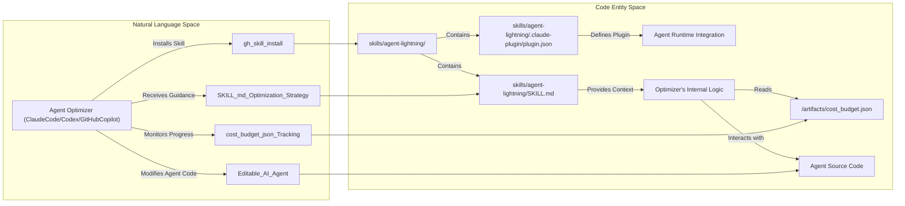
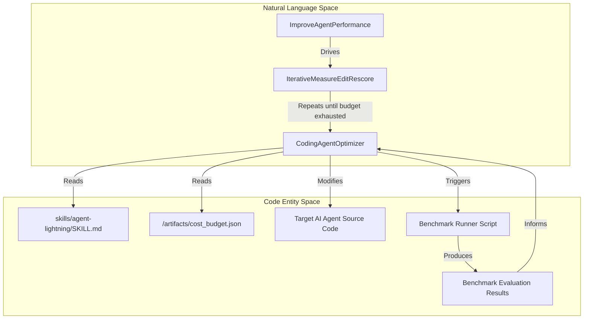

<!-- source: DeepWiki mcp.deepwiki.com · repo microsoft/agent-lightning · page 6.5 Agent Skills · fetched 2026-10-26 -->

# Agent Skills

<details>
<summary>Relevant source files</summary>

The following files were used as context for generating this wiki page:

- [skills/README.md](skills/README.md)
- [skills/agent-lightning/.claude-plugin/plugin.json](skills/agent-lightning/.claude-plugin/plugin.json)
- [skills/agent-lightning/SKILL.md](skills/agent-lightning/SKILL.md)
- [skills/assets/agent-lightning-alfworld-success-finale-cost.svg](skills/assets/agent-lightning-alfworld-success-finale-cost.svg)
- [skills/assets/agent-lightning-alfworld-success-overall-cost.svg](skills/assets/agent-lightning-alfworld-success-overall-cost.svg)

</details>


## Purpose and Scope

This page documents the **Agent Skills** subsystem located in the `skills/` directory [skills/README.md:1-4](). Agent Skills provide a standardized framework that transforms general-purpose coding agents (such as Claude Code, Codex, or GitHub Copilot) into specialized **agent optimizers** [skills/agent-lightning/SKILL.md:1-7](). By installing the `agent-lightning` skill, an agent acquires a structured action space, evaluation context, and measurement protocols designed to optimize an editable AI agent against benchmarks while preserving its deployment contract [skills/agent-lightning/SKILL.md:1-7]().

Sources: [skills/README.md:1-4](), [skills/agent-lightning/SKILL.md:1-7]()

---

## Overview & Core Philosophy

Agent optimization is modeled as a systematic search over interacting choices rather than arbitrary code edits [skills/agent-lightning/SKILL.md:11-12](). The core philosophy emphasizes moving the Pareto frontier of accuracy, cost, latency, and reliability through measured, evidence-based iterations [skills/agent-lightning/SKILL.md:12-14]().

The framework strictly separates the **development budget** for optimization from the **per-run cost** of the resulting deployed agent, ensuring that a larger development budget creates room to explore without mandating higher deployment costs [skills/agent-lightning/SKILL.md:15-18](). Remaining development budgets are tracked via `/artifacts/cost_budget.json`, which maintains a `{spent, budget, remaining}` structure [skills/agent-lightning/SKILL.md:19-22]().

Sources: [skills/agent-lightning/SKILL.md:11-27](), [skills/README.md:1-4]()

---

## Plugin Structure & Installation

The skill package and Claude Code plugin share a unified `SKILL.md` definition file located in `skills/agent-lightning/` [skills/README.md:15-16](). This directory functions directly as the Claude Code plugin root [skills/README.md:15-16](). Metadata and configuration are managed via `skills/agent-lightning/.claude-plugin/plugin.json` [skills/agent-lightning/.claude-plugin/plugin.json:1-11]().

Installation is executed using the GitHub CLI `gh skill` command across supported agent runtimes [skills/README.md:9-13]():

```bash
gh skill install microsoft/agent-lightning agent-lightning --agent claude-code
gh skill install microsoft/agent-lightning agent-lightning --agent codex
gh skill install microsoft/agent-lightning agent-lightning --agent github-copilot
```

### Diagram: Natural Language to Code Entity Space (Skill Installation & Configuration)



Sources: [skills/README.md:9-16](), [skills/agent-lightning/.claude-plugin/plugin.json:1-11](), [skills/agent-lightning/SKILL.md:19-22]()

---

## Action Space & Levers

The skill formalizes an action space comprising twelve distinct optimization levers, detailing their purpose, useful diagnostic signals, and primary trade-offs [skills/agent-lightning/SKILL.md:29-45]().

| Lever | What it changes | Useful signal | Main tradeoff |
| :--- | :--- | :--- | :--- |
| **Input grounding** | Information and state visible to the model | Relevant context missing | Longer context distracts or costs more |
| **Output contract** | Representation, types, schema, terminal state | Work looks reasonable but unreadable | Overfitting evaluator quirks |
| **Prompt** | Interpretation, priorities, constraints | Instructions misunderstood/ignored | Prompt gains can be brittle |
| **Tools** | Deterministic inspection, computation, execution | Model approximating reliable tool work | More code and new failure modes |
| **Model** | Base capability and knowledge | Primary cannot solve grounded cases | Cost, latency, availability |
| **Reasoning effort** | Computation used by primary call | Grounded hard cases remain | Non-linear cost and latency growth |
| **Failure isolation** | Whether one failure damages other work | Individual tasks crash, time out | Isolation does not recover failed task |
| **Conditional repair** | Second attempt informed by failure evidence | Deployment checks expose recoverable failure | Extra calls and regressions |
| **Routing** | Handling for different task classes | Difficulty/failure risk varies | Router mistakes and complexity |
| **Planning & interaction** | State, ordering, tool use across steps | Long tasks lose goals/observations | State and control-flow overhead |
| **Retrieval** | Facts supplied from external corpus | Correct answers depend on external facts | Retrieval errors and added latency |
| **Critique or selection** | Additional views or candidates | Independent attempts expose useful info | Multiplied calls, cost, latency |

Sources: [skills/agent-lightning/SKILL.md:29-45]()

### Diagram: Natural Language to Code Entity Space (Optimization Loop)



Sources: [skills/agent-lightning/SKILL.md:19-27](), [skills/README.md:17-23]()

---

## Benchmark Results & Cost Analysis

Agent Lightning has been evaluated across multiple task domains against traditional optimization baselines [skills/README.md:25-39]().

### Benchmark Accuracy Comparison (%)

| Method | SpreadsheetBench accuracy (%) | OfficeQA correctness (%) | ALFWorld success (%) |
| :--- | ---: | ---: | ---: |
| No skill | 36.1 | 22.1 | 73.1 |
| Human skill | 42.9 | 45.9 | 56.7 |
| LLM skill | 36.8 | 36.6 | 65.7 |
| Trace2Skill | 40.7 | 20.9 | 82.8 |
| TextGrad | 38.2 | 30.0 | 70.9 |
| GEPA | 42.5 | 45.3 | 81.3 |
| SkillOpt | 47.5 | 48.8 | 85.8 |
| Coding agents, without Agent Lightning (average) | 62.9 (+37.3) | 54.1 (+22.3) | 88.6 (+31.6) |
| **Coding agents, with Agent Lightning (average)** | **66.7 (+41.1)** | **54.5 (+22.7)** | **94.9 (+37.9)** |

Sources: [skills/README.md:25-40]()

### Performance Breakdowns: Overall vs. Finale Cost

Development budgets were restricted to \$5, \$10, or \$25 in API credits, covering optimizer actions and agent training runs [skills/README.md:43-47](). Final held-out evaluations occurred after optimization [skills/README.md:45-47](). Finale cost measures agent LLM expenses during final evaluation [skills/README.md:55-57](). In environments such as ALFWorld, optimization can produce rule-based controllers that reduce finale costs to \$0 [skills/README.md:59-60]().

Performance breakdowns are visualized via SVG charts located in `skills/assets/` [skills/README.md:49-65]():
* **Overall Cost Charts:**
  * SpreadsheetBench accuracy versus overall cost [skills/README.md:49]()
  * OfficeQA correctness versus overall cost [skills/README.md:51]()
  * ALFWorld success versus overall cost [skills/README.md:53](), [skills/assets/agent-lightning-alfworld-success-overall-cost.svg:1-240]()
* **Finale Cost Charts:**
  * SpreadsheetBench accuracy versus finale cost [skills/README.md:61]()
  * OfficeQA correctness versus finale cost [skills/README.md:63]()
  * ALFWorld success versus finale cost [skills/README.md:65](), [skills/assets/agent-lightning-alfworld-success-finale-cost.svg:1-243]()

Sources: [skills/README.md:43-65](), [skills/assets/agent-lightning-alfworld-success-overall-cost.svg:1-240](), [skills/assets/agent-lightning-alfworld-success-finale-cost.svg:1-243]()

---

