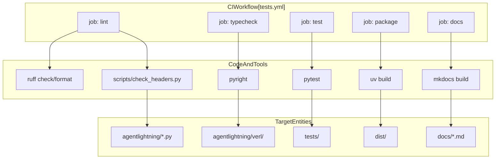
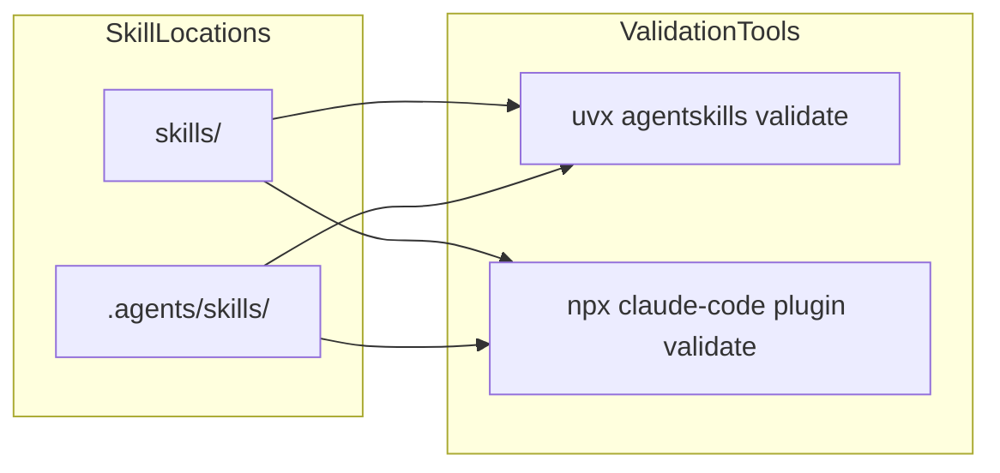
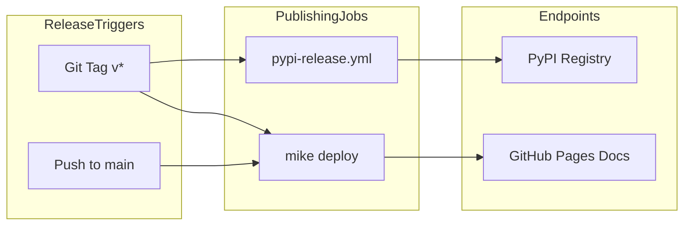

<!-- source: DeepWiki mcp.deepwiki.com · repo microsoft/agent-lightning · page 7 Infrastructure & CI/CD · fetched 2026-10-26 -->

# Infrastructure & CI/CD

Relevant source files

The following files were used as context for generating this wiki page:

- [.dockerignore](.dockerignore)
- [.github/workflows/tests.yml](.github/workflows/tests.yml)
- [.gitignore](.gitignore)
- [.pre-commit-config.yaml](.pre-commit-config.yaml)

This section provides an overview of the automation, testing, and deployment strategies used in Agent Lightning. The infrastructure is designed to support high-performance agentic RL training while maintaining strict code quality, copyright compliance, and documentation versioning.

For a deep dive into the specific child topics, refer to the corresponding sub-pages:
- **[Test Suite](#7.1)** — Server endpoint tests, VERL unit tests, controller tests, example integration tests, pytest setup, and the `verl-cpu` dependency group.
- **[CI Workflows & Code Quality](#7.2)** — GitHub Actions CI jobs, `check_headers.py`, pre-commit hooks, MkDocs/mike pipeline, and skill validation.
- **[Release & Publishing](#7.3)** — PyPI release/nightly workflows, version bumping scripts, MkDocs+mike deployment, Dependabot, and release Agent Skills.
- **[Documentation Site](#7.4)** — The `docs/` directory layout, MkDocs Material site configuration, page numbering, macros (`source_links.py`), stylesheets, and JavaScript assets.

---

### CI/CD Pipeline Architecture

The Agent Lightning CI/CD pipeline is powered by GitHub Actions and managed via the `uv` toolchain for reproducible environments. The primary workflow, `tests.yml`, validates the framework across multiple specialized jobs to ensure stability without bottlenecking the developer experience [.github/workflows/tests.yml:1-117]().

*   **Linting & Formatting**: Uses `ruff` for code style and a custom `scripts/check_headers.py` script to enforce Microsoft copyright headers on all source files [.github/workflows/tests.yml:34-39]().
*   **Type-Checking**: A dedicated `typecheck` job runs `pyright`. This is isolated from linting because it requires the `verl-cpu` dependency group (including `torch` and related libraries) to resolve types in the training integration modules [.github/workflows/tests.yml:41-59]().
*   **Unit & Integration Testing**: The `test` job executes the `pytest` suite, covering both `agl-server` FastAPI endpoints and `verl` training adapters [.github/workflows/tests.yml:61-77]().
*   **Package Verification**: The `package` job runs `uv build` and verifies the contents of the resulting wheel and source distribution [.github/workflows/tests.yml:79-96]().
*   **Documentation Build**: The `docs` job builds the documentation site using `mkdocs build --strict` to ensure all documentation is valid and error-free [.github/workflows/tests.yml:98-117]().

#### CI Workflow & Entity Mapping
The following diagram associates CI jobs with the specific tools and code entities they validate [.github/workflows/tests.yml:17-117]().

**CI Job to Entity Mapping**

Sources: [.github/workflows/tests.yml:17-117]()

For details on test setup and execution, see **[Test Suite](#7.1)**. For linting and formatting details, see **[CI Workflows & Code Quality](#7.2)**.

---

### Skill & Plugin Validation

Agent Lightning includes specialized validation pipelines for portable agent capabilities and configuration artifacts. The validation process ensures that skills adhere to required schemas and plugin standards.

**Skill Validation Logic**

Sources: [.github/workflows/tests.yml:1-117]()

For further information, see **[CI Workflows & Code Quality](#7.2)**.

---

### Release & Documentation Pipeline

The project employs a multi-tier release strategy for PyPI distribution and documentation hosting:

*   **PyPI Publishing**: Automated workflows handle stable releases (triggered by tags) and nightly builds to provide early access to new framework updates.
*   **Documentation Versioning**: Documentation is built using `mkdocs` and versioned via `mike`. Pushes to `main` update the `latest` alias, while version tags update the `stable` alias [.github/workflows/tests.yml:98-117]().
*   **Dependency Management**: Dependabot is configured to perform automated weekly updates of GitHub Actions to maintain pipeline security.

**Release & Publishing Flow**

Sources: [.github/workflows/tests.yml:98-117]()

For details on the publishing process and automated documentation builds, see **[Release & Publishing](#7.3)** and **[Documentation Site](#7.4)**.

---

### Environment & Pre-commit Hooks

To maintain local development code quality, the repository includes a `.pre-commit-config.yaml` configuration that executes checks prior to commits [.pre-commit-config.yaml:1-16]():
*   **Standard Hooks**: `end-of-file-fixer`, `trailing-whitespace`, and `check-yaml` (excluding Jinja2 templates used by the K8s runner like `job-template.yaml`) [.pre-commit-config.yaml:7-10]().
*   **Security**: `detect-private-key` prevents accidental secret or credential leaks [.pre-commit-config.yaml:16]().
*   **Exclusions**: Third-party vendored code (`examples/llm-in-sandbox/vendor/`) and repository-local agent files (`.agents/`) are excluded from these checks [.pre-commit-config.yaml:1]().
*   **Ignored Files**: The `.gitignore` file specifies patterns for files and directories that should be ignored by Git, including build artifacts, cache directories, environment files, and various editor/IDE specific files [.gitignore:1-249](). Similarly, `.dockerignore` specifies files to exclude when building Docker images, focusing on development-related files, tests, documentation, and large example data [.dockerignore:1-81]().

Sources:
* [.github/workflows/tests.yml:1-117]()
* [.pre-commit-config.yaml:1-16]()
* [.gitignore:1-249]()
* [.dockerignore:1-81]()

---

