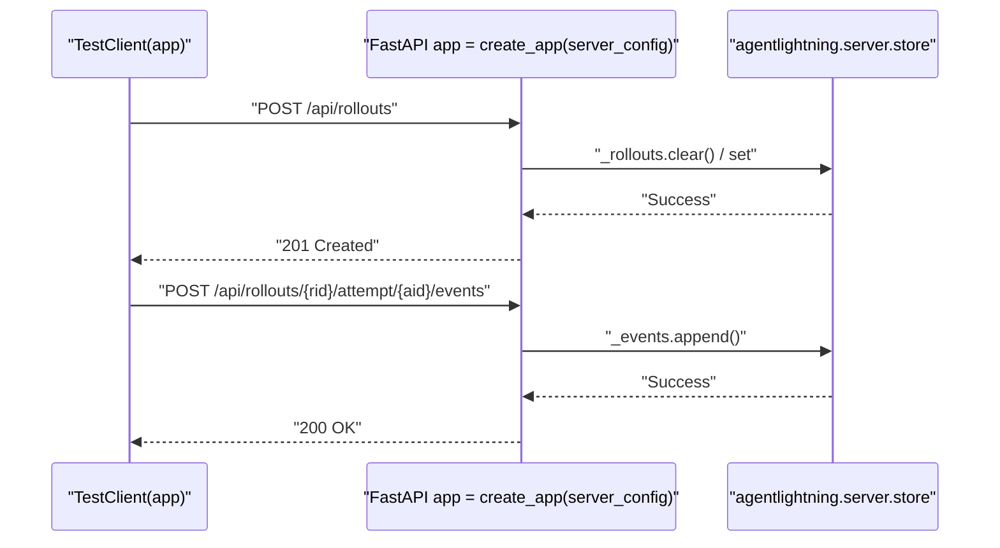
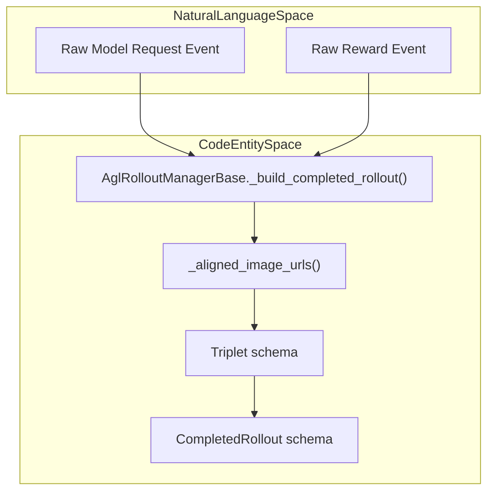
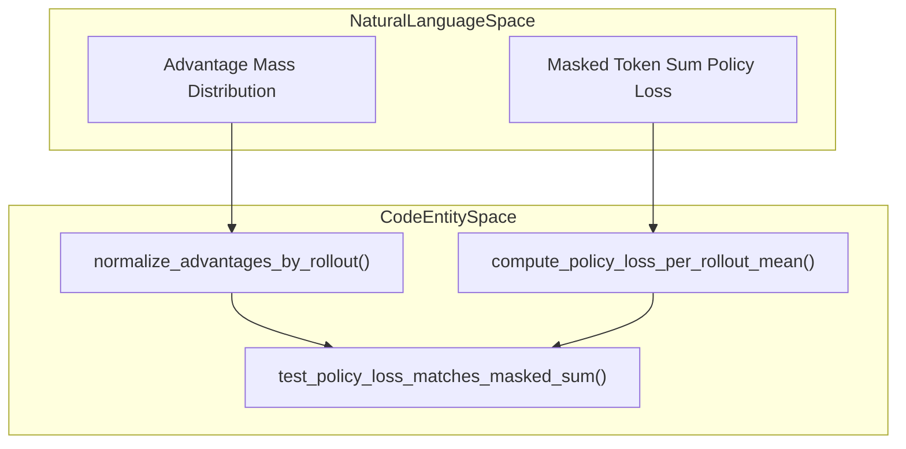

<!-- source: DeepWiki mcp.deepwiki.com · repo microsoft/agent-lightning · page 7.1 Test Suite · fetched 2026-10-26 -->

# Test Suite

Relevant source files

The following files were used as context for generating this wiki page:

- [examples/swe_smith/pull_images.py](examples/swe_smith/pull_images.py)
- [examples/swe_smith/train_smith_agent.py](examples/swe_smith/train_smith_agent.py)
- [examples/swe_smith/train_smith_agent_megatron.py](examples/swe_smith/train_smith_agent_megatron.py)
- [tests/__init__.py](tests/__init__.py)
- [tests/controller/test_k8s_reconciler.py](tests/controller/test_k8s_reconciler.py)
- [tests/server/conftest.py](tests/server/conftest.py)
- [tests/test_package.py](tests/test_package.py)

Agent Lightning employs a multi-tiered testing infrastructure designed to validate the entire agentic reinforcement learning lifecycle. This includes unit testing for the core framework, FastAPI server endpoint validation, specialized VERL training integrations, and end-to-end example integration tests.

Sources: [tests/server/conftest.py:1-59](), [tests/test_package.py:1-46]()

## Test Infrastructure & Setup

The test suite is built on `pytest` and leverages specialized dependency groups to manage environment complexity. The `verl-cpu` group is specifically used to run RL-related unit tests without requiring a physical GPU, enabling fast CI feedback for logic changes. Package smoke tests ensure metadata and version consistency across distributions [tests/test_package.py:13-46]().

### Server Testing Strategy
The `agl-server` is validated using the FastAPI `TestClient` [tests/server/conftest.py:51-55](). A critical component of this setup is the `clean_store` fixture, which ensures isolation by clearing the in-memory global stores (`_rollouts`, `_events`, `_models`, `_terminal_order`) before and after every test case [tests/server/conftest.py:21-32]().

Title: Server Endpoint Test Flow

Sources: [tests/server/conftest.py:21-55](), [tests/test_package.py:34-46]()

## Core Test Categories

### 1. Server Endpoint Tests (`tests/server/`)
These tests cover the REST API surface area and the state machine transitions of rollouts.
*   **Rollout Lifecycle**: Validates transitions from `QUEUING` to `RUNNING` and prevents illegal transitions (e.g., back to `QUEUING`) via `409 Conflict` responses.
*   **Idempotency**: Ensures that re-enqueueing a rollout with an existing `rollout_id` does not clobber running state or existing events.
*   **Event Triplet Formatting**: Validates the `?format=triplet` query parameter which filters and projects events into the format required for RL training.

Sources: [tests/server/conftest.py:21-59]()

### 2. VERL Unit Tests (`tests/verl/`)
These tests focus on the integration between Agent Lightning and the VERL training framework.
*   **Rollout Manager**: Validates that `AglRolloutManagerBase` correctly filters out errored `model_request` events and empty token sequences before passing data to the trainer. It also tests the multimodal patch logic for aligning image URLs with triplets.
*   **Custom Loss & Advantage**: Validates the `per_rollout_mean` loss mode and advantage normalization logic.

Sources: [tests/verl/test_agl_rollout_manager.py:1-269]()

### 3. Controller & Reconciler Tests
These tests validate the reconciliation loops that manage agent execution.
*   **Kubernetes Reconciler**: `test_k8s_reconciler.py` covers the Jinja2 template rendering for K8s Jobs (`build_job_spec`) and the lifecycle tracking of those jobs via the `kr8s` API, verifying proper selectors (`MANAGED_BY_SELECTOR`) and environment variable injection (`AGL_KEY`, `AGL_OPENAI_BASE_URL`) [tests/controller/test_k8s_reconciler.py:11-50]().
*   **Local Runner**: Validates subprocess spawning, environment variable injection, and timeout handling.

Sources: [tests/controller/test_k8s_reconciler.py:11-50]()

### 4. Integration & Example Tests
These tests verify that specific agent implementations and environments function correctly.
*   **SWE-smith Agent**: Validates the Docker image preparation logic via `pull_images.py` and dataset curation helpers for coding agents [examples/swe_smith/pull_images.py:4-10](). The `train_smith_agent.py` and `train_smith_agent_megatron.py` scripts demonstrate how `build_config` merges base VERL configurations with example-specific overrides [examples/swe_smith/train_smith_agent.py:164-193](), [examples/swe_smith/train_smith_agent_megatron.py:155-183]().
*   **Package & Metadata**: Smoke tests in `tests/test_package.py` verify version consistency and OpenAPI metadata generation [tests/test_package.py:13-46]().

Sources: [examples/swe_smith/pull_images.py:4-10](), [examples/swe_smith/train_smith_agent.py:164-193](), [examples/swe_smith/train_smith_agent_megatron.py:155-183](), [tests/test_package.py:13-46]()

## RL Data Flow Validation

The `AglRolloutManager` and `RolloutAdapter` bridge the gap between raw events and training tensors. The test suite validates the conversion of `Event` objects into `Triplet` and `CompletedRollout` models.

Title: Rollout to Training Batch Mapping

Sources: [tests/verl/test_agl_rollout_manager.py:1-269]()

## Specialized VERL Loss Tests

Agent Lightning introduces custom PPO loss modes. The mapping between natural language expectations and policy loss computations is validated across specialized test modules.

Title: Policy Loss and Advantage Computation Mapping

Sources: [tests/verl/test_agl_rollout_manager.py:1-5]()

---

