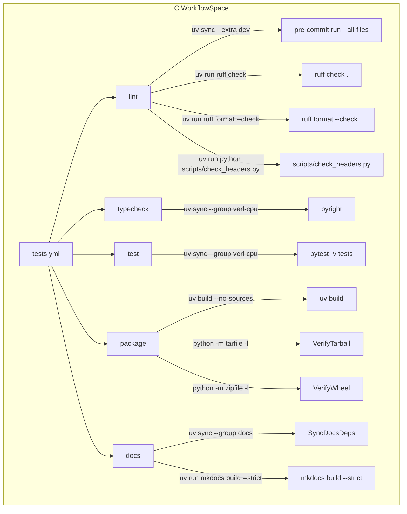
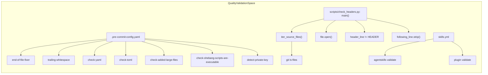

<!-- source: DeepWiki mcp.deepwiki.com · repo microsoft/agent-lightning · page 7.2 CI Workflows & Code Quality · fetched 2026-10-26 -->

# CI Workflows & Code Quality

Relevant source files

The following files were used as context for generating this wiki page:

- [.github/dependabot.yml](.github/dependabot.yml)
- [.github/workflows/skills.yml](.github/workflows/skills.yml)
- [.github/workflows/tests.yml](.github/workflows/tests.yml)
- [.pre-commit-config.yaml](.pre-commit-config.yaml)
- [scripts/check_headers.py](scripts/check_headers.py)

Agent Lightning utilizes a multi-tiered CI/CD architecture designed to validate the framework's core services (`agl-server`, `agl-controller`), reinforcement learning integrations (`verl`), and agent optimization skills. The pipeline ensures code quality through strict linting, type-checking, and automated compliance scripts, while managing documentation versioning and agent skill validation.

Sources: [.github/workflows/tests.yml:1-117](), [.github/workflows/skills.yml:1-66]()

## CI Workflow Architecture

The primary CI entry point is the `Test` workflow defined in [.github/workflows/tests.yml:1-117](), which partitions validation into five specialized jobs (`lint`, `typecheck`, `test`, `package`, `docs`) to optimize execution time and dependency management.

### Workflow Jobs Structure

| Job | Purpose | Dependency Groups / Tools |
| :--- | :--- | :--- |
| `lint` | Fast static analysis, formatting checks, and copyright header compliance. | `dev` [.github/workflows/tests.yml:31]() |
| `typecheck` | Static type analysis via `pyright`. Separated due to heavy `torch` and `verl` dependencies. | `dev`, `verl-cpu` [.github/workflows/tests.yml:57]() |
| `test` | Executes the `pytest` suite for server, controller, and VERL logic. | `dev`, `verl-cpu` [.github/workflows/tests.yml:75]() |
| `package` | Validates build reproducibility and package wheel/sdist integrity. | N/A (`uv build`) [.github/workflows/tests.yml:92]() |
| `docs` | Verifies documentation build and link integrity. | `docs` [.github/workflows/tests.yml:113]() |

### Implementation Detail: Data Flow and Execution Space

The CI system leverages the `uv` toolchain for high-speed dependency resolution and caching [.github/workflows/tests.yml:27]().

Title: CI Workflow Execution and Code Entity Space

Sources: [.github/workflows/tests.yml:18-117]()

## Code Quality & Compliance

### Microsoft Copyright Compliance
The repository enforces Microsoft copyright headers on all tracked Python source files (`.py`, `.pyi`, `.pyw`) via the `scripts/check_headers.py` utility [scripts/check_headers.py:11-13]().

*   **Logic**: The `iter_source_files()` function uses `git ls-files` to identify tracked source files [scripts/check_headers.py:17-37](), while `main()` verifies the presence of `# Copyright (c) Microsoft. All rights reserved.` as the first valid line (accounting for shebang lines) [scripts/check_headers.py:40-52]().
*   **Exclusions**: Vendored code, such as `examples/llm-in-sandbox/vendor/`, is explicitly excluded from this check via `EXCLUDED_PREFIXES` [scripts/check_headers.py:14]() and [.pre-commit-config.yaml:1]().

Sources: [scripts/check_headers.py:1-79](), [.pre-commit-config.yaml:1-16]()

### Pre-commit Hooks
The [.pre-commit-config.yaml]() defines the baseline for local and CI-enforced quality checks:
*   **`ruff`**: Used for linting and formatting, executed directly in the `lint` job [.github/workflows/tests.yml:34-37]().
*   **`end-of-file-fixer`**: Ensures files terminate with a newline [.pre-commit-config.yaml:7]().
*   **`check-yaml`**: Validates YAML syntax, excluding Jinja2-based Kubernetes templates like `job-template.yaml` which contain non-standard template placeholders [.pre-commit-config.yaml:9-10]().
*   **`detect-private-key`**: Scans for accidentally committed credentials [.pre-commit-config.yaml:16]().

Title: Code Quality Entity Mapping

Sources: [scripts/check_headers.py:1-79](), [.pre-commit-config.yaml:1-16](), [.github/workflows/tests.yml:33](), [.github/workflows/skills.yml:35-46](), [.github/workflows/skills.yml:54-66]()

## Documentation Pipeline

The `docs` job within the `Test` workflow [.github/workflows/tests.yml:98-117]() handles documentation building and link checking.

*   **Build Process**: Dependencies are synced using `--group docs`, followed by `mkdocs build --strict` [.github/workflows/tests.yml:113-117]().

Sources: [.github/workflows/tests.yml:98-117]()

## Agent Skills Validation

The `Validate Agent Skills` workflow [.github/workflows/skills.yml:1-66]() ensures that agent optimization skills adhere to the required schema and metadata standards. This workflow is triggered on pushes or pull requests affecting the `skills/` or `.agents/skills/` directories [.github/workflows/skills.yml:9-11]().

### Validation Steps
1.  **`agentskills validate`**: Scans `skills/` and `.agents/skills/` directories for `SKILL.md` files and validates them using the `skills-ref` package via `uvx` [.github/workflows/skills.yml:35-46]().
2.  **Claude Code Plugin Validation**: Searches for `.claude-plugin/plugin.json` manifests within skill directories and uses the `@anthropic-ai/claude-code` CLI to ensure compatibility with the Claude Code plugin architecture [.github/workflows/skills.yml:54-66]().

Sources: [.github/workflows/skills.yml:1-66]()

## Automated Maintenance

Agent Lightning uses GitHub Dependabot [.github/dependabot.yml:1-11]() to maintain the security and currency of the CI infrastructure.
*   **Scope**: Monitors the `github-actions` package ecosystem [.github/dependabot.yml:3]().
*   **Schedule**: Performs weekly checks for updates to actions such as `actions/checkout`, `actions/setup-python`, and `astral-sh/setup-uv` [.github/dependabot.yml:8-9]().
*   **Grouping**: All GitHub Actions updates are grouped under `github-actions` to reduce PR noise [.github/dependabot.yml:5-6]().
*   **Cooldown**: A 7-day cooldown is applied to prevent frequent, consecutive PRs for minor updates [.github/dependabot.yml:11]().

Sources: [.github/dependabot.yml:1-11]()

---

