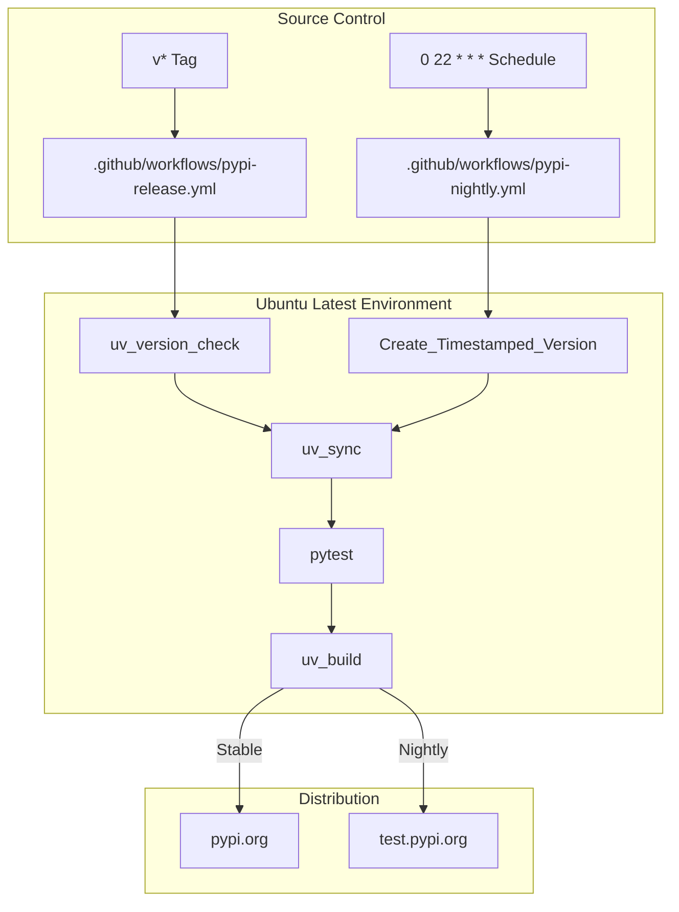
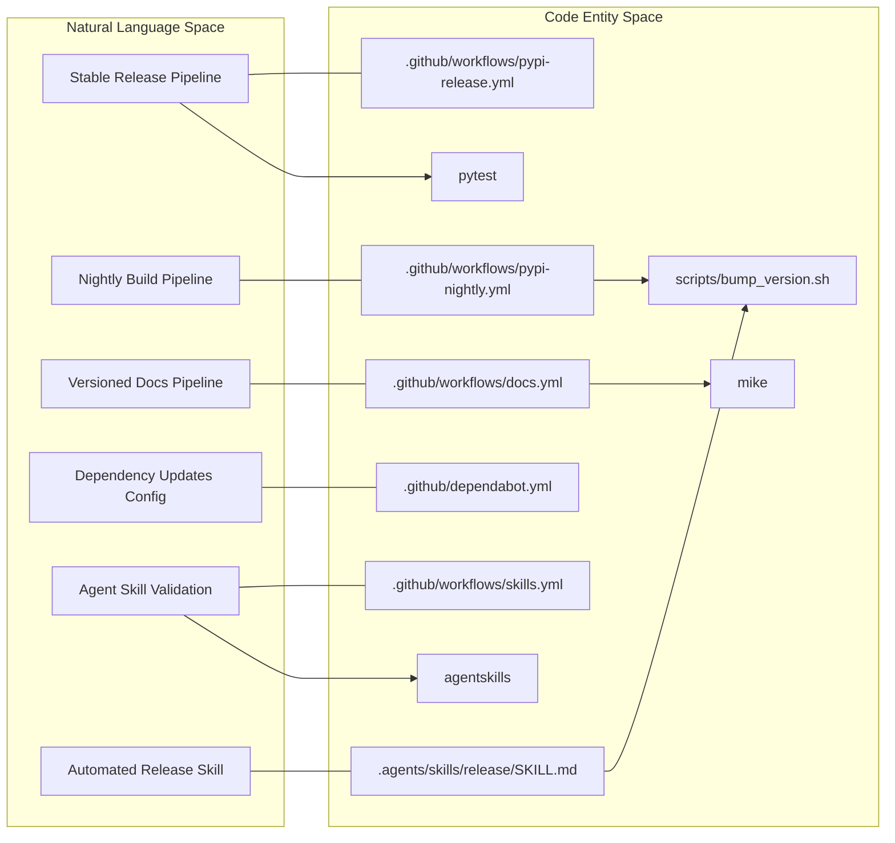
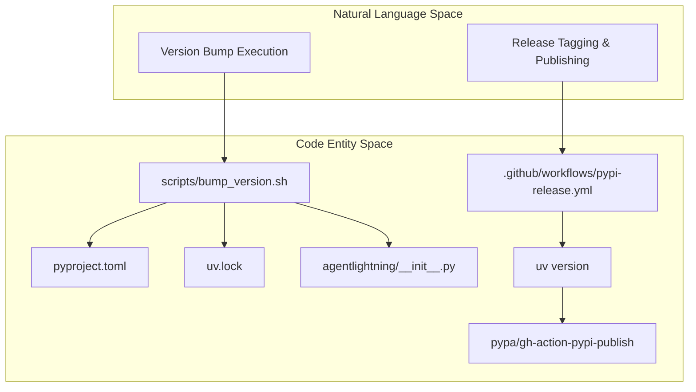

<!-- source: DeepWiki mcp.deepwiki.com · repo microsoft/agent-lightning · page 7.3 Release & Publishing · fetched 2026-10-26 -->

# Release & Publishing

Relevant source files

The following files were used as context for generating this wiki page:

- [.agents/skills/release/SKILL.md](.agents/skills/release/SKILL.md)
- [.agents/skills/release/agents/openai.yaml](.agents/skills/release/agents/openai.yaml)
- [.github/workflows/pypi-nightly.yml](.github/workflows/pypi-nightly.yml)
- [.github/workflows/pypi-release.yml](.github/workflows/pypi-release.yml)
- [.python-version](.python-version)
- [SECURITY.md](SECURITY.md)
- [scripts/bump_version.sh](scripts/bump_version.sh)

This page documents the automation pipelines responsible for distributing the Agent Lightning framework. This includes PyPI package publication (stable and nightly), versioned documentation deployment via MkDocs and `mike`, dependency management via Dependabot, the automated release Agent Skill, and security vulnerability reporting guidelines.

## PyPI Release & Nightly Workflows

The project utilizes two distinct release tracks: **Stable** (triggered by git tags) and **Nightly** (triggered by a cron schedule). Both tracks utilize `uv` for building the Python distribution.

### Stable Release (`pypi-release.yml`)
The stable release pipeline is triggered when a tag matching `v*` is pushed to the repository [[.github/workflows/pypi-release.yml:4-6]](.github/workflows/pypi-release.yml). It performs a strict version check to ensure the tag matches the `version` field in `pyproject.toml` and the runtime `__version__` in the package [[.github/workflows/pypi-release.yml:33-49]](.github/workflows/pypi-release.yml).

The build process involves:
1. **Version Verification**: Compares `uv version --short` against the tag name [[.github/workflows/pypi-release.yml:33-38]](.github/workflows/pypi-release.yml) and against `agentlightning.__version__` [[.github/workflows/pypi-release.yml:44-49]](.github/workflows/pypi-release.yml).
2. **Dependency Sync**: Uses `uv sync` with the `dev` group and extra to prepare the test environment [[.github/workflows/pypi-release.yml:51-52]](.github/workflows/pypi-release.yml).
3. **Testing**: Runs `pytest` on the server, controller, and specific package/image tests to ensure artifact integrity [[.github/workflows/pypi-release.yml:54-60]](.github/workflows/pypi-release.yml).
4. **Package Build**: `uv build --no-sources` generates the `.tar.gz` and `.whl` files [[.github/workflows/pypi-release.yml:62-63]](.github/workflows/pypi-release.yml).
5. **Verification**: The contents of the generated artifacts are listed using `python -m tarfile` and `python -m zipfile` [[.github/workflows/pypi-release.yml:65-68]](.github/workflows/pypi-release.yml).
6. **Trusted Publishing**: Uses `pypa/gh-action-pypi-publish` with OpenID Connect (OIDC) to publish to PyPI [[.github/workflows/pypi-release.yml:70-71]](.github/workflows/pypi-release.yml).

Sources: [.github/workflows/pypi-release.yml:1-71]()

### Nightly Build (`pypi-nightly.yml`)
The nightly build runs daily at 22:00 UTC (06:00 UTC+8) [[.github/workflows/pypi-nightly.yml:4-6]](.github/workflows/pypi-nightly.yml). It differs from the stable release by:
1. **Version Bumping**: It generates a timestamped development version (e.g., `1.0.0.dev20250101120000`) by modifying `pyproject.toml` via `uv version` and updating `agentlightning/__init__.py` via `sed` [[.github/workflows/pypi-nightly.yml:37-44]](.github/workflows/pypi-nightly.yml).
2. **Target**: It publishes specifically to **Test PyPI** rather than the production index [[.github/workflows/pypi-nightly.yml:65-69]](.github/workflows/pypi-nightly.yml).

Sources: [.github/workflows/pypi-nightly.yml:1-68]()

### PyPI Publication Pipeline Data Flow

Title: "PyPI Publication Pipeline Data Flow"

Sources: [.github/workflows/pypi-release.yml:1-71](), [.github/workflows/pypi-nightly.yml:1-68]()

## Version Management Script (`bump_version.sh`)

The `scripts/bump_version.sh` utility provides a standardized way to increment the project version across multiple files. It ensures consistency between the build system (`pyproject.toml`) and the runtime package metadata [[scripts/bump_version.sh:31-33]](scripts/bump_version.sh).

- **Logic**: It uses `uv version --bump <major|minor|patch>` to update the project file and then uses `sed` to update the `__version__` string in `agentlightning/__init__.py` [[scripts/bump_version.sh:40-45]](scripts/bump_version.sh).
- **Constraints**: It requires the `uv` tool to be installed and expects a single argument (`major`, `minor`, or `patch`) [[scripts/bump_version.sh:11-29]](scripts/bump_version.sh).

Sources: [scripts/bump_version.sh:1-47]()

## Documentation Deployment (`docs.yml`)

The project uses **MkDocs** with the `mike` versioning tool to maintain a documentation site that supports multiple versions (e.g., `latest`, `stable`, and specific version tags).

### Pipeline Logic
The documentation pipeline runs on pushes to `main` or new tags [[.github/workflows/docs.yml:3-9]](.github/workflows/docs.yml).
- **Version Detection**: If a tag is present, it extracts the version number [[.github/workflows/docs.yml:44-46]](.github/workflows/docs.yml). Otherwise, it reads the version from `pyproject.toml` using `tomllib` [[.github/workflows/docs.yml:48-50]](.github/workflows/docs.yml).
- **Stable Deployment**: When a tag is pushed, `mike deploy` pushes the versioned docs and updates the `stable` alias [[.github/workflows/docs.yml:55-58]](.github/workflows/docs.yml).
- **Dev Deployment**: On pushes to `main`, it updates the `latest` alias and ensures `stable` remains the default view for users via `mike set-default` [[.github/workflows/docs.yml:59-65]](.github/workflows/docs.yml).

Sources: [.github/workflows/docs.yml:1-64]()

## Agent Skills Validation (`skills.yml`)

The repository includes "Agent Skills" (located in `skills/` and `.agents/skills/`) which are validated during CI to ensure compatibility with coding agents like Claude Code [[.github/workflows/skills.yml:33-34]](.github/workflows/skills.yml).

- **Skill Format**: Validated using `agentskills validate` (from `skills-ref==0.1.1`) to check the `SKILL.md` structure [[.github/workflows/skills.yml:42-44]](.github/workflows/skills.yml).
- **Claude Plugins**: Validated using `@anthropic-ai/claude-code@2.1.218` plugin validator for `.claude-plugin/plugin.json` files [[.github/workflows/skills.yml:54-64]](.github/workflows/skills.yml).

Sources: [.github/workflows/skills.yml:1-66]()

## Automated Release Skill (`SKILL.md`)

The `.agents/skills/release/` directory contains a specialized skill that allows coding agents to manage the release lifecycle [[.agents/skills/release/SKILL.md:2-3]](.agents/skills/release/SKILL.md).

### Release Contract
The release process defined in the skill enforces a specific sequence:
1. **Establish State**: Verify the repository is clean, resolve canonical `OWNER/REPO`, and compare local tags with PyPI JSON metadata [[.agents/skills/release/SKILL.md:16-35]](.agents/skills/release/SKILL.md).
2. **Prepare PR**: Create a release branch from a fresh default branch and run `scripts/bump_version.sh` [[.agents/skills/release/SKILL.md:51-58]](.agents/skills/release/SKILL.md). The skill mandates that only `pyproject.toml`, `uv.lock`, and `agentlightning/__init__.py` should be modified [[.agents/skills/release/SKILL.md:66-70]](.agents/skills/release/SKILL.md).
3. **Merge and Tag**: Once GitHub checks pass, the PR is merged using `gh pr merge` [[.agents/skills/release/SKILL.md:100-115]](.agents/skills/release/SKILL.md). After merging, the merge commit is tagged with `vX.Y.Z` and pushed to the canonical remote, triggering the automated publication workflows [[.agents/skills/release/SKILL.md:120-155]](.agents/skills/release/SKILL.md).

Sources: [.agents/skills/release/SKILL.md:1-238]()

## Dependency Management (`dependabot.yml`)

The project uses GitHub Dependabot to keep GitHub Actions dependencies up to date.
- **Configuration**: Dependabot is configured to check for `github-actions` updates in the root directory [[.github/dependabot.yml:3-4]](.github/dependabot.yml).
- **Schedule**: Checks occur on a `weekly` interval [[.github/dependabot.yml:9]](.github/dependabot.yml).
- **Grouping**: All GitHub Actions updates are grouped into a single pull request to reduce noise [[.github/dependabot.yml:5-7]](.github/dependabot.yml).

Sources: [.github/dependabot.yml:1-11]()

## Security Policy (`SECURITY.md`)

In accordance with Microsoft security standards, the repository includes a standardized `SECURITY.md` file [SECURITY.md:1-14](SECURITY.md). 
- **Vulnerability Reporting**: Public GitHub issues must not be used for reporting security vulnerabilities [SECURITY.md:8-9](SECURITY.md).
- **Policy Guidance**: Reporting instructions, contact information, and security policies point directly to the central Microsoft security guidance portal at [https://aka.ms/SECURITY.md](https://aka.ms/SECURITY.md) [SECURITY.md:10-12](SECURITY.md).

Sources: [SECURITY.md:1-14]()

## Release Entity Mapping

The following diagrams map logical release concepts to the specific GitHub Actions workflows, configuration files, and scripts that implement them, bridging Natural Language Space to Code Entity Space.

Title: "Release Implementation Map"

Sources: [.github/workflows/pypi-release.yml:1-71](), [.github/workflows/pypi-nightly.yml:1-68](), [.github/workflows/docs.yml:1-64](), [.github/dependabot.yml:1-11](), [.github/workflows/skills.yml:1-66](), [scripts/bump_version.sh:1-47](), [.agents/skills/release/SKILL.md:1-238]()

Title: "Version Bump and Release Control Flow"

Sources: [scripts/bump_version.sh:1-47](), [.github/workflows/pypi-release.yml:1-71](), [.agents/skills/release/SKILL.md:1-238]()

---

