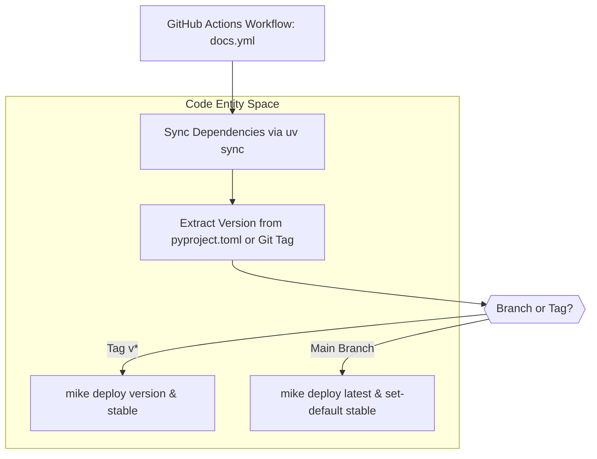

<!-- source: DeepWiki mcp.deepwiki.com · repo microsoft/agent-lightning · page 7.4 Documentation Site · fetched 2026-10-26 -->

# Documentation Site

<details>
<summary>Relevant source files</summary>

The following files were used as context for generating this wiki page:

- [.github/workflows/docs.yml](.github/workflows/docs.yml)
- [README.md](README.md)
- [docs/assets/favicon-white.svg](docs/assets/favicon-white.svg)
- [docs/assets/favicon.svg](docs/assets/favicon.svg)
- [docs/community/contributing.md](docs/community/contributing.md)
- [docs/javascripts/katex.js](docs/javascripts/katex.js)
- [docs/javascripts/move-source-file.js](docs/javascripts/move-source-file.js)
- [docs/macros/source_links.py](docs/macros/source_links.py)
- [docs/overrides/main.html](docs/overrides/main.html)
- [docs/stylesheets/extra.css](docs/stylesheets/extra.css)
- [mkdocs.yml](mkdocs.yml)

</details>


## Purpose and Scope
This section details the technical architecture, layout conventions, and extension mechanisms of the Agent Lightning v1.0 documentation site. The documentation is engineered around **MkDocs Material**, enhanced with custom Python macros (`source_links.py`), KaTeX rendering (`katex.js`), DOM-manipulation scripts (`move-source-file.js`), Jinja2 template overrides (`main.html`), and automated CI/CD deployments via GitHub Actions (`docs.yml`).

Sources: `[.github/workflows/docs.yml:1-64]`, `[docs/macros/source_links.py:1-70]`, `[docs/stylesheets/extra.css:1-111]`.

---

## 1. Page Numbering and Navigation Conventions

The `docs/` directory houses Markdown files structured using a prefix-based numerical naming convention to enforce ordering within the MkDocs navigation tree defined in `mkdocs.yml`.

| Prefix Range | Domain / Subsystem | Example Files |
| :--- | :--- | :--- |
| `00–09` | Getting Started & Basics | Getting started guides, installation, and setup (`00-installation.md`, `01-quick-start.md`, `05-basics.md`) `[mkdocs.yml:101-103]()` |
| `20–39` | Configuration & Infrastructure | Trainer, API gateway, and controller configurations `[mkdocs.yml:104-107]()` |
| `50–80` | Worked Examples & Recipes | Calc-X, GSM8K, coding agents, multimodal QA `[mkdocs.yml:109-116]()` |

Sources: `[mkdocs.yml:98-119]`, `[docs/macros/source_links.py:1-70]`.

---

## 2. Macros & Source Code Linker (`source_links.py`)

To ensure that documentation references real files in the repository without broken links, Agent Lightning defines a custom MkDocs macro plugin located at `docs/macros/source_links.py` `[docs/macros/source_links.py:1-70]()`.

### Implementation Details
The module defines `define_env(env)` which registers the `src()` macro function for Markdown consumption `[docs/macros/source_links.py:10-70]()`.

Title: "Source Links Macro Resolution Pipeline"
```mermaid
graph TD
    MarkdownDoc[""MarkdownDocumentation""] -->|"Calls src('path')"| define_env[""source_links.py:define_env()""]
    define_env --> ValidatePath[""Validate abs_path against project_dir""]
    ValidatePath -->|Exists| BuildURL[""Generate GitHub Tree URL: repo_url/tree/commit/path""]
    ValidatePath -->|Missing| WarnUser[""Emit mkdocs warning & render broken-source-link span""]
    BuildURL --> RenderAnchor[""Render HTML Anchor Element""]
    WarnUser --> RenderAnchor

    subgraph Code Entity Space
    define_env
    ValidatePath
    BuildURL
    WarnUser
    end
```
*Figure 1: Documentation macro resolution pipeline bridging natural language markdown to `source_links.py` functions.*

Sources: `[docs/macros/source_links.py:10-70]`.

---

## 3. Stylesheets and Theming (`extra.css`)

The documentation applies custom branding through `docs/stylesheets/extra.css` and the Material theme configuration `[docs/stylesheets/extra.css:1-111]`, `[mkdocs.yml:6-31]`.

### Key Style Modifications
* **Grid Max-Width**: `.md-grid` is constrained to `88rem` for wide-screen readability `[docs/stylesheets/extra.css:1-3]()`.
* **API Reference Spacing**: Adjusts padding and bottom borders for `.doc-class`, `.doc-function`, and `.doc-attribute` rendered via `mkdocstrings` `[docs/stylesheets/extra.css:30-46]()`.
* **Color Palette (`agl`)**: Overrides primary and secondary theme colors utilizing custom CSS variables (`--md-primary-fg-color: #c45259`, `--md-accent-fg-color: #f69047`) for light and slate dark modes `[docs/stylesheets/extra.css:48-66]()`.
* **Warning Banners**: Defines `.version-warning` styling with amber borders (`#FFD15D`) for development/nightly build warnings `[docs/stylesheets/extra.css:68-77]()`.

Sources: `[docs/stylesheets/extra.css:1-111]`, `[mkdocs.yml:6-31]`.

---

## 4. JavaScript Integrations & DOM Manipulation

Client-side behavior is managed through initialization scripts loaded under extra JavaScript configurations `[mkdocs.yml:89-97]()`.

Title: "Client-Side Script Execution Flow"
```mermaid
graph TD
    BrowserEvent[""Browser DOMContentLoaded Event""] --> KaTeXInit[""katex.js: renderMathInElement()""]
    BrowserEvent --> DOMMutation[""move-source-file.js: DOM Mutation""]
    DOMMutation --> QueryDOM[""Query .md-content__inner and h1""]
    QueryDOM --> RelocateMeta[""Relocate .md-source-file directly after h1""]
    KaTeXInit --> RenderMath[""Render LaTeX Blocks & Inlines ($$, $, \(), \[)""]

    subgraph Code Entity Space
    KaTeXInit
    DOMMutation
    QueryDOM
    RelocateMeta
    end
```
*Figure 2: Client-side JavaScript execution flow mapping DOM events to `katex.js` and `move-source-file.js` routines.*

### KaTeX Math Support (`katex.js`)
Initialized via `docs/javascripts/katex.js`, KaTeX scans the document body upon page transitions and parses mathematical expressions matching delimiters `$$`, `$`, `\(...\)`, and `\[...\]` `[docs/javascripts/katex.js:1-12]()`.

### Source File Metadata Relocation (`move-source-file.js`)
The `docs/javascripts/move-source-file.js` script queries `.md-content__inner`, locates the generated `.md-source-file` block, and injects it immediately after the first `<h1>` heading for cleaner document layouts `[docs/javascripts/move-source-file.js:1-11]()`.

Sources: `[docs/javascripts/katex.js:1-12]`, `[docs/javascripts/move-source-file.js:1-11]`, `[mkdocs.yml:89-97]`.

---

## 5. Site Overrides and Version Warnings (`main.html`)

Template customization is implemented in `docs/overrides/main.html`, extending the Material theme's `base.html` block structure `[docs/overrides/main.html:1-9]`, `[mkdocs.yml:7-8]`.

### Version Warning Logic
The override injects a hidden `#version-warning` div into the content block. A lightweight client-side script checks `window.location.href`; if the active URL path contains `latest/`, the warning banner is unhidden to alert users that they are viewing development documentation rather than the stable release `[docs/overrides/main.html:4-26]()`.

Sources: `[docs/overrides/main.html:1-26]`, `[mkdocs.yml:7-8]`.

---

## 6. CI/CD Deployment Pipeline (`docs.yml`)

Documentation builds and deployments are automated via GitHub Actions in `.github/workflows/docs.yml` `[.github/workflows/docs.yml:1-64]()`.

### Workflow Stages
* **Environment Setup**: Installs Python 3.12 and uses `astral-sh/setup-uv` to sync documentation dependencies (`uv sync --frozen --no-default-groups --group dev --group docs`) `[.github/workflows/docs.yml:27-34]()`.
* **Version Detection**: Extracts the project version from `pyproject.toml` or the GitHub git tag for versioned deployments `[.github/workflows/docs.yml:41-52]()`.
* **Deployment with `mike`**:
  * On version tags (`refs/tags/v*`), deploys versioned documentation and updates aliases via `mike deploy --push --update-aliases` `[.github/workflows/docs.yml:54-58]()`.
  * On pushes to `main`, deploys to the `latest` alias and sets `stable` as the default branch `[.github/workflows/docs.yml:59-64]()`.

Title: "CI/CD Documentation Publishing Workflow"

*Figure 3: CI/CD documentation publishing workflow executed by `.github/workflows/docs.yml`.*

Sources: `[.github/workflows/docs.yml:1-64]`.

---

