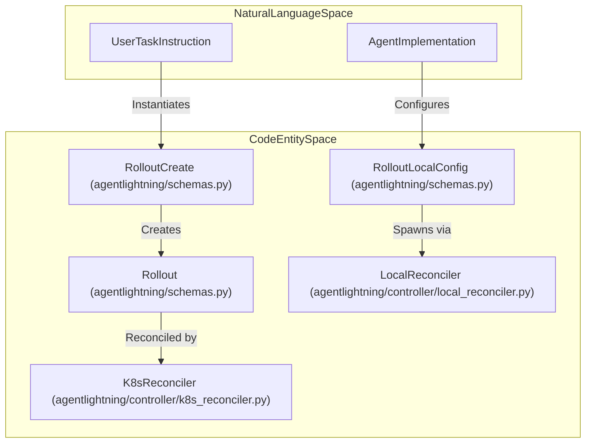
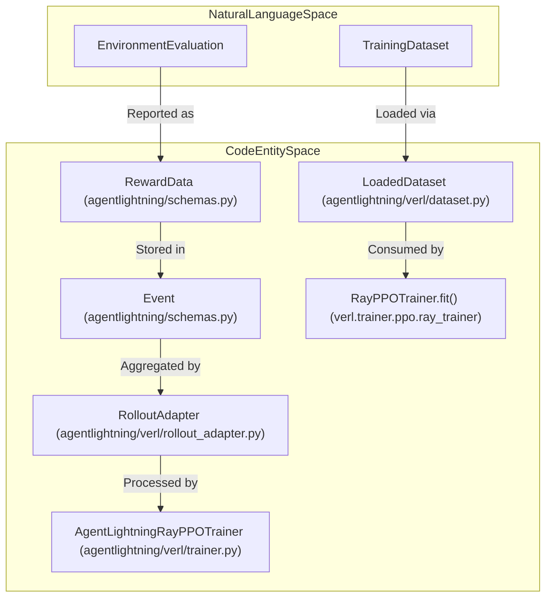
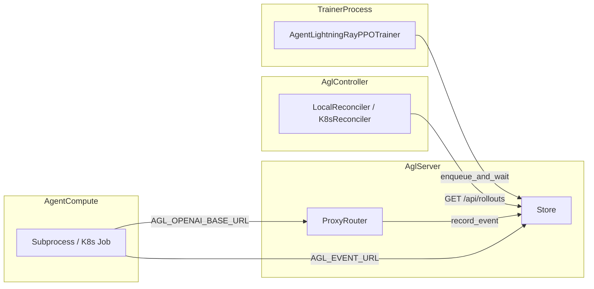

<!-- source: DeepWiki mcp.deepwiki.com · repo microsoft/agent-lightning · page 8 Glossary · fetched 2026-10-26 -->

# Glossary

Relevant source files

The following files were used as context for generating this wiki page:

- [README.md](README.md)
- [agentlightning/schemas.py](agentlightning/schemas.py)
- [agentlightning/verl/entrypoint.py](agentlightning/verl/entrypoint.py)
- [agentlightning/verl/trainer.py](agentlightning/verl/trainer.py)
- [docs/community/contributing.md](docs/community/contributing.md)
- [mkdocs.yml](mkdocs.yml)
- [tests/server/test_endpoints.py](tests/server/test_endpoints.py)
- [tests/verl/test_agl_rollout_manager.py](tests/verl/test_agl_rollout_manager.py)

This page provides definitions for the core terminology, technical jargon, and domain-specific concepts used within the Agent Lightning v1.0 codebase. Its purpose is to serve as a comprehensive reference for onboarding engineers to understand the mapping between abstract agentic reinforcement learning concepts and their concrete codebase implementations.

---

## Core Concepts

### Rollout
A **Rollout** represents a single execution instance of an agent task. It is the top-level unit of work in the system, decoupling the training loop from environment execution.
*   **State Machine**: Progresses through `QUEUING`, `RUNNING`, and terminal states (`SUCCEEDED` or `FAILED`) [agentlightning/schemas.py:77-93]().
*   **Implementation**: Defined as a Pydantic model containing input data, configuration for the runner, and lifecycle status [agentlightning/schemas.py:177-185]().
*   **Code Pointer**: The `Rollout` schema is managed by the server store in `agentlightning/schemas.py` [agentlightning/schemas.py:177-185]().

Sources: `agentlightning/schemas.py`

### Event
An **Event** is a single granular interaction or observation recorded during a rollout attempt. Version 1.0 uses a flat event list per rollout attempt rather than a complex trace tree.
*   **Types**: Well-known types include `model_request` (captured by the proxy) and `reward` (reported by the agent) [agentlightning/schemas.py:13-27]().
*   **Implementation**: `Event` class in `agentlightning/schemas.py` [agentlightning/schemas.py:13-27]().
*   **Ingestion**: Posted via rollout attempt event endpoints [tests/server/test_endpoints.py:130-137]().

Sources: `agentlightning/schemas.py`, `tests/server/test_endpoints.py`

### Triplet
A **Triplet** is a data structure representing a single `(Prompt, Response, Reward)` turn, extracted from the raw event stream for reinforcement learning training.
*   **Format**: Specifically used for RL training data ingestion in VERL via rollout managers [agentlightning/verl/trainer.py:38-44]().
*   **Extraction**: The server and rollout adapters automatically pair model requests with subsequent rewards to construct training samples.

Sources: `agentlightning/verl/trainer.py`

### Proxy Router
The **Proxy Router** is the component within `agl-server` that manages the routing of OpenAI-compatible LLM requests to underlying model servers (such as vLLM).
*   **Prefix Cache Reuse**: Uses a hash of the `rollout_id` to pin specific rollouts to specific model endpoints, maximizing KV cache hit rates [agentlightning/schemas.py:13-27]().
*   **Param Injection**: Automatically injects generation parameters depending on whether the rollout is in training or validation mode [agentlightning/schemas.py:13-27]().

Sources: `agentlightning/schemas.py`

---

## Natural Language Space to Code Entity Space

To bridge high-level agentic reinforcement learning concepts with actual codebase symbols, the following diagrams map natural language intents to concrete classes and execution flows.

### Task and Agent Mapping Diagram

Sources: `agentlightning/schemas.py`, `agentlightning/controller/local_reconciler.py`

### Reward and Training Data Mapping Diagram

Sources: `agentlightning/schemas.py`, `agentlightning/verl/trainer.py`, `agentlightning/verl/dataset.py`

---

## Technical Jargon & Abbreviations

| Term | Definition | Code Pointer |
| :--- | :--- | :--- |
| **VERL** | Volcano Engine Reinforcement Learning. The backend used for PPO/GRPO training. | `AgentLightningRayPPOTrainer` [agentlightning/verl/trainer.py:100-118]() |
| **Pause/Drain** | The process of stopping new proxy requests and waiting for in-flight ones to finish before updating model weights. | `_pause_and_drain_gateway` [agentlightning/verl/trainer.py:171-175]() |
| **Trajectory Aggregation** | Aggregating all turns of a multi-turn agent interaction into a single training sample for the RL algorithm. | `AglRolloutManager` [agentlightning/verl/trainer.py:38-44]() |
| **Per-Rollout Mean** | A custom PPO loss mode that normalizes advantages by the number of tokens in a rollout rather than the global batch. | `PER_ROLLOUT_MEAN_LOSS_MODE` [agentlightning/verl/per_rollout_loss.py:47-48]() |
| **Reconciler** | The control loop in `agl-controller` that ensures the desired state matches actual compute. | `LocalReconciler` [agentlightning/controller/local_reconciler.py:94-97]() |
| **LoadedDataset** | A custom VERL dataset wrapper that allows passing in-memory Python sequences instead of Parquet files. | `LoadedDataset` [agentlightning/verl/dataset.py:1-30]() |
| **RolloutHooks** | Extension point for injecting lifecycle logic into rollout execution. | `RolloutHooks` [agentlightning/verl/trainer.py:36-37]() |

Sources: `agentlightning/verl/trainer.py`, `agentlightning/controller/local_reconciler.py`, `agentlightning/verl/per_rollout_loss.py`, `agentlightning/verl/dataset.py`

---

## System Topology

### Component Interaction Diagram

Sources: `agentlightning/verl/trainer.py`, `agentlightning/controller/local_reconciler.py`, `agentlightning/schemas.py`, `tests/server/test_endpoints.py`

---

## Training Specific Terms

### Advantage Normalization
In `AgentLightningRayPPOTrainer`, advantages can be normalized at the rollout level to handle high variance across multi-turn agent interactions.
*   **Implementation**: `normalize_advantages_by_rollout` [agentlightning/verl/per_rollout_loss.py:48-49]() is called during rollout-level loss computations.
*   **Broadcast**: Scalar rollout-level rewards are broadcast to all token-level triplets within that rollout during adapter processing.

Sources: `agentlightning/verl/trainer.py`, `agentlightning/verl/per_rollout_loss.py`

### Gateway Pause State
A synchronization primitive used to prevent agents from calling the LLM while the trainer is updating the weights of model servers.
*   **Implementation**: Managed via `_pause_and_drain_gateway` [agentlightning/verl/trainer.py:171-175]() and `_resume_gateway` [agentlightning/verl/trainer.py:168-170]() methods in `AgentLightningRayPPOTrainer`.
*   **Flow**: The trainer calls `/proxy/pause`, polls until `inflight == 0`, updates weights, and calls `/proxy/resume` [agentlightning/verl/trainer.py:171-175]().

Sources: `agentlightning/verl/trainer.py`

### Trace Aggregator
Defines the granularity at which agent interactions are converted into RL training samples.
*   **Transition Level**: Treats individual model turns as separate samples [agentlightning/verl/trainer.py:38-44]().
*   **Trajectory Level**: Treats the entire multi-turn conversation as a single cohesive sequence [agentlightning/verl/trainer.py:38-44]().
*   **Code Pointer**: Implemented within `RolloutAdapter` [agentlightning/verl/rollout_adapter.py:1-50]() and managed by `AglRolloutManager` [agentlightning/verl/trainer.py:38-44]().

Sources: `agentlightning/verl/trainer.py`