# Page: Overview

# Overview

<details>
<summary>Relevant source files</summary>

The following files were used as context for generating this wiki page:

- [README.md](README.md)
- [agentlightning/__init__.py](agentlightning/__init__.py)
- [agentlightning/verl/dataset.py](agentlightning/verl/dataset.py)
- [docs/76-example-coding-agent-moe.md](docs/76-example-coding-agent-moe.md)
- [docs/README.md](docs/README.md)
- [docs/community/contributing.md](docs/community/contributing.md)
- [docs/images/architecture.jpg](docs/images/architecture.jpg)
- [examples/swe_smith/README.md](examples/swe_smith/README.md)
- [mkdocs.yml](mkdocs.yml)

</details>


Agent Lightning v1.0 is a lightweight (~3,500 lines of code) framework designed for **Harnessed Agentic RL** [README.md:5-15](). It enables training AI agents—ranging from multi-turn reasoning agents to complex coding agents—using Reinforcement Learning with **zero changes** required to the agent's internal business logic or tools [README.md:22-23]().

By decoupling the training infrastructure from the agent execution environment, Agent Lightning allows models to interact with real toolchains, file systems, and sandboxes while recording high-fidelity training data (token IDs, logprobs, and rewards) via an OpenAI-compatible proxy [README.md:49-51]().

Sources: [README.md:5-15](), [README.md:22-23](), [README.md:49-51]()

## Three-Service Architecture

The framework operates via a Producer-Consumer loop distributed across three lightweight components. This separation isolates heavy training compute (GPUs) from agent execution compute (which may require specialized sandboxes or Kubernetes clusters) [README.md:49-51]().

- **Trainer:** Runs `verl` and vLLM, builds training samples, and updates the policy [README.md:47]().
- **AGL Server (`agentlightning.server.__main__:main`):** A FastAPI-based central hub acting as a rollout state store, event repository, and LLM proxy [README.md:49-50](), [docs/community/contributing.md:63]().
- **AGL Controller (`agentlightning.controller.__main__:main`):** A reconciliation service that polls the server for queued rollout tasks and spawns agent execution environments either as local subprocesses or native Kubernetes Jobs [docs/community/contributing.md:64]().

Sources: [README.md:47-51](), [docs/community/contributing.md:63-64]()

## System Topology & Mapping

The following diagrams illustrate how high-level architectural concepts correspond to concrete code entities across the repository.

**Diagram: Service Interaction and Code Entrypoints**
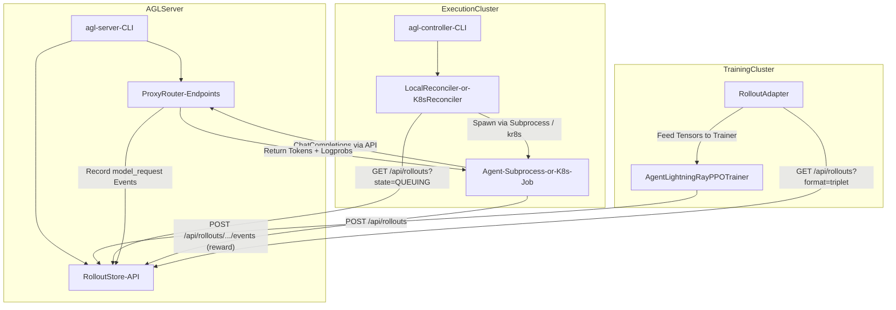
Sources: [README.md:47-51](), [docs/community/contributing.md:63-65]()

**Diagram: Data Entity Relationship**
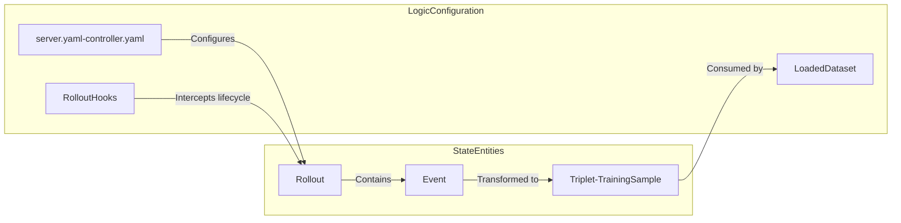
Sources: [docs/community/contributing.md:63-65](), [agentlightning/verl/dataset.py:17-45]()

## Core Value Proposition: Harnessed RL

Unlike traditional RL frameworks that rely on simplified environment emulators, Agent Lightning focuses on **Harnessed Agentic RL**:
- **Real Harnesses & Tools:** Agents utilize actual bash shells, compilers, and browsers without abstraction layers [README.md:22-23]().
- **Native Kubernetes Support:** Rollouts scale horizontally as native `K8s Jobs` via `kr8s` without external sandbox services [README.md:24]().
- **Zero-Drift Proxy:** Captures exact token IDs and logprobs directly from the provider API to eliminate re-tokenization drift [README.md:91]().
- **Trajectory Aggregation:** Supports multi-turn credit assignment, advantage normalization, and reward-hacking prevention [README.md:89]().

Sources: [README.md:22-24](), [README.md:89](), [README.md:91]()

## Navigation

For detailed information on specific subsystems, guides, and workflows, see the child pages:
- **[Getting Started & Installation](#1.1)** — Installing Agent Lightning v1.0, dependency groups, `scripts/setup_verl.sh` CUDA setup, and first local training runs [README.md:27-35]().
- **[Architecture Overview](#1.2)** — In-depth breakdown of the three-service Producer-Consumer loop, data flows, and service responsibilities [README.md:40-51]().

Sources: [README.md:27-51](), [README.md:40-51]()

---

# Page: Getting Started & Installation

# Getting Started & Installation

<details>
<summary>Relevant source files</summary>

The following files were used as context for generating this wiki page:

- [agentlightning/config/__init__.py](agentlightning/config/__init__.py)
- [agentlightning/config/controller.yaml](agentlightning/config/controller.yaml)
- [agentlightning/config/server.yaml](agentlightning/config/server.yaml)
- [agentlightning/controller/__init__.py](agentlightning/controller/__init__.py)
- [agentlightning/controller/__main__.py](agentlightning/controller/__main__.py)
- [agentlightning/hooks.py](agentlightning/hooks.py)
- [docs/01-quick-start.md](docs/01-quick-start.md)
- [docs/30-controller-configuration.md](docs/30-controller-configuration.md)
- [pyproject.toml](pyproject.toml)
- [scripts/setup_verl.sh](scripts/setup_verl.sh)
- [tests/controller/test_local_reconciler_platform.py](tests/controller/test_local_reconciler_platform.py)
- [uv.lock](uv.lock)

</details>


## Purpose & Scope
This page provides a comprehensive guide for installing Agent Lightning v1.0, managing its multi-tiered dependency system, configuring core services via Hydra, and executing your first local agent training loop. Agent Lightning bridges the gap between agentic frameworks and large-scale reinforcement learning (RL) optimization loops by decoupling agent execution from training compute.

Sources: [pyproject.toml:1-128](), [scripts/setup_verl.sh:1-98](), [docs/01-quick-start.md:1-57]()

## System Overview & Toolchain

Agent Lightning utilizes the `uv` toolchain for high-performance dependency resolution and environment isolation [pyproject.toml:58-70](). The framework is built around a three-service producer-consumer architecture:
1.  **agl-server**: A FastAPI-based central hub for rollout state, LLM proxying, and event ingestion [pyproject.toml:49]().
2.  **agl-controller**: A reconciliation service managing agent lifecycles via local subprocesses (`LocalReconciler`) or Kubernetes Jobs (`K8sReconciler`) [pyproject.toml:50](), [agentlightning/controller/__main__.py:22-35]().
3.  **VERL Trainer**: The training backend (`AgentLightningRayPPOTrainer`) that orchestrates PPO/GRPO updates and dispatches rollouts to the server [docs/01-quick-start.md:7]().

### Core Components Mapping

The following diagram bridges natural language concepts to specific code entities used during installation, CLI entrypoints, and initial setup.

**Natural Language to Code Entity Space: CLI & Environment**
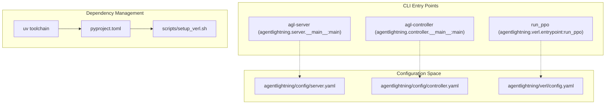
Sources: [pyproject.toml:48-50](), [agentlightning/config/server.yaml:1-11](), [agentlightning/config/controller.yaml:1-19](), [scripts/setup_verl.sh:1-11]()

## Installation Procedures

### Requirements
* **OS**: Linux (Ubuntu 22.04+ recommended) [docs/01-quick-start.md:11](). The `local` runner type (`runner_type=local`) relies on POSIX process-group signals and is explicitly not supported on native Windows [docs/30-controller-configuration.md:88-89](), [tests/controller/test_local_reconciler_platform.py:31-34]().
* **Python**: Version 3.12 or newer [pyproject.toml:21]().
* **Hardware**: NVIDIA GPU (A100 recommended). CUDA 12.9 or 13.0 is supported for stable GPU training stacks [scripts/setup_verl.sh:28-31]().

### Step 1: UV Sync
From the project root, use `uv` to install the base Python environment and core dependencies [docs/01-quick-start.md:27-31]():
```bash
uv sync
```
Sources: [pyproject.toml:22-34]()

### Step 2: Install VERL and GPU Stack
Agent Lightning uses `verl` as its training backend. The compatible versions of `verl`, `vllm`, and `torch` are tightly coupled. Use `scripts/setup_verl.sh` to install the tested stack and build `flash-attn` from source [scripts/setup_verl.sh:1-98]().

```bash
source .venv/bin/activate
# Usage: bash scripts/setup_verl.sh <verl_version> <cuda_variant> [venv_path]
bash scripts/setup_verl.sh 0.8.0 cu130
```
The script supports `verl` versions `0.7.1` or `0.8.0` and CUDA variants `cu129` or `cu130` [scripts/setup_verl.sh:23-31](). It automates the installation of `vllm`, `nvidia-cuda-nvcc` (for CUDA 13.0 builds), and forces a local compilation of `flash-attn==2.8.3` to ensure binary compatibility with PyTorch's CUDART runtime [scripts/setup_verl.sh:39-98]().

### Step 3: W&B Login
By default, tasks upload metrics and training trajectories to Weights & Biases [docs/01-quick-start.md:50]():
```bash
uv run wandb login
```
Sources: [docs/01-quick-start.md:50]()

## Dependency Group Configuration

Agent Lightning defines optional dependency groups and toolchain parameters in `pyproject.toml` to separate lightweight coordination services from the heavy GPU training stack [pyproject.toml:36-46](), [pyproject.toml:96-128]().

| Group | Purpose | Key Dependencies |
| :--- | :--- | :--- |
| `dev` | Development and testing | `pytest`, `ruff`, `pyright`, `openai`, `sympy` [pyproject.toml:37-46]() |
| `docs` | Documentation site generation | `mike`, `mkdocs-material`, `mkdocstrings`, `mkdocs-macros-plugin` [pyproject.toml:97-105]() |
| `verl-cpu` | Lint and type-check environment | `verl`, `torch` (CPU index), `ray`, `tensordict`, `datasets` [pyproject.toml:120-128]() |

**Toolchain Conflict Resolution**
The `verl-cpu` group uses a dedicated `uv` source (`pytorch-cpu`) pointing to `https://download.pytorch.org/whl/cpu` [pyproject.toml:58-70](). This allows static type-checkers (like `pyright`) and test suites to run on non-GPU worker nodes without downloading ~2.3GB of CUDA runtime binaries [pyproject.toml:110-128]().

Sources: [pyproject.toml:36-70](), [pyproject.toml:96-128]()

## Configuration Files

The framework uses Hydra for configuration management across services.

### Server Configuration (`server.yaml`)
Located at `agentlightning/config/server.yaml`, primary fields include:
* `host` and `port`: Uvicorn web server binding parameters [agentlightning/config/server.yaml:1-2]().
* `key`: Shared bearer token for API authentication [agentlightning/config/server.yaml:3]().
* `default_proxy`: Sets the default model name (e.g., `Qwen/Qwen2.5-7B-Instruct`) and sampling temperatures for `train` and `val` modes [agentlightning/config/server.yaml:4-11]().

### Controller Configuration (`controller.yaml`)
Located at `agentlightning/config/controller.yaml`, primary fields include:
* `runner_type`: Execution backend selector (`k8s` or `local`) [agentlightning/config/controller.yaml:1](), [docs/30-controller-configuration.md:41-47]().
* `agl_server.url`: API Gateway base URL used by the controller [agentlightning/config/controller.yaml:4](), [docs/30-controller-configuration.md:55-57]().
* `agl_server.agent_url`: Optional external URL for agent pods when networking requires traversal [agentlightning/config/controller.yaml:8](), [docs/30-controller-configuration.md:58]().
* `agl_server.key`: Shared authentication secret [agentlightning/config/controller.yaml:9](), [docs/30-controller-configuration.md:59]().
* `k8s_runner` and `local_runner`: Polling frequencies, process pool limits (`maximum_size: 50`), and job rate limits [agentlightning/config/controller.yaml:11-19](), [docs/30-controller-configuration.md:67-87]().

Sources: [agentlightning/config/server.yaml:1-11](), [agentlightning/config/controller.yaml:1-19](), [docs/30-controller-configuration.md:1-87]()

## Running the First Training Loop

A local test run uses the `local` runner mode to spawn agents as managed subprocesses on the same machine as the training process [docs/30-controller-configuration.md:49]().

### 1. Manual Service Entrypoints
Services can be started manually via the CLI entrypoints defined in `pyproject.toml`:
```bash
# Start the API Server Gateway
agl-server host=0.0.0.0 port=8080 key="my-secret-key"

# Start the Controller in local mode
agl-controller runner_type=local agl_server.url="http://localhost:8080" agl_server.key="my-secret-key"
```
Sources: [pyproject.toml:48-50](), [agentlightning/config/server.yaml:1-3](), [agentlightning/config/controller.yaml:1-9]()

### 2. Data Flow Diagram
The following diagram maps the execution components during training initialization and rollout reconciliation to code symbols in the codebase.

**Code Entity Data Flow: Training Initialization**
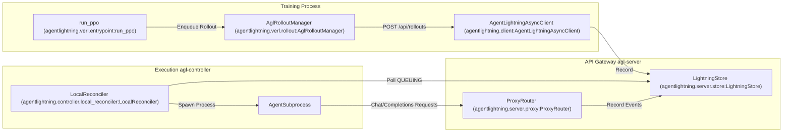
Sources: [pyproject.toml:48-50](), [agentlightning/controller/__main__.py:17-43](), [agentlightning/controller/local_reconciler.py:12]()

Sources: [pyproject.toml:1-128](), [scripts/setup_verl.sh:1-98](), [agentlightning/config/server.yaml:1-11](), [agentlightning/config/controller.yaml:1-19](), [docs/01-quick-start.md:1-57](), [docs/30-controller-configuration.md:1-95](), [tests/controller/test_local_reconciler_platform.py:1-61]()

---

# Page: Architecture Overview

# Architecture Overview

<details>
<summary>Relevant source files</summary>

The following files were used as context for generating this wiki page:

- [README.md](README.md)
- [agentlightning/controller/local_reconciler.py](agentlightning/controller/local_reconciler.py)
- [agentlightning/verl/entrypoint.py](agentlightning/verl/entrypoint.py)
- [agentlightning/verl/trainer.py](agentlightning/verl/trainer.py)
- [docs/00-installation.md](docs/00-installation.md)
- [docs/05-basics.md](docs/05-basics.md)
- [docs/20-trainer-configuration.md](docs/20-trainer-configuration.md)
- [docs/community/contributing.md](docs/community/contributing.md)
- [mkdocs.yml](mkdocs.yml)
- [tests/controller/test_local_reconciler.py](tests/controller/test_local_reconciler.py)
- [tests/controller/test_local_reconciler_env.py](tests/controller/test_local_reconciler_env.py)

</details>


Agent Lightning v1.0 decouples agent logic from training logic using a **Producer-Consumer loop**. This architecture allows developers to optimize agents built with any framework by treating agent execution as a telemetry source that feeds into a centralized API gateway store, which a Reinforcement Learning (RL) trainer then consumes to update policy weights [README.md:15-16](), [docs/05-basics.md:3-4]().

## Purpose and Scope

This page covers the core architectural design of Agent Lightning v1.0, detailing the three-service Producer-Consumer loop involving the VERL Trainer, `agl-server`, and `agl-controller`. It outlines service responsibilities, state transitions, and the data flow from rollout creation to reward ingestion and PPO optimization [README.md:39-45](), [docs/05-basics.md:11]().

Sources: [README.md:15-45](), [docs/05-basics.md:3-11]()

---

## The Producer-Consumer Loop

The system operates as a distributed loop where the **Trainer** produces rollout tasks and consumes reward/model events, while the **Controller** and **Agent** consume tasks and produce telemetry [README.md:39-45]().

1. **VERL Trainer (`AgentLightningRayPPOTrainer`)**: Orchestrates the RL lifecycle, generates rollout tasks, updates policy weights, and manages the training iteration [README.md:39-41](), [agentlightning/verl/trainer.py:100-105](), [docs/05-basics.md:77-86]().
2. **`agl-server` (API Gateway)**: The central FastAPI application hub (`create_app` in `agentlightning/server/app.py`) that persists rollout states (`_rollouts` store in `agentlightning/server/routes/rollouts.py`), proxies LLM requests (`ProxyRouter`), and ingests reward events [README.md:42-42](), [agentlightning/server/app.py:53-75](), [agentlightning/server/routes/rollouts.py:111-122]().
3. **`agl-controller` (Rollout Executor)**: Polls the server for queued rollouts and reconciles them by spawning agent processes locally (`LocalReconciler`) or as Kubernetes Jobs (`K8sReconciler` in `agentlightning/controller/k8s_reconciler.py`) [README.md:43-43](), [agentlightning/controller/local_reconciler.py:94-110]().
4. **Agent Subprocesses / K8s Jobs**: Executes agent code in a real harness, interacting with models through the `agl-server` proxy with zero changes to internal logic [README.md:15-16](), [docs/05-basics.md:11]().

### Data Flow Diagram

The following sequence diagram illustrates service interactions and code entrypoints during a rollout execution cycle, bridging natural language concepts to concrete code entities.

Title: System Service Interaction & Code Entities
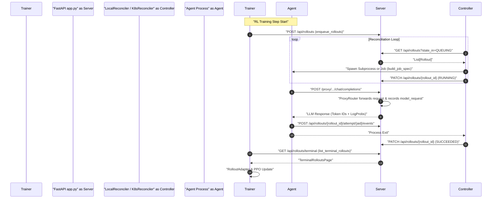
Sources: [README.md:33-45](), [agentlightning/verl/trainer.py:139-175](), [agentlightning/controller/local_reconciler.py:125-183]()

---

## Primary Components & Service Responsibilities

### 1. `agl-server` (API Gateway & Store)
The `agl-server` service is built as a FastAPI application (`agentlightning/server/app.py`) that captures execution telemetry without modifying the agent codebase [README.md:15-16](), [agentlightning/server/app.py:3]().
* **LLM Proxy**: Routes model requests through `ProxyRouter`, capturing prompt token IDs, response token IDs, and log probabilities directly from the inference engine to eliminate retokenization drift [README.md:83](), [agentlightning/server/app.py:70]().
* **Rollout State Machine**: Manages lifecycle states (`QUEUING`, `RUNNING`, `SUCCEEDED`, `FAILED`) via REST endpoints in `agentlightning/server/routes/rollouts.py` [docs/05-basics.md:33-36](), [agentlightning/server/routes/rollouts.py:95-209]().
* **Event Ingestion**: Handles reward and custom telemetry reporting via `/api` event routes [agentlightning/server/app.py:84]().

### 2. `agl-controller` (Rollout Execution)
The controller reconciles server rollout queues with compute infrastructure [docs/05-basics.md:64-75]().
* **Local Runner**: Spawns short-lived local subprocesses via `LocalReconciler` and injects environment variables (`AGL_OPENAI_BASE_URL`, `AGL_EVENT_URL`, `AGL_KEY`) [docs/05-basics.md:72](), [agentlightning/controller/local_reconciler.py:94-110]().
* **Kubernetes Runner**: Uses `K8sReconciler` and Jinja2 templates (`build_job_spec` in `agentlightning/controller/k8s_reconciler.py`) to render and launch Kubernetes Jobs managed by `kr8s` [agentlightning/controller/k8s_reconciler.py:43-101]().

### 3. VERL Training Integration (Optimization Layer)
The training module links `verl` with the API Gateway [docs/05-basics.md:77-88]().
* **Rollout Management**: Dispatches rollout tasks, awaits completion, and aggregates trajectories using `trace_aggregator` configurations in `AgentLightningRayPPOTrainer` [agentlightning/verl/trainer.py:139-153](), [docs/20-trainer-configuration.md:120-141]().
* **Policy Optimization**: Implements custom PPO loss functions (`per_rollout_mean`) and advantage normalization [docs/20-trainer-configuration.md:33-35]().

### Component Architecture & Code Mapping

Title: Component Architecture & Code Mapping
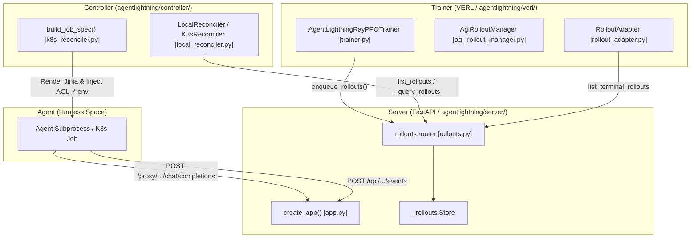
Sources: [agentlightning/verl/trainer.py:100-153](), [agentlightning/controller/local_reconciler.py:94-110]()

---

## Decoupling Benefits

The three-service architecture provides strict separation of concerns:
* **Agent Agnosticism**: Agents use standard OpenAI-compatible client libraries without requiring custom RL hooks [README.md:15-16](), [docs/05-basics.md:15]().
* **Environment Agnosticism**: The trainer operates purely on aggregated triplets and rewards, remaining agnostic to whether execution occurs in a local process or a Kubernetes sandbox [README.md:17-18](), [docs/05-basics.md:17]().
* **Infrastructure Isolation**: The API gateway buffers communication between GPU training clusters and CPU/sandbox rollout workers [docs/05-basics.md:17]().

Sources: [README.md:15-18](), [docs/05-basics.md:13-18]()

---

# Page: AGL Server

# AGL Server

<details>
<summary>Relevant source files</summary>

The following files were used as context for generating this wiki page:

- [agentlightning/controller/k8s_reconciler.py](agentlightning/controller/k8s_reconciler.py)
- [agentlightning/server/__init__.py](agentlightning/server/__init__.py)
- [agentlightning/server/__main__.py](agentlightning/server/__main__.py)
- [agentlightning/server/app.py](agentlightning/server/app.py)
- [agentlightning/server/routes/rollouts.py](agentlightning/server/routes/rollouts.py)

</details>


The `agl-server` is the central coordination hub and state management plane of the Agent Lightning framework [agentlightning/server/app.py:3-19](). Implemented as a FastAPI application, it manages rollout lifecycle states, provides an OpenAI-compatible reverse proxy for LLM generation, and ingests telemetry and reward events from running agents [agentlightning/server/app.py:3-19](). 

By centralizing state transitions and model interaction through `agl-server`, the training infrastructure (such as VERL) remains decoupled from environment execution details.

Sources: [agentlightning/server/app.py:3-19]()

## Role and Responsibilities

The server executes several core coordination duties:

*   **Rollout Coordination:** Manages rollout states through `enqueue_rollouts()` and `patch_rollout()` [agentlightning/server/routes/rollouts.py:95-183]().
*   **LLM Proxying:** Intercepts agent generation calls via `ProxyRouter` and manages drain/pause workflows with `ProxyPauseState` [agentlightning/server/app.py:17]().
*   **Event Ingestion:** Receives telemetry and reward payloads via event routers mounted in `create_app()` [agentlightning/server/app.py:84]().
*   **Authentication:** Validates API keys via `_build_auth_dependency()` using bearer tokens or `x-api-key` headers [agentlightning/server/app.py:34-50]().
*   **Application Lifecycle:** Manages background state variables and HTTP client sessions inside the `lifespan()` async context manager [agentlightning/server/app.py:67-73]().

Sources: [agentlightning/server/app.py:17-84](), [agentlightning/server/routes/rollouts.py:95-183]()

## System Topology & Code Mapping

The following diagram bridges natural language runtime components to their implementation symbols within the `agentlightning/server` package.

### System Topology Map
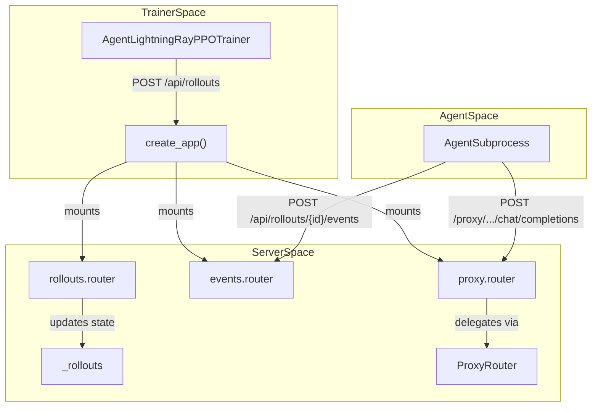
Sources: [agentlightning/server/app.py:53-93](), [agentlightning/server/routes/rollouts.py:95-209]()

## Core Subsystems

The server functionality is partitioned across three core domains, each detailed in its respective child page:

### REST API & Data Model
Exposes HTTP endpoints for rollout creation, lifecycle patching, lightweight terminal pagination, and health checks [agentlightning/server/routes/rollouts.py:95-209](), [agentlightning/server/app.py:78-80](). Data structures are validated via Pydantic schemas.

For details, see [REST API & Data Model](#2.1).

Sources: [agentlightning/server/app.py:78-80](), [agentlightning/server/routes/rollouts.py:95-209]()

### LLM Proxy & Gateway Management
Implements an OpenAI-compatible proxy interface that routes agent requests according to URL parameters, supporting model weight updates via pause and drain states managed by `ProxyPauseState` [agentlightning/server/app.py:17,68-88]().

For details, see [LLM Proxy & Gateway Management](#2.2).

Sources: [agentlightning/server/app.py:17,68-88]()

### Event System & Triplet Format
Ingeats agent telemetry (`model_request` and `reward` events) to reconstruct training sequences and calculate policy advantages [agentlightning/server/app.py:84]().

For details, see [Event System & Triplet Format](#2.3).

Sources: [agentlightning/server/app.py:84]()

## Code Entity Mapping

This diagram maps internal class implementations and route handlers to their architectural roles.

### Code Entity Map
```mermaid
classDiagram
    class create_app {
        +create_app(config) FastAPI
        +_build_auth_dependency(key)
    }
    class ProxyRouter {
        +__init__(default_proxy)
    }
    class ProxyPauseState {
        +pause()
        +resume()
    }
    class rollouts {
        +enqueue_rollouts()
        +list_rollouts()
        +patch_rollout()
    }
    class events {
        +post_event()
    }

    create_app --> ProxyRouter : "app.state.proxy_router"
    create_app --> ProxyPauseState : "app.state.proxy_pause_state"
    create_app --> rollouts : "rollouts.router"
    create_app --> events : "events.router"

    style create_app font-weight:bold
```
Sources: [agentlightning/server/app.py:34-93](), [agentlightning/server/routes/rollouts.py:95-209]()

## Execution

The server is launched via the Hydra entrypoint `main()` defined in `agentlightning/server/__main__.py` [agentlightning/server/__main__.py:14-23](). It constructs the application instance using `create_app(config)` and binds a `uvicorn` server instance [agentlightning/server/__main__.py:16-23]().

Sources: [agentlightning/server/__main__.py:14-23]()

---

# Page: REST API & Data Model

# REST API & Data Model

<details>
<summary>Relevant source files</summary>

The following files were used as context for generating this wiki page:

- [agentlightning/schemas.py](agentlightning/schemas.py)
- [agentlightning/server/routes/__init__.py](agentlightning/server/routes/__init__.py)
- [agentlightning/server/routes/models.py](agentlightning/server/routes/models.py)
- [agentlightning/server/store.py](agentlightning/server/store.py)
- [tests/server/test_endpoints.py](tests/server/test_endpoints.py)
- [tests/verl/test_agl_rollout_manager.py](tests/verl/test_agl_rollout_manager.py)

</details>


The `agl-server` module acts as the central state coordinator and telemetry hub for Agent Lightning. It provides a RESTful interface implemented in FastAPI [agentlightning/server/app.py:53-93]() for enqueuing rollouts, tracking their lifecycle states, registering models [agentlightning/server/routes/models.py:15-24](), and ingesting events such as LLM requests and reward signals [tests/server/test_endpoints.py:126-148](). The server uses an in-memory store (`_rollouts`, `_events`, `_models`, and `_terminal_order`) [agentlightning/server/store.py:13-18]() to maintain low-latency coordination between the training loop (producer) and the controller/runners (consumers).

Sources: [agentlightning/server/app.py:53-93](), [agentlightning/server/routes/models.py:15-24](), [agentlightning/server/store.py:13-18](), [tests/server/test_endpoints.py:126-148]()

---

## Rollout Lifecycle & State Machine

The core unit of work managed by `agl-server` is a `Rollout` [agentlightning/schemas.py:177-185](). Its execution lifecycle is governed by a strict state machine defined by `RolloutState` [agentlightning/schemas.py:77-84]() and enforced via `VALID_TRANSITIONS` [agentlightning/schemas.py:87-93]() during `patch_rollout` requests [agentlightning/server/routes/rollouts.py:182-209]().

### Rollout States
*   **`QUEUING`**: Initial state upon creation via `enqueue_rollouts` [agentlightning/schemas.py:80](), [agentlightning/server/routes/rollouts.py:95-122](). The rollout is waiting for a controller runner (local or Kubernetes) to pick it up.
*   **`RUNNING`**: The controller runner has claimed and spawned an agent process or Kubernetes Job for the rollout [agentlightning/schemas.py:81](), [agentlightning/controller/k8s_reconciler.py:38-101]().
*   **`SUCCEEDED`**: Terminal state indicating the agent completed execution successfully [agentlightning/schemas.py:82]().
*   **`FAILED`**: Terminal state indicating the agent crashed, timed out, or encountered a fatal error [agentlightning/schemas.py:83]().

### State Transitions & Terminal Ordering
Transitions are strictly validated against `VALID_TRANSITIONS` [agentlightning/schemas.py:87-93](). Attempting an invalid transition raises an HTTP 409 conflict via `_invalid_transition` [agentlightning/server/routes/rollouts.py:59-63]() and [tests/server/test_endpoints.py:51-56](). When a rollout enters a terminal state (`SUCCEEDED` or `FAILED`), its identifier is appended to `_terminal_order` [agentlightning/server/store.py:18](), enabling efficient cursor-based pagination for the VERL training loop via `list_terminal_rollouts` [agentlightning/server/routes/rollouts.py:143-171]().

**Title: Rollout State Machine (`RolloutState`, `VALID_TRANSITIONS`, and `patch_rollout`)**
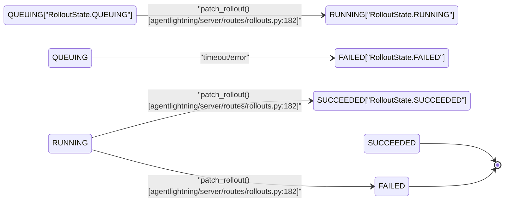
Sources: [agentlightning/schemas.py:77-100](), [agentlightning/server/routes/rollouts.py:59-209](), [agentlightning/server/store.py:18](), [tests/server/test_endpoints.py:32-71]()

---

## REST API Endpoints

The server exposes endpoints under the `/api` prefix alongside root proxy and health routes, protected by an optional bearer token or API key verified by `_build_auth_dependency` [agentlightning/server/app.py:34-50]().

### Rollout CRUD Endpoints (`/api/rollouts`)
| Method | Endpoint | Description | Code Entity / Reference |
| :--- | :--- | :--- | :--- |
| `POST` | `/api/rollouts` | Enqueue a batch of rollouts. Supports idempotency via client-supplied `rollout_id`. | `enqueue_rollouts` [agentlightning/server/routes/rollouts.py:95-122]() |
| `GET` | `/api/rollouts` | List rollouts filtered by lifecycle states. | `list_rollouts` [agentlightning/server/routes/rollouts.py:125-133]() |
| `GET` | `/api/rollouts/terminal` | Cursor-paginated lightweight list of completed rollouts for training consumption. | `list_terminal_rollouts` [agentlightning/server/routes/rollouts.py:143-171]() |
| `GET` | `/api/rollouts/{rollout_id}` | Retrieve full rollout details and attempt lists. | `get_rollout` [agentlightning/server/routes/rollouts.py:174-179]() |
| `PATCH` | `/api/rollouts/{rollout_id}` | Update rollout status and increment version. | `patch_rollout` [agentlightning/server/routes/rollouts.py:182-209]() |
| `DELETE` | `/api/rollouts/{rollout_id}` | Delete a rollout and its associated events idempotently. | `test_delete_rollout` [tests/server/test_endpoints.py:150-167]() |

### Event Ingestion & Model Registration Endpoints
| Method | Endpoint | Description | Code Entity / Reference |
| :--- | :--- | :--- | :--- |
| `POST` | `/api/rollouts/{rid}/attempt/{aid}/events` | Post user-defined or environment events (such as `reward`). | `test_event_endpoints` [tests/server/test_endpoints.py:126-148]() |
| `GET` | `/api/rollouts/{rid}/events` | Retrieve events for a rollout, supporting `?format=triplet`. | `_to_triplet_format` [agentlightning/server/routes/events.py:156-169]() |
| `POST` | `/api/models` | Register model inference endpoints (`model`, `endpoint`). | `register_models` [agentlightning/server/routes/models.py:15-24]() |
| `DELETE` | `/api/models` | Clear all registered model inference endpoints. | `delete_all_models` [agentlightning/server/routes/models.py:27-31]() |
| `GET` | `/healthz` | Health check endpoint returning status `ok`. | `healthz` [agentlightning/server/app.py:78-80]() |

Sources: [agentlightning/server/app.py:34-80](), [agentlightning/server/routes/rollouts.py:95-209](), [agentlightning/server/routes/models.py:15-31](), [agentlightning/server/routes/events.py:156-169](), [tests/server/test_endpoints.py:32-167]()

---

## Data Models & Pydantic Schemas

Agent Lightning relies on shared Pydantic models defined in `agentlightning/schemas.py` to guarantee schema compliance across the `agl-server`, controller runners, and VERL trainer.

### Key Schema Classes
*   **`Rollout`**: Represents a unit of work containing `rollout_id`, `input`, `is_train`, `config` (`RolloutConfig`), `metadata` (`RolloutMetadata`), and `status` (`RolloutLifecycleStatus`) [agentlightning/schemas.py:118-185]().
*   **`Event`**: Captures telemetry items (`event_type`, `rollout_id`, `attempt_id`, `timestamp`, and `data`) stored in insertion order [agentlightning/schemas.py:13-27]().
*   **`ModelRequestData`**: Well-known structure for `event_type='model_request'`, created automatically by the LLM proxy [agentlightning/schemas.py:36-54]().
*   **`RewardData`**: Well-known structure for `event_type='reward'`, reporting scalar `value`, messages, and sources [agentlightning/schemas.py:56-67]().
*   **`Model`**: Defines registered inference endpoints keyed by `(model, endpoint)` [agentlightning/schemas.py:69-75]().

**Title: Code Entity Relationship - API Data Models (`Rollout`, `RolloutConfig`, `Event`, `Model`)**
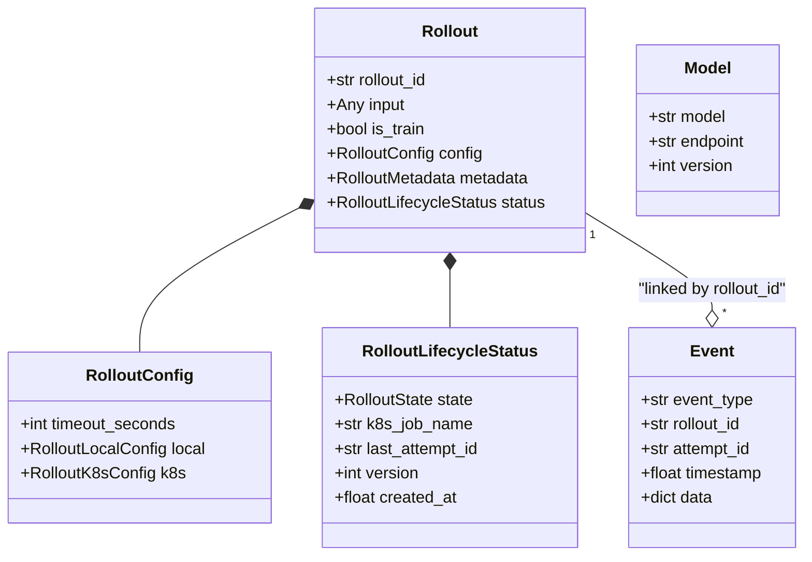
Sources: [agentlightning/schemas.py:13-185]()

---

## Triplet Format & Data Flow Pipeline

When the VERL training loop requests rollout events via `GET /api/rollouts/{id}/events?format=triplet`, `agl-server` transforms raw telemetry into training triplets through dedicated server route helpers and VERL manager adapters.

1.  **Event Transformation**: `_to_triplet_format` trims `model_request` payloads down to `prompt_token_ids`, `response_token_ids`, and `response_log_probs`, while scalarizing `reward` events into `value` [agentlightning/server/routes/events.py:100-169]().
2.  **Deduplication**: `_dedupe_model_requests_by_prompt_token_ids` ensures that if an agent retries an identical prompt, only the final successful interaction is retained for training [agentlightning/server/routes/events.py:172-183]().
3.  **Image Alignment**: The `AglRolloutManagerBase` in the VERL trainer parses raw message structures via `_extract_image_urls_from_messages` to align multimodal image inputs with corresponding triplet tokens [agentlightning/verl/agl_rollout_manager.py:10-11](), [tests/verl/test_agl_rollout_manager.py:163-197]().

**Title: Event Pipeline & Triplet Transformation (`_to_triplet_format`, `_dedupe_model_requests_by_prompt_token_ids`, `_extract_image_urls_from_messages`)**
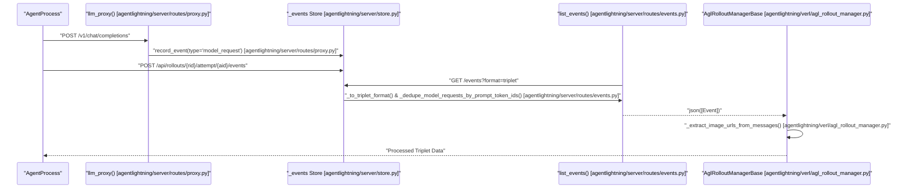
Sources: [agentlightning/server/routes/proxy.py:30-80](), [agentlightning/server/routes/events.py:100-183](), [agentlightning/server/store.py:13-18](), [agentlightning/verl/agl_rollout_manager.py:10-11](), [tests/verl/test_agl_rollout_manager.py:163-197]()

---

# Page: LLM Proxy & Gateway Management

# LLM Proxy & Gateway Management

<details>
<summary>Relevant source files</summary>

The following files were used as context for generating this wiki page:

- [agentlightning/server/proxy.py](agentlightning/server/proxy.py)
- [agentlightning/server/routes/proxy.py](agentlightning/server/routes/proxy.py)
- [docs/25-api-gateway-configuration.md](docs/25-api-gateway-configuration.md)
- [docs/35-asynchronous-training.md](docs/35-asynchronous-training.md)
- [tests/server/test_proxy_disconnect.py](tests/server/test_proxy_disconnect.py)

</details>


## Purpose and Scope
This page details the implementation of the OpenAI-compatible reverse proxy within `agl-server` (`agentlightning/server/proxy.py` and `agentlightning/server/routes/proxy.py`). It covers the proxy routing pattern, model selection and parameter injection via `ProxyRouter`, concurrency control and draining via `ProxyPauseState`, upstream retry mechanisms, client disconnect handling, and the gateway management endpoints.

Sources: [agentlightning/server/proxy.py:1-182](), [agentlightning/server/routes/proxy.py:1-139]()

---

## Proxy Routing Pattern & Architecture

The API Gateway exposes an OpenAI-compatible reverse proxy route defined in `agentlightning/server/routes/proxy.py`:

```text
POST /proxy/rollout/{rollout_id}/attempt/{attempt_id}/mode/{mode}/openai/v1/{upstream_path:path}
```

* `rollout_id`: Path parameter identifying the active rollout [agentlightning/server/routes/proxy.py:38]().
* `attempt_id`: Path parameter tracking the specific attempt index [agentlightning/server/routes/proxy.py:38]().
* `mode`: Execution mode (`train` or `val`), determining temperature and logprob injection rules [agentlightning/server/routes/proxy.py:42-43]().
* `upstream_path`: Forwarded target, supporting `chat/completions` and `completions` [agentlightning/server/routes/proxy.py:44-45]().

### Request Flow and Code Mapping

The following diagram bridges the natural language concept of proxy request handling to the exact FastAPI route handler (`llm_proxy`), router logic (`ProxyRouter`), and upstream forwarding functions (`forward_request`).

**Title: LLM Proxy Request Handling Flow**
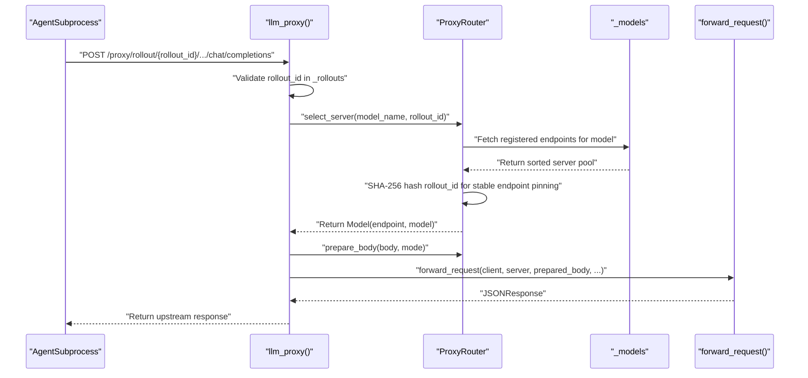
Sources: [agentlightning/server/routes/proxy.py:38-103](), [agentlightning/server/proxy.py:39-85](), [agentlightning/server/proxy.py:96-150]()

---

## Core Implementation Entities

### ProxyRouter
The `ProxyRouter` class (`agentlightning/server/proxy.py`) manages model selection and request parameter transformation:
* `select_server(model: str, rollout_id: str)`: Looks up registered model endpoints in `_models` [agentlightning/server/proxy.py:53-56](). To maximize upstream KV prefix cache hits, it sorts the endpoint pool and hashes `rollout_id` using SHA-256 to stably pin each rollout to a specific model server replica [agentlightning/server/proxy.py:57-61]().
* `prepare_body(body: dict[str, Any], mode: str)`: Injects `model`, `temperature`, and `return_token_ids=True` [agentlightning/server/proxy.py:63-83](). When `mode == "train"`, it enforces `logprobs=True` if configured (`_include_log_probs`) and injects routed experts if enabled [agentlightning/server/proxy.py:64-75]().

### ProxyPauseState
The `ProxyPauseState` dataclass (`agentlightning/server/proxy.py`) handles gateway pause and drain states [agentlightning/server/proxy.py:87-94]().
* `paused`: Boolean flag indicating whether new requests should be rejected [agentlightning/server/proxy.py:89]().
* `inflight`: Counter tracking active requests currently executing upstream [agentlightning/server/proxy.py:92]().
* `lock`: An `asyncio.Lock` guarding state transitions and concurrent increment/decrement operations [agentlightning/server/proxy.py:93]().

**Title: Proxy Entity Architecture**
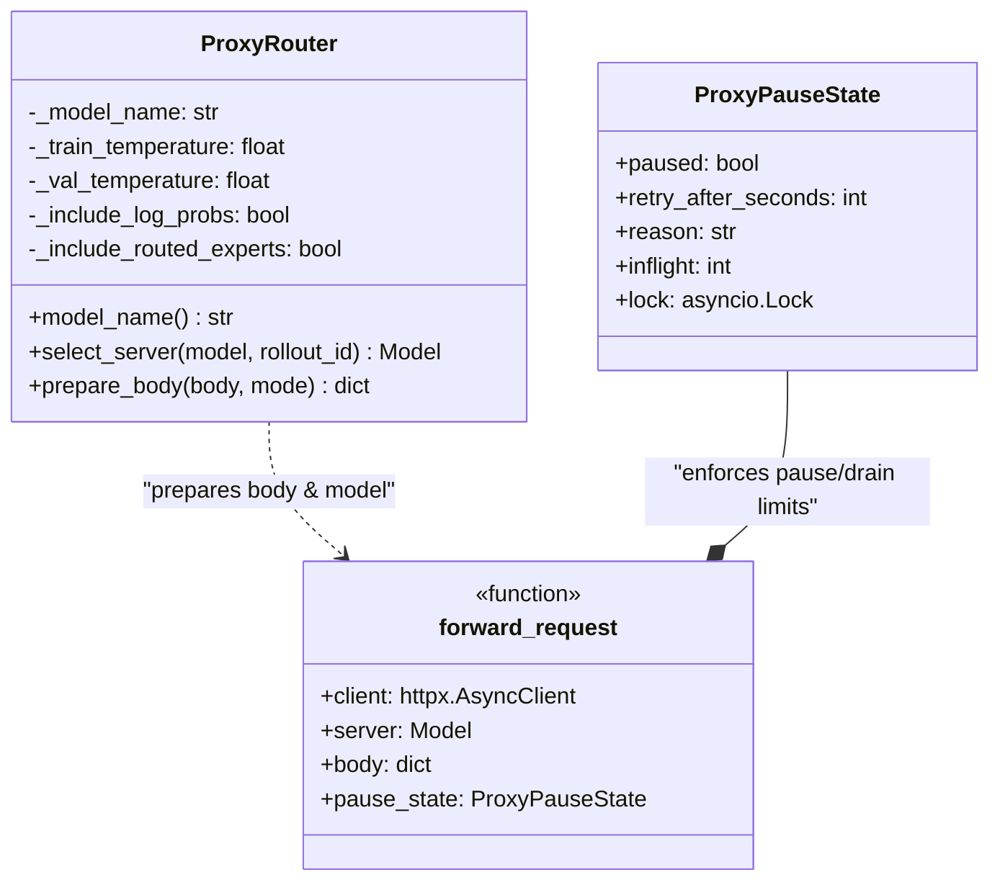
Sources: [agentlightning/server/proxy.py:39-94](), [agentlightning/server/proxy.py:96-150]()

---

## Reliability, Error Handling & Upstream Retries

To handle transient upstream model server failures (such as vLLM or TGI overloads), `_send_upstream_with_retries()` implements robust retry semantics (`agentlightning/server/proxy.py`) [agentlightning/server/proxy.py:162-182]().

*   **Max Attempts**: Bounded by `_UPSTREAM_MAX_ATTEMPTS = 6` [agentlightning/server/proxy.py:27]().
*   **Retryable Status Codes**: Triggers on `408`, `409`, `429`, and `_is_retryable_status()` checks [agentlightning/server/proxy.py:28](), [agentlightning/server/proxy.py:182]().
*   **Backoff Strategy**: Exponential backoff starting at `_RETRY_BACKOFF_BASE_SECONDS = 0.5` and capped at `_RETRY_BACKOFF_CAP_SECONDS = 8.0` [agentlightning/server/proxy.py:29-30]().
*   **Event Capture**: Every completed request invokes `_capture_event()` to record token sequences, latency, HTTP status, and retry counts into the event store [agentlightning/server/proxy.py:134-145]().

Sources: [agentlightning/server/proxy.py:27-30](), [agentlightning/server/proxy.py:134-145](), [agentlightning/server/proxy.py:162-182]()

---

## Client Disconnect Handling

When an agent subprocess disconnects during an active model request, `llm_proxy()` runs `_wait_for_disconnect(request)` concurrently with `forward_request()` [agentlightning/server/routes/proxy.py:31-35](), [agentlightning/server/routes/proxy.py:90](). If the client disconnects before the upstream response is returned, the gateway cancels the upstream HTTP task and pending retries, releases the in-flight slot, and returns a `499` status code [agentlightning/server/routes/proxy.py:91-102](). Completed requests before a disconnect are recorded normally [docs/25-api-gateway-configuration.md:62-65]().

Sources: [agentlightning/server/routes/proxy.py:31-102](), [docs/25-api-gateway-configuration.md:62-65]()

---

## Gateway Management Endpoints

Managed via `management_router` (`agentlightning/server/routes/proxy.py`), these endpoints control proxy lifecycle states during training weight updates [agentlightning/server/routes/proxy.py:21]().

| Endpoint | Method | Description |
| :--- | :--- | :--- |
| `/proxy/pause` | `POST` | Sets `paused=True`, returning `429 Too Many Requests` with a `Retry-After` header for incoming requests while active in-flight requests drain [agentlightning/server/routes/proxy.py:120-133](). |
| `/proxy/resume` | `POST` | Resumes proxy forwarding by setting `paused=False` [agentlightning/server/routes/proxy.py:136-149](). |
| `/proxy/state` | `GET` | Returns current pause configuration, reason, and active `inflight` request count [agentlightning/server/routes/proxy.py:152-161](). |

Sources: [agentlightning/server/routes/proxy.py:21](), [agentlightning/server/routes/proxy.py:120-161]()

---

# Page: Event System & Triplet Format

# Event System & Triplet Format

<details>
<summary>Relevant source files</summary>

The following files were used as context for generating this wiki page:

- [agentlightning/client.py](agentlightning/client.py)
- [agentlightning/schemas.py](agentlightning/schemas.py)
- [agentlightning/server/routes/events.py](agentlightning/server/routes/events.py)
- [tests/server/test_endpoints.py](tests/server/test_endpoints.py)
- [tests/test_client.py](tests/test_client.py)
- [tests/verl/test_agl_rollout_manager.py](tests/verl/test_agl_rollout_manager.py)

</details>


The Event System is the primary telemetry and data ingestion pipeline for Agent Lightning. It records every interaction between the agent and the environment, specifically tracking model inferences and rewards. This system serves two purposes: providing observability into agent behavior and transforming raw interaction logs into the "Triplet" format required for Reinforcement Learning (RL) training.

## Purpose & Scope

This page documents the event ingestion pipeline in `agentlightning/server/routes/events.py`, the structure of well-known events (`model_request` and `reward`) defined in `agentlightning/schemas.py`, the transformation pipeline that converts raw trajectory events into RL-ready triplets, deduplication logic, and the sync/async HTTP clients (`AgentLightningSyncClient` and `AgentLightningAsyncClient`) implemented in `agentlightning/client.py`.

Sources: [agentlightning/server/routes/events.py:1-187](), [agentlightning/client.py:1-82](), [agentlightning/schemas.py:1-68]()

---

## Event Ingestion Pipeline

Events are recorded per rollout attempt. A rollout represents a single task instance (e.g., a math problem or a coding task), and an attempt (`attempt_id`) is a specific execution of that task [agentlightning/schemas.py:13-27]().

### Event Types
1. **`model_request`**: Captured automatically by the LLM Proxy. It contains the prompt, the model's response, token IDs, log probabilities, and server metadata [agentlightning/server/routes/events.py:125-172](), structured via `ModelRequestData` [agentlightning/schemas.py:36-54]().
2. **`reward`**: Posted by the agent or an external evaluator. It contains a scalar `value` representing the success or score of the rollout [agentlightning/server/routes/events.py:175-182](), structured via `RewardData` [agentlightning/schemas.py:56-67]().

### Data Flow: Agent to Server
Agents interact with the event system via environment variables pointing to the server endpoints. Events are appended in-memory to `_events` via `record_event()` [agentlightning/server/routes/events.py:46-66]().

Title: Event Ingestion Pipeline Architecture
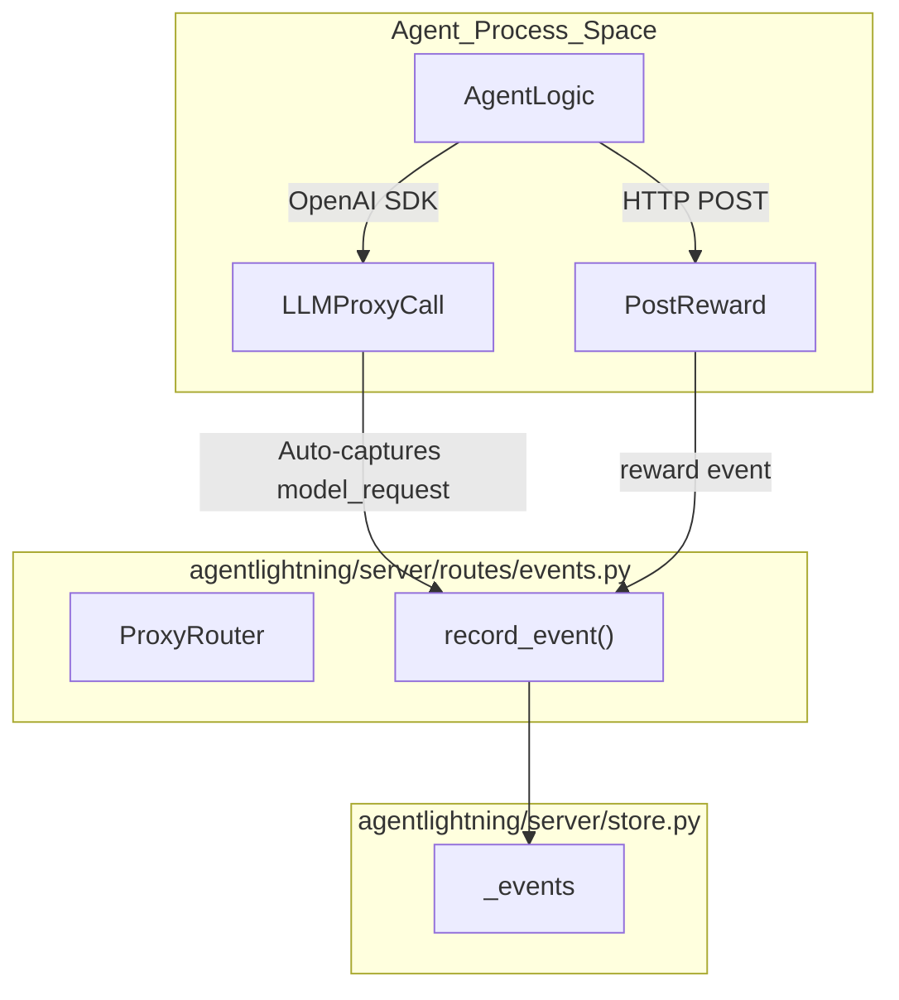
Sources: [agentlightning/server/routes/events.py:46-66](), [agentlightning/schemas.py:13-67]()

---

## Triplet Format & RL Extraction

During training, the VERL trainer requests events using query parameters like `?format=triplet` [tests/server/test_endpoints.py:138-142](). This triggers a transformation pipeline that trims raw events into a compact format suitable for PPO/GRPO updates.

### The Transformation Process
When triplet formatting is requested, the server applies specific transformations:
1. **Trimming**: The `_trim_model_request()` function extracts `prompt_token_ids`, `response_token_ids`, and `response_log_probs` [agentlightning/server/routes/events.py:125-172](). The `_trim_reward()` function extracts scalar values [agentlightning/server/routes/events.py:175-182]().
2. **Logprob Extraction**: The `_extract_choice_log_probs()` function parses OpenAI-style chat or completions logprobs into a flat list of floats, handling malformed entries robustly without raising exceptions [agentlightning/server/routes/events.py:87-122]().
3. **Expert Routing Cleanup**: The `_drop_superseded_routed_experts()` function manages routed expert tensors, keeping only the final route tensor in each mergeable trajectory [agentlightning/server/routes/events.py:24-43]().

### Triplet Structure
| Field | Source Event | Description |
| :--- | :--- | :--- |
| `prompt_token_ids` | `model_request` | The input tokens sent to the LLM [agentlightning/server/routes/events.py:140](). |
| `response_token_ids` | `model_request` | The tokens generated by the LLM [agentlightning/server/routes/events.py:145](). |
| `response_log_probs` | `model_request` | The log probabilities of the generated tokens [agentlightning/server/routes/events.py:146](). |
| `value` | `reward` | The scalar reward value for the rollout [agentlightning/server/routes/events.py:177](). |

Sources: [agentlightning/server/routes/events.py:24-182](), [tests/server/test_endpoints.py:138-142]()

---

## HTTP Clients & Authentication

Agent Lightning provides specialized HTTP clients in `agentlightning/client.py` to interact with the server, handling authentication and reliability [agentlightning/client.py:1-82]().

### `AgentLightningAsyncClient` & `AgentLightningSyncClient`
These clients extend `httpx` and utilize `_headers_with_key()` to automatically inject and normalize the `Authorization: Bearer {key}` header case-insensitively [agentlightning/client.py:13-17](), [tests/test_client.py:29-58]().

*   **`AgentLightningAsyncClient`**: Used within the `agl-controller` and async agent loops [agentlightning/client.py:20-33]().
*   **`AgentLightningSyncClient`**: Used by the VERL trainer. It includes a `post_with_retry()` method that implements exponential backoff (up to 30 seconds) for idempotent endpoints [agentlightning/client.py:64-82](). It also includes a `get()` method with retries [agentlightning/client.py:53-63]().

Title: Client Interaction Sequence
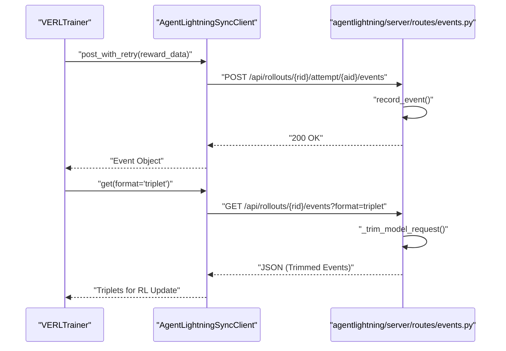
Sources: [agentlightning/client.py:13-82](), [tests/test_client.py:29-58]()

---

## Deduplication & Routing Cleanup

Deduplication and stream cleanup ensure that redundant or superseded model requests do not distort training metrics. The event recording pipeline invokes `_drop_superseded_routed_experts()` to clean up intermediate routed expert tensors for identical or extending prompt contexts [agentlightning/server/routes/events.py:24-43]().

Sources: [agentlightning/server/routes/events.py:24-43]()

---

# Page: AGL Controller

# AGL Controller

<details>
<summary>Relevant source files</summary>

The following files were used as context for generating this wiki page:

- [agentlightning/config/__init__.py](agentlightning/config/__init__.py)
- [agentlightning/config/controller.yaml](agentlightning/config/controller.yaml)
- [agentlightning/controller/__init__.py](agentlightning/controller/__init__.py)
- [agentlightning/controller/__main__.py](agentlightning/controller/__main__.py)
- [agentlightning/hooks.py](agentlightning/hooks.py)
- [docs/01-quick-start.md](docs/01-quick-start.md)
- [docs/30-controller-configuration.md](docs/30-controller-configuration.md)
- [tests/controller/test_local_reconciler_platform.py](tests/controller/test_local_reconciler_platform.py)

</details>


The `agl-controller` service translates declarative rollout requests from the central `agl-server` queue into real agent executions using either local subprocesses or Kubernetes Jobs [agentlightning/controller/__main__.py:17-43](). Operating on a continuous reconciliation model, the controller polls for `QUEUING` rollouts, provisions the corresponding compute environment, and monitors their lifecycle until they reach a terminal state (`SUCCEEDED` or `FAILED`) [agentlightning/controller/__main__.py:17-43]().

This page provides a high-level overview of the controller's architecture, runner backends, and lifecycle hooks. For detailed deep dives, refer to the child sections:
- Local runner mechanics: see [Local Runner](#3.1)
- Kubernetes runner mechanics: see [Kubernetes Runner](#3.2)
- Rollout lifecycle extensions: see [Rollout Hooks](#3.3)

---

## Architecture & Reconciliation Loop

The controller entrypoint is managed by `agentlightning/controller/__main__.py`, which initializes either a `LocalReconciler` or a `K8sReconciler` depending on the Hydra configuration defined in `agentlightning/config/controller.yaml` [agentlightning/controller/__main__.py:17-38](), [agentlightning/config/controller.yaml:1](). Signal handlers for `SIGTERM` and `SIGINT` are registered to ensure graceful shutdown of the reconciler loop [agentlightning/controller/__main__.py:39-43]().

### Controller Reconciliation Architecture

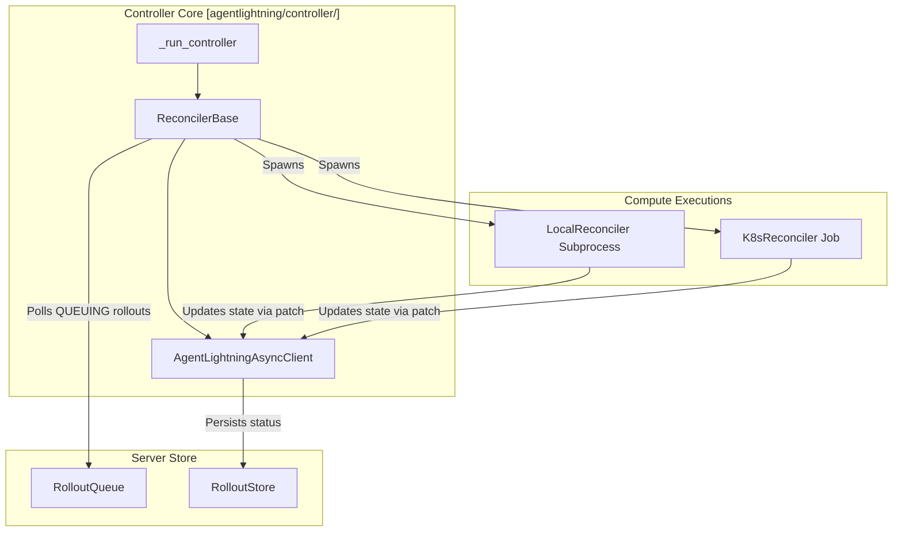
*Figure 1: High-level reconciliation flow bridging server queue state with controller execution loops.*

Sources: [agentlightning/controller/__main__.py:17-43](), [agentlightning/config/controller.yaml:1-19]()

---

## Runner Backends

The controller supports a single active runner type configured via `runner_type` (`local` or `k8s`) in `agentlightning/config/controller.yaml` [agentlightning/config/controller.yaml:1-1](). 

### Local Runner (`local`)
The local runner executes agent tasks as local OS subprocesses managed by `LocalReconciler`. It maintains a process pool constrained by `local_runner.maximum_size`, handles polling intervals via `local_runner.poll_interval`, and injects required runtime environment variables (`AGL_OPENAI_BASE_URL`, `AGL_EVENT_URL`, `AGL_KEY`) [agentlightning/config/controller.yaml:17-19](). The local runner is not supported on native Windows due to its reliance on POSIX process-group signals [docs/30-controller-configuration.md:89-90](), [tests/controller/test_local_reconciler_platform.py:31-34]().

For details, see [Local Runner](#3.1).

### Kubernetes Runner (`k8s`)
The Kubernetes runner delegates execution to `K8sReconciler`, which renders Jinja2-based Job manifests from rollout definitions, enforces rate limits via `k8s_runner.max_jobs_per_minute`, manages cleanup TTLs via `k8s_runner.ttl_after_finished`, and interacts with the cluster via the `kr8s` library [agentlightning/config/controller.yaml:11-16]().

For details, see [Kubernetes Runner](#3.2).

Sources: [agentlightning/config/controller.yaml:1-19](), [agentlightning/controller/__main__.py:22-38](), [docs/30-controller-configuration.md:89-90](), [tests/controller/test_local_reconciler_platform.py:31-34]()

---

## Rollout Lifecycle & Hooks

Rollouts progress through a strict lifecycle managed by the controller and reported back through `AgentLightningAsyncClient` [agentlightning/controller/__main__.py:18-21](). Developers can intercept these transitions using the `RolloutHooks` extension point defined in `agentlightning/hooks.py` [agentlightning/hooks.py:19-35]().

### Rollout Lifecycle State Machine

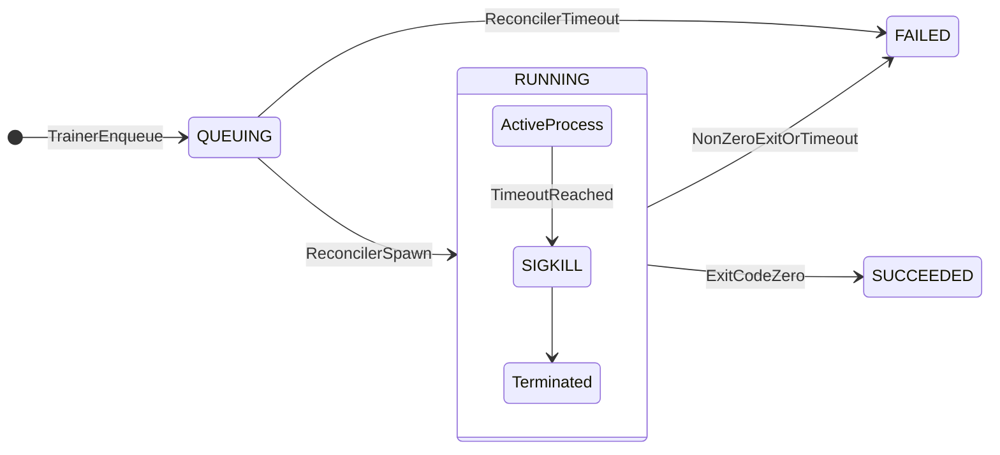
*Figure 2: State machine transitions executed during rollout reconciliation.*

Sources: [agentlightning/hooks.py:19-35](), [agentlightning/controller/__main__.py:17-43]()

The `RolloutHooks` protocol provides synchronization and customization callbacks during startup, enqueueing, success, and failure [agentlightning/hooks.py:19-35](). Dynamic loading of hook implementations from file paths is handled by `load_hooks()` [agentlightning/hooks.py:36-63]().

| Hook Method | Purpose | Source Reference |
| :--- | :--- | :--- |
| `on_startup` | Initialize hook state once after startup | [agentlightning/hooks.py:22-23]() |
| `on_enqueue` | Transform a rollout request before persistence | [agentlightning/hooks.py:25-27]() |
| `on_succeeded` | Post-process successful rollouts with `TraceWriter` | [agentlightning/hooks.py:29-30]() |
| `on_failed` | Handle failure logging and cleanup actions | [agentlightning/hooks.py:32-33]() |

For details, see [Rollout Hooks](#3.3).

Sources: [agentlightning/hooks.py:15-63]()

---

# Page: Local Runner

# Local Runner

<details>
<summary>Relevant source files</summary>

The following files were used as context for generating this wiki page:

- [agentlightning/controller/local_reconciler.py](agentlightning/controller/local_reconciler.py)
- [tests/controller/test_local_reconciler.py](tests/controller/test_local_reconciler.py)
- [tests/controller/test_local_reconciler_env.py](tests/controller/test_local_reconciler_env.py)

</details>


The purpose of this page is to document the implementation details of `LocalReconciler` (`agentlightning/controller/local_reconciler.py:94-110`()), the local runner component of `agl-controller`. It handles polling the server rollout queue, spawning agent rollouts as short-lived Python subprocesses, injecting `AGL_*` environment variables, managing a process pool, enforcing execution timeouts, handling state transitions, and dynamically loading agent classes.

---

## Overview & Platform Support

The `LocalReconciler` executes rollouts in a local process pool while maintaining synchronization with the central rollout queue via `AgentLightningAsyncClient` (`agentlightning/controller/local_reconciler.py:23-25`()). Because the local runner relies on POSIX process-group signal handling, native Windows is explicitly unsupported (`agentlightning/controller/local_reconciler.py:31-33`()). If `runner_type=local` is invoked on Windows, `LocalReconciler.run()` raises a `RuntimeError` before starting reconciliation or spawning any processes (`agentlightning/controller/local_reconciler.py:111-115`()).

### System Entity Mapping

**Diagram: Local Execution Data Flow**
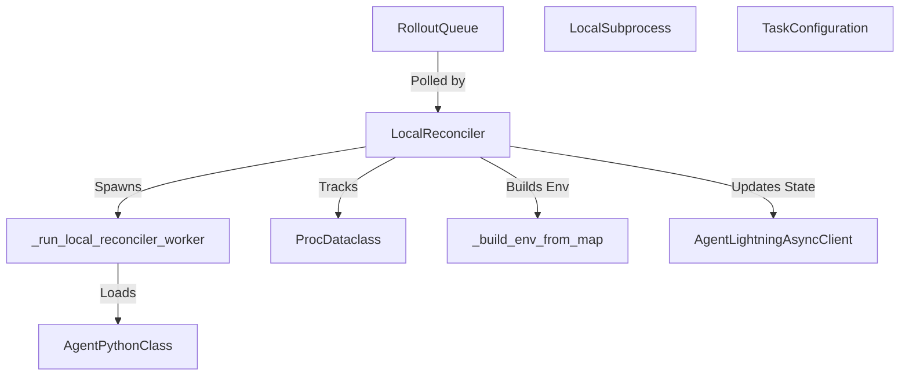
Sources: [agentlightning/controller/local_reconciler.py:35-51](), [agentlightning/controller/local_reconciler.py:53-61](), [agentlightning/controller/local_reconciler.py:63-74](), [agentlightning/controller/local_reconciler.py:94-110]()

**Diagram: Process Lifecycle State Machine**
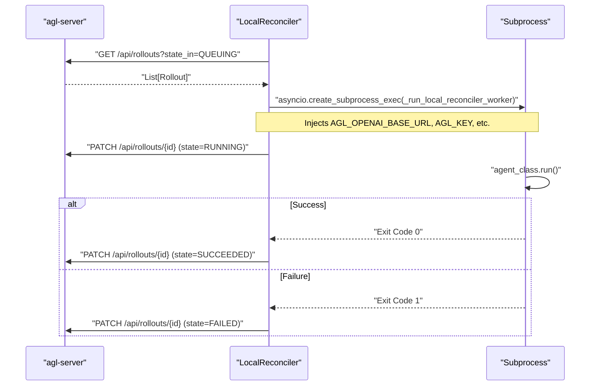
Sources: [agentlightning/controller/local_reconciler.py:125-183](), [agentlightning/controller/local_reconciler.py:184-189]()

Sources: [agentlightning/controller/local_reconciler.py:31-115]()

---

## Reconciliation Loop & Process Pool

The `LocalReconciler` runs a continuous asynchronous loop governed by `poll_interval` (`agentlightning/controller/local_reconciler.py:125-136`()).

### Polling and Scaling
`LocalReconciler._reconcile_once()` queries rollouts in `QUEUING` or `RUNNING` states with a limit of 50 per batch (`agentlightning/controller/local_reconciler.py:137-144`()). It records active child processes in the `_rid_to_proc` mapping dictionary (`agentlightning/controller/local_reconciler.py:108`()).
*   **Pool Size**: New subprocesses are spawned only when the live count is strictly less than `maximum_size` (`agentlightning/controller/local_reconciler.py:151-159`()).
*   **Orphan Detection**: If the server reports a rollout as `RUNNING` but no corresponding active local subprocess exists under `_rid_to_proc`, the reconciler transitions the rollout state to `FAILED` (`agentlightning/controller/local_reconciler.py:160-161`(), `tests/controller/test_local_reconciler.py:121-129`()).

Sources: [agentlightning/controller/local_reconciler.py:125-183](), [tests/controller/test_local_reconciler.py:121-129]()

---

## Environment Variable Injection & `env_map`

When spawning a subprocess, `LocalReconciler` injects a standardized set of environment variables (`tests/controller/test_local_reconciler_env.py:24-64`()).

### AGL System Variables
| Variable | Description |
| :--- | :--- |
| `AGL_OPENAI_BASE_URL` | Points to the reverse proxy endpoint: `http://{server}/proxy/rollout/{rid}/attempt/{aid}/mode/train/openai/v1` (`tests/controller/test_local_reconciler_env.py:62`()). |
| `AGL_EVENT_URL` | Points to the event ingestion endpoint: `http://{server}/api/rollouts/{rid}/attempt/{aid}/events` (`tests/controller/test_local_reconciler_env.py:63`()). |
| `AGL_KEY` | Bearer authorization key for gateway communication (`tests/controller/test_local_reconciler_env.py:61`()). |

### Task-Specific Variables (`env_map`)
The `_build_env_from_map()` and `_resolve_input_path()` functions extract specific values from the rollout's JSON `input` structure and map them to environment variables (`agentlightning/controller/local_reconciler.py:63-91`()). Nested dictionaries and list indexes are parsed dynamically (e.g., `input.question` or `input.items.0`) (`agentlightning/controller/local_reconciler.py:77-91`()).

Sources: [agentlightning/controller/local_reconciler.py:63-91](), [tests/controller/test_local_reconciler_env.py:24-64]()

---

## Agent Class Loading

`_run_local_reconciler_worker(agent_class_path: str)` serves as the entry point executed inside the spawned Python process (`agentlightning/controller/local_reconciler.py:35-51`()).
1.  **Dynamic Import**: Parses `agent_class_path` using colon (`:`) or dot (`.`) separators to separate the module name from the class name (`agentlightning/controller/local_reconciler.py:37-41`()).
2.  **Validation**: Confirms the imported attribute is a valid Python class (`agentlightning/controller/local_reconciler.py:42-43`()).
3.  **Execution**: Instantiates the class and invokes `.run()`. If the result is awaitable, `asyncio.run()` executes the coroutine (`agentlightning/controller/local_reconciler.py:44-46`()). Exceptions are caught and logged via `traceback.print_exc()`, returning a non-zero exit code (`agentlightning/controller/local_reconciler.py:48-50`()).

Sources: [agentlightning/controller/local_reconciler.py:35-51]()

---

## Timeouts and Termination

The reconciler enforces strict duration limits and handles graceful shutdown procedures.

### Timeout Enforcement
During each reconciliation tick, active subprocesses are checked against their configured `timeout_seconds` (`agentlightning/controller/local_reconciler.py:171-183`()). If `(now - spawned_at) > timeout`, the reconciler terminates the process group and marks the rollout as `FAILED` with a timeout explanation (`agentlightning/controller/local_reconciler.py:177-183`(), `tests/controller/test_local_reconciler.py:133-176`()).

### Graceful Shutdown
When stop signals are received, `LocalReconciler.stop()` sets the internal `_stop` event (`agentlightning/controller/local_reconciler.py:122-124`()). The cleanup sequence waits up to `_SHUTDOWN_WAIT_TIMEOUT` (5.0 seconds) for running subprocesses to exit before forcing termination (`agentlightning/controller/local_reconciler.py:28`()).

Sources: [agentlightning/controller/local_reconciler.py:28](), [agentlightning/controller/local_reconciler.py:122-124](), [agentlightning/controller/local_reconciler.py:171-183](), [tests/controller/test_local_reconciler.py:133-176]()

---

# Page: Kubernetes Runner

# Kubernetes Runner

<details>
<summary>Relevant source files</summary>

The following files were used as context for generating this wiki page:

- [agentlightning/controller/k8s_reconciler.py](agentlightning/controller/k8s_reconciler.py)
- [agentlightning/server/app.py](agentlightning/server/app.py)
- [agentlightning/server/routes/rollouts.py](agentlightning/server/routes/rollouts.py)
- [examples/calc_x/job-template.yaml](examples/calc_x/job-template.yaml)
- [tests/controller/test_k8s_reconciler.py](tests/controller/test_k8s_reconciler.py)

</details>


The `K8sReconciler` is the core component of the `agl-controller` responsible for managing the lifecycle of rollouts on a Kubernetes cluster. It translates `Rollout` objects from the `agl-server` into Kubernetes `Job` resources, monitors their execution using the `kr8s` async library, and synchronizes their terminal states back to the server [agentlightning/controller/k8s_reconciler.py:3-10]().

Sources: [agentlightning/controller/k8s_reconciler.py:3-10]()

---

## Implementation Architecture

The `K8sReconciler` operates using two concurrent asynchronous loops to ensure consistency between the `agl-server` state and the Kubernetes cluster state [agentlightning/controller/k8s_reconciler.py:5-10]().

### Concurrent Control Loops
1.  **`_periodic_reconcile_loop`**: Polls the `agl-server` for rollouts in `QUEUING` or `RUNNING` states at an interval defined by `poll_interval`. It triggers the creation of new Kubernetes Jobs and detects orphaned rollouts [agentlightning/controller/k8s_reconciler.py:147-160]().
2.  **`_watch_jobs_loop`**: Utilizes the `kr8s` library to watch for event-driven updates from the Kubernetes API. It reacts immediately when a Job succeeds or fails, updating the rollout status on the server without waiting for the next poll cycle [agentlightning/controller/k8s_reconciler.py:228-256]().

### Data Flow: Server to Cluster
The following diagram maps the transition from a `Rollout` entity in the code to a `Job` resource in Kubernetes, bridging natural language concepts with code entities.

**Rollout to K8s Job Mapping**
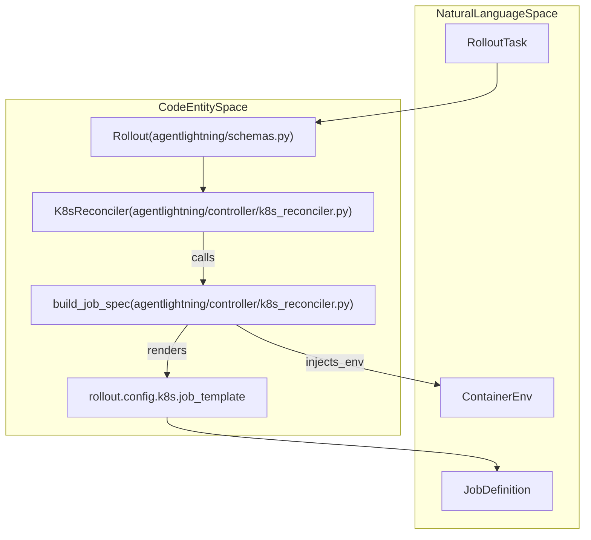
Sources: [agentlightning/controller/k8s_reconciler.py:43-101](), [agentlightning/schemas.py:18-25]()

---

## Job Manifest Rendering

The runner uses Jinja2 to render Job manifests from templates provided in the rollout configuration [agentlightning/controller/k8s_reconciler.py:25-27]().

### Template Processing
The `build_job_spec` function performs the following steps [agentlightning/controller/k8s_reconciler.py:43-43]():
1.  **Jinja2 Rendering**: It takes the template from `rollout.config.k8s.job_template` and renders it using the `job_name` and the `rollout.input` data. It includes a `yaml_escape` filter to handle special characters in input strings [agentlightning/controller/k8s_reconciler.py:45-54](), [examples/calc_x/job-template.yaml:17-19]().
2.  **Validation**: It ensures the rendered YAML contains exactly one document and that the document `kind` is `Job` [agentlightning/controller/k8s_reconciler.py:55-61]().
3.  **Metadata Injection**: It forces specific metadata to ensure the controller can track the resource:
    *   `name`: Generated via `build_job_name(rollout_id)` (format: `agl-rollout-{id}`) [agentlightning/controller/k8s_reconciler.py:38-40]().
    *   `labels`: Includes the `MANAGED_BY_SELECTOR` (`app.kubernetes.io/managed-by=agentlightning`), the specific `rollout-id`, and the `attempt-id` [agentlightning/controller/k8s_reconciler.py:34-34](), [agentlightning/controller/k8s_reconciler.py:63-70]().

### AGL Environment Variable Injection
To enable the agent running inside the container to communicate back to the server, the reconciler injects three critical environment variables into **every** container in the Pod spec [agentlightning/controller/k8s_reconciler.py:86-100]():

| Variable | Description | Value Pattern |
| :--- | :--- | :--- |
| `AGL_OPENAI_BASE_URL` | LLM Proxy endpoint | `{base}/proxy/rollout/{rid}/attempt/{aid}/mode/{mode}/openai/v1` [agentlightning/controller/k8s_reconciler.py:83-85]() |
| `AGL_EVENT_URL` | Event ingestion endpoint | `{base}/api/rollouts/{rid}/attempt/{aid}/events` [agentlightning/controller/k8s_reconciler.py:90-92]() |
| `AGL_KEY` | Authentication token | Configured via `controller_config.agl_server.key` [agentlightning/controller/k8s_reconciler.py:93-93]() |

Sources: [agentlightning/controller/k8s_reconciler.py:34-101](), [tests/controller/test_k8s_reconciler.py:11-50](), [examples/calc_x/job-template.yaml:1-23]()

---

## Resource Management & Rate Limiting

The `K8sReconciler` includes safeguards to prevent overwhelming the Kubernetes API or the cluster resources [agentlightning/controller/k8s_reconciler.py:104-120]().

### Rate Limiting
The controller implements a sliding window rate limiter using `max_jobs_per_minute`. It maintains a `deque` of `_job_creation_timestamps` and checks if the number of jobs created in the last `JOB_CREATION_WINDOW_SECONDS` (60s) exceeds the configured limit before spawning new ones [agentlightning/controller/k8s_reconciler.py:35-35](), [agentlightning/controller/k8s_reconciler.py:119-119]().

### Orphaned Job Detection
During the `_reconcile_once` cycle, the reconciler fetches all Jobs matching the `MANAGED_BY_SELECTOR` [agentlightning/controller/k8s_reconciler.py:165-172](). 
*   **Orphaned Jobs**: If a Job exists but the server has no record of the rollout (or it is in a terminal state), it is deleted from the cluster [agentlightning/controller/k8s_reconciler.py:188-192]().
*   **Orphaned Rollouts**: If a rollout is `RUNNING` on the server but no Job exists in K8s, it is considered orphaned and its state is patched to `FAILED` on the server [agentlightning/controller/k8s_reconciler.py:183-186]().

### Lifecycle & Cleanup
*   **`backoffLimit`**: Explicitly set to `0` to prevent Kubernetes from retrying failed agent pods; retries are managed by the `agl-server` state machine [agentlightning/controller/k8s_reconciler.py:72-72]().
*   **`activeDeadlineSeconds`**: Derived from `rollout.config.timeout_seconds` to ensure Jobs are killed by K8s if they hang [agentlightning/controller/k8s_reconciler.py:74-75]().
*   **`ttlSecondsAfterFinished`**: Configured via `k8s_runner.ttl_after_finished` to automatically clean up completed Job resources from the cluster [agentlightning/controller/k8s_reconciler.py:73-73]().

**Component Interaction Diagram**
```mermaid
sequenceDiagram
    participant S as "AglServer"
    participant C as "K8sReconciler"
    participant K as "Kr8sAPI"

    C->>S: "_query_rollouts(QUEUING)"
    S-->>C: "RolloutList"
    C->>C: "build_job_spec()"
    C->>K: "Job.create()"
    C->>S: "_patch_status(RUNNING, job_name)"
    
    K-->>C: "WatchEvent(JobSucceeded)"
    C->>S: "_patch_status(SUCCEEDED)"
    Note over K,C: "Job cleaned by ttlSecondsAfterFinished"
```
Sources: [agentlightning/controller/k8s_reconciler.py:104-256](), [agentlightning/client.py:29-29]()

---

# Page: Rollout Hooks

# Rollout Hooks

<details>
<summary>Relevant source files</summary>

The following files were used as context for generating this wiki page:

- [agentlightning/config/__init__.py](agentlightning/config/__init__.py)
- [agentlightning/config/controller.yaml](agentlightning/config/controller.yaml)
- [agentlightning/controller/__init__.py](agentlightning/controller/__init__.py)
- [agentlightning/controller/__main__.py](agentlightning/controller/__main__.py)
- [agentlightning/hooks.py](agentlightning/hooks.py)

</details>


Rollout Hooks provide a synchronous extension point for intercepting and augmenting the rollout lifecycle during training [agentlightning/hooks.py:3-4](). They allow developers to modify rollout requests before they are enqueued, initialize state at startup, and process results (success or failure) to inject synthetic events or metrics into the server event stream.

---

### Lifecycle Callbacks

The `RolloutHooks` base class defines four primary lifecycle methods that are invoked by the rollout management infrastructure during the training loop [agentlightning/hooks.py:19-33]().

| Hook Method | Timing | Primary Purpose |
|:---|:---|:---|
| `on_startup` | Once during initialization [agentlightning/hooks.py:22-23](). | Initialize external resources or shared state. |
| `on_enqueue` | Before a rollout request is persisted [agentlightning/hooks.py:25-27](). | Transform `RolloutCreate` payloads (e.g., adding metadata or dynamic config). |
| `on_succeeded` | After a rollout transitions to `SUCCEEDED` [agentlightning/hooks.py:29-30](). | Post-process events, calculate complex rewards, or log traces. |
| `on_failed` | After a rollout transitions to `FAILED` [agentlightning/hooks.py:32-33](). | Debugging, error logging, or cleanup. |

Sources:
- `RolloutHooks` definition: [agentlightning/hooks.py:19-33]()
- `RolloutCreate` schema reference: [agentlightning/hooks.py:9]()

---

### Data Flow and Trace Injection

When a rollout completes, the manager fetches the full event history and invokes the success or failure hooks [agentlightning/hooks.py:29-33](). A key feature of these hooks is the `TraceWriter` protocol [agentlightning/hooks.py:15-16](), which allows hooks to inject new events back into the server for a specific rollout attempt.

#### Code Entity Mapping: Lifecycle Execution
The following sequence diagram shows how the rollout runner coordinates with `RolloutHooks` and the `TraceWriter` protocol.

```mermaid
sequenceDiagram
    participant RM as "AglRolloutManagerBase"
    participant H as "RolloutHooks"
    participant TH as "_TraceEventHelper"
    participant S as "agl-server"

    Note over RM, S: "Rollout Creation Phase"
    RM->>H: "on_enqueue(request: RolloutCreate)"
    H-->>RM: "RolloutCreate"
    RM->>S: "POST /api/rollouts"

    Note over RM, S: "Rollout Completion Phase"
    RM->>S: "GET /api/rollouts/{id}"
    S-->>RM: "Rollout(state=SUCCEEDED)"
    
    create participant TH
    RM->>TH: "new()"
    RM->>H: "on_succeeded(rollout, events, store)"
    
    opt "Synthetic Event Injection"
        H->>TH: "add_event(rollout_id, attempt_id, event_type, data)"
    end
    
    RM->>TH: "flush()"
    TH->>S: "POST /api/rollouts/{id}/attempt/{aid}/events"
```

Sources:
- `TraceWriter` protocol: [agentlightning/hooks.py:15-16]()
- `RolloutHooks` methods: [agentlightning/hooks.py:19-33]()

---

### Dynamic Loading and Configuration

Hooks are loaded dynamically from a Python file at runtime [agentlightning/hooks.py:36-63](). This allows training configurations to remain decoupled from the specific hook logic.

#### The `load_hooks()` Function
The `load_hooks(path: str)` function performs the following steps:
1. Resolves the absolute path to the provided Python module [agentlightning/hooks.py:42-44]().
2. Dynamically imports the module using `importlib.util` [agentlightning/hooks.py:46-49]().
3. Inspects the module using `inspect.getmembers` to identify subclasses of `RolloutHooks` [agentlightning/hooks.py:51-55]().
4. Validates that exactly one valid subclass exists to avoid ambiguity [agentlightning/hooks.py:57-61]().
5. Returns an instantiated instance of the hook class [agentlightning/hooks.py:63]().

#### Configuration Wiring
Hooks are specified in the training configuration under the `agentlightning` block.

```yaml
# Example configuration snippet
agentlightning:
  hooks: "path/to/my_hooks.py"
  agl_server:
    url: "http://localhost:8080"
```

Sources:
- `load_hooks` implementation: [agentlightning/hooks.py:36-63]()
- Controller configuration defaults: [agentlightning/config/controller.yaml:1-10]()

---

### Implementation Example: Synthetic Reward Injection

A common use case for `RolloutHooks` is to calculate a global reward based on the entire sequence of events and inject it as a synthetic reward event if the agent failed to post one explicitly.

```mermaid
graph TD
    subgraph NaturalLanguageSpace
        A["TrainingLoopFinishesRollout"]
        B["CustomLogicProcessesTraces"]
        C["NewRewardSentToServer"]
    end

    subgraph CodeEntitySpace
        A -->|invokes| H_SUCC["RolloutHooks.on_succeeded"]
        H_SUCC -->|uses| TW["TraceWriter.add_event"]
        TW -->|queues for| RM["AglRolloutManagerBase"]
        RM -->|HTTP POST| API["/api/rollouts/{id}/attempt/{aid}/events"]
    end
```

Sources:
- `RolloutHooks.on_succeeded` definition: [agentlightning/hooks.py:29-30]()
- `TraceWriter.add_event` definition: [agentlightning/hooks.py:15-16]()
- Dynamic loading discovery: [agentlightning/hooks.py:51-55]()

---

# Page: VERL Training Integration

# VERL Training Integration

<details>
<summary>Relevant source files</summary>

The following files were used as context for generating this wiki page:

- [agentlightning/verl/__init__.py](agentlightning/verl/__init__.py)
- [agentlightning/verl/vllm_compat.py](agentlightning/verl/vllm_compat.py)

</details>


## Purpose and Scope
This page provides an overview of the VERL/PPO training integration in Agent Lightning. It covers how the custom `AgentLightningRayPPOTrainer` coordinates with `agl-server` and `agl-controller` to execute agent rollouts asynchronously, manage gateway states, process rollouts through adapters, and apply per-rollout loss functions.

For deep technical details, refer to the child pages:
- [Trainer & Training Loop](#4.1)
- [Rollout Manager & Adapter](#4.2)
- [Per-Rollout Loss & Advantage](#4.3)
- [VERL Configuration](#4.4)

Sources: [agentlightning/verl/trainer.py:100-175](), [agentlightning/verl/__init__.py:1-3]()

---

## Overview

The **VERL Training Integration** enables Agent Lightning to leverage the VERL framework for large-scale Reinforcement Learning (RL). Unlike standard VERL, which executes rollouts using local Ray workers, Agent Lightning extends the PPO trainer to dispatch rollouts to `agl-server` via `AgentLightningRayPPOTrainer` [agentlightning/verl/trainer.py:100-101](). This architecture decouples agent execution—running in isolated local subprocesses or Kubernetes Jobs—from the trainer's core weight updates and advantage estimation loops. Additionally, runtime shims such as `apply_vllm_compat_patches` ensure compatibility across different vLLM versions [agentlightning/verl/vllm_compat.py:15-18]().

Sources: [agentlightning/verl/trainer.py:100-101](), [agentlightning/verl/vllm_compat.py:15-18]()

## Core Abstractions

The integration is centered around `AgentLightningRayPPOTrainer` [agentlightning/verl/trainer.py:100-101](), which overrides standard VERL rollout logic to interact with the Agent Lightning service ecosystem:

*   **Gateway Management**: Before executing a PPO weight update, the trainer invokes `_pause_and_drain_gateway` [agentlightning/verl/trainer.py:171-175]() to pause the LLM proxy gateway (`/proxy/pause`), draining in-flight agent requests to maintain parameter consistency [agentlightning/verl/trainer.py:171-175]().
*   **Rollout Dispatch**: Instead of local sampling loops, the rollout methods delegate work to instances managed by `_make_rollout_manager` [agentlightning/verl/trainer.py:139-152]() using `AglRolloutManager` or `AglAsyncRolloutManager` [agentlightning/verl/trainer.py:38-44]().
*   **Custom Loss Integration**: It registers custom policy losses like `per_rollout_mean` across Ray worker processes via setup hooks configured in `run_ppo` [agentlightning/verl/entrypoint.py:33-73]().

Sources: [agentlightning/verl/trainer.py:38-175](), [agentlightning/verl/entrypoint.py:33-73]()

### System Mapping: Trainer to Server Loop

The following diagram bridges natural language descriptions of the training loop to their corresponding code entities in `agentlightning/verl/trainer.py` and service routing layers.

Title: "System Mapping: Trainer to Server Loop"
```mermaid
graph TD
    subgraph "Trainer_Space (Ray)"
        T["AgentLightningRayPPOTrainer.fit()"]
        RM["AglRolloutManager._rollout()"]
        AD["RolloutAdapter.get_train_data_batch()"]
    end

    subgraph "Server_Space (FastAPI)"
        S["agl-server"]
        P["ProxyRouter (/proxy/pause)"]
        Q["Rollout Queue (/api/rollouts)"]
    end

    subgraph "Execution_Space"
        C["agl-controller"]
        A["Agent Subprocess/Job"]
    end

    T -- "1. Dispatch" --> RM
    RM -- "POST /api/rollouts" --> Q
    Q -- "Poll" --> C
    C -- "Spawn" --> A
    A -- "2. LLM Request" --> P
    T -- "3. Pause for Update" --> P
    RM -- "4. Fetch Results" --> AD
    AD -- "GET /api/rollouts?format=triplet" --> S
```
Sources: [agentlightning/verl/trainer.py:100-175]()

---

## Component Details & Child Navigation

The VERL training subsystem is divided into four primary modules:

1.  **Trainer & Training Loop**: Implemented in `AgentLightningRayPPOTrainer` [agentlightning/verl/trainer.py:100-101](), managing `fit()`, `_train_step()`, `_rollout()`, gateway pause/drain, carry-over rollouts, and datasets.
    *   For details, see [Trainer & Training Loop](#4.1).
2.  **Rollout Manager & Adapter**: Implemented via `AglRolloutManagerBase` [agentlightning/verl/trainer.py:41-44]() and `RolloutAdapter` [agentlightning/verl/trainer.py:50-50]() handling trace merging, padding, and metrics integration.
    *   For details, see [Rollout Manager & Adapter](#4.2).
3.  **Per-Rollout Loss & Advantage**: Custom `per_rollout_mean` PPO loss, advantage normalization, dual-clip policy loss, and GRPO group metrics [agentlightning/verl/trainer.py:65-79]().
    *   For details, see [Per-Rollout Loss & Advantage](#4.3).
4.  **VERL Configuration**: Schema reference (`agentlightning/verl/config.yaml`), actor-rollout-ref overrides, and configuration merging utilities.
    *   For details, see [VERL Configuration](#4.4).

Sources: [agentlightning/verl/trainer.py:41-101](), [agentlightning/verl/trainer.py:65-79]()

---

## Entity Mapping: Data Flow

This diagram maps the core data classes and their relationships within the VERL training execution path.

Title: "Entity Mapping: Data Flow"
```mermaid
classDiagram
    class LoadedDataset {
        +dataframe: Dataset
        +__getitem__(item)
    }
    class AglRolloutManager {
        +enqueue_and_wait_until_completed()
        +rollout_timeout_seconds: int
    }
    class RolloutAdapter {
        +get_train_data_batch()
        +get_test_metrics()
    }
    class AgentLightningRayPPOTrainer {
        +fit()
        +_train_step()
        +_pause_and_drain_gateway()
    }

    LoadedDataset --> AgentLightningRayPPOTrainer : "Provides Prompts"
    AgentLightningRayPPOTrainer --> AglRolloutManager : "Dispatches Tasks"
    AglRolloutManager --> RolloutAdapter : "Returns CompletedRollout"
    RolloutAdapter --> AgentLightningRayPPOTrainer : "Returns DataProto"
```
Sources: [agentlightning/verl/trainer.py:100-152]()

Sources:
- [agentlightning/verl/trainer.py:1-175]()
- [agentlightning/verl/entrypoint.py:1-73]()
- [agentlightning/verl/vllm_compat.py:1-41]()
- [agentlightning/verl/__init__.py:1-3]()

---

# Page: Trainer & Training Loop

# Trainer & Training Loop

<details>
<summary>Relevant source files</summary>

The following files were used as context for generating this wiki page:

- [agentlightning/__init__.py](agentlightning/__init__.py)
- [agentlightning/verl/dataset.py](agentlightning/verl/dataset.py)
- [agentlightning/verl/entrypoint.py](agentlightning/verl/entrypoint.py)
- [agentlightning/verl/trainer.py](agentlightning/verl/trainer.py)

</details>


The `AgentLightningRayPPOTrainer` is the core engine of the Agent Lightning reinforcement learning pipeline. It extends the standard VERL `RayPPOTrainer` to support agentic workflows where rollouts are executed as independent processes or Kubernetes jobs rather than local model-based samplers. This trainer manages the lifecycle of distributed agent execution, handles the transition from agent events to RL triplets, and coordinates weight updates with the LLM proxy.

## Overview & Entrypoint (`run_ppo` & `LoadedDataset`)

The training process is launched via the `run_ppo` function defined in `agentlightning/verl/entrypoint.py`. This entrypoint initializes the Ray cluster, configures runtime environments (including the worker process setup hook for custom rollout-level loss), and wraps training and validation data in `LoadedDataset` instances.

**Training Initialization & Entrypoint Mapping**
```mermaid
graph TD
    subgraph Entrypoint_Layer
        A["run_ppo(config, train_dataset, val_dataset)"] --> B["LoadedDataset"]
    end

    subgraph Ray_Cluster_Layer
        B --> C["_AglTaskRunner.run(config, train_ds, val_ds)"]
        C --> D["AgentLightningRayPPOTrainer"]
    end

    subgraph Trainer_Internals
        D --> E["trainer.init_workers()"]
        D --> F["trainer.fit()"]
    end
```
Sources: `[agentlightning/verl/entrypoint.py:33-73]()`, `[agentlightning/verl/dataset.py:17-42]()`.

The `LoadedDataset` class subclasses VERL's `RLHFDataset` to bypass file-based initialization, directly utilizing in-memory sequences (`Sequence[Any]`) and setting up dataframe properties `[agentlightning/verl/dataset.py:17-30]()`.

Sources: `[agentlightning/verl/entrypoint.py:33-73]()`, `[agentlightning/verl/dataset.py:17-42]()`.

---

## AgentLightningRayPPOTrainer Internals

The `AgentLightningRayPPOTrainer` class manages training execution steps, rollout orchestration, and weight synchronization.

### Key Methods & Lifecycle
- `__init__()`: Initializes configuration, checks asynchronous rollout constraints (`async_train_batch_size > data.train_batch_size`), and initializes tracking attributes like `_carry_over_rollouts` `[agentlightning/verl/trainer.py:100-118]()`.
- `fit()`: Drives the main training loop across epochs and global steps.
- `_rollout()`: Dispatches rollout requests through the `AglRolloutManager` or asynchronous rollout manager.
- `_train_step()`: Executes the VERL PPO update step using the processed `DataProto` batch.

**Trainer Control Flow & Rollout Loop**
```mermaid
graph TD
    subgraph Trainer_Execution
        A["fit()"] --> B["_rollout()"]
        B --> C["AglRolloutManager / AglAsyncRolloutManager"]
        C --> D["RolloutAdapter.get_train_data_batch()"]
        D --> E["_pause_and_drain_gateway(reason)"]
        E --> F["_train_step()"]
        F --> G["_resume_gateway()"]
    end
```
Sources: `[agentlightning/verl/trainer.py:100-190]()`, `[agentlightning/verl/agl_rollout_manager.py:63-81]()`.

Sources: `[agentlightning/verl/trainer.py:100-190]()`.

---

## Gateway Pause, Drain & Resumption

To guarantee that active agent rollouts interact with up-to-date model weights without race conditions, the trainer coordinates directly with the `agl-server` reverse proxy gateway.

### Gateway Management Functions
- `_pause_and_drain_gateway(reason: str)`: Issues a `POST /proxy/pause` request to the gateway, allowing up to 300 seconds for in-flight requests to complete `[agentlightning/verl/trainer.py:171-175]()`.
- `_resume_gateway()`: Sends an idempotent `POST /proxy/resume` request after weight updates complete, unlocking new rollout generation `[agentlightning/verl/trainer.py:167-170]()`.
- `_abort_all_rollout_requests()` / `_resume_all_rollout_generation()`: Manages Ray rollout replica states asynchronously `[agentlightning/verl/trainer.py:159-166]()`.

Sources: `[agentlightning/verl/trainer.py:154-190]()`.

---

## Asynchronous Rollouts, Carry-Over & Sample Dropping

When asynchronous rollout collection is enabled via `agentlightning.async_rollout.enabled`, training and rollout generation run concurrently on shared GPU infrastructure. This is configured by setting `agentlightning.async_rollout.enabled: true` and `async_train_batch_size` in the configuration. The `async_train_batch_size` must be strictly greater than `data.train_batch_size` `[agentlightning/verl/trainer.py:108-111]()`.

### Carry-Over Rollouts
- The trainer maintains up to `async_train_batch_size` prompt groups active.
- Unfinished rollout groups are stored in `_carry_over_rollouts` `[agentlightning/verl/trainer.py:116]()` and passed into subsequent training iterations.
- Group integrity (such as GRPO/RLOO rollout counts `n`) is strictly preserved across steps.

### Sample Dropping & Variance Checks
- `_grpo_group_metrics()` and `_same_reward_uid_indices()` evaluate intra-group reward variance `[agentlightning/verl/trainer.py:65-97]()`.
- Samples where all rollouts share identical scores (zero variance) are identified to prevent degenerate advantage calculations in GRPO `[agentlightning/verl/trainer.py:91-97]()`.

Sources: `[agentlightning/verl/trainer.py:65-118]()`, `[agentlightning/verl/entrypoint.py:33-73]()`.

---

# Page: Rollout Manager & Adapter

# Rollout Manager & Adapter

<details>
<summary>Relevant source files</summary>

The following files were used as context for generating this wiki page:

- [agentlightning/verl/agl_rollout_manager.py](agentlightning/verl/agl_rollout_manager.py)
- [agentlightning/verl/rollout_adapter.py](agentlightning/verl/rollout_adapter.py)
- [tests/verl/test_rollout_adapter.py](tests/verl/test_rollout_adapter.py)

</details>


This page details the implementation and internal mechanisms of `AglRolloutManagerBase`, `AglRolloutManager`, `AglAsyncRolloutManager`, and the `RolloutAdapter` class (specifically `RolloutAdapter.get_train_data_batch()`). These components bridge remote agent execution environments managed by `agl-server` and `agl-controller` with the VERL PPO training loop.

Sources: `[agentlightning/verl/agl_rollout_manager.py:1-40]`, `[agentlightning/verl/rollout_adapter.py:1-20]`

## Overview & Core Data Models

The rollout management infrastructure handles remote rollout dispatch, lifecycle polling, and raw event reconstruction into structured training samples.

### Data Models
*   `Triplet`: Represents a single prompt-response-reward turn containing `prompt`, `response`, `reward`, `metadata`, and optional multimodal `image_urls` `[agentlightning/verl/agl_rollout_manager.py:41-51]`. The `image_urls` field is populated by extracting image URLs from OpenAI-style chat messages in `_extract_image_urls_from_messages` `[agentlightning/verl/agl_rollout_manager.py:144-167]` and aligning them with triplets in `_aligned_image_urls` `[agentlightning/verl/agl_rollout_manager.py:169-209]`.
*   `EnqueuedRollout`: Tracks metadata for a rollout currently in the server queue, including `data_id`, `rollout_id`, `step`, `sample_idx_in_step`, `enqueue_time`, `input`, and server timestamps (`running_at`, `finished_at`) `[agentlightning/verl/agl_rollout_manager.py:53-65]`.
*   `CompletedRollout`: Represents a finished rollout containing final rewards, aggregated triplets, raw events, rollout states, and error messages `[agentlightning/verl/agl_rollout_manager.py:67-85]`.

Sources: `[agentlightning/verl/agl_rollout_manager.py:41-85]`, `[agentlightning/verl/agl_rollout_manager.py:144-209]`

## Rollout Manager Architecture

`AglRolloutManagerBase` provides the core HTTP interaction patterns using `AgentLightningSyncClient` `[agentlightning/verl/agl_rollout_manager.py:21-21]`. It subclasses into two distinct operational managers:
1.  `AglRolloutManager`: Synchronous rollout runner that blocks and polls until batch rollouts reach terminal states (`SUCCEEDED` or `FAILED`).
2.  `AglAsyncRolloutManager`: Asynchronous rollout group manager that enables non-blocking queue submission and deferred synchronization.

### Natural Language to Code Entity Mapping (Rollout Events)
The following diagram maps event-driven natural language inputs and server responses to internal Python data structures within `agl_rollout_manager.py`.

```mermaid
graph TD
    subgraph "NaturalLanguageSpace"
        E1["ModelRequestEventText"]
        E2["RewardEventScalar"]
    end

    subgraph "CodeEntitySpace"
        T["Triplet"]
        ER["EnqueuedRollout"]
        CR["CompletedRollout"]
        _EIE["_extract_image_urls_from_messages"]
        _AIE["_aligned_image_urls"]
    end

    E1 -->|"_build_completed_rollout"| T
    E1 --> _EIE
    _EIE --> _AIE
    _AIE --> T
    E2 -->|"_as_reward_value"| T
    T --> CR
    ER -->|"_fetch_rollout_events"| CR
```
Sources: `[agentlightning/verl/agl_rollout_manager.py:41-85]`, `[agentlightning/verl/agl_rollout_manager.py:113-118]`, `[agentlightning/verl/agl_rollout_manager.py:144-209]`, `[agentlightning/verl/agl_rollout_manager.py:18-85]`

## RolloutAdapter and get_train_data_batch()

The `RolloutAdapter` transforms a list of `CompletedRollout` objects into a VERL `DataProto` batch via its primary interface function, `get_train_data_batch()` `[agentlightning/verl/rollout_adapter.py:16-18]`.

### Aggregation Levels
The adapter supports two trace aggregation strategies controlled via configuration:
*   `transition`: Treats each interaction turn (triplet) as an individual training sample. This level is mandatory for multimodal inputs `[agentlightning/verl/rollout_adapter.py:380-390]`.
*   `trajectory`: Merges multi-turn interaction traces into a single concatenated sequence per rollout.

Sources: `[agentlightning/verl/rollout_adapter.py:16-18]`, `[agentlightning/verl/rollout_adapter.py:380-390]`

### Trace Merging & Padding
During multi-turn execution, prompts must incorporate prior interaction history. The adapter validates token continuity (`ids_startswith`) across turns `[agentlightning/verl/rollout_adapter.py:46-48]`. Sequence lengths are standardized using helper functions:
*   `get_left_padded_ids_and_attention_mask`: Truncates or left-pads token IDs with `pad_token_id` `[agentlightning/verl/rollout_adapter.py:166-175]`.
*   `get_right_padded_ids_and_attention_mask`: Truncates or right-pads token IDs `[agentlightning/verl/rollout_adapter.py:177-186]`.
*   Expert routing batch construction is supported via `_build_routed_experts_batch` for specialized MoE configurations `[agentlightning/verl/rollout_adapter.py:188-194]`.

Sources: `[agentlightning/verl/rollout_adapter.py:46-48]`, `[agentlightning/verl/rollout_adapter.py:166-186]`, `[agentlightning/verl/rollout_adapter.py:188-194]`

### WandB Upload and Test Metrics
The adapter provides built-in observability integrations:
*   `_upload_trace_merge_mismatches_to_wandb`: Logs token mismatch tables to Weights & Biases when trace merging fails validation `[agentlightning/verl/rollout_adapter.py:117-129]`.
*   `_upload_compact_rollout_trajectories_to_wandb`: Uploads compressed JSONL archives (`.jsonl.zip`) containing rollout trajectories as W&B artifacts `[agentlightning/verl/rollout_adapter.py:131-164]`.
*   Test metrics compute aggregation performance indicators such as final rewards and sequence lengths from completed batches `[agentlightning/verl/rollout_adapter.py:355-375]`.

Sources: `[agentlightning/verl/rollout_adapter.py:117-164]`, `[agentlightning/verl/rollout_adapter.py:355-375]`

### Natural Language to Code Entity Mapping (Token Processing & Batching)
The following diagram bridges natural language prompt/response tokens and multimodal image payloads to the core `RolloutAdapter` processing structures and VERL tensors.

```mermaid
graph TD
    subgraph "NaturalLanguageSpace"
        NT1["RawPromptResponseTokens"]
        NT2["MultimodalImageUrls"]
    end

    subgraph "CodeEntitySpace"
        RA["RolloutAdapter"]
        GTDB["get_train_data_batch"]
        DP["verl.DataProto"]
        WND["_upload_compact_rollout_trajectories_to_wandb"]
    end

    NT1 -->|"trace_merging_and_padding"| RA
    NT2 -->|"transition_aggregation"| RA
    RA --> GTDB
    GTDB --> DP
    GTDB --> WND
```
Sources: `[agentlightning/verl/rollout_adapter.py:16-18]`, `[agentlightning/verl/rollout_adapter.py:131-164]`, `[agentlightning/verl/rollout_adapter.py:380-390]`

---

# Page: Per-Rollout Loss & Advantage

# Per-Rollout Loss & Advantage

<details>
<summary>Relevant source files</summary>

The following files were used as context for generating this wiki page:

- [agentlightning/verl/per_rollout_loss.py](agentlightning/verl/per_rollout_loss.py)
- [agentlightning/verl/rollout_level_advantage.py](agentlightning/verl/rollout_level_advantage.py)
- [tests/verl/test_per_rollout_loss.py](tests/verl/test_per_rollout_loss.py)

</details>


This page documents the custom PPO loss and advantage computation mechanisms in Agent Lightning, specifically designed for per-rollout normalization and outcome-based reward broadcasting. These features enable stable training for agentic tasks where a single rollout may consist of multiple triplets (turns) sharing a common final outcome.

## Per-Rollout Mean Loss

The `per_rollout_mean` loss mode is a custom PPO policy loss implementation that normalizes advantages at the rollout level rather than the token level. This is registered in the VERL `POLICY_LOSS_REGISTRY` under the key `PER_ROLLOUT_MEAN_LOSS_MODE` [agentlightning/verl/per_rollout_loss.py:13-13]().

### Advantage Normalization
The `normalize_advantages_by_rollout` function ensures that each row's advantage is normalized by its rollout's total token count and the number of trained rows in the batch [agentlightning/verl/per_rollout_loss.py:17-42]().

1.  **Token Counting**: It calculates the total number of valid tokens (masked by `response_mask`) for every row [agentlightning/verl/per_rollout_loss.py:30-30]().
2.  **Aggregation**: It sums these counts across all rows belonging to the same `rollout_id` [agentlightning/verl/per_rollout_loss.py:31-35]().
3.  **Scaling**: It divides the advantages by the product of the rollout's total token count and the `num_trained_rows` (batch size) [agentlightning/verl/per_rollout_loss.py:37-42]().

Sources: [agentlightning/verl/per_rollout_loss.py:17-42](), [tests/verl/test_per_rollout_loss.py:36-58]()

### Policy Loss Calculation
The `compute_policy_loss_per_rollout_mean` function implements a dual-clipped PPO loss [agentlightning/verl/per_rollout_loss.py:45-90]().

*   **Dual Clipping**: In addition to standard PPO clipping (`clip_ratio`), it introduces `clip_ratio_c` (default 3.0). If the advantage is negative, the loss is clipped to prevent excessively large gradient updates from very small probabilities [agentlightning/verl/per_rollout_loss.py:58-78]().
*   **KL Capture**: It calculates the approximate KL divergence between the old and new policies for monitoring [agentlightning/verl/per_rollout_loss.py:64-66]().
*   **Masked Sum**: Unlike standard PPO which often uses `masked_mean`, this mode uses `verl_F.masked_sum` because the advantages have already been pre-normalized by the rollout token counts [agentlightning/verl/per_rollout_loss.py:84-84](), [tests/verl/test_per_rollout_loss.py:73-73]().

Sources: [agentlightning/verl/per_rollout_loss.py:45-90](), [tests/verl/test_per_rollout_loss.py:60-74]()

### CISPO Per-Rollout Mean Loss
The `compute_policy_loss_cispo_per_rollout_mean` function implements a Clipped Importance-Sampling Policy Optimization (CISPO) loss, also with rollout-normalized advantages [agentlightning/verl/per_rollout_loss.py:93-132]().

*   **Clipped Ratio Detachment**: The clipped importance-sampling ratio (`clipped_ratio`) is detached, meaning that clipped tokens still contribute to the policy gradient signal, but no gradient flows through the ratio itself [agentlightning/verl/per_rollout_loss.py:118-118]().
*   **PPO KL**: Similar to the standard PPO loss, it computes the approximate KL divergence for monitoring [agentlightning/verl/per_rollout_loss.py:116-116]().
*   **Masked Sum**: The policy gradient loss is computed using `verl_F.masked_sum` [agentlightning/verl/per_rollout_loss.py:125-125]().

Sources: [agentlightning/verl/per_rollout_loss.py:93-132]()

---

## Rollout-Level Advantage

`compute_rollout_level_advantage` is used to broadcast a single scalar advantage (typically derived from a final reward) to all triplets within a multi-turn rollout. This is particularly useful for GRPO (Group Relative Policy Optimization) where advantages are computed relative to a group of rollouts for the same prompt [agentlightning/verl/rollout_level_advantage.py:15-26]().

### Data Flow & Validation
The function processes a `DataProto` batch through several stages:

1.  **Rollout Grouping**: Rows are grouped by `rollout_id_list` [agentlightning/verl/rollout_level_advantage.py:41-43]().
2.  **Constraint Validation**:
    *   **Same UID**: All triplets in a rollout must share the same `uid` (or `data_id_list`) [agentlightning/verl/rollout_level_advantage.py:31-35](), [agentlightning/verl/rollout_level_advantage.py:49-49](), [agentlightning/verl/rollout_level_advantage.py:114-118]().
    *   **Same Reward**: All triplets must have the same total `token_level_rewards` sum, ensuring the advantage is consistent across the trajectory [agentlightning/verl/rollout_level_advantage.py:50-50](), [agentlightning/verl/rollout_level_advantage.py:120-126]().
3.  **Collapsed Estimation**: A "representative" batch containing only one row per rollout is sent to the underlying `adv_estimator` (e.g., GRPO) [agentlightning/verl/rollout_level_advantage.py:52-61]().
4.  **Broadcasting**: The resulting scalar advantage is extracted and broadcasted back to all original rows, masked by their respective `response_mask` [agentlightning/verl/rollout_level_advantage.py:63-72]().

Sources: [agentlightning/verl/rollout_level_advantage.py:15-97](), [tests/verl/test_rollout_level_advantage.py:74-115]()

---

## Technical Architecture & Entity Mapping

### Loss Implementation Mapping
This diagram maps the natural language requirements for per-rollout loss to the code entities that implement them.

**Diagram: Loss Implementation Mapping**
```mermaid
graph LR
    subgraph "NaturalLanguageSpace"
        n1["Per-Rollout Scaling"]
        n2["Dual Clipping PPO"]
        n3["CISPO Loss"]
        n4["Loss Registration"]
    end

    subgraph "CodeEntitySpace"
        c1["normalize_advantages_by_rollout"]
        c2["compute_policy_loss_per_rollout_mean"]
        c3["compute_policy_loss_cispo_per_rollout_mean"]
        c4["register_policy_loss"]
        c5["PER_ROLLOUT_MEAN_LOSS_MODE"]
        c6["CISPO_PER_ROLLOUT_MEAN_LOSS_MODE"]
    end

    n1 --> c1
    n2 --> c2
    n3 --> c3
    n4 --> c4

    c1 -- "divides_by" --> rtc["rollout_token_counts"]
    c2 -- "uses" --> crc["clip_ratio_c"]
    c3 -- "uses" --> crd["clipped_ratio.detach()"]
    c4 -- "key" --> c5
    c4 -- "key" --> c6
```
Sources: [agentlightning/verl/per_rollout_loss.py:13-15](), [agentlightning/verl/per_rollout_loss.py:17-42](), [agentlightning/verl/per_rollout_loss.py:45-90](), [agentlightning/verl/per_rollout_loss.py:93-132]()

### Advantage Broadcasting Flow
The following diagram illustrates how advantages are collapsed for estimation and then broadcasted back to the full batch, linking concepts to code entities.

**Diagram: Advantage Broadcasting Flow**
```mermaid
graph TD
    subgraph "BatchProcessing"
        B_in["DataProto (Input Batch)"]
        B_in -- "Extract non_tensor_batch['rollout_id_list']" --> RolloutIDs["rollout_ids"]
        RolloutIDs -- "Group rows by rollout_id" --> RolloutToIndices["rollout_to_indices: dict[Any, list[int]]"]
        RolloutToIndices -- "Select first row of each rollout" --> RepresentativeIndices["representative_indices: list[int]"]
        B_in -- "Filter by representative_indices" --> RolloutBatch["DataProto (Rollout Batch)"]
    end

    subgraph "Estimation"
        RolloutBatch -- "Call compute_advantage_fn" --> RolloutBatchAdv["DataProto (Rollout Batch with Advantages)"]
        RolloutBatchAdv -- "Extract scalar advantages/returns" --> RolloutScalars["rollout_to_scalar: dict[Any, torch.Tensor]"]
    end

    subgraph "Broadcasting"
        RolloutScalars -- "Map to original rollout_ids" --> RowScalars["row_scalars: torch.Tensor"]
        RowScalars -- "Unsqueeze and multiply by response_mask" --> BroadcastedAdv["batch['advantages'] / batch['returns']"]
        BroadcastedAdv --> B_out["DataProto (Output Batch with Broadcasted Advantages)"]
    end

    B_in --> B_out
```
Sources: [agentlightning/verl/rollout_level_advantage.py:27-85](), [agentlightning/verl/rollout_level_advantage.py:129-160]()

---

## Implementation Details

### Key Functions & Parameters

| Function | File | Description |
| :--- | :--- | :--- |
| `normalize_advantages_by_rollout` | `per_rollout_loss.py` | Scales advantages by `1 / (rollout_tokens * batch_size)` [agentlightning/verl/per_rollout_loss.py:17-42](). |
| `compute_policy_loss_per_rollout_mean` | `per_rollout_loss.py` | PPO policy loss with `clip_ratio_c` and masked sum [agentlightning/verl/per_rollout_loss.py:45-90](). |
| `compute_policy_loss_cispo_per_rollout_mean` | `per_rollout_loss.py` | CISPO policy loss with detached clipped ratio and masked sum [agentlightning/verl/per_rollout_loss.py:93-132](). |
| `compute_rollout_level_advantage` | `rollout_level_advantage.py` | Main entry point for outcome-style advantage broadcasting [agentlightning/verl/rollout_level_advantage.py:15-26](). |
| `_extract_rollout_scalars` | `rollout_level_advantage.py` | Validates that all tokens in a rollout row have the same advantage value [agentlightning/verl/rollout_level_advantage.py:129-149](). |

### Configuration Requirements
*   **Loss Mode**: Set `actor_rollout_ref.ppo_loss_mode` to `per_rollout_mean` or `cispo_per_rollout_mean` in the Hydra config to enable the custom loss.
*   **Advantage Estimator**: When using `compute_rollout_level_advantage`, the `adv_estimator` is typically `grpo` to facilitate group-based relative rewards [agentlightning/verl/rollout_level_advantage.py:64-64]().
*   **Clip Ratio C**: The `clip_ratio_c` parameter in the actor config controls the lower-bound clipping for negative advantages in `per_rollout_mean` loss [agentlightning/verl/per_rollout_loss.py:60-61]().

Sources: [agentlightning/verl/per_rollout_loss.py:13-15](), [agentlightning/verl/per_rollout_loss.py:55-61](), [agentlightning/verl/rollout_level_advantage.py:15-36]()

---

# Page: VERL Configuration

# VERL Configuration

<details>
<summary>Relevant source files</summary>

The following files were used as context for generating this wiki page:

- [agentlightning/verl/config.yaml](agentlightning/verl/config.yaml)
- [docs/00-installation.md](docs/00-installation.md)
- [docs/05-basics.md](docs/05-basics.md)
- [docs/20-trainer-configuration.md](docs/20-trainer-configuration.md)

</details>


This page provides a technical reference for the configuration system used to integrate Agent Lightning with the VERL (Versatile REINFORCEMENT Learning) framework. It covers the `agentlightning` configuration block, overrides for standard PPO behavior, and the mechanism for merging Hydra configurations in `agentlightning/verl/config.yaml`.

## Configuration Structure & Hydra Integration

Agent Lightning extends the standard VERL PPO configuration using Hydra's searchpath mechanism. The core configuration resides in `agentlightning/verl/config.yaml`, which specifies the search path pointing to `pkg://verl/trainer/config` and loads `ppo_trainer` via Hydra defaults [agentlightning/verl/config.yaml:1-8]().

Sources: `[agentlightning/verl/config.yaml:1-8]()`, `[docs/20-trainer-configuration.md:3-37]()`

### The `agentlightning` Block

This block controls the connection to the API server, defines rollout timeouts, and configures the execution environment for agents (Local vs. Kubernetes).

| Key | Type | Description |
|:---|:---|:---|
| `agl_base_url` | `str` | The base URL of the `agl-server` (e.g., `http://localhost:8080`). [agentlightning/verl/config.yaml:13]() |
| `agl_key` | `str` | Bearer token for authentication with the `agl-server`. [agentlightning/verl/config.yaml:14]() |
| `hooks` | `str \| null` | Path to a `RolloutHooks` implementation (e.g., `module:ClassName`). [agentlightning/verl/config.yaml:15]() |
| `rollout_timeout_seconds` | `int` | Maximum time allowed for an agent rollout before it is marked as failed. [agentlightning/verl/config.yaml:16]() |
| `local.agent_class` | `str \| null` | The agent class to load for local execution. [agentlightning/verl/config.yaml:18]() |
| `local.env_map` | `dict` | Mapping of dataset fields to environment variables for local agents. [agentlightning/verl/config.yaml:19]() |
| `k8s.job_template_path` | `str \| null` | Path to the Jinja2 template for Kubernetes Job manifests. [agentlightning/verl/config.yaml:21]() |
| `reward_fillna_value` | `float` | Value used to fill rewards if an agent fails to report one (default `0.0`). [agentlightning/verl/config.yaml:22]() |
| `max_ppo_update_times` | `int \| null` | Optional limit on PPO update iterations. [agentlightning/verl/config.yaml:23]() |
| `trace_aggregator.level` | `str` | `transition` (step-by-step) or `trajectory` (full multi-turn history). [agentlightning/verl/config.yaml:25]() |
| `trace_aggregator.trajectory_max_prompt_length` | `int` | Limits the initial prompt length in trajectory mode. [agentlightning/verl/config.yaml:26]() |
| `trace_aggregator.trajectory_max_response_length` | `int` | Limits the response length in trajectory mode. [agentlightning/verl/config.yaml:27]() |
| `async_rollout.enabled` | `bool` | Whether to use non-blocking rollout dispatch. [agentlightning/verl/config.yaml:29]() |
| `async_rollout.async_train_batch_size` | `int \| null` | Batch size for asynchronous training. [agentlightning/verl/config.yaml:30]() |

Sources: `[agentlightning/verl/config.yaml:12-31]()`, `[docs/20-trainer-configuration.md:11-30]()`

### Actor, Rollout, and Algorithm Overrides

Agent Lightning applies specific overrides to the `actor_rollout_ref` and `algorithm` blocks to ensure PPO updates are compatible with external agentic rollouts:

*   **`algorithm.enable_rollout_level_advantage: true`**: Enables rollout-level advantage broadcasting across tokens [agentlightning/verl/config.yaml:9-10]().
*   **`actor.calculate_entropy: true`**: Enables entropy calculation on actor outputs [agentlightning/verl/config.yaml:36-37]().
*   **`actor.policy_loss.loss_mode: per_rollout_mean`**: Configures the PPO actor to use a custom loss calculation where advantages are normalized by the number of tokens in a rollout rather than the global batch size [agentlightning/verl/config.yaml:38-39]().
*   **`rollout.mode: async`**: Forces the VERL internal rollout mode to `async` [agentlightning/verl/config.yaml:40-41]().

Sources: `[agentlightning/verl/config.yaml:9-11]()`, `[agentlightning/verl/config.yaml:35-41]()`

### Trace Aggregator & Asynchronous Training Settings

The `trace_aggregator` and `async_rollout` sub-blocks control how raw events from `agl-server` are transformed into VERL training samples.

*   **Trajectory Mode**: The default `trajectory` mode merges multi-turn calls into a single sequence, using `trajectory_max_prompt_length` and `trajectory_max_response_length` [agentlightning/verl/config.yaml:24-27]().
*   **Async Rollout**: When `agentlightning.async_rollout.enabled` is `true`, the trainer can dispatch rollouts asynchronously with an optional `async_train_batch_size` [agentlightning/verl/config.yaml:28-30]().

Sources: `[agentlightning/verl/config.yaml:24-31]()`, `[docs/20-trainer-configuration.md:120-148]()`

## Configuration Merging & Data Flow

Training scripts use `OmegaConf` and Hydra to merge the base VERL configuration with Agent Lightning defaults and task-specific overrides.

### Configuration Merging Architecture

```mermaid
graph TD
    subgraph "NaturalLanguageSpace"
        A["BaseVERLPPOConfig"]
        B["AgentLightningExtensionConfig"]
        C["TaskSpecificOverrides"]
    end
    
    subgraph "CodeEntitySpace"
        D["pkg://verl/trainer/config/ppo_trainer.yaml"]
        E["agentlightning/verl/config.yaml"]
        F["OmegaConf.merge()"]
        G["AgentLightningRayPPOTrainer"]
        H["AglRolloutManager"]
    end
    
    A --> D
    B --> E
    D --> F
    E -- "defaults: - ppo_trainer" --> F
    C --> F
    F --> G
    G --> H
```
Sources: `[agentlightning/verl/config.yaml:1-8]()`, `[docs/20-trainer-configuration.md:3-37]()`

### `build_config()` in Example Scripts

Example training scripts, such as `examples/calc_x/train_calc_agent.py`, define a `build_config()` function to construct the final configuration. This function performs the following steps:

1.  **Locate Base Config**: It uses `importlib.resources.files("agentlightning.verl")` to find the `agentlightning/verl` package directory.
2.  **Initialize Hydra**: `hydra.initialize_config_dir()` is used to set up Hydra's configuration directory.
3.  **Compose Base Config**: `hydra.compose(config_name="config")` loads the base configuration, which includes `ppo_trainer` defaults and `agentlightning/verl/config.yaml` [agentlightning/verl/config.yaml:1-8]().
4.  **Apply Example Overrides**: A dictionary of example-specific overrides is created. These overrides can dynamically adjust parameters like `actor_rollout_ref.model.path`, `agentlightning.agl_base_url`, and `agentlightning.async_rollout.enabled` based on command-line arguments.
5.  **Merge Configurations**: `OmegaConf.merge()` combines the base Hydra configuration, the example-specific overrides, and any command-line overrides provided as dot-list arguments.

This process ensures that the final configuration passed to `run_ppo()` is a comprehensive `OmegaConf` object reflecting all default, Agent Lightning, and task-specific settings.

Sources: `[agentlightning/verl/config.yaml:1-8]()`, `[docs/20-trainer-configuration.md:3-37]()`

## Key Implementation Entities & Runtime Wiring

The configuration directly dictates the behavior of `AgentLightningRayPPOTrainer` and its associated rollout managers.

*   **Gateway Management**: The trainer uses `agl_base_url` and `agl_key` from `agentlightning` to communicate with the server (`agl-server`) [docs/20-trainer-configuration.md:41-48]().
*   **Custom Policy Loss Registration**: The setting `loss_mode: per_rollout_mean` maps to custom PPO loss handlers executed across Ray workers [agentlightning/verl/config.yaml:38-39]().

### Trainer Instantiation and Loss Registration Flow

```mermaid
sequenceDiagram
    participant TS as "TrainingScriptRunPPO"
    participant CFG as "agentlightning/verl/config.yaml"
    participant TR as "AgentLightningRayPPOTrainer"
    participant RW as "RayWorkerActor"
    
    TS->>CFG: "Load base config & defaults"
    CFG-->>TS: "Merged DictConfig loss_mode=per_rollout_mean"
    TS->>TR: "Initialize with config"
    TR->>RW: "Setup worker process & register loss_mode"
    Note over RW: "per_rollout_mean loss registered"
    TR->>TR: "_train_step() / _rollout() execution"
```
Sources: `[agentlightning/verl/config.yaml:35-41]()`, `[docs/20-trainer-configuration.md:31-35]()`

---

# Page: Writing Agents

# Writing Agents

<details>
<summary>Relevant source files</summary>

The following files were used as context for generating this wiki page:

- [agentlightning/controller/local_reconciler.py](agentlightning/controller/local_reconciler.py)
- [examples/calc_x/README.md](examples/calc_x/README.md)
- [examples/calc_x/calc_agent.py](examples/calc_x/calc_agent.py)
- [examples/calc_x/run_local.sh](examples/calc_x/run_local.sh)
- [examples/calc_x/run_minikube.sh](examples/calc_x/run_minikube.sh)
- [examples/calc_x/train_calc_agent.py](examples/calc_x/train_calc_agent.py)
- [tests/controller/test_local_reconciler.py](tests/controller/test_local_reconciler.py)
- [tests/controller/test_local_reconciler_env.py](tests/controller/test_local_reconciler_env.py)

</details>


This page serves as a high-level guide to implementing agents in Agent Lightning v1.0. Agents interact with the training infrastructure through the **Agent Contract**, which standardizes environment variables, LLM proxy routing, and reward event reporting. 

For deep technical details, refer to the child pages:
- **[Agent Contract & Environment Variables](#5.1)** — Detailed environment variables (`AGL_OPENAI_BASE_URL`, `AGL_EVENT_URL`, `AGL_KEY`), `env_map` resolution, reward event formats, and model request capture.
- **[Local Agent Pattern](#5.2)** — Implementing local agent classes, subprocess bootstrap, async `run()` patterns, and error handling with examples like GSM8K and ScienceWorld.
- **[Kubernetes Agent Pattern](#5.3)** — Writing K8s-deployed agents using Jinja2 `job-template.yaml` files, environment injection, and sandbox lifecycle management.

---

## The Agent Contract

The agent contract establishes the runtime conventions for how an agent receives its task and connects to `agl-server` and `agl-controller`.

### Environment Variables
Agents are instantiated with specific environment variables injected by the controller [agentlightning/controller/local_reconciler.py:63-74]():
*   `AGL_OPENAI_BASE_URL`: The OpenAI-compatible proxy endpoint configured with rollout context [tests/controller/test_local_reconciler_env.py:62]().
*   `AGL_EVENT_URL`: The ingestion endpoint where agents post completion or reward events [tests/controller/test_local_reconciler_env.py:63]().
*   `AGL_KEY`: The authentication bearer token shared with the server [tests/controller/test_local_reconciler_env.py:61](). This key is automatically added as an `Authorization: Bearer` header by `AgentLightningSyncClient` and `AgentLightningAsyncClient`.

### Task Input Mapping
Task inputs are mapped into environment variables using the `env_map` configuration (e.g., mapping `input.question` to `QUESTION` and `input.result` to `RESULT`) [examples/calc_x/train_calc_agent.py:91-95](). The reconciler resolves these paths at spawn time [agentlightning/controller/local_reconciler.py:63-91]().

### Reward Reporting
Upon task completion, agents evaluate their output and post a reward event to `AGL_EVENT_URL` [examples/calc_x/calc_agent.py:68-76]().

For details, see [Agent Contract & Environment Variables](#5.1).

Sources: [agentlightning/controller/local_reconciler.py:63-91](), [examples/calc_x/calc_agent.py:68-76](), [examples/calc_x/train_calc_agent.py:91-95](), [tests/controller/test_local_reconciler_env.py:61-63]()

---

## Agent Execution Architecture

The following diagrams bridge developer intent in Natural Language Space to concrete code entities in Code Entity Space.

### System Entity Mapping: Agent Execution
```mermaid
graph TD
    subgraph "Natural Language Space"
        INTENT1[""Run a Calc-X Agent on this Question""]
    end

    subgraph "Code Entity Space"
        AC[""agent_class (examples.calc_x.calc_agent.Agent)""]
        LR[""LocalReconciler (agentlightning.controller.local_reconciler)""]
        WORKER["""_run_local_reconciler_worker() (agentlightning.controller.local_reconciler)"""]
        AGENT["""Agent.run() (examples.calc_x.calc_agent)"""]
    end

    INTENT1 --> AC
    AC -->|""loaded by""| LR
    LR -->|""spawns""| WORKER
    WORKER -->|""instantiates & invokes""| AGENT
```
Sources: [agentlightning/controller/local_reconciler.py:35-50](), [agentlightning/controller/local_reconciler.py:94-104](), [examples/calc_x/calc_agent.py:18-80]()

### System Entity Mapping: Reward Reporting & Telemetry
```mermaid
graph TD
    subgraph "Natural Language Space"
        INTENT2[""Post scalar evaluation reward to server""]
    end

    subgraph "Code Entity Space"
        CALC["""Agent.run() (examples.calc_x.calc_agent)"""]
        HTTP["""httpx.post() (httpx)"""]
        EVT["""AGL_EVENT_URL (os.environ)"""]
        SRV["""agl-server Event Ingestion Endpoint""]
    end

    INTENT2 --> CALC
    CALC -->|""triggers""| HTTP
    HTTP -->|""targets""| EVT
    EVT -->|""delivers payload""| SRV
```
Sources: [examples/calc_x/calc_agent.py:68-76]()

---

## Local Agent Pattern

Local agents are implemented as Python classes executed as subprocesses by the `LocalReconciler` [agentlightning/controller/local_reconciler.py:3-4](). 

- **Execution**: The worker function dynamically loads the class specified by `agent_class` and invokes its `run()` method [agentlightning/controller/local_reconciler.py:35-46]().
- **Async Support**: If `run()` is a coroutine or awaitable, it is executed via `asyncio.run()` [agentlightning/controller/local_reconciler.py:44-46]().

For details, see [Local Agent Pattern](#5.2).

Sources: [agentlightning/controller/local_reconciler.py:3-4](), [agentlightning/controller/local_reconciler.py:35-50]()

---

## Kubernetes Agent Pattern

For agents requiring sandboxed execution, strict isolation, or heavy dependencies (such as tool-use or bash execution environments), the Kubernetes pattern is used.

- **Templates**: The `K8sReconciler` renders Jinja2 job manifests from a `job_template_path` specified in the rollout config [examples/calc_x/train_calc_agent.py:96-98]().
- **Lifecycle**: Containers receive proxy credentials and environment variables through automated injection, reporting events directly back to `agl-server`.

For details, see [Kubernetes Agent Pattern](#5.3).

Sources: [examples/calc_x/train_calc_agent.py:96-98]()

---

## LLM Interaction & Telemetry

Agents must route all LLM requests through the proxy specified by `AGL_OPENAI_BASE_URL` rather than calling third-party APIs directly [tests/controller/test_local_reconciler_env.py:62]().

### Data Flow: Proxy and Events
```mermaid
sequenceDiagram
    participant A as ""Agent Instance""
    participant P as ""agl-server Proxy""
    participant S as ""agl-server Store""
    participant LLM as ""LLM Provider""

    A->>P: ""POST /chat/completions""
    P->>S: ""Log 'model_request' event""
    P->>LLM: ""Forward request""
    LLM-->>P: ""Response""
    P-->>A: ""Return JSON""
    Note over A,S: Agent processes response
    A->>S: ""POST /events (type='reward')""
```
Sources: [tests/controller/test_local_reconciler_env.py:62]()

### Key Benefits of the Proxy:
1.  **Automatic Tracing**: Every completion request is recorded as a `model_request` event for reinforcement learning datasets.
2.  **Trainer Coordination**: Allows the VERL trainer to pause inference during policy weight updates.
3.  **Token Capture**: Captures exact prompt and response tokens for advantage calculation and policy loss estimation.

Sources: [tests/controller/test_local_reconciler_env.py:62]()

---

# Page: Agent Contract & Environment Variables

# Agent Contract & Environment Variables

<details>
<summary>Relevant source files</summary>

The following files were used as context for generating this wiki page:

- [agentlightning/controller/local_reconciler.py](agentlightning/controller/local_reconciler.py)
- [agentlightning/schemas.py](agentlightning/schemas.py)
- [tests/controller/test_local_reconciler.py](tests/controller/test_local_reconciler.py)
- [tests/controller/test_local_reconciler_env.py](tests/controller/test_local_reconciler_env.py)
- [tests/server/test_endpoints.py](tests/server/test_endpoints.py)
- [tests/verl/test_agl_rollout_manager.py](tests/verl/test_agl_rollout_manager.py)

</details>


## Purpose & Scope
This page documents the agent contract, which defines the runtime interface between the `agl-controller` and agent code executing within a rollout. This contract decouples agent implementations from the underlying reinforcement learning infrastructure while providing secure, unified access to the LLM proxy, event logging system, and task-specific inputs.

**Sources:**
- `agentlightning/controller/local_reconciler.py:63-91`
- `tests/controller/test_local_reconciler_env.py:61-63`

---

## Core Environment Variables

When the `agl-controller` spawns an agent process (via `LocalReconciler` or `K8sReconciler`), it injects three core environment variables. These supply the agent with credentials and endpoint URLs to communicate with `agl-server`.

| Variable | Description | Source |
| :--- | :--- | :--- |
| `AGL_OPENAI_BASE_URL` | The OpenAI-compatible proxy URL containing rollout and attempt identifiers. | [tests/controller/test_local_reconciler_env.py:62-62]() |
| `AGL_EVENT_URL` | The REST endpoint for posting reward and custom telemetry events. | [tests/controller/test_local_reconciler_env.py:63-63]() |
| `AGL_KEY` | The bearer token or secret key used for server authentication. | [tests/controller/test_local_reconciler_env.py:61-61]() |

### Proxy URL Structure
The `AGL_OPENAI_BASE_URL` follows a standardized routing pattern that allows the `agl-server` gateway to capture and attribute all LLM generations:
`{base_url}/proxy/rollout/{rollout_id}/attempt/{attempt_id}/mode/{mode}/openai/v1` [tests/controller/test_local_reconciler_env.py:62-62]()

*   `rollout_id`: Unique identifier for the active rollout instance [tests/controller/test_local_reconciler_env.py:62-62]().
*   `attempt_id`: Identifier distinguishing retries or re-evaluations (defaults to `"0"`) [tests/controller/test_local_reconciler_env.py:62-62]().
*   `mode`: Execution mode, typically `train` or `val`, determining model pool routing [tests/controller/test_local_reconciler_env.py:62-62]().

**Sources:**
- `tests/controller/test_local_reconciler_env.py:61-63`

---

## Input Mapping (`env_map`)

Agents frequently require task-specific inputs (e.g., a math problem statement, document text, or system prompt). The `env_map` configuration option allows mapping fields from the `rollout.input` payload directly into environment variables using dot-notation paths [agentlightning/controller/local_reconciler.py:63-74]().

### Resolution Logic
The `_resolve_input_path()` function parses field navigation rules:
1. If the path is `"input"`, the complete input dictionary/object is returned [agentlightning/controller/local_reconciler.py:77-79]().
2. If the path starts with `"input."`, it traverses dictionaries or list indexes [agentlightning/controller/local_reconciler.py:80-91]().
3. Non-string resolved values are automatically serialized via `json.dumps()` before assignment [agentlightning/controller/local_reconciler.py:70-73]().

### Data Flow: Input to Environment

Title: "Input Resolution and Code Entity Mapping"
```mermaid
graph TD
    TaskData["Rollout.input"] --> InputObj["_resolve_input_path"]
    Mapping["env_map"] --> EnvMap["_build_env_from_map"]
    InputObj --> Builder["_build_env_from_map"]
    EnvMap --> Builder
    Builder --> Subprocess["asyncio.create_subprocess_exec"]
    Subprocess --> AgentEnv["AgentProcessEnvironment"]
```
**Sources:**
- `agentlightning/controller/local_reconciler.py:63-91`

---

## Event Reporting Contract

Agents communicate outcomes and execution states back to the server via the `AGL_EVENT_URL`.

### Reward Event Format
For reinforcement learning updates, agents must report scalar rewards by posting an event matching the `EventCreate` schema [agentlightning/schemas.py:29-34]():

```json
{
  "event_type": "reward",
  "data": {
    "value": 1.0,
    "source": "evaluator",
    "reason": "Correct answer verified"
  }
}
```
*   `value` (float): The scalar reward consumed by the training adapter [agentlightning/schemas.py:56-63]().
*   `event_type`: Must be `"reward"` so the training bridge can extract it during rollout processing [agentlightning/schemas.py:13-20]().

### Automatic Model Request Capture & Triplet Formatting
Agents do not need to manually log LLM prompts and responses. When an agent invokes the OpenAI-compatible proxy at `AGL_OPENAI_BASE_URL`, the server automatically records a `model_request` event structured via `ModelRequestData` [agentlightning/schemas.py:36-54]().

When the VERL training integration queries rollout events, the server transforms raw events into a compact triplet format:
*   **Model Requests**: Trimmed to isolate `prompt_token_ids`, `response_token_ids`, and extracted `response_log_probs` [tests/verl/test_agl_rollout_manager.py:148-160]().
*   **Rewards**: Trimmed to preserve only the scalar `value` and metadata [tests/verl/test_agl_rollout_manager.py:87-87]().

### Chat vs. Completions Modes
The proxy and event ingestion layer support both chat and completions generation formats:
*   **Chat Schema**: Extracts logprobs from `logprobs.content` (structured list of token logprob dictionaries).
*   **Completions Schema**: Extracts logprobs from `logprobs.token_logprobs` (list of float scores).

**Sources:**
- `agentlightning/schemas.py:13-67`
- `tests/verl/test_agl_rollout_manager.py:55-160`

---

## Implementation Context

Agent execution is orchestrated by the controller and managed via subprocesses or container tasks.

Title: "Agent Execution Sequence and Code Entity Mapping"
```mermaid
sequenceDiagram
    participant S as "agl-server FastAPI"
    participant C as "LocalReconciler"
    participant W as "_run_local_reconciler_worker"
    participant P as "ProxyRouter"
    participant A as "AgentClass.run()"

    C->>S: "GET /api/rollouts (QUEUING)"
    S-->>C: "RolloutData"
    C->>C: "_build_env_from_map()"
    C->>W: "spawn process (AGL_OPENAI_BASE_URL, etc.)"
    W->>A: "loaded.run()"
    A->>S: "POST /openai/v1/chat/completions"
    S->>P: "select_server(model, rollout_id)"
    P-->>S: "TargetEndpoint"
    S-->>A: "LLMResponse (captured via record_event)"
    A->>S: "POST /api/rollouts/{id}/events (reward)"
    A-->>W: "return 0"
    W-->>C: "exit(0)"
    C->>S: "PATCH /api/rollouts/{id} (SUCCEEDED)"
```

**Sources:**
- `agentlightning/controller/local_reconciler.py:35-51`
- `agentlightning/controller/local_reconciler.py:125-189`
- `tests/controller/test_local_reconciler_env.py:61-64`

---

# Page: Local Agent Pattern

# Local Agent Pattern

<details>
<summary>Relevant source files</summary>

The following files were used as context for generating this wiki page:

- [examples/gsm8k/README.md](examples/gsm8k/README.md)
- [examples/gsm8k/gsm8k_agent.py](examples/gsm8k/gsm8k_agent.py)
- [examples/gsm8k/run_local.sh](examples/gsm8k/run_local.sh)
- [examples/gsm8k/train_gsm8k_agent.py](examples/gsm8k/train_gsm8k_agent.py)
- [examples/science_world/README.md](examples/science_world/README.md)
- [examples/science_world/agents/sw_agent.py](examples/science_world/agents/sw_agent.py)
- [examples/science_world/train_sw_agent.py](examples/science_world/train_sw_agent.py)

</details>


## Purpose and Scope

The **Local Agent Pattern** is the primary mechanism for executing agent rollouts as local subprocesses on the host machine managed by the controller. This pattern supports rapid development, debugging, and single-node GPU training where Kubernetes orchestration is unnecessary. 

In this pattern, the controller manages a local process pool, spawning short-lived Python subprocesses for each rollout attempt. These subprocesses communicate with the server to perform LLM inference via the OpenAI-compatible proxy and report terminal rewards.

Sources: [examples/gsm8k/run_local.sh:41-45]()

---

## Agent Class Implementation

To implement a local agent, define a Python class adhering to the Agent Lightning execution contract.

### Class Structure and the `run()` Method

A local agent exposes an `async def run(self) -> None` method as its primary entry point [examples/science_world/agents/sw_agent.py:101-101](). 

When the controller initiates a rollout, it dynamically imports the target class, instantiates it, and invokes `run()`. The agent logic executes the following sequence:
1. **Input Retrieval**: Reads task specification parameters from environment variables injected via `env_map` [examples/science_world/agents/sw_agent.py:104-106]().
2. **LLM Interaction**: Uses `AsyncOpenAI` pointing to `AGL_OPENAI_BASE_URL` to route requests through the local proxy [examples/gsm8k/gsm8k_agent.py:85-91]().
3. **Reward Reporting**: POSTs a reward payload to `AGL_EVENT_URL` before completion [examples/gsm8k/gsm8k_agent.py:63-74]().

### Configuration via `agent_class`

The agent is selected in training configurations through the `agent_class` setting under `agentlightning.local`, specified as `module.path:ClassName` [examples/science_world/train_sw_agent.py:183-183]().

| Config Key | Description | Code Reference / Example |
| :--- | :--- | :--- |
| `agent_class` | Fully qualified path to the agent class | `examples.gsm8k.gsm8k_agent.ChatAgent` [examples/gsm8k/train_gsm8k_agent.py:91-91]() |
| `env_map` | Mapping from rollout dataset attributes to environment variables | `QUESTION: input.question` [examples/gsm8k/train_gsm8k_agent.py:93-94]() |

Sources: [examples/gsm8k/train_gsm8k_agent.py:90-96](), [examples/science_world/agents/sw_agent.py:9-26](), [examples/science_world/train_sw_agent.py:183-184]()

---

## Subprocess Bootstrap & Data Flow

The local controller polls the server for queued rollouts and spawns a separate worker subprocess for each rollout instance.

### Execution Flow Diagram

This diagram bridges natural language concepts to concrete code entities involved in local subprocess bootstrapping and execution, referencing `sw_agent.py` and `gsm8k_agent.py`.

**Diagram: Local Agent Subprocess Lifecycle**
```mermaid
graph TD
    A["LocalReconciler"] --> B["_run_local_reconciler_worker"]
    B --> C["importlib.import_module"]
    C --> D["SWAgent.run / ChatAgent.run"]
    D -->|"OpenAI API (base_url=AGL_OPENAI_BASE_URL)"| E["ProxyRouter"]
    D -->|"Reward Event"| F["post_reward() / RolloutStoreAPI"]
    D --> G["sys.exit(0)"]
    G -->|"Process Exit"| A
```
Sources: [examples/gsm8k/gsm8k_agent.py:63-112](), [examples/science_world/agents/sw_agent.py:98-111]()

### Environment Mapping Data Flow

The environment builder extracts properties from rollout configuration payloads and populates the child process environment.

**Diagram: Data Model to Environment Mapping**
```mermaid
graph LR
    D1["rollout.input"] --> C2["_resolve_input_path()"]
    D2["rollout.input.question"] --> C2
    C1["_build_env_from_map()"] --> E1["os.environ['QUESTION']"]
    C2 -- "resolved value" --> C1
```
Sources: [examples/gsm8k/train_gsm8k_agent.py:92-95]()

---

## Concrete Examples

### GSM8K ChatAgent and CompletionAgent

The GSM8K implementations (`ChatAgent` and `CompletionAgent`) execute single-turn reasoning loops over chat or completion endpoints [examples/gsm8k/gsm8k_agent.py:77-144]().
* **Input Extraction**: Reads `QUESTION` and `ANSWER` from environment variables [examples/gsm8k/gsm8k_agent.py:81-82]().
* **Inference**: Uses `AsyncOpenAI` pointing to `AGL_OPENAI_BASE_URL` with strict timeouts [examples/gsm8k/gsm8k_agent.py:87-92]().
* **Reward Calculation**: Compares normalized prediction strings against ground truth and reports binary outcomes via `post_reward()` [examples/gsm8k/gsm8k_agent.py:63-74]().

### ScienceWorld SWAgent

`SWAgent` demonstrates a multi-turn environment interaction pattern [examples/science_world/agents/sw_agent.py:98-205]().
* **Environment Initialization**: Instantiates `ScienceWorldEnv` locally within the subprocess [examples/science_world/agents/sw_agent.py:133-134]().
* **History Maintenance**: Appends user observations and assistant action outputs to a growing `messages` list to preserve token continuity for trajectory aggregation [examples/science_world/agents/sw_agent.py:144-197]().
* **Reward Reporting**: Computes final normalized task scores and reports rewards upon episode termination [examples/science_world/agents/sw_agent.py:140-169]().

Sources: [examples/gsm8k/gsm8k_agent.py:77-144](), [examples/science_world/agents/sw_agent.py:98-205]()

---

## Best Practices & Error Handling

### Error Handling & Timeouts
* Wrap LLM calls with `asyncio.wait_for` to prevent hanging subprocesses [examples/gsm8k/gsm8k_agent.py:92-105]().
* Unhandled exceptions or non-zero exit codes cause the controller to mark the rollout as `FAILED`.
* Subprocesses exceeding rollout timeout thresholds are terminated via process group signals.

### Proxy Integration
* Always target `AGL_OPENAI_BASE_URL` provided in environment variables to ensure requests link properly to rollout tracing states [examples/science_world/agents/sw_agent.py:110-131]().

### Reward Event Payload Structure
Reward events require a JSON structure containing `event_type: "reward"` and a numeric scalar inside the `data` field [examples/gsm8k/gsm8k_agent.py:68-71]().

```python
httpx.post(
    event_url,
    json={
        "event_type": "reward",
        "data": {"value": reward_value},
    },
    headers={"Authorization": f"Bearer {agl_key}"}
)
```

Sources: [examples/gsm8k/gsm8k_agent.py:63-74](), [examples/science_world/agents/sw_agent.py:110-131]()

---

# Page: Kubernetes Agent Pattern

# Kubernetes Agent Pattern

<details>
<summary>Relevant source files</summary>

The following files were used as context for generating this wiki page:

- [examples/calc_x/Dockerfile](examples/calc_x/Dockerfile)
- [examples/calc_x/job-template.yaml](examples/calc_x/job-template.yaml)
- [examples/llm-in-sandbox/.gitignore](examples/llm-in-sandbox/.gitignore)
- [examples/llm-in-sandbox/Dockerfile.agent](examples/llm-in-sandbox/Dockerfile.agent)
- [examples/swe_smith/job-template-openai.yaml](examples/swe_smith/job-template-openai.yaml)

</details>


The **Kubernetes Agent Pattern** enables Agent Lightning to scale rollout execution across a Kubernetes cluster via `agl-controller`. Unlike the local runner which spawns subprocesses, the Kubernetes runner treats each rollout attempt as a discrete Kubernetes `Job`. This pattern is essential for resource-intensive agents (such as those requiring sandboxed code execution or complex tool environments) and provides strict resource and process isolation between rollout attempts.

Sources: [examples/calc_x/job-template.yaml:1-23](), [examples/swe_smith/job-template-openai.yaml:1-66]()

## Job Template System

The `K8sReconciler` uses Jinja2 templates to render Kubernetes Job manifests dynamically. This allows runtime injection of rollout-specific metadata and task inputs into the Pod specification.

### Jinja2 Template Format
The template typically resides in a `job-template.yaml` file (e.g., in `examples/calc_x/job-template.yaml` [examples/calc_x/job-template.yaml:1-23]() or `examples/swe_smith/job-template-openai.yaml` [examples/swe_smith/job-template-openai.yaml:1-66]()). The reconciler provides a rendering context containing the `input` object (rollout task data) and environment configurations.

Key template configurations include:
*   **`metadata.name`**: Set to `auto` or dynamically named for automatic generation by the controller [examples/calc_x/job-template.yaml:4](), [examples/swe_smith/job-template-openai.yaml:7]().
*   **`backoffLimit: 0`**: Prevents Kubernetes from automatically retrying a failed Job, leaving retry management to Agent Lightning [examples/calc_x/job-template.yaml:6](), [examples/swe_smith/job-template-openai.yaml:9]().
*   **`restartPolicy: Never`**: Ensures that a failing container does not restart inside the same Pod, preserving the "one attempt, one pod" isolation model [examples/calc_x/job-template.yaml:9](), [examples/swe_smith/job-template-openai.yaml:15]().

Sources: [examples/calc_x/job-template.yaml:1-23](), [examples/swe_smith/job-template-openai.yaml:1-20]()

### The `yaml_escape` Filter
To prevent YAML injection vulnerabilities or syntax errors when task data contains special characters (such as quotes or newlines), the reconciler exposes a `yaml_escape` filter. This filter must be applied to all environment variable mappings derived from task inputs [examples/calc_x/job-template.yaml:15-19]().

```yaml
env:
  - name: QUESTION
    value: {{ input.question | yaml_escape }}
  - name: RESULT
    value: {{ input.result | yaml_escape }}
```
Sources: [examples/calc_x/job-template.yaml:15-19]()

## Environment Variable Injection

The `K8sReconciler` injects standard AGL system environment variables into every container spawned by the Job. These variables allow the agent code to connect back to `agl-server` for LLM inference proxying and event reporting.

| Variable | Description |
| :--- | :--- |
| `AGL_OPENAI_BASE_URL` | The proxy URL for LLM requests. |
| `AGL_EVENT_URL` | The endpoint for reporting reward and diagnostic events. |
| `AGL_KEY` | The bearer token for authentication against `agl-server`. |
| `QUESTION` / `RESULT` | Task-specific parameters injected via the Jinja2 template [examples/calc_x/job-template.yaml:16-19](). |
| `AGL_TASK_INPUT` | Task input string or problem statement used by complex coding agents [examples/swe_smith/job-template-openai.yaml:22-23](). |

Sources: [examples/calc_x/job-template.yaml:15-19](), [examples/swe_smith/job-template-openai.yaml:21-23]()

## Dockerfile Patterns for Agent Images

Agent images must package all required libraries, tooling, and agent scripts.

### Pattern: Sandbox with Pre-installed Dependencies
For agents requiring complex computational or isolated environments (such as `llm-in-sandbox`), the Dockerfile pattern (`Dockerfile.agent`) uses multi-stage or layered dependency installation:
1.  **System Packages**: Installs base utilities like `git`, `curl`, and `build-essential` [examples/llm-in-sandbox/Dockerfile.agent:13-15]().
2.  **Package Managers**: Installs `uv` for accelerated Python package installation [examples/llm-in-sandbox/Dockerfile.agent:17]().
3.  **Vendored Libraries**: Copies sandbox source code into `/opt/llm-in-sandbox` and installs it in editable mode [examples/llm-in-sandbox/Dockerfile.agent:25-26]().
4.  **Compilation**: Pre-compiles Python source files using `compileall` to minimize container startup latency [examples/llm-in-sandbox/Dockerfile.agent:34-35]().

For simpler environments like `calc_x`, a minimal Python image with `sympy`, `autogen-agentchat`, and `mcp-server-calculator` is built via `Dockerfile` [examples/calc_x/Dockerfile:5-17]().

Sources: [examples/calc_x/Dockerfile:1-26](), [examples/llm-in-sandbox/Dockerfile.agent:1-37]()

## Implementation & Data Flow

### K8s Agent Lifecycle
The following sequence diagram illustrates how `agl-controller` manages the lifecycle of a Kubernetes-backed agent rollout.

Title: "K8s Rollout Lifecycle"
```mermaid
sequenceDiagram
    participant S as "agl-server"
    participant C as "K8sReconciler"
    participant K as "KubernetesAPI"
    participant A as "AgentPod"

    C->>S: "Poll for QUEUING rollouts"
    S-->>C: "Return RolloutConfig"
    C->>C: "Render job-template.yaml"
    C->>K: "Create Job (ManagedBy: agl-controller)"
    K->>A: "Schedule & Run Pod"
    Note over A: "Reads AGL_EVENT_URL & AGL_KEY"
    A->>S: "POST /api/events (Reward)"
    A->>A: "Exit(0)"
    C->>K: "Watch Job Status"
    K-->>C: "Job Succeeded"
    C->>S: "Update Rollout State (SUCCEEDED)"
```
Sources: [examples/calc_x/job-template.yaml:1-23](), [examples/swe_smith/job-template-openai.yaml:1-66]()

### Code Entity Mapping
This diagram maps natural-language architectural concepts to the underlying code entities used in the Kubernetes Agent Pattern, bridging Natural Language Space to Code Entity Space.

Title: "K8s Entity Mapping"
```mermaid
graph TD
    subgraph "Kubernetes_Space"
        JOB["batch/v1 Job"]
        POD["v1 Pod"]
    end

    subgraph "Controller_Space"
        KR["K8sReconciler"]
        TEMPL["job-template.yaml"]
    end

    subgraph "Agent_Space_Container"
        RUNNER["calc_agent.py"]
        EV_POST["post_event()"]
    end

    KR -- "renders" --> TEMPL
    KR -- "creates via kr8s" --> JOB
    JOB -- "spawns" --> POD
    POD -- "executes" --> RUNNER
    RUNNER -- "reports reward" --> EV_POST
    EV_POST -- "HTTP POST" --> AGL_SERVER["agl-server"]
```
Sources: [examples/calc_x/job-template.yaml:1-23](), [examples/calc_x/Dockerfile:1-26]()

## Concrete Examples

### Calc-X Agent
The Calc-X agent uses a compact Kubernetes Job template that passes the math `QUESTION` and expected `RESULT` as environment variables [examples/calc_x/job-template.yaml:15-19](). The container executes `calc_agent.py`, leveraging `mcp-server-calculator` and `autogen` for tool-use reasoning [examples/calc_x/Dockerfile:10-18]().

Sources: [examples/calc_x/job-template.yaml:1-23](), [examples/calc_x/Dockerfile:1-26]()

### LLM-in-Sandbox Agent
The `llm-in-sandbox` example packages a specialized testbed environment with vendored libraries and an explicit entrypoint runner script (`/app/runner.py`) [examples/llm-in-sandbox/Dockerfile.agent:30-37](). The runner script configures LLM environment variables, executes the agent via a subprocess, extracts the answer, computes a reward, and posts events back to `agl-server`.

Sources: [examples/llm-in-sandbox/Dockerfile.agent:1-37]()

## Job Lifecycle Management

The `agl-controller` manages cleanup and synchronization for Kubernetes Jobs using explicit lifecycle configurations:
*   **`backoffLimit: 0`**: Guarantees that a container failure surfaces immediately as a Job failure rather than triggering pod recreation loops [examples/calc_x/job-template.yaml:6]().
*   **`restartPolicy: Never`**: Keeps pod status isolated for controller reconciliation [examples/calc_x/job-template.yaml:9]().
*   **TTL and Cleanup**: Handled via parameters like `ttl_after_finished` to automatically prune completed Job resources from the cluster and prevent API server congestion.

Sources: [examples/calc_x/job-template.yaml:1-23](), [examples/swe_smith/job-template-openai.yaml:1-66]()

---

# Page: Examples & Recipes

# Examples & Recipes

<details>
<summary>Relevant source files</summary>

The following files were used as context for generating this wiki page:

- [docs/50-example-calc-x.md](docs/50-example-calc-x.md)
- [docs/75-example-coding-agent.md](docs/75-example-coding-agent.md)

</details>


The `examples/` directory catalogs implementation patterns for **Harnessed Agentic RL**, demonstrating how to train agents using real tools, context, and control flows by routing interactions through the `agl-server` proxy [docs/50-example-calc-x.md:7](). Each recipe is self-contained, supplying agent logic, training configurations, and orchestration scripts (`run_local.sh`, `run_minikube.sh`, or `run.sh`) [docs/50-example-calc-x.md:53-68](), [docs/75-example-coding-agent.md:81-98]().

Sources: [docs/50-example-calc-x.md:7](), [docs/75-example-coding-agent.md:81-98]()

---

## 6.1 Math & Tool-Use Examples

These examples focus on reasoning tasks where the agent leverages external tools or structured thought processes to derive a final answer. **Calc-X** is a math reasoning agent built with **AutoGen** and **MCP calculator tools** [docs/50-example-calc-x.md:7](). It demonstrates how to wrap a tool-using agent for reinforcement learning with minimal GPU overhead using `verl` [docs/50-example-calc-x.md:7](). The example supports both local multi-process execution (`run_local.sh`) and Kubernetes/Minikube jobs (`run_minikube.sh`) [docs/50-example-calc-x.md:9-14](). **GSM8K** handles grade-school math reasoning tasks, showcasing support for both standard Chat Completions and raw Completions APIs.

### Natural Language to Code Entity Space: Math RL
The following diagram maps the natural language math problem-solving flow to the concrete code entities managing tool execution and reward computation.

**Math Tool-Use Topology**
```mermaid
graph TD
    subgraph "NaturalLanguageSpace"
        "Question"["MathProblemPrompt"]
        "AnsFormat"["AnswerConventionFormat"]
    end

    subgraph "CodeEntitySpace"
        "Agent"["Agent (examples.calc_x.calc_agent.Agent)"]
        "Tool"["McpCalculator / stdioserver"]
        "Proxy"["ProxyRouter (agl-server)"]
        "Trainer"["AgentLightningRayPPOTrainer"]
        "Config"["build_config()"]
    end

    "Question" --> "Agent"
    "Agent" -->|"ToolCall"| "Proxy"
    "Proxy" -->|"Executes"| "Tool"
    "Tool" -->|"Result"| "Agent"
    "Agent" -->|"FinalAnswer"| "AnsFormat"
    "AnsFormat" -->|"RewardSignal"| "Trainer"
    "Config" -->|"Overrides"| "Trainer"
```
Sources: [docs/50-example-calc-x.md:7-14](), [examples/calc_x/train_calc_agent.py:13-100]()

For details on dataset preparation, GRPO configuration, and reward calculation, see [Math & Tool-Use Examples](#6.1).

Sources: [docs/50-example-calc-x.md:1-73]()

---

## 6.2 Search & Retrieval Examples

These examples involve multi-turn interactions with external environments or information retrieval backends. **Search-R1** implements multi-turn retrieval-augmented reasoning using a dedicated retrieval server and tool-calling interfaces to optimize information retrieval prior to generation. **ScienceWorld** operates within an interactive text-based environment for scientific problem-solving, employing trajectory-level aggregation and multi-turn credit assignment.

For technical details on the retrieval server setup, trajectory aggregation, and environment configuration, see [Search & Retrieval Examples](#6.2).

Sources: [docs/75-example-coding-agent.md:1-17]()

---

## 6.3 Coding Agent Examples

Agent Lightning provides recipes for training coding agents that interact directly with real filesystems and compilers. **SWE-smith** utilizes a `bash` action space and repository unit tests as ground-truth reward signals, executing each rollout as an isolated Kubernetes Job [docs/75-example-coding-agent.md:7](). The setup involves a multi-machine architecture separating the Kubernetes controller machine (Machine A) from the GPU training machine (Machine B) [docs/75-example-coding-agent.md:9-14](). **LLM-in-Sandbox** leverages the `llm-in-sandbox` library to execute agent-generated code inside secure Kubernetes Jobs, isolating the host environment during training.

### Natural Language to Code Entity Space: Coding Rollouts
This diagram illustrates how natural language coding requirements are translated into sandboxed execution environments via Kubernetes reconcilers and job templates.

**Coding Sandbox Topology**
```mermaid
graph LR
    subgraph "NaturalLanguageSpace"
        "Issue"["GitHubIssuePrompt"]
        "Test"["PytestUnitResult"]
    end

    subgraph "CodeEntitySpace"
        "Runner"["K8sReconciler"]
        "Job"["KubernetesJobManifest"]
        "Agent"["CodingAgentClass"]
        "Env"["llm-in-sandbox"]
        "Gateway"["agl-server"]
    end

    "Issue" --> "Agent"
    "Agent" -->|"RequestJob"| "Runner"
    "Runner" -->|"Render"| "Job"
    "Job" -->|"Contains"| "Env"
    "Env" -->|"Returns"| "Test"
    "Test" -->|"Reward"| "Agent"
    "Agent" -->|"ProxyCall"| "Gateway"
```
Sources: [docs/75-example-coding-agent.md:7-14]()

For details on Jinja2 templates, Docker image management, network isolation, and K8s Job execution, see [Coding Agent Examples](#6.3).

Sources: [docs/75-example-coding-agent.md:1-118]()

---

## 6.4 Multimodal QA Example

The **Multimodal QA** example demonstrates training Vision-Language Models (VLMs) on synthetic visual reasoning tasks. The implementation handles `image_url` content parts through the proxy layer and applies rule-based reward scoring. Orchestration scripts coordinate local Ray clusters alongside `agl-server` and `agl-controller` instances for training execution.

For details on image-based reward scoring, `mrope` position IDs, and orchestration scripts, see [Multimodal QA Example](#6.4).

Sources: [docs/50-example-calc-x.md:1-73]()

---

## 6.5 Agent Skills

The `skills/` directory documents the **Agent Skills** specification, enabling coding agents to function as agent optimizers via the `agent-lightning` skill format. It defines action spaces using `SKILL.md` configurations, supports `.claude-plugin/plugin.json` integration metadata, and incorporates automated release tooling.

For technical details on the skill schema and installation instructions, see [Agent Skills](#6.5).

Sources: [docs/75-example-coding-agent.md:1-118]()

---

# Page: Math & Tool-Use Examples

# Math & Tool-Use Examples

<details>
<summary>Relevant source files</summary>

The following files were used as context for generating this wiki page:

- [docs/55-example-gsm8k.md](docs/55-example-gsm8k.md)
- [examples/calc_x/README.md](examples/calc_x/README.md)
- [examples/calc_x/calc_agent.py](examples/calc_x/calc_agent.py)
- [examples/calc_x/data/sample.jsonl](examples/calc_x/data/sample.jsonl)
- [examples/calc_x/eval_utils.py](examples/calc_x/eval_utils.py)
- [examples/calc_x/run_local.sh](examples/calc_x/run_local.sh)
- [examples/calc_x/run_minikube.sh](examples/calc_x/run_minikube.sh)
- [examples/calc_x/train_calc_agent.py](examples/calc_x/train_calc_agent.py)
- [examples/gsm8k/README.md](examples/gsm8k/README.md)
- [examples/gsm8k/gsm8k_agent.py](examples/gsm8k/gsm8k_agent.py)
- [examples/gsm8k/run_local.sh](examples/gsm8k/run_local.sh)
- [examples/gsm8k/train_gsm8k_agent.py](examples/gsm8k/train_gsm8k_agent.py)

</details>


This page provides a technical deep dive into the mathematical reasoning and tool-use examples provided in the Agent Lightning repository. These examples demonstrate how to bridge agentic workflows—ranging from single-turn QA to multi-turn tool use—with the **VERL** (PPO/GRPO) training backend using the `agl-server` and `agl-controller` architecture.

Sources: [examples/calc_x/train_calc_agent.py:13-100](), [examples/gsm8k/train_gsm8k_agent.py:20-98]()

---

## Calc-X: Math Reasoning with AutoGen + MCP

The Calc-X example trains an agent to solve mathematical reasoning problems using a calculator tool accessed via the Model Context Protocol (MCP). It supports both local process execution and Kubernetes-based rollout orchestration [examples/calc_x/train_calc_agent.py:89-98]().

### Implementation Details
The training entrypoint `train_calc_agent.py` configures the VERL training loop to use **GRPO** (Group Relative Policy Optimization) by default [examples/calc_x/train_calc_agent.py:21-24]().

*   **Dataset Preparation:** Data is loaded from Parquet files using `HuggingFaceDataset.from_parquet` [examples/calc_x/train_calc_agent.py:167-174](). The expected files include training and validation datasets containing math questions and ground-truth results [examples/calc_x/train_calc_agent.py:201-205]().
*   **Agent Logic:** The `Agent` class in `calc_agent.py` uses `AssistantAgent` from `autogen_agentchat` and an `OpenAIChatCompletionClient` pointed at the AGL proxy [examples/calc_x/calc_agent.py:18-22](), [examples/calc_x/calc_agent.py:42-54]().
*   **Tooling:** It spawns a `mcp_server_calculator` via `StdioServerParams` with a 120-second timeout [examples/calc_x/calc_agent.py:31-35]().
*   **Reward Mechanism:** The agent extracts the answer using a `### ANSWER: <answer> ###` regex pattern [examples/calc_x/calc_agent.py:64-65](). It calculates a binary reward (1.0 for success, 0.0 for failure) using `scalar_are_results_same` with a relative tolerance of `1e-2` [examples/calc_x/eval_utils.py:43-69](), [examples/calc_x/eval_utils.py:72-74]().
*   **Event Reporting:** Rewards are posted to the `agl-server` via the `AGL_EVENT_URL` using `httpx.post` [examples/calc_x/calc_agent.py:68-76]().

Sources: [examples/calc_x/train_calc_agent.py:21-24](), [examples/calc_x/train_calc_agent.py:167-174](), [examples/calc_x/train_calc_agent.py:201-205](), [examples/calc_x/calc_agent.py:18-22](), [examples/calc_x/calc_agent.py:31-35](), [examples/calc_x/calc_agent.py:42-54](), [examples/calc_x/calc_agent.py:64-65](), [examples/calc_x/eval_utils.py:43-69](), [examples/calc_x/eval_utils.py:72-74](), [examples/calc_x/calc_agent.py:68-76]()

### Execution Modes
1.  **Local Mode:** Orchestrated by `run_local.sh`, which starts `agl-server`, `agl-controller` (local runner), and Ray before launching the training script [examples/calc_x/run_local.sh:13-52]().
2.  **K8s Mode:** Orchestrated by `run_minikube.sh`. It builds a Docker image `calc-x-agent:dev` via `minikube image build` and configures the `agl-controller` to use the `k8s` runner [examples/calc_x/run_minikube.sh:13-55]().

Sources: [examples/calc_x/run_local.sh:13-52](), [examples/calc_x/run_minikube.sh:13-55]()

### Data Flow: Calc-X Rollout
The following diagram maps the relationship between the training configuration and the runtime execution entities.

```mermaid
graph TD
    subgraph NaturalLanguageSpace
        Q[""What is 15% of 200?""]
        R[""The answer is 30""]
        F[""### ANSWER: 30 ###""]
    end

    subgraph CodeEntitySpace
        Trainer["run_ppo"]
        Config["verl_default_config"]
        Agent["Agent"]
        MCP["mcp_server_calculator"]
        Proxy["ProxyRouter"]
    end

    Config -- "defines_grpo" --> Trainer
    Trainer -- "rollout_request" --> Proxy
    Proxy -- "proxies_completions" --> Agent
    Agent -- "StdioServerParams" --> MCP
    MCP -- "result" --> Agent
    Agent -- "httpx_post" --> Proxy
    Agent -- "format_convention" --> F
```
Sources: [examples/calc_x/train_calc_agent.py:20-100](), [examples/calc_x/calc_agent.py:18-76](), [examples/calc_x/run_minikube.sh:31-55]()

---

## GSM8K: Grade-School Math QA

The GSM8K example demonstrates a simpler, single-turn reasoning task. It is used to showcase the flexibility of the `agl-server` proxy in handling different OpenAI API styles [examples/gsm8k/train_gsm8k_agent.py:123-127]().

### API Modes
The example supports two distinct interaction patterns configured via the `api` parameter in `build_config` [examples/gsm8k/train_gsm8k_agent.py:101-139]():

1.  **Chat Completions API:** The `ChatAgent` uses the standard `client.chat.completions.create` method [examples/gsm8k/gsm8k_agent.py:77-112]().
2.  **Completions API (Token-in/Token-out):** The `CompletionAgent` tokenizes the prompt locally using `transformers.AutoTokenizer` via `encode_prompt` [examples/gsm8k/gsm8k_agent.py:40-42](), sends raw token IDs to the proxy, and decodes the response token IDs using `decode_choice_token_ids` [examples/gsm8k/gsm8k_agent.py:45-53](), [examples/gsm8k/gsm8k_agent.py:114-144]().

Sources: [examples/gsm8k/train_gsm8k_agent.py:101-139](), [examples/gsm8k/gsm8k_agent.py:40-42](), [examples/gsm8k/gsm8k_agent.py:45-53](), [examples/gsm8k/gsm8k_agent.py:77-112](), [examples/gsm8k/gsm8k_agent.py:114-144]()

### Dataset and Configuration
*   **Loading:** The `load_gsm8k_dataset` function extracts the ground truth from the `#### <answer>` format common in the GSM8K dataset using `extract_gsm8k_answer` [examples/gsm8k/train_gsm8k_agent.py:15-17](), [examples/gsm8k/train_gsm8k_agent.py:142-153]().
*   **Environment Mapping:** The `env_map` configuration in `verl_default_config` links dataset fields (`input.question`, `input.answer`) to environment variables (`QUESTION`, `ANSWER`) that the agent reads at runtime [examples/gsm8k/train_gsm8k_agent.py:20-98]() [examples/gsm8k/train_gsm8k_agent.py:90-96]().
*   **Trace Aggregation:** Configured at the `trajectory` level to capture the full reasoning chain for reinforcement learning [examples/gsm8k/train_gsm8k_agent.py:81-85]().

Sources: [examples/gsm8k/train_gsm8k_agent.py:15-17](), [examples/gsm8k/train_gsm8k_agent.py:20-98](), [examples/gsm8k/train_gsm8k_agent.py:81-85](), [examples/gsm8k/train_gsm8k_agent.py:90-96](), [examples/gsm8k/train_gsm8k_agent.py:142-153]()

### Code Entity Mapping: GSM8K Agent Interaction
```mermaid
graph LR
    subgraph NaturalLanguageSpace
        Question["MathQuestion"]
        Reasoning["ChainOfThought"]
        FinalAns["NormalizedAnswer"]
    end

    subgraph CodeEntitySpace
        CAgent["ChatAgent"]
        CompAgent["CompletionAgent"]
        Proxy["agl_server_proxy"]
        Extract["extract_final_answer"]
    end

    CAgent -- "json_messages" --> Proxy
    CompAgent -- "token_ids" --> Proxy
    Proxy -- "response" --> CAgent
    Proxy -- "response" --> CompAgent
    CAgent -- "text" --> Extract
    CompAgent -- "decode_choice_token_ids" --> Extract
    Extract -- "compare" --> FinalAns
```
Sources: [examples/gsm8k/gsm8k_agent.py:23-53](), [examples/gsm8k/gsm8k_agent.py:77-144](), [examples/gsm8k/train_gsm8k_agent.py:142-153]()

---

## Key Implementation Patterns

### Answer Formatting & Extraction
Both examples enforce a specific output format to simplify reward calculation. The agents provide an `output_format` string in the prompt instructions [examples/calc_x/calc_agent.py:36-39](), [examples/gsm8k/gsm8k_agent.py:55-60]().

*   **Pattern:** `### ANSWER: <answer> ###`
*   **Extraction Logic:** A regex pattern `r"###\s*ANSWER:\s*(.+?)(\s*###|$)"` is used to isolate the prediction in both `gsm8k_agent.py` [examples/gsm8k/gsm8k_agent.py:26-28]() and `calc_agent.py` [examples/calc_x/calc_agent.py:64-65]().

Sources: [examples/calc_x/calc_agent.py:36-39](), [examples/calc_x/calc_agent.py:64-65](), [examples/gsm8k/gsm8k_agent.py:26-28](), [examples/gsm8k/gsm8k_agent.py:55-60]()

### Reward Calculation & Reporting
Rewards are calculated by comparing the model's extracted answer to the dataset's ground truth.
*   **Calc-X:** Uses `scalar_are_results_same` with a relative tolerance [examples/calc_x/eval_utils.py:43-69](), [examples/calc_x/eval_utils.py:72-74]().
*   **GSM8K:** Uses `normalize_answer` which strips commas and whitespace before comparison [examples/gsm8k/gsm8k_agent.py:36-37](), [examples/gsm8k/gsm8k_agent.py:64]().
*   **Reporting:** Both agents use `httpx.post` to send a JSON payload containing `event_type: "reward"` and the scalar value to the `agl-server` [examples/gsm8k/gsm8k_agent.py:63-74](), [examples/calc_x/calc_agent.py:68-76]().

Sources: [examples/calc_x/eval_utils.py:43-69](), [examples/calc_x/eval_utils.py:72-74](), [examples/calc_x/calc_agent.py:68-76](), [examples/gsm8k/gsm8k_agent.py:36-37](), [examples/gsm8k/gsm8k_agent.py:63-74]()

### Orchestration Scripts
The `run_local.sh` and `run_minikube.sh` scripts follow a standard lifecycle:
1.  **Cleanup:** Kill existing `agl-server`, `agl-controller`, and `ray` processes via `pkill` and `ray stop` [examples/calc_x/run_local.sh:13-21](), [examples/gsm8k/run_local.sh:13-20]().
2.  **Services:** Start `ray` head node, `agl-server` (FastAPI), and `agl-controller` (Local or K8s Reconciler) [examples/calc_x/run_local.sh:28-46](), [examples/gsm8k/run_local.sh:27-45]().
3.  **Health Check:** Poll the `/healthz` endpoint until the server is ready [examples/calc_x/run_local.sh:37-40](), [examples/gsm8k/run_local.sh:36-39]().
4.  **Training:** Execute the Python training script with the configured `agl-base-url` and `agl-key` [examples/gsm8k/run_local.sh:47-51](), [examples/calc_x/run_local.sh:48-52]().

Sources: [examples/calc_x/run_local.sh:13-52](), [examples/gsm8k/run_local.sh:13-51]()

---

# Page: Search & Retrieval Examples

# Search & Retrieval Experiment Examples

<details>
<summary>Relevant source files</summary>

The following files were used as context for generating this wiki page:

- [docs/65-example-search-r1.md](docs/65-example-search-r1.md)
- [examples/science_world/README.md](examples/science_world/README.md)
- [examples/science_world/agents/sw_agent.py](examples/science_world/agents/sw_agent.py)
- [examples/science_world/train_sw_agent.py](examples/science_world/train_sw_agent.py)
- [examples/search_r1/README.md](examples/search_r1/README.md)
- [examples/search_r1/agents/search_r1_agent.py](examples/search_r1/agents/search_r1_agent.py)
- [examples/search_r1/data_process.sh](examples/search_r1/data_process.sh)
- [examples/search_r1/retrieval_launch.sh](examples/search_r1/retrieval_launch.sh)
- [examples/search_r1/retrieval_server.py](examples/search_r1/retrieval_server.py)
- [examples/search_r1/run.sh](examples/search_r1/run.sh)
- [examples/search_r1/train_search_r1_agent.py](examples/search_r1/train_search_r1_agent.py)

</details>


## Purpose and Scope

This page provides a technical walkthrough of advanced reinforcement learning examples in Agent Lightning, focusing on multi-turn retrieval-augmented reasoning (`Search-R1`) and text-based environment interaction (`ScienceWorld`). These examples demonstrate how to utilize the `agl-server` proxy for tool-calling, external service integration, and trajectory-level credit assignment.

Sources: [examples/search_r1/README.md:1-3](), [examples/science_world/README.md:1-3]()

---

## Search-R1: Retrieval-Augmented Reasoning

The Search-R1 example implements a multi-turn agent that uses an external search engine to answer complex questions. It is based on the Llama-3.2-3B model and uses `llama3_json` tool calling for search actions [examples/search_r1/train_search_r1_agent.py:13-47]().

### Retrieval Infrastructure

Search-R1 requires a dedicated retrieval server to provide external knowledge:
*   **Data Preparation**: `data_process.sh` downloads the Wiki-18 corpus and a pre-computed FAISS index [examples/search_r1/data_process.sh:13-77](). It also creates a dedicated `retriever` conda environment with `faiss-gpu` and required transformer dependencies [examples/search_r1/data_process.sh:43-58]().
*   **Retrieval Server**: `retrieval_server.py` hosts a FastAPI application (`app`) that uses `DenseRetriever` to search the FAISS index using E5 dense embeddings [examples/search_r1/retrieval_server.py:99-143]().
*   **Launch Utility**: `retrieval_launch.sh` activates the retriever environment and starts `retrieval_server.py` on port 8000 with GPU acceleration for FAISS [examples/search_r1/retrieval_launch.sh:1-34]().

Sources: [examples/search_r1/data_process.sh:13-77](), [examples/search_r1/retrieval_server.py:99-143](), [examples/search_r1/retrieval_launch.sh:1-34]()

### Search-R1 Retrieval Flow

Title: "Search-R1 Retrieval Data Flow"
```mermaid
graph LR
    subgraph "NaturalLanguageSpace"
        Query[""Who discovered penicillin?""]
        Context[""Doc 1: Alexander Fleming...""]
    end

    subgraph "CodeEntitySpace"
        Agent["SearchR1Agent"]
        RServer["retrieval_server.py:retrieve"]
        Retriever["DenseRetriever.batch_search"]
        Index["faiss.read_index"]
        
        Agent -- "1. POST /retrieve" --> RServer
        RServer -- "2. batch_search" --> Retriever
        Retriever -- "3. index.search" --> Index
        Index -- "4. doc_indexes" --> Retriever
        Retriever -- "5. result JSON" --> RServer
        RServer -- "6. passages2string" --> Agent
    end

    Query --> RServer
    Index --> Context
```
Sources: [examples/search_r1/agents/search_r1_agent.py:105-139](), [examples/search_r1/retrieval_server.py:124-157]()

### SearchR1Agent Implementation

The agent logic coordinates multi-turn text generation and external retrieval calls [examples/search_r1/agents/search_r1_agent.py:121-140]().
*   **Action Extraction**: `extract_action` uses regular expressions to identify `<search>` or `<answer>` tags in model outputs [examples/search_r1/agents/search_r1_agent.py:81-87]().
*   **Retrieval Call**: `retrieve_doc` dispatches queries to the retrieval endpoint via `httpx` and formats retrieved passages into string snippets using `passages2string` [examples/search_r1/agents/search_r1_agent.py:90-118]().
*   **Execution Loop**: `execute_response` parses the action, performs searches if needed, and formats environment feedback inside `<information>` tags for subsequent LLM turns [examples/search_r1/agents/search_r1_agent.py:121-140]().

Sources: [examples/search_r1/agents/search_r1_agent.py:81-140]()

### Training Configuration

Training utilizes GRPO with `llama3_json` tool choice enabled in the vLLM engine [examples/search_r1/train_search_r1_agent.py:24-47](). It employs `trajectory` level trace aggregation to capture the full multi-turn reasoning process in a single training row [examples/search_r1/train_search_r1_agent.py:92-96]().

Sources: [examples/search_r1/train_search_r1_agent.py:24-105]()

---

## ScienceWorld: Text-Based RL

ScienceWorld trains an agent to solve science tasks in a simulated text environment, highlighting trajectory-level aggregation and GRPO optimization [examples/science_world/train_sw_agent.py:93-109]().

### SWAgent and Environment Interaction

The `SWAgent` interacts with `ScienceWorldEnv` through a constrained action space [examples/science_world/agents/sw_agent.py:98-134]().
1.  **Environment Setup**: The agent boots `ScienceWorldEnv` and loads the task and variation based on environment variables (`TASK_NAME`, `VARIATION_IDX`) injected by the `agl-controller` [examples/science_world/agents/sw_agent.py:104-134]().
2.  **Prompt Construction**: The agent presents a list of valid actions to the model, which must respond using the `### ACTION: <number> ###` format [examples/science_world/agents/sw_agent.py:47-63]().
3.  **Step & Reward**: The agent steps the environment using `env.step(action_str)` and posts a normalized reward (`final_score / 100`) via `httpx` to `AGL_EVENT_URL` upon completion [examples/science_world/agents/sw_agent.py:168-182]().

Sources: [examples/science_world/agents/sw_agent.py:98-182]()

### ScienceWorld System Diagram

Title: "ScienceWorld Multi-Turn Rollout Flow"
```mermaid
graph TD
    subgraph "NaturalLanguageSpace"
        Obs[""You are in the kitchen...""]
        ActionText[""### ACTION: 5 ###""]
        Reward[""Reward: 0.85""]
    end

    subgraph "CodeEntitySpace"
        SWAgent["examples.science_world.agents.sw_agent:SWAgent"]
        SWEnv["scienceworld.ScienceWorldEnv"]
        Proxy["agl-server_LLM_Proxy"]
        Controller["agl-controller:LocalReconciler"]
        
        Controller -- "1. spawn subprocess" --> SWAgent
        SWAgent -- "2. env.reset" --> SWEnv
        SWAgent -- "3. chat.completions" --> Proxy
        Proxy -- "4. model_request_event" --> SWAgent
        SWAgent -- "5. env.step" --> SWEnv
        SWAgent -- "6. post_reward" --> Proxy
    end

    Obs --> SWAgent
    SWAgent --> ActionText
    SWEnv --> Reward
```
Sources: [examples/science_world/agents/sw_agent.py:98-182](), [examples/science_world/train_sw_agent.py:165-189]()

### Trajectory Aggregation

Because ScienceWorld episodes span multiple turns, the configuration uses `trace_aggregator.level = "trajectory"` [examples/science_world/train_sw_agent.py:169-175](). This merges all turns of an episode into a single sequence, allowing the PPO/GRPO trainer to perform multi-turn credit assignment.

Sources: [examples/science_world/train_sw_agent.py:165-175]()

---

## Retrieval & Action Mapping

Both examples map natural language outputs to specific environment actions or tool calls:

| Example | Action Format | Execution Mechanism | Response Parsing |
| :--- | :--- | :--- | :--- |
| **Search-R1** | `<search>query</search>` | `httpx` call to `retrieval_server.py` [examples/search_r1/agents/search_r1_agent.py:105-118]() | `extract_action` (Regex) [examples/search_r1/agents/search_r1_agent.py:81-87]() |
| **ScienceWorld** | `### ACTION: N ###` | `env.step(action_str)` [examples/science_world/agents/sw_agent.py:168]() | `_parse_action_index` (Regex) [examples/science_world/agents/sw_agent.py:88-95]() |

Sources: [examples/search_r1/agents/search_r1_agent.py:81-118](), [examples/science_world/agents/sw_agent.py:88-95](), [examples/science_world/agents/sw_agent.py:168]()

---

## Orchestration Scripts

Both examples provide shell scripts to orchestrate the three-service architecture locally:
*   **Search-R1**: `examples/search_r1/run.sh` starts `agl-server`, `agl-controller` (local runner), and `train_search_r1_agent.py` in sequence with health checks [examples/search_r1/run.sh:22-42]().
*   **ScienceWorld**: `examples/science_world/run_local.sh` performs similar orchestration, while `train_sw_agent.py` dynamically generates datasets from task names and variation counts [examples/science_world/train_sw_agent.py:3-20]().

Sources: [examples/search_r1/run.sh:22-42](), [examples/science_world/train_sw_agent.py:3-20]()

---

# Page: Coding Agent Examples

# Coding Agent Examples

<details>
<summary>Relevant source files</summary>

The following files were used as context for generating this wiki page:

- [docs/70-example-llm-in-sandbox.md](docs/70-example-llm-in-sandbox.md)
- [docs/76-example-coding-agent-moe.md](docs/76-example-coding-agent-moe.md)
- [docs/README.md](docs/README.md)
- [examples/llm-in-sandbox/README.md](examples/llm-in-sandbox/README.md)
- [examples/llm-in-sandbox/agents/runner.py](examples/llm-in-sandbox/agents/runner.py)
- [examples/llm-in-sandbox/job-template.yaml](examples/llm-in-sandbox/job-template.yaml)
- [examples/llm-in-sandbox/run.sh](examples/llm-in-sandbox/run.sh)
- [examples/llm-in-sandbox/train_llm_in_sandbox.py](examples/llm-in-sandbox/train_llm_in_sandbox.py)
- [examples/swe_smith/README.md](examples/swe_smith/README.md)
- [examples/swe_smith/agents/smith_agent.py](examples/swe_smith/agents/smith_agent.py)
- [examples/swe_smith/run.sh](examples/swe_smith/run.sh)
- [examples/swe_smith/run_moe.sh](examples/swe_smith/run_moe.sh)
- [examples/swe_smith/swe_smith_chat_template.jinja](examples/swe_smith/swe_smith_chat_template.jinja)
- [examples/swe_smith/train_smith_agent_moe.py](examples/swe_smith/train_smith_agent_moe.py)
- [tests/examples/test_swe_smith_agent.py](tests/examples/test_swe_smith_agent.py)
- [tests/examples/test_swe_smith_images.py](tests/examples/test_swe_smith_images.py)

</details>


This page covers the implementation and training of high-capability coding agents within the Agent Lightning framework. It focuses on two primary examples: **SWE-smith**, a multi-turn software engineering agent capable of resolving GitHub issues in containerized testbeds with bash action spaces and Megatron/MoE support, and **LLM-in-Sandbox**, a containerized benchmarking suite for biomedical, chemical, and mathematical coding tasks deployed via Kubernetes Jobs.

---

## SWE-smith Coding Agent

The SWE-smith agent (`smith_agent.py`) is designed to solve real-world software engineering problems by interacting with a bash action space. It operates within specialized Docker containers that provide the necessary environment for specific repositories [tests/examples/test_swe_smith_images.py:1-153]().

### Agent Architecture and Action Space
The agent utilizes a multi-turn loop to explore the codebase, edit files, and run tests. It employs a custom chat template (`swe_smith_chat_template.jinja`) that supports system instructions, tool definitions, and `<think>` tags for Chain-of-Thought reasoning [examples/swe_smith/swe_smith_chat_template.jinja:1-11](), [examples/swe_smith/swe_smith_chat_template.jinja:29-32]().

To prevent reward hacking and ensure realistic training, the agent environment implements several strict safety mechanisms:
* **Git Blocking**: Commands matching `_GIT_INVOKE_RE` and `_GIT_ACCESS_RE` are blocked at the shell level to prevent the agent from inspecting hidden git metadata or the ground-truth fix [examples/swe_smith/agents/smith_agent.py:42-50]().
* **Network Isolation**: Network fetch utilities matching `_NET_FETCH_RE` and Python networking modules matching `_PY_NET_RE` are blocked to prevent external solution retrieval [examples/swe_smith/agents/smith_agent.py:55-74]().
* **Tamper Protection**: Attempts to modify test configuration files or test-harness files matching `_TEST_TAMPER_RE` are detected and blocked [examples/swe_smith/agents/smith_agent.py:77-82]().

Additionally, context overflow handling (such as HTTP 400 responses from vLLM when prompts exceed `max_model_len`) is tested explicitly to ensure episodes terminate cleanly without appending empty assistant turns [tests/examples/test_swe_smith_agent.py:61-76]().

### Megatron and Mixture-of-Experts (MoE) Variant
For large-scale training with massive models like Qwen3.5-35B-A3B, SWE-smith provides a specialized Megatron configuration (`train_smith_agent_moe.py` and `run_moe.sh`) [examples/swe_smith/train_smith_agent_moe.py:1-170](), [examples/swe_smith/run_moe.sh:1-9](). This variant configures tensor parallelism, expert parallelism, router replay (`R3`), and CISPO per-rollout mean loss modes to handle MoE scaling efficiently across cluster nodes [examples/swe_smith/train_smith_agent_moe.py:24-119]().

The `run_moe.sh` script sets `AGL_INCLUDE_ROUTED_EXPERTS=true` [examples/swe_smith/run_moe.sh:8](), which instructs the `agl-server`'s `ProxyRouter` to include routed experts in the response [agentlightning/server/proxy.py:47](), [agentlightning/server/proxy.py:74](). The `train_smith_agent_moe.py` script then configures the Megatron actor to use `R3` mode for router replay [examples/swe_smith/train_smith_agent_moe.py:104](). This ensures that during the actor update, the same experts selected during the vLLM rollout are replayed, which is crucial for effective MoE training [docs/76-example-coding-agent-moe.md:27-29]().

### Natural Language to Code Entity Mapping (SWE-smith)

Title: "SWE-smith Execution and Validation Flow"

```mermaid
graph TD
    subgraph "NaturalLanguageSpace"
        Problem["GitHubIssueDescription"]
        Plan["CoTReasoningThink"]
        BashCmd["BashToolCall"]
        Result["CommandOutput"]
    end

    subgraph "CodeEntitySpace"
        AgentLoop["smith_agent.py:run_agent_loop"]
        ChatTemplate["swe_smith_chat_template.jinja"]
        GitAccessBlock["smith_agent.py:_GIT_ACCESS_RE"]
        NetFetchBlock["smith_agent.py:_NET_FETCH_RE"]
        RewardFn["smith_agent.py:compute_reward"]
    end

    Problem --> AgentLoop
    AgentLoop --> ChatTemplate
    AgentLoop --> Plan
    Plan --> GitAccessBlock
    Plan --> NetFetchBlock
    GitAccessBlock --> BashCmd
    BashCmd --> Result
    Result --> AgentLoop
    AgentLoop --> RewardFn
```
Sources: [examples/swe_smith/agents/smith_agent.py:42-82](), [examples/swe_smith/agents/smith_agent.py:89-180](), [examples/swe_smith/swe_smith_chat_template.jinja:1-68]()

---

## LLM-in-Sandbox

The LLM-in-Sandbox example demonstrates how to wrap a complex vendored library into an Agent Lightning rollout. It is primarily used for specialized benchmarks in biomedicine (`biomed_mini`), chemistry (`chem_mini`), mathematics (`math_mini`), instruct pretrain (`instruct_pretrain`), and long-context evaluation (`long_context_mini`) [examples/llm-in-sandbox/agents/runner.py:20-26]().

### Kubernetes Execution Pattern
LLM-in-Sandbox uses the Kubernetes reconciler to spawn agents as Kubernetes Jobs. The `job-template.yaml` file defines the pod specification, injecting task metadata (`DATA_FOLDER_NAME`, `DATA_FILENAME`, `DATA_INDEX`) via environment variables using the `yaml_escape` filter [examples/llm-in-sandbox/job-template.yaml:1-28](). The `run.sh` script orchestrates the local minikube environment, building the `llm-in-sandbox-agent:dev` Docker image and starting the `agl-server` and `agl-controller` before initiating training [examples/llm-in-sandbox/run.sh:26-56]().

### Implementation Details
* **Runner Adapter**: `runner.py` acts as the bridge between the sandbox container and Agent Lightning. It loads task inputs from `AGL_TASK_INPUT`, configures environment variables via `configure_llm_env()`, and invokes `llm-in-sandbox run_in_container` [examples/llm-in-sandbox/agents/runner.py:34-40](), [examples/llm-in-sandbox/agents/runner.py:78-98](). The `configure_llm_env` function sets up environment variables like `LLM_NAME`, `LLM_BASE_URL`, and `LLM_API_KEY` for the `llm-in-sandbox` library, potentially overriding them with Agent Lightning specific environment variables such as `AGL_OPENAI_MODEL_PREFIX` or `AGL_OPENAI_BASE_URL` [examples/llm-in-sandbox/agents/runner.py:78-87]().
* **Reward Computation**: After execution, the runner extracts the final answer using `ANSWER_RE` and imports the domain-specific reward module from `REWARD_MODULES` to compute the score via `compute_score` [examples/llm-in-sandbox/agents/runner.py:107-129]().
* **Event Posting**: Rewards and agent outputs are posted back to the AGL Gateway using `post_event()` over HTTP with bearer token authentication [examples/llm-in-sandbox/agents/runner.py:132-154]().

### Infrastructure to Code Entity Mapping (LLM-in-Sandbox)

Title: "LLM-in-Sandbox Job Lifecycle and Execution Flow"

```mermaid
graph LR
    subgraph "InfrastructureSpace"
        K8sJob["KubernetesJob"]
        AgentContainer["llm-in-sandbox-agent:dev"]
    end

    subgraph "CodeEntitySpace"
        TrainScript["train_llm_in_sandbox.py"]
        Runner["runner.py:main"]
        SandboxCmd["llm-in-sandbox run_in_container"]
        RewardMod["llm_in_sandbox.benchmark.*.reward"]
    end

    TrainScript --> K8sJob
    K8sJob --> AgentContainer
    AgentContainer --> Runner
    Runner --> SandboxCmd
    Runner --> RewardMod
    Runner --> TrainScript
```
Sources: [examples/llm-in-sandbox/train_llm_in_sandbox.py:1-195](), [examples/llm-in-sandbox/agents/runner.py:1-201](), [examples/llm-in-sandbox/job-template.yaml:1-28]()

---

# Page: Multimodal QA Example

# Multimodal QA Example

<details>
<summary>Relevant source files</summary>

The following files were used as context for generating this wiki page:

- [agentlightning/verl/rollout_adapter.py](agentlightning/verl/rollout_adapter.py)
- [docs/80-example-multimodal-qa.md](docs/80-example-multimodal-qa.md)
- [examples/multimodal_qa/README.md](examples/multimodal_qa/README.md)
- [examples/multimodal_qa/multimodal_qa_agent.py](examples/multimodal_qa/multimodal_qa_agent.py)
- [examples/multimodal_qa/run_local.sh](examples/multimodal_qa/run_local.sh)
- [examples/multimodal_qa/train_multimodal_qa.py](examples/multimodal_qa/train_multimodal_qa.py)
- [tests/verl/test_rollout_adapter.py](tests/verl/test_rollout_adapter.py)

</details>


The Multimodal QA example demonstrates the integration of **multimodal (image) reinforcement learning** within the Agent Lightning framework [docs/80-example-multimodal-qa.md:7-10](). It provides a complete pipeline for training Vision-Language Models (VLMs) using synthetic image data, exercising the full multimodal data path from agent rollout to VLM training forward pass [docs/80-example-multimodal-qa.md:7-10]().

## Overview and Purpose

The primary goal of this example is to validate that image data captured during agent rollouts is correctly processed, aligned with token sequences, and fed into the trainer's forward pass as `multi_modal_inputs` (including `pixel_values` and `image_grid_thw`) with appropriate `mrope` (Multimodal Rotary Positional Embedding) position IDs [docs/80-example-multimodal-qa.md:9-10]().

### Key Features
*   **Synthetic Dataset**: Generates 256x256 images containing 1–5 red circles using `PIL` in `examples/multimodal_qa/train_multimodal_qa.py` [examples/multimodal_qa/train_multimodal_qa.py:25-44]().
*   **Multimodal Data Path**: Recovers image URLs from `model_request` events and converts them into tensors for training [docs/80-example-multimodal-qa.md:9-10]().
*   **Rule-based Reward**: Scores agents based on their ability to count the circles correctly via `examples/multimodal_qa/multimodal_qa_agent.py` [examples/multimodal_qa/multimodal_qa_agent.py:70-72]().
*   **Transition Aggregation**: Specifically requires `transition` level trace aggregation to maintain image-to-token alignment [examples/multimodal_qa/train_multimodal_qa.py:130-134]().

Sources: [docs/80-example-multimodal-qa.md:7-10](), [examples/multimodal_qa/train_multimodal_qa.py:25-134](), [examples/multimodal_qa/multimodal_qa_agent.py:70-72]()

---

## System Architecture and Data Flow

The Multimodal QA example follows the standard Agent Lightning three-service architecture, specialized for vision inputs.

Title: Multimodal Data Path Architecture
```mermaid
graph TD
    subgraph "NaturalLanguageAndImageSpace"
        DS["PILImageDataset"]
        Q["QuestionTextPrompt"]
        IMG["Base64ImageURL"]
    end

    subgraph "CodeEntitySpace"
        RC["render_circle_image()"]
        AGNT["MultimodalQAAgent.run()"]
        SRV["agl-server"]
        ADP["RolloutAdapter"]
        TRN["train_multimodal_qa.py"]
    end

    DS --> RC
    RC --> IMG
    Q --> AGNT
    IMG --> AGNT
    AGNT -->|"chat.completions.create()"| SRV
    SRV -->|"RecordEvent"| ADP
    TRN -->|"build_config()"| ADP
    ADP -->|"multi_modal_inputs"| TRN
```
Sources: [examples/multimodal_qa/train_multimodal_qa.py:25-60](), [examples/multimodal_qa/multimodal_qa_agent.py:35-72](), [docs/80-example-multimodal-qa.md:9-10]()

---

## Implementation Details

### Synthetic Dataset Generation
The dataset is generated in-memory at startup by `examples/multimodal_qa/train_multimodal_qa.py` [examples/multimodal_qa/train_multimodal_qa.py:47-60](). Each sample consists of a 256x256 white background with a random number of non-overlapping red circles rendered via `render_circle_image()` [examples/multimodal_qa/train_multimodal_qa.py:25-44](). The image is encoded as a base64 `data:image/png;base64` URL [examples/multimodal_qa/train_multimodal_qa.py:44]().

### MultimodalQAAgent and image_url Parts
The `MultimodalQAAgent` class in `examples/multimodal_qa/multimodal_qa_agent.py` implements the agent logic [examples/multimodal_qa/multimodal_qa_agent.py:35-72](). It retrieves the image and question from environment variables (mapped via `env_map`) and calls the proxied VLM using `AsyncOpenAI` [examples/multimodal_qa/multimodal_qa_agent.py:41-52]().

*   **Content Parts**: The agent sends the image using the `image_url` content type alongside text in the OpenAI-compatible chat messages list [examples/multimodal_qa/multimodal_qa_agent.py:58-63]().
*   **Rule-Based Reward**: A simple regex utility `extract_first_integer()` parses the VLM's response, awarding `1.0` for a correct count and `0.0` otherwise via `post_reward()` [examples/multimodal_qa/multimodal_qa_agent.py:17-33](), [examples/multimodal_qa/multimodal_qa_agent.py:70-72]().

Sources: [examples/multimodal_qa/train_multimodal_qa.py:25-60](), [examples/multimodal_qa/multimodal_qa_agent.py:17-72]()

---

## Training Configuration & Multimodal Mechanics

The training script `examples/multimodal_qa/train_multimodal_qa.py` builds the configuration by overriding default VERL parameters for multimodal tasks via `verl_default_config()` and `build_config()` [examples/multimodal_qa/train_multimodal_qa.py:63-183]().

### Transition Aggregation Requirement
Multimodal training rows require transition-level aggregation because trajectory-level merging breaks the image-to-token alignment [examples/multimodal_qa/train_multimodal_qa.py:130-134](). The configuration explicitly sets:
```yaml
agentlightning:
  trace_aggregator:
    level: transition
```
If image-bearing traces are aggregated at the trajectory level, `RolloutAdapter` raises an error [docs/80-example-multimodal-qa.md:42]().

### mrope Position IDs and multi_modal_inputs
As implemented in the VERL integration layer, the training data batch incorporates `multi_modal_inputs` (`pixel_values` and `image_grid_thw`) in `non_tensor_batch` and `position_ids` with `dim() == 3` corresponding to `mrope` [docs/80-example-multimodal-qa.md:9](), [docs/80-example-multimodal-qa.md:47]().

### Prefix Caching Consideration
To prevent cache desynchronization issues across sleep/wake cycles on vLLM versions prior to `0.22.0`, prefix caching is explicitly disabled in the default rollout configuration (`enable_prefix_caching: False`) [examples/multimodal_qa/train_multimodal_qa.py:88](), [docs/80-example-multimodal-qa.md:52]().

Sources: [examples/multimodal_qa/train_multimodal_qa.py:63-183](), [docs/80-example-multimodal-qa.md:9-10](), [docs/80-example-multimodal-qa.md:42](), [docs/80-example-multimodal-qa.md:47](), [docs/80-example-multimodal-qa.md:52]()

---

## Orchestration and Execution

The `examples/multimodal_qa/run_local.sh` script manages the lifecycle of the three core services (`agl-server`, `agl-controller`, and the training execution) [examples/multimodal_qa/run_local.sh:1-53]().

### Execution Sequence and Rollout Interaction

Title: Multimodal QA Execution Sequence
```mermaid
sequenceDiagram
    participant T as train_multimodal_qa.py
    participant S as agl-server
    participant C as agl-controller
    participant A as MultimodalQAAgent.run()

    T->>S: RegisterRollouts()
    C->>S: PollForQUEUINGRollouts()
    S-->>C: ReturnRolloutData(IMAGE, QUESTION)
    C->>A: SpawnSubprocess(EnvVars)
    A->>S: AsyncOpenAI.chat.completions.create()
    S-->>A: VLMResponseContent
    A->>S: post_reward() [event_type=reward]
    T->>S: FetchTripletsWithImageData()
    T->>T: ComputePPOUpdateMultiModalTensors()
```
Sources: [examples/multimodal_qa/run_local.sh:1-53](), [examples/multimodal_qa/multimodal_qa_agent.py:38-72]()

### Running the Example
To execute local training:
```bash
cd examples/multimodal_qa
bash run_local.sh
```
Useful overrides can be passed directly via the command line:
```bash
bash run_local.sh --train-size 32 --val-size 8 trainer.total_epochs=1
```
Sources: [docs/80-example-multimodal-qa.md:25-40](), [examples/multimodal_qa/run_local.sh:1-53]()

---

# Page: Agent Skills

# Agent Skills

<details>
<summary>Relevant source files</summary>

The following files were used as context for generating this wiki page:

- [skills/README.md](skills/README.md)
- [skills/agent-lightning/.claude-plugin/plugin.json](skills/agent-lightning/.claude-plugin/plugin.json)
- [skills/agent-lightning/SKILL.md](skills/agent-lightning/SKILL.md)
- [skills/assets/agent-lightning-alfworld-success-finale-cost.svg](skills/assets/agent-lightning-alfworld-success-finale-cost.svg)
- [skills/assets/agent-lightning-alfworld-success-overall-cost.svg](skills/assets/agent-lightning-alfworld-success-overall-cost.svg)

</details>


## Purpose and Scope

This page documents the **Agent Skills** subsystem located in the `skills/` directory [skills/README.md:1-4](). Agent Skills provide a standardized framework that transforms general-purpose coding agents (such as Claude Code, Codex, or GitHub Copilot) into specialized **agent optimizers** [skills/agent-lightning/SKILL.md:1-7](). By installing the `agent-lightning` skill, an agent acquires a structured action space, evaluation context, and measurement protocols designed to optimize an editable AI agent against benchmarks while preserving its deployment contract [skills/agent-lightning/SKILL.md:1-7]().

Sources: [skills/README.md:1-4](), [skills/agent-lightning/SKILL.md:1-7]()

---

## Overview & Core Philosophy

Agent optimization is modeled as a systematic search over interacting choices rather than arbitrary code edits [skills/agent-lightning/SKILL.md:11-12](). The core philosophy emphasizes moving the Pareto frontier of accuracy, cost, latency, and reliability through measured, evidence-based iterations [skills/agent-lightning/SKILL.md:12-14]().

The framework strictly separates the **development budget** for optimization from the **per-run cost** of the resulting deployed agent, ensuring that a larger development budget creates room to explore without mandating higher deployment costs [skills/agent-lightning/SKILL.md:15-18](). Remaining development budgets are tracked via `/artifacts/cost_budget.json`, which maintains a `{spent, budget, remaining}` structure [skills/agent-lightning/SKILL.md:19-22]().

Sources: [skills/agent-lightning/SKILL.md:11-27](), [skills/README.md:1-4]()

---

## Plugin Structure & Installation

The skill package and Claude Code plugin share a unified `SKILL.md` definition file located in `skills/agent-lightning/` [skills/README.md:15-16](). This directory functions directly as the Claude Code plugin root [skills/README.md:15-16](). Metadata and configuration are managed via `skills/agent-lightning/.claude-plugin/plugin.json` [skills/agent-lightning/.claude-plugin/plugin.json:1-11]().

Installation is executed using the GitHub CLI `gh skill` command across supported agent runtimes [skills/README.md:9-13]():

```bash
gh skill install microsoft/agent-lightning agent-lightning --agent claude-code
gh skill install microsoft/agent-lightning agent-lightning --agent codex
gh skill install microsoft/agent-lightning agent-lightning --agent github-copilot
```

### Diagram: Natural Language to Code Entity Space (Skill Installation & Configuration)

```mermaid
graph LR
    subgraph "Natural Language Space"
        NL_Optimizer["Agent Optimizer (ClaudeCode/Codex/GitHubCopilot)"] -- "Installs Skill" --> NL_SkillInstall["gh_skill_install"]
        NL_Optimizer -- "Receives Guidance" --> NL_SKILL_MD["SKILL_md_Optimization_Strategy"]
        NL_Optimizer -- "Monitors Progress" --> NL_CostBudget["cost_budget_json_Tracking"]
        NL_Optimizer -- "Modifies Agent Code" --> NL_EditableAgent["Editable_AI_Agent"]
    end

    subgraph "Code Entity Space"
        CE_SkillDir["skills/agent-lightning/"] -- "Contains" --> CE_SKILL_MD["skills/agent-lightning/SKILL.md"]
        CE_SkillDir -- "Contains" --> CE_PluginJSON["skills/agent-lightning/.claude-plugin/plugin.json"]
        CE_PluginJSON -- "Defines Plugin" --> CE_AgentIntegration["Agent Runtime Integration"]
        CE_SKILL_MD -- "Provides Context" --> CE_OptimizerLogic["Optimizer's Internal Logic"]
        CE_OptimizerLogic -- "Reads" --> CE_CostBudgetFile["/artifacts/cost_budget.json"]
        CE_OptimizerLogic -- "Interacts with" --> CE_AgentCode["Agent Source Code"]
    end

    NL_SkillInstall --> CE_SkillDir
    NL_SKILL_MD --> CE_SKILL_MD
    NL_CostBudget --> CE_CostBudgetFile
    NL_EditableAgent --> CE_AgentCode
```

Sources: [skills/README.md:9-16](), [skills/agent-lightning/.claude-plugin/plugin.json:1-11](), [skills/agent-lightning/SKILL.md:19-22]()

---

## Action Space & Levers

The skill formalizes an action space comprising twelve distinct optimization levers, detailing their purpose, useful diagnostic signals, and primary trade-offs [skills/agent-lightning/SKILL.md:29-45]().

| Lever | What it changes | Useful signal | Main tradeoff |
| :--- | :--- | :--- | :--- |
| **Input grounding** | Information and state visible to the model | Relevant context missing | Longer context distracts or costs more |
| **Output contract** | Representation, types, schema, terminal state | Work looks reasonable but unreadable | Overfitting evaluator quirks |
| **Prompt** | Interpretation, priorities, constraints | Instructions misunderstood/ignored | Prompt gains can be brittle |
| **Tools** | Deterministic inspection, computation, execution | Model approximating reliable tool work | More code and new failure modes |
| **Model** | Base capability and knowledge | Primary cannot solve grounded cases | Cost, latency, availability |
| **Reasoning effort** | Computation used by primary call | Grounded hard cases remain | Non-linear cost and latency growth |
| **Failure isolation** | Whether one failure damages other work | Individual tasks crash, time out | Isolation does not recover failed task |
| **Conditional repair** | Second attempt informed by failure evidence | Deployment checks expose recoverable failure | Extra calls and regressions |
| **Routing** | Handling for different task classes | Difficulty/failure risk varies | Router mistakes and complexity |
| **Planning & interaction** | State, ordering, tool use across steps | Long tasks lose goals/observations | State and control-flow overhead |
| **Retrieval** | Facts supplied from external corpus | Correct answers depend on external facts | Retrieval errors and added latency |
| **Critique or selection** | Additional views or candidates | Independent attempts expose useful info | Multiplied calls, cost, latency |

Sources: [skills/agent-lightning/SKILL.md:29-45]()

### Diagram: Natural Language to Code Entity Space (Optimization Loop)

```mermaid
graph TD
    subgraph "Natural Language Space"
        NL_Optimizer["CodingAgentOptimizer"]
        NL_OptimizationGoal["ImproveAgentPerformance"]
        NL_IterativeProcess["IterativeMeasureEditRescore"]
    end

    subgraph "Code Entity Space"
        CE_SKILL_MD["skills/agent-lightning/SKILL.md"]
        CE_CostBudgetFile["/artifacts/cost_budget.json"]
        CE_EditableAgent["Target AI Agent Source Code"]
        CE_BenchmarkScript["Benchmark Runner Script"]
        CE_BenchmarkResults["Benchmark Evaluation Results"]
    end

    NL_Optimizer -- "Reads" --> CE_SKILL_MD
    NL_Optimizer -- "Reads" --> CE_CostBudgetFile
    NL_Optimizer -- "Modifies" --> CE_EditableAgent
    NL_Optimizer -- "Triggers" --> CE_BenchmarkScript
    CE_BenchmarkScript -- "Produces" --> CE_BenchmarkResults
    CE_BenchmarkResults -- "Informs" --> NL_Optimizer
    NL_OptimizationGoal -- "Drives" --> NL_IterativeProcess
    NL_IterativeProcess -- "Repeats until budget exhausted" --> NL_Optimizer
```

Sources: [skills/agent-lightning/SKILL.md:19-27](), [skills/README.md:17-23]()

---

## Benchmark Results & Cost Analysis

Agent Lightning has been evaluated across multiple task domains against traditional optimization baselines [skills/README.md:25-39]().

### Benchmark Accuracy Comparison (%)

| Method | SpreadsheetBench accuracy (%) | OfficeQA correctness (%) | ALFWorld success (%) |
| :--- | ---: | ---: | ---: |
| No skill | 36.1 | 22.1 | 73.1 |
| Human skill | 42.9 | 45.9 | 56.7 |
| LLM skill | 36.8 | 36.6 | 65.7 |
| Trace2Skill | 40.7 | 20.9 | 82.8 |
| TextGrad | 38.2 | 30.0 | 70.9 |
| GEPA | 42.5 | 45.3 | 81.3 |
| SkillOpt | 47.5 | 48.8 | 85.8 |
| Coding agents, without Agent Lightning (average) | 62.9 (+37.3) | 54.1 (+22.3) | 88.6 (+31.6) |
| **Coding agents, with Agent Lightning (average)** | **66.7 (+41.1)** | **54.5 (+22.7)** | **94.9 (+37.9)** |

Sources: [skills/README.md:25-40]()

### Performance Breakdowns: Overall vs. Finale Cost

Development budgets were restricted to \$5, \$10, or \$25 in API credits, covering optimizer actions and agent training runs [skills/README.md:43-47](). Final held-out evaluations occurred after optimization [skills/README.md:45-47](). Finale cost measures agent LLM expenses during final evaluation [skills/README.md:55-57](). In environments such as ALFWorld, optimization can produce rule-based controllers that reduce finale costs to \$0 [skills/README.md:59-60]().

Performance breakdowns are visualized via SVG charts located in `skills/assets/` [skills/README.md:49-65]():
* **Overall Cost Charts:**
  * SpreadsheetBench accuracy versus overall cost [skills/README.md:49]()
  * OfficeQA correctness versus overall cost [skills/README.md:51]()
  * ALFWorld success versus overall cost [skills/README.md:53](), [skills/assets/agent-lightning-alfworld-success-overall-cost.svg:1-240]()
* **Finale Cost Charts:**
  * SpreadsheetBench accuracy versus finale cost [skills/README.md:61]()
  * OfficeQA correctness versus finale cost [skills/README.md:63]()
  * ALFWorld success versus finale cost [skills/README.md:65](), [skills/assets/agent-lightning-alfworld-success-finale-cost.svg:1-243]()

Sources: [skills/README.md:43-65](), [skills/assets/agent-lightning-alfworld-success-overall-cost.svg:1-240](), [skills/assets/agent-lightning-alfworld-success-finale-cost.svg:1-243]()

---

# Page: Infrastructure & CI/CD

# Infrastructure & CI/CD

<details>
<summary>Relevant source files</summary>

The following files were used as context for generating this wiki page:

- [.dockerignore](.dockerignore)
- [.github/workflows/tests.yml](.github/workflows/tests.yml)
- [.gitignore](.gitignore)
- [.pre-commit-config.yaml](.pre-commit-config.yaml)

</details>


This section provides an overview of the automation, testing, and deployment strategies used in Agent Lightning. The infrastructure is designed to support high-performance agentic RL training while maintaining strict code quality, copyright compliance, and documentation versioning.

For a deep dive into the specific child topics, refer to the corresponding sub-pages:
- **[Test Suite](#7.1)** — Server endpoint tests, VERL unit tests, controller tests, example integration tests, pytest setup, and the `verl-cpu` dependency group.
- **[CI Workflows & Code Quality](#7.2)** — GitHub Actions CI jobs, `check_headers.py`, pre-commit hooks, MkDocs/mike pipeline, and skill validation.
- **[Release & Publishing](#7.3)** — PyPI release/nightly workflows, version bumping scripts, MkDocs+mike deployment, Dependabot, and release Agent Skills.
- **[Documentation Site](#7.4)** — The `docs/` directory layout, MkDocs Material site configuration, page numbering, macros (`source_links.py`), stylesheets, and JavaScript assets.

---

### CI/CD Pipeline Architecture

The Agent Lightning CI/CD pipeline is powered by GitHub Actions and managed via the `uv` toolchain for reproducible environments. The primary workflow, `tests.yml`, validates the framework across multiple specialized jobs to ensure stability without bottlenecking the developer experience [.github/workflows/tests.yml:1-117]().

*   **Linting & Formatting**: Uses `ruff` for code style and a custom `scripts/check_headers.py` script to enforce Microsoft copyright headers on all source files [.github/workflows/tests.yml:34-39]().
*   **Type-Checking**: A dedicated `typecheck` job runs `pyright`. This is isolated from linting because it requires the `verl-cpu` dependency group (including `torch` and related libraries) to resolve types in the training integration modules [.github/workflows/tests.yml:41-59]().
*   **Unit & Integration Testing**: The `test` job executes the `pytest` suite, covering both `agl-server` FastAPI endpoints and `verl` training adapters [.github/workflows/tests.yml:61-77]().
*   **Package Verification**: The `package` job runs `uv build` and verifies the contents of the resulting wheel and source distribution [.github/workflows/tests.yml:79-96]().
*   **Documentation Build**: The `docs` job builds the documentation site using `mkdocs build --strict` to ensure all documentation is valid and error-free [.github/workflows/tests.yml:98-117]().

#### CI Workflow & Entity Mapping
The following diagram associates CI jobs with the specific tools and code entities they validate [.github/workflows/tests.yml:17-117]().

**CI Job to Entity Mapping**
```mermaid
graph TD
    subgraph "CIWorkflow[tests.yml]"
        LINT["job: lint"]
        TYPE["job: typecheck"]
        TEST["job: test"]
        PACKAGE["job: package"]
        DOCS["job: docs"]
    end

    subgraph "CodeAndTools"
        RUFF["ruff check/format"]
        PYR["pyright"]
        PYT["pytest"]
        UVB["uv build"]
        MKD["mkdocs build"]
        HDR["scripts/check_headers.py"]
    end

    subgraph "TargetEntities"
        SRC["agentlightning/*.py"]
        VRL["agentlightning/verl/"]
        TST["tests/"]
        DIST["dist/"]
        DOC["docs/*.md"]
    end

    LINT --> RUFF
    LINT --> HDR
    HDR --> SRC
    TYPE --> PYR
    PYR --> VRL
    TEST --> PYT
    PYT --> TST
    PACKAGE --> UVB
    UVB --> DIST
    DOCS --> MKD
    MKD --> DOC
```
Sources: [.github/workflows/tests.yml:17-117]()

For details on test setup and execution, see **[Test Suite](#7.1)**. For linting and formatting details, see **[CI Workflows & Code Quality](#7.2)**.

---

### Skill & Plugin Validation

Agent Lightning includes specialized validation pipelines for portable agent capabilities and configuration artifacts. The validation process ensures that skills adhere to required schemas and plugin standards.

**Skill Validation Logic**
```mermaid
graph LR
    subgraph "SkillLocations"
        PUB["skills/"]
        LOC[".agents/skills/"]
    end

    subgraph "ValidationTools"
        ASV["uvx agentskills validate"]
        CCV["npx claude-code plugin validate"]
    end

    PUB --> ASV
    LOC --> ASV
    PUB --> CCV
    LOC --> CCV
```
Sources: [.github/workflows/tests.yml:1-117]()

For further information, see **[CI Workflows & Code Quality](#7.2)**.

---

### Release & Documentation Pipeline

The project employs a multi-tier release strategy for PyPI distribution and documentation hosting:

*   **PyPI Publishing**: Automated workflows handle stable releases (triggered by tags) and nightly builds to provide early access to new framework updates.
*   **Documentation Versioning**: Documentation is built using `mkdocs` and versioned via `mike`. Pushes to `main` update the `latest` alias, while version tags update the `stable` alias [.github/workflows/tests.yml:98-117]().
*   **Dependency Management**: Dependabot is configured to perform automated weekly updates of GitHub Actions to maintain pipeline security.

**Release & Publishing Flow**
```mermaid
graph LR
    subgraph "ReleaseTriggers"
        TAG["Git Tag v*"]
        MAIN["Push to main"]
    end

    subgraph "PublishingJobs"
        PYPI["pypi-release.yml"]
        MIKE["mike deploy"]
    end

    subgraph "Endpoints"
        P_REG["PyPI Registry"]
        G_PAG["GitHub Pages Docs"]
    end

    TAG --> PYPI
    TAG --> MIKE
    MAIN --> MIKE
    PYPI --> P_REG
    MIKE --> G_PAG
```
Sources: [.github/workflows/tests.yml:98-117]()

For details on the publishing process and automated documentation builds, see **[Release & Publishing](#7.3)** and **[Documentation Site](#7.4)**.

---

### Environment & Pre-commit Hooks

To maintain local development code quality, the repository includes a `.pre-commit-config.yaml` configuration that executes checks prior to commits [.pre-commit-config.yaml:1-16]():
*   **Standard Hooks**: `end-of-file-fixer`, `trailing-whitespace`, and `check-yaml` (excluding Jinja2 templates used by the K8s runner like `job-template.yaml`) [.pre-commit-config.yaml:7-10]().
*   **Security**: `detect-private-key` prevents accidental secret or credential leaks [.pre-commit-config.yaml:16]().
*   **Exclusions**: Third-party vendored code (`examples/llm-in-sandbox/vendor/`) and repository-local agent files (`.agents/`) are excluded from these checks [.pre-commit-config.yaml:1]().
*   **Ignored Files**: The `.gitignore` file specifies patterns for files and directories that should be ignored by Git, including build artifacts, cache directories, environment files, and various editor/IDE specific files [.gitignore:1-249](). Similarly, `.dockerignore` specifies files to exclude when building Docker images, focusing on development-related files, tests, documentation, and large example data [.dockerignore:1-81]().

Sources:
* [.github/workflows/tests.yml:1-117]()
* [.pre-commit-config.yaml:1-16]()
* [.gitignore:1-249]()
* [.dockerignore:1-81]()

---

# Page: Test Suite

# Test Suite

<details>
<summary>Relevant source files</summary>

The following files were used as context for generating this wiki page:

- [examples/swe_smith/pull_images.py](examples/swe_smith/pull_images.py)
- [examples/swe_smith/train_smith_agent.py](examples/swe_smith/train_smith_agent.py)
- [examples/swe_smith/train_smith_agent_megatron.py](examples/swe_smith/train_smith_agent_megatron.py)
- [tests/__init__.py](tests/__init__.py)
- [tests/controller/test_k8s_reconciler.py](tests/controller/test_k8s_reconciler.py)
- [tests/server/conftest.py](tests/server/conftest.py)
- [tests/test_package.py](tests/test_package.py)

</details>


Agent Lightning employs a multi-tiered testing infrastructure designed to validate the entire agentic reinforcement learning lifecycle. This includes unit testing for the core framework, FastAPI server endpoint validation, specialized VERL training integrations, and end-to-end example integration tests.

Sources: [tests/server/conftest.py:1-59](), [tests/test_package.py:1-46]()

## Test Infrastructure & Setup

The test suite is built on `pytest` and leverages specialized dependency groups to manage environment complexity. The `verl-cpu` group is specifically used to run RL-related unit tests without requiring a physical GPU, enabling fast CI feedback for logic changes. Package smoke tests ensure metadata and version consistency across distributions [tests/test_package.py:13-46]().

### Server Testing Strategy
The `agl-server` is validated using the FastAPI `TestClient` [tests/server/conftest.py:51-55](). A critical component of this setup is the `clean_store` fixture, which ensures isolation by clearing the in-memory global stores (`_rollouts`, `_events`, `_models`, `_terminal_order`) before and after every test case [tests/server/conftest.py:21-32]().

Title: Server Endpoint Test Flow
```mermaid
sequenceDiagram
    participant T as "TestClient(app)"
    participant A as "FastAPI app = create_app(server_config)"
    participant S as "agentlightning.server.store"

    T->>A: "POST /api/rollouts"
    A->>S: "_rollouts.clear() / set"
    S-->>A: "Success"
    A-->>T: "201 Created"

    T->>A: "POST /api/rollouts/{rid}/attempt/{aid}/events"
    A->>S: "_events.append()"
    S-->>A: "Success"
    A-->>T: "200 OK"
```
Sources: [tests/server/conftest.py:21-55](), [tests/test_package.py:34-46]()

## Core Test Categories

### 1. Server Endpoint Tests (`tests/server/`)
These tests cover the REST API surface area and the state machine transitions of rollouts.
*   **Rollout Lifecycle**: Validates transitions from `QUEUING` to `RUNNING` and prevents illegal transitions (e.g., back to `QUEUING`) via `409 Conflict` responses.
*   **Idempotency**: Ensures that re-enqueueing a rollout with an existing `rollout_id` does not clobber running state or existing events.
*   **Event Triplet Formatting**: Validates the `?format=triplet` query parameter which filters and projects events into the format required for RL training.

Sources: [tests/server/conftest.py:21-59]()

### 2. VERL Unit Tests (`tests/verl/`)
These tests focus on the integration between Agent Lightning and the VERL training framework.
*   **Rollout Manager**: Validates that `AglRolloutManagerBase` correctly filters out errored `model_request` events and empty token sequences before passing data to the trainer. It also tests the multimodal patch logic for aligning image URLs with triplets.
*   **Custom Loss & Advantage**: Validates the `per_rollout_mean` loss mode and advantage normalization logic.

Sources: [tests/verl/test_agl_rollout_manager.py:1-269]()

### 3. Controller & Reconciler Tests
These tests validate the reconciliation loops that manage agent execution.
*   **Kubernetes Reconciler**: `test_k8s_reconciler.py` covers the Jinja2 template rendering for K8s Jobs (`build_job_spec`) and the lifecycle tracking of those jobs via the `kr8s` API, verifying proper selectors (`MANAGED_BY_SELECTOR`) and environment variable injection (`AGL_KEY`, `AGL_OPENAI_BASE_URL`) [tests/controller/test_k8s_reconciler.py:11-50]().
*   **Local Runner**: Validates subprocess spawning, environment variable injection, and timeout handling.

Sources: [tests/controller/test_k8s_reconciler.py:11-50]()

### 4. Integration & Example Tests
These tests verify that specific agent implementations and environments function correctly.
*   **SWE-smith Agent**: Validates the Docker image preparation logic via `pull_images.py` and dataset curation helpers for coding agents [examples/swe_smith/pull_images.py:4-10](). The `train_smith_agent.py` and `train_smith_agent_megatron.py` scripts demonstrate how `build_config` merges base VERL configurations with example-specific overrides [examples/swe_smith/train_smith_agent.py:164-193](), [examples/swe_smith/train_smith_agent_megatron.py:155-183]().
*   **Package & Metadata**: Smoke tests in `tests/test_package.py` verify version consistency and OpenAPI metadata generation [tests/test_package.py:13-46]().

Sources: [examples/swe_smith/pull_images.py:4-10](), [examples/swe_smith/train_smith_agent.py:164-193](), [examples/swe_smith/train_smith_agent_megatron.py:155-183](), [tests/test_package.py:13-46]()

## RL Data Flow Validation

The `AglRolloutManager` and `RolloutAdapter` bridge the gap between raw events and training tensors. The test suite validates the conversion of `Event` objects into `Triplet` and `CompletedRollout` models.

Title: Rollout to Training Batch Mapping
```mermaid
graph TD
    subgraph "NaturalLanguageSpace"
        E1["Raw Model Request Event"]
        E2["Raw Reward Event"]
    end

    subgraph "CodeEntitySpace"
        BM["AglRolloutManagerBase._build_completed_rollout()"]
        AI["_aligned_image_urls()"]
        TR["Triplet schema"]
        CR["CompletedRollout schema"]
    end

    E1 --> BM
    E2 --> BM
    BM --> AI
    AI --> TR
    TR --> CR
```
Sources: [tests/verl/test_agl_rollout_manager.py:1-269]()

## Specialized VERL Loss Tests

Agent Lightning introduces custom PPO loss modes. The mapping between natural language expectations and policy loss computations is validated across specialized test modules.

Title: Policy Loss and Advantage Computation Mapping
```mermaid
graph TD
    subgraph "NaturalLanguageSpace"
        NL1["Advantage Mass Distribution"]
        NL2["Masked Token Sum Policy Loss"]
    end

    subgraph "CodeEntitySpace"
        CE1["normalize_advantages_by_rollout()"]
        CE2["compute_policy_loss_per_rollout_mean()"]
        RE["test_policy_loss_matches_masked_sum()"]
    end

    NL1 --> CE1
    NL2 --> CE2
    CE1 --> RE
    CE2 --> RE
```
Sources: [tests/verl/test_agl_rollout_manager.py:1-5]()

---

# Page: CI Workflows & Code Quality

# CI Workflows & Code Quality

<details>
<summary>Relevant source files</summary>

The following files were used as context for generating this wiki page:

- [.github/dependabot.yml](.github/dependabot.yml)
- [.github/workflows/skills.yml](.github/workflows/skills.yml)
- [.github/workflows/tests.yml](.github/workflows/tests.yml)
- [.pre-commit-config.yaml](.pre-commit-config.yaml)
- [scripts/check_headers.py](scripts/check_headers.py)

</details>


Agent Lightning utilizes a multi-tiered CI/CD architecture designed to validate the framework's core services (`agl-server`, `agl-controller`), reinforcement learning integrations (`verl`), and agent optimization skills. The pipeline ensures code quality through strict linting, type-checking, and automated compliance scripts, while managing documentation versioning and agent skill validation.

Sources: [.github/workflows/tests.yml:1-117](), [.github/workflows/skills.yml:1-66]()

## CI Workflow Architecture

The primary CI entry point is the `Test` workflow defined in [.github/workflows/tests.yml:1-117](), which partitions validation into five specialized jobs (`lint`, `typecheck`, `test`, `package`, `docs`) to optimize execution time and dependency management.

### Workflow Jobs Structure

| Job | Purpose | Dependency Groups / Tools |
| :--- | :--- | :--- |
| `lint` | Fast static analysis, formatting checks, and copyright header compliance. | `dev` [.github/workflows/tests.yml:31]() |
| `typecheck` | Static type analysis via `pyright`. Separated due to heavy `torch` and `verl` dependencies. | `dev`, `verl-cpu` [.github/workflows/tests.yml:57]() |
| `test` | Executes the `pytest` suite for server, controller, and VERL logic. | `dev`, `verl-cpu` [.github/workflows/tests.yml:75]() |
| `package` | Validates build reproducibility and package wheel/sdist integrity. | N/A (`uv build`) [.github/workflows/tests.yml:92]() |
| `docs` | Verifies documentation build and link integrity. | `docs` [.github/workflows/tests.yml:113]() |

### Implementation Detail: Data Flow and Execution Space

The CI system leverages the `uv` toolchain for high-speed dependency resolution and caching [.github/workflows/tests.yml:27]().

Title: CI Workflow Execution and Code Entity Space
```mermaid
graph TD
    subgraph "CIWorkflowSpace"
        TestsYaml["tests.yml"] --> LintJob["lint"]
        TestsYaml --> TypeCheckJob["typecheck"]
        TestsYaml --> TestJob["test"]
        TestsYaml --> PackageJob["package"]
        TestsYaml --> DocsJob["docs"]

        LintJob --> |"uv sync --extra dev"| PreCommitRun["pre-commit run --all-files"]
        LintJob --> |"uv run ruff check"| RuffCheck["ruff check ."]
        LintJob --> |"uv run ruff format --check"| RuffFormat["ruff format --check ."]
        LintJob --> |"uv run python scripts/check_headers.py"| CheckHeaders["scripts/check_headers.py"]

        TypeCheckJob --> |"uv sync --group verl-cpu"| PyrightRun["pyright"]

        TestJob --> |"uv sync --group verl-cpu"| PytestRun["pytest -v tests"]

        PackageJob --> |"uv build --no-sources"| UvBuild["uv build"]
        PackageJob --> |"python -m tarfile -l"| VerifyTar["VerifyTarball"]
        PackageJob --> |"python -m zipfile -l"| VerifyWhl["VerifyWheel"]

        DocsJob --> |"uv sync --group docs"| SyncDocsDeps["SyncDocsDeps"]
        DocsJob --> |"uv run mkdocs build --strict"| MkDocsBuild["mkdocs build --strict"]
    end
```
Sources: [.github/workflows/tests.yml:18-117]()

## Code Quality & Compliance

### Microsoft Copyright Compliance
The repository enforces Microsoft copyright headers on all tracked Python source files (`.py`, `.pyi`, `.pyw`) via the `scripts/check_headers.py` utility [scripts/check_headers.py:11-13]().

*   **Logic**: The `iter_source_files()` function uses `git ls-files` to identify tracked source files [scripts/check_headers.py:17-37](), while `main()` verifies the presence of `# Copyright (c) Microsoft. All rights reserved.` as the first valid line (accounting for shebang lines) [scripts/check_headers.py:40-52]().
*   **Exclusions**: Vendored code, such as `examples/llm-in-sandbox/vendor/`, is explicitly excluded from this check via `EXCLUDED_PREFIXES` [scripts/check_headers.py:14]() and [.pre-commit-config.yaml:1]().

Sources: [scripts/check_headers.py:1-79](), [.pre-commit-config.yaml:1-16]()

### Pre-commit Hooks
The [.pre-commit-config.yaml]() defines the baseline for local and CI-enforced quality checks:
*   **`ruff`**: Used for linting and formatting, executed directly in the `lint` job [.github/workflows/tests.yml:34-37]().
*   **`end-of-file-fixer`**: Ensures files terminate with a newline [.pre-commit-config.yaml:7]().
*   **`check-yaml`**: Validates YAML syntax, excluding Jinja2-based Kubernetes templates like `job-template.yaml` which contain non-standard template placeholders [.pre-commit-config.yaml:9-10]().
*   **`detect-private-key`**: Scans for accidentally committed credentials [.pre-commit-config.yaml:16]().

Title: Code Quality Entity Mapping
```mermaid
graph LR
    subgraph "QualityValidationSpace"
        PreCommitConfig[".pre-commit-config.yaml"] --> EndOfFileFixer["end-of-file-fixer"]
        PreCommitConfig --> TrailingWhitespace["trailing-whitespace"]
        PreCommitConfig --> CheckYaml["check-yaml"]
        PreCommitConfig --> CheckToml["check-toml"]
        PreCommitConfig --> CheckAddedLargeFiles["check-added-large-files"]
        PreCommitConfig --> CheckShebangScripts["check-shebang-scripts-are-executable"]
        PreCommitConfig --> DetectPrivateKey["detect-private-key"]

        CheckHeadersPython["scripts/check_headers.py: main()"] --> IterSourceFiles["iter_source_files()"]
        IterSourceFiles --> GitLsFiles["git ls-files"]
        CheckHeadersPython --> ReadFile["file.open()"]
        CheckHeadersPython --> CheckHeaderLine["header_line != HEADER"]
        CheckHeadersPython --> CheckBlankLine["following_line.strip()"]

        SkillsWorkflow["skills.yml"] --> AgentSkillsValidate["agentskills validate"]
        SkillsWorkflow --> ClaudeValidate["plugin validate"]
    end
```
Sources: [scripts/check_headers.py:1-79](), [.pre-commit-config.yaml:1-16](), [.github/workflows/tests.yml:33](), [.github/workflows/skills.yml:35-46](), [.github/workflows/skills.yml:54-66]()

## Documentation Pipeline

The `docs` job within the `Test` workflow [.github/workflows/tests.yml:98-117]() handles documentation building and link checking.

*   **Build Process**: Dependencies are synced using `--group docs`, followed by `mkdocs build --strict` [.github/workflows/tests.yml:113-117]().

Sources: [.github/workflows/tests.yml:98-117]()

## Agent Skills Validation

The `Validate Agent Skills` workflow [.github/workflows/skills.yml:1-66]() ensures that agent optimization skills adhere to the required schema and metadata standards. This workflow is triggered on pushes or pull requests affecting the `skills/` or `.agents/skills/` directories [.github/workflows/skills.yml:9-11]().

### Validation Steps
1.  **`agentskills validate`**: Scans `skills/` and `.agents/skills/` directories for `SKILL.md` files and validates them using the `skills-ref` package via `uvx` [.github/workflows/skills.yml:35-46]().
2.  **Claude Code Plugin Validation**: Searches for `.claude-plugin/plugin.json` manifests within skill directories and uses the `@anthropic-ai/claude-code` CLI to ensure compatibility with the Claude Code plugin architecture [.github/workflows/skills.yml:54-66]().

Sources: [.github/workflows/skills.yml:1-66]()

## Automated Maintenance

Agent Lightning uses GitHub Dependabot [.github/dependabot.yml:1-11]() to maintain the security and currency of the CI infrastructure.
*   **Scope**: Monitors the `github-actions` package ecosystem [.github/dependabot.yml:3]().
*   **Schedule**: Performs weekly checks for updates to actions such as `actions/checkout`, `actions/setup-python`, and `astral-sh/setup-uv` [.github/dependabot.yml:8-9]().
*   **Grouping**: All GitHub Actions updates are grouped under `github-actions` to reduce PR noise [.github/dependabot.yml:5-6]().
*   **Cooldown**: A 7-day cooldown is applied to prevent frequent, consecutive PRs for minor updates [.github/dependabot.yml:11]().

Sources: [.github/dependabot.yml:1-11]()

---

# Page: Release & Publishing

# Release & Publishing

<details>
<summary>Relevant source files</summary>

The following files were used as context for generating this wiki page:

- [.agents/skills/release/SKILL.md](.agents/skills/release/SKILL.md)
- [.agents/skills/release/agents/openai.yaml](.agents/skills/release/agents/openai.yaml)
- [.github/workflows/pypi-nightly.yml](.github/workflows/pypi-nightly.yml)
- [.github/workflows/pypi-release.yml](.github/workflows/pypi-release.yml)
- [.python-version](.python-version)
- [SECURITY.md](SECURITY.md)
- [scripts/bump_version.sh](scripts/bump_version.sh)

</details>


This page documents the automation pipelines responsible for distributing the Agent Lightning framework. This includes PyPI package publication (stable and nightly), versioned documentation deployment via MkDocs and `mike`, dependency management via Dependabot, the automated release Agent Skill, and security vulnerability reporting guidelines.

## PyPI Release & Nightly Workflows

The project utilizes two distinct release tracks: **Stable** (triggered by git tags) and **Nightly** (triggered by a cron schedule). Both tracks utilize `uv` for building the Python distribution.

### Stable Release (`pypi-release.yml`)
The stable release pipeline is triggered when a tag matching `v*` is pushed to the repository [[.github/workflows/pypi-release.yml:4-6]](.github/workflows/pypi-release.yml). It performs a strict version check to ensure the tag matches the `version` field in `pyproject.toml` and the runtime `__version__` in the package [[.github/workflows/pypi-release.yml:33-49]](.github/workflows/pypi-release.yml).

The build process involves:
1. **Version Verification**: Compares `uv version --short` against the tag name [[.github/workflows/pypi-release.yml:33-38]](.github/workflows/pypi-release.yml) and against `agentlightning.__version__` [[.github/workflows/pypi-release.yml:44-49]](.github/workflows/pypi-release.yml).
2. **Dependency Sync**: Uses `uv sync` with the `dev` group and extra to prepare the test environment [[.github/workflows/pypi-release.yml:51-52]](.github/workflows/pypi-release.yml).
3. **Testing**: Runs `pytest` on the server, controller, and specific package/image tests to ensure artifact integrity [[.github/workflows/pypi-release.yml:54-60]](.github/workflows/pypi-release.yml).
4. **Package Build**: `uv build --no-sources` generates the `.tar.gz` and `.whl` files [[.github/workflows/pypi-release.yml:62-63]](.github/workflows/pypi-release.yml).
5. **Verification**: The contents of the generated artifacts are listed using `python -m tarfile` and `python -m zipfile` [[.github/workflows/pypi-release.yml:65-68]](.github/workflows/pypi-release.yml).
6. **Trusted Publishing**: Uses `pypa/gh-action-pypi-publish` with OpenID Connect (OIDC) to publish to PyPI [[.github/workflows/pypi-release.yml:70-71]](.github/workflows/pypi-release.yml).

Sources: [.github/workflows/pypi-release.yml:1-71]()

### Nightly Build (`pypi-nightly.yml`)
The nightly build runs daily at 22:00 UTC (06:00 UTC+8) [[.github/workflows/pypi-nightly.yml:4-6]](.github/workflows/pypi-nightly.yml). It differs from the stable release by:
1. **Version Bumping**: It generates a timestamped development version (e.g., `1.0.0.dev20250101120000`) by modifying `pyproject.toml` via `uv version` and updating `agentlightning/__init__.py` via `sed` [[.github/workflows/pypi-nightly.yml:37-44]](.github/workflows/pypi-nightly.yml).
2. **Target**: It publishes specifically to **Test PyPI** rather than the production index [[.github/workflows/pypi-nightly.yml:65-69]](.github/workflows/pypi-nightly.yml).

Sources: [.github/workflows/pypi-nightly.yml:1-68]()

### PyPI Publication Pipeline Data Flow

Title: "PyPI Publication Pipeline Data Flow"
```mermaid
graph TD
    subgraph Source_Control["Source Control"]
        Git_Tag["v* Tag"] --> Trigger_Stable[".github/workflows/pypi-release.yml"]
        Cron_Schedule["0 22 * * * Schedule"] --> Trigger_Nightly[".github/workflows/pypi-nightly.yml"]
    end

    subgraph Build_Environment["Ubuntu Latest Environment"]
        Trigger_Stable --> Verify_Version["uv_version_check"]
        Trigger_Nightly --> Gen_Dev_Version["Create_Timestamped_Version"]
        
        Verify_Version --> Sync_UV["uv_sync"]
        Gen_Dev_Version --> Sync_UV
        
        Sync_UV --> Run_Tests["pytest"]
        Run_Tests --> UV_Build["uv_build"]
    end

    subgraph Distribution
        UV_Build -- "Stable" --> PyPI["pypi.org"]
        UV_Build -- "Nightly" --> TestPyPI["test.pypi.org"]
    end
```
Sources: [.github/workflows/pypi-release.yml:1-71](), [.github/workflows/pypi-nightly.yml:1-68]()

## Version Management Script (`bump_version.sh`)

The `scripts/bump_version.sh` utility provides a standardized way to increment the project version across multiple files. It ensures consistency between the build system (`pyproject.toml`) and the runtime package metadata [[scripts/bump_version.sh:31-33]](scripts/bump_version.sh).

- **Logic**: It uses `uv version --bump <major|minor|patch>` to update the project file and then uses `sed` to update the `__version__` string in `agentlightning/__init__.py` [[scripts/bump_version.sh:40-45]](scripts/bump_version.sh).
- **Constraints**: It requires the `uv` tool to be installed and expects a single argument (`major`, `minor`, or `patch`) [[scripts/bump_version.sh:11-29]](scripts/bump_version.sh).

Sources: [scripts/bump_version.sh:1-47]()

## Documentation Deployment (`docs.yml`)

The project uses **MkDocs** with the `mike` versioning tool to maintain a documentation site that supports multiple versions (e.g., `latest`, `stable`, and specific version tags).

### Pipeline Logic
The documentation pipeline runs on pushes to `main` or new tags [[.github/workflows/docs.yml:3-9]](.github/workflows/docs.yml).
- **Version Detection**: If a tag is present, it extracts the version number [[.github/workflows/docs.yml:44-46]](.github/workflows/docs.yml). Otherwise, it reads the version from `pyproject.toml` using `tomllib` [[.github/workflows/docs.yml:48-50]](.github/workflows/docs.yml).
- **Stable Deployment**: When a tag is pushed, `mike deploy` pushes the versioned docs and updates the `stable` alias [[.github/workflows/docs.yml:55-58]](.github/workflows/docs.yml).
- **Dev Deployment**: On pushes to `main`, it updates the `latest` alias and ensures `stable` remains the default view for users via `mike set-default` [[.github/workflows/docs.yml:59-65]](.github/workflows/docs.yml).

Sources: [.github/workflows/docs.yml:1-64]()

## Agent Skills Validation (`skills.yml`)

The repository includes "Agent Skills" (located in `skills/` and `.agents/skills/`) which are validated during CI to ensure compatibility with coding agents like Claude Code [[.github/workflows/skills.yml:33-34]](.github/workflows/skills.yml).

- **Skill Format**: Validated using `agentskills validate` (from `skills-ref==0.1.1`) to check the `SKILL.md` structure [[.github/workflows/skills.yml:42-44]](.github/workflows/skills.yml).
- **Claude Plugins**: Validated using `@anthropic-ai/claude-code@2.1.218` plugin validator for `.claude-plugin/plugin.json` files [[.github/workflows/skills.yml:54-64]](.github/workflows/skills.yml).

Sources: [.github/workflows/skills.yml:1-66]()

## Automated Release Skill (`SKILL.md`)

The `.agents/skills/release/` directory contains a specialized skill that allows coding agents to manage the release lifecycle [[.agents/skills/release/SKILL.md:2-3]](.agents/skills/release/SKILL.md).

### Release Contract
The release process defined in the skill enforces a specific sequence:
1. **Establish State**: Verify the repository is clean, resolve canonical `OWNER/REPO`, and compare local tags with PyPI JSON metadata [[.agents/skills/release/SKILL.md:16-35]](.agents/skills/release/SKILL.md).
2. **Prepare PR**: Create a release branch from a fresh default branch and run `scripts/bump_version.sh` [[.agents/skills/release/SKILL.md:51-58]](.agents/skills/release/SKILL.md). The skill mandates that only `pyproject.toml`, `uv.lock`, and `agentlightning/__init__.py` should be modified [[.agents/skills/release/SKILL.md:66-70]](.agents/skills/release/SKILL.md).
3. **Merge and Tag**: Once GitHub checks pass, the PR is merged using `gh pr merge` [[.agents/skills/release/SKILL.md:100-115]](.agents/skills/release/SKILL.md). After merging, the merge commit is tagged with `vX.Y.Z` and pushed to the canonical remote, triggering the automated publication workflows [[.agents/skills/release/SKILL.md:120-155]](.agents/skills/release/SKILL.md).

Sources: [.agents/skills/release/SKILL.md:1-238]()

## Dependency Management (`dependabot.yml`)

The project uses GitHub Dependabot to keep GitHub Actions dependencies up to date.
- **Configuration**: Dependabot is configured to check for `github-actions` updates in the root directory [[.github/dependabot.yml:3-4]](.github/dependabot.yml).
- **Schedule**: Checks occur on a `weekly` interval [[.github/dependabot.yml:9]](.github/dependabot.yml).
- **Grouping**: All GitHub Actions updates are grouped into a single pull request to reduce noise [[.github/dependabot.yml:5-7]](.github/dependabot.yml).

Sources: [.github/dependabot.yml:1-11]()

## Security Policy (`SECURITY.md`)

In accordance with Microsoft security standards, the repository includes a standardized `SECURITY.md` file [SECURITY.md:1-14](SECURITY.md). 
- **Vulnerability Reporting**: Public GitHub issues must not be used for reporting security vulnerabilities [SECURITY.md:8-9](SECURITY.md).
- **Policy Guidance**: Reporting instructions, contact information, and security policies point directly to the central Microsoft security guidance portal at [https://aka.ms/SECURITY.md](https://aka.ms/SECURITY.md) [SECURITY.md:10-12](SECURITY.md).

Sources: [SECURITY.md:1-14]()

## Release Entity Mapping

The following diagrams map logical release concepts to the specific GitHub Actions workflows, configuration files, and scripts that implement them, bridging Natural Language Space to Code Entity Space.

Title: "Release Implementation Map"
```mermaid
graph LR
    subgraph Natural_Language_Space["Natural Language Space"]
        Stable_Release["Stable Release Pipeline"]
        Nightly_Build["Nightly Build Pipeline"]
        Versioned_Docs["Versioned Docs Pipeline"]
        Dependency_Updates["Dependency Updates Config"]
        Agent_Skill_Mgmt["Agent Skill Validation"]
        Automated_Release_Skill["Automated Release Skill"]
    end

    subgraph Code_Entity_Space["Code Entity Space"]
        Stable_Release --- pypi_release_yml[".github/workflows/pypi-release.yml"]
        Nightly_Build --- pypi_nightly_yml[".github/workflows/pypi-nightly.yml"]
        Versioned_Docs --- docs_yml[".github/workflows/docs.yml"]
        Dependency_Updates --- dependabot_yml[".github/dependabot.yml"]
        Agent_Skill_Mgmt --- skills_yml[".github/workflows/skills.yml"]
        Automated_Release_Skill --- skill_md[".agents/skills/release/SKILL.md"]
        
        pypi_nightly_yml --> bump_version_sh["scripts/bump_version.sh"]
        skill_md --> bump_version_sh
        docs_yml --> mike_tool["mike"]
        Stable_Release --> pytest_runner["pytest"]
        Agent_Skill_Mgmt --> agentskills_cli["agentskills"]
    end
```
Sources: [.github/workflows/pypi-release.yml:1-71](), [.github/workflows/pypi-nightly.yml:1-68](), [.github/workflows/docs.yml:1-64](), [.github/dependabot.yml:1-11](), [.github/workflows/skills.yml:1-66](), [scripts/bump_version.sh:1-47](), [.agents/skills/release/SKILL.md:1-238]()

Title: "Version Bump and Release Control Flow"
```mermaid
graph TD
    subgraph Natural_Language_Space["Natural Language Space"]
        Version_Bump_Execution["Version Bump Execution"]
        Release_Tagging["Release Tagging & Publishing"]
    end

    subgraph Code_Entity_Space["Code Entity Space"]
        Version_Bump_Execution --> bump_version_sh["scripts/bump_version.sh"]
        bump_version_sh --> pyproject_toml["pyproject.toml"]
        bump_version_sh --> uv_lock["uv.lock"]
        bump_version_sh --> init_py["agentlightning/__init__.py"]
        
        Release_Tagging --> pypi_release_yml[".github/workflows/pypi-release.yml"]
        pypi_release_yml --> uv_version_check["uv version"]
        uv_version_check --> pypi_publish["pypa/gh-action-pypi-publish"]
    end
```
Sources: [scripts/bump_version.sh:1-47](), [.github/workflows/pypi-release.yml:1-71](), [.agents/skills/release/SKILL.md:1-238]()

---

# Page: Documentation Site

# Documentation Site

<details>
<summary>Relevant source files</summary>

The following files were used as context for generating this wiki page:

- [.github/workflows/docs.yml](.github/workflows/docs.yml)
- [README.md](README.md)
- [docs/assets/favicon-white.svg](docs/assets/favicon-white.svg)
- [docs/assets/favicon.svg](docs/assets/favicon.svg)
- [docs/community/contributing.md](docs/community/contributing.md)
- [docs/javascripts/katex.js](docs/javascripts/katex.js)
- [docs/javascripts/move-source-file.js](docs/javascripts/move-source-file.js)
- [docs/macros/source_links.py](docs/macros/source_links.py)
- [docs/overrides/main.html](docs/overrides/main.html)
- [docs/stylesheets/extra.css](docs/stylesheets/extra.css)
- [mkdocs.yml](mkdocs.yml)

</details>


## Purpose and Scope
This section details the technical architecture, layout conventions, and extension mechanisms of the Agent Lightning v1.0 documentation site. The documentation is engineered around **MkDocs Material**, enhanced with custom Python macros (`source_links.py`), KaTeX rendering (`katex.js`), DOM-manipulation scripts (`move-source-file.js`), Jinja2 template overrides (`main.html`), and automated CI/CD deployments via GitHub Actions (`docs.yml`).

Sources: `[.github/workflows/docs.yml:1-64]`, `[docs/macros/source_links.py:1-70]`, `[docs/stylesheets/extra.css:1-111]`.

---

## 1. Page Numbering and Navigation Conventions

The `docs/` directory houses Markdown files structured using a prefix-based numerical naming convention to enforce ordering within the MkDocs navigation tree defined in `mkdocs.yml`.

| Prefix Range | Domain / Subsystem | Example Files |
| :--- | :--- | :--- |
| `00–09` | Getting Started & Basics | Getting started guides, installation, and setup (`00-installation.md`, `01-quick-start.md`, `05-basics.md`) `[mkdocs.yml:101-103]()` |
| `20–39` | Configuration & Infrastructure | Trainer, API gateway, and controller configurations `[mkdocs.yml:104-107]()` |
| `50–80` | Worked Examples & Recipes | Calc-X, GSM8K, coding agents, multimodal QA `[mkdocs.yml:109-116]()` |

Sources: `[mkdocs.yml:98-119]`, `[docs/macros/source_links.py:1-70]`.

---

## 2. Macros & Source Code Linker (`source_links.py`)

To ensure that documentation references real files in the repository without broken links, Agent Lightning defines a custom MkDocs macro plugin located at `docs/macros/source_links.py` `[docs/macros/source_links.py:1-70]()`.

### Implementation Details
The module defines `define_env(env)` which registers the `src()` macro function for Markdown consumption `[docs/macros/source_links.py:10-70]()`.

Title: "Source Links Macro Resolution Pipeline"
```mermaid
graph TD
    MarkdownDoc[""MarkdownDocumentation""] -->|"Calls src('path')"| define_env[""source_links.py:define_env()""]
    define_env --> ValidatePath[""Validate abs_path against project_dir""]
    ValidatePath -->|Exists| BuildURL[""Generate GitHub Tree URL: repo_url/tree/commit/path""]
    ValidatePath -->|Missing| WarnUser[""Emit mkdocs warning & render broken-source-link span""]
    BuildURL --> RenderAnchor[""Render HTML Anchor Element""]
    WarnUser --> RenderAnchor

    subgraph Code Entity Space
    define_env
    ValidatePath
    BuildURL
    WarnUser
    end
```
*Figure 1: Documentation macro resolution pipeline bridging natural language markdown to `source_links.py` functions.*

Sources: `[docs/macros/source_links.py:10-70]`.

---

## 3. Stylesheets and Theming (`extra.css`)

The documentation applies custom branding through `docs/stylesheets/extra.css` and the Material theme configuration `[docs/stylesheets/extra.css:1-111]`, `[mkdocs.yml:6-31]`.

### Key Style Modifications
* **Grid Max-Width**: `.md-grid` is constrained to `88rem` for wide-screen readability `[docs/stylesheets/extra.css:1-3]()`.
* **API Reference Spacing**: Adjusts padding and bottom borders for `.doc-class`, `.doc-function`, and `.doc-attribute` rendered via `mkdocstrings` `[docs/stylesheets/extra.css:30-46]()`.
* **Color Palette (`agl`)**: Overrides primary and secondary theme colors utilizing custom CSS variables (`--md-primary-fg-color: #c45259`, `--md-accent-fg-color: #f69047`) for light and slate dark modes `[docs/stylesheets/extra.css:48-66]()`.
* **Warning Banners**: Defines `.version-warning` styling with amber borders (`#FFD15D`) for development/nightly build warnings `[docs/stylesheets/extra.css:68-77]()`.

Sources: `[docs/stylesheets/extra.css:1-111]`, `[mkdocs.yml:6-31]`.

---

## 4. JavaScript Integrations & DOM Manipulation

Client-side behavior is managed through initialization scripts loaded under extra JavaScript configurations `[mkdocs.yml:89-97]()`.

Title: "Client-Side Script Execution Flow"
```mermaid
graph TD
    BrowserEvent[""Browser DOMContentLoaded Event""] --> KaTeXInit[""katex.js: renderMathInElement()""]
    BrowserEvent --> DOMMutation[""move-source-file.js: DOM Mutation""]
    DOMMutation --> QueryDOM[""Query .md-content__inner and h1""]
    QueryDOM --> RelocateMeta[""Relocate .md-source-file directly after h1""]
    KaTeXInit --> RenderMath[""Render LaTeX Blocks & Inlines ($$, $, \(), \[)""]

    subgraph Code Entity Space
    KaTeXInit
    DOMMutation
    QueryDOM
    RelocateMeta
    end
```
*Figure 2: Client-side JavaScript execution flow mapping DOM events to `katex.js` and `move-source-file.js` routines.*

### KaTeX Math Support (`katex.js`)
Initialized via `docs/javascripts/katex.js`, KaTeX scans the document body upon page transitions and parses mathematical expressions matching delimiters `$$`, `$`, `\(...\)`, and `\[...\]` `[docs/javascripts/katex.js:1-12]()`.

### Source File Metadata Relocation (`move-source-file.js`)
The `docs/javascripts/move-source-file.js` script queries `.md-content__inner`, locates the generated `.md-source-file` block, and injects it immediately after the first `<h1>` heading for cleaner document layouts `[docs/javascripts/move-source-file.js:1-11]()`.

Sources: `[docs/javascripts/katex.js:1-12]`, `[docs/javascripts/move-source-file.js:1-11]`, `[mkdocs.yml:89-97]`.

---

## 5. Site Overrides and Version Warnings (`main.html`)

Template customization is implemented in `docs/overrides/main.html`, extending the Material theme's `base.html` block structure `[docs/overrides/main.html:1-9]`, `[mkdocs.yml:7-8]`.

### Version Warning Logic
The override injects a hidden `#version-warning` div into the content block. A lightweight client-side script checks `window.location.href`; if the active URL path contains `latest/`, the warning banner is unhidden to alert users that they are viewing development documentation rather than the stable release `[docs/overrides/main.html:4-26]()`.

Sources: `[docs/overrides/main.html:1-26]`, `[mkdocs.yml:7-8]`.

---

## 6. CI/CD Deployment Pipeline (`docs.yml`)

Documentation builds and deployments are automated via GitHub Actions in `.github/workflows/docs.yml` `[.github/workflows/docs.yml:1-64]()`.

### Workflow Stages
* **Environment Setup**: Installs Python 3.12 and uses `astral-sh/setup-uv` to sync documentation dependencies (`uv sync --frozen --no-default-groups --group dev --group docs`) `[.github/workflows/docs.yml:27-34]()`.
* **Version Detection**: Extracts the project version from `pyproject.toml` or the GitHub git tag for versioned deployments `[.github/workflows/docs.yml:41-52]()`.
* **Deployment with `mike`**:
  * On version tags (`refs/tags/v*`), deploys versioned documentation and updates aliases via `mike deploy --push --update-aliases` `[.github/workflows/docs.yml:54-58]()`.
  * On pushes to `main`, deploys to the `latest` alias and sets `stable` as the default branch `[.github/workflows/docs.yml:59-64]()`.

Title: "CI/CD Documentation Publishing Workflow"
```mermaid
graph TD
    Trigger[""GitHub Actions Workflow: docs.yml""] --> SyncDeps[""Sync Dependencies via uv sync""]
    SyncDeps --> ExtractVersion[""Extract Version from pyproject.toml or Git Tag""]
    ExtractVersion --> CheckRef{{"Branch or Tag?"}}
    CheckRef -->|Tag v*| DeployVersioned[""mike deploy version & stable""]
    CheckRef -->|Main Branch| DeployDev[""mike deploy latest & set-default stable""]

    subgraph Code Entity Space
    SyncDeps
    ExtractVersion
    DeployVersioned
    DeployDev
    end
```
*Figure 3: CI/CD documentation publishing workflow executed by `.github/workflows/docs.yml`.*

Sources: `[.github/workflows/docs.yml:1-64]`.

---

# Page: Glossary

# Glossary

<details>
<summary>Relevant source files</summary>

The following files were used as context for generating this wiki page:

- [README.md](README.md)
- [agentlightning/schemas.py](agentlightning/schemas.py)
- [agentlightning/verl/entrypoint.py](agentlightning/verl/entrypoint.py)
- [agentlightning/verl/trainer.py](agentlightning/verl/trainer.py)
- [docs/community/contributing.md](docs/community/contributing.md)
- [mkdocs.yml](mkdocs.yml)
- [tests/server/test_endpoints.py](tests/server/test_endpoints.py)
- [tests/verl/test_agl_rollout_manager.py](tests/verl/test_agl_rollout_manager.py)

</details>


This page provides definitions for the core terminology, technical jargon, and domain-specific concepts used within the Agent Lightning v1.0 codebase. Its purpose is to serve as a comprehensive reference for onboarding engineers to understand the mapping between abstract agentic reinforcement learning concepts and their concrete codebase implementations.

---

## Core Concepts

### Rollout
A **Rollout** represents a single execution instance of an agent task. It is the top-level unit of work in the system, decoupling the training loop from environment execution.
*   **State Machine**: Progresses through `QUEUING`, `RUNNING`, and terminal states (`SUCCEEDED` or `FAILED`) [agentlightning/schemas.py:77-93]().
*   **Implementation**: Defined as a Pydantic model containing input data, configuration for the runner, and lifecycle status [agentlightning/schemas.py:177-185]().
*   **Code Pointer**: The `Rollout` schema is managed by the server store in `agentlightning/schemas.py` [agentlightning/schemas.py:177-185]().

Sources: `agentlightning/schemas.py`

### Event
An **Event** is a single granular interaction or observation recorded during a rollout attempt. Version 1.0 uses a flat event list per rollout attempt rather than a complex trace tree.
*   **Types**: Well-known types include `model_request` (captured by the proxy) and `reward` (reported by the agent) [agentlightning/schemas.py:13-27]().
*   **Implementation**: `Event` class in `agentlightning/schemas.py` [agentlightning/schemas.py:13-27]().
*   **Ingestion**: Posted via rollout attempt event endpoints [tests/server/test_endpoints.py:130-137]().

Sources: `agentlightning/schemas.py`, `tests/server/test_endpoints.py`

### Triplet
A **Triplet** is a data structure representing a single `(Prompt, Response, Reward)` turn, extracted from the raw event stream for reinforcement learning training.
*   **Format**: Specifically used for RL training data ingestion in VERL via rollout managers [agentlightning/verl/trainer.py:38-44]().
*   **Extraction**: The server and rollout adapters automatically pair model requests with subsequent rewards to construct training samples.

Sources: `agentlightning/verl/trainer.py`

### Proxy Router
The **Proxy Router** is the component within `agl-server` that manages the routing of OpenAI-compatible LLM requests to underlying model servers (such as vLLM).
*   **Prefix Cache Reuse**: Uses a hash of the `rollout_id` to pin specific rollouts to specific model endpoints, maximizing KV cache hit rates [agentlightning/schemas.py:13-27]().
*   **Param Injection**: Automatically injects generation parameters depending on whether the rollout is in training or validation mode [agentlightning/schemas.py:13-27]().

Sources: `agentlightning/schemas.py`

---

## Natural Language Space to Code Entity Space

To bridge high-level agentic reinforcement learning concepts with actual codebase symbols, the following diagrams map natural language intents to concrete classes and execution flows.

### Task and Agent Mapping Diagram
```mermaid
graph TD
    subgraph NaturalLanguageSpace
        NL_Task["UserTaskInstruction"]
        NL_Agent["AgentImplementation"]
    end

    subgraph CodeEntitySpace
        NL_Task --> |"Instantiates"| RC["RolloutCreate (agentlightning/schemas.py)"]
        RC --> |"Creates"| R["Rollout (agentlightning/schemas.py)"]
        NL_Agent --> |"Configures"| RLC["RolloutLocalConfig (agentlightning/schemas.py)"]
        RLC --> |"Spawns via"| LR["LocalReconciler (agentlightning/controller/local_reconciler.py)"]
        R --> |"Reconciled by"| KR["K8sReconciler (agentlightning/controller/k8s_reconciler.py)"]
    end
```
Sources: `agentlightning/schemas.py`, `agentlightning/controller/local_reconciler.py`

### Reward and Training Data Mapping Diagram
```mermaid
graph TD
    subgraph NaturalLanguageSpace
        NL_Reward["EnvironmentEvaluation"]
        NL_Batch["TrainingDataset"]
    end

    subgraph CodeEntitySpace
        NL_Reward --> |"Reported as"| RD["RewardData (agentlightning/schemas.py)"]
        RD --> |"Stored in"| E["Event (agentlightning/schemas.py)"]
        E --> |"Aggregated by"| RA["RolloutAdapter (agentlightning/verl/rollout_adapter.py)"]
        RA --> |"Processed by"| TR["AgentLightningRayPPOTrainer (agentlightning/verl/trainer.py)"]
        NL_Batch --> |"Loaded via"| LD["LoadedDataset (agentlightning/verl/dataset.py)"]
        LD --> |"Consumed by"| EN["RayPPOTrainer.fit() (verl.trainer.ppo.ray_trainer)"]
    end
```
Sources: `agentlightning/schemas.py`, `agentlightning/verl/trainer.py`, `agentlightning/verl/dataset.py`

---

## Technical Jargon & Abbreviations

| Term | Definition | Code Pointer |
| :--- | :--- | :--- |
| **VERL** | Volcano Engine Reinforcement Learning. The backend used for PPO/GRPO training. | `AgentLightningRayPPOTrainer` [agentlightning/verl/trainer.py:100-118]() |
| **Pause/Drain** | The process of stopping new proxy requests and waiting for in-flight ones to finish before updating model weights. | `_pause_and_drain_gateway` [agentlightning/verl/trainer.py:171-175]() |
| **Trajectory Aggregation** | Aggregating all turns of a multi-turn agent interaction into a single training sample for the RL algorithm. | `AglRolloutManager` [agentlightning/verl/trainer.py:38-44]() |
| **Per-Rollout Mean** | A custom PPO loss mode that normalizes advantages by the number of tokens in a rollout rather than the global batch. | `PER_ROLLOUT_MEAN_LOSS_MODE` [agentlightning/verl/per_rollout_loss.py:47-48]() |
| **Reconciler** | The control loop in `agl-controller` that ensures the desired state matches actual compute. | `LocalReconciler` [agentlightning/controller/local_reconciler.py:94-97]() |
| **LoadedDataset** | A custom VERL dataset wrapper that allows passing in-memory Python sequences instead of Parquet files. | `LoadedDataset` [agentlightning/verl/dataset.py:1-30]() |
| **RolloutHooks** | Extension point for injecting lifecycle logic into rollout execution. | `RolloutHooks` [agentlightning/verl/trainer.py:36-37]() |

Sources: `agentlightning/verl/trainer.py`, `agentlightning/controller/local_reconciler.py`, `agentlightning/verl/per_rollout_loss.py`, `agentlightning/verl/dataset.py`

---

## System Topology

### Component Interaction Diagram
```mermaid
graph LR
    subgraph TrainerProcess
        Trainer["AgentLightningRayPPOTrainer"]
    end

    subgraph AglServer
        Store["Store"]
        Proxy["ProxyRouter"]
    end

    subgraph AglController
        Reconciler["LocalReconciler / K8sReconciler"]
    end

    subgraph AgentCompute
        Job["Subprocess / K8s Job"]
    end

    Trainer --> |"enqueue_and_wait"| Store
    Reconciler --> |"GET /api/rollouts"| Store
    Job --> |"AGL_OPENAI_BASE_URL"| Proxy
    Proxy --> |"record_event"| Store
    Job --> |"AGL_EVENT_URL"| Store
```
Sources: `agentlightning/verl/trainer.py`, `agentlightning/controller/local_reconciler.py`, `agentlightning/schemas.py`, `tests/server/test_endpoints.py`

---

## Training Specific Terms

### Advantage Normalization
In `AgentLightningRayPPOTrainer`, advantages can be normalized at the rollout level to handle high variance across multi-turn agent interactions.
*   **Implementation**: `normalize_advantages_by_rollout` [agentlightning/verl/per_rollout_loss.py:48-49]() is called during rollout-level loss computations.
*   **Broadcast**: Scalar rollout-level rewards are broadcast to all token-level triplets within that rollout during adapter processing.

Sources: `agentlightning/verl/trainer.py`, `agentlightning/verl/per_rollout_loss.py`

### Gateway Pause State
A synchronization primitive used to prevent agents from calling the LLM while the trainer is updating the weights of model servers.
*   **Implementation**: Managed via `_pause_and_drain_gateway` [agentlightning/verl/trainer.py:171-175]() and `_resume_gateway` [agentlightning/verl/trainer.py:168-170]() methods in `AgentLightningRayPPOTrainer`.
*   **Flow**: The trainer calls `/proxy/pause`, polls until `inflight == 0`, updates weights, and calls `/proxy/resume` [agentlightning/verl/trainer.py:171-175]().

Sources: `agentlightning/verl/trainer.py`

### Trace Aggregator
Defines the granularity at which agent interactions are converted into RL training samples.
*   **Transition Level**: Treats individual model turns as separate samples [agentlightning/verl/trainer.py:38-44]().
*   **Trajectory Level**: Treats the entire multi-turn conversation as a single cohesive sequence [agentlightning/verl/trainer.py:38-44]().
*   **Code Pointer**: Implemented within `RolloutAdapter` [agentlightning/verl/rollout_adapter.py:1-50]() and managed by `AglRolloutManager` [agentlightning/verl/trainer.py:38-44]().

Sources: `agentlightning/verl/trainer.py`