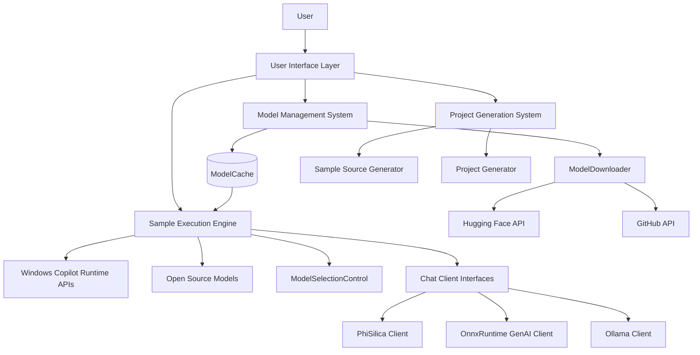
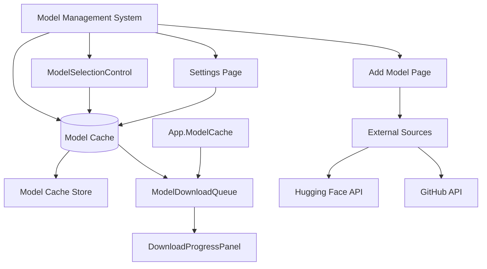
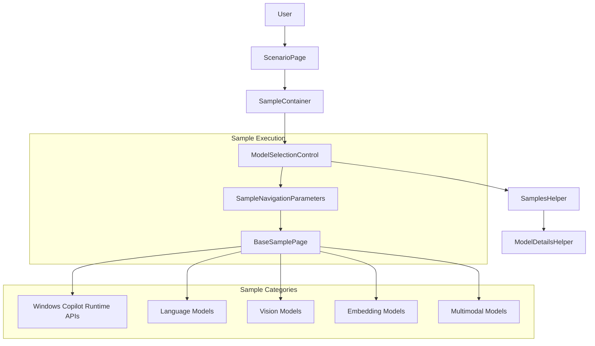
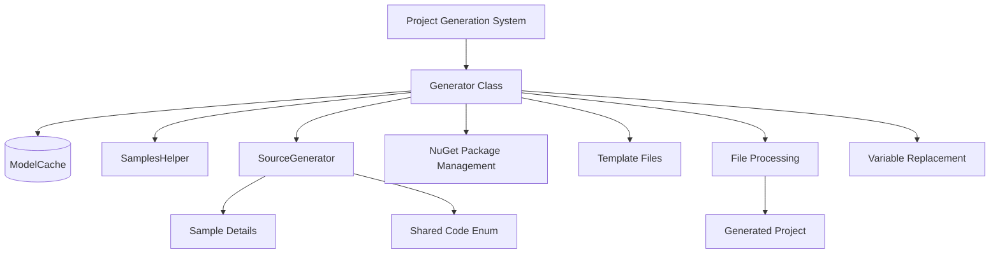
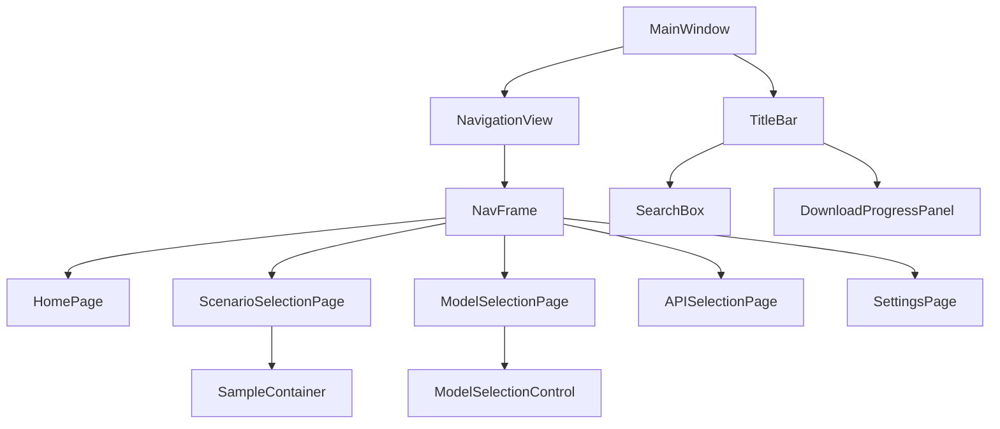
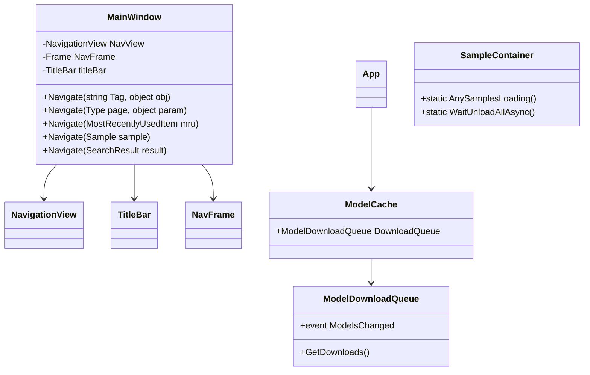

<!-- source: DeepWiki mcp.deepwiki.com · repo microsoft/ai-dev-gallery · page 1 Overview · fetched 2026-10-26 -->

# Overview

<details>
<summary>Relevant source files</summary>

The following files were used as context for generating this wiki page:

- [AIDevGallery/MainWindow.xaml](AIDevGallery/MainWindow.xaml)
- [AIDevGallery/MainWindow.xaml.cs](AIDevGallery/MainWindow.xaml.cs)
- [README.md](README.md)
- [docs/images/HeroImage0.png](docs/images/HeroImage0.png)
- [docs/images/HeroImage1.png](docs/images/HeroImage1.png)
- [docs/images/HeroImage2.png](docs/images/HeroImage2.png)
- [docs/images/HeroImage3.png](docs/images/HeroImage3.png)
- [docs/images/adg-logo.png](docs/images/adg-logo.png)
- [docs/images/adg-logo.svg](docs/images/adg-logo.svg)
- [docs/images/header.png](docs/images/header.png)

</details>


The AI Dev Gallery is an application designed for Windows developers to explore, test, and integrate AI capabilities into their own applications. It provides a comprehensive platform for interacting with AI models, experimenting with sample code, and generating standalone projects, all within a unified user interface.

This page provides a high-level overview of the AI Dev Gallery system architecture, outlining its core components and how they interact with each other. For more detailed information about specific subsystems, please refer to their respective documentation pages.

Sources: [README.md:9-15]()

## Key Features

The AI Dev Gallery includes the following key features:

- Interactive exploration of AI samples powered by local AI models
- Model discovery and management from sources like Hugging Face and GitHub
- Execution of samples using different model types and hardware acceleration options
- Generation of standalone Visual Studio projects from sample code
- Integration with Windows Copilot Runtime APIs

Sources: [README.md:10-14]()

## High-Level Architecture

The AI Dev Gallery follows a modular architecture with clear separation of concerns between its main subsystems:



Title: AI Dev Gallery System Architecture

Sources: [AIDevGallery/MainWindow.xaml.cs:22-43](), [README.md:10-15]()

## Navigation System

The application uses a navigation-based UI structure managed by the `MainWindow` class, which handles routing between the different pages:

```mermaid
flowchart TD
    MainWindow["MainWindow"] --> NavView["NavigationView"]
    NavView --> HomePage["HomePage"]
    NavView --> ScenarioPage["ScenarioSelectionPage"]
    NavView --> ModelPage["ModelSelectionPage"]
    NavView --> APIPage["APISelectionPage"]
    NavView --> SettingsPage["SettingsPage"]
    
    MainWindow --> NavFrame["NavFrame"]
    NavView --> NavFrame
    
    ScenarioPage --> SampleContainer["SampleContainer"]
    ModelPage --> ModelSelection["ModelSelectionControl"]
    
    subgraph "Navigation Methods"
        Navigate["Navigate(string Tag, object obj)"]
        Navigate_Type["Navigate(Type page, object param)"]
        Navigate_MRU["Navigate(MostRecentlyUsedItem mru)"]
        Navigate_Sample["Navigate(Sample sample)"]
        Navigate_SearchResult["Navigate(SearchResult result)"]
    end
    
    MainWindow --> "Navigation Methods"
```

Title: Navigation System Flow

Sources: [AIDevGallery/MainWindow.xaml.cs:46-182](), [AIDevGallery/MainWindow.xaml:76-124]()

## Model Management System

The Model Management System is responsible for discovering, downloading, caching, and managing AI models from various sources:



Title: Model Management System Components

Sources: [AIDevGallery/MainWindow.xaml.cs:27](), [AIDevGallery/MainWindow.xaml.cs:203-213](), [AIDevGallery/MainWindow.xaml:152-198]()

## Sample Execution Pipeline

The Sample Execution Engine allows users to run AI samples with different model types and configurations:



Title: Sample Execution Pipeline

Sources: [AIDevGallery/MainWindow.xaml.cs:35-42](), [AIDevGallery/MainWindow.xaml.cs:96-100](), [AIDevGallery/MainWindow.xaml.cs:123-127]()

## Project Generation System

The Project Generation System allows users to export samples as standalone Visual Studio projects, facilitating the integration of AI capabilities into their own applications:



Title: Project Generation System

Sources: [README.md:14]()

## Windows Copilot Runtime API Integration

The AI Dev Gallery integrates with Windows Copilot Runtime APIs to provide various AI capabilities:

```mermaid
graph LR
    WCRAPIs["Windows Copilot Runtime APIs"]
    
    subgraph "Image Processing"
        ImageDescription["Image Description"]
        IncreaseFidelity["Increase Fidelity"]
        BackgroundRemover["Background Remover"]
        LiveImageDescription["Live Image Description"]
        TextRecognition["Text Recognition"]
    end
    
    subgraph "Text Generation"
        PhiSilicaBasic["PhiSilica Basic"]
    end
    
    WCRAPIs --> "Image Processing"
    WCRAPIs --> "Text Generation"
    
    ImageDescription --> ImageDescriptionGenerator["ImageDescriptionGenerator API"]
    IncreaseFidelity --> ImageScaler["ImageScaler API"]
    BackgroundRemover --> ImageObjectRemover["ImageObjectRemover API"]
    LiveImageDescription --> ImageDescriptionGenerator
    TextRecognition --> TextRecognizer["TextRecognizer API"]
    PhiSilica --> LanguageModel["Windows.AI.GenerativeLanguageModel"]
```

Title: Windows Copilot Runtime API Integration

Sources: [AIDevGallery/MainWindow.xaml.cs:103-104](), [README.md:48]()

## Hardware Acceleration

The AI Dev Gallery supports various hardware acceleration options to optimize model performance on different devices:

```mermaid
graph TD
    ModelExecution["Model Execution"]
    
    subgraph "Hardware Acceleration"
        CPU["CPU"]
        DML["DirectML/GPU"]
        QNN["QNN/NPU"]
        WCRAPI["Windows Copilot Runtime"]
    end
    
    ModelExecution --> "Hardware Acceleration"
    
    CPU --> ONNX["ONNX Runtime CPU EP"]
    DML --> ONNX_DML["ONNX Runtime DirectML EP"]
    QNN --> ONNX_QNN["ONNX Runtime QNN EP"]
    WCRAPI --> WindowsAPIs["Native Windows AI APIs"]
```

Title: Hardware Acceleration Options

Sources: [README.md:48](), [README.md:56-60]()

## User Interface Components

The AI Dev Gallery employs several key UI components to provide a consistent user experience:



Title: Main UI Components

Sources: [AIDevGallery/MainWindow.xaml:22-200](), [AIDevGallery/MainWindow.xaml.cs:22-265]()

## System Requirements

The AI Dev Gallery has the following system requirements:

| Component | Requirement |
|-----------|-------------|
| OS | Windows 10 version 1809 (10.0; Build 17763) or newer |
| Architecture | x64, ARM64 |
| Memory | At least 16 GB recommended |
| Disk space | At least 20GB free space recommended |
| GPU | 8GB of VRAM recommended for GPU acceleration |

Sources: [README.md:55-60]()

## Core Classes and Their Relationships

The following diagram illustrates the relationships between key classes in the AI Dev Gallery:



Title: Core Classes and Relationships

Sources: [AIDevGallery/MainWindow.xaml.cs:21-265]()

## Development Environment Setup

To build and run the AI Dev Gallery, the following components are required:

1. Visual Studio 2022 or later
2. Windows 10 or newer
3. Windows application development workload installed in Visual Studio

For ARM64-based Copilot+ PCs, the solution must be built and run as `ARM64` (not as `x64`), especially when running samples that invoke the Windows Copilot Runtime.

Sources: [README.md:30-49]()

## Conclusion

The AI Dev Gallery provides a comprehensive platform for developers to explore AI capabilities, experiment with different models, and integrate AI functionality into their applications. Its modular architecture enables clear separation of concerns between model management, sample execution, and project generation.

For more detailed information about specific subsystems, please refer to their respective documentation pages:

- For information about the Core Architecture, see [Core Architecture](#2)
- For details on the Model Management System, see [Model Management System](#3)
- For information about Windows Copilot Runtime APIs, see [Windows Copilot Runtime APIs](#4)
- For details on Open Source Models, see [Open Source Models](#5)
- For information about the Project Generation System, see [Project Generation System](#6)

Sources: [README.md:9-15](), [README.md:61-64]()

---

