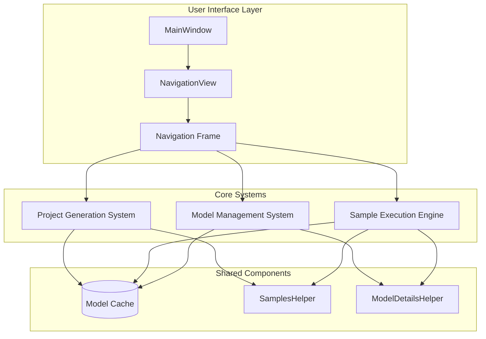
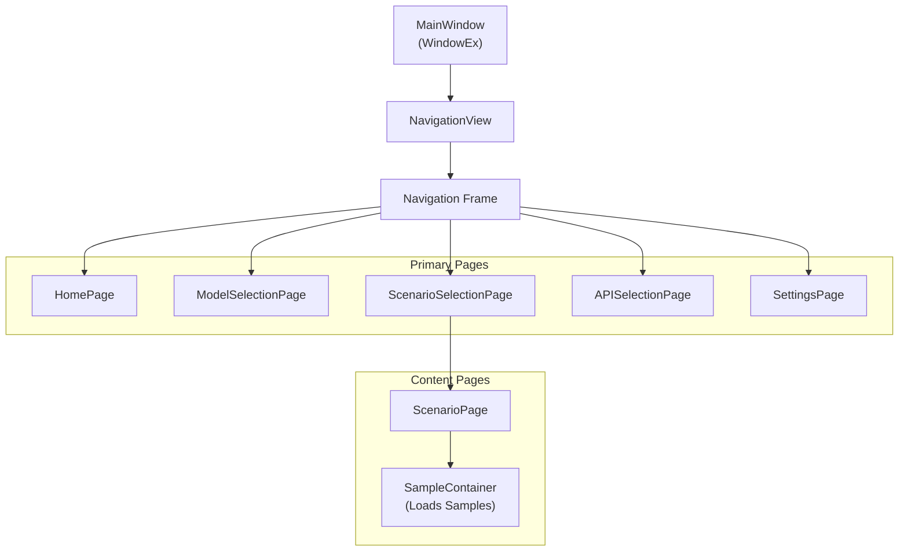
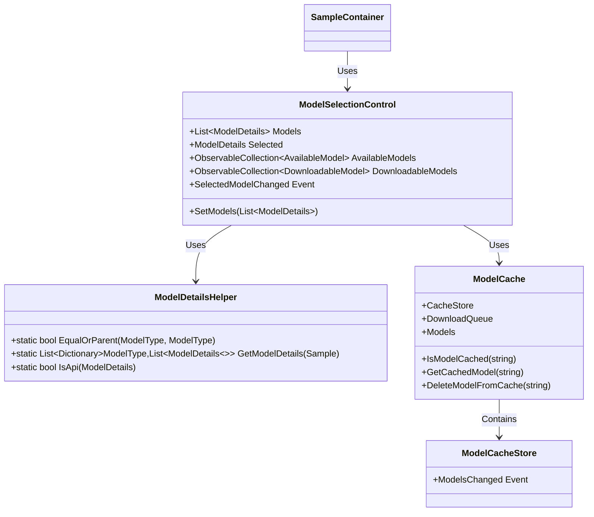
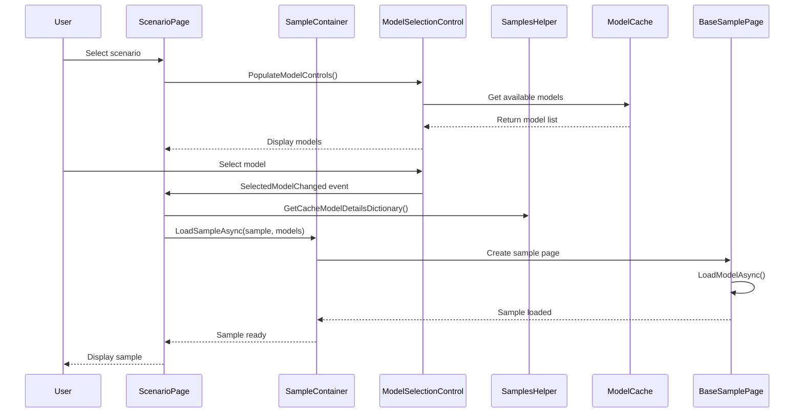
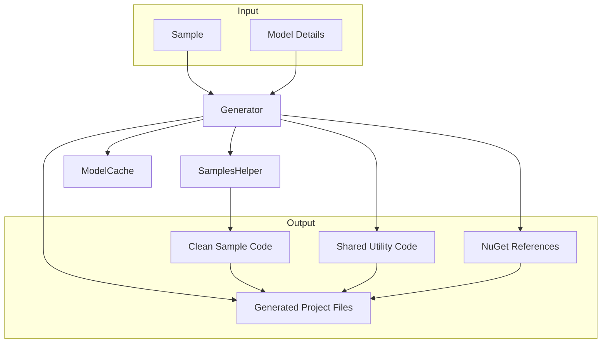
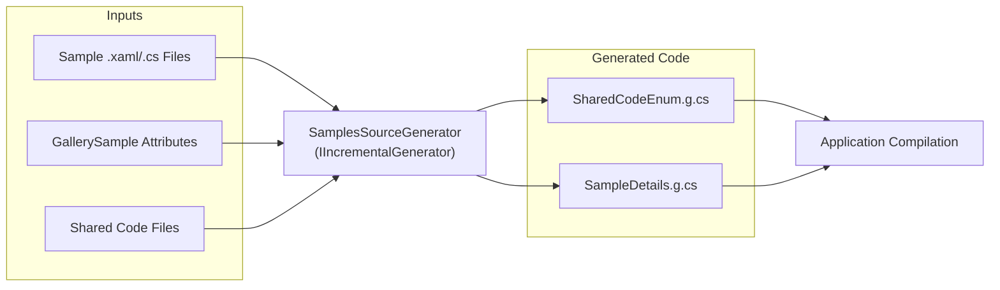
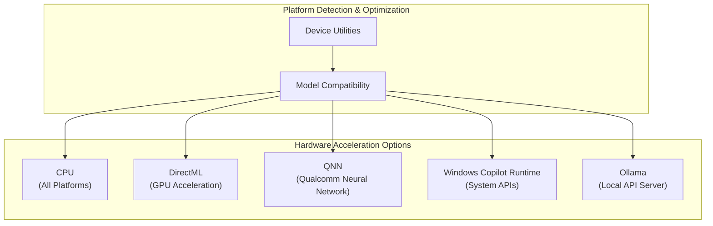
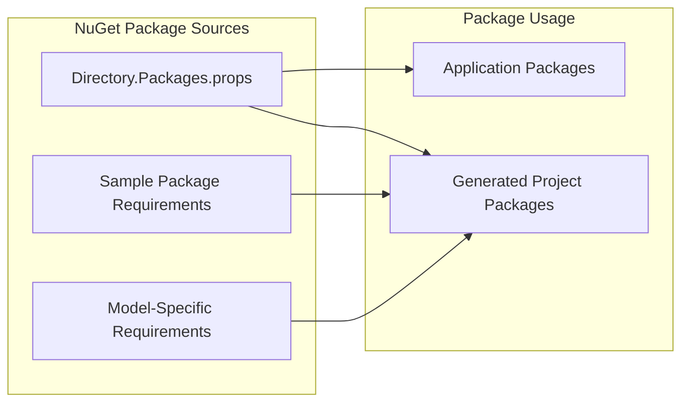

<!-- source: DeepWiki mcp.deepwiki.com · repo microsoft/ai-dev-gallery · page 2 Core Architecture · fetched 2026-10-26 -->

# Core Architecture

Relevant source files

The following files were used as context for generating this wiki page:

- [AIDevGallery.SourceGenerator/SamplesSourceGenerator.cs](AIDevGallery.SourceGenerator/SamplesSourceGenerator.cs)
- [AIDevGallery.Utils/SamplesConstants.cs](AIDevGallery.Utils/SamplesConstants.cs)
- [AIDevGallery/AIDevGallery.csproj](AIDevGallery/AIDevGallery.csproj)
- [AIDevGallery/Controls/ModelSelectionControl.xaml.cs](AIDevGallery/Controls/ModelSelectionControl.xaml.cs)
- [AIDevGallery/Helpers/ModelDetailsHelper.cs](AIDevGallery/Helpers/ModelDetailsHelper.cs)
- [AIDevGallery/Helpers/SamplesHelper.cs](AIDevGallery/Helpers/SamplesHelper.cs)
- [AIDevGallery/MainWindow.xaml](AIDevGallery/MainWindow.xaml)
- [AIDevGallery/MainWindow.xaml.cs](AIDevGallery/MainWindow.xaml.cs)
- [AIDevGallery/Models/BaseSampleNavigationParameters.cs](AIDevGallery/Models/BaseSampleNavigationParameters.cs)
- [AIDevGallery/Pages/Scenarios/ScenarioPage.xaml.cs](AIDevGallery/Pages/Scenarios/ScenarioPage.xaml.cs)
- [AIDevGallery/ProjectGenerator/Generator.cs](AIDevGallery/ProjectGenerator/Generator.cs)
- [Directory.Packages.props](Directory.Packages.props)

This document describes the overall architecture of the AI Dev Gallery application, explaining how its major components interact to provide an integrated environment for exploring AI models, running samples, and generating standalone projects. It serves as a foundational overview of the system's structure and design patterns.

For details about how to navigate through the application UI, see [Navigation System](#2.1). For a deeper dive into samples and scenarios implementation, see [Samples and Scenarios Framework](#2.2).

## System Overview

The AI Dev Gallery follows a modular architecture with three primary systems working together:

The architecture consists of:

1. **User Interface Layer**: Provides navigation and content presentation
2. **Core Systems**: Handles model management, sample execution, and project generation
3. **Shared Components**: Facilitates data sharing and common functionality across systems

Sources: [MainWindow.xaml.cs:21-265](), [AIDevGallery.csproj:1-328]()

## Application Navigation Structure

The application uses a hub-and-spoke navigation model centered around a main window with a navigation frame:

The `MainWindow` class serves as the application shell, containing a `NavigationView` for main menu navigation and a frame for page content. The navigation structure is defined in [MainWindow.xaml:70-124]() and implemented in [MainWindow.xaml.cs:82-147]().

Key navigation elements:
- **Home**: Main landing page with featured samples
- **Samples**: Organized by scenarios (e.g., chat, image classification)
- **Models**: Browse available models by type
- **WCR APIs**: Windows Copilot Runtime API samples
- **Settings**: Application configuration

Sources: [MainWindow.xaml:1-202](), [MainWindow.xaml.cs:21-265]()

## Model Management Architecture

The Model Management System handles discovery, download, and selection of AI models:

The Model Management System provides:

1. **Model Discovery**: Finding models from Hugging Face, GitHub, and local sources
2. **Model Download**: Managing the download queue and progress
3. **Model Caching**: Storing downloaded models for offline use
4. **Model Selection**: Choosing appropriate models for samples

The `ModelSelectionControl` [Controls/ModelSelectionControl.xaml.cs]() is a key UI component that displays available models, handles downloads, and enables model selection. It works with `ModelDetailsHelper` [Helpers/ModelDetailsHelper.cs]() to determine model compatibility and categorization.

Sources: [Controls/ModelSelectionControl.xaml.cs:21-598](), [Helpers/ModelDetailsHelper.cs:1-175]()

## Sample Execution Pipeline

The Sample Execution Engine loads and runs samples with selected models:

The sample execution flow involves:

1. **Scenario Selection**: User selects a scenario category
2. **Model Selection**: User chooses compatible models
3. **Sample Loading**: The selected sample is loaded with the chosen models
4. **Execution**: The sample runs using the selected models

The `ScenarioPage` [Pages/Scenarios/ScenarioPage.xaml.cs]() orchestrates this flow, using `SampleContainer` to host the running sample and `ModelSelectionControl` for model selection.

Sources: [Pages/Scenarios/ScenarioPage.xaml.cs:1-411](), [Models/BaseSampleNavigationParameters.cs:1-47](), [Helpers/SamplesHelper.cs:1-343]()

## Project Generation System

The Project Generation System exports samples as standalone Visual Studio projects:

The Project Generation System:

1. **Sample Code Export**: Extracts and cleans sample code
2. **Project Structure Creation**: Generates project files and folder structure
3. **Model Management**: Optionally copies model files locally
4. **Dependency Management**: Adds appropriate NuGet packages

The main component is the `Generator` class [ProjectGenerator/Generator.cs](), which processes samples and creates standalone projects. It uses `SamplesHelper` to clean up sample code and determine required dependencies.

Key methods:
- `GenerateAsync()`: Main method that generates the project
- `AddFilesFromSampleAsync()`: Adds sample code files to the project
- `GetCleanCSCode()`: Cleans sample code for standalone use

Sources: [ProjectGenerator/Generator.cs:1-432](), [Helpers/SamplesHelper.cs:197-269]()

## Source Generation System

The AI Dev Gallery employs compile-time source generation to incorporate sample code into the application:

The Source Generation System:

1. **Sample Discovery**: Finds samples marked with `GallerySampleAttribute`
2. **Code Extraction**: Extracts and processes XAML and C# code
3. **Enum Generation**: Creates enums for shared code components
4. **Sample Registry**: Generates a registry of all available samples

The `SamplesSourceGenerator` [AIDevGallery.SourceGenerator/SamplesSourceGenerator.cs]() handles this process during compilation. It generates two key files:
- `SharedCodeEnum.g.cs`: Enumerates shared code components
- `SampleDetails.g.cs`: Contains all sample definitions with their code

This approach allows sample code to be both displayed in the application and exported to standalone projects.

Sources: [AIDevGallery.SourceGenerator/SamplesSourceGenerator.cs:1-552](), [AIDevGallery.Utils/SamplesConstants.cs:1-15]()

## Cross-Cutting Concerns

Several components work across systems to provide essential functionality:

### Hardware Acceleration Management

The application supports multiple hardware acceleration options:

The system automatically selects the appropriate hardware acceleration based on device capabilities and model requirements. Platform-specific packages are included conditionally in the project file:

- For ARM64: QNN acceleration [AIDevGallery.csproj:92-95]()
- For x64: DirectML acceleration [AIDevGallery.csproj:97-100]()

### NuGet Package Management

The application manages NuGet dependencies for both the core application and generated projects:

Package versions are centrally managed in [Directory.Packages.props]() and referenced by:
1. The main application [AIDevGallery.csproj]()
2. The project generator when creating standalone projects [ProjectGenerator/Generator.cs:291-308]()

Sources: [Directory.Packages.props:1-59](), [AIDevGallery.csproj:52-100](), [ProjectGenerator/Generator.cs:291-309]()

## Architectural Patterns

The AI Dev Gallery employs several architectural patterns:

### MVVM Pattern

The application uses the MVVM (Model-View-ViewModel) pattern in many areas:
- Models: Data structures like `ModelDetails` and `Sample`
- Views: XAML pages and controls like `ScenarioPage` and `ModelSelectionControl`
- ViewModels: Classes that expose data and commands to views

### Modular Design

The codebase is organized into modules with clear responsibilities:
- **Model Management**: Handles model discovery, download, and caching
- **Sample Execution**: Manages sample loading and execution
- **Project Generation**: Creates standalone projects from samples

### Source Generation

The application leverages compile-time source generation to:
- Embed sample code in the application
- Generate enums and registries of available samples
- Support both in-app execution and project export

This architecture provides a flexible, maintainable system for exploring AI models, running samples, and learning through code generation.

Sources: [AIDevGallery.csproj:1-328](), [ProjectGenerator/Generator.cs:1-432](), [AIDevGallery.SourceGenerator/SamplesSourceGenerator.cs:1-552]()

---

