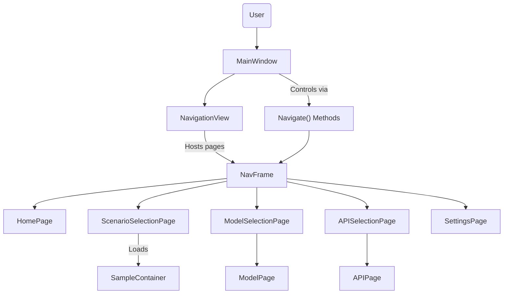
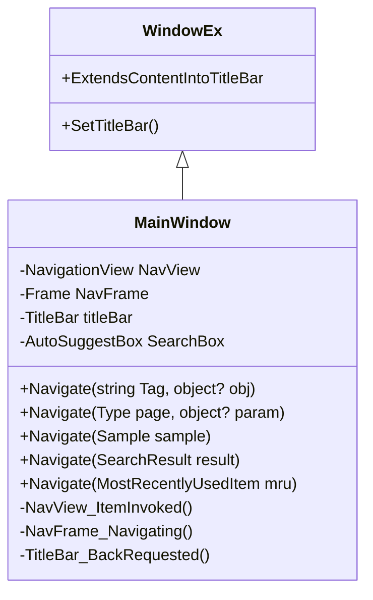
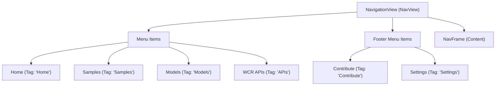
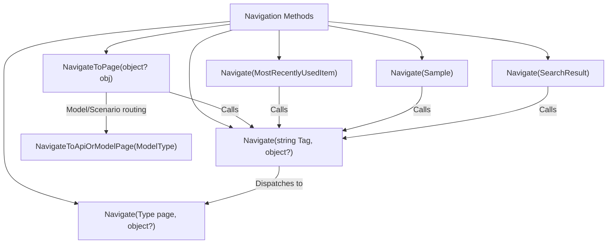
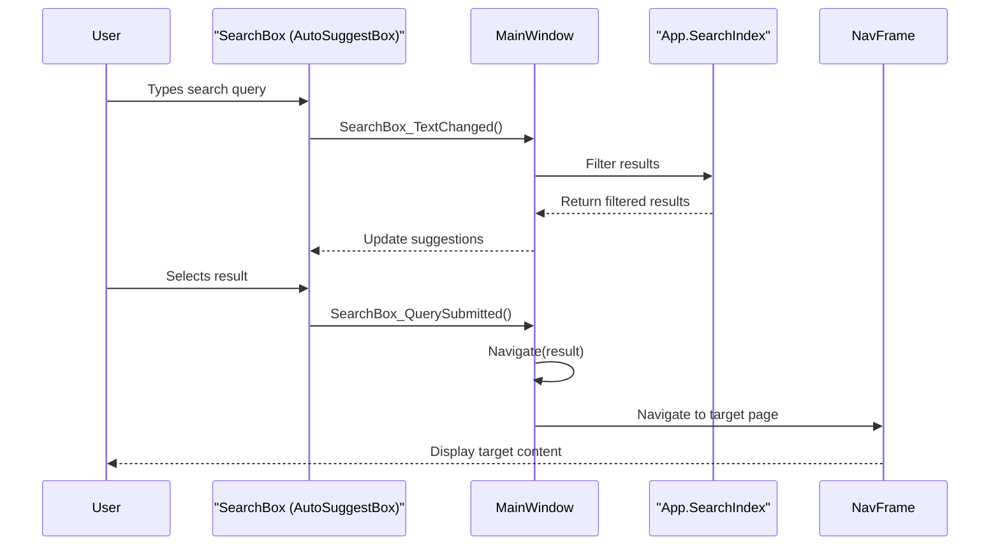
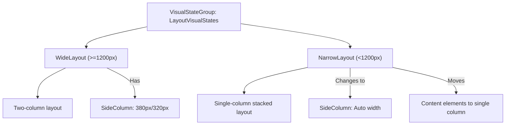
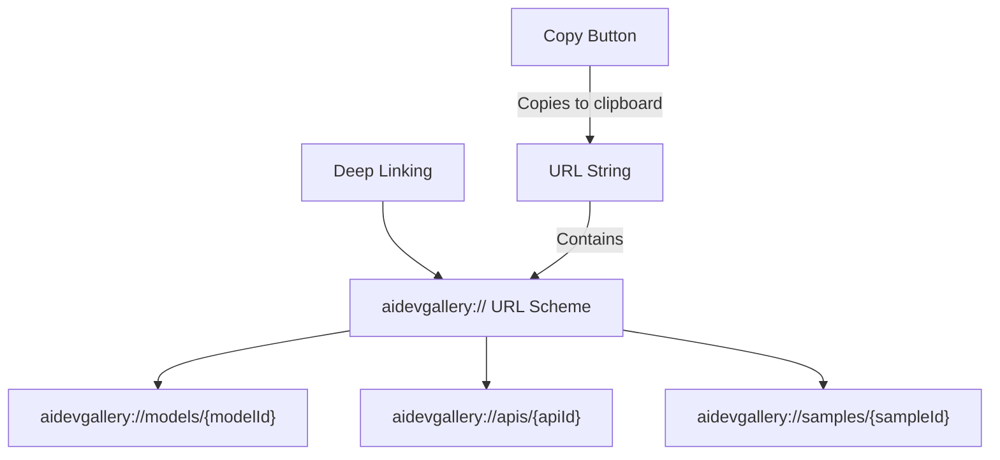
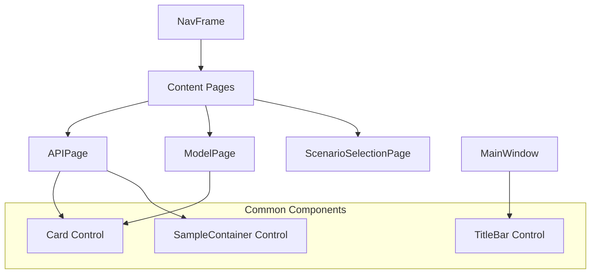
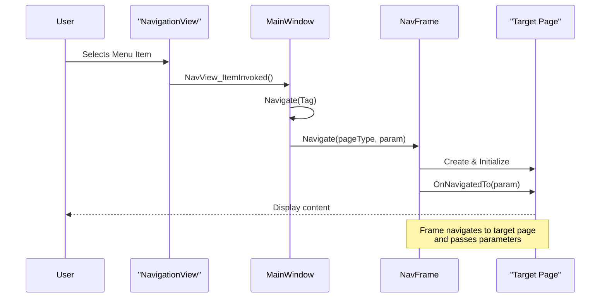

<!-- source: DeepWiki mcp.deepwiki.com · repo microsoft/ai-dev-gallery · page 2.1 Navigation System · fetched 2026-10-26 -->

# Navigation System

<details>
<summary>Relevant source files</summary>

The following files were used as context for generating this wiki page:

- [AIDevGallery/Controls/Card.xaml](AIDevGallery/Controls/Card.xaml)
- [AIDevGallery/MainWindow.xaml](AIDevGallery/MainWindow.xaml)
- [AIDevGallery/MainWindow.xaml.cs](AIDevGallery/MainWindow.xaml.cs)
- [AIDevGallery/Pages/APIs/APIPage.xaml](AIDevGallery/Pages/APIs/APIPage.xaml)
- [AIDevGallery/Pages/APIs/APIPage.xaml.cs](AIDevGallery/Pages/APIs/APIPage.xaml.cs)
- [AIDevGallery/Pages/Models/ModelPage.xaml](AIDevGallery/Pages/Models/ModelPage.xaml)

</details>


The Navigation System in the AI Dev Gallery provides the core infrastructure for users to navigate between different sections of the application. This document details the architecture, components, and implementation patterns that enable navigation throughout the application.

For information about the Sample and Scenario framework that provides the content for many of these pages, see [Samples and Scenarios Framework](#2.2).

## Navigation Architecture

The AI Dev Gallery uses a hub-and-spoke navigation model where users navigate from a central menu to specialized pages. The system is built on Windows App SDK navigation components, primarily using NavigationView and Frame controls.



Sources: [AIDevGallery/MainWindow.xaml.cs:46-165](), [AIDevGallery/MainWindow.xaml:76-124]()

## Main Window Structure

The `MainWindow` class serves as the container for the application's UI and controls navigation between pages. It inherits from `WindowEx` (from WinUIEx library) and implements a custom title bar along with the main navigation framework.



The MainWindow contains:

1. **NavigationView (NavView)**: Provides the main navigation menu with items for Home, Samples, Models, WCR APIs, and settings
2. **Frame (NavFrame)**: Hosts the current page content
3. **TitleBar**: Custom title bar with back button, search functionality, and download progress indicators

Sources: [AIDevGallery/MainWindow.xaml:76-124](), [AIDevGallery/MainWindow.xaml.cs:21-33]()

## Main Navigation Menu Structure

The NavigationView control provides the primary navigation menu for the application:



When a navigation item is selected, the `NavView_ItemInvoked` event handler retrieves the `Tag` property from the selected item and calls the appropriate `Navigate` method.

Sources: [AIDevGallery/MainWindow.xaml:76-124](), [AIDevGallery/MainWindow.xaml.cs:82-85]()

## Navigation Methods

The `MainWindow` class provides several navigation methods that handle different scenarios:

| Method | Description |
|--------|-------------|
| `NavigateToPage(object? obj)` | Entry point for navigating from an object (Model, Scenario, etc.) |
| `Navigate(string Tag, object? obj)` | Navigates based on a tag string with optional object parameter |
| `Navigate(Type page, object? param)` | Directly navigates to a specified page type with optional parameter |
| `Navigate(MostRecentlyUsedItem mru)` | Navigates to a recently used item |
| `Navigate(Sample sample)` | Navigates to a specific sample |
| `Navigate(SearchResult result)` | Navigates to a search result |

The diagram below shows the relationship between these methods:



Sources: [AIDevGallery/MainWindow.xaml.cs:46-182]()

## Page Routing Logic

The navigation system uses string tags to map to specific page types. The core routing logic is implemented in the `Navigate(string Tag, object? obj)` method:

| Tag | Destination | Description |
|-----|-------------|-------------|
| "home" | HomePage | Main landing page with featured content |
| "samples" | ScenarioSelectionPage | Browse and run samples |
| "models" | ModelSelectionPage | Browse and manage models |
| "apis" | APISelectionPage | Explore Windows Copilot Runtime APIs |
| "settings" | SettingsPage | Application settings |
| "contribute" | (External URL) | Opens the GitHub repository |

The `Navigate(Type page, object? param)` method handles the actual navigation to the target page, with special logic for navigating within existing pages (such as to specific API sections within the APISelectionPage).

Sources: [AIDevGallery/MainWindow.xaml.cs:87-112](), [AIDevGallery/MainWindow.xaml.cs:114-153]()

## Search Functionality

The navigation system integrates with the search functionality through the `SearchBox_TextChanged` and `SearchBox_QuerySubmitted` methods:

1. As the user types in the search box, the application filters the global search index
2. When the user selects a search result, the application navigates to the appropriate page using the `Navigate(SearchResult)` method



Sources: [AIDevGallery/MainWindow.xaml:138-149](), [AIDevGallery/MainWindow.xaml.cs:215-232]()

## Back Navigation

The application supports back navigation through:

1. A back button in the TitleBar that's visible when the frame can go back 
2. The `TitleBar_BackRequested` event handler that navigates back when the back button is clicked

The visibility of the back button is bound to the `NavFrame.CanGoBack` property:

```
IsBackButtonVisible="{x:Bind NavFrame.CanGoBack, Mode=OneWay}"
```

Sources: [AIDevGallery/MainWindow.xaml:130](), [AIDevGallery/MainWindow.xaml.cs:258-264]()

## Responsive Navigation

The navigation system uses Visual States to adapt the layout for different screen sizes. The two main layout states are:

1. **WideLayout**: Used for screens 1200px and wider with a two-column layout
2. **NarrowLayout**: Used for screens narrower than 1200px with a stacked layout



Both the `APIPage` and `ModelPage` implement these responsive layouts to reorganize their content based on available screen space.

Sources: [AIDevGallery/Pages/Models/ModelPage.xaml:207-230](), [AIDevGallery/Pages/APIs/APIPage.xaml:218-240]()

## Deep Linking

The application supports deep linking through URL schemes that enable sharing links to specific content:



When a user clicks the copy button on a page (such as the `APIPage`), the application builds the appropriate URL and copies it to the clipboard:

```csharp
dataPackage.SetText($"aidevgallery://apis/{ModelFamily.Id}");
```

Sources: [AIDevGallery/Pages/APIs/APIPage.xaml:47-56](), [AIDevGallery/Pages/APIs/APIPage.xaml.cs:163-173]()

## Component Structure

The navigation pages use a common set of UI components to maintain consistency:

1. **Card**: A reusable control that provides a standardized container for content sections
2. **TitleBar**: Custom title bar with back navigation and search functionality
3. **SampleContainer**: Specialized container for displaying sample content



Sources: [AIDevGallery/Controls/Card.xaml:1-92](), [AIDevGallery/MainWindow.xaml:125-200](), [AIDevGallery/Pages/APIs/APIPage.xaml:96-100]()

## Navigation Flow Example

The following sequence diagram illustrates a typical navigation flow when a user selects an item from the main navigation menu:



Sources: [AIDevGallery/MainWindow.xaml.cs:82-85](), [AIDevGallery/MainWindow.xaml.cs:87-112](), [AIDevGallery/MainWindow.xaml.cs:114-153]()

---

