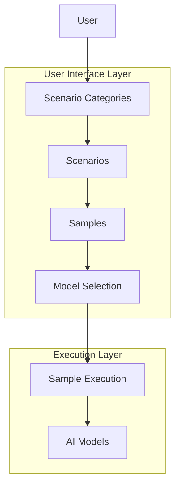
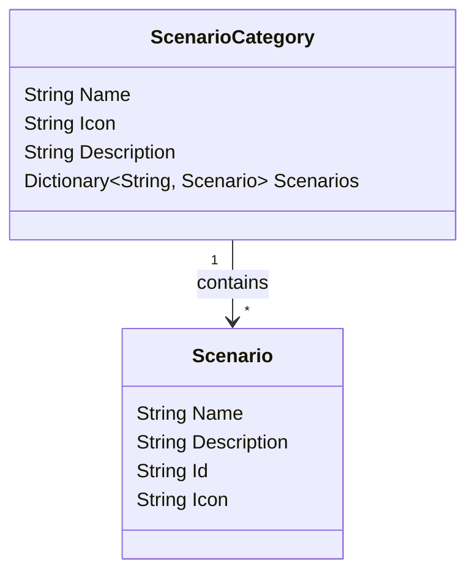
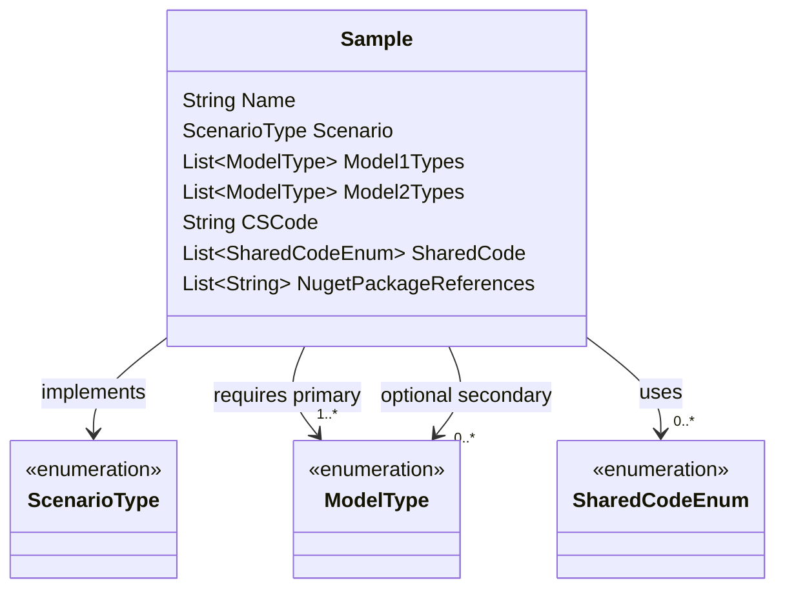
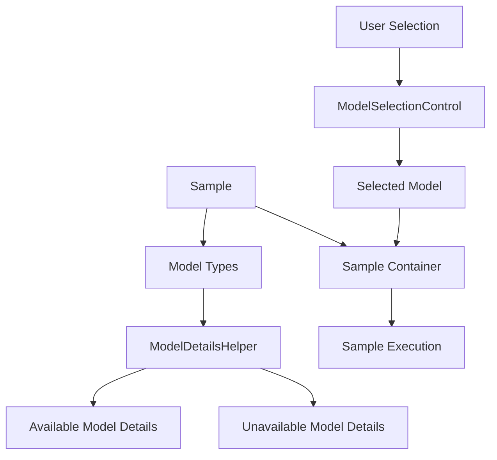
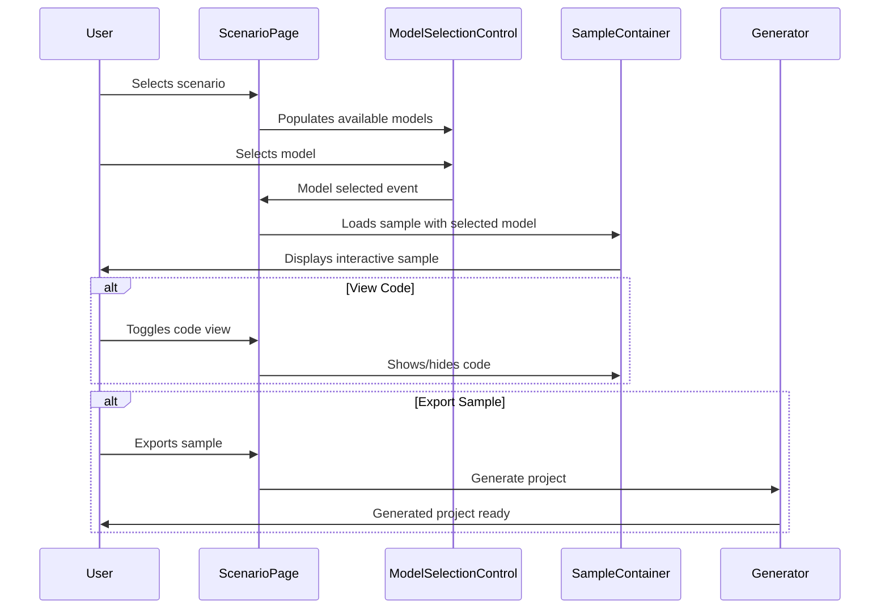
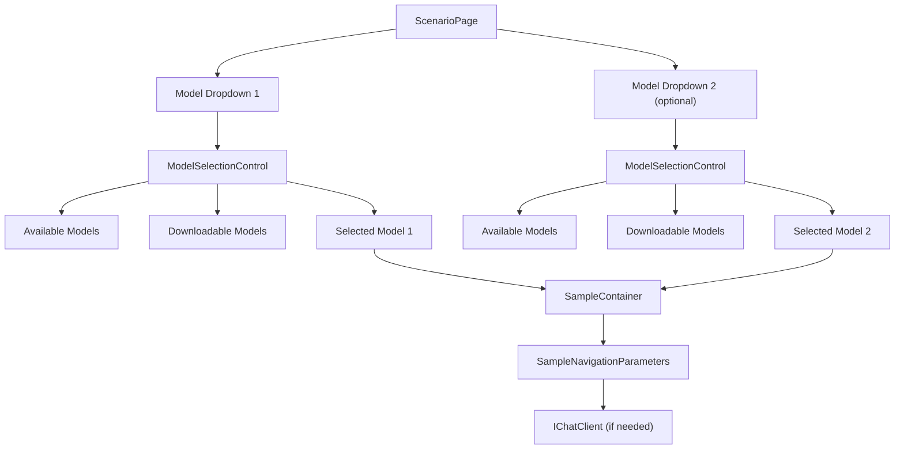
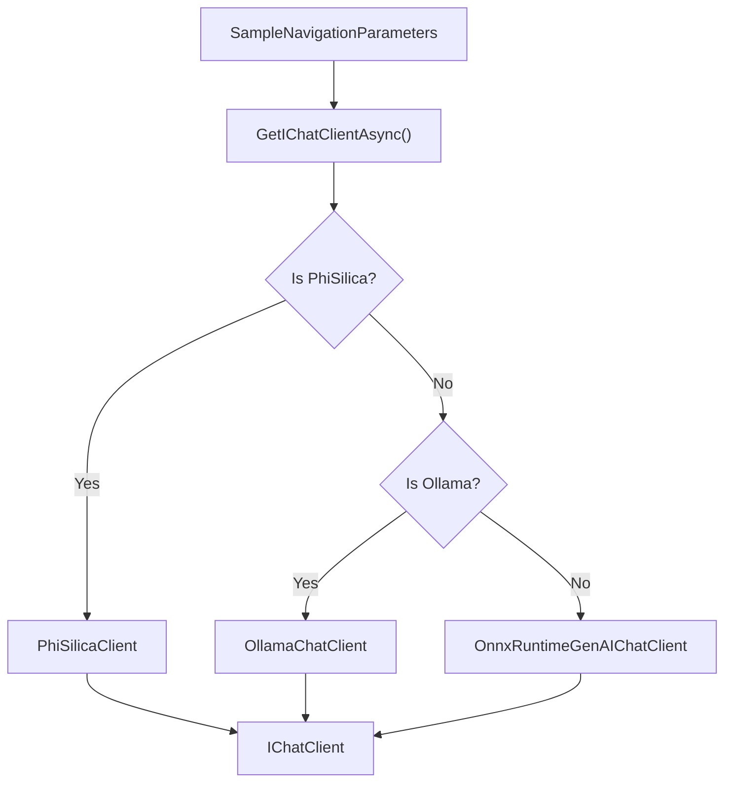
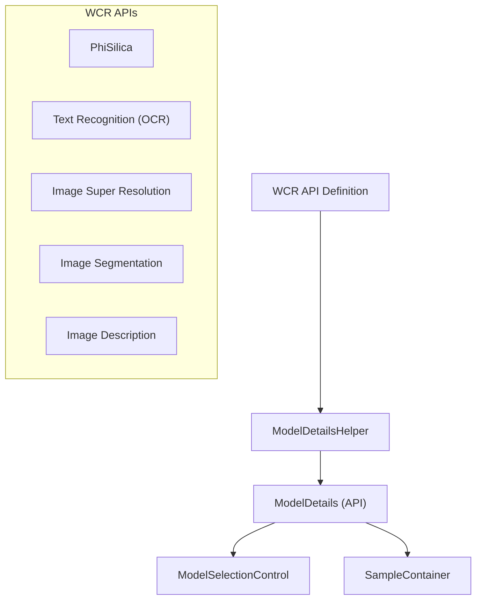

<!-- source: DeepWiki mcp.deepwiki.com · repo microsoft/ai-dev-gallery · page 2.2 Samples and Scenarios Framework · fetched 2026-10-26 -->

# Samples and Scenarios Framework

<details>
<summary>Relevant source files</summary>

The following files were used as context for generating this wiki page:

- [AIDevGallery/Controls/ModelSelectionControl.xaml.cs](AIDevGallery/Controls/ModelSelectionControl.xaml.cs)
- [AIDevGallery/Helpers/ModelDetailsHelper.cs](AIDevGallery/Helpers/ModelDetailsHelper.cs)
- [AIDevGallery/Helpers/SamplesHelper.cs](AIDevGallery/Helpers/SamplesHelper.cs)
- [AIDevGallery/Models/BaseSampleNavigationParameters.cs](AIDevGallery/Models/BaseSampleNavigationParameters.cs)
- [AIDevGallery/Pages/Scenarios/ScenarioPage.xaml.cs](AIDevGallery/Pages/Scenarios/ScenarioPage.xaml.cs)
- [AIDevGallery/Samples/Definitions/WcrApis/apis.json](AIDevGallery/Samples/Definitions/WcrApis/apis.json)
- [AIDevGallery/Samples/scenarios.json](AIDevGallery/Samples/scenarios.json)

</details>


## Purpose and Scope

The Samples and Scenarios Framework provides the structure for defining, organizing, and presenting AI samples within the AI Dev Gallery application. This framework bridges the conceptual organization of AI capabilities (scenarios) with their concrete implementations (samples), enabling users to explore and interact with various AI models and technologies.

This page documents how scenarios are structured in the configuration files, how samples are associated with scenarios, and how the application presents these components to users. For information about the navigation system that controls movement between these components, see [Navigation System](#2.1).

Sources:
- [AIDevGallery/Samples/scenarios.json:1-217]()

## Framework Overview

The AI Dev Gallery organizes its content in a hierarchical structure:

1. **Categories** - High-level groupings of related AI capabilities (Text, Image, etc.)
2. **Scenarios** - Specific AI tasks or use cases within a category (Text Generation, Image Description, etc.)
3. **Samples** - Concrete implementations of scenarios that users can run and explore

This hierarchy provides a logical organization of samples that helps users discover relevant AI capabilities based on their needs or interests.



**Diagram: Samples and Scenarios Framework Structure**

Sources:
- [AIDevGallery/Samples/scenarios.json:1-217]()
- [AIDevGallery/Pages/Scenarios/ScenarioPage.xaml.cs:1-411]()

## Scenario Configuration

Scenarios are defined in a hierarchical JSON structure in the `scenarios.json` file. The file organizes scenarios into categories, with each category containing multiple scenarios.

### Categories Structure

Each category in the scenarios.json file has the following properties:

| Property | Purpose |
|----------|---------|
| Name | Display name of the category |
| Icon | Glyph icon code for visual representation |
| Description | Brief explanation of the category's purpose |
| Scenarios | Collection of scenarios within this category |

### Scenario Structure

Each scenario within a category has these properties:

| Property | Purpose |
|----------|---------|
| Name | Display name of the scenario |
| Description | Detailed explanation of what the scenario does |
| Id | Unique identifier used for routing and sample association |
| Icon | Optional glyph icon code for visual representation |



**Diagram: Scenario Configuration Class Structure**

Sources:
- [AIDevGallery/Samples/scenarios.json:1-217]()

### Example Category: Text

The Text category contains scenarios related to text processing and generation:

```
Text Category
├── Generate Text
├── Summarize Text
├── Chat
├── Semantic Kernel Chat
├── Translate Text
├── Grammar Check
├── Paraphrase Text
├── Analyze Text Sentiment
├── Custom Parameters
├── Content Moderation
├── Semantic Search
└── Retrieval Augmented Generation
```

Sources:
- [AIDevGallery/Samples/scenarios.json:2-76]()

## Sample Implementation

Samples are the concrete implementations of scenarios. A sample is associated with one or more model types and contains the code and UI for executing a specific AI task.

### Sample Properties

Key properties of the Sample class include:

| Property | Purpose |
|----------|---------|
| Name | Display name of the sample |
| Scenario | ScenarioType the sample implements |
| Model1Types | Primary model types this sample can use |
| Model2Types | Optional secondary model types for multi-model samples |
| CSCode | C# implementation code |
| SharedCode | References to shared code components needed by the sample |
| NugetPackageReferences | NuGet packages required by the sample |



**Diagram: Sample Class Structure**

Sources:
- [AIDevGallery/Helpers/SamplesHelper.cs:18-342]()

### Sample-Model Integration

Samples are not directly tied to specific models but rather to model types (e.g., LanguageModels, VisionModels). This allows samples to work with different models that implement the same capabilities. The `ModelDetailsHelper` class provides utilities for associating models with samples based on their capabilities.



**Diagram: Sample-Model Integration Flow**

Sources:
- [AIDevGallery/Helpers/ModelDetailsHelper.cs:14-174]()
- [AIDevGallery/Controls/ModelSelectionControl.xaml.cs:21-597]()

## User Interface and Presentation

The Samples and Scenarios Framework provides the UI components for presenting scenarios to users and allowing them to interact with samples.

### ScenarioPage

The `ScenarioPage` is the primary UI component for displaying scenarios and associated samples. It handles:

1. Loading scenario definitions
2. Presenting model selection options
3. Loading and executing samples
4. Providing code export functionality

### Navigation Flow

The navigation flow for scenarios and samples follows this pattern:



**Diagram: Scenario Navigation Flow**

Sources:
- [AIDevGallery/Pages/Scenarios/ScenarioPage.xaml.cs:26-411]()

## Model Selection and Integration

The framework provides robust model selection capabilities through the `ModelSelectionControl` component, which allows users to:

1. View available (already downloaded) models
2. View downloadable models
3. Select models based on compatibility
4. Access model details and options

### Model Categories

Models are organized into three categories in the UI:

1. **Available Models** - Downloaded models compatible with the current sample
2. **Downloadable Models** - Compatible models that need to be downloaded
3. **Unavailable Models** - Models that are incompatible due to hardware or other constraints

### Multiple Model Support

Some samples require two different models to function (e.g., a language model and an embedding model). The framework supports this through the `Model1Types` and `Model2Types` properties of the Sample class, with corresponding UI elements for selecting both models.



**Diagram: Multiple Model Selection and Integration**

Sources:
- [AIDevGallery/Controls/ModelSelectionControl.xaml.cs:21-597]()
- [AIDevGallery/Pages/Scenarios/ScenarioPage.xaml.cs:140-245]()
- [AIDevGallery/Models/BaseSampleNavigationParameters.cs:13-47]()

## Sample Execution

When a user selects a scenario and compatible model(s), the application creates a `SampleNavigationParameters` object and passes it to the `SampleContainer` for execution. This object contains:

1. The selected model path(s)
2. Hardware acceleration options
3. Cancellation tokens for async operations
4. Methods for creating appropriate clients (e.g., `IChatClient`)

### Client Factory Pattern

For language model samples, the framework provides a factory pattern for creating appropriate clients based on the selected model:



**Diagram: Chat Client Factory Pattern**

Sources:
- [AIDevGallery/Models/BaseSampleNavigationParameters.cs:27-44]()
- [AIDevGallery/Helpers/SamplesHelper.cs:176-196]()

## Code Export and Project Generation

The framework provides functionality to export samples as standalone Visual Studio projects. This allows users to examine and modify the code outside the AI Dev Gallery application.

When a user chooses to export a sample, the framework:

1. Collects necessary model information
2. Transforms the sample code by replacing placeholders
3. Adds necessary NuGet package references
4. Generates a complete Visual Studio project

### Dependencies Resolution

The `SamplesHelper` class provides methods for determining all required dependencies:

- `GetAllSharedCode` - Identifies required shared code components
- `GetAllNugetPackageReferences` - Determines required NuGet packages
- `GetCleanCSCode` - Transforms sample code for standalone use

Sources:
- [AIDevGallery/Helpers/SamplesHelper.cs:18-196]()
- [AIDevGallery/Pages/Scenarios/ScenarioPage.xaml.cs:274-392]()

## Windows Copilot Runtime API Integration

The framework includes special handling for Windows Copilot Runtime (WCR) APIs, which are defined in a separate configuration file and have unique characteristics compared to downloadable models.



**Diagram: Windows Copilot Runtime API Integration**

Sources:
- [AIDevGallery/Samples/Definitions/WcrApis/apis.json:1-60]()
- [AIDevGallery/Helpers/ModelDetailsHelper.cs:33-47]()

## Summary

The Samples and Scenarios Framework provides a flexible and extensible system for organizing, presenting, and executing AI samples within the AI Dev Gallery. By separating the conceptual organization (scenarios) from the implementation details (samples) and providing a robust model selection mechanism, the framework enables users to explore a wide range of AI capabilities with different models and configurations.

---

