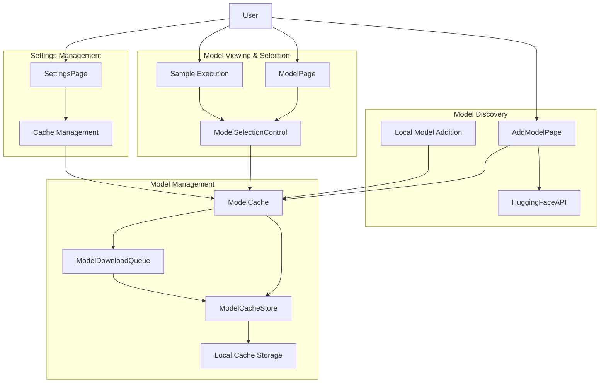
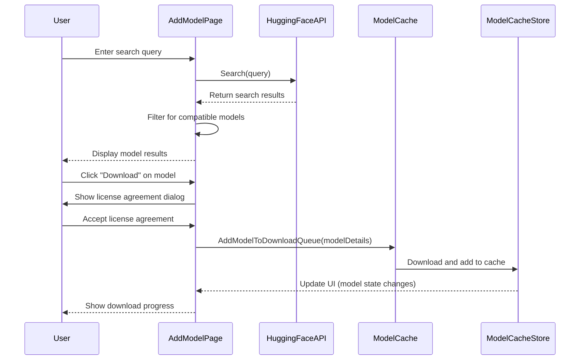
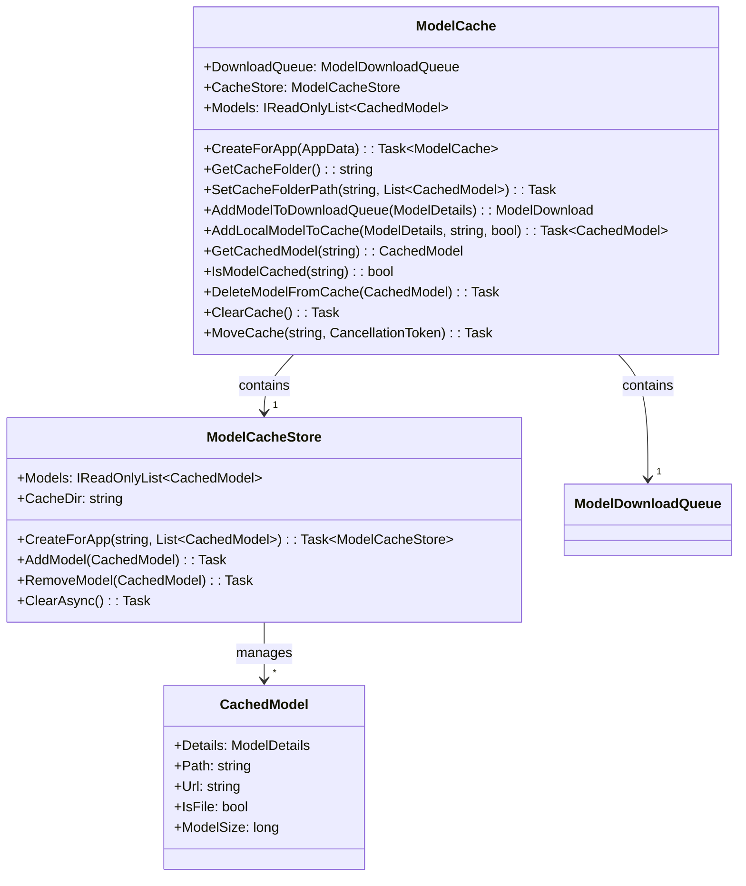
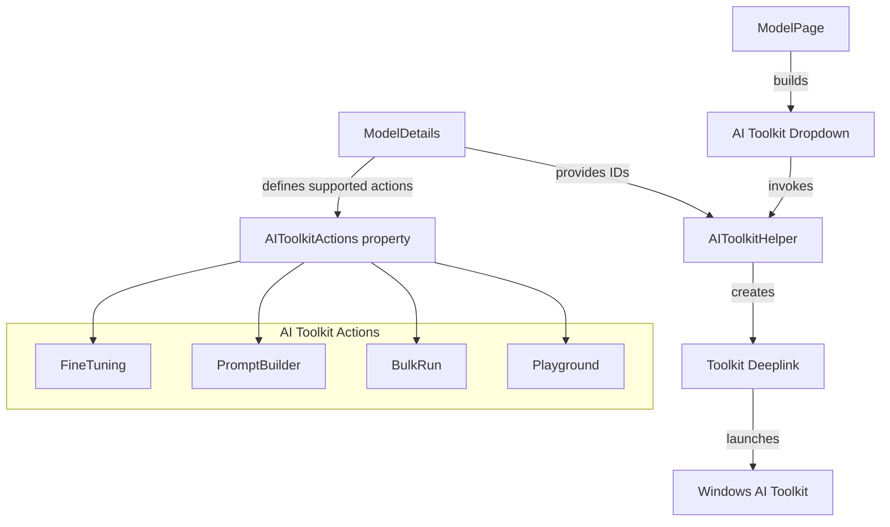
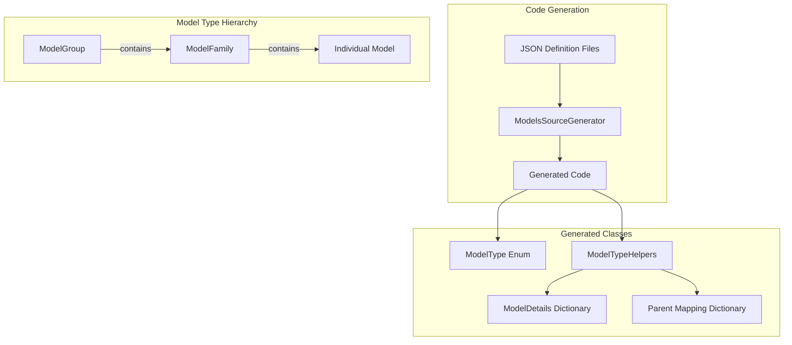

<!-- source: DeepWiki mcp.deepwiki.com · repo microsoft/ai-dev-gallery · page 3 Model Management System · fetched 2026-10-26 -->

# Model Management System

<details>
<summary>Relevant source files</summary>

The following files were used as context for generating this wiki page:

- [AIDevGallery.SourceGenerator/Models/AIToolkitAction.cs](AIDevGallery.SourceGenerator/Models/AIToolkitAction.cs)
- [AIDevGallery.SourceGenerator/Models/Model.cs](AIDevGallery.SourceGenerator/Models/Model.cs)
- [AIDevGallery.SourceGenerator/ModelsSourceGenerator.cs](AIDevGallery.SourceGenerator/ModelsSourceGenerator.cs)
- [AIDevGallery/Assets/AITKIcon.png](AIDevGallery/Assets/AITKIcon.png)
- [AIDevGallery/Controls/ModelSelectionControl.xaml](AIDevGallery/Controls/ModelSelectionControl.xaml)
- [AIDevGallery/Pages/Models/AddModelPage.xaml.cs](AIDevGallery/Pages/Models/AddModelPage.xaml.cs)
- [AIDevGallery/Pages/Models/ModelPage.xaml.cs](AIDevGallery/Pages/Models/ModelPage.xaml.cs)
- [AIDevGallery/Pages/SettingsPage.xaml](AIDevGallery/Pages/SettingsPage.xaml)
- [AIDevGallery/Pages/SettingsPage.xaml.cs](AIDevGallery/Pages/SettingsPage.xaml.cs)
- [AIDevGallery/Samples/Definitions/Models/multimodal.modelgroup.json](AIDevGallery/Samples/Definitions/Models/multimodal.modelgroup.json)
- [AIDevGallery/Telemetry/Events/AIToolkitActionClickedEvent.cs](AIDevGallery/Telemetry/Events/AIToolkitActionClickedEvent.cs)
- [AIDevGallery/Utils/AIToolkitHelper.cs](AIDevGallery/Utils/AIToolkitHelper.cs)
- [AIDevGallery/Utils/AppUtils.cs](AIDevGallery/Utils/AppUtils.cs)
- [AIDevGallery/Utils/ModelCache.cs](AIDevGallery/Utils/ModelCache.cs)
- [AIDevGallery/Utils/ModelCacheStore.cs](AIDevGallery/Utils/ModelCacheStore.cs)

</details>


The Model Management System is responsible for discovering, downloading, caching, and managing AI models within the AI Dev Gallery. It enables users to search for and add models from repositories like Hugging Face, maintain a local cache of downloaded models, and select appropriate models when running AI samples.

For information about how models are executed within samples, see the Samples and Scenarios Framework [2.2]. For details on specific model types supported by the application, see Open Source Models [5].

## Architecture Overview

The Model Management System bridges external model repositories with the Sample Execution Engine, ensuring that appropriate models are available when needed for running AI samples.

### System Components Diagram



Sources: [AIDevGallery/Utils/ModelCache.cs:14-221](), [AIDevGallery/Utils/ModelCacheStore.cs:14-119](), [AIDevGallery/Pages/Models/AddModelPage.xaml.cs:26-501](), [AIDevGallery/Pages/Models/ModelPage.xaml.cs:22-333]()

### Key Components

1. **Model Discovery**:
   - `AddModelPage`: UI interface for searching and discovering models
   - `HuggingFaceAPI`: Integration with Hugging Face repository
   - Local model addition functionality

2. **Model Management**:
   - `ModelCache`: Core class that manages all aspects of downloaded models
   - `ModelCacheStore`: Maintains metadata about cached models
   - `ModelDownloadQueue`: Handles asynchronous model downloads

3. **Model Viewing & Selection**:
   - `ModelPage`: Displays detailed information about model families
   - `ModelSelectionControl`: Reusable UI component for model selection

4. **Settings Management**:
   - `SettingsPage`: User interface for configuring model cache settings

## Model Discovery and Download

The Model Discovery component allows users to find models through search or by adding local model files.

### Model Search and Download Process



Sources: [AIDevGallery/Pages/Models/AddModelPage.xaml.cs:43-242](), [AIDevGallery/Pages/Models/AddModelPage.xaml.cs:244-274](), [AIDevGallery/Utils/ModelCache.cs:68-83]()

### HuggingFace Integration

The search functionality calls the Hugging Face API to find models matching the user's query. The system filters the results to show only models with:

1. ONNX configuration files (`genai_config.json`)
2. Compatible hardware accelerator support
3. Appropriate licensing

For each search result, the system:
- Extracts model metadata (size, parameters, hardware support)
- Determines the appropriate prompt template based on model name
- Checks compatibility with the user's system
- Displays licensing information

Sources: [AIDevGallery/Pages/Models/AddModelPage.xaml.cs:82-221](), [AIDevGallery/Pages/Models/AddModelPage.xaml.cs:223-242]()

### Local Model Addition

Users can add local model folders through the "Add Local Model" functionality:

1. User selects a folder containing an ONNX model with a `genai_config.json` file
2. System validates the model configuration and extracts hardware acceleration info
3. User provides a name for the model
4. The model is added to the cache with a `local-file://` URL scheme
5. Model becomes available for use in samples

Sources: [AIDevGallery/Pages/Models/AddModelPage.xaml.cs:351-478]()

## Model Cache System

The Model Cache is responsible for storing downloaded models and their metadata for efficient reuse.

### Cache Architecture



Sources: [AIDevGallery/Utils/ModelCache.cs:14-221](), [AIDevGallery/Utils/ModelCacheStore.cs:14-119]()

### Cache Storage Structure

The Model Cache maintains two types of information:

1. **Physical files**: The actual model files stored in a configurable cache directory
2. **Metadata**: Information about cached models stored in a `cache.json` file

Each `CachedModel` contains:
- `Details`: Complete model metadata (name, description, hardware requirements)
- `Path`: File system path to the model
- `Url`: Original source URL of the model
- `IsFile`: Flag indicating if the model is a single file or directory
- `ModelSize`: Size of the model in bytes

Sources: [AIDevGallery/Utils/ModelCacheStore.cs:31-75]()

### Cache Management Operations

Users can manage the cache through the Settings page, which provides operations for:

- **Viewing cache contents**: List of all downloaded models with size information
- **Deleting individual models**: Remove specific models to free disk space
- **Clearing the entire cache**: Remove all downloaded models
- **Moving the cache**: Relocate the cache directory to a different location
- **Opening model folders**: Access model files directly

These operations are implemented in the `ModelCache` class and exposed through the Settings UI.

Sources: [AIDevGallery/Utils/ModelCache.cs:85-220](), [AIDevGallery/Pages/SettingsPage.xaml.cs:64-300](), [AIDevGallery/Pages/SettingsPage.xaml:40-106]()

## Model Selection

The `ModelSelectionControl` is a reusable component that displays available models and allows users to select them for use in samples.

### Model Selection Interface

```mermaid
graph TD
    subgraph "ModelSelectionControl"
        AvailableModels["Available Models Section"]
        DownloadableModels["Downloadable Models Section"]
        UnavailableModels["Unavailable Models Section"]
        
        ModelCard["Model Card" style="rounded"]
        HardwareIndicators["Hardware Accelerator Indicators"]
        OptionsMenu["Options Menu"]
        DownloadButton["Download Button"]
    end
    
    User["User"]
    
    SampleContainer["Sample Container"]
    ModelCache["ModelCache"]
    
    User --> ModelSelectionControl
    ModelSelectionControl -->|"Selected Model Changed"| SampleContainer
    ModelSelectionControl -->|"Query Available Models"| ModelCache
    ModelSelectionControl -->|"Download Model"| ModelCache
    OptionsMenu -->|"Delete/View Model"| ModelCache
```

Sources: [AIDevGallery/Controls/ModelSelectionControl.xaml:2-533](), [AIDevGallery/Pages/Models/ModelPage.xaml.cs:276-289]()

### Model Categories

The control organizes models into three categories:

1. **Available Models**: Models that are downloaded and ready to use
   - Display model name, size, hardware accelerators, and source
   - Provide options to view model card, open containing folder, or delete

2. **Downloadable Models**: Models that can be downloaded
   - Show download button with progress indicator during download
   - Display license information and hardware requirements

3. **Unavailable Models**: Models incompatible with the user's hardware
   - Shown in disabled state with compatibility information
   - Explain why the model can't be used (e.g., requires NPU on a system without one)

Sources: [AIDevGallery/Controls/ModelSelectionControl.xaml:32-246](), [AIDevGallery/Controls/ModelSelectionControl.xaml:247-419](), [AIDevGallery/Controls/ModelSelectionControl.xaml:420-443]()

### Hardware Acceleration Support

Models specify which hardware accelerators they support through the `HardwareAccelerators` property:

| Accelerator | Display Name | Description |
|-------------|--------------|-------------|
| CPU | CPU | Models optimized for CPU execution |
| DML | GPU | GPU acceleration using DirectML |
| QNN | NPU | Neural Processing Unit acceleration using Qualcomm Neural Network |
| WCRAPI | WCR | Models running through Windows Copilot Runtime APIs |
| OLLAMA | Ollama | Models running locally via Ollama |

The `ModelSelectionControl` displays appropriate indicators and provides tooltips explaining the hardware requirements for each model.

Sources: [AIDevGallery/Utils/AppUtils.cs:131-170](), [AIDevGallery/Controls/ModelSelectionControl.xaml:75-100]()

## AI Toolkit Integration

The Model Management System integrates with the Windows AI Toolkit, enabling users to use downloaded models in the toolkit for additional capabilities.

### AI Toolkit Integration Flow



Sources: [AIDevGallery/Utils/AIToolkitHelper.cs:10-100](), [AIDevGallery.SourceGenerator/Models/AIToolkitAction.cs:9-15](), [AIDevGallery/Pages/Models/ModelPage.xaml.cs:176-243]()

### AI Toolkit Actions

Models can support several AI Toolkit actions, defined in the `AIToolkitAction` enum:

- **FineTuning**: Customize models for specific tasks or domains
- **PromptBuilder**: Create and refine prompts for optimal model responses
- **BulkRun**: Process multiple inputs in batch mode
- **Playground**: Experiment with the model in an interactive environment

Each model specifies its supported actions through the `AIToolkitActions` property in its `ModelDetails`. The UI dynamically builds the AI Toolkit dropdown menu based on the supported actions.

Sources: [AIDevGallery/Utils/AIToolkitHelper.cs:10-94](), [AIDevGallery.SourceGenerator/Models/AIToolkitAction.cs:9-15](), [AIDevGallery/Pages/Models/ModelPage.xaml.cs:176-243]()

### Integration Implementation

When a user selects an AI Toolkit action:

1. `AIToolkitHelper.CreateAiToolkitDeeplink()` generates a deeplink URL
2. The system attempts to launch the Windows AI Toolkit with the deeplink
3. The deeplink includes the model ID and action information
4. Telemetry records the action for usage analysis

This integration expands the capabilities available to users beyond what's directly implemented in the AI Dev Gallery.

Sources: [AIDevGallery/Pages/Models/ModelPage.xaml.cs:244-273](), [AIDevGallery/Telemetry/Events/AIToolkitActionClickedEvent.cs:11-37]()

## Model Type System

The application uses a code generation approach to manage model types and metadata through the `ModelsSourceGenerator`.

### Model Type Hierarchy



Sources: [AIDevGallery.SourceGenerator/ModelsSourceGenerator.cs:22-465](), [AIDevGallery.SourceGenerator/Models/Model.cs:9-30](), [AIDevGallery/Samples/Definitions/Models/multimodal.modelgroup.json:1-54]()

### Model Definition Structure

Models are defined in JSON files with a hierarchical structure:
- **Model Groups**: Top-level categories (e.g., "MultimodalModels", "LanguageModels")
- **Model Families**: Groups of related models (e.g., "Phi3Vision")
- **Individual Models**: Specific model variants (e.g., "Phi3VisionCPU")

Each model definition includes:
- Basic information (ID, name, description)
- Source URL and icon
- Size and parameter count
- Hardware accelerator requirements
- License information
- AI Toolkit integration details

Sources: [AIDevGallery/Samples/Definitions/Models/multimodal.modelgroup.json:1-54]()

### Code Generation Process

The `ModelsSourceGenerator` processes model definition files at compile time to generate:

1. A `ModelType` enum containing all model types in the hierarchy
2. A `ModelTypeHelpers` class with static dictionaries:
   - `ModelDetails`: Maps model types to their detailed information
   - `ModelFamilyDetails`: Maps model types to family information
   - `ParentMapping`: Establishes parent-child relationships

This approach allows adding new models by simply creating JSON definition files, without modifying the application code.

Sources: [AIDevGallery.SourceGenerator/ModelsSourceGenerator.cs:191-464]()

## Conclusion

The Model Management System provides a comprehensive solution for discovering, downloading, caching, and selecting AI models in the AI Dev Gallery. Its key strengths include:

1. **Flexible Discovery**: Support for finding models on Hugging Face and adding local models
2. **Efficient Caching**: Robust model caching with user-friendly management options
3. **Intuitive Selection**: Clear categorization of models based on availability and compatibility
4. **Hardware Awareness**: Intelligent filtering based on available hardware accelerators
5. **External Integration**: Seamless connection to the Windows AI Toolkit for extended capabilities

This system serves as a critical foundation for the application, enabling users to experiment with various AI models and integrate them into their own applications through the Project Generation system [6].

---

