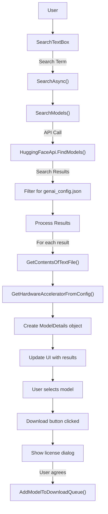
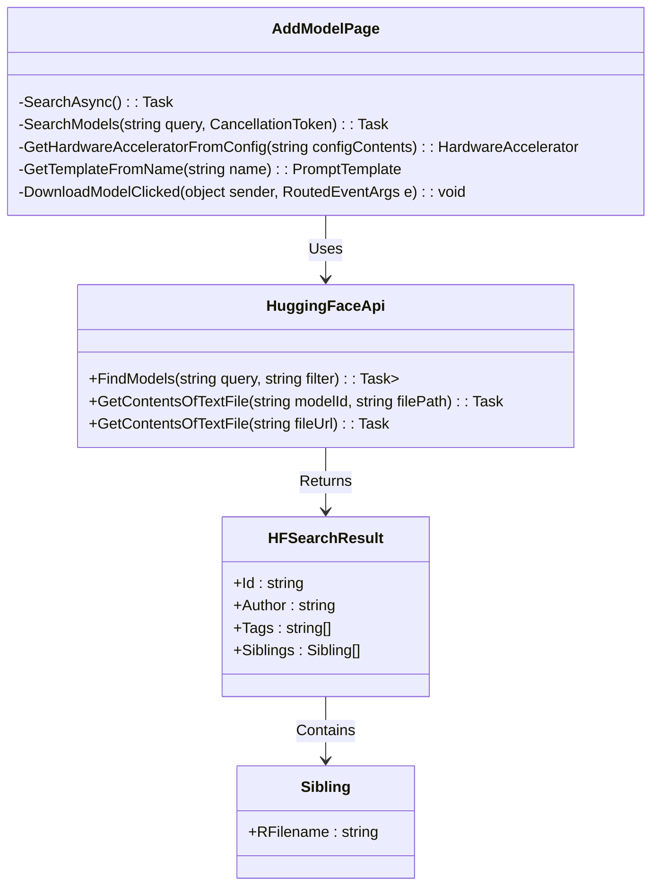
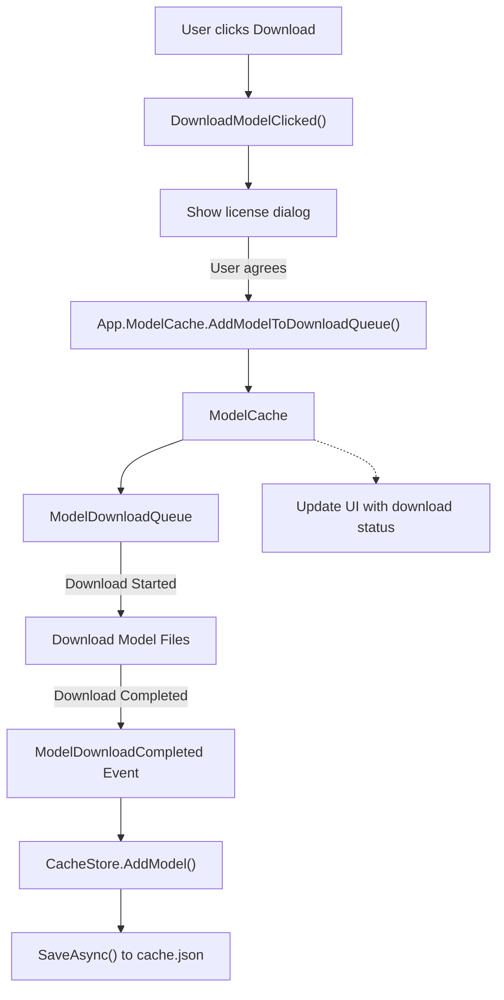
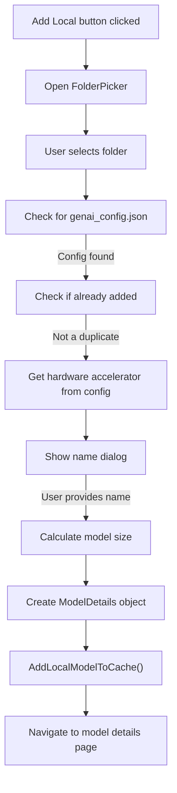
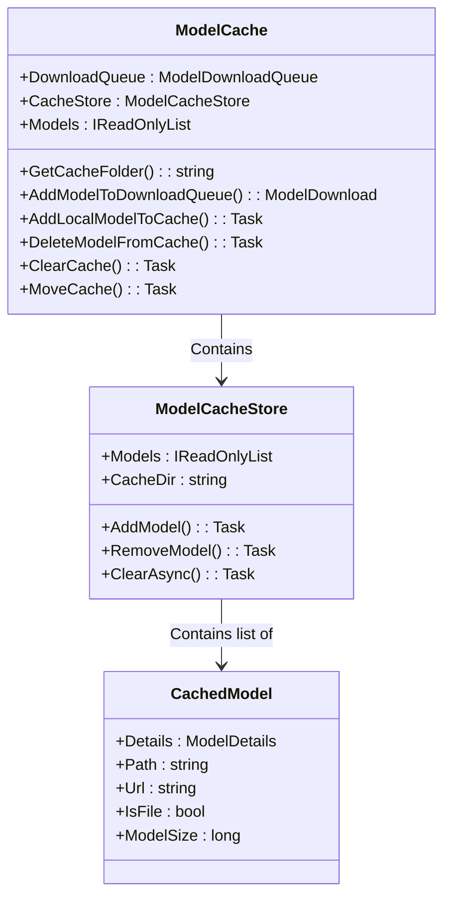
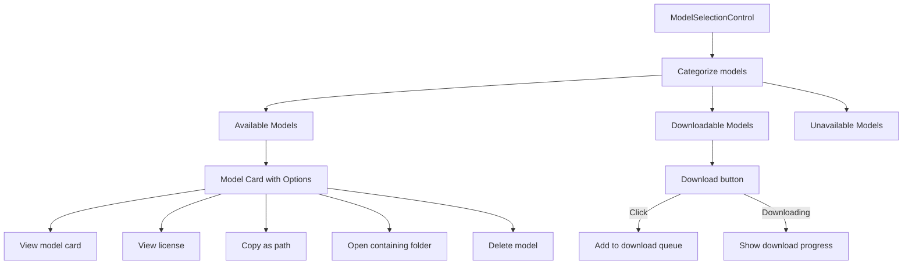

<!-- source: DeepWiki mcp.deepwiki.com · repo microsoft/ai-dev-gallery · page 3.1 Model Discovery and Download · fetched 2026-10-26 -->

# Model Discovery and Download

<details>
<summary>Relevant source files</summary>

The following files were used as context for generating this wiki page:

- [AIDevGallery/Controls/ModelSelectionControl.xaml](AIDevGallery/Controls/ModelSelectionControl.xaml)
- [AIDevGallery/Models/HFSearchResults.cs](AIDevGallery/Models/HFSearchResults.cs)
- [AIDevGallery/Pages/Models/AddModelPage.xaml.cs](AIDevGallery/Pages/Models/AddModelPage.xaml.cs)
- [AIDevGallery/Pages/SettingsPage.xaml](AIDevGallery/Pages/SettingsPage.xaml)
- [AIDevGallery/Pages/SettingsPage.xaml.cs](AIDevGallery/Pages/SettingsPage.xaml.cs)
- [AIDevGallery/Samples/promptTemplates.json](AIDevGallery/Samples/promptTemplates.json)
- [AIDevGallery/Utils/AppUtils.cs](AIDevGallery/Utils/AppUtils.cs)
- [AIDevGallery/Utils/HuggingFaceApi.cs](AIDevGallery/Utils/HuggingFaceApi.cs)
- [AIDevGallery/Utils/LicenseInfo.cs](AIDevGallery/Utils/LicenseInfo.cs)
- [AIDevGallery/Utils/ModelCache.cs](AIDevGallery/Utils/ModelCache.cs)
- [AIDevGallery/Utils/ModelCacheStore.cs](AIDevGallery/Utils/ModelCacheStore.cs)

</details>


## Purpose and Overview

This document details the Model Discovery and Download system of the AI Dev Gallery, which enables users to search for, discover, and download AI models from external sources like Hugging Face. The system also allows users to add local models from their file system and provides comprehensive model management capabilities. For information about how downloaded models are cached and selected for use in samples, see [Model Cache and Selection](#3.2).

## Model Discovery Architecture

The model discovery system allows users to search for compatible AI models and add them to their local cache for use in AI Dev Gallery samples.

### Discovery Flow Diagram



Sources:
- [AIDevGallery/Pages/Models/AddModelPage.xaml.cs:43-221]()
- [AIDevGallery/Utils/HuggingFaceApi.cs:27-59]()

### Hugging Face Integration

The system searches for models using the Hugging Face API and filters the results to include only models with a compatible configuration.



Sources:
- [AIDevGallery/Utils/HuggingFaceApi.cs:16-75]()
- [AIDevGallery/Models/HFSearchResults.cs:14-74]()

## Model Detection and Compatibility

### Hardware Acceleration Detection

The system determines hardware acceleration support by analyzing the model's `genai_config.json` file:

```
- QNN/NPU: Checks for "QnnHtp.dll" in the configuration
- DirectML/GPU: Checks for DML provider options
- CPU: Default if neither NPU nor GPU is detected
```

This information helps users understand how the model will perform on their specific hardware.

Sources:
- [AIDevGallery/Pages/Models/AddModelPage.xaml.cs:330-348]()
- [AIDevGallery/Utils/AppUtils.cs:137-169]()

### Prompt Template Detection

When adding a model, the system automatically detects the appropriate prompt template based on the model name:

| Model Type | Template Applied |
|------------|-----------------|
| Phi        | Phi3 template   |
| DeepSeek   | DeepSeekR1 template |
| Llama/Nemotron | Llama3 template |
| Mistral    | Mistral template |
| Qwen       | Qwen template   |
| Gemma      | Gemma template  |

This ensures that the correct input format is used when interacting with the model.

Sources:
- [AIDevGallery/Pages/Models/AddModelPage.xaml.cs:223-242]()
- [AIDevGallery/Samples/promptTemplates.json:1-58]()

## Download Process

### Download Flow



Sources:
- [AIDevGallery/Pages/Models/AddModelPage.xaml.cs:244-288]()
- [AIDevGallery/Utils/ModelCache.cs:68-83]()

### License Verification

Before downloading, users must agree to the model's license terms. The system:

1. Displays the model name and license information
2. Provides a link to view the full license
3. Requires explicit user agreement before download starts

The `LicenseInfo` class maintains a comprehensive database of license information, mapping license identifiers to full license names and URLs.

Sources:
- [AIDevGallery/Pages/Models/AddModelPage.xaml.cs:255-272]()
- [AIDevGallery/Utils/LicenseInfo.cs:10-534]()

## Adding Local Models

In addition to downloading from external sources, users can add local models:



The process involves:
1. Selecting a folder containing model files
2. Verifying the presence of a `genai_config.json` file
3. Determining hardware acceleration support
4. Adding the model to the cache as a local model

Sources:
- [AIDevGallery/Pages/Models/AddModelPage.xaml.cs:351-478]()
- [AIDevGallery/Utils/ModelCache.cs:85-90]()

## Model Cache Management

The Model Cache System manages the storage and organization of downloaded and local models.

### Cache Architecture



Sources:
- [AIDevGallery/Utils/ModelCache.cs:14-221]()
- [AIDevGallery/Utils/ModelCacheStore.cs:14-119]()

### Settings UI for Cache Management

The Settings page enables users to:

1. View the cache folder location and size
2. Change the cache location
3. Clear the entire cache
4. View and manage individual cached models

When changing the cache location, the system:
1. Validates the destination folder is empty
2. Ensures sufficient disk space is available
3. Copies all models to the new location
4. Updates cache path references

Sources:
- [AIDevGallery/Pages/SettingsPage.xaml:40-106]()
- [AIDevGallery/Pages/SettingsPage.xaml.cs:62-300]()

## Model Selection UI Integration

The ModelSelectionControl is used throughout the application to select models for samples:



The control:
1. Categorizes models based on compatibility and download status
2. Provides download buttons for compatible models that aren't yet downloaded
3. Shows download progress for models being downloaded
4. Offers management options like viewing model details, license information, and file location

Sources:
- [AIDevGallery/Controls/ModelSelectionControl.xaml:1-462]()

## Conclusion

The Model Discovery and Download system provides a comprehensive solution for finding, downloading, and managing AI models within the AI Dev Gallery. By integrating with Hugging Face, supporting local models, and providing robust cache management, the system enables users to easily access a wide range of AI models for use in their applications.

---

