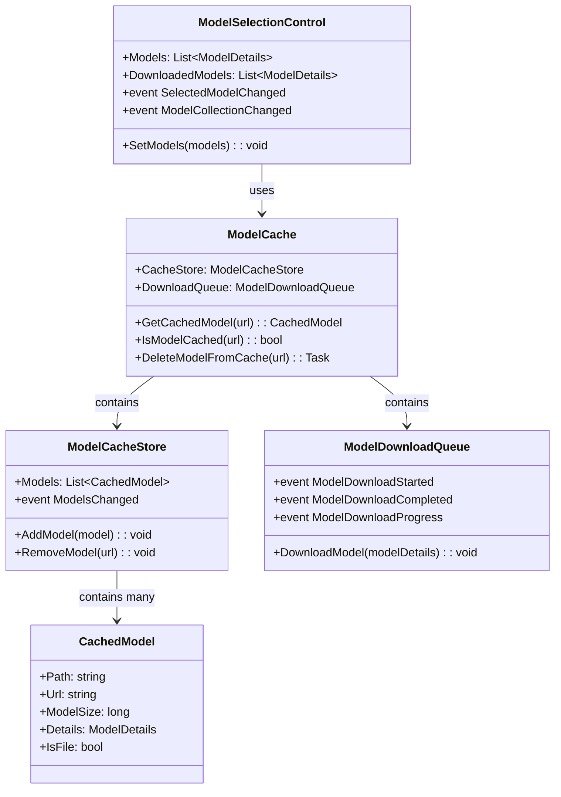
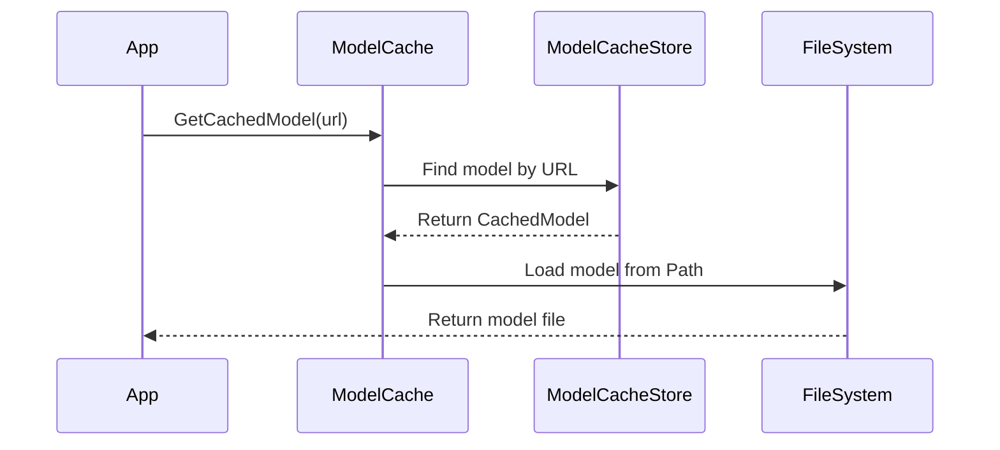
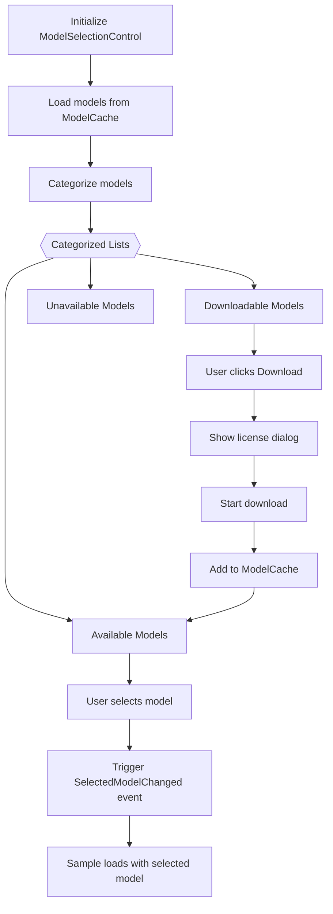
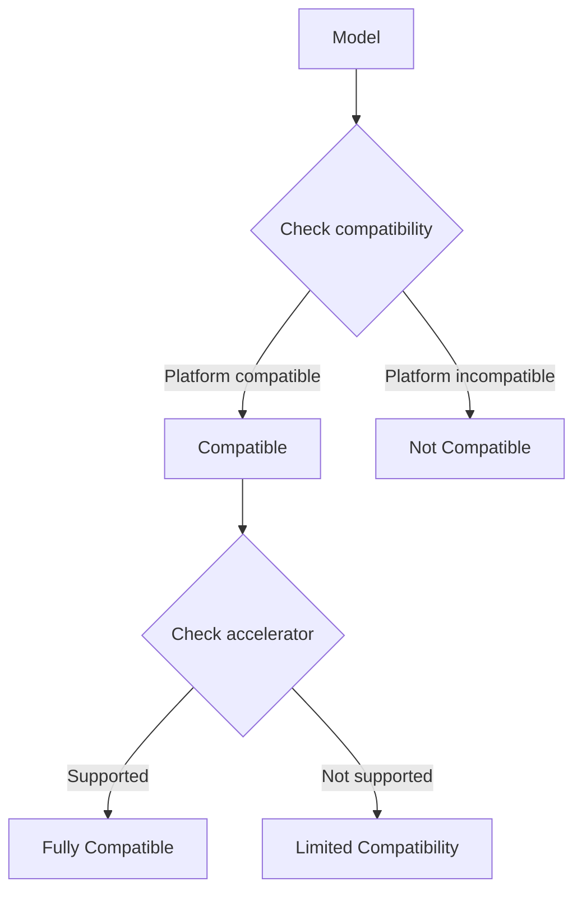
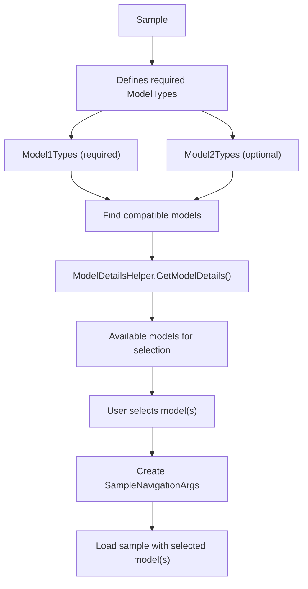
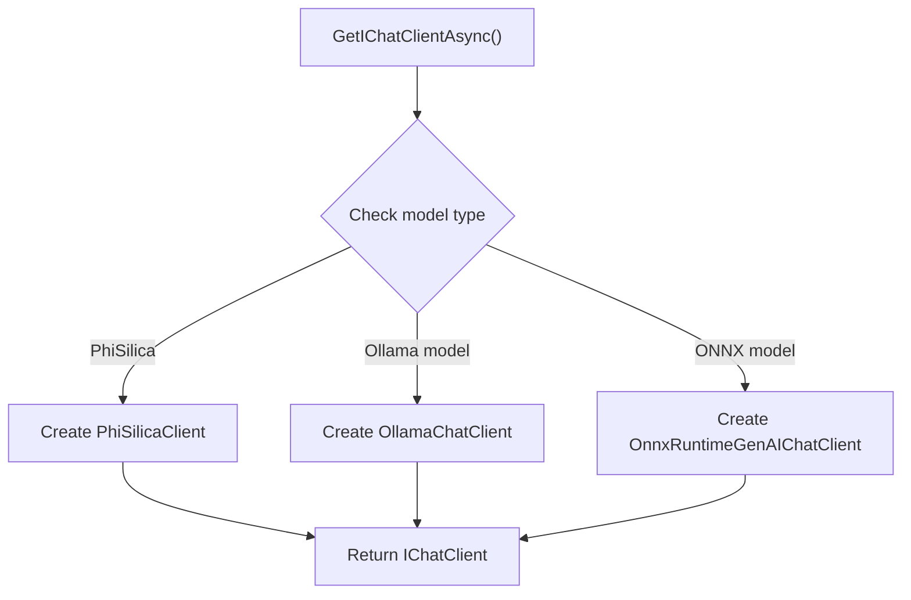
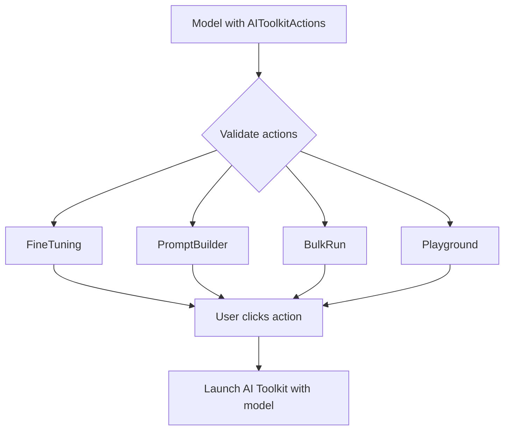

<!-- source: DeepWiki mcp.deepwiki.com · repo microsoft/ai-dev-gallery · page 3.2 Model Cache and Selection · fetched 2026-10-26 -->

# Model Cache and Selection

Relevant source files

The following files were used as context for generating this wiki page:

- [AIDevGallery.SourceGenerator/Models/AIToolkitAction.cs](AIDevGallery.SourceGenerator/Models/AIToolkitAction.cs)
- [AIDevGallery.SourceGenerator/Models/Model.cs](AIDevGallery.SourceGenerator/Models/Model.cs)
- [AIDevGallery.SourceGenerator/ModelsSourceGenerator.cs](AIDevGallery.SourceGenerator/ModelsSourceGenerator.cs)
- [AIDevGallery/Assets/AITKIcon.png](AIDevGallery/Assets/AITKIcon.png)
- [AIDevGallery/Controls/ModelSelectionControl.xaml.cs](AIDevGallery/Controls/ModelSelectionControl.xaml.cs)
- [AIDevGallery/Helpers/ModelDetailsHelper.cs](AIDevGallery/Helpers/ModelDetailsHelper.cs)
- [AIDevGallery/Helpers/SamplesHelper.cs](AIDevGallery/Helpers/SamplesHelper.cs)
- [AIDevGallery/Models/BaseSampleNavigationParameters.cs](AIDevGallery/Models/BaseSampleNavigationParameters.cs)
- [AIDevGallery/Pages/Models/ModelPage.xaml.cs](AIDevGallery/Pages/Models/ModelPage.xaml.cs)
- [AIDevGallery/Pages/Scenarios/ScenarioPage.xaml.cs](AIDevGallery/Pages/Scenarios/ScenarioPage.xaml.cs)
- [AIDevGallery/Samples/Definitions/Models/multimodal.modelgroup.json](AIDevGallery/Samples/Definitions/Models/multimodal.modelgroup.json)
- [AIDevGallery/Telemetry/Events/AIToolkitActionClickedEvent.cs](AIDevGallery/Telemetry/Events/AIToolkitActionClickedEvent.cs)
- [AIDevGallery/Utils/AIToolkitHelper.cs](AIDevGallery/Utils/AIToolkitHelper.cs)

## Purpose and Scope

This document details the Model Cache and Selection subsystem in the AI Dev Gallery application. This subsystem is responsible for discovering, downloading, caching, and selecting AI models for use in samples. It provides a seamless experience for users to work with various AI models without manually managing model files or compatibility.

For information about how models are initially discovered and downloaded, see [Model Discovery and Download](#3.1).

## Architecture Overview

The Model Cache and Selection subsystem consists of several key components working together to manage models throughout their lifecycle.

Sources: [AIDevGallery/Controls/ModelSelectionControl.xaml.cs:21-33](), [AIDevGallery/Pages/Models/ModelPage.xaml.cs:66-68](), [AIDevGallery/Pages/Models/ModelPage.xaml.cs:102-108]()

## Model Cache System

The Model Cache system maintains a local repository of downloaded models and their metadata. It is accessed throughout the application via the global `App.ModelCache` instance.

### Key Components

1. **ModelCache**: Central service that manages model access and operations
2. **ModelCacheStore**: Stores information about cached models and notifies when models change
3. **CachedModel**: Represents a downloaded model with its metadata and file path

### Model Storage and Retrieval

When a model is downloaded, it is stored in the local file system and registered in the ModelCacheStore. The application can then retrieve the model using its URL as a unique identifier:

Sources: [AIDevGallery/Pages/Models/ModelPage.xaml.cs:102-108](), [AIDevGallery/Pages/Models/ModelPage.xaml.cs:121-127]()

## Model Selection Component

The `ModelSelectionControl` is a reusable UI component that displays available and downloadable models, enabling users to select models for samples.

### Component Structure

The control organizes models into three categories:

1. **Available Models**: Already downloaded and cached locally
2. **Downloadable Models**: Available for download but not yet cached
3. **Unavailable Models**: Not compatible with the current system

### Selection Flow

Sources: [AIDevGallery/Controls/ModelSelectionControl.xaml.cs:79-147](), [AIDevGallery/Controls/ModelSelectionControl.xaml.cs:206-305]()

### Model Categories and Filtering

The control uses these methods to categorize and display models:

- `PopulateModelDetailsLists()`: Sorts models into available, downloadable, and unavailable categories
- `SetViewSelection()`: Updates the UI when a model is selected
- `ResetAndLoadModelList()`: Refreshes the model list and tries to preselect a suitable model

Sources: [AIDevGallery/Controls/ModelSelectionControl.xaml.cs:206-305]()

## Model Compatibility System

The system determines which models are compatible with the current device and which can be used with specific samples.

### Compatibility Determination

Model compatibility is checked using the `ModelDetails.Compatibility` property, which considers:

1. Hardware platform (x64, ARM64)
2. Available accelerators (CPU, DirectML, QNN)
3. Special API availability (Windows Copilot Runtime)

Sources: [AIDevGallery/Controls/ModelSelectionControl.xaml.cs:154-166](), [AIDevGallery/Helpers/ModelDetailsHelper.cs:10-32]()

### Hardware Accelerator Support

The system supports these hardware accelerators for model execution:

| Accelerator | Description | Identifier |
|-------------|-------------|------------|
| CPU | Standard CPU execution | `HardwareAccelerator.CPU` |
| DML | DirectML for GPU acceleration | `HardwareAccelerator.DML` |
| QNN | Qualcomm Neural Network for ARM devices | `HardwareAccelerator.QNN` |
| WCRAPI | Windows Copilot Runtime API | `HardwareAccelerator.WCRAPI` |
| OLLAMA | Ollama service interface | `HardwareAccelerator.OLLAMA` |

Sources: [AIDevGallery/Helpers/ModelDetailsHelper.cs:135-146](), [AIDevGallery/Models/BaseSampleNavigationParameters.cs:27-44]()

## Integration with Samples

The Model Cache and Selection system integrates with samples to enable AI model execution.

### Sample-Model Compatibility

Sources: [AIDevGallery/Helpers/SamplesHelper.cs:271-342](), [AIDevGallery/Pages/Scenarios/ScenarioPage.xaml.cs:140-187]()

### Model Details Dictionary

When a sample is executed, the system creates a dictionary mapping model types to model details:

1. `GetCacheModelDetailsDictionary()`: Creates a dictionary of `ModelType` to `ExpandedModelDetails`
2. This dictionary is used to load the appropriate models for the sample
3. For samples requiring two models (e.g., multimodal), both models are included in the dictionary

Sources: [AIDevGallery/Helpers/SamplesHelper.cs:271-342]()

## Models for Language and Chat Samples

For language model and chat samples, the system includes special handling to set up the appropriate client.

### Chat Client Factory

The `SamplesHelper` class provides methods to create appropriate chat clients based on the selected model:

Sources: [AIDevGallery/Models/BaseSampleNavigationParameters.cs:27-44](), [AIDevGallery/Helpers/SamplesHelper.cs:176-196]()

### Prompt Templates

Language models often require specific prompt templates for proper functioning. The system:

1. Retrieves the appropriate prompt template for the selected model
2. Formats the template for use with the chat client
3. Applies the template when generating chat completions

Sources: [AIDevGallery/Helpers/SamplesHelper.cs:101-174](), [AIDevGallery/Helpers/SamplesHelper.cs:255-257]()

## Model Selection in UI Contexts

The Model Selection system is used in multiple UI contexts throughout the application.

### Model Selection in Scenario Pages

In the Scenario Page, the system:

1. Identifies samples that match the scenario
2. Finds compatible models for those samples
3. Populates the ModelSelectionControl with those models
4. Responds to user selection by loading the appropriate sample

Sources: [AIDevGallery/Pages/Scenarios/ScenarioPage.xaml.cs:54-72](), [AIDevGallery/Pages/Scenarios/ScenarioPage.xaml.cs:140-232]()

### Model Selection in Model Pages

In the Model Page, the system:

1. Loads details for a specific model family
2. Displays available model variants in the ModelSelectionControl
3. Shows the model's documentation using its README
4. Allows users to browse samples compatible with the model

Sources: [AIDevGallery/Pages/Models/ModelPage.xaml.cs:44-108]()

## AI Toolkit Integration

The Model Cache and Selection system integrates with the Windows AI Toolkit, allowing users to open selected models in the toolkit.

### Toolkit Actions

Models can define supported toolkit actions in their JSON definitions:

Sources: [AIDevGallery/Utils/AIToolkitHelper.cs:10-94](), [AIDevGallery/Pages/Models/ModelPage.xaml.cs:176-273]()

### Action Validation

The `AIToolkitHelper` class validates which actions are available for each model based on:

1. Model compatibility with the current device
2. The presence of required toolkit IDs in the model metadata
3. The list of supported actions defined in the model

Sources: [AIDevGallery/Utils/AIToolkitHelper.cs:51-64](), [AIDevGallery/Utils/AIToolkitHelper.cs:66-93]()

## Caching Mechanisms and Storage

The Model Cache system stores downloaded models on the local file system and maintains references to them.

### Cache Operations

The key operations for the model cache are:

1. **Add Model**: Registers a downloaded model in the cache
2. **Get Model**: Retrieves a cached model by URL
3. **Delete Model**: Removes a model from the cache and optionally the file system
4. **Check Existence**: Verifies if a model is already cached

Sources: [AIDevGallery/Controls/ModelSelectionControl.xaml.cs:330-350](), [AIDevGallery/Pages/Models/ModelPage.xaml.cs:102-108]()

### User Model Management

Users can manage cached models through the UI:

1. **Open Model Folder**: Opens the folder containing the model files
2. **Delete Model**: Removes the model from the cache after confirmation
3. **Copy Model Path**: Copies the file path to the clipboard
4. **View License**: Opens the model's license information

Sources: [AIDevGallery/Controls/ModelSelectionControl.xaml.cs:306-437]()

## Conclusion

The Model Cache and Selection system provides a comprehensive solution for managing AI models in the AI Dev Gallery application. It handles the complete lifecycle of models from discovery and download through caching and selection, making it easy for users to experiment with various AI models in their samples.

---

