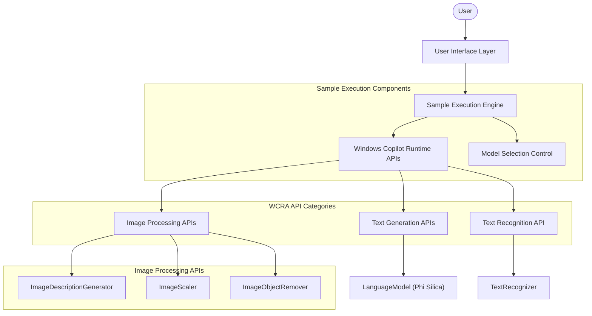
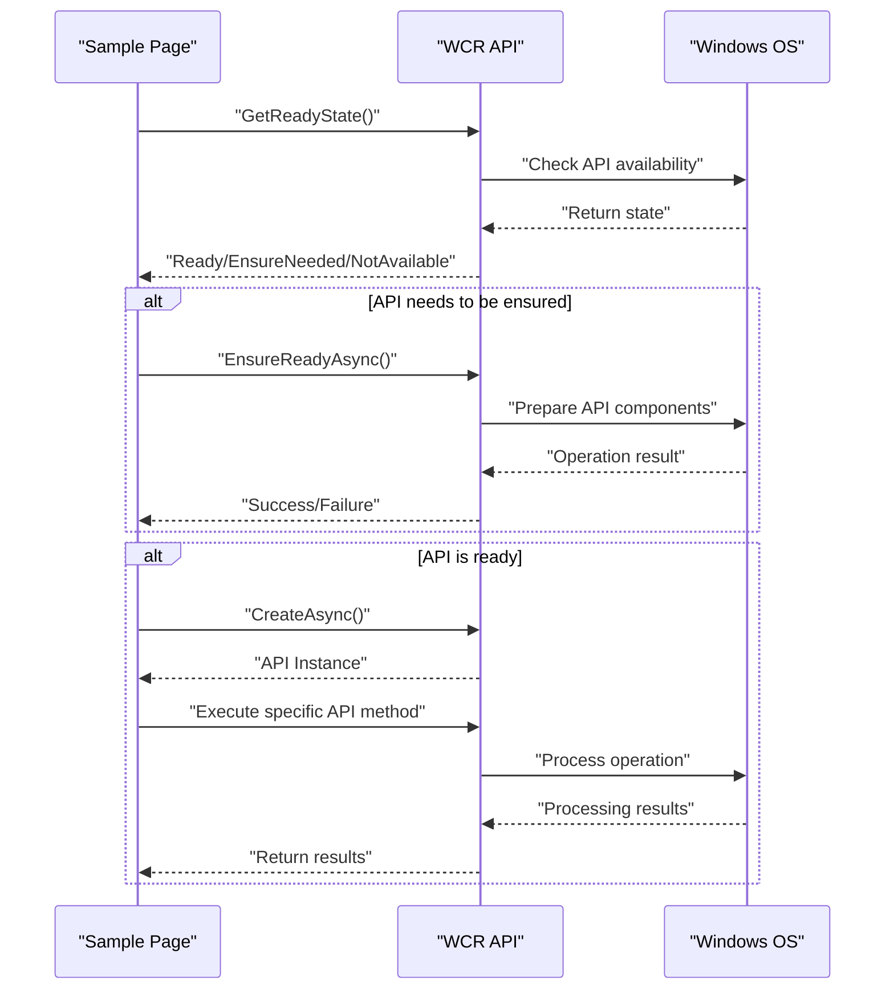
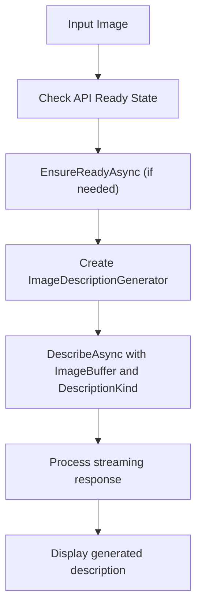
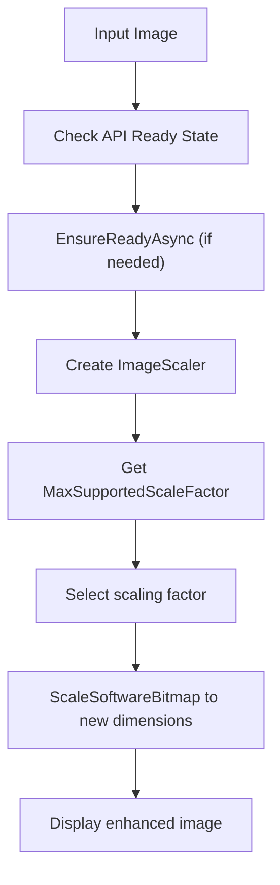
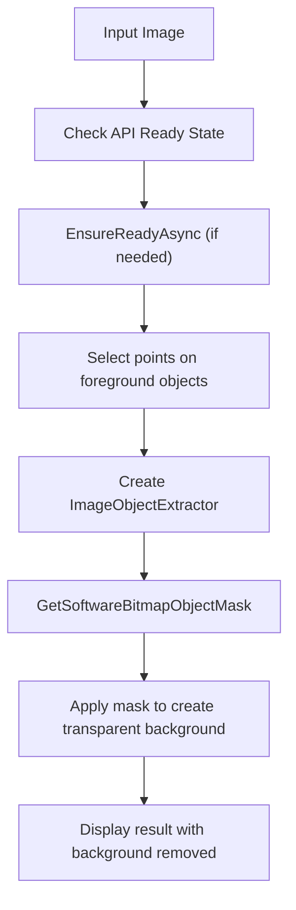
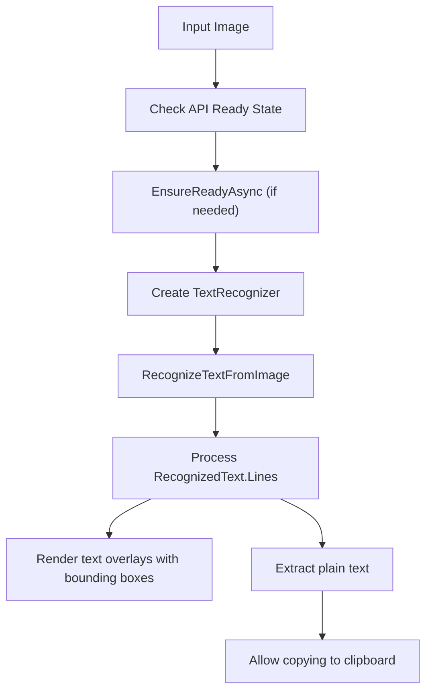
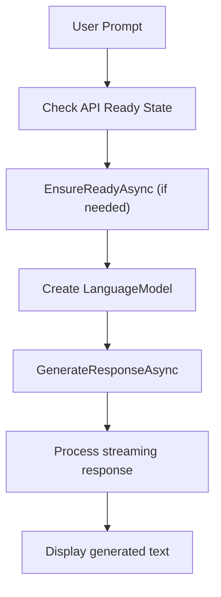
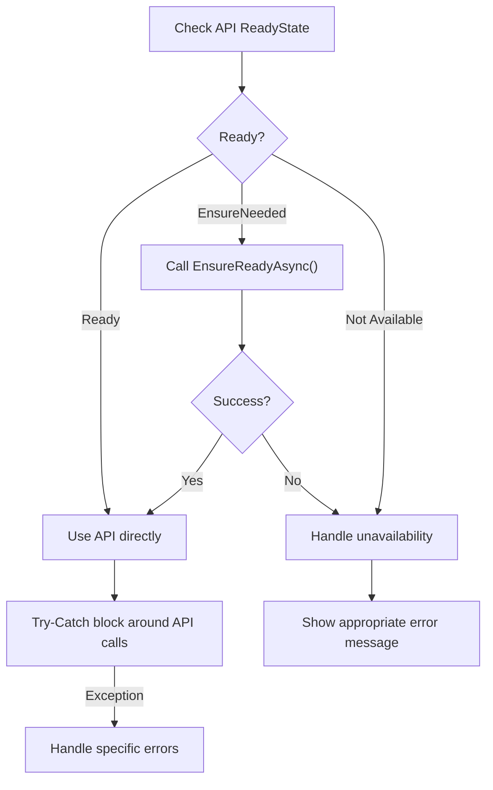

<!-- source: DeepWiki mcp.deepwiki.com · repo microsoft/ai-dev-gallery · page 4 Windows Copilot Runtime APIs · fetched 2026-10-26 -->

# Windows Copilot Runtime APIs

<details>
<summary>Relevant source files</summary>

The following files were used as context for generating this wiki page:

- [AIDevGallery/Samples/Definitions/WcrApis/apis.json](AIDevGallery/Samples/Definitions/WcrApis/apis.json)
- [AIDevGallery/Samples/WCRAPIs/BackgroundRemover.xaml.cs](AIDevGallery/Samples/WCRAPIs/BackgroundRemover.xaml.cs)
- [AIDevGallery/Samples/WCRAPIs/ImageDescription.xaml.cs](AIDevGallery/Samples/WCRAPIs/ImageDescription.xaml.cs)
- [AIDevGallery/Samples/WCRAPIs/IncreaseFidelity.xaml.cs](AIDevGallery/Samples/WCRAPIs/IncreaseFidelity.xaml.cs)
- [AIDevGallery/Samples/WCRAPIs/LiveImageDescription.xaml.cs](AIDevGallery/Samples/WCRAPIs/LiveImageDescription.xaml.cs)
- [AIDevGallery/Samples/WCRAPIs/PhiSilicaBasic.xaml.cs](AIDevGallery/Samples/WCRAPIs/PhiSilicaBasic.xaml.cs)
- [AIDevGallery/Samples/WCRAPIs/TextRecognition.xaml.cs](AIDevGallery/Samples/WCRAPIs/TextRecognition.xaml.cs)
- [AIDevGallery/Samples/scenarios.json](AIDevGallery/Samples/scenarios.json)

</details>


## Overview

The Windows Copilot Runtime (WCR) APIs module provides integration with Windows built-in AI capabilities. This page documents the implementation of Windows Copilot Runtime APIs within the AI Dev Gallery application, covering the architecture, available APIs, and usage patterns. The WCR APIs enable access to powerful AI features like image processing, text recognition, and text generation that are built into Windows.

This document focuses specifically on how the AI Dev Gallery application integrates with and demonstrates Windows Copilot Runtime APIs. For information about the broader Sample Execution system that utilizes these APIs, see [Sample Execution Engine](#2.2).

Sources: [AIDevGallery/Samples/Definitions/WcrApis/apis.json:1-60]()

## Architecture Overview

Windows Copilot Runtime APIs are integrated into the AI Dev Gallery as one of the primary model types in the Sample Execution Engine. The following diagram illustrates how WCR APIs fit into the overall system:



Sources: [AIDevGallery/Samples/scenarios.json:1-218]()

## Common API Integration Pattern

All Windows Copilot Runtime APIs in the application follow a consistent integration pattern:



Sources: [AIDevGallery/Samples/WCRAPIs/ImageDescription.xaml.cs:51-90](), [AIDevGallery/Samples/WCRAPIs/IncreaseFidelity.xaml.cs:45-78](), [AIDevGallery/Samples/WCRAPIs/BackgroundRemover.xaml.cs:51-84](), [AIDevGallery/Samples/WCRAPIs/TextRecognition.xaml.cs:47-80](), [AIDevGallery/Samples/WCRAPIs/PhiSilicaBasic.xaml.cs:40-66]()

## Available Windows Copilot Runtime APIs

The following Windows Copilot Runtime APIs are integrated into the AI Dev Gallery:

| API | Class | Namespace | Purpose |
|-----|-------|-----------|---------|
| Image Description | ImageDescriptionGenerator | Microsoft.Windows.AI.Generative | Generate descriptions of images |
| Image Super Resolution | ImageScaler | Microsoft.Windows.AI | Enhance and upscale images |
| Image Segmentation | ImageObjectRemover, ImageObjectExtractor | Microsoft.Windows.AI | Remove backgrounds from images |
| Text Recognition (OCR) | TextRecognizer | Microsoft.Windows.Vision | Extract text from images |
| Phi Silica | LanguageModel | Microsoft.Windows.AI.Generative | Generate text responses |

Sources: [AIDevGallery/Samples/Definitions/WcrApis/apis.json:1-60]()

## Image Processing APIs

The Windows Copilot Runtime provides several image processing capabilities demonstrated in the AI Dev Gallery:

### ImageDescriptionGenerator

The `ImageDescriptionGenerator` API generates descriptive text about image content. It provides different description types through the `ImageDescriptionKind` enumeration:

- `AccessibleDescription` - Designed for accessibility purposes
- `BriefDescription` (Caption) - Short descriptive caption
- `DetailedDescrition` - Comprehensive description
- `DiagramDescription` - Specialized for describing charts/diagrams

The sample implementation demonstrates:
- Loading/selecting images from files or clipboard
- Generating descriptions with different styles
- Streaming response (implementing progress callbacks)



Sources: [AIDevGallery/Samples/WCRAPIs/ImageDescription.xaml.cs:37-257](), [AIDevGallery/Samples/WCRAPIs/LiveImageDescription.xaml.cs:35-219]()

### ImageScaler

The `ImageScaler` API provides image enhancement capabilities through super-resolution. It allows:
- Scaling images up to a maximum supported scale factor
- Preserving image quality while increasing resolution
- Processing various image formats

The implementation demonstrates:
- Determining maximum supported scale factor
- Scaling software bitmaps to new dimensions
- Side-by-side comparison of original and enhanced images



Sources: [AIDevGallery/Samples/WCRAPIs/IncreaseFidelity.xaml.cs:36-232]()

### ImageObjectRemover/ImageObjectExtractor

The `ImageObjectRemover` and `ImageObjectExtractor` APIs provide background removal capabilities. The implementation shows:
- Interactive selection of foreground objects
- Mask generation to separate foreground from background
- Applying transparency to background elements



Sources: [AIDevGallery/Samples/WCRAPIs/BackgroundRemover.xaml.cs:39-323]()

## Text Recognition API

### TextRecognizer

The `TextRecognizer` API provides Optical Character Recognition (OCR) capabilities to extract text from images. The implementation shows:
- Detecting and recognizing text in various image formats
- Retrieving bounding boxes for text regions
- Overlaying recognized text on the original image
- Copy functionality for the extracted text



Sources: [AIDevGallery/Samples/WCRAPIs/TextRecognition.xaml.cs:37-254]()

## Text Generation API

### LanguageModel (Phi Silica)

The `LanguageModel` API provides text generation capabilities using the Phi Silica model. The implementation demonstrates:
- Generating text responses from user prompts
- Streaming response generation (implementing progress callbacks)
- Cancellation of ongoing generations
- Input validation and length limits



Sources: [AIDevGallery/Samples/WCRAPIs/PhiSilicaBasic.xaml.cs:17-204]()

## Integration Best Practices

Based on the AI Dev Gallery implementation, here are best practices for integrating Windows Copilot Runtime APIs:

1. **Always check API availability before use**:
   ```csharp
   var readyState = ImageDescriptionGenerator.GetReadyState();
   if (readyState is AIFeatureReadyState.Ready or AIFeatureReadyState.EnsureNeeded)
   {
       // Proceed with using the API
   }
   else
   {
       // Handle unavailability
   }
   ```

2. **Handle different availability states appropriately**:
   - `AIFeatureReadyState.Ready` - Ready to use
   - `AIFeatureReadyState.EnsureNeeded` - Needs preparation before use
   - `AIFeatureReadyState.DisabledByUser` - User has disabled the feature
   - Other states - Not supported on the system

3. **Implement cancellation for long-running operations**:
   - Use CancellationTokenSource for operations that may take time
   - Provide user interface for cancellation
   - Properly dispose resources after cancellation

4. **Utilize progress callbacks for streaming results**:
   - Implement the Progress handler for APIs that support it
   - Update UI incrementally as results arrive
   - Provide visual feedback during processing

5. **Properly handle resources**:
   - Dispose API instances when no longer needed
   - Use `using` statements or explicit Dispose calls
   - Cancel ongoing operations when navigating away

Sources: [AIDevGallery/Samples/WCRAPIs/ImageDescription.xaml.cs:51-90](), [AIDevGallery/Samples/WCRAPIs/IncreaseFidelity.xaml.cs:45-78](), [AIDevGallery/Samples/WCRAPIs/BackgroundRemover.xaml.cs:51-84](), [AIDevGallery/Samples/WCRAPIs/TextRecognition.xaml.cs:47-80](), [AIDevGallery/Samples/WCRAPIs/PhiSilicaBasic.xaml.cs:40-66]()

## Error Handling

The Windows Copilot Runtime APIs may not be available on all systems or may be disabled by user settings. The AI Dev Gallery implements a consistent approach to error handling:



Common error handling patterns:
1. Checking API availability state before attempting to use it
2. Providing user-friendly messages for different unavailability reasons
3. Implementing try-catch blocks around API operations
4. Gracefully degrading functionality when APIs are not available

Sources: [AIDevGallery/Samples/WCRAPIs/ImageDescription.xaml.cs:51-90](), [AIDevGallery/Samples/WCRAPIs/IncreaseFidelity.xaml.cs:45-78](), [AIDevGallery/Samples/WCRAPIs/BackgroundRemover.xaml.cs:51-84]()

## Summary

The Windows Copilot Runtime APIs provide access to powerful AI capabilities built into Windows. The AI Dev Gallery demonstrates integration with these APIs through a consistent pattern of checking availability, ensuring readiness, and handling results appropriately. The available APIs cover image processing, text recognition, and text generation, providing a robust foundation for AI-enabled applications.

Sources: [AIDevGallery/Samples/Definitions/WcrApis/apis.json:1-60]()

---

