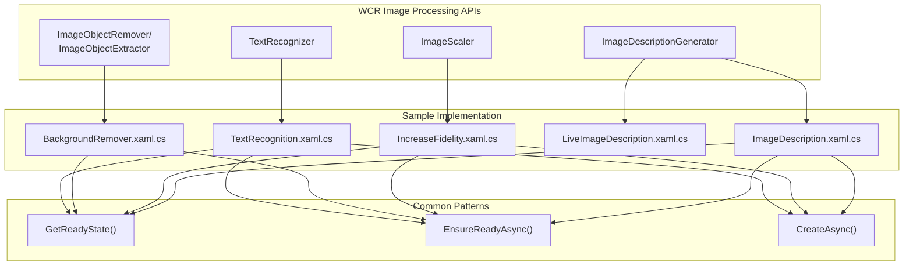
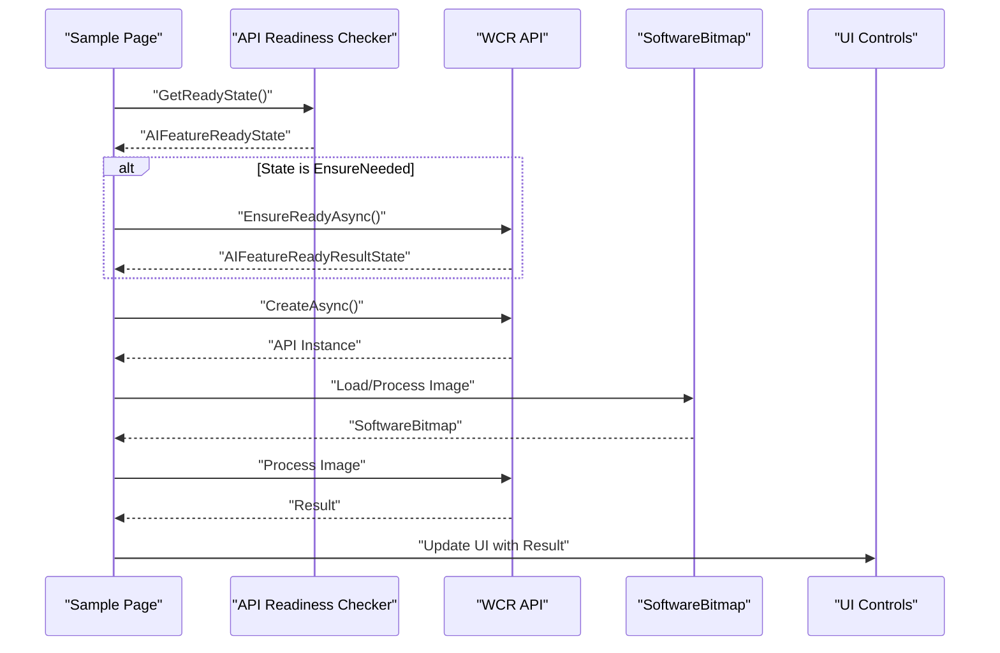
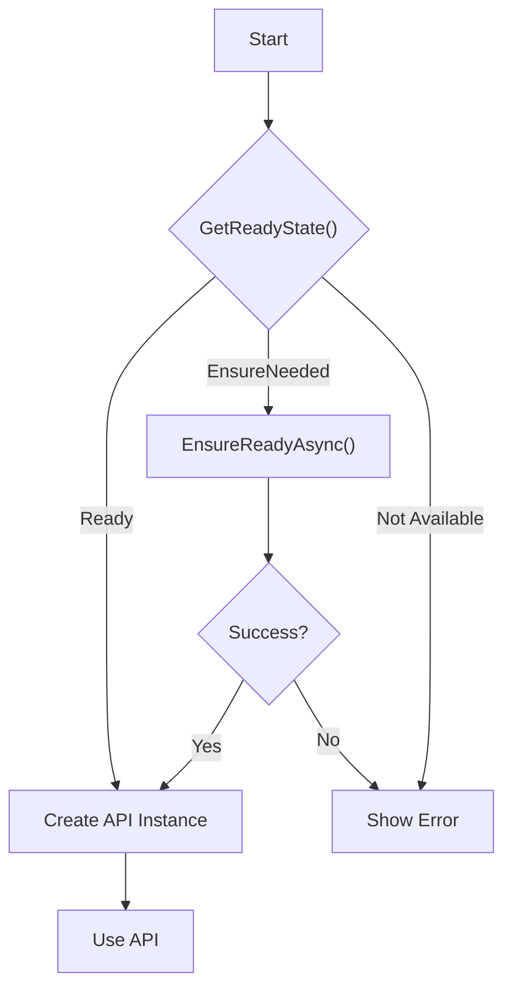
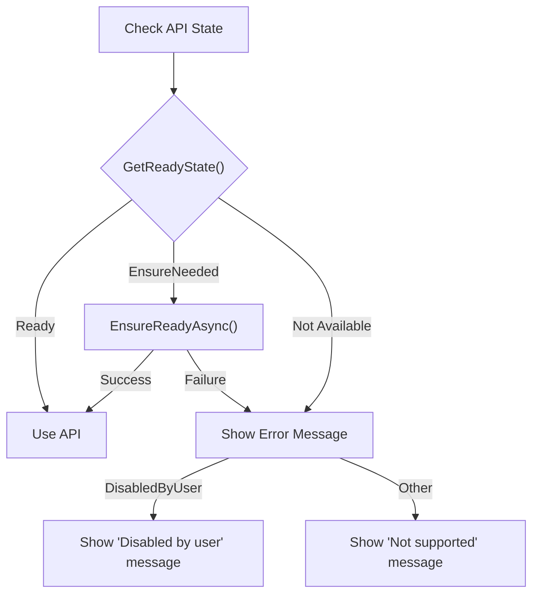

<!-- source: DeepWiki mcp.deepwiki.com · repo microsoft/ai-dev-gallery · page 4.1 WCR Image Processing APIs · fetched 2026-10-26 -->

# WCR Image Processing APIs

<details>
<summary>Relevant source files</summary>

The following files were used as context for generating this wiki page:

- [AIDevGallery/Assets/Road.png](AIDevGallery/Assets/Road.png)
- [AIDevGallery/Samples/WCRAPIs/BackgroundRemover.xaml](AIDevGallery/Samples/WCRAPIs/BackgroundRemover.xaml)
- [AIDevGallery/Samples/WCRAPIs/BackgroundRemover.xaml.cs](AIDevGallery/Samples/WCRAPIs/BackgroundRemover.xaml.cs)
- [AIDevGallery/Samples/WCRAPIs/ImageDescription.xaml](AIDevGallery/Samples/WCRAPIs/ImageDescription.xaml)
- [AIDevGallery/Samples/WCRAPIs/ImageDescription.xaml.cs](AIDevGallery/Samples/WCRAPIs/ImageDescription.xaml.cs)
- [AIDevGallery/Samples/WCRAPIs/IncreaseFidelity.xaml](AIDevGallery/Samples/WCRAPIs/IncreaseFidelity.xaml)
- [AIDevGallery/Samples/WCRAPIs/IncreaseFidelity.xaml.cs](AIDevGallery/Samples/WCRAPIs/IncreaseFidelity.xaml.cs)
- [AIDevGallery/Samples/WCRAPIs/LiveImageDescription.xaml.cs](AIDevGallery/Samples/WCRAPIs/LiveImageDescription.xaml.cs)
- [AIDevGallery/Samples/WCRAPIs/PhiSilicaBasic.xaml](AIDevGallery/Samples/WCRAPIs/PhiSilicaBasic.xaml)
- [AIDevGallery/Samples/WCRAPIs/PhiSilicaBasic.xaml.cs](AIDevGallery/Samples/WCRAPIs/PhiSilicaBasic.xaml.cs)
- [AIDevGallery/Samples/WCRAPIs/TextRecognition.xaml.cs](AIDevGallery/Samples/WCRAPIs/TextRecognition.xaml.cs)

</details>


## Purpose and Scope

This document provides technical details about the Windows Copilot Runtime (WCR) Image Processing APIs implemented in the AI Dev Gallery. These APIs leverage the Windows Copilot Runtime to perform various AI-powered image processing tasks including image description, image upscaling, background removal, and text recognition. For information about WCR Language Model APIs, see [WCR Language Model APIs](#4.2).

Sources: [AIDevGallery/Samples/WCRAPIs/ImageDescription.xaml.cs:1-257](), [AIDevGallery/Samples/WCRAPIs/IncreaseFidelity.xaml.cs:1-232](), [AIDevGallery/Samples/WCRAPIs/BackgroundRemover.xaml.cs:1-323](), [AIDevGallery/Samples/WCRAPIs/LiveImageDescription.xaml.cs:1-219](), [AIDevGallery/Samples/WCRAPIs/TextRecognition.xaml.cs:1-254]()

## Architecture Overview

The WCR Image Processing APIs are part of the Windows Copilot Runtime, which provides a set of AI capabilities directly integrated into Windows. These APIs are exposed through the `Microsoft.Windows.AI` and `Microsoft.Windows.AI.Generative` namespaces.

### WCR Image Processing Components



Sources: [AIDevGallery/Samples/WCRAPIs/ImageDescription.xaml.cs:47-70](), [AIDevGallery/Samples/WCRAPIs/IncreaseFidelity.xaml.cs:38-77](), [AIDevGallery/Samples/WCRAPIs/BackgroundRemover.xaml.cs:42-81](), [AIDevGallery/Samples/WCRAPIs/LiveImageDescription.xaml.cs:37-92](), [AIDevGallery/Samples/WCRAPIs/TextRecognition.xaml.cs:39-79]()

### API Integration Flow



Sources: [AIDevGallery/Samples/WCRAPIs/ImageDescription.xaml.cs:57-90](), [AIDevGallery/Samples/WCRAPIs/IncreaseFidelity.xaml.cs:47-77](), [AIDevGallery/Samples/WCRAPIs/BackgroundRemover.xaml.cs:51-83](), [AIDevGallery/Samples/WCRAPIs/TextRecognition.xaml.cs:47-79]()

## API Components

### ImageDescriptionGenerator

The `ImageDescriptionGenerator` API generates textual descriptions of image content. It supports different kinds of descriptions through the `ImageDescriptionKind` enum.

#### Key properties and methods:

| Method/Property | Description |
|-----------------|-------------|
| `GetReadyState()` | Static method to check if the API is available |
| `EnsureReadyAsync()` | Static method to initialize the API if needed |
| `CreateAsync()` | Creates an instance of the generator |
| `DescribeAsync(ImageBuffer, ImageDescriptionKind, ContentFilterOptions)` | Generates a description of the provided image |

#### Description Types:

| Description Kind | Purpose |
|------------------|---------|
| `AccessibleDescription` | Detailed description suitable for accessibility |
| `BriefDescription` | Short caption for the image |
| `DetailedDescrition` | In-depth description of image contents |
| `DiagramDescription` | Specialized for describing charts and diagrams |

Sources: [AIDevGallery/Samples/WCRAPIs/ImageDescription.xaml.cs:39-45](), [AIDevGallery/Samples/WCRAPIs/ImageDescription.xaml.cs:180-236]()

### ImageScaler

The `ImageScaler` API enhances images by increasing their resolution while maintaining and improving detail quality.

#### Key properties and methods:

| Method/Property | Description |
|-----------------|-------------|
| `GetReadyState()` | Static method to check if the API is available |
| `EnsureReadyAsync()` | Static method to initialize the API if needed |
| `CreateAsync()` | Creates an instance of the scaler |
| `MaxSupportedScaleFactor` | The maximum scale factor supported by the API |
| `ScaleSoftwareBitmap(SoftwareBitmap, int, int)` | Scales the image to the specified dimensions |

Sources: [AIDevGallery/Samples/WCRAPIs/IncreaseFidelity.xaml.cs:168-204]()

### ImageObjectRemover/ImageObjectExtractor

These APIs enable background removal by identifying and extracting objects from images.

#### Key properties and methods:

| Method/Property | Description |
|-----------------|-------------|
| `GetReadyState()` | Static method to check if the API is available |
| `EnsureReadyAsync()` | Static method to initialize the API if needed |
| `CreateWithSoftwareBitmapAsync(SoftwareBitmap)` | Creates an extractor for a specific image |
| `GetSoftwareBitmapObjectMask(ImageObjectExtractorHint)` | Generates a mask identifying objects based on hints |

The `ImageObjectExtractorHint` class allows specifying points to include or exclude from the extraction.

Sources: [AIDevGallery/Samples/WCRAPIs/BackgroundRemover.xaml.cs:189-215](), [AIDevGallery/Samples/WCRAPIs/BackgroundRemover.xaml.cs:217-246]()

### TextRecognizer

The `TextRecognizer` API identifies and extracts text from images (OCR functionality).

#### Key properties and methods:

| Method/Property | Description |
|-----------------|-------------|
| `GetReadyState()` | Static method to check if the API is available |
| `EnsureReadyAsync()` | Static method to initialize the API if needed |
| `CreateAsync()` | Creates an instance of the recognizer |
| `RecognizeTextFromImage(ImageBuffer, TextRecognizerOptions)` | Extracts text content from an image |
| `RecognizedText.Lines` | Collection of text lines with position information |

Sources: [AIDevGallery/Samples/WCRAPIs/TextRecognition.xaml.cs:178-195](), [AIDevGallery/Samples/WCRAPIs/TextRecognition.xaml.cs:209-248]()

## Implementation Patterns

### API Readiness Check Pattern

All WCR Image Processing APIs follow a consistent pattern for checking availability and initialization:



This pattern is implemented in the `LoadModelAsync` method of each sample page.

Sources: [AIDevGallery/Samples/WCRAPIs/ImageDescription.xaml.cs:57-90](), [AIDevGallery/Samples/WCRAPIs/IncreaseFidelity.xaml.cs:47-77](), [AIDevGallery/Samples/WCRAPIs/BackgroundRemover.xaml.cs:51-83](), [AIDevGallery/Samples/WCRAPIs/TextRecognition.xaml.cs:47-79]()

### Image Processing Flow

The typical image processing flow in these samples follows this pattern:

1. Load image from file, clipboard, or camera
2. Convert to appropriate format (typically `Bgra8` with `Premultiplied` alpha)
3. Create an API instance if not already created
4. Process the image using the appropriate API
5. Display the results

Sources: [AIDevGallery/Samples/WCRAPIs/ImageDescription.xaml.cs:159-177](), [AIDevGallery/Samples/WCRAPIs/IncreaseFidelity.xaml.cs:144-215](), [AIDevGallery/Samples/WCRAPIs/BackgroundRemover.xaml.cs:153-187](), [AIDevGallery/Samples/WCRAPIs/TextRecognition.xaml.cs:153-176]()

## Sample Implementations

### Image Description

The `ImageDescription` sample demonstrates how to generate textual descriptions of images using different description types:

1. Loads an image from file, clipboard, or a default asset
2. Converts the image to a compatible format
3. Creates an `ImageDescriptionGenerator` instance
4. Provides a UI to select description type (Caption, Detailed, Accessible, Office charts)
5. Displays the generated description with streaming updates

Sources: [AIDevGallery/Samples/WCRAPIs/ImageDescription.xaml.cs:180-236]()

### Live Image Description

The `LiveImageDescription` sample extends the basic image description functionality to work with a live camera feed:

1. Initializes the camera using `CameraPreviewControl`
2. Processes frames as they arrive
3. Generates descriptions using `ImageDescriptionGenerator`
4. Provides a mechanism to start/stop processing

Sources: [AIDevGallery/Samples/WCRAPIs/LiveImageDescription.xaml.cs:95-102](), [AIDevGallery/Samples/WCRAPIs/LiveImageDescription.xaml.cs:124-199]()

### Image Enhancement (Increase Fidelity)

The `IncreaseFidelity` sample demonstrates how to upscale images while maintaining quality:

1. Loads an image from file, clipboard, or a default asset
2. Provides a slider to select the scale factor (limited by `MaxSupportedScaleFactor`)
3. Creates an `ImageScaler` instance
4. Scales the image to the new dimensions
5. Displays a side-by-side comparison of original and enhanced images

Sources: [AIDevGallery/Samples/WCRAPIs/IncreaseFidelity.xaml.cs:161-215](), [AIDevGallery/Samples/WCRAPIs/IncreaseFidelity.xaml:1-166]()

### Background Removal

The `BackgroundRemover` sample demonstrates how to extract objects from images:

1. Loads an image from file, clipboard, or a default asset
2. Allows the user to click on parts of the image to mark objects to keep
3. Creates an `ImageObjectExtractor` instance
4. Generates a mask using the selected points
5. Applies the mask to the original image to create a transparent background
6. Displays the result with only the selected objects visible

Sources: [AIDevGallery/Samples/WCRAPIs/BackgroundRemover.xaml.cs:189-215](), [AIDevGallery/Samples/WCRAPIs/BackgroundRemover.xaml.cs:277-301]()

### Text Recognition (OCR)

The `TextRecognition` sample demonstrates how to extract text from images:

1. Loads an image from file, clipboard, or a default asset
2. Creates a `TextRecognizer` instance
3. Processes the image to detect text
4. Displays the result by rendering overlays on the image showing the detected text regions
5. Provides an option to copy all the extracted text

Sources: [AIDevGallery/Samples/WCRAPIs/TextRecognition.xaml.cs:178-195](), [AIDevGallery/Samples/WCRAPIs/TextRecognition.xaml.cs:209-248]()

## Common Implementation Details

### Image Loading and Format Conversion

All samples use a common pattern for loading and preparing images:

```csharp
// Load from stream
var decoder = await BitmapDecoder.CreateAsync(stream);
SoftwareBitmap inputBitmap = await decoder.GetSoftwareBitmapAsync(BitmapPixelFormat.Bgra8, BitmapAlphaMode.Premultiplied);

// Convert for display
var bitmapSource = new SoftwareBitmapSource();
SoftwareBitmap convertedImage = SoftwareBitmap.Convert(inputBitmap, BitmapPixelFormat.Bgra8, BitmapAlphaMode.Premultiplied);
await bitmapSource.SetBitmapAsync(convertedImage);
imageControl.Source = bitmapSource;
```

Sources: [AIDevGallery/Samples/WCRAPIs/ImageDescription.xaml.cs:159-177](), [AIDevGallery/Samples/WCRAPIs/IncreaseFidelity.xaml.cs:217-226](), [AIDevGallery/Samples/WCRAPIs/BackgroundRemover.xaml.cs:177-187](), [AIDevGallery/Samples/WCRAPIs/TextRecognition.xaml.cs:153-176]()

### Error Handling

The samples implement consistent error handling to gracefully manage the case when APIs are unavailable:



Sources: [AIDevGallery/Samples/WCRAPIs/ImageDescription.xaml.cs:57-90](), [AIDevGallery/Samples/WCRAPIs/IncreaseFidelity.xaml.cs:47-77](), [AIDevGallery/Samples/WCRAPIs/BackgroundRemover.xaml.cs:51-83](), [AIDevGallery/Samples/WCRAPIs/TextRecognition.xaml.cs:47-79]()

---

