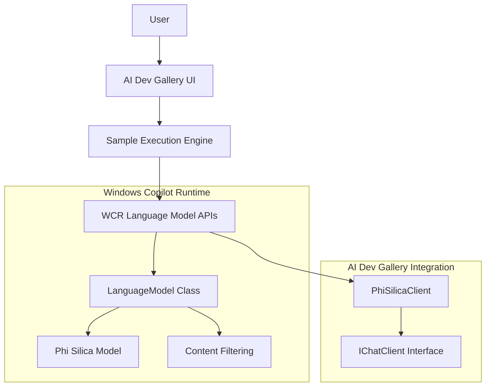
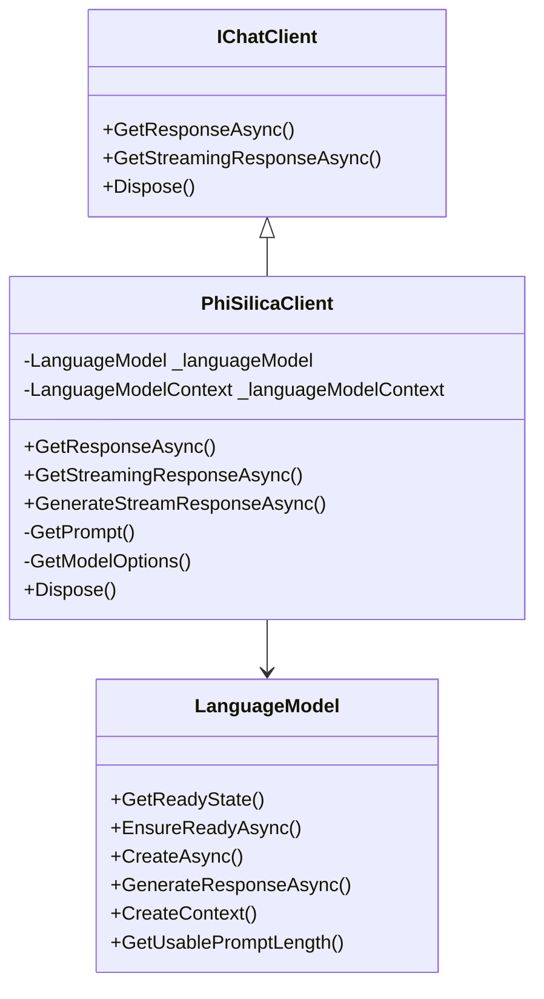
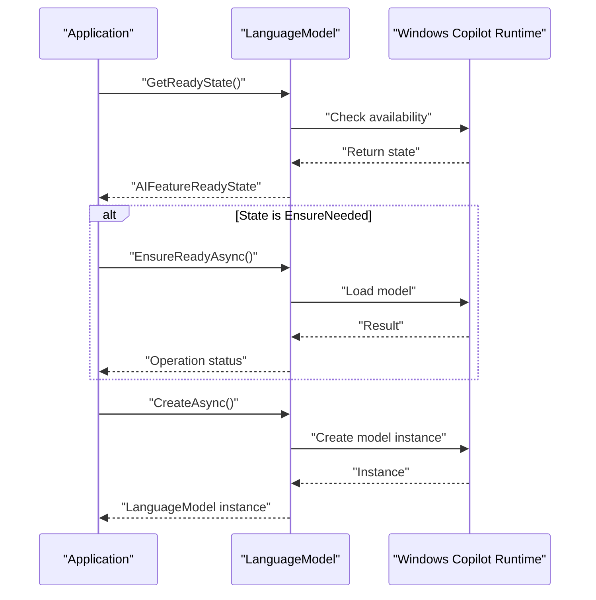
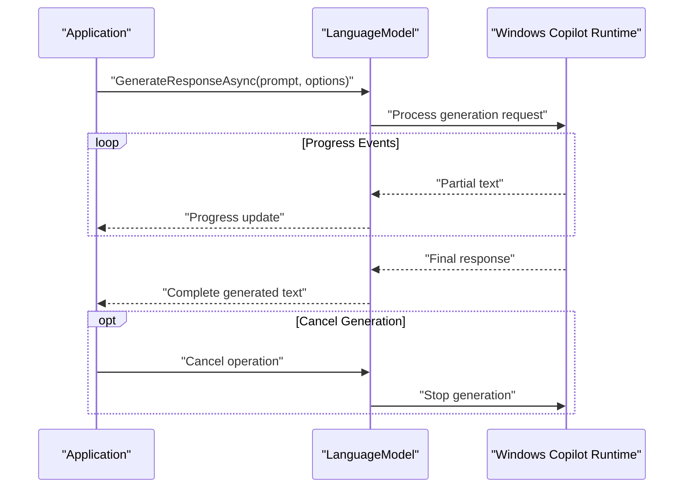

<!-- source: DeepWiki mcp.deepwiki.com · repo microsoft/ai-dev-gallery · page 4.2 WCR Language Model APIs · fetched 2026-10-26 -->

# WCR Language Model APIs

<details>
<summary>Relevant source files</summary>

The following files were used as context for generating this wiki page:

- [AIDevGallery/ProjectGenerator/Template/MainWindow.xaml.cs](AIDevGallery/ProjectGenerator/Template/MainWindow.xaml.cs)
- [AIDevGallery/Samples/BaseSamplePage.cs](AIDevGallery/Samples/BaseSamplePage.cs)
- [AIDevGallery/Samples/Definitions/WcrApis/WcrApiCodeSnippet.cs](AIDevGallery/Samples/Definitions/WcrApis/WcrApiCodeSnippet.cs)
- [AIDevGallery/Samples/SharedCode/IChatClient/PhiSilicaClient.cs](AIDevGallery/Samples/SharedCode/IChatClient/PhiSilicaClient.cs)
- [AIDevGallery/Samples/WCRAPIs/BackgroundRemover.xaml.cs](AIDevGallery/Samples/WCRAPIs/BackgroundRemover.xaml.cs)
- [AIDevGallery/Samples/WCRAPIs/ImageDescription.xaml.cs](AIDevGallery/Samples/WCRAPIs/ImageDescription.xaml.cs)
- [AIDevGallery/Samples/WCRAPIs/IncreaseFidelity.xaml.cs](AIDevGallery/Samples/WCRAPIs/IncreaseFidelity.xaml.cs)
- [AIDevGallery/Samples/WCRAPIs/LiveImageDescription.xaml.cs](AIDevGallery/Samples/WCRAPIs/LiveImageDescription.xaml.cs)
- [AIDevGallery/Samples/WCRAPIs/PhiSilicaBasic.xaml.cs](AIDevGallery/Samples/WCRAPIs/PhiSilicaBasic.xaml.cs)
- [AIDevGallery/Samples/WCRAPIs/TextRecognition.xaml.cs](AIDevGallery/Samples/WCRAPIs/TextRecognition.xaml.cs)

</details>


## Purpose and Scope

This document provides a detailed technical explanation of the Windows Copilot Runtime (WCR) Language Model APIs as implemented in the AI Dev Gallery. These APIs enable developers to leverage Windows-native language models for text generation and completion tasks. This page focuses specifically on language model capabilities; for information about WCR image processing features, see [WCR Image Processing APIs](#4.1).

## Architecture Overview

The Windows Copilot Runtime Language Model APIs provide a system for accessing and utilizing the built-in language models available on Windows systems, particularly the Phi Silica model. These APIs are integrated into the AI Dev Gallery architecture as one of the available model types for text generation.



Sources: [AIDevGallery/Samples/SharedCode/IChatClient/PhiSilicaClient.cs:26-27](), [AIDevGallery/Samples/WCRAPIs/PhiSilicaBasic.xaml.cs:26-31]()

## Core Components

### LanguageModel Class

The `LanguageModel` class is the core component for interacting with Windows Copilot Runtime language models. It provides capabilities for text generation and completion.

Key methods and properties:

| Method/Property | Purpose |
|-----------------|---------|
| `GetReadyState()` | Checks if the language model is available on the system |
| `EnsureReadyAsync()` | Ensures the language model is loaded and ready for use |
| `CreateAsync()` | Creates a new instance of the language model |
| `GenerateResponseAsync()` | Generates text based on the provided prompt |
| `CreateContext()` | Creates a context for maintaining conversation state |
| `GetUsablePromptLength()` | Returns the maximum allowed prompt length |

Sources: [AIDevGallery/Samples/WCRAPIs/PhiSilicaBasic.xaml.cs:40-147](), [AIDevGallery/Samples/SharedCode/IChatClient/PhiSilicaClient.cs:40-211]()

### PhiSilicaClient

The AI Dev Gallery implements a `PhiSilicaClient` class that wraps the WCR `LanguageModel` functionality with a chat-like interface through the `IChatClient` interface. This allows for consistent usage patterns across different model types in the application.



Sources: [AIDevGallery/Samples/SharedCode/IChatClient/PhiSilicaClient.cs:26-264]()

### Configuration Options

Text generation with the WCR Language Model APIs can be configured using several options:

#### LanguageModelOptions

Configures how text is generated:

```
var languageModelOptions = new LanguageModelOptions
{
    Temperature = options?.Temperature ?? DefaultTemperature,
    TopK = (uint)(options?.TopK ?? DefaultTopK),
    TopP = (uint)(options?.TopP ?? DefaultTopP),
    ContentFilterOptions = contentFilterOptions
};
```

#### ContentFilterOptions

Configures content filtering for both input and output:

```
var contentFilterOptions = new ContentFilterOptions();
contentFilterOptions.PromptMaxAllowedSeverityLevel = new TextContentFilterSeverity
{
    Hate = inputModeration,
    Sexual = inputModeration,
    Violent = inputModeration,
    SelfHarm = inputModeration
};
```

Sources: [AIDevGallery/Samples/SharedCode/IChatClient/PhiSilicaClient.cs:124-156]()

## Usage Patterns

### Availability and Initialization Flow

Before using the WCR Language Model APIs, applications must check availability and initialize the model:



The standard pattern for checking availability:

```
var readyState = LanguageModel.GetReadyState();
if (readyState is AIFeatureReadyState.Ready or AIFeatureReadyState.EnsureNeeded)
{
    if (readyState == AIFeatureReadyState.EnsureNeeded)
    {
        var operation = await LanguageModel.EnsureReadyAsync();
        if (operation.Status != AIFeatureReadyResultState.Success)
        {
            // Handle error
        }
    }
    
    // Proceed with model creation and use
    _languageModel = await LanguageModel.CreateAsync();
}
else
{
    // Model not available
    var reason = readyState == AIFeatureReadyState.DisabledByUser
        ? "Disabled by user."
        : "Not supported on this system.";
    // Handle unavailability
}
```

Sources: [AIDevGallery/Samples/WCRAPIs/PhiSilicaBasic.xaml.cs:40-66](), [AIDevGallery/Samples/SharedCode/IChatClient/PhiSilicaClient.cs:62-97]()

### Text Generation Flow

Once a `LanguageModel` instance is created, applications can generate text using the following pattern:



Sources: [AIDevGallery/Samples/WCRAPIs/PhiSilicaBasic.xaml.cs:95-147](), [AIDevGallery/Samples/SharedCode/IChatClient/PhiSilicaClient.cs:213-263]()

### Streaming Generation

The WCR Language Model APIs support streaming generation, allowing for real-time display of text as it's generated:

```
var operation = _languageModel.GenerateResponseAsync(prompt);
operation.Progress = (asyncInfo, delta) =>
{
    DispatcherQueue.TryEnqueue(() =>
    {
        // Display delta (new text chunk)
        GenerateTextBlock.Text += delta;
        
        // Check for cancellation
        if (_cts?.IsCancellationRequested == true)
        {
            operation.Cancel();
        }
    });
};

// Wait for completion
var result = await operation;
```

Sources: [AIDevGallery/Samples/WCRAPIs/PhiSilicaBasic.xaml.cs:112-139](), [AIDevGallery/Samples/SharedCode/IChatClient/PhiSilicaClient.cs:213-262]()

## Implementation Examples

### Basic Text Generation

The `PhiSilicaBasic` sample demonstrates a simple text generation implementation:

1. Check if the language model is available
2. Initialize the model
3. Set up a streaming generation process with progress updates
4. Display generated text as it arrives
5. Support cancellation

Key components:
- `LanguageModel` instance for generating text
- Progress callback for streaming updates
- Cancellation support via `CancellationTokenSource`

Sources: [AIDevGallery/Samples/WCRAPIs/PhiSilicaBasic.xaml.cs:26-204]()

### Chat Client Implementation

The `PhiSilicaClient` class provides a more sophisticated implementation that adapts the WCR Language Model to the `IChatClient` interface:

1. Manages the conversation context
2. Formats chat messages into a prompt
3. Handles streaming generation
4. Provides cancellation support
5. Manages content filtering

This implementation allows for consistent integration with the AI Dev Gallery's chat interface.

Sources: [AIDevGallery/Samples/SharedCode/IChatClient/PhiSilicaClient.cs:26-264]()

## Error Handling

The WCR Language Model APIs provide several error states that applications should handle:

| Error State | Description | Handling |
|-------------|-------------|----------|
| `AIFeatureReadyState.DisabledByUser` | User has disabled the feature | Inform user and provide instructions to enable |
| `AIFeatureReadyState.NotSupportedOnCurrentSystem` | System doesn't support the feature | Inform user of system requirements |
| `LanguageModelResponseStatus.BlockedByPolicy` | Content blocked by system policy | Inform user of policy limitations |
| `LanguageModelResponseStatus.PromptBlockedByContentModeration` | Input content filtered | Suggest modifying the prompt |
| `LanguageModelResponseStatus.ResponseBlockedByContentModeration` | Output content filtered | Explain content was blocked |
| `LanguageModelResponseStatus.PromptLargerThanContext` | Prompt exceeds context limit | Suggest shortening the prompt |

The `BaseSamplePage.ShowException()` method provides a consistent way to display errors to users throughout the application.

Sources: [AIDevGallery/Samples/BaseSamplePage.cs:55-127](), [AIDevGallery/Samples/SharedCode/IChatClient/PhiSilicaClient.cs:65-74](), [AIDevGallery/Samples/SharedCode/IChatClient/PhiSilicaClient.cs:254-262]()

## Performance Considerations

### Context Length Limitations

The WCR Language Models have context length limitations that applications must respect:

```
if ((ulong)prompt.Length > _languageModel.GetUsablePromptLength(_languageModelContext, prompt))
{
    yield return "\nPrompt larger than context";
    yield break;
}
```

This check helps prevent errors when the prompt exceeds the model's capacity.

Sources: [AIDevGallery/Samples/SharedCode/IChatClient/PhiSilicaClient.cs:223-227]()

### Resource Management

Proper resource management is essential when using WCR Language Models:

1. **Dispose language model instances**: Always dispose of `LanguageModel` instances when they're no longer needed.

```
public void Dispose()
{
    _languageModel.Dispose();
}
```

2. **Cancel ongoing operations**: Use cancellation tokens to stop generation when needed.

```
_cts?.Cancel();
```

Sources: [AIDevGallery/Samples/WCRAPIs/PhiSilicaBasic.xaml.cs:75-79](), [AIDevGallery/Samples/SharedCode/IChatClient/PhiSilicaClient.cs:197-200]()

## Integration with AI Dev Gallery

The AI Dev Gallery integrates WCR Language Model APIs through:

1. The `PhiSilicaBasic` sample, which demonstrates basic text generation
2. The `PhiSilicaClient` implementation, which provides chat functionality
3. Code snippets in `WcrApiCodeSnippet.cs` that demonstrate usage patterns

This integration allows users to explore the capabilities of WCR Language Models and learn how to incorporate them into their own applications.

Sources: [AIDevGallery/Samples/WCRAPIs/PhiSilicaBasic.xaml.cs:17-204](), [AIDevGallery/Samples/SharedCode/IChatClient/PhiSilicaClient.cs:26-264](), [AIDevGallery/Samples/Definitions/WcrApis/WcrApiCodeSnippet.cs:14-33]()

---

