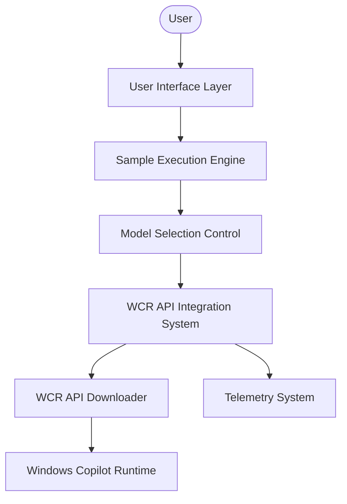
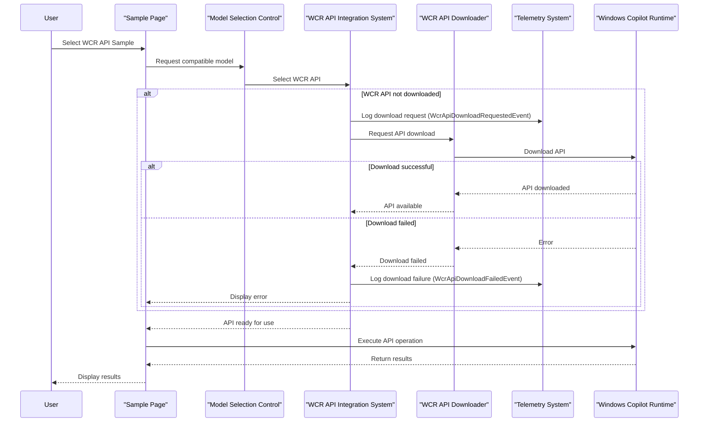
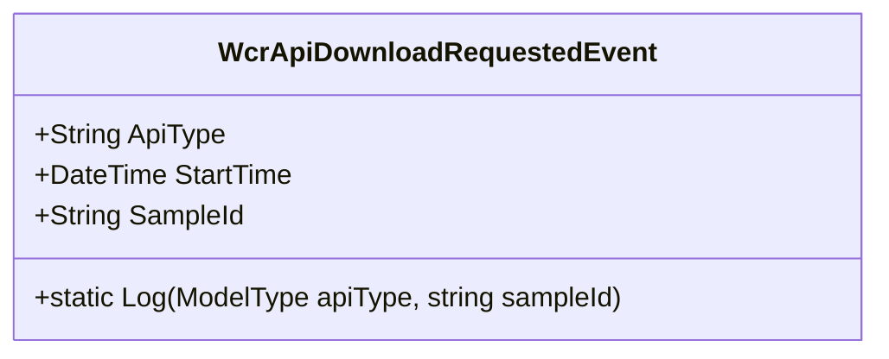
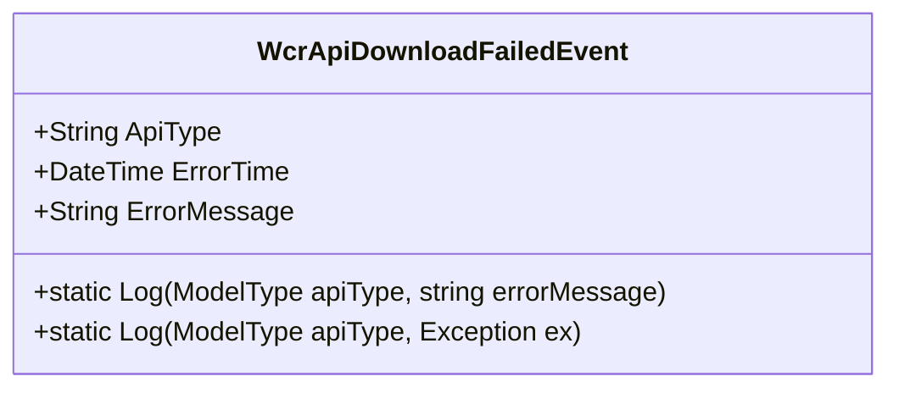

<!-- source: DeepWiki mcp.deepwiki.com · repo microsoft/ai-dev-gallery · page 4.3 WCR API Integration System · fetched 2026-10-26 -->

# WCR API Integration System

<details>
<summary>Relevant source files</summary>

The following files were used as context for generating this wiki page:

- [AIDevGallery/Samples/Definitions/WcrApis/apis.json](AIDevGallery/Samples/Definitions/WcrApis/apis.json)
- [AIDevGallery/Samples/scenarios.json](AIDevGallery/Samples/scenarios.json)
- [AIDevGallery/Telemetry/Events/WcrApiDownloadFailedEvent.cs](AIDevGallery/Telemetry/Events/WcrApiDownloadFailedEvent.cs)
- [AIDevGallery/Telemetry/Events/WcrApiDownloadRequestedEvent.cs](AIDevGallery/Telemetry/Events/WcrApiDownloadRequestedEvent.cs)

</details>


## Purpose and Scope

This document details the architecture and implementation of the Windows Copilot Runtime (WCR) API Integration System within the AI Dev Gallery application. It focuses on how the application integrates with, downloads, and utilizes Windows Copilot Runtime APIs to enable AI capabilities. For information about specific WCR image processing capabilities, see [WCR Image Processing APIs](#4.1). For details on WCR language models, see [WCR Language Model APIs](#4.2).

## Overview

The Windows Copilot Runtime API Integration System provides a framework for discovering, downloading, and utilizing Windows-native AI capabilities through the Windows Copilot Runtime. This system enables AI Dev Gallery users to access Microsoft's powerful AI models that are integrated directly into Windows without requiring separate model downloads or configuration.

## System Architecture

The following diagram illustrates how the WCR API Integration System fits within the overall AI Dev Gallery architecture:



Sources:
- [AIDevGallery/Telemetry/Events/WcrApiDownloadRequestedEvent.cs]()
- [AIDevGallery/Telemetry/Events/WcrApiDownloadFailedEvent.cs]()

## Supported WCR APIs

The Windows Copilot Runtime API Integration System supports several Windows-native AI capabilities, defined in the API definitions file:

```mermaid
classDiagram
    class "WCR APIs" {
        +String Id
        +String Name
        +String Icon
    }
    
    class "PhiSilica" {
        +String Id
        +String Description: "Generate text"
    }
    
    class "TextRecognitionOCR" {
        +String Id
        +String Description: "Recognize and extract text from an image"
    }
    
    class "ImageScaler" {
        +String Id
        +String Description: "Scales an image to a specified size"
    }
    
    class "BackgroundRemover" {
        +String Id
        +String Description: "Remove the background from an image"
    }
    
    class "ImageDescription" {
        +String Id
        +String Description: "Generate a description of an image"
    }
    
    "WCR APIs" *-- "PhiSilica"
    "WCR APIs" *-- "TextRecognitionOCR"
    "WCR APIs" *-- "ImageScaler"
    "WCR APIs" *-- "BackgroundRemover"
    "WCR APIs" *-- "ImageDescription"
```

Sources:
- [AIDevGallery/Samples/Definitions/WcrApis/apis.json]()

The table below provides details on each supported WCR API, including its unique identifier and primary function:

| API Name | ID | Description | Icon Glyph |
|----------|----------|-------------|------------|
| Phi Silica | 9b56e116-c142-4be1-827c-cb023743aca2 | Generate text | \uE8F2 |
| Text Recognition (OCR) | 4bcc0137-0e9a-4eda-8096-b235fcb0e98b | Recognize and extract text from an image | \uE7A8 |
| Image Super Resolution | 97ed0b95-3f14-415c-bb1f-9a6c59b78c3d | Scales an image to a specified size | \uED61 |
| Image Segmentation | 9d445930-b353-429a-9674-777eef771ccf | Remove the background from an image | \uE7C5 |
| Image Description | bdab049c-9b01-48f4-b12d-acb911b0a61c | Generate a description of an image | \uE799 |

Sources:
- [AIDevGallery/Samples/Definitions/WcrApis/apis.json:2-57]()

## API Integration Flow

The following diagram illustrates how the WCR API Integration System processes API requests and manages API downloads:



Sources:
- [AIDevGallery/Telemetry/Events/WcrApiDownloadRequestedEvent.cs:14-37]()
- [AIDevGallery/Telemetry/Events/WcrApiDownloadFailedEvent.cs:13-43]()

## Telemetry

The WCR API Integration System includes telemetry to track API usage and diagnose issues. Two primary telemetry events are implemented:

1. **WcrApiDownloadRequestedEvent** - Logged when a WCR API download is requested
2. **WcrApiDownloadFailedEvent** - Logged when a WCR API download fails

### WcrApiDownloadRequestedEvent

This event is triggered when a user selects a sample that requires a WCR API that needs to be downloaded:



Sources:
- [AIDevGallery/Telemetry/Events/WcrApiDownloadRequestedEvent.cs:13-37]()

### WcrApiDownloadFailedEvent

This event is triggered when an API download operation fails:



Sources:
- [AIDevGallery/Telemetry/Events/WcrApiDownloadFailedEvent.cs:13-43]()

## Integration with Sample Scenarios

The WCR API Integration System supports various sample scenarios that demonstrate Windows Copilot Runtime capabilities. These scenarios are defined in the scenarios.json file and include:

| Scenario | Description | API Used |
|----------|-------------|----------|
| Describe Image | Describe an image with a multimodal language model | Image Description |
| Describe Live Image | Describe live feed with a multimodal language model | Image Description |
| Recognize Text | Detect text in an image | Text Recognition (OCR) |
| Enhance Image | Increase image fidelity with super resolution models | Image Scaler |
| Remove Background | Remove image backgrounds with an image segmentation model | Background Remover |
| Generate Text | Generate text with a local language model | Phi Silica |

Sources:
- [AIDevGallery/Samples/scenarios.json:127-164]()
- [AIDevGallery/Samples/Definitions/WcrApis/apis.json:2-57]()

## Conclusion

The Windows Copilot Runtime API Integration System forms a critical component of the AI Dev Gallery, enabling users to leverage powerful AI capabilities built directly into Windows. By providing a structured approach to discovering, downloading, and utilizing WCR APIs, the system allows developers to explore and incorporate these capabilities into their own applications.

---

