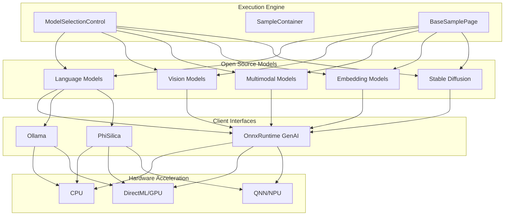
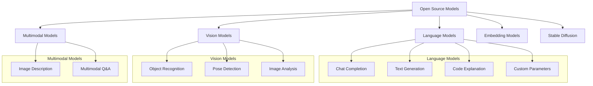
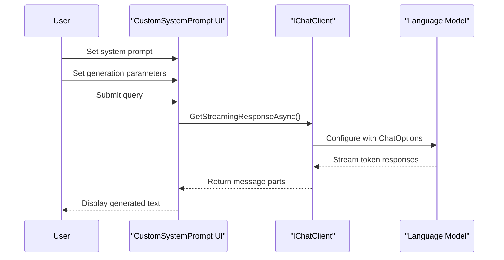
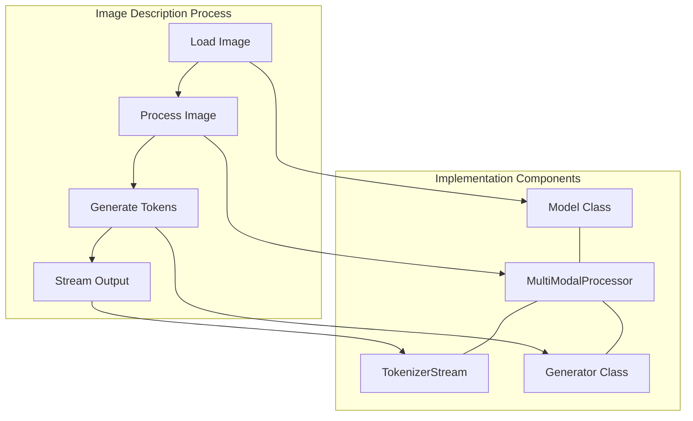
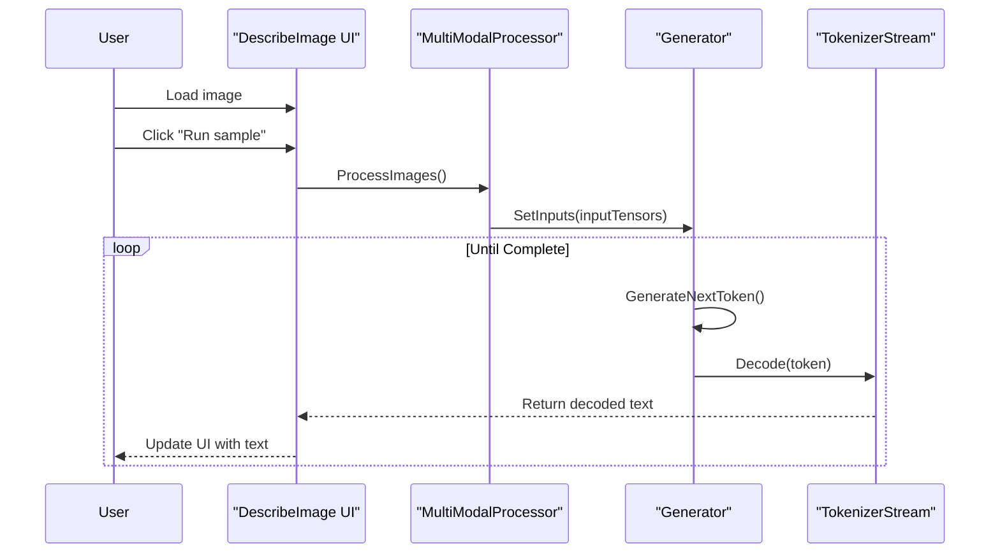
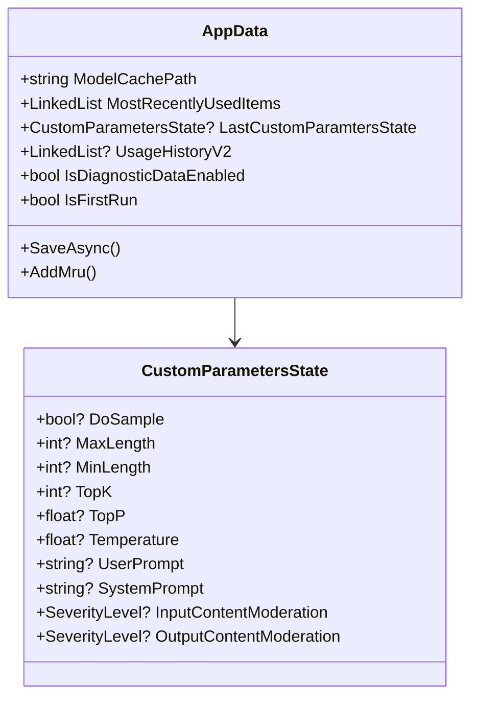

<!-- source: DeepWiki mcp.deepwiki.com · repo microsoft/ai-dev-gallery · page 5 Open Source Models · fetched 2026-10-26 -->

# Open Source Models

Relevant source files

The following files were used as context for generating this wiki page:

- [AIDevGallery/Assets/ModelIcons/Mistral.svg](AIDevGallery/Assets/ModelIcons/Mistral.svg)
- [AIDevGallery/Samples/Open Source Models/Language Models/CustomSystemPrompt.xaml](AIDevGallery/Samples/Open Source Models/Language Models/CustomSystemPrompt.xaml)
- [AIDevGallery/Samples/Open Source Models/Language Models/CustomSystemPrompt.xaml.cs](AIDevGallery/Samples/Open Source Models/Language Models/CustomSystemPrompt.xaml.cs)
- [AIDevGallery/Samples/Open Source Models/Multimodal Models/DescribeImage.xaml](AIDevGallery/Samples/Open Source Models/Multimodal Models/DescribeImage.xaml)
- [AIDevGallery/Samples/Open Source Models/Multimodal Models/DescribeImage.xaml.cs](AIDevGallery/Samples/Open Source Models/Multimodal Models/DescribeImage.xaml.cs)
- [AIDevGallery/Utils/AppData.cs](AIDevGallery/Utils/AppData.cs)

This document describes how AI Dev Gallery integrates with and utilizes open source AI models. It covers the architecture, supported model types, and implementation details for working with various kinds of AI models including language models, vision models, and multimodal models.

For information about the Windows Copilot Runtime APIs, see [Windows Copilot Runtime APIs](#4). For details about the Model Management System used to discover and download models, see [Model Management System](#3).

## Integration Architecture

The Open Source Models system provides a framework for running inference with various types of open source AI models. It supports multiple model formats and acceleration options, allowing users to experiment with different models directly within the application.

Sources: 
- [AIDevGallery/Samples/Open Source Models/Language Models/CustomSystemPrompt.xaml.cs:67-90]()
- [AIDevGallery/Samples/Open Source Models/Multimodal Models/DescribeImage.xaml.cs:47-64]()

## Model Types and Capabilities

AI Dev Gallery supports various categories of open source models, each with different capabilities and use cases:

Sources:
- [AIDevGallery/Samples/Open Source Models/Language Models/CustomSystemPrompt.xaml.cs:20-28]()
- [AIDevGallery/Samples/Open Source Models/Multimodal Models/DescribeImage.xaml.cs:26-34]()

## Language Models

Language Models in AI Dev Gallery enable text generation with customizable parameters. The system provides a flexible interface for interacting with models through the `IChatClient` interface.

### Custom Parameters

The Language Models section includes a sample for customizing system prompts and inference parameters. Users can adjust:

- System prompts to define model behavior
- Temperature for controlling randomness
- Top-K and Top-P sampling parameters
- Maximum and minimum output length
- Content moderation levels (for supported models)

The `ChatOptions` class is used to configure model parameters:

| Parameter    | Type   | Default | Description                                           |
|--------------|--------|---------|-------------------------------------------------------|
| MaxOutputTokens | int | 1024 | Maximum number of tokens to generate |
| Temperature  | float  | 1.0   | Controls randomness (higher = more random)             |
| TopK         | int    | 50    | Limits token selection to top K most probable tokens   |
| TopP         | float  | 0.9   | Cumulative probability threshold for token selection   |
| MinLength    | int    | 0     | Minimum number of tokens to generate                   |
| DoSample     | bool   | true  | Whether to use sampling vs greedy generation           |

Sources:
- [AIDevGallery/Samples/Open Source Models/Language Models/CustomSystemPrompt.xaml.cs:31-57]()
- [AIDevGallery/Samples/Open Source Models/Language Models/CustomSystemPrompt.xaml.cs:138-153]()
- [AIDevGallery/Utils/AppData.cs:118-130]()

### Model Execution Process

The language model execution process involves these key steps:

1. User configures system prompt and parameters
2. Parameters are converted to `ChatOptions`
3. Streaming generation is initiated via `GetStreamingResponseAsync()`
4. Tokens are streamed back to the UI as they're generated

The application uses `Task.Run()` with async streaming to prevent UI blocking during generation.

Sources:
- [AIDevGallery/Samples/Open Source Models/Language Models/CustomSystemPrompt.xaml.cs:169-232]()
- [AIDevGallery/Samples/Open Source Models/Language Models/CustomSystemPrompt.xaml.cs:254-274]()

## Multimodal Models

Multimodal models in AI Dev Gallery can process both text and images. The `DescribeImage` sample demonstrates how to use these models for image description tasks.

### Image Description

The Image Description sample allows users to:
1. Load an image from file
2. Process it with a multimodal model
3. Generate a textual description of the image

The sample utilizes these key components:
- `Model`: Represents the loaded ONNX model
- `MultiModalProcessor`: Processes images and text for the model
- `TokenizerStream`: Handles token decoding
- `Generator`: Manages the token generation process

Sources:
- [AIDevGallery/Samples/Open Source Models/Multimodal Models/DescribeImage.xaml.cs:65-89]()
- [AIDevGallery/Samples/Open Source Models/Multimodal Models/DescribeImage.xaml.cs:120-161]()

### Streaming Inference

The multimodal models use a streaming inference approach that:
1. Processes the image and creates input tensors
2. Sets up generation parameters
3. Generates tokens one by one
4. Decodes and returns tokens as they're produced

This approach provides real-time feedback during the generation process.

Sources:
- [AIDevGallery/Samples/Open Source Models/Multimodal Models/DescribeImage.xaml.cs:204-244]()
- [AIDevGallery/Samples/Open Source Models/Multimodal Models/DescribeImage.xaml.cs:120-161]()

## Implementation Details

### Model Loading

Models are loaded differently depending on their type:

1. **Language Models**: Loaded via `GetIChatClientAsync()` with the following steps:
   - Get chat client from sample parameters
   - Configure default chat options
   - Detect model type (PhiSilica vs other models)

2. **Multimodal Models**: Loaded via direct ONNX runtime with:
   - Create `Model` instance from model path
   - Initialize `MultiModalProcessor`
   - Create `TokenizerStream` for token processing

Sources:
- [AIDevGallery/Samples/Open Source Models/Language Models/CustomSystemPrompt.xaml.cs:69-89]()
- [AIDevGallery/Samples/Open Source Models/Multimodal Models/DescribeImage.xaml.cs:66-89]()

### Resource Management

Both model types implement proper resource cleanup:

1. **Language Models**:
   - Cancel ongoing generation on unload
   - Dispose chat client

2. **Multimodal Models**:
   - Cancel token source
   - Dispose tokenizer stream, processor, and model

This ensures proper cleanup of resources when navigating away from samples.

Sources:
- [AIDevGallery/Samples/Open Source Models/Language Models/CustomSystemPrompt.xaml.cs:132-136]()
- [AIDevGallery/Samples/Open Source Models/Multimodal Models/DescribeImage.xaml.cs:91-99]()

### State Management

The application saves custom parameter state between sessions using the `AppData` class:

This allows the application to persist user preferences for model parameters between sessions.

Sources:
- [AIDevGallery/Utils/AppData.cs:17-115]()
- [AIDevGallery/Utils/AppData.cs:118-130]()

## Model Selection and Integration

Models are selected using the `ModelSelectionControl` which integrates with the sample execution system. This allows users to:

1. Choose from available local models
2. Select different hardware acceleration options
3. Configure model-specific parameters

The sample then uses the selected model for inference through the appropriate client interface.

Sources:
- [AIDevGallery/Samples/Open Source Models/Language Models/CustomSystemPrompt.xaml.cs:69-76]()
- [AIDevGallery/Samples/Open Source Models/Multimodal Models/DescribeImage.xaml.cs:50-54]()

---

