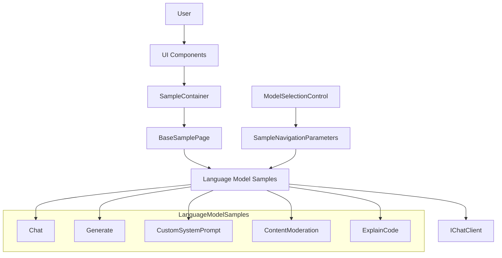
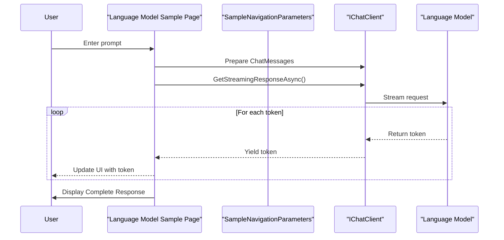
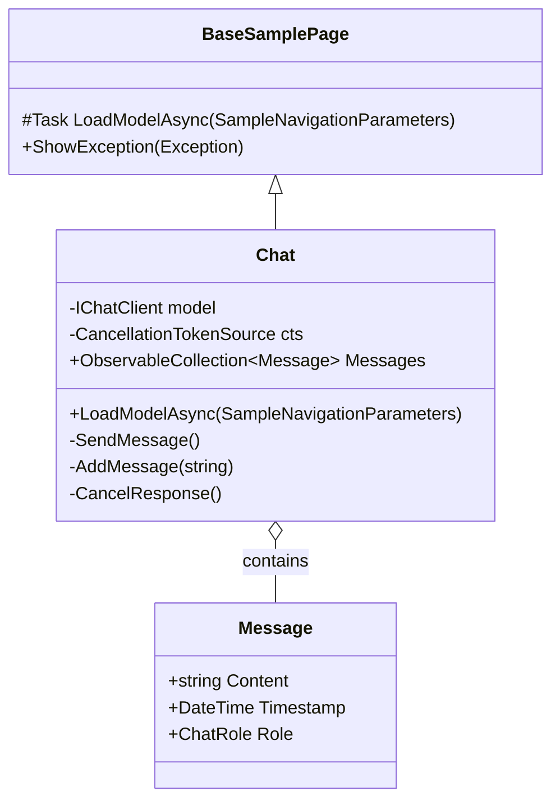
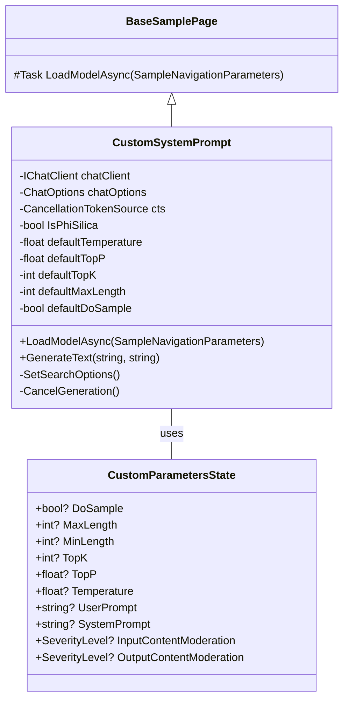
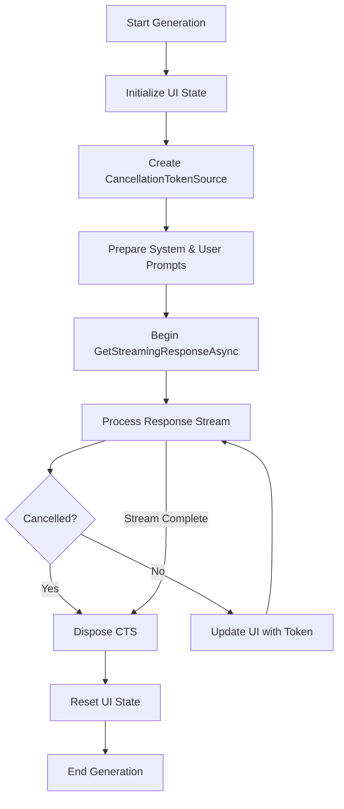
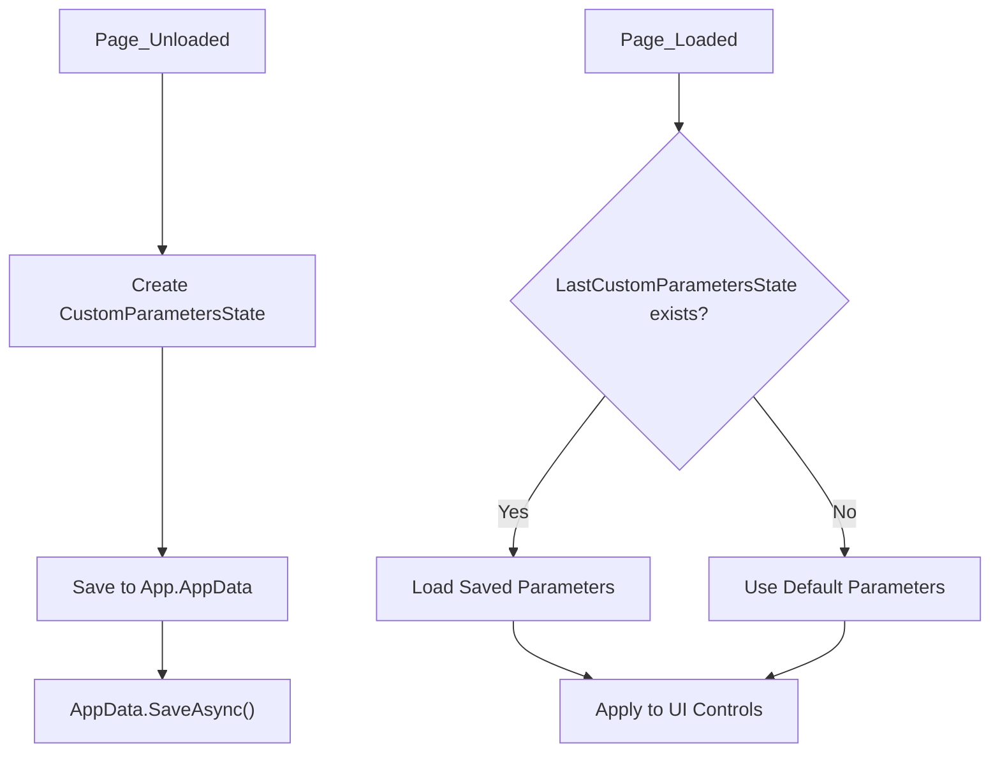

<!-- source: DeepWiki mcp.deepwiki.com · repo microsoft/ai-dev-gallery · page 5.1 Language Models · fetched 2026-10-26 -->

# Language Models

<details>
<summary>Relevant source files</summary>

The following files were used as context for generating this wiki page:

- [AIDevGallery/Samples/Open Source Models/Language Models/Chat.xaml.cs](AIDevGallery/Samples/Open Source Models/Language Models/Chat.xaml.cs)
- [AIDevGallery/Samples/Open Source Models/Language Models/ContentModeration.xaml.cs](AIDevGallery/Samples/Open Source Models/Language Models/ContentModeration.xaml.cs)
- [AIDevGallery/Samples/Open Source Models/Language Models/CustomSystemPrompt.xaml](AIDevGallery/Samples/Open Source Models/Language Models/CustomSystemPrompt.xaml)
- [AIDevGallery/Samples/Open Source Models/Language Models/CustomSystemPrompt.xaml.cs](AIDevGallery/Samples/Open Source Models/Language Models/CustomSystemPrompt.xaml.cs)
- [AIDevGallery/Samples/Open Source Models/Language Models/ExplainCode.xaml.cs](AIDevGallery/Samples/Open Source Models/Language Models/ExplainCode.xaml.cs)
- [AIDevGallery/Samples/Open Source Models/Language Models/Generate.xaml.cs](AIDevGallery/Samples/Open Source Models/Language Models/Generate.xaml.cs)
- [AIDevGallery/Samples/Open Source Models/Stable Diffusion/GenerateImage.xaml.cs](AIDevGallery/Samples/Open Source Models/Stable Diffusion/GenerateImage.xaml.cs)
- [AIDevGallery/Utils/AppData.cs](AIDevGallery/Utils/AppData.cs)

</details>


This document details the implementation and usage of language model functionality within the AI Dev Gallery. It focuses on how language models are integrated into the application and used for chat, text generation, code explanation, and other text-based AI operations.

For information about vision models, see [Vision Models](#5.2).
For information about embeddings and multimodal models, see [Embeddings and Multimodal Models](#5.3).

## System Architecture

The Language Models component is part of the Open Source Models category in the AI Dev Gallery. It provides a set of sample implementations that demonstrate different ways to use language models for various AI tasks.



Sources: [AIDevGallery/Samples/Open Source Models/Language Models/Chat.xaml.cs:34-42](), [AIDevGallery/Samples/Open Source Models/Language Models/CustomSystemPrompt.xaml.cs:29-38](), [AIDevGallery/Samples/Open Source Models/Language Models/Generate.xaml.cs:25-32]()

## Language Model Processing Flow

All language model features follow a similar pattern for processing user prompts and generating responses:



Sources: [AIDevGallery/Samples/Open Source Models/Language Models/Chat.xaml.cs:142-176](), [AIDevGallery/Samples/Open Source Models/Language Models/CustomSystemPrompt.xaml.cs:192-219]()

## Language Model Features

The AI Dev Gallery implements several key features that demonstrate language model capabilities:

### Chat Interface

The Chat feature provides a conversational interface for interactive dialogue with language models. It maintains a message history and enables continued conversations.



Implementation details:
- Uses `ObservableCollection<Message>` to track conversation history
- Maintains separate message bubbles for user and assistant messages
- Handles message streaming for interactive responses
- Supports cancellation of responses during generation

Sources: [AIDevGallery/Samples/Open Source Models/Language Models/Chat.xaml.cs:34-63](), [AIDevGallery/Samples/Open Source Models/Language Models/Chat.xaml.cs:130-189]()

### Text Generation

The Text Generation feature (`Generate` class) allows users to generate text based on a specific topic or prompt. The implementation:

- Uses a system prompt to instruct the model to focus on the specific text generation task
- Streams responses token-by-token for a responsive user experience
- Provides progress visualization and cancellation options

Sources: [AIDevGallery/Samples/Open Source Models/Language Models/Generate.xaml.cs:25-53](), [AIDevGallery/Samples/Open Source Models/Language Models/Generate.xaml.cs:82-148]()

### Custom Parameters

The Custom Parameters feature (`CustomSystemPrompt` class) enables fine-tuning of language model behavior through various parameters.



Configurable parameters include:
- **Min Length**: Minimum number of tokens to generate
- **Max Length**: Maximum number of tokens to generate
- **Top P**: Nucleus sampling parameter for controlling diversity
- **Top K**: Number of top tokens to consider at each step
- **Temperature**: Controls randomness (higher = more random)
- **Do Sample**: Toggle between sampling and greedy decoding

The feature also provides special handling for PhiSilica models with content moderation settings.

Sources: [AIDevGallery/Samples/Open Source Models/Language Models/CustomSystemPrompt.xaml.cs:29-38](), [AIDevGallery/Samples/Open Source Models/Language Models/CustomSystemPrompt.xaml.cs:138-153](), [AIDevGallery/Utils/AppData.cs:118-130]()

### Content Moderation

The Content Moderation feature demonstrates safety mechanisms for language model interactions by:

- Validating prompt safety before generating responses
- Using a separate model call with specialized instructions to assess content safety
- Only proceeding with generation if the prompt is deemed safe
- Providing clear feedback about moderation decisions

Sources: [AIDevGallery/Samples/Open Source Models/Language Models/ContentModeration.xaml.cs:27-53](), [AIDevGallery/Samples/Open Source Models/Language Models/ContentModeration.xaml.cs:166-195]()

### Code Explanation

The Code Explanation feature utilizes language models to analyze and explain code snippets. Key aspects:

- Uses a specialized system prompt for code explanation tasks
- Increases maximum input length to 4096 characters to accommodate larger code snippets
- Provides formatted explanations of code functionality and purpose

Sources: [AIDevGallery/Samples/Open Source Models/Language Models/ExplainCode.xaml.cs:26-57](), [AIDevGallery/Samples/Open Source Models/Language Models/ExplainCode.xaml.cs:86-153]()

## Implementation Details

### Common Code Patterns

All language model features follow these common implementation patterns:



1. **Model Loading**: Each sample implements a `LoadModelAsync` method that:
   - Receives a `SampleNavigationParameters` object
   - Calls `sampleParams.GetIChatClientAsync()` to obtain the `IChatClient`
   - Configures any model-specific settings
   - Calls `sampleParams.NotifyCompletion()` when ready

2. **Streaming Response Processing**: All samples implement token-by-token processing:
   - Create messages with appropriate `ChatRole` (System, User)
   - Call `GetStreamingResponseAsync` to stream responses
   - Process each token as it arrives
   - Update UI in real-time via `DispatcherQueue.TryEnqueue`

3. **Cancellation Support**: All samples provide:
   - Cancel buttons in the UI
   - `CancellationTokenSource` management
   - Proper resource cleanup

4. **Error Handling**: All samples implement:
   - Try/catch blocks around model operations
   - User-friendly error displays via `ShowException`

Sources: [AIDevGallery/Samples/Open Source Models/Language Models/Chat.xaml.cs:142-188](), [AIDevGallery/Samples/Open Source Models/Language Models/CustomSystemPrompt.xaml.cs:169-232](), [AIDevGallery/Samples/Open Source Models/Language Models/Generate.xaml.cs:82-148]()

### Microsoft.Extensions.AI Integration

All language model features use the Microsoft.Extensions.AI library with these key components:

- `IChatClient`: Core interface for interacting with language models
- `ChatMessage`: Message representation with role and content
- `ChatRole`: Enum defining message roles (System, User, Assistant)
- `ChatOptions`: Configuration options for model behavior

Example of chat options configuration:

```csharp
chatOptions = new ChatOptions
{
    AdditionalProperties = new AdditionalPropertiesDictionary
    {
        { "min_length", 0 },
        { "do_sample", defaultDoSample },
    },
    MaxOutputTokens = defaultMaxLength,
    Temperature = defaultTemperature,
    TopP = defaultTopP,
    TopK = defaultTopK,
};
```

Sources: [AIDevGallery/Samples/Open Source Models/Language Models/CustomSystemPrompt.xaml.cs:138-153]()

### Parameter Persistence

The CustomSystemPrompt feature persists parameter settings between application sessions:



Parameters are stored in the `CustomParametersState` class and saved to application data when the page is unloaded. When the page is loaded again, these settings are restored or defaults are used if no saved settings exist.

Sources: [AIDevGallery/Samples/Open Source Models/Language Models/CustomSystemPrompt.xaml.cs:92-129](), [AIDevGallery/Utils/AppData.cs:118-130]()

### PhiSilica-Specific Handling

The language model features include special handling for Windows Copilot Runtime's PhiSilica model:

- Detection of PhiSilica via `chatClient?.GetService<ChatClientMetadata>()?.ProviderName`
- Content moderation controls specific to PhiSilica
- UI adjustments for PhiSilica-specific parameters

Sources: [AIDevGallery/Samples/Open Source Models/Language Models/CustomSystemPrompt.xaml.cs:75-86](), [AIDevGallery/Samples/Open Source Models/Language Models/CustomSystemPrompt.xaml.cs:337-343]()

## Sample Usage Examples

### Chat Sample

The Chat sample provides a messaging interface where:
1. Users enter messages in a text box
2. Messages appear in a conversation view with user and model messages
3. Responses stream in real-time for a natural conversation experience
4. Users can send new messages to continue the conversation

The UI presents messages in chronological order with user and assistant messages visually differentiated.

### Custom Parameters Sample

The Custom Parameters sample enables experimentation with model behavior:
1. Users can set a system prompt to define the model's persona
2. Parameter sliders control generation behavior:
   - Temperature slider (0.01-5) controls randomness
   - Top P slider (0-1) controls nucleus sampling
   - Top K slider (0-200) limits token selection
   - Min/Max Length sliders control response length
3. The sampling toggle enables/disables probabilistic generation
4. Content moderation controls are available for PhiSilica models

This sample is particularly useful for:
- Fine-tuning model outputs for specific applications
- Exploring the effects of different parameters on generation
- Comparing deterministic vs. probabilistic generation

### Code Explanation Sample

The Code Explanation sample specializes in analyzing code:
1. Users paste code into the input box
2. The model analyzes the code and generates an explanation
3. The explanation covers the code's purpose, functionality, and structure

This sample demonstrates how language models can be specialized for technical domains through appropriate system prompts.

## Conclusion

The Language Models component of the AI Dev Gallery provides a comprehensive set of features that demonstrate how to integrate and use language models in applications. By using a common architecture and the Microsoft.Extensions.AI library, the implementation maintains consistency while showcasing different capabilities.

Key strengths of the implementation include:
- Streaming responses for a responsive user experience
- Customizable parameters for controlling model behavior
- Content moderation for safer interactions
- Specialized interfaces for different use cases
- Persistence of user preferences across sessions

These samples serve as both demonstrations and reference implementations for developers looking to integrate language models into their own applications.

Sources: [AIDevGallery/Samples/Open Source Models/Language Models/Chat.xaml.cs](), [AIDevGallery/Samples/Open Source Models/Language Models/CustomSystemPrompt.xaml.cs](), [AIDevGallery/Samples/Open Source Models/Language Models/Generate.xaml.cs](), [AIDevGallery/Samples/Open Source Models/Language Models/ContentModeration.xaml.cs](), [AIDevGallery/Samples/Open Source Models/Language Models/ExplainCode.xaml.cs]()

---

