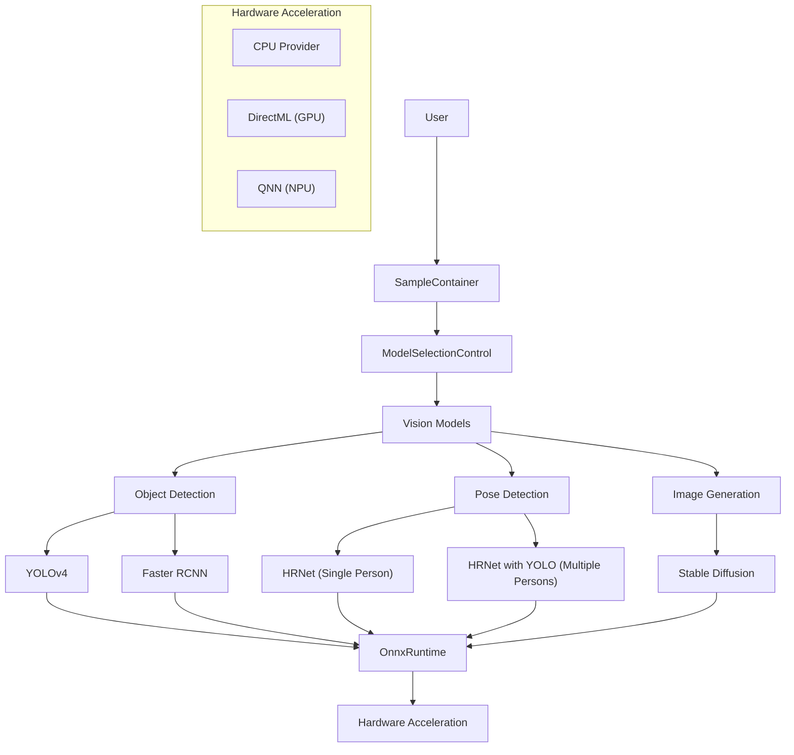
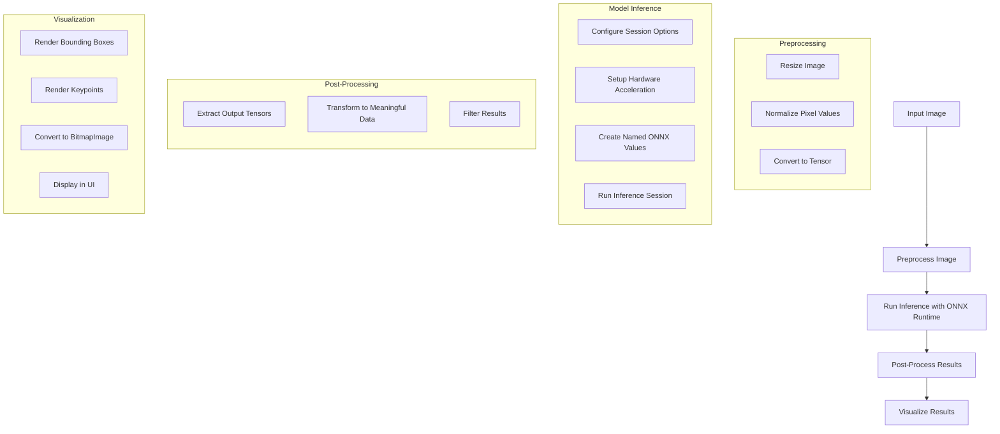
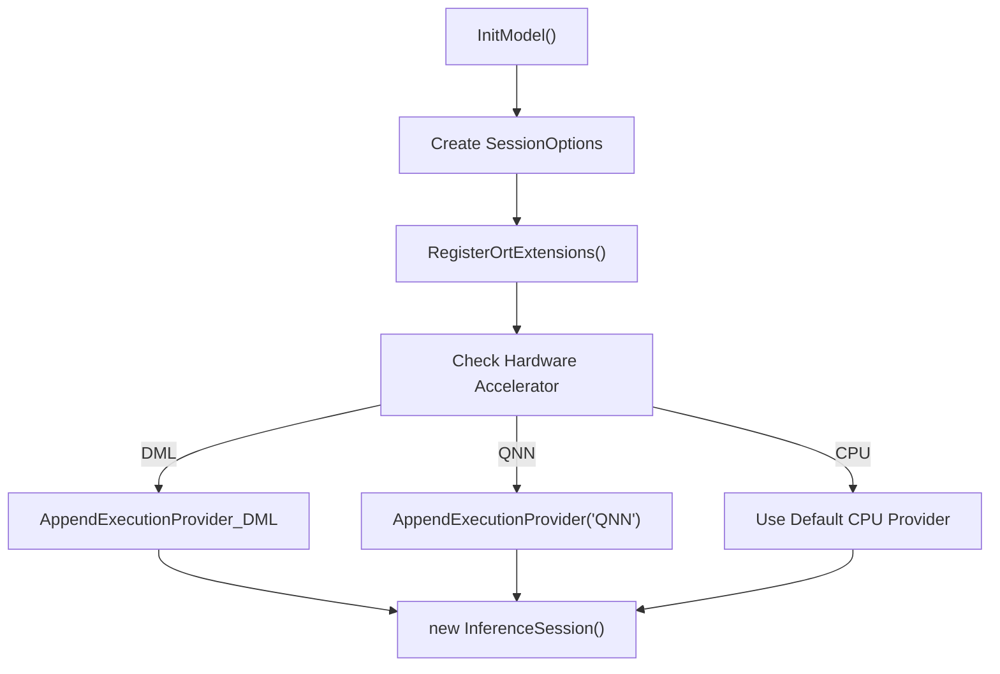
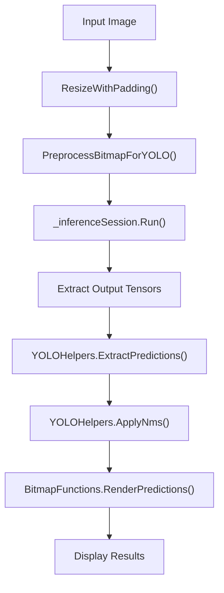
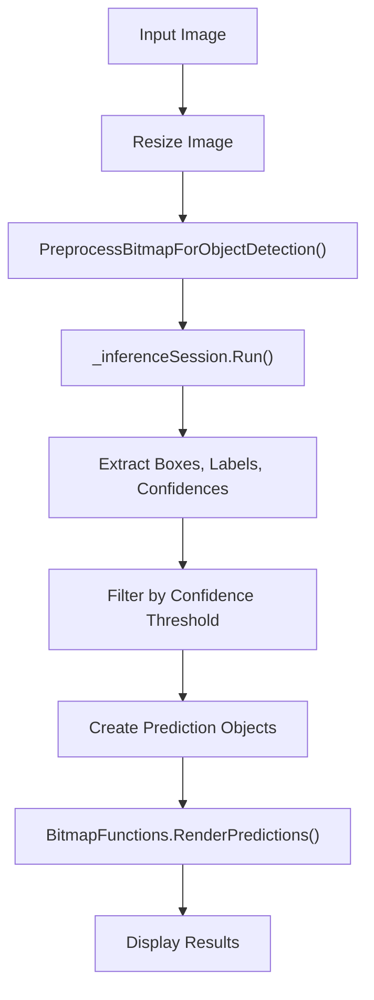
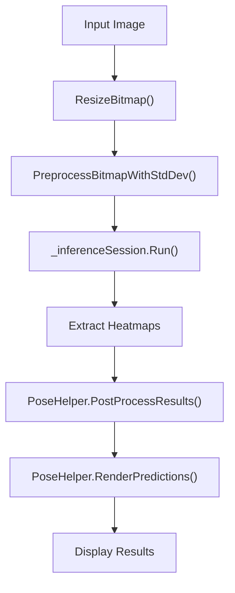
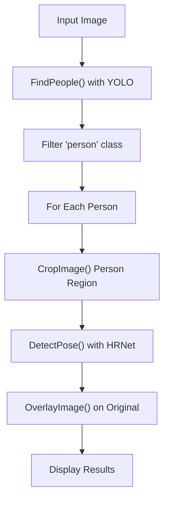
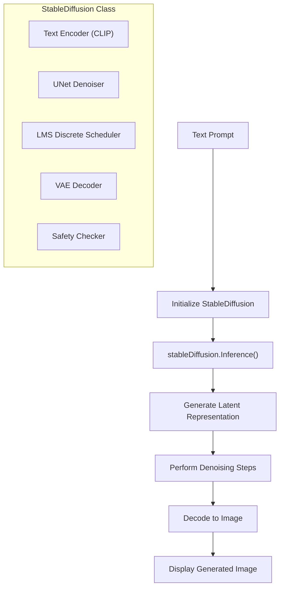
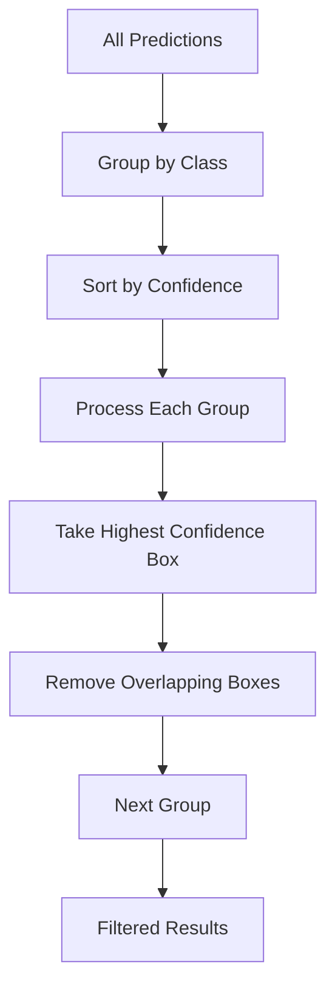
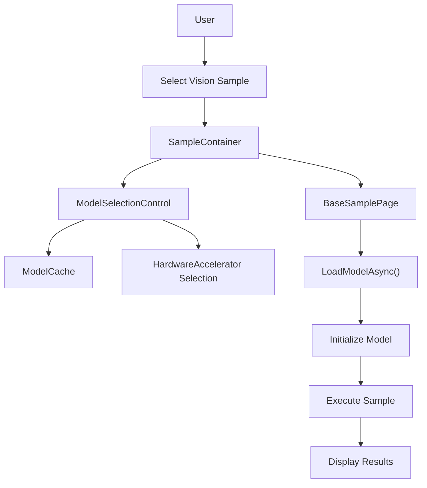

<!-- source: DeepWiki mcp.deepwiki.com · repo microsoft/ai-dev-gallery · page 5.2 Vision Models · fetched 2026-10-26 -->

# Vision Models

<details>
<summary>Relevant source files</summary>

The following files were used as context for generating this wiki page:

- [AIDevGallery/Samples/Open Source Models/Image Models/Faster RCNN/ObjectDetection.xaml.cs](AIDevGallery/Samples/Open Source Models/Image Models/Faster RCNN/ObjectDetection.xaml.cs)
- [AIDevGallery/Samples/Open Source Models/Image Models/HRNetPose/PoseDetection.xaml.cs](AIDevGallery/Samples/Open Source Models/Image Models/HRNetPose/PoseDetection.xaml.cs)
- [AIDevGallery/Samples/Open Source Models/Image Models/MultiHRNetPose/Multipose.xaml](AIDevGallery/Samples/Open Source Models/Image Models/MultiHRNetPose/Multipose.xaml)
- [AIDevGallery/Samples/Open Source Models/Image Models/MultiHRNetPose/Multipose.xaml.cs](AIDevGallery/Samples/Open Source Models/Image Models/MultiHRNetPose/Multipose.xaml.cs)
- [AIDevGallery/Samples/Open Source Models/Image Models/YOLOv4/YOLOObjectionDetection.xaml](AIDevGallery/Samples/Open Source Models/Image Models/YOLOv4/YOLOObjectionDetection.xaml)
- [AIDevGallery/Samples/Open Source Models/Image Models/YOLOv4/YOLOObjectionDetection.xaml.cs](AIDevGallery/Samples/Open Source Models/Image Models/YOLOv4/YOLOObjectionDetection.xaml.cs)
- [AIDevGallery/Samples/Open Source Models/Language Models/Chat.xaml.cs](AIDevGallery/Samples/Open Source Models/Language Models/Chat.xaml.cs)
- [AIDevGallery/Samples/Open Source Models/Language Models/ContentModeration.xaml.cs](AIDevGallery/Samples/Open Source Models/Language Models/ContentModeration.xaml.cs)
- [AIDevGallery/Samples/Open Source Models/Language Models/ExplainCode.xaml.cs](AIDevGallery/Samples/Open Source Models/Language Models/ExplainCode.xaml.cs)
- [AIDevGallery/Samples/Open Source Models/Language Models/Generate.xaml.cs](AIDevGallery/Samples/Open Source Models/Language Models/Generate.xaml.cs)
- [AIDevGallery/Samples/Open Source Models/Stable Diffusion/GenerateImage.xaml.cs](AIDevGallery/Samples/Open Source Models/Stable Diffusion/GenerateImage.xaml.cs)
- [AIDevGallery/Samples/SharedCode/BitmapFunctions.cs](AIDevGallery/Samples/SharedCode/BitmapFunctions.cs)
- [AIDevGallery/Samples/SharedCode/PoseHelper.cs](AIDevGallery/Samples/SharedCode/PoseHelper.cs)
- [AIDevGallery/Samples/SharedCode/YOLOHelpers.cs](AIDevGallery/Samples/SharedCode/YOLOHelpers.cs)

</details>


## Purpose and Scope

This document details the vision model implementations within the AI Dev Gallery application. Vision models provide capabilities for object detection, pose estimation, and image generation from text prompts. The document covers the architecture, components, and workflows of these models, along with their integration into the larger application framework.

For information about language models, see [Language Models](#5.1). For embedding and multimodal models, see [Embeddings and Multimodal Models](#5.3).

## Vision Models Architecture

The AI Dev Gallery implements several types of vision models, each serving different purposes but sharing common components and workflows. Below is a high-level overview of the vision model architecture.



Sources:
- [AIDevGallery/Samples/Open Source Models/Image Models/MultiHRNetPose/Multipose.xaml.cs](AIDevGallery/Samples/Open%20Source%20Models/Image%20Models/MultiHRNetPose/Multipose.xaml.cs)
- [AIDevGallery/Samples/Open Source Models/Image Models/YOLOv4/YOLOObjectionDetection.xaml.cs](AIDevGallery/Samples/Open%20Source%20Models/Image%20Models/YOLOv4/YOLOObjectionDetection.xaml.cs)
- [AIDevGallery/Samples/Open Source Models/Image Models/Faster RCNN/ObjectDetection.xaml.cs](AIDevGallery/Samples/Open%20Source%20Models/Image%20Models/Faster%20RCNN/ObjectDetection.xaml.cs)
- [AIDevGallery/Samples/Open Source Models/Image Models/HRNetPose/PoseDetection.xaml.cs](AIDevGallery/Samples/Open%20Source%20Models/Image%20Models/HRNetPose/PoseDetection.xaml.cs)
- [AIDevGallery/Samples/Open Source Models/Stable Diffusion/GenerateImage.xaml.cs](AIDevGallery/Samples/Open%20Source%20Models/Stable%20Diffusion/GenerateImage.xaml.cs)

## Common Vision Model Workflow

All vision models in the AI Dev Gallery follow a similar workflow, with variations depending on the specific model type:



Sources:
- [AIDevGallery/Samples/SharedCode/BitmapFunctions.cs](AIDevGallery/Samples/SharedCode/BitmapFunctions.cs)
- [AIDevGallery/Samples/Open Source Models/Image Models/YOLOv4/YOLOObjectionDetection.xaml.cs:120-206](AIDevGallery/Samples/Open%20Source%20Models/Image%20Models/YOLOv4/YOLOObjectionDetection.xaml.cs:120-206)
- [AIDevGallery/Samples/Open Source Models/Image Models/HRNetPose/PoseDetection.xaml.cs:119-175](AIDevGallery/Samples/Open%20Source%20Models/Image%20Models/HRNetPose/PoseDetection.xaml.cs:119-175)

## Shared Components

The vision models share several common components and utility classes that handle image processing, model management, and result visualization:

### BitmapFunctions

The `BitmapFunctions` class provides utilities for image processing and is heavily used across all vision models:

| Function | Purpose |
|----------|---------|
| `ResizeBitmap` | Resizes images to fit model input requirements |
| `ResizeWithPadding` | Resizes while preserving aspect ratio with padding |
| `PreprocessBitmapForYOLO` | Prepares images specifically for YOLO models |
| `PreprocessBitmapWithStdDev` | Normalizes images using mean and standard deviation |
| `RenderPredictions` | Draws bounding boxes and labels for object detection results |
| `ConvertBitmapToBitmapImage` | Converts System.Drawing.Bitmap to UI-compatible BitmapImage |

Sources:
- [AIDevGallery/Samples/SharedCode/BitmapFunctions.cs:27-494](AIDevGallery/Samples/SharedCode/BitmapFunctions.cs:27-494)

### Hardware Acceleration Management

Vision models support multiple hardware acceleration options through ONNX Runtime:



Sources:
- [AIDevGallery/Samples/Open Source Models/Image Models/YOLOv4/YOLOObjectionDetection.xaml.cs:72-90](AIDevGallery/Samples/Open%20Source%20Models/Image%20Models/YOLOv4/YOLOObjectionDetection.xaml.cs:72-90)
- [AIDevGallery/Samples/Open Source Models/Image Models/HRNetPose/PoseDetection.xaml.cs:66-94](AIDevGallery/Samples/Open%20Source%20Models/Image%20Models/HRNetPose/PoseDetection.xaml.cs:66-94)
- [AIDevGallery/Samples/Open Source Models/Image Models/MultiHRNetPose/Multipose.xaml.cs:78-119](AIDevGallery/Samples/Open%20Source%20Models/Image%20Models/MultiHRNetPose/Multipose.xaml.cs:78-119)

## Object Detection Models

AI Dev Gallery implements two main object detection models: YOLOv4 and Faster RCNN.

### YOLOv4

YOLO (You Only Look Once) is a single-stage detector that processes images in one pass:



The YOLOv4 implementation:
- Takes input images of size 416×416
- Processes 3 output tensors representing different grid scales
- Uses anchors to decode bounding box predictions
- Applies non-maximum suppression to filter overlapping detections

Sources:
- [AIDevGallery/Samples/Open Source Models/Image Models/YOLOv4/YOLOObjectionDetection.xaml.cs:139-192](AIDevGallery/Samples/Open%20Source%20Models/Image%20Models/YOLOv4/YOLOObjectionDetection.xaml.cs:139-192)
- [AIDevGallery/Samples/SharedCode/YOLOHelpers.cs:13-147](AIDevGallery/Samples/SharedCode/YOLOHelpers.cs:13-147)

### Faster RCNN

Faster RCNN is a two-stage detector that first proposes regions and then classifies them:



The Faster RCNN implementation:
- Processes images with padding to fit model requirements
- Extracts bounding boxes, class labels, and confidence scores
- Applies confidence thresholding (default: 0.7)
- Renders predictions with class labels and scores

Sources:
- [AIDevGallery/Samples/Open Source Models/Image Models/Faster RCNN/ObjectDetection.xaml.cs:108-183](AIDevGallery/Samples/Open%20Source%20Models/Image%20Models/Faster%20RCNN/ObjectDetection.xaml.cs:108-183)

## Pose Detection Models

AI Dev Gallery includes two pose detection implementations: single-person pose detection using HRNet, and multi-person pose detection using a combination of YOLO and HRNet.

### Single-Person Pose Detection (HRNet)

The HRNet pose detection model identifies key body points for a single person:



Key aspects of the HRNet implementation:
- Uses input size of 256×192 pixels
- Outputs heatmaps for 17 keypoints (COCO format)
- Post-processes heatmaps to find precise keypoint locations
- Renders keypoints and connections between them

Sources:
- [AIDevGallery/Samples/Open Source Models/Image Models/HRNetPose/PoseDetection.xaml.cs:119-175](AIDevGallery/Samples/Open%20Source%20Models/Image%20Models/HRNetPose/PoseDetection.xaml.cs:119-175)
- [AIDevGallery/Samples/SharedCode/PoseHelper.cs:12-94](AIDevGallery/Samples/SharedCode/PoseHelper.cs:12-94)

### Multi-Person Pose Detection

The multi-person pose detection pipeline combines YOLO for person detection with HRNet for pose estimation:



The multi-person pose detection:
1. Uses YOLO to detect all people in the image
2. For each detected person:
   - Crops the region containing the person
   - Applies the HRNet model to detect pose keypoints
   - Overlays the pose keypoints back onto the original image

Sources:
- [AIDevGallery/Samples/Open Source Models/Image Models/MultiHRNetPose/Multipose.xaml.cs:146-192](AIDevGallery/Samples/Open%20Source%20Models/Image%20Models/MultiHRNetPose/Multipose.xaml.cs:146-192)
- [AIDevGallery/Samples/Open Source Models/Image Models/MultiHRNetPose/Multipose.xaml.cs:194-261](AIDevGallery/Samples/Open%20Source%20Models/Image%20Models/MultiHRNetPose/Multipose.xaml.cs:194-261)
- [AIDevGallery/Samples/Open Source Models/Image Models/MultiHRNetPose/Multipose.xaml.cs:263-310](AIDevGallery/Samples/Open%20Source%20Models/Image%20Models/MultiHRNetPose/Multipose.xaml.cs:263-310)

## Image Generation Models

The AI Dev Gallery includes Stable Diffusion for text-to-image generation.

### Stable Diffusion

Stable Diffusion converts text prompts into images:



The Stable Diffusion implementation:
- Takes a text prompt as input
- Processes the text through a CLIP text encoder
- Generates an initial random noise latent
- Applies denoising diffusion steps using the UNet model
- Decodes the latent to an image using the VAE decoder
- Checks the image for safety (optional)
- Displays the generated image

Sources:
- [AIDevGallery/Samples/Open Source Models/Stable Diffusion/GenerateImage.xaml.cs:123-205](AIDevGallery/Samples/Open%20Source%20Models/Stable%20Diffusion/GenerateImage.xaml.cs:123-205)

## Implementation Details

### Hardware Acceleration Configuration

The vision models support three hardware acceleration options:

| Accelerator | Configuration | Use Case |
|-------------|---------------|----------|
| CPU | Default provider | Compatible with all systems |
| DirectML (DML) | `AppendExecutionProvider_DML()` | Systems with GPU support |
| QNN | `AppendExecutionProvider("QNN")` | Systems with Neural Processing Unit (NPU) |

Example configuration code:
```csharp
SessionOptions sessionOptions = new();
sessionOptions.RegisterOrtExtensions();
if (hardwareAccelerator == HardwareAccelerator.DML)
{
    sessionOptions.AppendExecutionProvider_DML(DeviceUtils.GetBestDeviceId());
}
else if (hardwareAccelerator == HardwareAccelerator.QNN)
{
    Dictionary<string, string> options = new()
    {
        { "backend_path", "QnnHtp.dll" },
        { "htp_performance_mode", "high_performance" },
        { "htp_graph_finalization_optimization_mode", "3" }
    };
    sessionOptions.AppendExecutionProvider("QNN", options);
}
```

Sources:
- [AIDevGallery/Samples/Open Source Models/Image Models/MultiHRNetPose/Multipose.xaml.cs:78-102](AIDevGallery/Samples/Open%20Source%20Models/Image%20Models/MultiHRNetPose/Multipose.xaml.cs:78-102)
- [AIDevGallery/Samples/Open Source Models/Image Models/HRNetPose/PoseDetection.xaml.cs:66-92](AIDevGallery/Samples/Open%20Source%20Models/Image%20Models/HRNetPose/PoseDetection.xaml.cs:66-92)

### Image Processing

The `BitmapFunctions` class provides specialized preprocessing methods for different model types:

| Model Type | Preprocessing Method | Key Features |
|------------|---------------------|-------------|
| YOLO | `PreprocessBitmapForYOLO()` | Normalizes to [0,1], uses NHWC format |
| HRNet | `PreprocessBitmapWithStdDev()` | Normalizes with ImageNet mean/std, uses NCHW format |
| Faster RCNN | `PreprocessBitmapForObjectDetection()` | Subtracts mean values, uses NCHW format |

The system also includes specialized functions for converting between bitmap formats and for rendering model outputs onto images.

Sources:
- [AIDevGallery/Samples/SharedCode/BitmapFunctions.cs:115-286](AIDevGallery/Samples/SharedCode/BitmapFunctions.cs:115-286)
- [AIDevGallery/Samples/SharedCode/BitmapFunctions.cs:288-324](AIDevGallery/Samples/SharedCode/BitmapFunctions.cs:288-324)

### Result Visualization

For pose detection, the `PoseHelper` class renders keypoints and connections with the following steps:

1. Scale keypoint coordinates to match the original image dimensions
2. Draw connections between key points (e.g., shoulder to elbow)
3. Draw markers at each keypoint location

```csharp
List<(int StartIdx, int EndIdx)> connections =
[
    (5, 6),   // Left shoulder to right shoulder
    (5, 7),   // Left shoulder to left elbow
    (7, 9),   // Left elbow to left wrist
    // Additional connections...
];

foreach (var (startIdx, endIdx) in connections)
{
    var (startPointX, startPointY) = keypoints[startIdx];
    var (endPointX, endPointY) = keypoints[endIdx];
    g.DrawLine(linePen, startPointX, startPointY, endPointX, endPointY);
}
```

Sources:
- [AIDevGallery/Samples/SharedCode/PoseHelper.cs:52-94](AIDevGallery/Samples/SharedCode/PoseHelper.cs:52-94)

### NMS (Non-Maximum Suppression)

For object detection models, the `YOLOHelpers` class provides NMS to filter overlapping detections:



The NMS algorithm:
1. Groups predictions by object class
2. Sorts each group by confidence score
3. Takes the highest confidence detection
4. Removes overlapping detections based on IoU threshold
5. Repeats until all groups are processed

Sources:
- [AIDevGallery/Samples/SharedCode/YOLOHelpers.cs:105-147](AIDevGallery/Samples/SharedCode/YOLOHelpers.cs:105-147)

## Integration with AI Dev Gallery

Vision models are integrated into the AI Dev Gallery through the sample framework:



Key integration points:
1. Vision samples inherit from `BaseSamplePage`
2. Models are loaded through `LoadModelAsync()` method
3. The `SampleNavigationParameters` provides model path and hardware accelerator information
4. The `ModelSelectionControl` allows users to select models and hardware acceleration options

Sources:
- [AIDevGallery/Samples/Open Source Models/Image Models/YOLOv4/YOLOObjectionDetection.xaml.cs:61-70](AIDevGallery/Samples/Open%20Source%20Models/Image%20Models/YOLOv4/YOLOObjectionDetection.xaml.cs:61-70)
- [AIDevGallery/Samples/Open Source Models/Image Models/HRNetPose/PoseDetection.xaml.cs:58-64](AIDevGallery/Samples/Open%20Source%20Models/Image%20Models/HRNetPose/PoseDetection.xaml.cs:58-64)

## Summary

The Vision Models system in AI Dev Gallery provides a flexible framework for implementing various computer vision tasks:

1. **Object Detection** with YOLO and Faster RCNN for identifying objects in images
2. **Pose Detection** with HRNet for identifying body keypoints
3. **Multi-Person Pose Detection** combining YOLO and HRNet
4. **Image Generation** with Stable Diffusion for text-to-image generation

The system leverages ONNX Runtime for efficient model execution with support for multiple hardware acceleration options, making it adaptable to different hardware configurations. Common utilities for image processing and result visualization enable consistent implementation across different model types.

---

