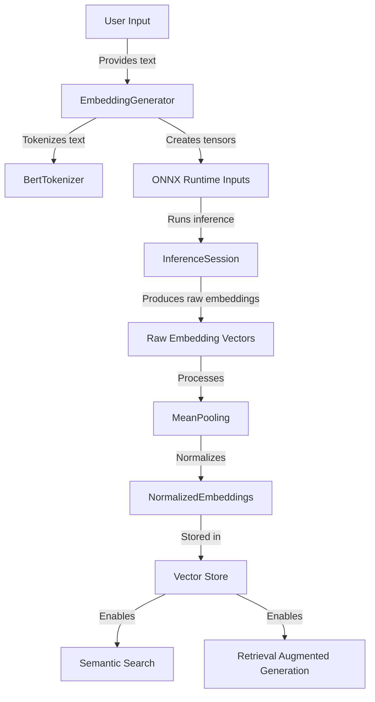
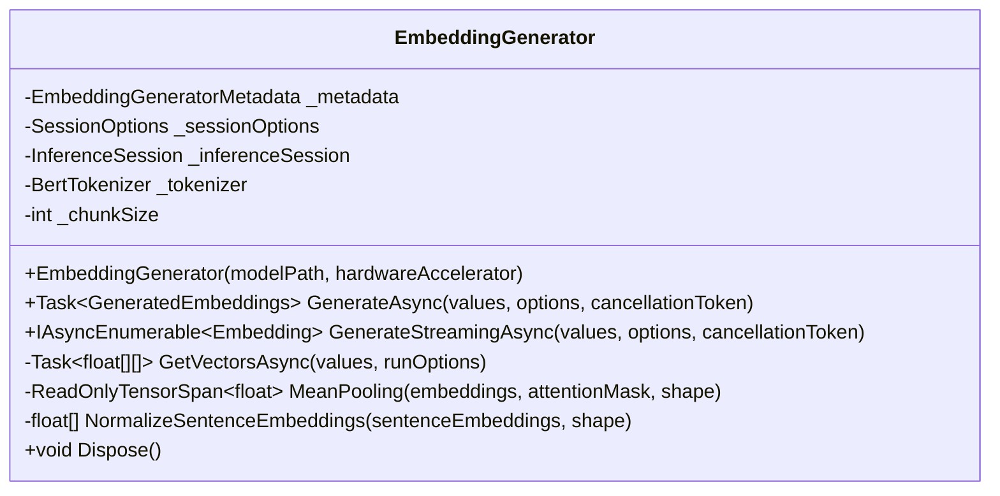
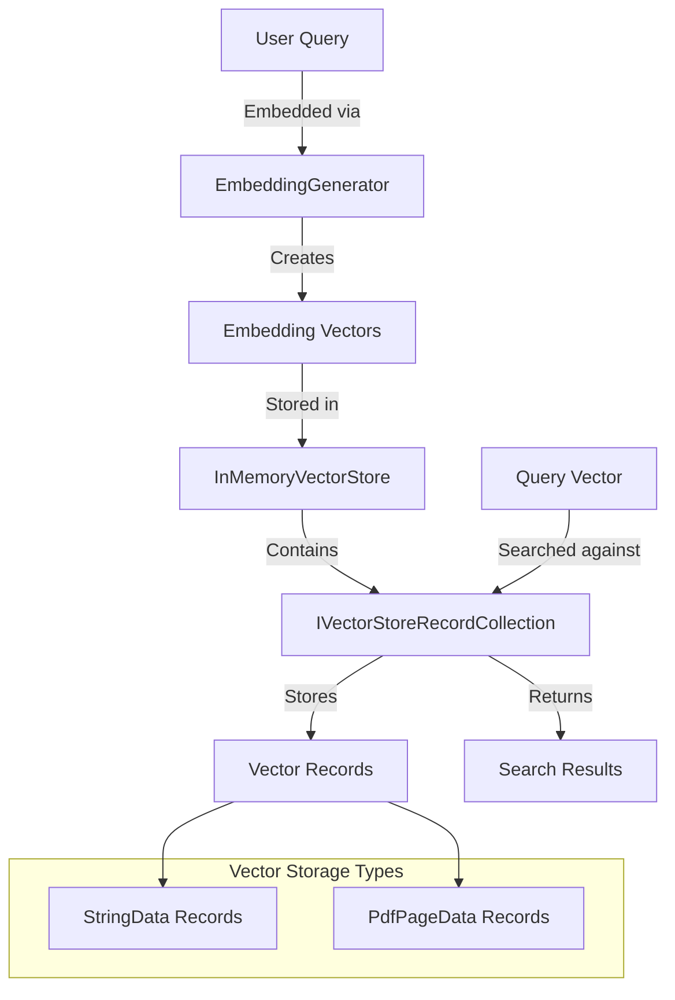
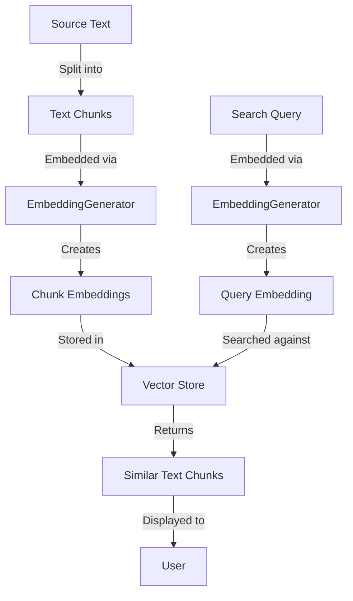
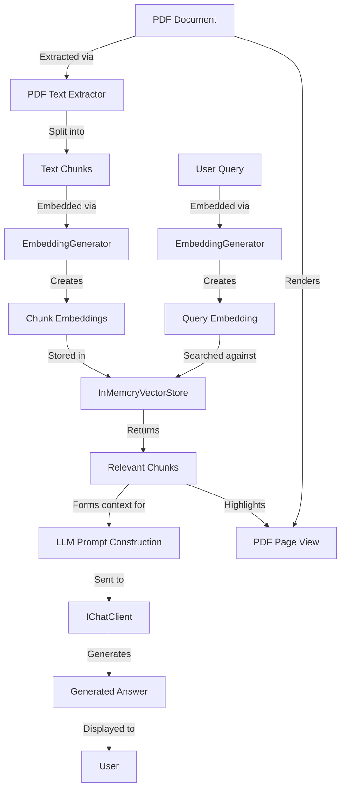
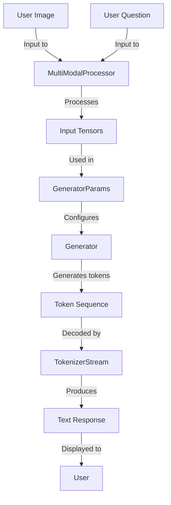
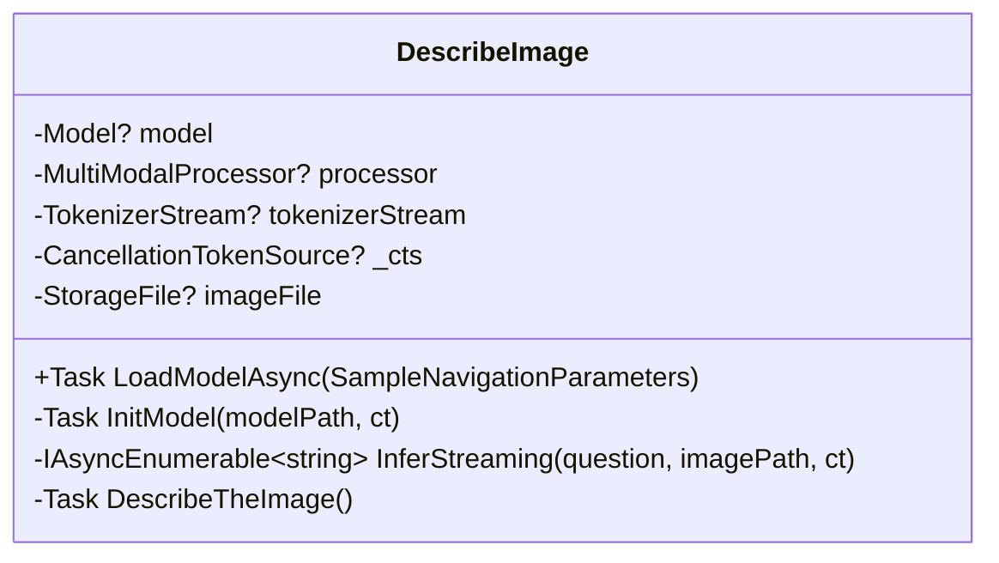
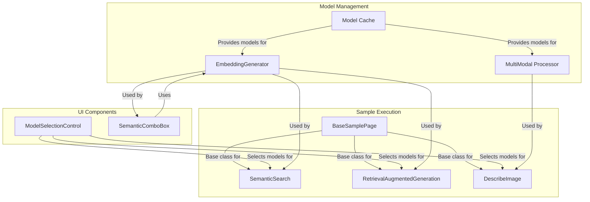
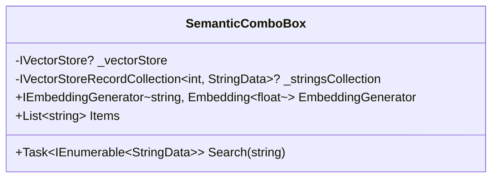
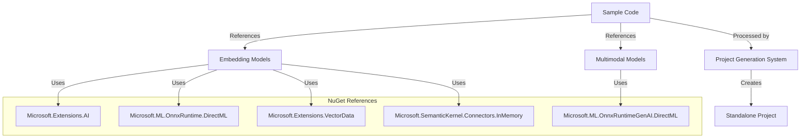

<!-- source: DeepWiki mcp.deepwiki.com · repo microsoft/ai-dev-gallery · page 5.3 Embeddings and Multimodal Models · fetched 2026-10-26 -->

# Embeddings and Multimodal Models

Relevant source files

The following files were used as context for generating this wiki page:

- [AIDevGallery/Assets/ModelIcons/Mistral.svg](AIDevGallery/Assets/ModelIcons/Mistral.svg)
- [AIDevGallery/Assets/cliptokenizer.onnx](AIDevGallery/Assets/cliptokenizer.onnx)
- [AIDevGallery/Samples/Open Source Models/Embeddings/RetrievalAugmentedGeneration.xaml.cs](AIDevGallery/Samples/Open Source Models/Embeddings/RetrievalAugmentedGeneration.xaml.cs)
- [AIDevGallery/Samples/Open Source Models/Embeddings/SemanticSearch.xaml.cs](AIDevGallery/Samples/Open Source Models/Embeddings/SemanticSearch.xaml.cs)
- [AIDevGallery/Samples/Open Source Models/Multimodal Models/DescribeImage.xaml](AIDevGallery/Samples/Open Source Models/Multimodal Models/DescribeImage.xaml)
- [AIDevGallery/Samples/Open Source Models/Multimodal Models/DescribeImage.xaml.cs](AIDevGallery/Samples/Open Source Models/Multimodal Models/DescribeImage.xaml.cs)
- [AIDevGallery/Samples/SharedCode/Controls/SemanticComboBox.cs](AIDevGallery/Samples/SharedCode/Controls/SemanticComboBox.cs)
- [AIDevGallery/Samples/SharedCode/Embeddings/EmbeddingGenerator.cs](AIDevGallery/Samples/SharedCode/Embeddings/EmbeddingGenerator.cs)
- [AIDevGallery/Samples/SharedCode/StableDiffusionCode/LMSDiscreteScheduler.cs](AIDevGallery/Samples/SharedCode/StableDiffusionCode/LMSDiscreteScheduler.cs)
- [AIDevGallery/Samples/SharedCode/StableDiffusionCode/StableDiffusion.cs](AIDevGallery/Samples/SharedCode/StableDiffusionCode/StableDiffusion.cs)

## Purpose and Scope

This document provides an overview of how the AI Dev Gallery implements and utilizes embedding models and multimodal models. Embedding models enable semantic search and retrieval augmented generation (RAG) capabilities, while multimodal models provide combined text/image understanding. For information on language models used for chat and text generation, see [Language Models](#5.1).

## Embedding Models Architecture

Embedding models convert text into numerical vector representations where semantic similarity between texts corresponds to proximity in vector space. The AI Dev Gallery implements a comprehensive embedding system for semantic search and RAG applications.

Sources: [AIDevGallery/Samples/SharedCode/Embeddings/EmbeddingGenerator.cs:27-289]()

### EmbeddingGenerator

The core of the embedding system is the `EmbeddingGenerator` class, which implements `IEmbeddingGenerator<string, Embedding<float>>`. It handles model loading, tensor operations, and embedding generation.

Key features:
- Supports multiple hardware acceleration options (CPU, DirectML/GPU, QNN/NPU)
- Handles tokenization with BertTokenizer
- Processes ONNX model input/output
- Provides both batch and streaming APIs for embedding generation
- Implements tensor operations for mean pooling and normalization

Sources: [AIDevGallery/Samples/SharedCode/Embeddings/EmbeddingGenerator.cs:27-289]()

The embedding generation process includes:
1. Tokenizing input text with a BertTokenizer
2. Creating input tensors for the ONNX model
3. Running inference to get raw embedding vectors
4. Applying mean pooling across the token dimension
5. Normalizing the embeddings for consistency

## Vector Storage and Retrieval

The embedding system integrates with vector stores to enable semantic search and retrieval:

Sources: [AIDevGallery/Samples/Open Source Models/Embeddings/SemanticSearch.xaml.cs:135-163](), [AIDevGallery/Samples/Open Source Models/Embeddings/RetrievalAugmentedGeneration.xaml.cs:168-170]()

The system uses:
- `InMemoryVectorStore` for storing embedding vectors
- `IVectorStoreRecordCollection` for organizing and retrieving vectors
- Custom record types (`StringData`, `PdfPageData`) for storing text and metadata alongside vectors
- Vector search capabilities for finding semantically similar content

## Embeddings Applications

### Semantic Search

The Semantic Search sample demonstrates using embeddings to find semantically similar content within a text corpus.

Sources: [AIDevGallery/Samples/Open Source Models/Embeddings/SemanticSearch.xaml.cs:122-179]()

Implementation details:
- Source text is chunked into semantically meaningful segments
- Each chunk is embedded using the `EmbeddingGenerator`
- Vector similarity search identifies the most relevant chunks
- Results are presented in order of relevance

### Retrieval Augmented Generation (RAG)

The RAG sample implements a complete workflow for knowledge-based question answering:

Sources: [AIDevGallery/Samples/Open Source Models/Embeddings/RetrievalAugmentedGeneration.xaml.cs:130-242](), [AIDevGallery/Samples/Open Source Models/Embeddings/RetrievalAugmentedGeneration.xaml.cs:244-327]()

Key components:
1. PDF processing: Extracts text from PDF documents
2. Text chunking: Divides text into manageable segments
3. Indexing: Creates and stores embeddings for each chunk
4. Retrieval: Finds relevant chunks for a user query
5. Generation: Uses a language model to generate an answer based on retrieved context
6. Visualization: Shows the relevant PDF pages alongside the answer

## Multimodal Models

Multimodal models process and understand multiple types of data simultaneously, such as images and text. The AI Dev Gallery includes support for multimodal models that can interpret images and respond to text prompts about them.

Sources: [AIDevGallery/Samples/Open Source Models/Multimodal Models/DescribeImage.xaml.cs:35-260]()

### DescribeImage Sample

The DescribeImage sample demonstrates how to use a multimodal model to generate textual descriptions of images:

Sources: [AIDevGallery/Samples/Open Source Models/Multimodal Models/DescribeImage.xaml.cs:35-260]()

Implementation flow:
1. Load a multimodal model and initialize a `MultiModalProcessor`
2. Create a `TokenizerStream` for decoding model outputs
3. Load and display an image
4. Process the image into input tensors for the model
5. Generate a textual description using streaming token generation
6. Display the generated description to the user

Key code components:
- `MultiModalProcessor`: Core class for handling multimodal inputs
- `GeneratorParams`: Configures generation parameters like max length
- `Generator`: Handles token generation from the model
- `TokenizerStream`: Decodes model output tokens into readable text

## Shared Components and Integration

Both embedding and multimodal systems integrate with the broader AI Dev Gallery architecture:

Sources: [AIDevGallery/Samples/SharedCode/Controls/SemanticComboBox.cs:16-140](), [AIDevGallery/Samples/Open Source Models/Multimodal Models/DescribeImage.xaml.cs:35-260](), [AIDevGallery/Samples/Open Source Models/Embeddings/RetrievalAugmentedGeneration.xaml.cs:50-548]()

### Integration with UI Components

The embedding system is also integrated into UI components like the `SemanticComboBox`, which provides semantic search capabilities within a combobox control:

Sources: [AIDevGallery/Samples/SharedCode/Controls/SemanticComboBox.cs:16-140]()

## Sample Generation

Both embedding and multimodal samples can be generated as standalone projects using the Project Generation system:

Sources: [AIDevGallery/Samples/Open Source Models/Multimodal Models/DescribeImage.xaml.cs:26-34](), [AIDevGallery/Samples/Open Source Models/Embeddings/RetrievalAugmentedGeneration.xaml.cs:28-49](), [AIDevGallery/Samples/Open Source Models/Embeddings/SemanticSearch.xaml.cs:23-42]()

## Hardware Acceleration Support

Both embedding and multimodal systems support various hardware acceleration options:

| Acceleration Type | Embedding Models | Multimodal Models |
|-------------------|------------------|-------------------|
| CPU               | ✓                | ✓                 |
| DirectML/GPU      | ✓                | ✓                 |
| QNN/NPU           | ✓                | Limited           |

Sources: [AIDevGallery/Samples/SharedCode/Embeddings/EmbeddingGenerator.cs:38-57]()

The embedding generator specifically implements optimizations for different hardware types:
- Default CPU execution
- DirectML for GPU acceleration
- QNN for NPU acceleration with specific performance settings

## Conclusion

The embedding and multimodal systems in the AI Dev Gallery provide powerful capabilities for semantic search, retrieval augmented generation, and image understanding. These components integrate with the broader application architecture and leverage state-of-the-art AI models to enable advanced functionality in a developer-friendly way.

---

