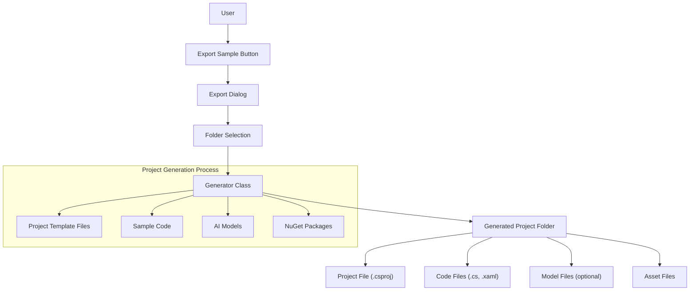
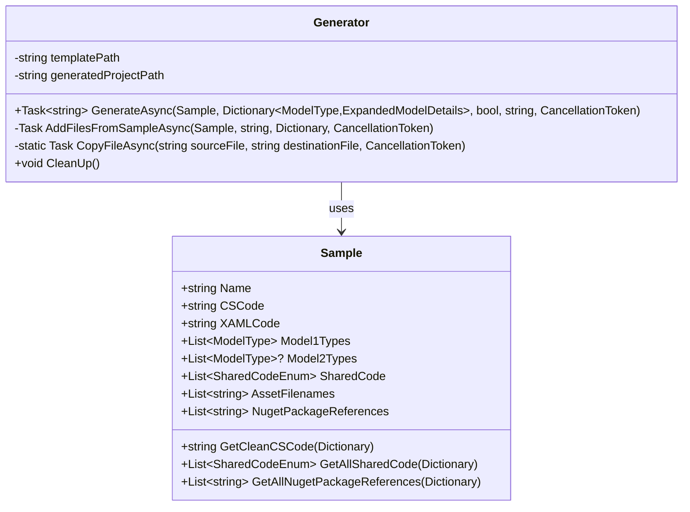
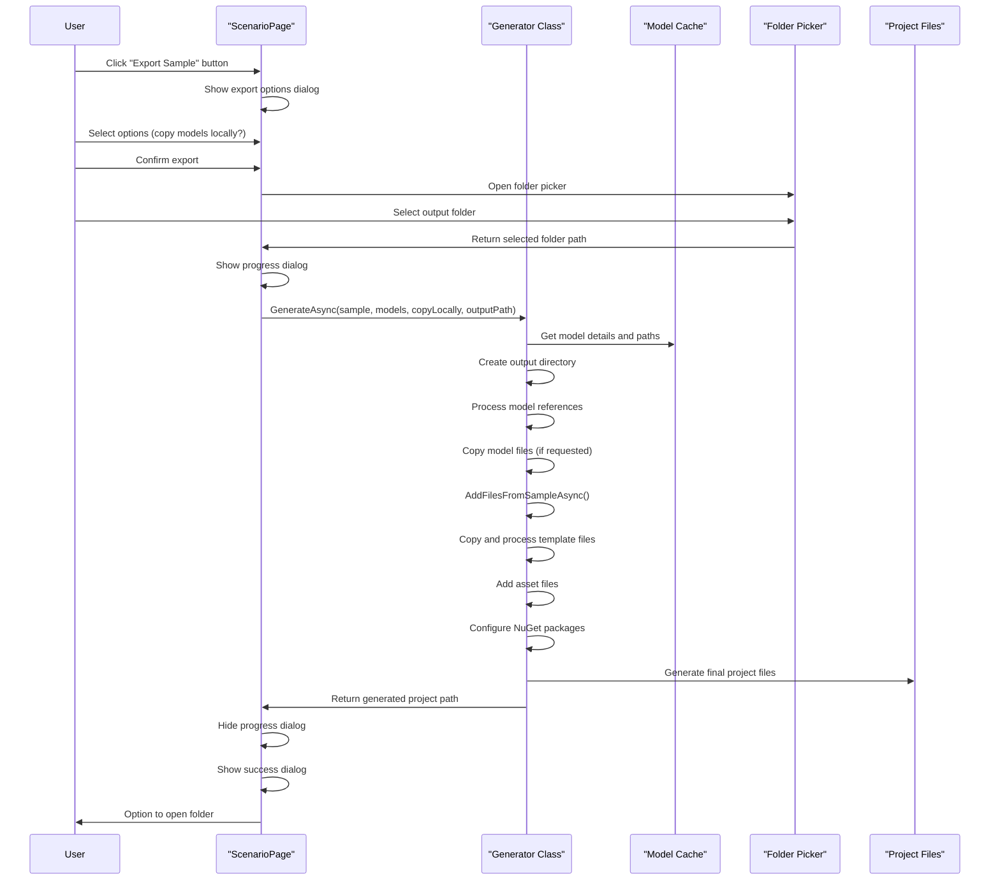
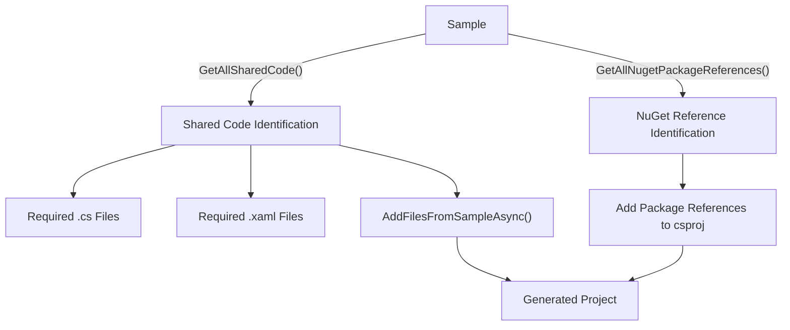
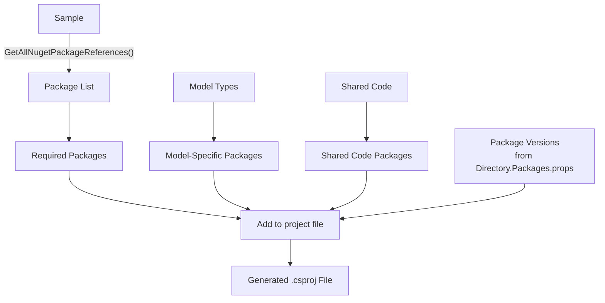
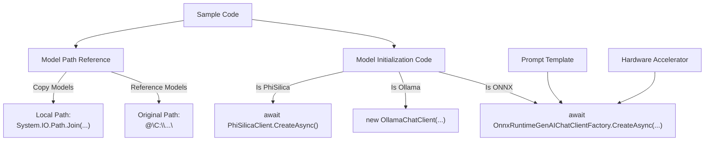
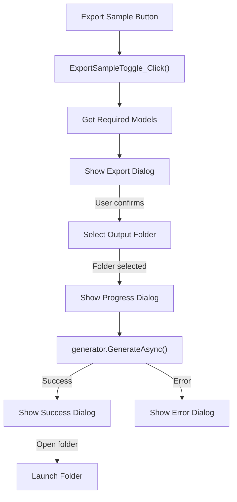

<!-- source: DeepWiki mcp.deepwiki.com · repo microsoft/ai-dev-gallery · page 6 Project Generation System · fetched 2026-10-26 -->

# Project Generation System

<details>
<summary>Relevant source files</summary>

The following files were used as context for generating this wiki page:

- [AIDevGallery.SourceGenerator/SamplesSourceGenerator.cs](AIDevGallery.SourceGenerator/SamplesSourceGenerator.cs)
- [AIDevGallery.Utils/SamplesConstants.cs](AIDevGallery.Utils/SamplesConstants.cs)
- [AIDevGallery/AIDevGallery.csproj](AIDevGallery/AIDevGallery.csproj)
- [AIDevGallery/Controls/ModelSelectionControl.xaml.cs](AIDevGallery/Controls/ModelSelectionControl.xaml.cs)
- [AIDevGallery/Helpers/ModelDetailsHelper.cs](AIDevGallery/Helpers/ModelDetailsHelper.cs)
- [AIDevGallery/Helpers/SamplesHelper.cs](AIDevGallery/Helpers/SamplesHelper.cs)
- [AIDevGallery/Models/BaseSampleNavigationParameters.cs](AIDevGallery/Models/BaseSampleNavigationParameters.cs)
- [AIDevGallery/Pages/Scenarios/ScenarioPage.xaml.cs](AIDevGallery/Pages/Scenarios/ScenarioPage.xaml.cs)
- [AIDevGallery/ProjectGenerator/Generator.cs](AIDevGallery/ProjectGenerator/Generator.cs)
- [Directory.Packages.props](Directory.Packages.props)

</details>


## Purpose and Scope

The Project Generation System enables users to export sample AI applications from the AI Dev Gallery as standalone Visual Studio projects. This allows developers to easily extend, modify, and integrate AI models and capabilities into their own applications. This page documents the architecture, components, and processes involved in generating these projects.

For information about how Samples and Scenarios are defined within the application, see [Samples and Scenarios Framework](#2.2).

For details on Source Generation used in the project generation process, see [Source Generation](#6.2).

## System Overview

The Project Generation System transforms in-app samples into fully functional Visual Studio projects that can be built and run independently. The system handles:

1. Creating project files and folder structures
2. Copying and modifying sample code
3. Managing model references and dependencies
4. Adding appropriate NuGet packages
5. Configuring build settings for different platforms and hardware accelerators



Sources: [AIDevGallery/ProjectGenerator/Generator.cs:49-376](), [AIDevGallery/Pages/Scenarios/ScenarioPage.xaml.cs:274-391]()

## Architecture Components

The Project Generation System consists of several key components that work together to create standalone projects:

### Generator Class

The `Generator` class is the core component that orchestrates the entire project generation process. It's responsible for:

- Creating the project directory structure
- Copying and modifying template files
- Injecting sample code and model references
- Managing NuGet package dependencies
- Handling model file copying (if requested)



Sources: [AIDevGallery/ProjectGenerator/Generator.cs:21-432]()

### Template System

The Project Generation System uses a template-based approach to create new projects:

1. Template files are stored in the `ProjectGenerator/Template` directory
2. Variables in templates (like `$projectname$`, `$safeprojectname$`) are replaced with actual values
3. Files are renamed and copied to the output directory
4. Project-specific content is injected into the templates

Sources: [AIDevGallery/ProjectGenerator/Generator.cs:184-241](), [AIDevGallery/AIDevGallery.csproj:34-44]()

### Model Management Integration

The system integrates with the Model Management System ([Model Management System](#3)) to:

1. Access downloaded models
2. Determine model compatibility with different hardware accelerators
3. Copy model files to the project (optional) or reference their original location
4. Generate appropriate code for model initialization and usage

Sources: [AIDevGallery/ProjectGenerator/Generator.cs:70-177](), [AIDevGallery/Helpers/SamplesHelper.cs:272-341]()

### Source Generation

The Source Generator component plays a critical role in:

1. Processing samples at compile time
2. Extracting shared code components for reuse
3. Cleaning up sample code for export by removing app-specific elements
4. Managing dependencies between shared code components

This component is covered in more detail in [Source Generation](#6.2).

Sources: [AIDevGallery.SourceGenerator/SamplesSourceGenerator.cs:26-551]()

## Project Generation Workflow

The project generation process follows a sequence of steps from user request to generated project:



Sources: [AIDevGallery/Pages/Scenarios/ScenarioPage.xaml.cs:274-391](), [AIDevGallery/ProjectGenerator/Generator.cs:49-376]()

## Input and Output

### Input to Project Generation

The Generator takes several inputs to create a project:

| Input | Description |
|-------|-------------|
| Sample | The sample to export, containing code, models, and dependencies |
| Models Dictionary | Maps model types to expanded model details including paths |
| Copy Models Locally | Boolean indicating whether to copy model files into the project |
| Output Path | Directory where the project will be generated |
| Cancellation Token | Used to cancel the operation if needed |

Sources: [AIDevGallery/ProjectGenerator/Generator.cs:51-105]()

### Generated Project Structure

The generated project follows a standard structure:

```
ProjectName/
├── Assets/
│   └── [Asset files used by the sample]
├── Models/ (Optional, if copying models locally)
│   └── [Model files]
├── Utils/
│   └── [Shared code files]
├── Sample.xaml
├── Sample.xaml.cs
├── App.xaml
├── App.xaml.cs
├── Package.appxmanifest
├── ProjectName.csproj
└── ProjectName.sln
```

Sources: [AIDevGallery/ProjectGenerator/Generator.cs:184-241](), [AIDevGallery/ProjectGenerator/Generator.cs:385-422]()

## Sample Code Processing

When generating a project, the sample code needs processing to work standalone:

### Code Transformation Steps

1. **Namespace transformation**: Changes from `AIDevGallery` namespace to `AIDevGallery.Sample`
2. **Navigation modifications**: Transforms navigation-related code to work in a standalone app
3. **Dependencies resolution**: Adds appropriate shared code files from the Utils directory
4. **Model paths configuration**: Updates model path references based on copying option
5. **Telemetry removal**: Removes AIDevGallery-specific telemetry and attributes

Sources: [AIDevGallery.SourceGenerator/SamplesSourceGenerator.cs:201-256](), [AIDevGallery/Helpers/SamplesHelper.cs:198-269]()

### Shared Code Management

The system identifies and includes necessary shared code components:



Sources: [AIDevGallery/Helpers/SamplesHelper.cs:18-96](), [AIDevGallery/ProjectGenerator/Generator.cs:385-422]()

## NuGet Package Management

The Project Generation System manages NuGet package references for the generated project:

1. **Package identification**: Determines required packages from sample and model types
2. **Version management**: Uses `Directory.Packages.props` to ensure consistent versions
3. **Conditional references**: Adds platform-specific packages as needed (e.g., DirectML for x64, QNN for ARM64)
4. **Package attributes**: Sets special attributes (e.g., `PrivateAssets="all"` for tools)



Sources: [AIDevGallery/ProjectGenerator/Generator.cs:256-334](), [Directory.Packages.props:1-59](), [AIDevGallery/Helpers/SamplesHelper.cs:58-96]()

## Model Integration

Models are a critical part of AI samples, and the Project Generation System handles them carefully:

### Model Path Handling

The system offers two options for model integration:

1. **Reference existing models**: Uses the model's original path (faster, but requires models to stay in place)
2. **Copy models locally**: Copies model files to the project (larger project size, but portable)

Sources: [AIDevGallery/ProjectGenerator/Generator.cs:70-177](), [AIDevGallery/Pages/Scenarios/ScenarioPage.xaml.cs:295-330]()

### Model Code Generation

The system generates appropriate code for model initialization based on:

1. Model type (language model, vision model, etc.)
2. Hardware acceleration (CPU, DirectML/GPU, QNN/NPU)
3. Required prompt templates
4. API types (WCRAPI, Ollama, ONNX)



Sources: [AIDevGallery/Helpers/SamplesHelper.cs:176-196](), [AIDevGallery/Helpers/SamplesHelper.cs:198-269]()

## UI Integration

The Project Generation System is integrated into the AI Dev Gallery UI through several components:

### Export Button in ScenarioPage

The Export button in the ScenarioPage triggers the project generation process:



Sources: [AIDevGallery/Pages/Scenarios/ScenarioPage.xaml.cs:274-391]()

### Export Dialog Options

The export dialog provides options for the generation process:

1. Copy models locally or reference them from their original location
2. Display model size information 
3. Select output folder location

Sources: [AIDevGallery/Pages/Scenarios/ScenarioPage.xaml.cs:295-330]()

## Error Handling and Cleanup

The Project Generation System includes error handling mechanisms:

1. **Disk space verification**: Checks if there's enough space to copy models
2. **Clean-up process**: Removes partial project files if generation fails
3. **Error reporting**: User-friendly error messages and option to copy error details

Sources: [AIDevGallery/ProjectGenerator/Generator.cs:70-105](), [AIDevGallery/ProjectGenerator/Generator.cs:424-431](), [AIDevGallery/Pages/Scenarios/ScenarioPage.xaml.cs:360-391]()

## Summary

The Project Generation System is a sophisticated component that bridges the gap between experimenting with AI samples in the gallery and developing real-world applications. By enabling users to export fully functional projects, it accelerates the development process and helps developers integrate AI capabilities into their own applications with minimal effort.

The system handles the complexities of model references, shared code dependencies, package management, and project configuration to produce ready-to-use Visual Studio projects that faithfully reproduce the functionality of samples from the AI Dev Gallery.

---

