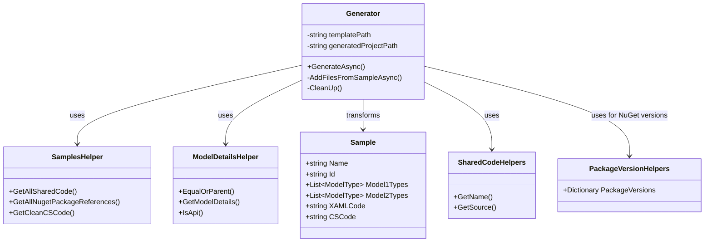
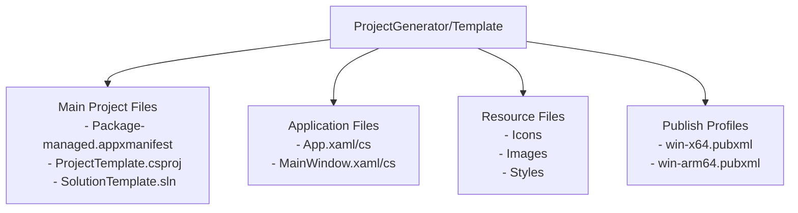
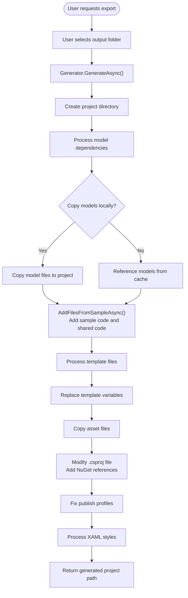
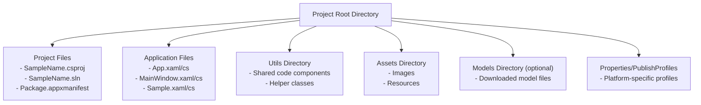

<!-- source: DeepWiki mcp.deepwiki.com · repo microsoft/ai-dev-gallery · page 6.1 Project Generator Implementation · fetched 2026-10-26 -->

# Project Generator Implementation

<details>
<summary>Relevant source files</summary>

The following files were used as context for generating this wiki page:

- [AIDevGallery.SourceGenerator/SamplesSourceGenerator.cs](AIDevGallery.SourceGenerator/SamplesSourceGenerator.cs)
- [AIDevGallery.Utils/SamplesConstants.cs](AIDevGallery.Utils/SamplesConstants.cs)
- [AIDevGallery/AIDevGallery.csproj](AIDevGallery/AIDevGallery.csproj)
- [AIDevGallery/Controls/ModelSelectionControl.xaml.cs](AIDevGallery/Controls/ModelSelectionControl.xaml.cs)
- [AIDevGallery/Helpers/ModelDetailsHelper.cs](AIDevGallery/Helpers/ModelDetailsHelper.cs)
- [AIDevGallery/Helpers/SamplesHelper.cs](AIDevGallery/Helpers/SamplesHelper.cs)
- [AIDevGallery/Models/BaseSampleNavigationParameters.cs](AIDevGallery/Models/BaseSampleNavigationParameters.cs)
- [AIDevGallery/Pages/Scenarios/ScenarioPage.xaml.cs](AIDevGallery/Pages/Scenarios/ScenarioPage.xaml.cs)
- [AIDevGallery/ProjectGenerator/Generator.cs](AIDevGallery/ProjectGenerator/Generator.cs)
- [Directory.Packages.props](Directory.Packages.props)

</details>


## Purpose and Scope

The Project Generator is a core component of the AI Dev Gallery that enables users to export AI samples as standalone Visual Studio projects. It transforms the in-app samples with their associated models, code, and dependencies into complete, ready-to-build Visual Studio solutions. This document details the implementation of the Project Generator system, focusing on its architecture, workflow, and code transformation processes.

For information about how source code is generated at compile time, see [Source Generation](#6.2).

## Architecture Overview

The Project Generator system consists of several key components that work together to create standalone projects from samples in the gallery.



Sources: [AIDevGallery/ProjectGenerator/Generator.cs:21-432](), [AIDevGallery/Helpers/SamplesHelper.cs:16-343](), [AIDevGallery/Helpers/ModelDetailsHelper.cs:12-175]()

## Core Components

### Generator Class
The central component is the `Generator` class which orchestrates the entire export process. It handles template processing, file copying, variable replacement, and project configuration.

### Template Files
The generator uses template files located in the `ProjectGenerator/Template` directory as the foundation for the generated projects. These include Visual Studio project files, application manifests, and basic application structure.

### Helper Classes
Several helper classes support the generation process:
- `SamplesHelper`: Processes sample code and determines dependencies
- `ModelDetailsHelper`: Handles model compatibility and references
- `SharedCodeHelpers`: Manages shared code files

### Project Templates
The application includes a set of template files that serve as the starting point for generated projects. These are referenced in the project file:



Sources: [AIDevGallery/AIDevGallery.csproj:33-43](), [AIDevGallery/ProjectGenerator/Generator.cs:23]()

## Project Generation Workflow

The project generation process follows a structured workflow starting from user initiation to final project output.



Sources: [AIDevGallery/ProjectGenerator/Generator.cs:51-376](), [AIDevGallery/Pages/Scenarios/ScenarioPage.xaml.cs:274-357]()

### Initiation
The process begins when a user clicks the "Export Sample" button in the ScenarioPage UI. This presents a dialog allowing the user to configure export options, including whether to copy model files locally.

### Project Directory Setup
The generator creates a safe project name based on the sample and ensures a unique directory name:

```
projectName = $"{sample.Name}Sample";
string safeProjectName = ToSafeVariableName(projectName);
```

If a directory with the same name already exists, a numeric suffix is added to ensure uniqueness.

Sources: [AIDevGallery/ProjectGenerator/Generator.cs:53-66]()

### Model Processing
The generator processes the models required by the sample:
1. Determines which models are needed
2. Checks disk space if copying models locally
3. Creates model directories and copies files if needed
4. Prepares model path strings for code integration

Sources: [AIDevGallery/ProjectGenerator/Generator.cs:70-178]()

### Sample File Processing
The `AddFilesFromSampleAsync` method adds the sample files to the project:
1. Determines all shared code dependencies
2. Creates appropriate directories for shared code
3. Writes the transformed XAML and C# code

Sources: [AIDevGallery/ProjectGenerator/Generator.cs:385-422]()

### Template File Processing
The generator processes all template files:
1. Iterates through files with specified extensions
2. Handles special file types (images vs. text files)
3. Performs variable replacement in text files
4. Writes transformed files to the output directory

For binary files like icons and images, files are copied as-is. For text files, variables like `$projectname$`, `$safeprojectname$`, and `$guid9$` are replaced with appropriate values.

Sources: [AIDevGallery/ProjectGenerator/Generator.cs:184-240]()

### Asset File Copying
The generator copies any additional asset files required by the sample:

```csharp
foreach (string assetFilename in sample.AssetFilenames)
{
    string fullAssetPath = Path.Join(Package.Current.InstalledLocation.Path, "Assets", assetFilename);
    string fullOutputAssetPath = Path.Combine(outputPath, "Assets", assetFilename);
    if (File.Exists(fullAssetPath))
    {
        File.Copy(fullAssetPath, fullOutputAssetPath);
    }
}
```

Sources: [AIDevGallery/ProjectGenerator/Generator.cs:243-252]()

### Project File Modification
The generator modifies the project file (`.csproj`) to add necessary NuGet package references:
1. Determines all required packages based on sample needs
2. Adds platform-specific package references (x64/ARM64)
3. Adds model content references if models are copied locally
4. Applies appropriate package versions

Sources: [AIDevGallery/ProjectGenerator/Generator.cs:254-334]()

### Finalization
The generator performs final tasks:
1. Fixes publish profiles to ensure proper runtime identifiers
2. Processes XAML styles to include in App.xaml
3. Returns the path to the generated project

Sources: [AIDevGallery/ProjectGenerator/Generator.cs:336-375]()

## Code Transformation

A key aspect of the project generation process is transforming the sample code to work independently outside the gallery.

### Sample Code Cleaning
The `GetCleanCSCode` method in `SamplesHelper` performs several transformations on the sample C# code:
1. Replaces model paths and hardware accelerator references
2. Replaces AI client initialization code
3. Updates namespace references
4. Removes gallery-specific code

Sources: [AIDevGallery/Helpers/SamplesHelper.cs:198-269]()

### XAML Transformation
XAML files are transformed through:
1. Namespace updates to match the new project structure
2. Control references updates
3. Removal of gallery-specific elements
4. Rewriting the `x:Class` attribute to use the new namespace

The transformation is handled by the source generator during compile time.

Sources: [AIDevGallery.SourceGenerator/SamplesSourceGenerator.cs:259-293]()

### Shared Code Handling
The generator determines required shared code files using `GetAllSharedCode`:
1. Identifies direct shared code requirements from the sample
2. Adds implicit dependencies (e.g., adding `LlmPromptTemplate` when `OnnxRuntimeGenAIChatClientFactory` is used)
3. Copies all required files to the appropriate locations in the generated project

Sources: [AIDevGallery/Helpers/SamplesHelper.cs:18-56](), [AIDevGallery/ProjectGenerator/Generator.cs:385-411]()

## NuGet Package Management

The Project Generator automatically determines and adds the required NuGet package references to the generated project.

### Package Determination
The `GetAllNugetPackageReferences` method determines which packages a sample requires:
1. Starts with explicitly declared packages in the sample
2. Adds packages based on model types (e.g., language models)
3. Adds packages for hardware acceleration (DirectML, QNN)
4. Adds packages required by shared code components

Sources: [AIDevGallery/Helpers/SamplesHelper.cs:58-96]()

### Package Version Management
Package versions are synchronized with those used in the main application:
1. Uses `PackageVersionHelpers` to access version information from `Directory.Packages.props`
2. Ensures consistency between the gallery and generated projects

Sources: [AIDevGallery/ProjectGenerator/Generator.cs:291-292](), [Directory.Packages.props:1-59]()

### Platform-Specific Packages
The generator adds conditional references for platform-specific packages:
1. DirectML packages are conditionally included for x64 platforms
2. QNN packages are conditionally included for ARM64 platforms
3. Appropriate conditions are added to the project file

```csharp
if (packageName == "Microsoft.ML.OnnxRuntime.DirectML" ||
    packageName == "Microsoft.ML.OnnxRuntimeGenAI.DirectML")
{
    packageReferenceItem.Condition = "$(Platform) == 'x64'";
}
else if (packageName == "Microsoft.ML.OnnxRuntime.QNN" ||
         packageName == "Microsoft.ML.OnnxRuntimeGenAI.QNN" ||
         packageName == "Microsoft.ML.OnnxRuntimeGenAI")
{
    packageReferenceItem.Condition = "$(Platform) == 'ARM64'";
}
```

Sources: [AIDevGallery/ProjectGenerator/Generator.cs:279-289]()

## Output Project Structure

The generated projects follow a standard structure that allows them to be opened and run in Visual Studio.



### Main Project Files
The core files define the project structure and configuration:
- `.csproj` file with NuGet references and build settings
- `.sln` file for Visual Studio integration
- `Package.appxmanifest` for application identity and capabilities

### Application Files
- `App.xaml`/`App.xaml.cs`: Application entry point
- `MainWindow.xaml`/`MainWindow.xaml.cs`: Main application window
- `Sample.xaml`/`Sample.xaml.cs`: The exported sample implementation

### Utilities and Resources
- Shared code files in the Utils directory
- Asset files in the Assets directory
- Model files in the Models directory (if copied locally)

## Summary

The Project Generator system provides a seamless way for users to export samples from the AI Dev Gallery into standalone Visual Studio projects. It handles the complex tasks of:

1. Transforming sample code to work independently
2. Managing model dependencies and references
3. Adding appropriate NuGet packages
4. Configuring project settings for different platforms
5. Creating a complete, buildable Visual Studio solution

This functionality bridges the gap between exploring AI capabilities in the gallery and integrating those capabilities into developers' own applications.

Sources: [AIDevGallery/ProjectGenerator/Generator.cs:21-432]()

---

