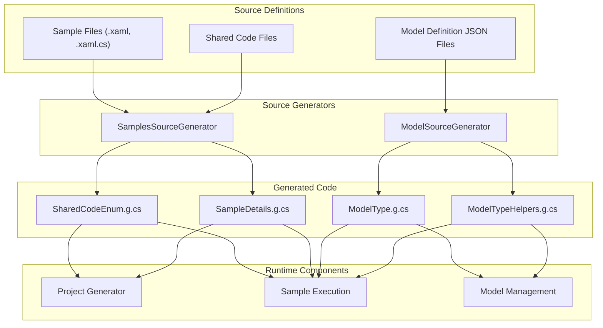
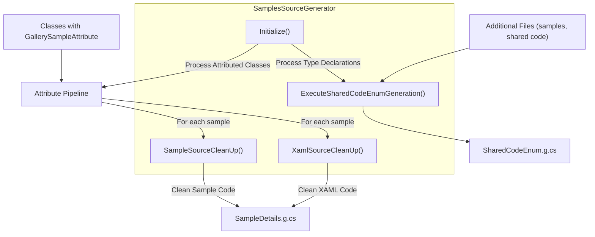
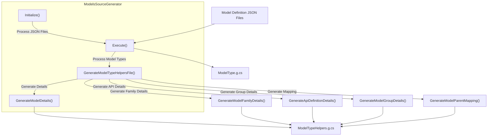
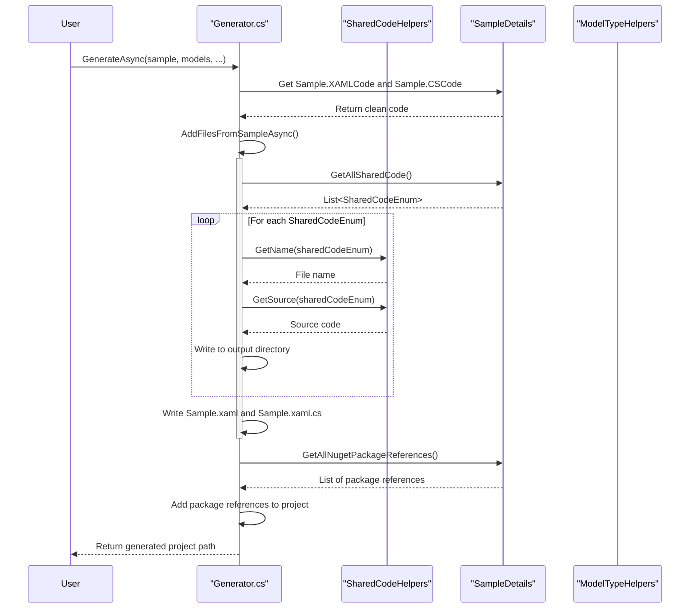
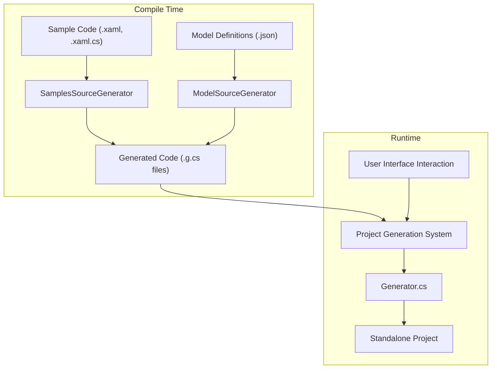

<!-- source: DeepWiki mcp.deepwiki.com · repo microsoft/ai-dev-gallery · page 6.2 Source Generation · fetched 2026-10-26 -->

# Source Generation

<details>
<summary>Relevant source files</summary>

The following files were used as context for generating this wiki page:

- [AIDevGallery.SourceGenerator/Models/AIToolkitAction.cs](AIDevGallery.SourceGenerator/Models/AIToolkitAction.cs)
- [AIDevGallery.SourceGenerator/Models/Model.cs](AIDevGallery.SourceGenerator/Models/Model.cs)
- [AIDevGallery.SourceGenerator/ModelsSourceGenerator.cs](AIDevGallery.SourceGenerator/ModelsSourceGenerator.cs)
- [AIDevGallery.SourceGenerator/SamplesSourceGenerator.cs](AIDevGallery.SourceGenerator/SamplesSourceGenerator.cs)
- [AIDevGallery.Utils/SamplesConstants.cs](AIDevGallery.Utils/SamplesConstants.cs)
- [AIDevGallery/AIDevGallery.csproj](AIDevGallery/AIDevGallery.csproj)
- [AIDevGallery/Assets/AITKIcon.png](AIDevGallery/Assets/AITKIcon.png)
- [AIDevGallery/Pages/Models/ModelPage.xaml.cs](AIDevGallery/Pages/Models/ModelPage.xaml.cs)
- [AIDevGallery/ProjectGenerator/Generator.cs](AIDevGallery/ProjectGenerator/Generator.cs)
- [AIDevGallery/Samples/Definitions/Models/multimodal.modelgroup.json](AIDevGallery/Samples/Definitions/Models/multimodal.modelgroup.json)
- [AIDevGallery/Telemetry/Events/AIToolkitActionClickedEvent.cs](AIDevGallery/Telemetry/Events/AIToolkitActionClickedEvent.cs)
- [AIDevGallery/Utils/AIToolkitHelper.cs](AIDevGallery/Utils/AIToolkitHelper.cs)
- [Directory.Packages.props](Directory.Packages.props)

</details>


## Overview

This document details the Source Generation system within the AI Dev Gallery application. Source Generation refers to the compile-time code generation used to catalog and prepare samples, models, and shared code for use in the application and for export as standalone projects. This is distinct from the Project Generation system, which uses the outputs of Source Generation to export samples as standalone Visual Studio projects at runtime (for details on that system, see [Project Generator Implementation](#6.1)).

The Source Generation system acts as a bridge between the sample and model definitions in the codebase and the runtime functionality that uses these definitions. By handling this at compile time, it provides strong typing, better IDE support, and more efficient code execution.

Sources: [AIDevGallery.SourceGenerator/SamplesSourceGenerator.cs:1-547](), [AIDevGallery.SourceGenerator/ModelsSourceGenerator.cs:1-466]()

## Source Generation Architecture

Source Generation in AI Dev Gallery consists of two primary source generators that create code at compile time, both implementing the `IIncrementalGenerator` interface from the Roslyn compiler framework:



Sources: [AIDevGallery.SourceGenerator/SamplesSourceGenerator.cs:19-37](), [AIDevGallery.SourceGenerator/ModelsSourceGenerator.cs:19-35](), [AIDevGallery/AIDevGallery.csproj:102-104]()

## Source Generator Types

The AI Dev Gallery employs two primary source generators, each with distinct responsibilities:

### SamplesSourceGenerator

The `SamplesSourceGenerator` is responsible for:

1. Generating a `SharedCodeEnum` that catalogs all shared code components
2. Processing sample files (.xaml and .xaml.cs) annotated with `GallerySampleAttribute`
3. Generating code for accessing and using sample content at runtime
4. Preparing cleaned-up code for project generation



Sources: [AIDevGallery.SourceGenerator/SamplesSourceGenerator.cs:24-189](), [AIDevGallery.SourceGenerator/SamplesSourceGenerator.cs:339-351]()

### ModelsSourceGenerator

The `ModelsSourceGenerator` is responsible for:

1. Processing model definition JSON files to extract model metadata
2. Generating a `ModelType` enumeration for all model types in the system
3. Creating helper classes and dictionaries for runtime model management
4. Establishing relationships between different model types



Sources: [AIDevGallery.SourceGenerator/ModelsSourceGenerator.cs:23-35](), [AIDevGallery.SourceGenerator/ModelsSourceGenerator.cs:36-189](), [AIDevGallery.SourceGenerator/ModelsSourceGenerator.cs:192-237]()

## Generated Code Components

The source generators produce several key code components that are used throughout the application:

### SharedCodeEnum

The `SharedCodeEnum` enumeration categorizes all shared code files that can be included in sample projects. Each enum value represents a specific shared code file. The generated code includes:

1. The enum definition with values for each shared code file
2. A `GetName` method to retrieve the filename for a given enum value
3. A `GetSource` method to retrieve the source code for a given enum value

This allows the application to access and include shared code in generated projects.

```
internal enum SharedCodeEnum
{
    DeviceUtils,
    ImageCropControls,
    ImageCropControlsCs,
    ImageCropControlsXaml,
    NativeMethods,
    // ... more shared code files
}
```

Sources: [AIDevGallery.SourceGenerator/SamplesSourceGenerator.cs:43-86](), [AIDevGallery.SourceGenerator/SamplesSourceGenerator.cs:91-184]()

### SampleDetails

The `SampleDetails` class contains a static list of all samples in the application. Each sample includes:

1. Metadata (name, ID, icon, etc.)
2. Cleaned versions of XAML and C# code
3. References to required models and shared code
4. NuGet package dependencies
5. Required asset files

This provides a comprehensive catalog of all samples available in the application.

Sources: [AIDevGallery.SourceGenerator/SamplesSourceGenerator.cs:438-542]()

### ModelType Enum and Helpers

The source generators produce several model-related components:

1. A `ModelType` enumeration with values for all model types, model families, and API definitions
2. Dictionaries mapping `ModelType` to detailed information about models, families, and APIs
3. A parent-child mapping showing relationships between model types
4. Helper methods for working with models

These components provide a strongly-typed system for working with models throughout the application.

Sources: [AIDevGallery.SourceGenerator/ModelsSourceGenerator.cs:191-465]()

## Integration with Project Generation

The Source Generation system plays a crucial role in the Project Generation workflow. Here's how they interact:



When a user requests to generate a project:

1. The `Generator.cs` class uses information from `SampleDetails` to get the prepared, cleaned code
2. It accesses `SharedCodeHelpers` to retrieve required shared code files
3. It uses `ModelTypeHelpers` to get information about required models
4. It combines all these elements to create a standalone project

Sources: [AIDevGallery/ProjectGenerator/Generator.cs:51-376](), [AIDevGallery/ProjectGenerator/Generator.cs:385-422]()

## Source Generation Workflow

The complete workflow from source code to generated project follows these steps:



1. **Compile-Time Processing**:
   - Source generators scan the codebase for sample code and model definitions
   - They generate code files with clean sample code, model information, and shared code access

2. **Runtime Execution**:
   - The application loads the generated code when it starts
   - When a user requests a project export, the Generator uses the generated code
   - The Generator combines template files, generated code, and model information
   - It produces a standalone project that can be opened in Visual Studio

Sources: [AIDevGallery/ProjectGenerator/Generator.cs:51-184](), [AIDevGallery/ProjectGenerator/Generator.cs:385-422](), [AIDevGallery.SourceGenerator/SamplesSourceGenerator.cs:339-351]()

## Key Components

The main components involved in Source Generation include:

| Component | Description | Responsibility |
|-----------|-------------|----------------|
| `SamplesSourceGenerator` | C# source generator | Processes sample code and generates code for sample management |
| `ModelSourceGenerator` | C# source generator | Processes model definitions and generates code for model management |
| `SharedCodeEnum` | Generated enumeration | Catalogs all shared code files available for inclusion in projects |
| `SharedCodeHelpers` | Generated static class | Provides methods to access shared code file names and content |
| `SampleDetails` | Generated static class | Provides a catalog of all samples with cleaned code and metadata |
| `ModelType` | Generated enumeration | Defines all model types available in the application |
| `ModelTypeHelpers` | Generated static class | Provides dictionaries and methods for working with models |
| `Generator` | Runtime class | Uses generated code to produce standalone projects |

Sources: [AIDevGallery.SourceGenerator/SamplesSourceGenerator.cs:19-37](), [AIDevGallery.SourceGenerator/ModelsSourceGenerator.cs:19-35](), [AIDevGallery/ProjectGenerator/Generator.cs:21-432]()

## Summary

The Source Generation system is a crucial component of the AI Dev Gallery application, bridging the gap between source code definitions and runtime functionality. By leveraging C# source generators, it:

1. Catalogs and prepares samples, models, and shared code at compile time
2. Provides strongly-typed access to this information at runtime
3. Enables the Project Generation system to export samples as standalone projects
4. Creates a unified system for working with diverse AI models and samples

This approach streamlines development, reduces runtime overhead, and ensures consistency between the application's samples and exported projects.

Sources: [AIDevGallery/AIDevGallery.csproj:102-104](), [AIDevGallery/ProjectGenerator/Generator.cs:21-432](), [AIDevGallery.SourceGenerator/SamplesSourceGenerator.cs:19-547](), [AIDevGallery.SourceGenerator/ModelsSourceGenerator.cs:19-466]()

---

