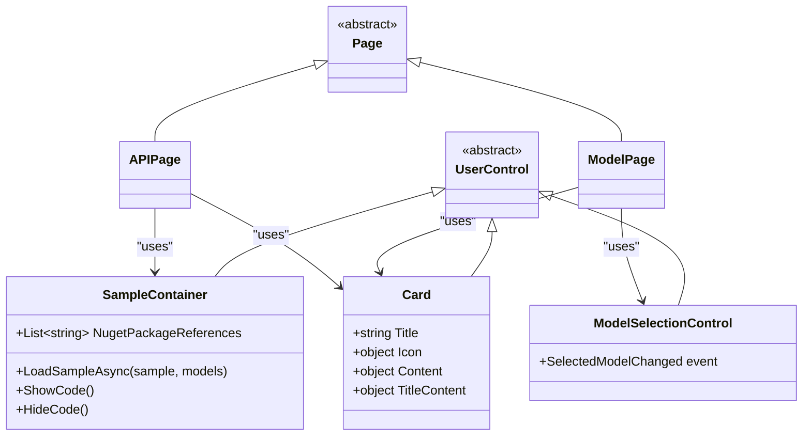
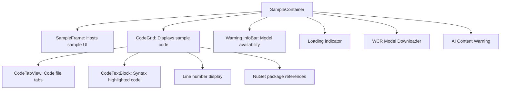
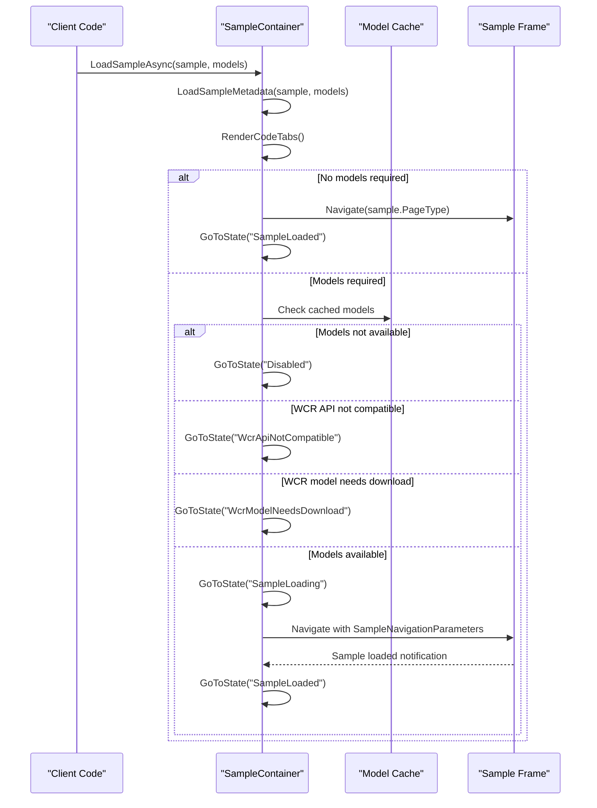
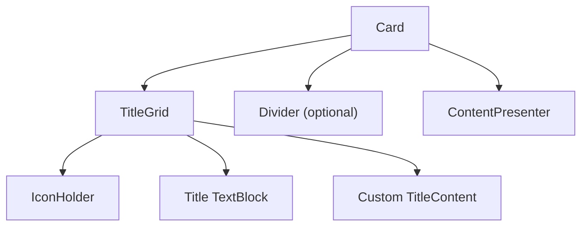
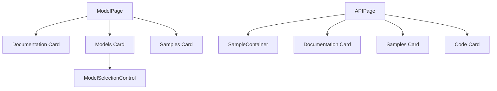
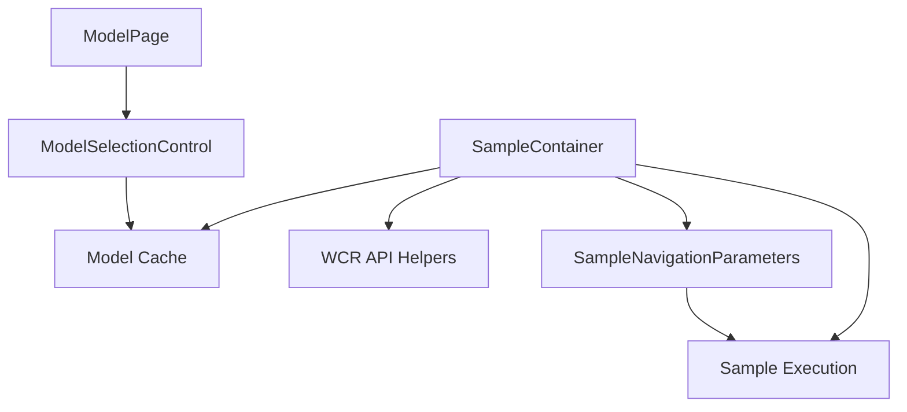

<!-- source: DeepWiki mcp.deepwiki.com · repo microsoft/ai-dev-gallery · page 7 UI Components · fetched 2026-10-26 -->

# UI Components

<details>
<summary>Relevant source files</summary>

The following files were used as context for generating this wiki page:

- [AIDevGallery/Controls/Card.xaml](AIDevGallery/Controls/Card.xaml)
- [AIDevGallery/Controls/SampleContainer.xaml](AIDevGallery/Controls/SampleContainer.xaml)
- [AIDevGallery/Controls/SampleContainer.xaml.cs](AIDevGallery/Controls/SampleContainer.xaml.cs)
- [AIDevGallery/Pages/APIs/APIPage.xaml](AIDevGallery/Pages/APIs/APIPage.xaml)
- [AIDevGallery/Pages/APIs/APIPage.xaml.cs](AIDevGallery/Pages/APIs/APIPage.xaml.cs)
- [AIDevGallery/Pages/Models/ModelPage.xaml](AIDevGallery/Pages/Models/ModelPage.xaml)

</details>


This page documents the core UI components that power the AI Dev Gallery application's user interface. These components provide a consistent, reusable framework for displaying AI models, executing samples, and organizing content within the application.

For information about specific page navigation and routing, see [Navigation System](#2.1). For details on how samples are defined and organized, see [Samples and Scenarios Framework](#2.2).

## Overview

The AI Dev Gallery application uses a set of custom WinUI/XAML controls to create a consistent and functional user interface. These components abstract the complexity of model selection, sample execution, and code display while providing a responsive design that adapts to different screen sizes.



Sources: [AIDevGallery/Controls/SampleContainer.xaml.cs:1-479](), [AIDevGallery/Controls/Card.xaml:1-92](), [AIDevGallery/Pages/Models/ModelPage.xaml:148-151]()

## Core Components

### SampleContainer

The SampleContainer is the primary UI component responsible for loading, displaying, and managing AI samples. It serves as a container that hosts sample content and provides functionality for viewing associated code.

#### Component Structure



Sources: [AIDevGallery/Controls/SampleContainer.xaml:14-236]()

#### Key Properties and Methods

| Property/Method | Description |
|-----------------|-------------|
| `DisclaimerHorizontalAlignment` | Controls alignment of the AI content disclaimer |
| `NugetPackageReferences` | List of NuGet packages required by the sample |
| `LoadSampleAsync(Sample?, List<ModelDetails>?)` | Loads and displays a sample with the specified models |
| `ShowCode()` | Displays the code pane with syntax-highlighted code |
| `HideCode()` | Hides the code pane |
| `RenderCode()` | Updates code display with syntax highlighting |
| `AnySamplesLoading()` | Static method to check if any samples are currently loading |
| `WaitUnloadAllAsync()` | Static method to wait for all samples to unload |

Sources: [AIDevGallery/Controls/SampleContainer.xaml.cs:29-33](), [AIDevGallery/Controls/SampleContainer.xaml.cs:35-42](), [AIDevGallery/Controls/SampleContainer.xaml.cs:111-271](), [AIDevGallery/Controls/SampleContainer.xaml.cs:387-399](), [AIDevGallery/Controls/SampleContainer.xaml.cs:54-84]()

#### Visual States

The SampleContainer uses VisualStateManager to manage different UI states:

1. **ModelEnabledStates**:
   - **Default**: Initial state
   - **Disabled**: When required models are unavailable
   - **SampleLoading**: During sample loading
   - **WcrApiNotCompatible**: When Windows Copilot Runtime APIs are incompatible
   - **WcrModelNeedsDownload**: When a WCR model download is required
   - **SampleLoaded**: When sample is successfully loaded

2. **CodeStates**:
   - **HideCodePane**: Code pane is hidden
   - **ShowCodePane**: Code pane is visible

Sources: [AIDevGallery/Controls/SampleContainer.xaml:236-279]()

#### Sample Loading Workflow



Sources: [AIDevGallery/Controls/SampleContainer.xaml.cs:111-271]()

### Card

The Card component provides a consistent container for content throughout the application. It serves as a fundamental UI building block used across various pages.

#### Component Structure



Sources: [AIDevGallery/Controls/Card.xaml:16-72]()

#### Key Properties

| Property | Description |
|----------|-------------|
| `Title` | The card's title text |
| `Icon` | Optional icon displayed before the title |
| `TitleContent` | Optional custom content in the title area |
| `Padding` | Content padding |
| `TitlePadding` | Title area padding |
| `DividerVisibility` | Controls visibility of the divider between title and content |

Sources: [AIDevGallery/Controls/Card.xaml:27-71]()

### ModelSelectionControl

The ModelSelectionControl enables users to browse and select AI models for sample execution. While not fully detailed in the provided files, its usage is evident throughout the application.

#### Main Features

- Displays a list of available models
- Allows selecting models compatible with samples
- Provides model compatibility information
- Triggers the `SelectedModelChanged` event when a model is selected

#### Usage in Application

The ModelSelectionControl is used in:
- ModelPage: To display and select model versions
- Sample execution: To select models for running samples

Sources: [AIDevGallery/Pages/Models/ModelPage.xaml:148-151]()

## Component Integration

The UI components are integrated into application pages to create a consistent user experience.

### Page Structure



Sources: [AIDevGallery/Pages/Models/ModelPage.xaml:95-204](), [AIDevGallery/Pages/APIs/APIPage.xaml:81-215]()

### Responsive Design

Both ModelPage and APIPage implement responsive design using VisualStateManager:

- **WideLayout**: Side-by-side layout for larger screens
- **NarrowLayout**: Stacked layout for smaller screens

For example, in narrow layout:
- Side columns are adjusted
- Cards are rearranged vertically
- Padding and spacing are optimized

| Layout State | Breakpoint | Configuration |
|--------------|------------|---------------|
| WideLayout | ≥ 1200px | Side-by-side layout with fixed width sidebar |
| NarrowLayout | < 1200px | Stacked layout with full-width components |

Sources: [AIDevGallery/Pages/Models/ModelPage.xaml:207-229](), [AIDevGallery/Pages/APIs/APIPage.xaml:218-240]()

## Sample Container Lifecycle

The SampleContainer manages a complex lifecycle for AI samples:

```mermaid
stateDiagram-v2
    [*] --> Default
    
    Default --> Disabled: "No models available"
    Default --> SampleLoading: "Models available"
    Default --> WcrApiNotCompatible: "WCR API not supported"
    Default --> WcrModelNeedsDownload: "WCR model needed"
    
    WcrModelNeedsDownload --> SampleLoading: "Model downloaded"
    SampleLoading --> SampleLoaded: "Sample loaded successfully"
    
    state "Code Display" as CodeState {
        HideCodePane --> ShowCodePane: "ShowCode() called"
        ShowCodePane --> HideCodePane: "HideCode() called"
    }
```

### Global Sample Management

The SampleContainer class maintains static references to all active containers and provides methods to:

- Track loading samples with `AnySamplesLoading()`
- Wait for all samples to unload with `WaitUnloadAllAsync()`
- Cancel sample loading operations with `CancelCTS()`

This ensures proper resource management and prevents memory leaks when navigating between samples.

Sources: [AIDevGallery/Controls/SampleContainer.xaml.cs:52-93]()

## Integration with Other Systems

The UI Components integrate with other systems in the AI Dev Gallery:



### Model Management Integration

The SampleContainer interfaces with the Model Management system to:
- Check for model availability using `App.ModelCache.GetCachedModel()`
- Determine model compatibility
- Provide model paths to samples for execution

Sources: [AIDevGallery/Controls/SampleContainer.xaml.cs:142-163]()

### Sample Execution Integration

The SampleContainer creates appropriate navigation parameters for samples:
- `SampleNavigationParameters` for single-model samples
- `MultiModelSampleNavigationParameters` for multi-model samples

These parameters include model paths, hardware accelerator information, and prompt templates needed for sample execution.

Sources: [AIDevGallery/Controls/SampleContainer.xaml.cs:214-250]()

### Windows Copilot Runtime Integration

The SampleContainer includes special handling for Windows Copilot Runtime APIs:
- Checks API compatibility with `WcrApiHelpers.GetApiAvailability()`
- Facilitates model downloads through the `WcrModelDownloader` control
- Manages the display of compatibility messages

Sources: [AIDevGallery/Controls/SampleContainer.xaml.cs:166-208]()

## Summary

The UI Components in AI Dev Gallery provide a consistent, responsive interface for:

1. **Sample display and execution**: Through the SampleContainer
2. **Content organization**: With the Card component
3. **Model selection**: Via the ModelSelectionControl

These components work together to create a cohesive user experience that abstracts the complexity of working with AI models and samples while providing the necessary functionality for model selection, sample execution, and code display.

---

