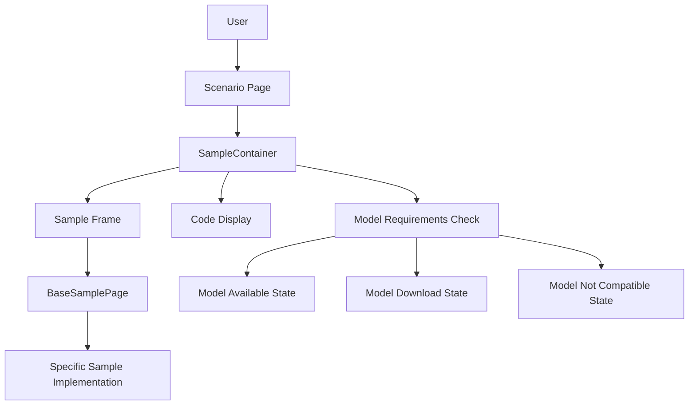
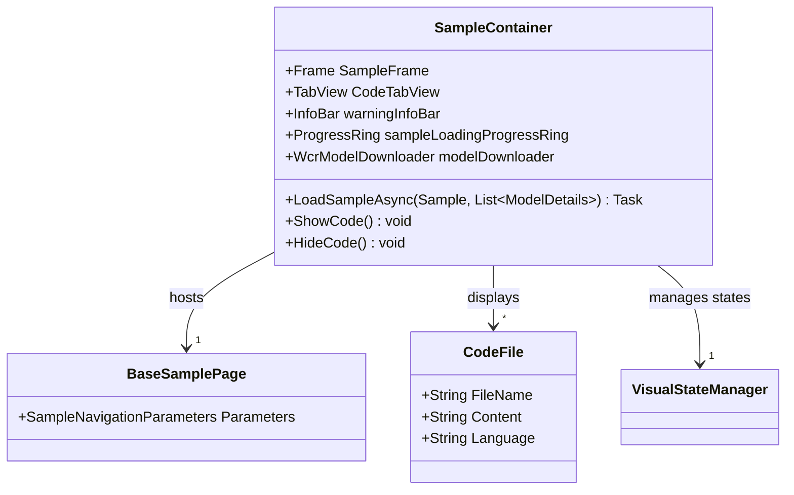
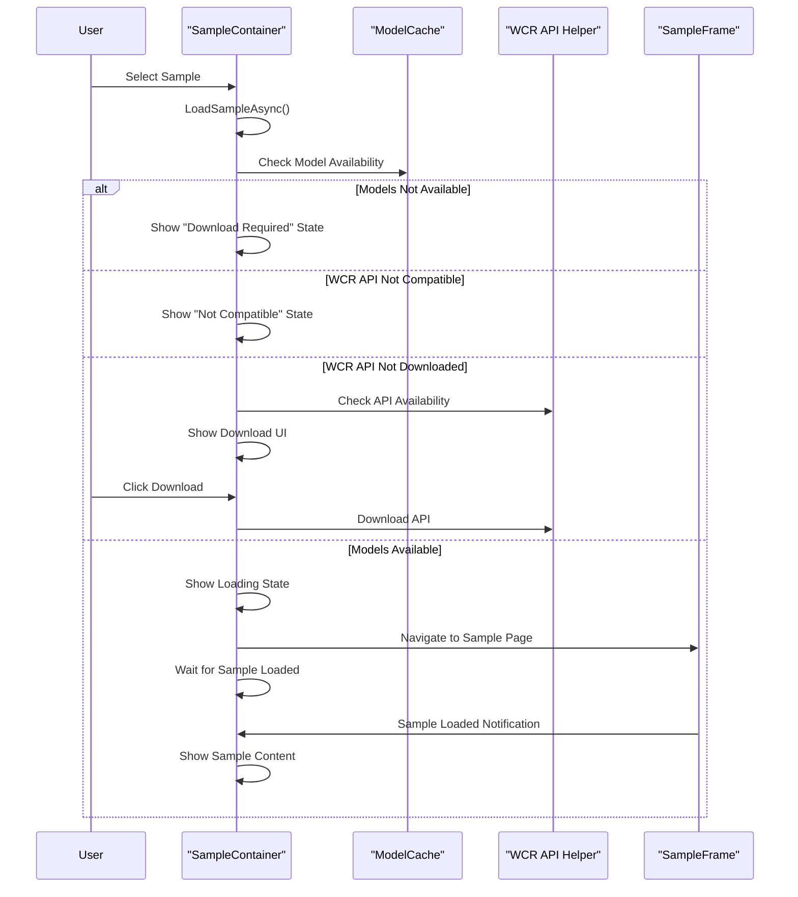
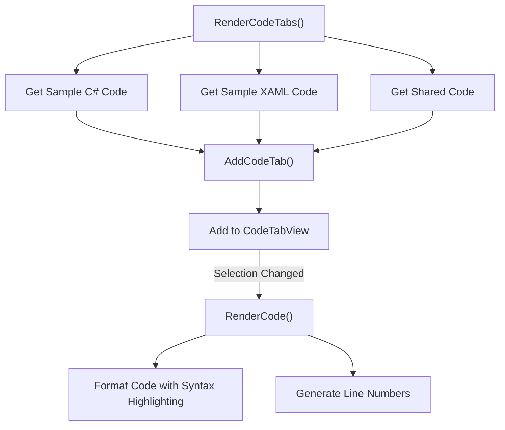
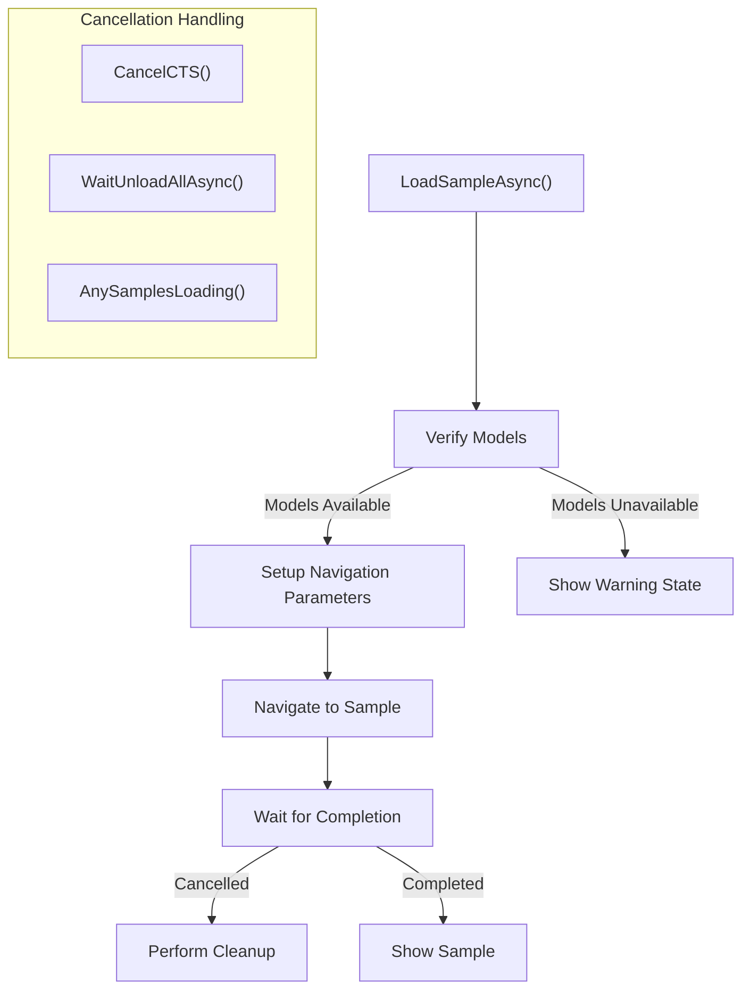
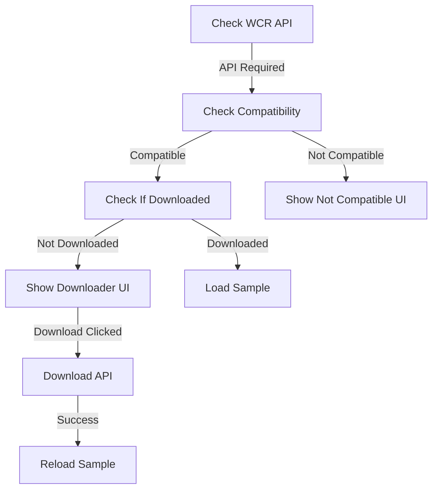

<!-- source: DeepWiki mcp.deepwiki.com · repo microsoft/ai-dev-gallery · page 7.1 Sample Container · fetched 2026-10-26 -->

# Sample Container

Relevant source files

The following files were used as context for generating this wiki page:

- [AIDevGallery/Assets/Road.png](AIDevGallery/Assets/Road.png)
- [AIDevGallery/Controls/SampleContainer.xaml](AIDevGallery/Controls/SampleContainer.xaml)
- [AIDevGallery/Controls/SampleContainer.xaml.cs](AIDevGallery/Controls/SampleContainer.xaml.cs)
- [AIDevGallery/Samples/WCRAPIs/BackgroundRemover.xaml](AIDevGallery/Samples/WCRAPIs/BackgroundRemover.xaml)
- [AIDevGallery/Samples/WCRAPIs/ImageDescription.xaml](AIDevGallery/Samples/WCRAPIs/ImageDescription.xaml)
- [AIDevGallery/Samples/WCRAPIs/IncreaseFidelity.xaml](AIDevGallery/Samples/WCRAPIs/IncreaseFidelity.xaml)
- [AIDevGallery/Samples/WCRAPIs/PhiSilicaBasic.xaml](AIDevGallery/Samples/WCRAPIs/PhiSilicaBasic.xaml)

The Sample Container is a core UI component within the AI Dev Gallery that provides a standardized environment for hosting, displaying, and executing AI samples. It serves as the primary container where sample code runs and is responsible for managing the sample lifecycle, displaying source code, and handling various sample execution states.

This component bridges the gap between the sample selection interface and the actual AI model execution, providing consistent UI layout and behavior across different types of samples.

## Component Overview

The Sample Container is implemented as a UserControl in the AI Dev Gallery application that can display both the running sample and its corresponding source code.

Sources: [AIDevGallery/Controls/SampleContainer.xaml.cs:111-271](), [AIDevGallery/Controls/SampleContainer.xaml:20-92]()

The SampleContainer provides several key features:

1. A frame for rendering the actual sample implementation
2. A code viewer with syntax highlighting for displaying sample source code
3. Various states to handle different model availability scenarios
4. Integration with the model cache and downloader systems
5. Support for Windows Copilot Runtime API compatibility checks

## Container Structure

The Sample Container has a dual-pane layout that can show both the running sample and its source code side by side.

Sources: [AIDevGallery/Controls/SampleContainer.xaml:14-235](), [AIDevGallery/Controls/SampleContainer.xaml.cs:23-58]()

The main elements of the container are:

1. **Content Area**: The primary area where the sample content is displayed, implemented as a Frame control named `SampleFrame`.
2. **Code Panel**: A collapsible panel showing the sample's source code with syntax highlighting.
3. **State Indicators**: Various elements like progress rings, warning messages, and download controls that indicate the sample's current state.

## Sample Loading Process

When a sample is loaded in the SampleContainer, it goes through a series of steps to prepare and execute the sample.

Sources: [AIDevGallery/Controls/SampleContainer.xaml.cs:111-271](), [AIDevGallery/Controls/SampleContainer.xaml:236-265]()

The loading process involves:

1. **Model Verification**: Checking if required models are available in the cache
2. **Compatibility Checks**: For WCR APIs, verifying the API is compatible with the current device
3. **Download Management**: Facilitating model or API downloads if needed
4. **Sample Initialization**: Creating the appropriate navigation parameters and loading the sample
5. **State Transitions**: Managing visual states based on the current loading status

## Visual States

The SampleContainer uses the VisualStateManager to transition between different UI states based on the sample and model status.

### Model Enabled States

- **Default**: Initial state
- **Disabled**: When required models are not available
- **SampleLoading**: During the sample loading process
- **WcrApiNotCompatible**: When WCR APIs are not compatible with the device
- **WcrModelNeedsDownload**: When WCR models need to be downloaded
- **SampleLoaded**: When the sample is successfully loaded

### Code Display States

- **HideCodePane**: When code panel is hidden
- **ShowCodePane**: When code panel is visible

Sources: [AIDevGallery/Controls/SampleContainer.xaml:236-279](), [AIDevGallery/Controls/SampleContainer.xaml.cs:387-399]()

## Code Display Functionality

The SampleContainer provides functionality to display sample source code with syntax highlighting.

Sources: [AIDevGallery/Controls/SampleContainer.xaml.cs:325-379](), [AIDevGallery/Controls/SampleContainer.xaml.cs:442-478]()

The code display features include:

1. **Code Tabs**: Displaying multiple code files in separate tabs
2. **Syntax Highlighting**: Using the ColorCode library to highlight code syntax
3. **Line Numbers**: Showing line numbers alongside code
4. **Code Selection**: Allowing users to select and copy code segments
5. **NuGet Package References**: Displaying the required NuGet packages for the sample

## Sample Execution Management

The SampleContainer manages the execution lifecycle of samples, including cancellation and cleanup.

Sources: [AIDevGallery/Controls/SampleContainer.xaml.cs:53-94](), [AIDevGallery/Controls/SampleContainer.xaml.cs:111-271]()

Key aspects of execution management:

1. **Cancellation Tokens**: Using CancellationTokenSource to allow sample execution cancellation
2. **Completion Sources**: Using TaskCompletionSource to track when samples are fully loaded
3. **Cleanup**: Ensuring proper cleanup when samples are unloaded
4. **Multiple Sample Tracking**: Managing multiple sample instances across the application

## Windows Copilot Runtime Integration

The SampleContainer includes special handling for Windows Copilot Runtime (WCR) APIs, which require specific compatibility checks and download processes.

Sources: [AIDevGallery/Controls/SampleContainer.xaml.cs:165-207](), [AIDevGallery/Controls/SampleContainer.xaml.cs:419-440]()

The WCR integration includes:

1. **Compatibility Checking**: Determining if the WCR API is compatible with the current device
2. **Download UI**: Providing an interface for downloading required WCR components
3. **Status Monitoring**: Tracking the download and installation process
4. **Sample Reloading**: Automatically reloading samples when required components are available

## Example Sample Types

The SampleContainer hosts various types of samples. Here are examples of sample types that can be rendered within the container:

1. **Image Processing Samples**:
   - Background Remover
   - Image Description
   - Increase Fidelity

2. **Text Generation Samples**:
   - PhiSilica Basic Chat

Sources: [AIDevGallery/Samples/WCRAPIs/BackgroundRemover.xaml:1-89](), [AIDevGallery/Samples/WCRAPIs/ImageDescription.xaml:1-131](), [AIDevGallery/Samples/WCRAPIs/IncreaseFidelity.xaml:1-165](), [AIDevGallery/Samples/WCRAPIs/PhiSilicaBasic.xaml:1-79]()

## Integration with Navigation System

The SampleContainer integrates with the application's navigation system to load and display samples.

| Navigation Element | Description |
|-------------------|-------------|
| ScenarioPage | Parent page that hosts the SampleContainer |
| BaseSamplePage | Base class for all sample implementations |
| SampleNavigationParameters | Parameters passed to samples for initialization |
| MultiModelSampleNavigationParameters | Parameters for samples requiring multiple models |

Sources: [AIDevGallery/Controls/SampleContainer.xaml.cs:214-250]()

## Related Components

The SampleContainer works closely with several other components in the AI Dev Gallery:

1. **Model Selection Control**: For selecting and configuring AI models (see [Model Selection Control](#7.2))
2. **Samples and Scenarios Framework**: For organizing and presenting samples (see [Samples and Scenarios Framework](#2.2))
3. **Model Cache and Selection**: For accessing downloaded models (see [Model Cache and Selection](#3.2))

---

