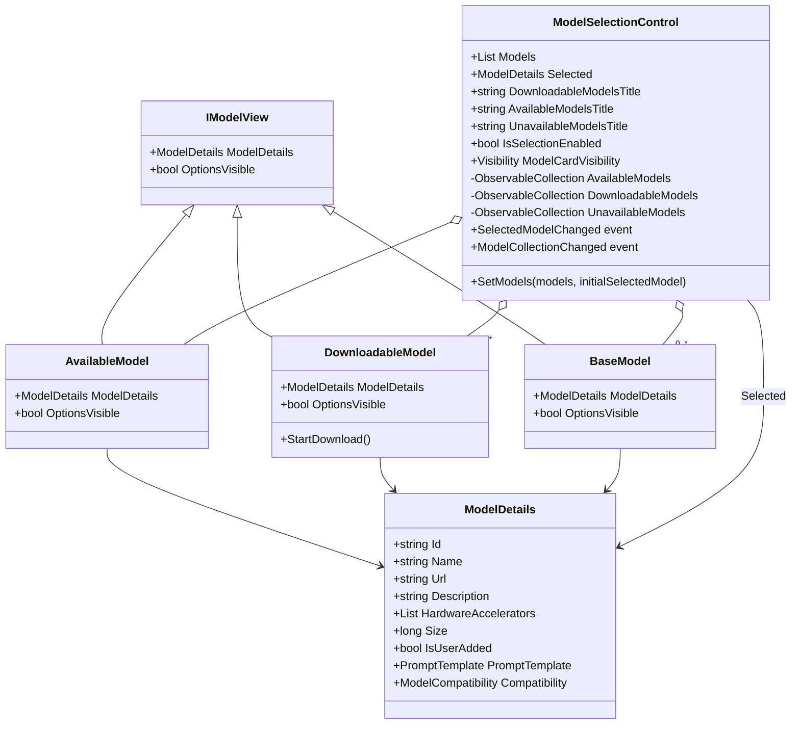
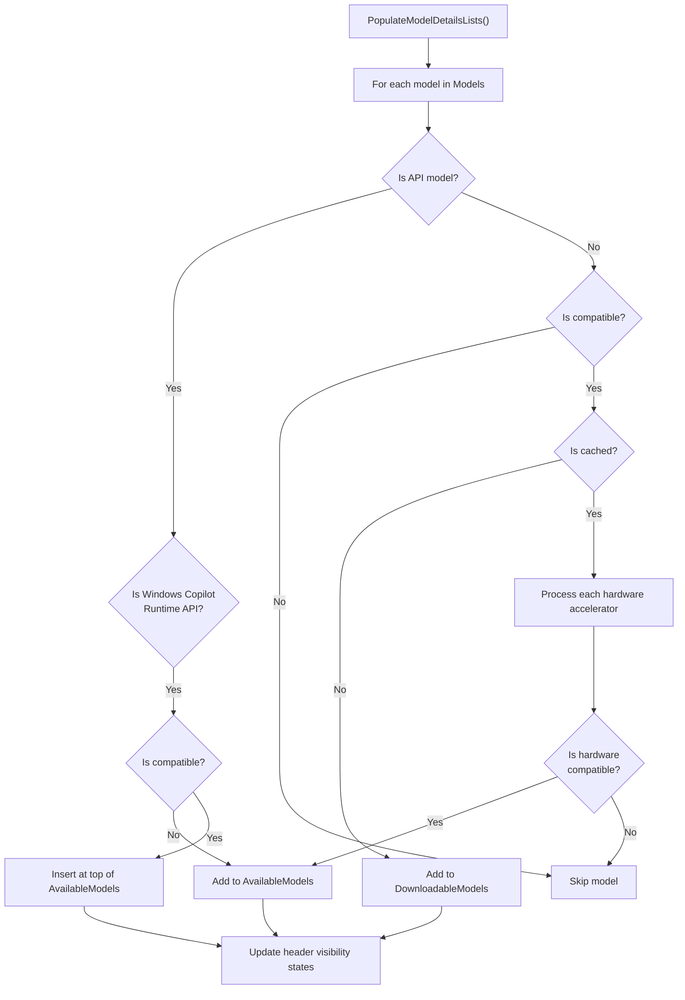
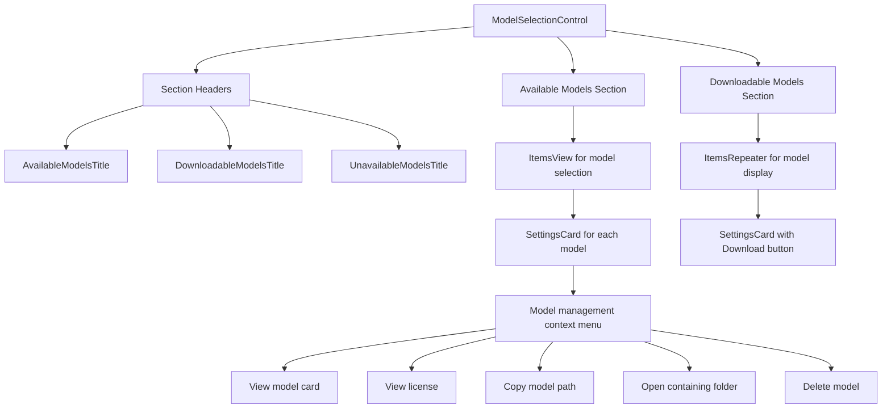
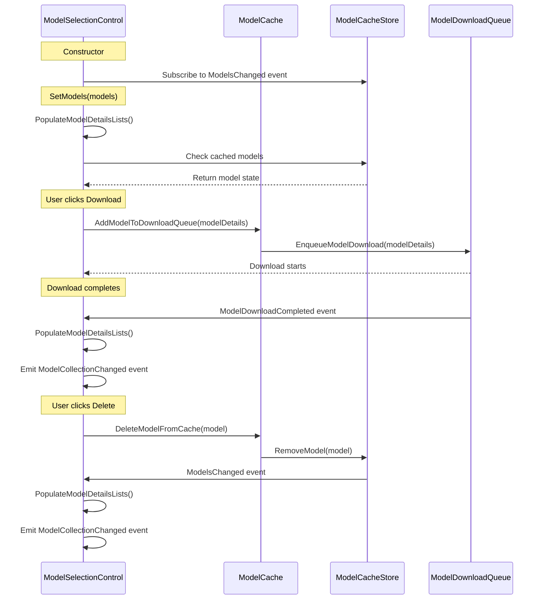
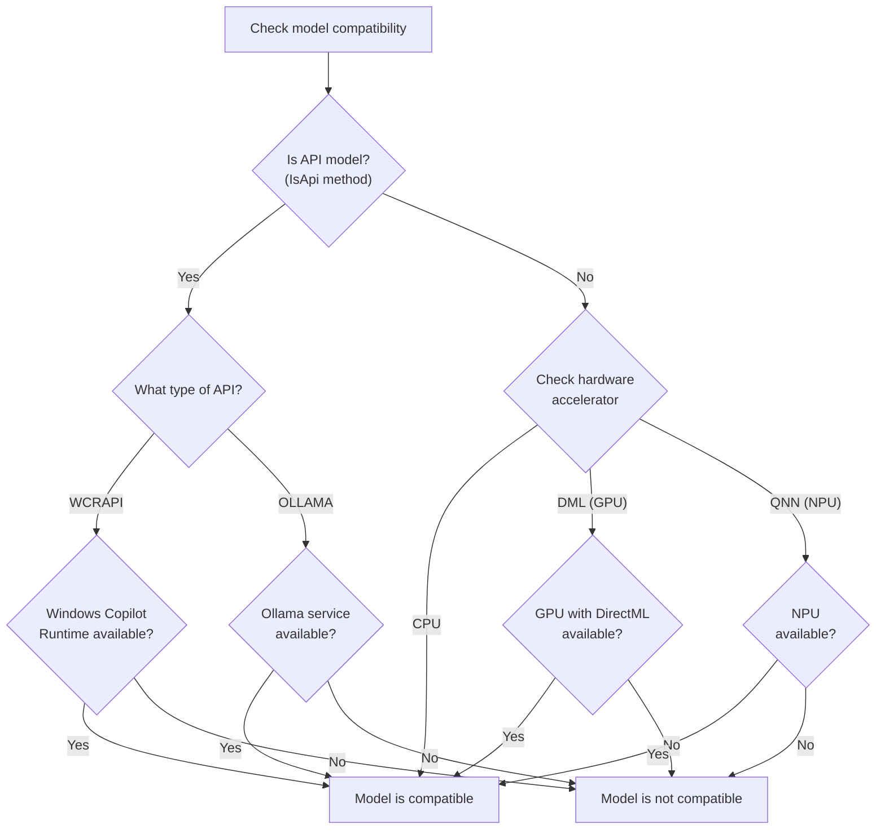
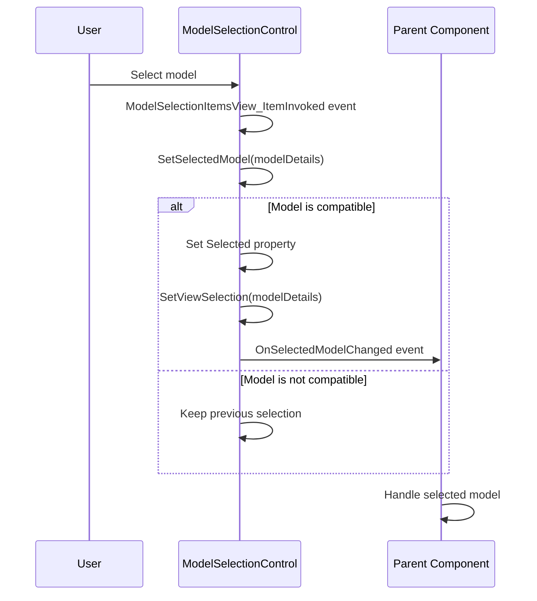
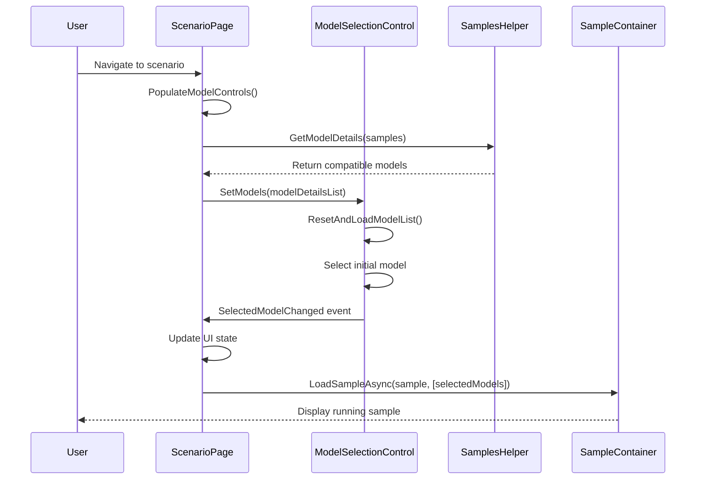
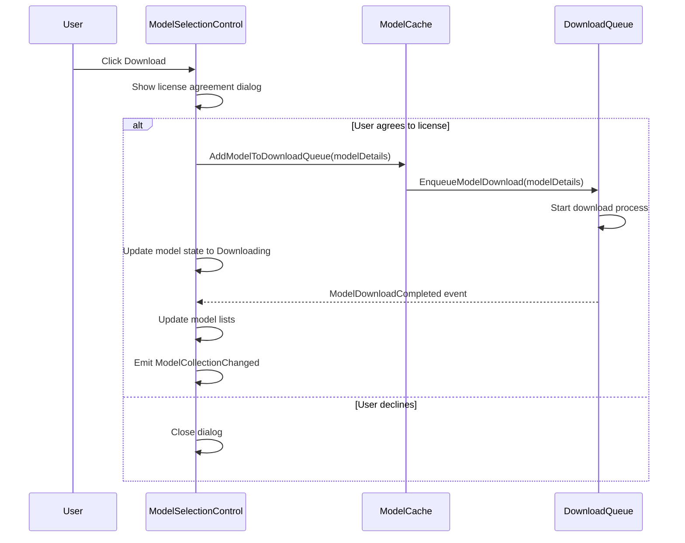

<!-- source: DeepWiki mcp.deepwiki.com · repo microsoft/ai-dev-gallery · page 7.2 Model Selection Control · fetched 2026-10-26 -->

# Model Selection Control

<details>
<summary>Relevant source files</summary>

The following files were used as context for generating this wiki page:

- [AIDevGallery/Controls/ModelSelectionControl.xaml](AIDevGallery/Controls/ModelSelectionControl.xaml)
- [AIDevGallery/Controls/ModelSelectionControl.xaml.cs](AIDevGallery/Controls/ModelSelectionControl.xaml.cs)
- [AIDevGallery/Helpers/ModelDetailsHelper.cs](AIDevGallery/Helpers/ModelDetailsHelper.cs)
- [AIDevGallery/Helpers/SamplesHelper.cs](AIDevGallery/Helpers/SamplesHelper.cs)
- [AIDevGallery/Models/BaseSampleNavigationParameters.cs](AIDevGallery/Models/BaseSampleNavigationParameters.cs)
- [AIDevGallery/Pages/Models/AddModelPage.xaml.cs](AIDevGallery/Pages/Models/AddModelPage.xaml.cs)
- [AIDevGallery/Pages/Scenarios/ScenarioPage.xaml.cs](AIDevGallery/Pages/Scenarios/ScenarioPage.xaml.cs)
- [AIDevGallery/Pages/SettingsPage.xaml](AIDevGallery/Pages/SettingsPage.xaml)
- [AIDevGallery/Pages/SettingsPage.xaml.cs](AIDevGallery/Pages/SettingsPage.xaml.cs)
- [AIDevGallery/Utils/AppUtils.cs](AIDevGallery/Utils/AppUtils.cs)
- [AIDevGallery/Utils/ModelCache.cs](AIDevGallery/Utils/ModelCache.cs)
- [AIDevGallery/Utils/ModelCacheStore.cs](AIDevGallery/Utils/ModelCacheStore.cs)

</details>


## Purpose and Scope

The Model Selection Control is a critical UI component in the AI Dev Gallery that enables users to browse, select, and manage AI models for use in sample applications. This component provides a unified interface for displaying available models (both downloaded and API-based), offering downloads for new models, and providing model management features such as deletion and information viewing.

This document covers the implementation details, architecture, and usage patterns of the ModelSelectionControl. For information about the SampleContainer which hosts and executes samples using the selected models, see [Sample Container](#7.1).

Sources: [AIDevGallery/Controls/ModelSelectionControl.xaml.cs:21-598]()

## Component Architecture

The ModelSelectionControl is implemented as a WinUI UserControl that categorizes and displays AI models based on their availability and compatibility with the user's system.



Sources: [AIDevGallery/Controls/ModelSelectionControl.xaml.cs:21-76](), [AIDevGallery/ViewModels]()

## Model Categorization Process

The control categorizes models into three primary collections based on their availability and compatibility with the current system:



Sources: [AIDevGallery/Controls/ModelSelectionControl.xaml.cs:206-304]()

## User Interface Components

The ModelSelectionControl provides a rich UI with distinct sections for different model categories:

1. **Available Models**: Models that can be used immediately (downloaded or API-based)
2. **Downloadable Models**: Models that are compatible but not yet downloaded
3. **Unavailable Models**: Models that are not compatible with the current system

Each model is displayed with key information:
- Model name
- Hardware accelerator requirements (CPU, GPU/DML, NPU/QNN, WCR, Ollama)
- Model size and parameter count
- Source (Hugging Face, GitHub, local, etc.)
- License information



Sources: [AIDevGallery/Controls/ModelSelectionControl.xaml:1-456]()

## Integration with Model Cache

The ModelSelectionControl integrates closely with the application's model cache system to manage model availability and provide management options:



Sources: [AIDevGallery/Controls/ModelSelectionControl.xaml.cs:72-76](), [AIDevGallery/Controls/ModelSelectionControl.xaml.cs:427-482]()

## Hardware Compatibility Detection

The control uses the ModelDetailsHelper class to determine model compatibility with the current system hardware:



Sources: [AIDevGallery/Helpers/ModelDetailsHelper.cs:135-175](), [AIDevGallery/Utils/AppUtils.cs:281-378]()

## Model Selection Process

When a user selects a model, the control follows this process:



Sources: [AIDevGallery/Controls/ModelSelectionControl.xaml.cs:150-176](), [AIDevGallery/Controls/ModelSelectionControl.xaml.cs:193-204]()

## Usage in Scenario Pages

The primary usage of ModelSelectionControl is in scenario pages where users select models to run samples:



Sources: [AIDevGallery/Pages/Scenarios/ScenarioPage.xaml.cs:54-124](), [AIDevGallery/Pages/Scenarios/ScenarioPage.xaml.cs:140-232]()

## Model Management Features

The ModelSelectionControl provides several model management features through context menus:

| Feature | Description | Method |
|---------|-------------|--------|
| View Model Card | Opens the model documentation | ModelCard_Click |
| View API Documentation | Opens API documentation for WCR APIs | ApiDocumentation_Click |
| View License | Opens the license information | ViewLicense_Click |
| Copy Model Path | Copies the model file path to clipboard | CopyModelPath_Click |
| Open Containing Folder | Opens the folder containing the model files | OpenModelFolder_Click |
| Delete Model | Removes the model from the cache | DeleteModel_Click |

Sources: [AIDevGallery/Controls/ModelSelectionControl.xaml.cs:307-437]()

## Model Download Process

When a user initiates a model download:



Sources: [AIDevGallery/Controls/ModelSelectionControl.xaml.cs:448-476]()

## Key Implementation Details

### Initialization and Subscription to Cache Events

The control subscribes to model cache events to stay updated with changes:

```csharp
public ModelSelectionControl()
{
    this.InitializeComponent();
    App.ModelCache.CacheStore.ModelsChanged += CacheStore_ModelsChanged;
    Unloaded += (sender, e) => App.ModelCache.CacheStore.ModelsChanged -= CacheStore_ModelsChanged;
}
```

Sources: [AIDevGallery/Controls/ModelSelectionControl.xaml.cs:72-77]()

### Model Categorization Logic

The `PopulateModelDetailsLists` method categorizes models based on their type, compatibility, and cache status:

```csharp
private void PopulateModelDetailsLists()
{
    // For API models (Windows Copilot Runtime or Ollama)
    if (model.IsApi())
    {
        if (model.HardwareAccelerators.Contains(HardwareAccelerator.WCRAPI))
        {
            // Add to available models
        }
        else if (model.Compatibility.CompatibilityState == ModelCompatibilityState.Compatible)
        {
            // Add to available models
        }
    }
    // For regular models
    else if (!App.ModelCache.IsModelCached(model.Url))
    {
        // Add to downloadable models
    }
    else
    {
        // Add to available models with proper hardware accelerators
    }
}
```

Sources: [AIDevGallery/Controls/ModelSelectionControl.xaml.cs:206-304]()

### Model Selection Event Handling

The control raises events when a model is selected:

```csharp
private void OnSelectedModelChanged(object sender, ModelDetails? args)
{
    SelectedModelChanged?.Invoke(sender, args);
}

public delegate void SelectedModelChangedEventHandler(object sender, ModelDetails? modelDetails);
public event SelectedModelChangedEventHandler? SelectedModelChanged;
```

Sources: [AIDevGallery/Controls/ModelSelectionControl.xaml.cs:440-446]()

## Conclusion

The ModelSelectionControl is a critical component in the AI Dev Gallery application that enables users to browse, select, and manage AI models. It integrates closely with the model cache system to provide a seamless experience for working with both downloaded models and API-based models. The control adapts its display based on model compatibility with the user's hardware and provides rich management features through context menus.

Sources: [AIDevGallery/Controls/ModelSelectionControl.xaml.cs](), [AIDevGallery/Controls/ModelSelectionControl.xaml]()