# Page: Overview

# Overview

<details>
<summary>Relevant source files</summary>

The following files were used as context for generating this wiki page:

- [AIDevGallery/MainWindow.xaml](AIDevGallery/MainWindow.xaml)
- [AIDevGallery/MainWindow.xaml.cs](AIDevGallery/MainWindow.xaml.cs)
- [README.md](README.md)
- [docs/images/HeroImage0.png](docs/images/HeroImage0.png)
- [docs/images/HeroImage1.png](docs/images/HeroImage1.png)
- [docs/images/HeroImage2.png](docs/images/HeroImage2.png)
- [docs/images/HeroImage3.png](docs/images/HeroImage3.png)
- [docs/images/adg-logo.png](docs/images/adg-logo.png)
- [docs/images/adg-logo.svg](docs/images/adg-logo.svg)
- [docs/images/header.png](docs/images/header.png)

</details>


The AI Dev Gallery is an application designed for Windows developers to explore, test, and integrate AI capabilities into their own applications. It provides a comprehensive platform for interacting with AI models, experimenting with sample code, and generating standalone projects, all within a unified user interface.

This page provides a high-level overview of the AI Dev Gallery system architecture, outlining its core components and how they interact with each other. For more detailed information about specific subsystems, please refer to their respective documentation pages.

Sources: [README.md:9-15]()

## Key Features

The AI Dev Gallery includes the following key features:

- Interactive exploration of AI samples powered by local AI models
- Model discovery and management from sources like Hugging Face and GitHub
- Execution of samples using different model types and hardware acceleration options
- Generation of standalone Visual Studio projects from sample code
- Integration with Windows Copilot Runtime APIs

Sources: [README.md:10-14]()

## High-Level Architecture

The AI Dev Gallery follows a modular architecture with clear separation of concerns between its main subsystems:

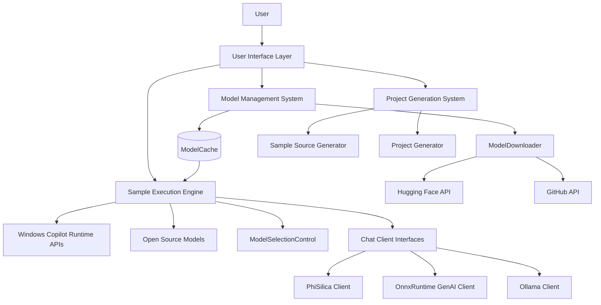

Title: AI Dev Gallery System Architecture

Sources: [AIDevGallery/MainWindow.xaml.cs:22-43](), [README.md:10-15]()

## Navigation System

The application uses a navigation-based UI structure managed by the `MainWindow` class, which handles routing between the different pages:

```mermaid
flowchart TD
    MainWindow["MainWindow"] --> NavView["NavigationView"]
    NavView --> HomePage["HomePage"]
    NavView --> ScenarioPage["ScenarioSelectionPage"]
    NavView --> ModelPage["ModelSelectionPage"]
    NavView --> APIPage["APISelectionPage"]
    NavView --> SettingsPage["SettingsPage"]
    
    MainWindow --> NavFrame["NavFrame"]
    NavView --> NavFrame
    
    ScenarioPage --> SampleContainer["SampleContainer"]
    ModelPage --> ModelSelection["ModelSelectionControl"]
    
    subgraph "Navigation Methods"
        Navigate["Navigate(string Tag, object obj)"]
        Navigate_Type["Navigate(Type page, object param)"]
        Navigate_MRU["Navigate(MostRecentlyUsedItem mru)"]
        Navigate_Sample["Navigate(Sample sample)"]
        Navigate_SearchResult["Navigate(SearchResult result)"]
    end
    
    MainWindow --> "Navigation Methods"
```

Title: Navigation System Flow

Sources: [AIDevGallery/MainWindow.xaml.cs:46-182](), [AIDevGallery/MainWindow.xaml:76-124]()

## Model Management System

The Model Management System is responsible for discovering, downloading, caching, and managing AI models from various sources:

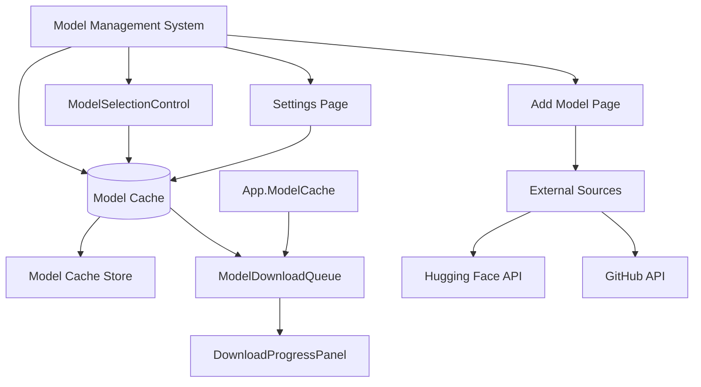

Title: Model Management System Components

Sources: [AIDevGallery/MainWindow.xaml.cs:27](), [AIDevGallery/MainWindow.xaml.cs:203-213](), [AIDevGallery/MainWindow.xaml:152-198]()

## Sample Execution Pipeline

The Sample Execution Engine allows users to run AI samples with different model types and configurations:

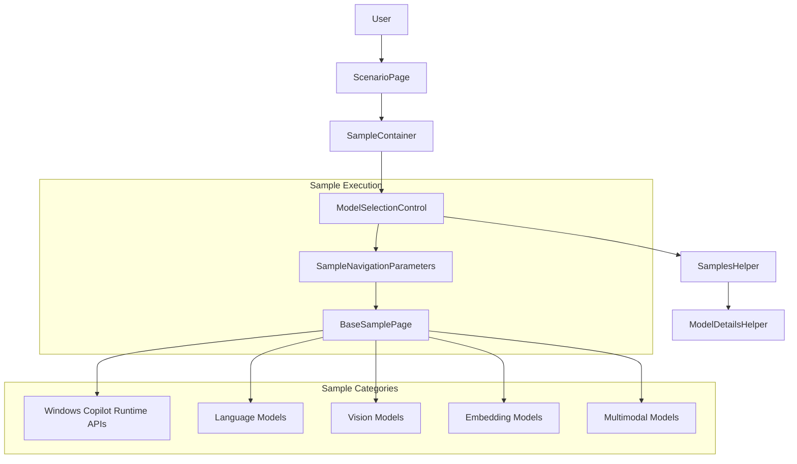

Title: Sample Execution Pipeline

Sources: [AIDevGallery/MainWindow.xaml.cs:35-42](), [AIDevGallery/MainWindow.xaml.cs:96-100](), [AIDevGallery/MainWindow.xaml.cs:123-127]()

## Project Generation System

The Project Generation System allows users to export samples as standalone Visual Studio projects, facilitating the integration of AI capabilities into their own applications:

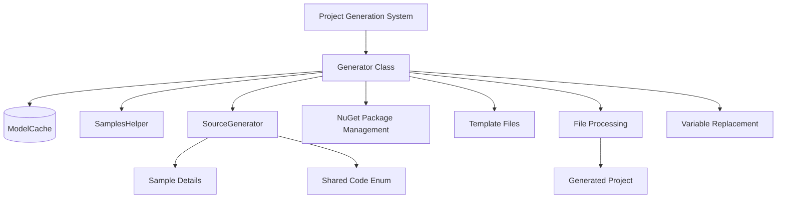

Title: Project Generation System

Sources: [README.md:14]()

## Windows Copilot Runtime API Integration

The AI Dev Gallery integrates with Windows Copilot Runtime APIs to provide various AI capabilities:

```mermaid
graph LR
    WCRAPIs["Windows Copilot Runtime APIs"]
    
    subgraph "Image Processing"
        ImageDescription["Image Description"]
        IncreaseFidelity["Increase Fidelity"]
        BackgroundRemover["Background Remover"]
        LiveImageDescription["Live Image Description"]
        TextRecognition["Text Recognition"]
    end
    
    subgraph "Text Generation"
        PhiSilicaBasic["PhiSilica Basic"]
    end
    
    WCRAPIs --> "Image Processing"
    WCRAPIs --> "Text Generation"
    
    ImageDescription --> ImageDescriptionGenerator["ImageDescriptionGenerator API"]
    IncreaseFidelity --> ImageScaler["ImageScaler API"]
    BackgroundRemover --> ImageObjectRemover["ImageObjectRemover API"]
    LiveImageDescription --> ImageDescriptionGenerator
    TextRecognition --> TextRecognizer["TextRecognizer API"]
    PhiSilica --> LanguageModel["Windows.AI.GenerativeLanguageModel"]
```

Title: Windows Copilot Runtime API Integration

Sources: [AIDevGallery/MainWindow.xaml.cs:103-104](), [README.md:48]()

## Hardware Acceleration

The AI Dev Gallery supports various hardware acceleration options to optimize model performance on different devices:

```mermaid
graph TD
    ModelExecution["Model Execution"]
    
    subgraph "Hardware Acceleration"
        CPU["CPU"]
        DML["DirectML/GPU"]
        QNN["QNN/NPU"]
        WCRAPI["Windows Copilot Runtime"]
    end
    
    ModelExecution --> "Hardware Acceleration"
    
    CPU --> ONNX["ONNX Runtime CPU EP"]
    DML --> ONNX_DML["ONNX Runtime DirectML EP"]
    QNN --> ONNX_QNN["ONNX Runtime QNN EP"]
    WCRAPI --> WindowsAPIs["Native Windows AI APIs"]
```

Title: Hardware Acceleration Options

Sources: [README.md:48](), [README.md:56-60]()

## User Interface Components

The AI Dev Gallery employs several key UI components to provide a consistent user experience:

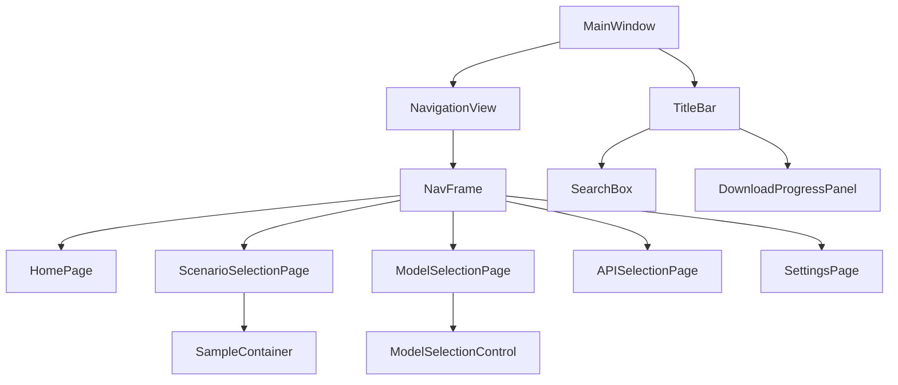

Title: Main UI Components

Sources: [AIDevGallery/MainWindow.xaml:22-200](), [AIDevGallery/MainWindow.xaml.cs:22-265]()

## System Requirements

The AI Dev Gallery has the following system requirements:

| Component | Requirement |
|-----------|-------------|
| OS | Windows 10 version 1809 (10.0; Build 17763) or newer |
| Architecture | x64, ARM64 |
| Memory | At least 16 GB recommended |
| Disk space | At least 20GB free space recommended |
| GPU | 8GB of VRAM recommended for GPU acceleration |

Sources: [README.md:55-60]()

## Core Classes and Their Relationships

The following diagram illustrates the relationships between key classes in the AI Dev Gallery:

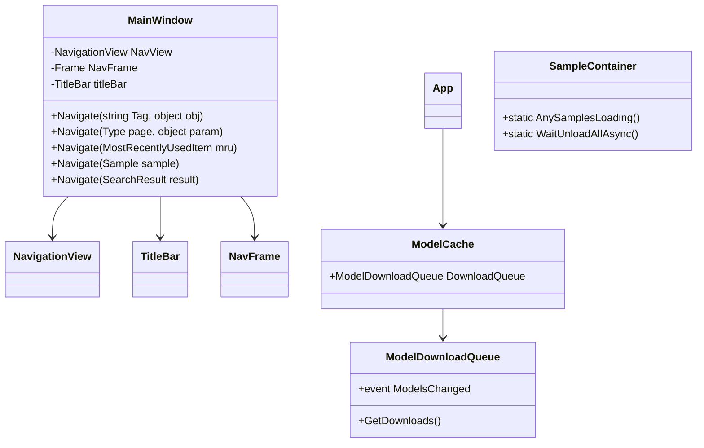

Title: Core Classes and Relationships

Sources: [AIDevGallery/MainWindow.xaml.cs:21-265]()

## Development Environment Setup

To build and run the AI Dev Gallery, the following components are required:

1. Visual Studio 2022 or later
2. Windows 10 or newer
3. Windows application development workload installed in Visual Studio

For ARM64-based Copilot+ PCs, the solution must be built and run as `ARM64` (not as `x64`), especially when running samples that invoke the Windows Copilot Runtime.

Sources: [README.md:30-49]()

## Conclusion

The AI Dev Gallery provides a comprehensive platform for developers to explore AI capabilities, experiment with different models, and integrate AI functionality into their applications. Its modular architecture enables clear separation of concerns between model management, sample execution, and project generation.

For more detailed information about specific subsystems, please refer to their respective documentation pages:

- For information about the Core Architecture, see [Core Architecture](#2)
- For details on the Model Management System, see [Model Management System](#3)
- For information about Windows Copilot Runtime APIs, see [Windows Copilot Runtime APIs](#4)
- For details on Open Source Models, see [Open Source Models](#5)
- For information about the Project Generation System, see [Project Generation System](#6)

Sources: [README.md:9-15](), [README.md:61-64]()

---

# Page: Core Architecture

# Core Architecture

<details>
<summary>Relevant source files</summary>

The following files were used as context for generating this wiki page:

- [AIDevGallery.SourceGenerator/SamplesSourceGenerator.cs](AIDevGallery.SourceGenerator/SamplesSourceGenerator.cs)
- [AIDevGallery.Utils/SamplesConstants.cs](AIDevGallery.Utils/SamplesConstants.cs)
- [AIDevGallery/AIDevGallery.csproj](AIDevGallery/AIDevGallery.csproj)
- [AIDevGallery/Controls/ModelSelectionControl.xaml.cs](AIDevGallery/Controls/ModelSelectionControl.xaml.cs)
- [AIDevGallery/Helpers/ModelDetailsHelper.cs](AIDevGallery/Helpers/ModelDetailsHelper.cs)
- [AIDevGallery/Helpers/SamplesHelper.cs](AIDevGallery/Helpers/SamplesHelper.cs)
- [AIDevGallery/MainWindow.xaml](AIDevGallery/MainWindow.xaml)
- [AIDevGallery/MainWindow.xaml.cs](AIDevGallery/MainWindow.xaml.cs)
- [AIDevGallery/Models/BaseSampleNavigationParameters.cs](AIDevGallery/Models/BaseSampleNavigationParameters.cs)
- [AIDevGallery/Pages/Scenarios/ScenarioPage.xaml.cs](AIDevGallery/Pages/Scenarios/ScenarioPage.xaml.cs)
- [AIDevGallery/ProjectGenerator/Generator.cs](AIDevGallery/ProjectGenerator/Generator.cs)
- [Directory.Packages.props](Directory.Packages.props)

</details>


This document describes the overall architecture of the AI Dev Gallery application, explaining how its major components interact to provide an integrated environment for exploring AI models, running samples, and generating standalone projects. It serves as a foundational overview of the system's structure and design patterns.

For details about how to navigate through the application UI, see [Navigation System](#2.1). For a deeper dive into samples and scenarios implementation, see [Samples and Scenarios Framework](#2.2).

## System Overview

The AI Dev Gallery follows a modular architecture with three primary systems working together:

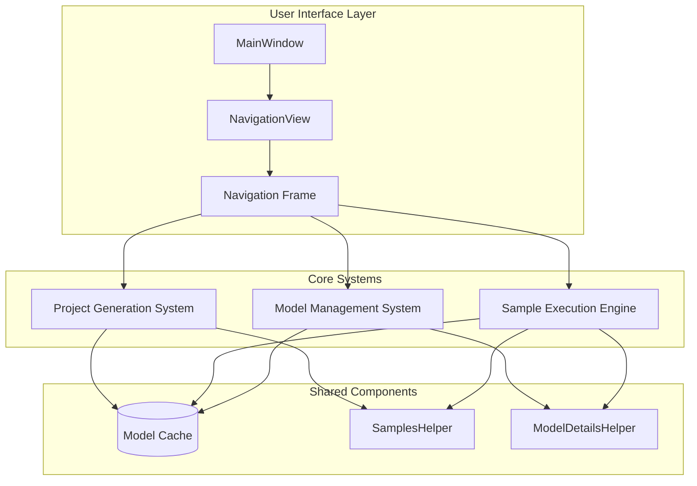

The architecture consists of:

1. **User Interface Layer**: Provides navigation and content presentation
2. **Core Systems**: Handles model management, sample execution, and project generation
3. **Shared Components**: Facilitates data sharing and common functionality across systems

Sources: [MainWindow.xaml.cs:21-265](), [AIDevGallery.csproj:1-328]()

## Application Navigation Structure

The application uses a hub-and-spoke navigation model centered around a main window with a navigation frame:

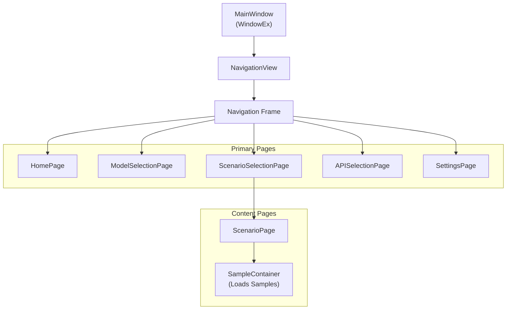

The `MainWindow` class serves as the application shell, containing a `NavigationView` for main menu navigation and a frame for page content. The navigation structure is defined in [MainWindow.xaml:70-124]() and implemented in [MainWindow.xaml.cs:82-147]().

Key navigation elements:
- **Home**: Main landing page with featured samples
- **Samples**: Organized by scenarios (e.g., chat, image classification)
- **Models**: Browse available models by type
- **WCR APIs**: Windows Copilot Runtime API samples
- **Settings**: Application configuration

Sources: [MainWindow.xaml:1-202](), [MainWindow.xaml.cs:21-265]()

## Model Management Architecture

The Model Management System handles discovery, download, and selection of AI models:

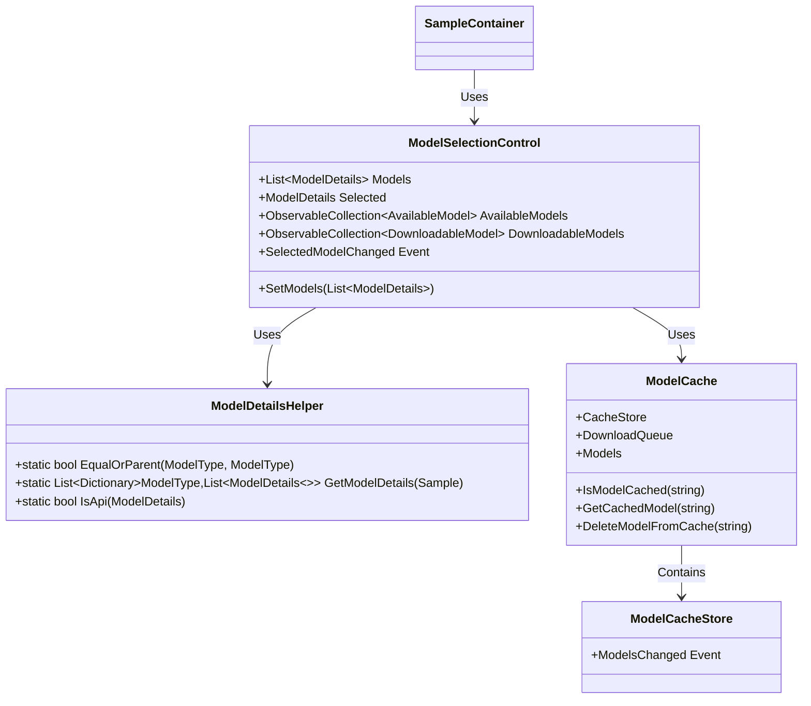

The Model Management System provides:

1. **Model Discovery**: Finding models from Hugging Face, GitHub, and local sources
2. **Model Download**: Managing the download queue and progress
3. **Model Caching**: Storing downloaded models for offline use
4. **Model Selection**: Choosing appropriate models for samples

The `ModelSelectionControl` [Controls/ModelSelectionControl.xaml.cs]() is a key UI component that displays available models, handles downloads, and enables model selection. It works with `ModelDetailsHelper` [Helpers/ModelDetailsHelper.cs]() to determine model compatibility and categorization.

Sources: [Controls/ModelSelectionControl.xaml.cs:21-598](), [Helpers/ModelDetailsHelper.cs:1-175]()

## Sample Execution Pipeline

The Sample Execution Engine loads and runs samples with selected models:

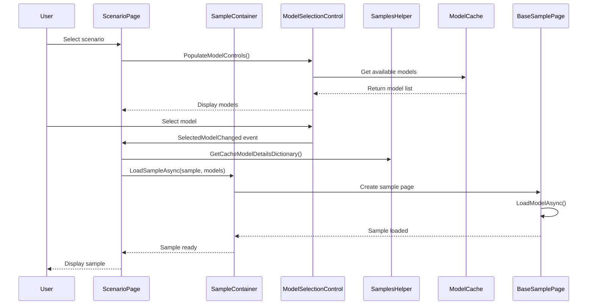

The sample execution flow involves:

1. **Scenario Selection**: User selects a scenario category
2. **Model Selection**: User chooses compatible models
3. **Sample Loading**: The selected sample is loaded with the chosen models
4. **Execution**: The sample runs using the selected models

The `ScenarioPage` [Pages/Scenarios/ScenarioPage.xaml.cs]() orchestrates this flow, using `SampleContainer` to host the running sample and `ModelSelectionControl` for model selection.

Sources: [Pages/Scenarios/ScenarioPage.xaml.cs:1-411](), [Models/BaseSampleNavigationParameters.cs:1-47](), [Helpers/SamplesHelper.cs:1-343]()

## Project Generation System

The Project Generation System exports samples as standalone Visual Studio projects:

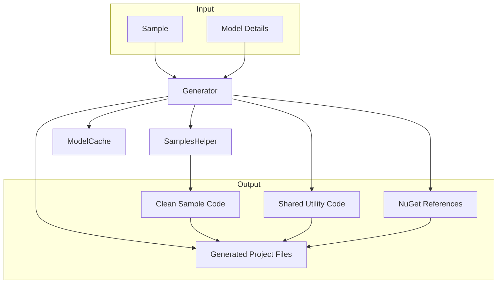

The Project Generation System:

1. **Sample Code Export**: Extracts and cleans sample code
2. **Project Structure Creation**: Generates project files and folder structure
3. **Model Management**: Optionally copies model files locally
4. **Dependency Management**: Adds appropriate NuGet packages

The main component is the `Generator` class [ProjectGenerator/Generator.cs](), which processes samples and creates standalone projects. It uses `SamplesHelper` to clean up sample code and determine required dependencies.

Key methods:
- `GenerateAsync()`: Main method that generates the project
- `AddFilesFromSampleAsync()`: Adds sample code files to the project
- `GetCleanCSCode()`: Cleans sample code for standalone use

Sources: [ProjectGenerator/Generator.cs:1-432](), [Helpers/SamplesHelper.cs:197-269]()

## Source Generation System

The AI Dev Gallery employs compile-time source generation to incorporate sample code into the application:

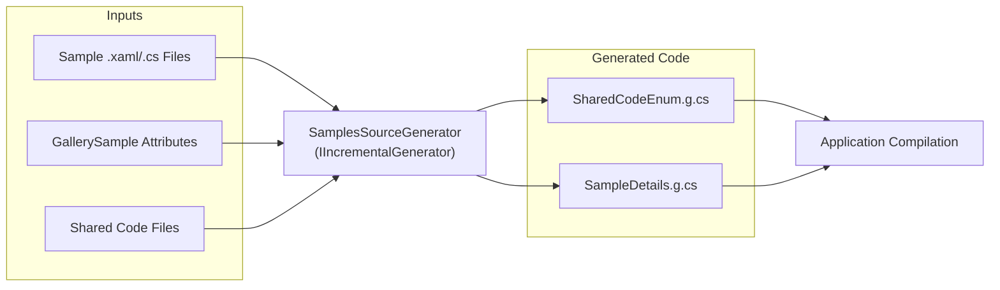

The Source Generation System:

1. **Sample Discovery**: Finds samples marked with `GallerySampleAttribute`
2. **Code Extraction**: Extracts and processes XAML and C# code
3. **Enum Generation**: Creates enums for shared code components
4. **Sample Registry**: Generates a registry of all available samples

The `SamplesSourceGenerator` [AIDevGallery.SourceGenerator/SamplesSourceGenerator.cs]() handles this process during compilation. It generates two key files:
- `SharedCodeEnum.g.cs`: Enumerates shared code components
- `SampleDetails.g.cs`: Contains all sample definitions with their code

This approach allows sample code to be both displayed in the application and exported to standalone projects.

Sources: [AIDevGallery.SourceGenerator/SamplesSourceGenerator.cs:1-552](), [AIDevGallery.Utils/SamplesConstants.cs:1-15]()

## Cross-Cutting Concerns

Several components work across systems to provide essential functionality:

### Hardware Acceleration Management

The application supports multiple hardware acceleration options:

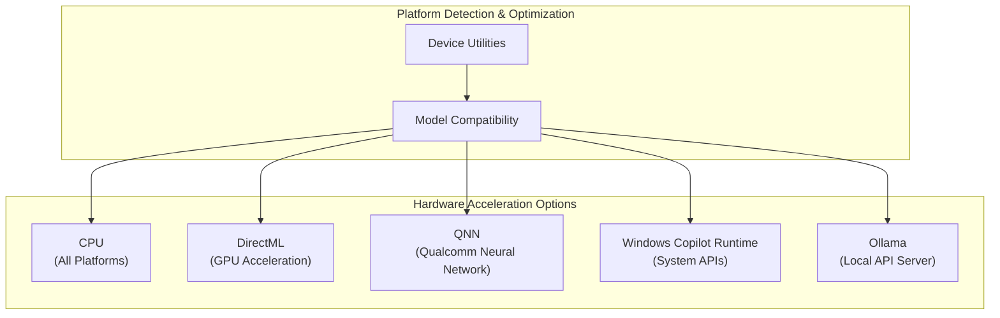

The system automatically selects the appropriate hardware acceleration based on device capabilities and model requirements. Platform-specific packages are included conditionally in the project file:

- For ARM64: QNN acceleration [AIDevGallery.csproj:92-95]()
- For x64: DirectML acceleration [AIDevGallery.csproj:97-100]()

### NuGet Package Management

The application manages NuGet dependencies for both the core application and generated projects:

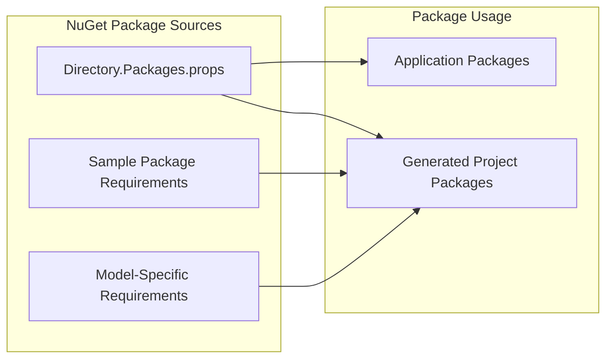

Package versions are centrally managed in [Directory.Packages.props]() and referenced by:
1. The main application [AIDevGallery.csproj]()
2. The project generator when creating standalone projects [ProjectGenerator/Generator.cs:291-308]()

Sources: [Directory.Packages.props:1-59](), [AIDevGallery.csproj:52-100](), [ProjectGenerator/Generator.cs:291-309]()

## Architectural Patterns

The AI Dev Gallery employs several architectural patterns:

### MVVM Pattern

The application uses the MVVM (Model-View-ViewModel) pattern in many areas:
- Models: Data structures like `ModelDetails` and `Sample`
- Views: XAML pages and controls like `ScenarioPage` and `ModelSelectionControl`
- ViewModels: Classes that expose data and commands to views

### Modular Design

The codebase is organized into modules with clear responsibilities:
- **Model Management**: Handles model discovery, download, and caching
- **Sample Execution**: Manages sample loading and execution
- **Project Generation**: Creates standalone projects from samples

### Source Generation

The application leverages compile-time source generation to:
- Embed sample code in the application
- Generate enums and registries of available samples
- Support both in-app execution and project export

This architecture provides a flexible, maintainable system for exploring AI models, running samples, and learning through code generation.

Sources: [AIDevGallery.csproj:1-328](), [ProjectGenerator/Generator.cs:1-432](), [AIDevGallery.SourceGenerator/SamplesSourceGenerator.cs:1-552]()

---

# Page: Navigation System

# Navigation System

<details>
<summary>Relevant source files</summary>

The following files were used as context for generating this wiki page:

- [AIDevGallery/Controls/Card.xaml](AIDevGallery/Controls/Card.xaml)
- [AIDevGallery/MainWindow.xaml](AIDevGallery/MainWindow.xaml)
- [AIDevGallery/MainWindow.xaml.cs](AIDevGallery/MainWindow.xaml.cs)
- [AIDevGallery/Pages/APIs/APIPage.xaml](AIDevGallery/Pages/APIs/APIPage.xaml)
- [AIDevGallery/Pages/APIs/APIPage.xaml.cs](AIDevGallery/Pages/APIs/APIPage.xaml.cs)
- [AIDevGallery/Pages/Models/ModelPage.xaml](AIDevGallery/Pages/Models/ModelPage.xaml)

</details>


The Navigation System in the AI Dev Gallery provides the core infrastructure for users to navigate between different sections of the application. This document details the architecture, components, and implementation patterns that enable navigation throughout the application.

For information about the Sample and Scenario framework that provides the content for many of these pages, see [Samples and Scenarios Framework](#2.2).

## Navigation Architecture

The AI Dev Gallery uses a hub-and-spoke navigation model where users navigate from a central menu to specialized pages. The system is built on Windows App SDK navigation components, primarily using NavigationView and Frame controls.

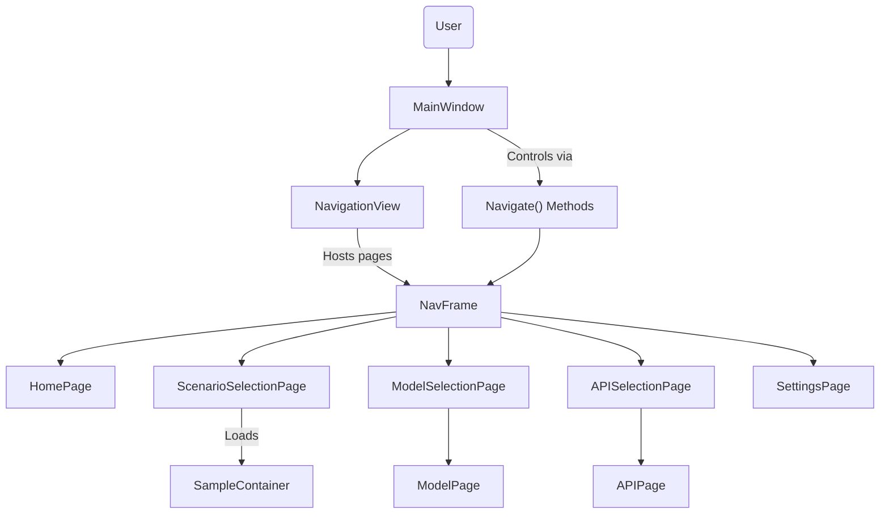

Sources: [AIDevGallery/MainWindow.xaml.cs:46-165](), [AIDevGallery/MainWindow.xaml:76-124]()

## Main Window Structure

The `MainWindow` class serves as the container for the application's UI and controls navigation between pages. It inherits from `WindowEx` (from WinUIEx library) and implements a custom title bar along with the main navigation framework.

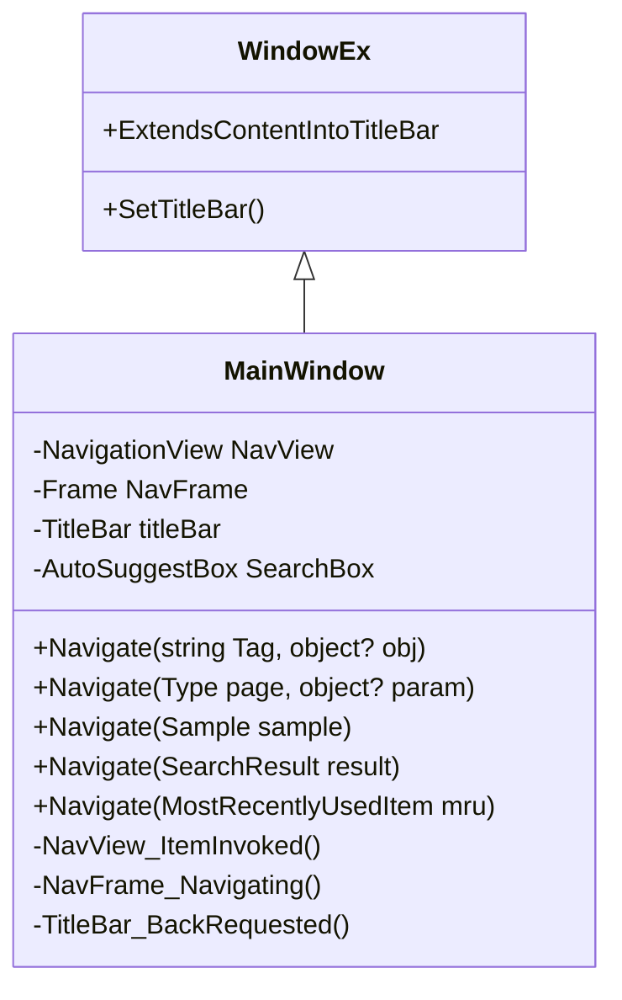

The MainWindow contains:

1. **NavigationView (NavView)**: Provides the main navigation menu with items for Home, Samples, Models, WCR APIs, and settings
2. **Frame (NavFrame)**: Hosts the current page content
3. **TitleBar**: Custom title bar with back button, search functionality, and download progress indicators

Sources: [AIDevGallery/MainWindow.xaml:76-124](), [AIDevGallery/MainWindow.xaml.cs:21-33]()

## Main Navigation Menu Structure

The NavigationView control provides the primary navigation menu for the application:

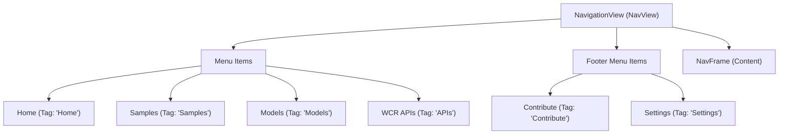

When a navigation item is selected, the `NavView_ItemInvoked` event handler retrieves the `Tag` property from the selected item and calls the appropriate `Navigate` method.

Sources: [AIDevGallery/MainWindow.xaml:76-124](), [AIDevGallery/MainWindow.xaml.cs:82-85]()

## Navigation Methods

The `MainWindow` class provides several navigation methods that handle different scenarios:

| Method | Description |
|--------|-------------|
| `NavigateToPage(object? obj)` | Entry point for navigating from an object (Model, Scenario, etc.) |
| `Navigate(string Tag, object? obj)` | Navigates based on a tag string with optional object parameter |
| `Navigate(Type page, object? param)` | Directly navigates to a specified page type with optional parameter |
| `Navigate(MostRecentlyUsedItem mru)` | Navigates to a recently used item |
| `Navigate(Sample sample)` | Navigates to a specific sample |
| `Navigate(SearchResult result)` | Navigates to a search result |

The diagram below shows the relationship between these methods:

```mermaid
graph TD
    NavMethodRoot["Navigation Methods"] --> NavigateToPage["NavigateToPage(object? obj)"]
    NavMethodRoot --> NavigateString["Navigate(string Tag, object?)"]
    NavMethodRoot --> NavigateType["Navigate(Type page, object?)"]
    NavMethodRoot --> NavigateMRU["Navigate(MostRecentlyUsedItem)"]
    NavMethodRoot --> NavigateSample["Navigate(Sample)"]
    NavMethodRoot --> NavigateSearch["Navigate(SearchResult)"]
    
    NavigateToPage -- "Model/Scenario routing" --> NavigateToApiOrModelPage["NavigateToApiOrModelPage(ModelType)"]
    NavigateString -- "Dispatches to" --> NavigateType
    NavigateToPage -- "Calls" --> NavigateString
    
    NavigateMRU -- "Calls" --> NavigateString
    NavigateSample -- "Calls" --> NavigateString
    NavigateSearch -- "Calls" --> NavigateString
```

Sources: [AIDevGallery/MainWindow.xaml.cs:46-182]()

## Page Routing Logic

The navigation system uses string tags to map to specific page types. The core routing logic is implemented in the `Navigate(string Tag, object? obj)` method:

| Tag | Destination | Description |
|-----|-------------|-------------|
| "home" | HomePage | Main landing page with featured content |
| "samples" | ScenarioSelectionPage | Browse and run samples |
| "models" | ModelSelectionPage | Browse and manage models |
| "apis" | APISelectionPage | Explore Windows Copilot Runtime APIs |
| "settings" | SettingsPage | Application settings |
| "contribute" | (External URL) | Opens the GitHub repository |

The `Navigate(Type page, object? param)` method handles the actual navigation to the target page, with special logic for navigating within existing pages (such as to specific API sections within the APISelectionPage).

Sources: [AIDevGallery/MainWindow.xaml.cs:87-112](), [AIDevGallery/MainWindow.xaml.cs:114-153]()

## Search Functionality

The navigation system integrates with the search functionality through the `SearchBox_TextChanged` and `SearchBox_QuerySubmitted` methods:

1. As the user types in the search box, the application filters the global search index
2. When the user selects a search result, the application navigates to the appropriate page using the `Navigate(SearchResult)` method

```mermaid
sequenceDiagram
    participant User
    participant SearchBox as "SearchBox (AutoSuggestBox)"
    participant MainWindow
    participant SearchIndex as "App.SearchIndex"
    participant NavFrame

    User->>SearchBox: Types search query
    SearchBox->>MainWindow: SearchBox_TextChanged()
    MainWindow->>SearchIndex: Filter results
    SearchIndex-->>MainWindow: Return filtered results
    MainWindow-->>SearchBox: Update suggestions

    User->>SearchBox: Selects result
    SearchBox->>MainWindow: SearchBox_QuerySubmitted()
    MainWindow->>MainWindow: Navigate(result)
    MainWindow->>NavFrame: Navigate to target page
    NavFrame-->>User: Display target content
```

Sources: [AIDevGallery/MainWindow.xaml:138-149](), [AIDevGallery/MainWindow.xaml.cs:215-232]()

## Back Navigation

The application supports back navigation through:

1. A back button in the TitleBar that's visible when the frame can go back 
2. The `TitleBar_BackRequested` event handler that navigates back when the back button is clicked

The visibility of the back button is bound to the `NavFrame.CanGoBack` property:

```
IsBackButtonVisible="{x:Bind NavFrame.CanGoBack, Mode=OneWay}"
```

Sources: [AIDevGallery/MainWindow.xaml:130](), [AIDevGallery/MainWindow.xaml.cs:258-264]()

## Responsive Navigation

The navigation system uses Visual States to adapt the layout for different screen sizes. The two main layout states are:

1. **WideLayout**: Used for screens 1200px and wider with a two-column layout
2. **NarrowLayout**: Used for screens narrower than 1200px with a stacked layout

```mermaid
graph TD
    VisualStates["VisualStateGroup: LayoutVisualStates"] --> WideLayout["WideLayout (>=1200px)"]
    VisualStates --> NarrowLayout["NarrowLayout (<1200px)"]
    
    WideLayout --> TwoColumnLayout["Two-column layout"]
    NarrowLayout --> SingleColumnLayout["Single-column stacked layout"]
    
    WideLayout -- "Has" --> SideColumn["SideColumn: 380px/320px"]
    NarrowLayout -- "Changes to" --> SideColumnAuto["SideColumn: Auto width"]
    NarrowLayout -- "Moves" --> ContentElements["Content elements to single column"]
```

Both the `APIPage` and `ModelPage` implement these responsive layouts to reorganize their content based on available screen space.

Sources: [AIDevGallery/Pages/Models/ModelPage.xaml:207-230](), [AIDevGallery/Pages/APIs/APIPage.xaml:218-240]()

## Deep Linking

The application supports deep linking through URL schemes that enable sharing links to specific content:

```mermaid
graph TD
    DeepLink["Deep Linking"] --> URLScheme["aidevgallery:// URL Scheme"]
    URLScheme --> ModelLink["aidevgallery://models/{modelId}"]
    URLScheme --> ApiLink["aidevgallery://apis/{apiId}"]
    URLScheme --> SampleLink["aidevgallery://samples/{sampleId}"]
    
    CopyButton["Copy Button"] -- "Copies to clipboard" --> URLString["URL String"]
    URLString -- "Contains" --> URLScheme
```

When a user clicks the copy button on a page (such as the `APIPage`), the application builds the appropriate URL and copies it to the clipboard:

```csharp
dataPackage.SetText($"aidevgallery://apis/{ModelFamily.Id}");
```

Sources: [AIDevGallery/Pages/APIs/APIPage.xaml:47-56](), [AIDevGallery/Pages/APIs/APIPage.xaml.cs:163-173]()

## Component Structure

The navigation pages use a common set of UI components to maintain consistency:

1. **Card**: A reusable control that provides a standardized container for content sections
2. **TitleBar**: Custom title bar with back navigation and search functionality
3. **SampleContainer**: Specialized container for displaying sample content

```mermaid
graph TD
    NavFrame["NavFrame"] --> Pages["Content Pages"]
    Pages --> APIPage["APIPage"]
    Pages --> ModelPage["ModelPage"]
    Pages --> ScenarioPage["ScenarioSelectionPage"]
    
    subgraph "Common Components"
        Card["Card Control"]
        TitleBar["TitleBar Control"]
        SampleContainer["SampleContainer Control"]
    end
    
    APIPage --> Card
    ModelPage --> Card
    MainWindow --> TitleBar
    APIPage --> SampleContainer
```

Sources: [AIDevGallery/Controls/Card.xaml:1-92](), [AIDevGallery/MainWindow.xaml:125-200](), [AIDevGallery/Pages/APIs/APIPage.xaml:96-100]()

## Navigation Flow Example

The following sequence diagram illustrates a typical navigation flow when a user selects an item from the main navigation menu:

```mermaid
sequenceDiagram
    participant User
    participant NavView as "NavigationView"
    participant MainWindow
    participant NavFrame
    participant TargetPage as "Target Page"

    User->>NavView: Selects Menu Item
    NavView->>MainWindow: NavView_ItemInvoked()
    MainWindow->>MainWindow: Navigate(Tag)
    MainWindow->>NavFrame: Navigate(pageType, param)
    NavFrame->>TargetPage: Create & Initialize
    NavFrame->>TargetPage: OnNavigatedTo(param)
    TargetPage-->>User: Display content
    
    Note over NavFrame, TargetPage: Frame navigates to target page<br/>and passes parameters
```

Sources: [AIDevGallery/MainWindow.xaml.cs:82-85](), [AIDevGallery/MainWindow.xaml.cs:87-112](), [AIDevGallery/MainWindow.xaml.cs:114-153]()

---

# Page: Samples and Scenarios Framework

# Samples and Scenarios Framework

<details>
<summary>Relevant source files</summary>

The following files were used as context for generating this wiki page:

- [AIDevGallery/Controls/ModelSelectionControl.xaml.cs](AIDevGallery/Controls/ModelSelectionControl.xaml.cs)
- [AIDevGallery/Helpers/ModelDetailsHelper.cs](AIDevGallery/Helpers/ModelDetailsHelper.cs)
- [AIDevGallery/Helpers/SamplesHelper.cs](AIDevGallery/Helpers/SamplesHelper.cs)
- [AIDevGallery/Models/BaseSampleNavigationParameters.cs](AIDevGallery/Models/BaseSampleNavigationParameters.cs)
- [AIDevGallery/Pages/Scenarios/ScenarioPage.xaml.cs](AIDevGallery/Pages/Scenarios/ScenarioPage.xaml.cs)
- [AIDevGallery/Samples/Definitions/WcrApis/apis.json](AIDevGallery/Samples/Definitions/WcrApis/apis.json)
- [AIDevGallery/Samples/scenarios.json](AIDevGallery/Samples/scenarios.json)

</details>


## Purpose and Scope

The Samples and Scenarios Framework provides the structure for defining, organizing, and presenting AI samples within the AI Dev Gallery application. This framework bridges the conceptual organization of AI capabilities (scenarios) with their concrete implementations (samples), enabling users to explore and interact with various AI models and technologies.

This page documents how scenarios are structured in the configuration files, how samples are associated with scenarios, and how the application presents these components to users. For information about the navigation system that controls movement between these components, see [Navigation System](#2.1).

Sources:
- [AIDevGallery/Samples/scenarios.json:1-217]()

## Framework Overview

The AI Dev Gallery organizes its content in a hierarchical structure:

1. **Categories** - High-level groupings of related AI capabilities (Text, Image, etc.)
2. **Scenarios** - Specific AI tasks or use cases within a category (Text Generation, Image Description, etc.)
3. **Samples** - Concrete implementations of scenarios that users can run and explore

This hierarchy provides a logical organization of samples that helps users discover relevant AI capabilities based on their needs or interests.

```mermaid
graph TD
    User["User"] --> Categories["Scenario Categories"]
    Categories --> Scenarios["Scenarios"]
    Scenarios --> Samples["Samples"]
    Samples --> ModelSelection["Model Selection"]
    ModelSelection --> Execution["Sample Execution"]
    
    subgraph "User Interface Layer"
        Categories
        Scenarios
        Samples
        ModelSelection
    end
    
    subgraph "Execution Layer"
        Execution
        Models["AI Models"]
        Execution --> Models
    end
```

**Diagram: Samples and Scenarios Framework Structure**

Sources:
- [AIDevGallery/Samples/scenarios.json:1-217]()
- [AIDevGallery/Pages/Scenarios/ScenarioPage.xaml.cs:1-411]()

## Scenario Configuration

Scenarios are defined in a hierarchical JSON structure in the `scenarios.json` file. The file organizes scenarios into categories, with each category containing multiple scenarios.

### Categories Structure

Each category in the scenarios.json file has the following properties:

| Property | Purpose |
|----------|---------|
| Name | Display name of the category |
| Icon | Glyph icon code for visual representation |
| Description | Brief explanation of the category's purpose |
| Scenarios | Collection of scenarios within this category |

### Scenario Structure

Each scenario within a category has these properties:

| Property | Purpose |
|----------|---------|
| Name | Display name of the scenario |
| Description | Detailed explanation of what the scenario does |
| Id | Unique identifier used for routing and sample association |
| Icon | Optional glyph icon code for visual representation |

```mermaid
classDiagram
    class ScenarioCategory {
        String Name
        String Icon
        String Description
        Dictionary~String, Scenario~ Scenarios
    }
    
    class Scenario {
        String Name
        String Description
        String Id
        String Icon
    }
    
    ScenarioCategory "1" --> "*" Scenario : contains
```

**Diagram: Scenario Configuration Class Structure**

Sources:
- [AIDevGallery/Samples/scenarios.json:1-217]()

### Example Category: Text

The Text category contains scenarios related to text processing and generation:

```
Text Category
├── Generate Text
├── Summarize Text
├── Chat
├── Semantic Kernel Chat
├── Translate Text
├── Grammar Check
├── Paraphrase Text
├── Analyze Text Sentiment
├── Custom Parameters
├── Content Moderation
├── Semantic Search
└── Retrieval Augmented Generation
```

Sources:
- [AIDevGallery/Samples/scenarios.json:2-76]()

## Sample Implementation

Samples are the concrete implementations of scenarios. A sample is associated with one or more model types and contains the code and UI for executing a specific AI task.

### Sample Properties

Key properties of the Sample class include:

| Property | Purpose |
|----------|---------|
| Name | Display name of the sample |
| Scenario | ScenarioType the sample implements |
| Model1Types | Primary model types this sample can use |
| Model2Types | Optional secondary model types for multi-model samples |
| CSCode | C# implementation code |
| SharedCode | References to shared code components needed by the sample |
| NugetPackageReferences | NuGet packages required by the sample |

```mermaid
classDiagram
    class Sample {
        String Name
        ScenarioType Scenario
        List~ModelType~ Model1Types
        List~ModelType~ Model2Types
        String CSCode
        List~SharedCodeEnum~ SharedCode
        List~String~ NugetPackageReferences
    }
    
    class ScenarioType {
        <<enumeration>>
    }
    
    class ModelType {
        <<enumeration>>
    }
    
    class SharedCodeEnum {
        <<enumeration>>
    }
    
    Sample --> ScenarioType : implements
    Sample --> "1..*" ModelType : requires primary
    Sample --> "0..*" ModelType : optional secondary
    Sample --> "0..*" SharedCodeEnum : uses
```

**Diagram: Sample Class Structure**

Sources:
- [AIDevGallery/Helpers/SamplesHelper.cs:18-342]()

### Sample-Model Integration

Samples are not directly tied to specific models but rather to model types (e.g., LanguageModels, VisionModels). This allows samples to work with different models that implement the same capabilities. The `ModelDetailsHelper` class provides utilities for associating models with samples based on their capabilities.

```mermaid
graph TD
    Sample["Sample"] --> ModelTypes["Model Types"]
    ModelTypes --> ModelDetailsHelper["ModelDetailsHelper"]
    ModelDetailsHelper --> AvailableModels["Available Model Details"]
    ModelDetailsHelper --> UnavailableModels["Unavailable Model Details"]
    
    UserSelection["User Selection"] --> ModelSelectionControl["ModelSelectionControl"]
    ModelSelectionControl --> SelectedModel["Selected Model"]
    
    Sample --> SampleContainer["Sample Container"]
    SelectedModel --> SampleContainer
    SampleContainer --> SampleExecution["Sample Execution"]
```

**Diagram: Sample-Model Integration Flow**

Sources:
- [AIDevGallery/Helpers/ModelDetailsHelper.cs:14-174]()
- [AIDevGallery/Controls/ModelSelectionControl.xaml.cs:21-597]()

## User Interface and Presentation

The Samples and Scenarios Framework provides the UI components for presenting scenarios to users and allowing them to interact with samples.

### ScenarioPage

The `ScenarioPage` is the primary UI component for displaying scenarios and associated samples. It handles:

1. Loading scenario definitions
2. Presenting model selection options
3. Loading and executing samples
4. Providing code export functionality

### Navigation Flow

The navigation flow for scenarios and samples follows this pattern:

```mermaid
sequenceDiagram
    participant User
    participant ScenarioPage
    participant ModelSelectionControl
    participant SampleContainer
    
    User->>ScenarioPage: Selects scenario
    ScenarioPage->>ModelSelectionControl: Populates available models
    User->>ModelSelectionControl: Selects model
    ModelSelectionControl->>ScenarioPage: Model selected event
    ScenarioPage->>SampleContainer: Loads sample with selected model
    SampleContainer->>User: Displays interactive sample
    
    alt View Code
        User->>ScenarioPage: Toggles code view
        ScenarioPage->>SampleContainer: Shows/hides code
    end
    
    alt Export Sample
        User->>ScenarioPage: Exports sample
        ScenarioPage->>Generator: Generate project
        Generator->>User: Generated project ready
    end
```

**Diagram: Scenario Navigation Flow**

Sources:
- [AIDevGallery/Pages/Scenarios/ScenarioPage.xaml.cs:26-411]()

## Model Selection and Integration

The framework provides robust model selection capabilities through the `ModelSelectionControl` component, which allows users to:

1. View available (already downloaded) models
2. View downloadable models
3. Select models based on compatibility
4. Access model details and options

### Model Categories

Models are organized into three categories in the UI:

1. **Available Models** - Downloaded models compatible with the current sample
2. **Downloadable Models** - Compatible models that need to be downloaded
3. **Unavailable Models** - Models that are incompatible due to hardware or other constraints

### Multiple Model Support

Some samples require two different models to function (e.g., a language model and an embedding model). The framework supports this through the `Model1Types` and `Model2Types` properties of the Sample class, with corresponding UI elements for selecting both models.

```mermaid
graph TD
    ScenarioPage["ScenarioPage"] --> ModelDropDown1["Model Dropdown 1"]
    ScenarioPage --> ModelDropDown2["Model Dropdown 2 (optional)"]
    
    ModelDropDown1 --> ModelSelectionControl1["ModelSelectionControl"]
    ModelDropDown2 --> ModelSelectionControl2["ModelSelectionControl"]
    
    ModelSelectionControl1 --> AvailableModels1["Available Models"]
    ModelSelectionControl1 --> DownloadableModels1["Downloadable Models"]
    
    ModelSelectionControl2 --> AvailableModels2["Available Models"]
    ModelSelectionControl2 --> DownloadableModels2["Downloadable Models"]
    
    ModelSelectionControl1 --> SelectedModel1["Selected Model 1"]
    ModelSelectionControl2 --> SelectedModel2["Selected Model 2"]
    
    SelectedModel1 --> SampleContainer["SampleContainer"]
    SelectedModel2 --> SampleContainer
    
    SampleContainer --> SampleNavParams["SampleNavigationParameters"]
    SampleNavParams --> IChatClient["IChatClient (if needed)"]
```

**Diagram: Multiple Model Selection and Integration**

Sources:
- [AIDevGallery/Controls/ModelSelectionControl.xaml.cs:21-597]()
- [AIDevGallery/Pages/Scenarios/ScenarioPage.xaml.cs:140-245]()
- [AIDevGallery/Models/BaseSampleNavigationParameters.cs:13-47]()

## Sample Execution

When a user selects a scenario and compatible model(s), the application creates a `SampleNavigationParameters` object and passes it to the `SampleContainer` for execution. This object contains:

1. The selected model path(s)
2. Hardware acceleration options
3. Cancellation tokens for async operations
4. Methods for creating appropriate clients (e.g., `IChatClient`)

### Client Factory Pattern

For language model samples, the framework provides a factory pattern for creating appropriate clients based on the selected model:

```mermaid
graph TD
    SampleParams["SampleNavigationParameters"] --> GetIChatClientAsync["GetIChatClientAsync()"]
    
    GetIChatClientAsync --> IsPhiSilica{"Is PhiSilica?"}
    IsPhiSilica -->|Yes| PhiSilicaClient["PhiSilicaClient"]
    
    IsPhiSilica -->|No| IsOllama{"Is Ollama?"}
    IsOllama -->|Yes| OllamaClient["OllamaChatClient"]
    
    IsOllama -->|No| OnnxRuntimeClient["OnnxRuntimeGenAIChatClient"]
    
    PhiSilicaClient --> IChatClient["IChatClient"]
    OllamaClient --> IChatClient
    OnnxRuntimeClient --> IChatClient
```

**Diagram: Chat Client Factory Pattern**

Sources:
- [AIDevGallery/Models/BaseSampleNavigationParameters.cs:27-44]()
- [AIDevGallery/Helpers/SamplesHelper.cs:176-196]()

## Code Export and Project Generation

The framework provides functionality to export samples as standalone Visual Studio projects. This allows users to examine and modify the code outside the AI Dev Gallery application.

When a user chooses to export a sample, the framework:

1. Collects necessary model information
2. Transforms the sample code by replacing placeholders
3. Adds necessary NuGet package references
4. Generates a complete Visual Studio project

### Dependencies Resolution

The `SamplesHelper` class provides methods for determining all required dependencies:

- `GetAllSharedCode` - Identifies required shared code components
- `GetAllNugetPackageReferences` - Determines required NuGet packages
- `GetCleanCSCode` - Transforms sample code for standalone use

Sources:
- [AIDevGallery/Helpers/SamplesHelper.cs:18-196]()
- [AIDevGallery/Pages/Scenarios/ScenarioPage.xaml.cs:274-392]()

## Windows Copilot Runtime API Integration

The framework includes special handling for Windows Copilot Runtime (WCR) APIs, which are defined in a separate configuration file and have unique characteristics compared to downloadable models.

```mermaid
graph TD
    WCRAPIDefinition["WCR API Definition"] --> ModelDetailsHelper["ModelDetailsHelper"]
    ModelDetailsHelper --> ModelDetails["ModelDetails (API)"]
    ModelDetails --> ModelSelectionControl["ModelSelectionControl"]
    ModelDetails --> SampleContainer["SampleContainer"]
    
    subgraph "WCR APIs"
        PhiSilica["PhiSilica"]
        TextRecognition["Text Recognition (OCR)"]
        ImageScaler["Image Super Resolution"]
        BackgroundRemover["Image Segmentation"]
        ImageDescription["Image Description"]
    end
```

**Diagram: Windows Copilot Runtime API Integration**

Sources:
- [AIDevGallery/Samples/Definitions/WcrApis/apis.json:1-60]()
- [AIDevGallery/Helpers/ModelDetailsHelper.cs:33-47]()

## Summary

The Samples and Scenarios Framework provides a flexible and extensible system for organizing, presenting, and executing AI samples within the AI Dev Gallery. By separating the conceptual organization (scenarios) from the implementation details (samples) and providing a robust model selection mechanism, the framework enables users to explore a wide range of AI capabilities with different models and configurations.

---

# Page: Model Management System

# Model Management System

<details>
<summary>Relevant source files</summary>

The following files were used as context for generating this wiki page:

- [AIDevGallery.SourceGenerator/Models/AIToolkitAction.cs](AIDevGallery.SourceGenerator/Models/AIToolkitAction.cs)
- [AIDevGallery.SourceGenerator/Models/Model.cs](AIDevGallery.SourceGenerator/Models/Model.cs)
- [AIDevGallery.SourceGenerator/ModelsSourceGenerator.cs](AIDevGallery.SourceGenerator/ModelsSourceGenerator.cs)
- [AIDevGallery/Assets/AITKIcon.png](AIDevGallery/Assets/AITKIcon.png)
- [AIDevGallery/Controls/ModelSelectionControl.xaml](AIDevGallery/Controls/ModelSelectionControl.xaml)
- [AIDevGallery/Pages/Models/AddModelPage.xaml.cs](AIDevGallery/Pages/Models/AddModelPage.xaml.cs)
- [AIDevGallery/Pages/Models/ModelPage.xaml.cs](AIDevGallery/Pages/Models/ModelPage.xaml.cs)
- [AIDevGallery/Pages/SettingsPage.xaml](AIDevGallery/Pages/SettingsPage.xaml)
- [AIDevGallery/Pages/SettingsPage.xaml.cs](AIDevGallery/Pages/SettingsPage.xaml.cs)
- [AIDevGallery/Samples/Definitions/Models/multimodal.modelgroup.json](AIDevGallery/Samples/Definitions/Models/multimodal.modelgroup.json)
- [AIDevGallery/Telemetry/Events/AIToolkitActionClickedEvent.cs](AIDevGallery/Telemetry/Events/AIToolkitActionClickedEvent.cs)
- [AIDevGallery/Utils/AIToolkitHelper.cs](AIDevGallery/Utils/AIToolkitHelper.cs)
- [AIDevGallery/Utils/AppUtils.cs](AIDevGallery/Utils/AppUtils.cs)
- [AIDevGallery/Utils/ModelCache.cs](AIDevGallery/Utils/ModelCache.cs)
- [AIDevGallery/Utils/ModelCacheStore.cs](AIDevGallery/Utils/ModelCacheStore.cs)

</details>


The Model Management System is responsible for discovering, downloading, caching, and managing AI models within the AI Dev Gallery. It enables users to search for and add models from repositories like Hugging Face, maintain a local cache of downloaded models, and select appropriate models when running AI samples.

For information about how models are executed within samples, see the Samples and Scenarios Framework [2.2]. For details on specific model types supported by the application, see Open Source Models [5].

## Architecture Overview

The Model Management System bridges external model repositories with the Sample Execution Engine, ensuring that appropriate models are available when needed for running AI samples.

### System Components Diagram

```mermaid
graph TD
    User["User"]
    
    subgraph "Model Discovery"
        AddModelPage["AddModelPage"]
        HuggingFaceAPI["HuggingFaceAPI"]
        LocalModelAdd["Local Model Addition"]
    end
    
    subgraph "Model Management"
        ModelCache["ModelCache"]
        ModelCacheStore["ModelCacheStore"]
        DownloadQueue["ModelDownloadQueue"]
        LocalStorage["Local Cache Storage"]
    end
    
    subgraph "Model Viewing & Selection"
        ModelPage["ModelPage"]
        ModelSelectionControl["ModelSelectionControl"]
        SampleExecution["Sample Execution"]
    end
    
    subgraph "Settings Management"
        SettingsPage["SettingsPage"]
        CacheManagement["Cache Management"]
    end
    
    User --> AddModelPage
    User --> ModelPage
    User --> SettingsPage
    User --> SampleExecution
    
    AddModelPage --> HuggingFaceAPI
    AddModelPage --> ModelCache
    LocalModelAdd --> ModelCache
    
    ModelCache --> ModelCacheStore
    ModelCache --> DownloadQueue
    ModelCacheStore --> LocalStorage
    DownloadQueue --> ModelCacheStore
    
    ModelPage --> ModelSelectionControl
    SampleExecution --> ModelSelectionControl
    ModelSelectionControl --> ModelCache
    
    SettingsPage --> CacheManagement
    CacheManagement --> ModelCache
```

Sources: [AIDevGallery/Utils/ModelCache.cs:14-221](), [AIDevGallery/Utils/ModelCacheStore.cs:14-119](), [AIDevGallery/Pages/Models/AddModelPage.xaml.cs:26-501](), [AIDevGallery/Pages/Models/ModelPage.xaml.cs:22-333]()

### Key Components

1. **Model Discovery**:
   - `AddModelPage`: UI interface for searching and discovering models
   - `HuggingFaceAPI`: Integration with Hugging Face repository
   - Local model addition functionality

2. **Model Management**:
   - `ModelCache`: Core class that manages all aspects of downloaded models
   - `ModelCacheStore`: Maintains metadata about cached models
   - `ModelDownloadQueue`: Handles asynchronous model downloads

3. **Model Viewing & Selection**:
   - `ModelPage`: Displays detailed information about model families
   - `ModelSelectionControl`: Reusable UI component for model selection

4. **Settings Management**:
   - `SettingsPage`: User interface for configuring model cache settings

## Model Discovery and Download

The Model Discovery component allows users to find models through search or by adding local model files.

### Model Search and Download Process

```mermaid
sequenceDiagram
    participant User
    participant AddModelPage
    participant HuggingFaceAPI
    participant ModelCache
    participant ModelCacheStore
    
    User->>AddModelPage: Enter search query
    AddModelPage->>HuggingFaceAPI: Search(query)
    HuggingFaceAPI-->>AddModelPage: Return search results
    AddModelPage->>AddModelPage: Filter for compatible models
    AddModelPage-->>User: Display model results
    
    User->>AddModelPage: Click "Download" on model
    AddModelPage->>User: Show license agreement dialog
    User->>AddModelPage: Accept license agreement
    AddModelPage->>ModelCache: AddModelToDownloadQueue(modelDetails)
    ModelCache->>ModelCacheStore: Download and add to cache
    ModelCacheStore-->>AddModelPage: Update UI (model state changes)
    AddModelPage-->>User: Show download progress
```

Sources: [AIDevGallery/Pages/Models/AddModelPage.xaml.cs:43-242](), [AIDevGallery/Pages/Models/AddModelPage.xaml.cs:244-274](), [AIDevGallery/Utils/ModelCache.cs:68-83]()

### HuggingFace Integration

The search functionality calls the Hugging Face API to find models matching the user's query. The system filters the results to show only models with:

1. ONNX configuration files (`genai_config.json`)
2. Compatible hardware accelerator support
3. Appropriate licensing

For each search result, the system:
- Extracts model metadata (size, parameters, hardware support)
- Determines the appropriate prompt template based on model name
- Checks compatibility with the user's system
- Displays licensing information

Sources: [AIDevGallery/Pages/Models/AddModelPage.xaml.cs:82-221](), [AIDevGallery/Pages/Models/AddModelPage.xaml.cs:223-242]()

### Local Model Addition

Users can add local model folders through the "Add Local Model" functionality:

1. User selects a folder containing an ONNX model with a `genai_config.json` file
2. System validates the model configuration and extracts hardware acceleration info
3. User provides a name for the model
4. The model is added to the cache with a `local-file://` URL scheme
5. Model becomes available for use in samples

Sources: [AIDevGallery/Pages/Models/AddModelPage.xaml.cs:351-478]()

## Model Cache System

The Model Cache is responsible for storing downloaded models and their metadata for efficient reuse.

### Cache Architecture

```mermaid
classDiagram
    class ModelCache {
        +DownloadQueue: ModelDownloadQueue
        +CacheStore: ModelCacheStore
        +Models: IReadOnlyList~CachedModel~
        +CreateForApp(AppData): Task~ModelCache~
        +GetCacheFolder(): string
        +SetCacheFolderPath(string, List~CachedModel~): Task
        +AddModelToDownloadQueue(ModelDetails): ModelDownload
        +AddLocalModelToCache(ModelDetails, string, bool): Task~CachedModel~
        +GetCachedModel(string): CachedModel
        +IsModelCached(string): bool
        +DeleteModelFromCache(CachedModel): Task
        +ClearCache(): Task
        +MoveCache(string, CancellationToken): Task
    }
    
    class ModelCacheStore {
        +Models: IReadOnlyList~CachedModel~
        +CacheDir: string
        +CreateForApp(string, List~CachedModel~): Task~ModelCacheStore~
        +AddModel(CachedModel): Task
        +RemoveModel(CachedModel): Task
        +ClearAsync(): Task
    }
    
    class CachedModel {
        +Details: ModelDetails
        +Path: string
        +Url: string
        +IsFile: bool
        +ModelSize: long
    }
    
    ModelCache --> "1" ModelCacheStore : contains
    ModelCache --> "1" ModelDownloadQueue : contains
    ModelCacheStore --> "*" CachedModel : manages
```

Sources: [AIDevGallery/Utils/ModelCache.cs:14-221](), [AIDevGallery/Utils/ModelCacheStore.cs:14-119]()

### Cache Storage Structure

The Model Cache maintains two types of information:

1. **Physical files**: The actual model files stored in a configurable cache directory
2. **Metadata**: Information about cached models stored in a `cache.json` file

Each `CachedModel` contains:
- `Details`: Complete model metadata (name, description, hardware requirements)
- `Path`: File system path to the model
- `Url`: Original source URL of the model
- `IsFile`: Flag indicating if the model is a single file or directory
- `ModelSize`: Size of the model in bytes

Sources: [AIDevGallery/Utils/ModelCacheStore.cs:31-75]()

### Cache Management Operations

Users can manage the cache through the Settings page, which provides operations for:

- **Viewing cache contents**: List of all downloaded models with size information
- **Deleting individual models**: Remove specific models to free disk space
- **Clearing the entire cache**: Remove all downloaded models
- **Moving the cache**: Relocate the cache directory to a different location
- **Opening model folders**: Access model files directly

These operations are implemented in the `ModelCache` class and exposed through the Settings UI.

Sources: [AIDevGallery/Utils/ModelCache.cs:85-220](), [AIDevGallery/Pages/SettingsPage.xaml.cs:64-300](), [AIDevGallery/Pages/SettingsPage.xaml:40-106]()

## Model Selection

The `ModelSelectionControl` is a reusable component that displays available models and allows users to select them for use in samples.

### Model Selection Interface

```mermaid
graph TD
    subgraph "ModelSelectionControl"
        AvailableModels["Available Models Section"]
        DownloadableModels["Downloadable Models Section"]
        UnavailableModels["Unavailable Models Section"]
        
        ModelCard["Model Card" style="rounded"]
        HardwareIndicators["Hardware Accelerator Indicators"]
        OptionsMenu["Options Menu"]
        DownloadButton["Download Button"]
    end
    
    User["User"]
    
    SampleContainer["Sample Container"]
    ModelCache["ModelCache"]
    
    User --> ModelSelectionControl
    ModelSelectionControl -->|"Selected Model Changed"| SampleContainer
    ModelSelectionControl -->|"Query Available Models"| ModelCache
    ModelSelectionControl -->|"Download Model"| ModelCache
    OptionsMenu -->|"Delete/View Model"| ModelCache
```

Sources: [AIDevGallery/Controls/ModelSelectionControl.xaml:2-533](), [AIDevGallery/Pages/Models/ModelPage.xaml.cs:276-289]()

### Model Categories

The control organizes models into three categories:

1. **Available Models**: Models that are downloaded and ready to use
   - Display model name, size, hardware accelerators, and source
   - Provide options to view model card, open containing folder, or delete

2. **Downloadable Models**: Models that can be downloaded
   - Show download button with progress indicator during download
   - Display license information and hardware requirements

3. **Unavailable Models**: Models incompatible with the user's hardware
   - Shown in disabled state with compatibility information
   - Explain why the model can't be used (e.g., requires NPU on a system without one)

Sources: [AIDevGallery/Controls/ModelSelectionControl.xaml:32-246](), [AIDevGallery/Controls/ModelSelectionControl.xaml:247-419](), [AIDevGallery/Controls/ModelSelectionControl.xaml:420-443]()

### Hardware Acceleration Support

Models specify which hardware accelerators they support through the `HardwareAccelerators` property:

| Accelerator | Display Name | Description |
|-------------|--------------|-------------|
| CPU | CPU | Models optimized for CPU execution |
| DML | GPU | GPU acceleration using DirectML |
| QNN | NPU | Neural Processing Unit acceleration using Qualcomm Neural Network |
| WCRAPI | WCR | Models running through Windows Copilot Runtime APIs |
| OLLAMA | Ollama | Models running locally via Ollama |

The `ModelSelectionControl` displays appropriate indicators and provides tooltips explaining the hardware requirements for each model.

Sources: [AIDevGallery/Utils/AppUtils.cs:131-170](), [AIDevGallery/Controls/ModelSelectionControl.xaml:75-100]()

## AI Toolkit Integration

The Model Management System integrates with the Windows AI Toolkit, enabling users to use downloaded models in the toolkit for additional capabilities.

### AI Toolkit Integration Flow

```mermaid
graph TD
    ModelDetails["ModelDetails"]
    ModelPage["ModelPage"]
    AIToolkitHelper["AIToolkitHelper"]
    
    subgraph "AI Toolkit Actions"
        FineTuning["FineTuning"]
        PromptBuilder["PromptBuilder"]
        BulkRun["BulkRun"]
        Playground["Playground"]
    end
    
    ModelDetails -->|"defines supported actions"| AIToolkitActions["AIToolkitActions property"]
    AIToolkitActions --> FineTuning
    AIToolkitActions --> PromptBuilder
    AIToolkitActions --> BulkRun
    AIToolkitActions --> Playground
    
    ModelPage -->|"builds"| AIToolkitDropdown["AI Toolkit Dropdown"]
    AIToolkitDropdown -->|"invokes"| AIToolkitHelper
    AIToolkitHelper -->|"creates"| Deeplink["Toolkit Deeplink"]
    Deeplink -->|"launches"| WindowsAIToolkit["Windows AI Toolkit"]
    
    ModelDetails -->|"provides IDs"| AIToolkitHelper
```

Sources: [AIDevGallery/Utils/AIToolkitHelper.cs:10-100](), [AIDevGallery.SourceGenerator/Models/AIToolkitAction.cs:9-15](), [AIDevGallery/Pages/Models/ModelPage.xaml.cs:176-243]()

### AI Toolkit Actions

Models can support several AI Toolkit actions, defined in the `AIToolkitAction` enum:

- **FineTuning**: Customize models for specific tasks or domains
- **PromptBuilder**: Create and refine prompts for optimal model responses
- **BulkRun**: Process multiple inputs in batch mode
- **Playground**: Experiment with the model in an interactive environment

Each model specifies its supported actions through the `AIToolkitActions` property in its `ModelDetails`. The UI dynamically builds the AI Toolkit dropdown menu based on the supported actions.

Sources: [AIDevGallery/Utils/AIToolkitHelper.cs:10-94](), [AIDevGallery.SourceGenerator/Models/AIToolkitAction.cs:9-15](), [AIDevGallery/Pages/Models/ModelPage.xaml.cs:176-243]()

### Integration Implementation

When a user selects an AI Toolkit action:

1. `AIToolkitHelper.CreateAiToolkitDeeplink()` generates a deeplink URL
2. The system attempts to launch the Windows AI Toolkit with the deeplink
3. The deeplink includes the model ID and action information
4. Telemetry records the action for usage analysis

This integration expands the capabilities available to users beyond what's directly implemented in the AI Dev Gallery.

Sources: [AIDevGallery/Pages/Models/ModelPage.xaml.cs:244-273](), [AIDevGallery/Telemetry/Events/AIToolkitActionClickedEvent.cs:11-37]()

## Model Type System

The application uses a code generation approach to manage model types and metadata through the `ModelsSourceGenerator`.

### Model Type Hierarchy

```mermaid
graph TD
    subgraph "Code Generation"
        JSON["JSON Definition Files"]
        SourceGenerator["ModelsSourceGenerator"]
        GeneratedCode["Generated Code"]
    end
    
    subgraph "Model Type Hierarchy"
        ModelGroup["ModelGroup"]
        ModelFamily["ModelFamily"]
        ModelType["Individual Model"]
        
        ModelGroup -->|"contains"| ModelFamily
        ModelFamily -->|"contains"| ModelType
    end
    
    subgraph "Generated Classes"
        ModelTypeEnum["ModelType Enum"]
        ModelTypeHelpers["ModelTypeHelpers"]
        ModelDetails["ModelDetails Dictionary"]
        ParentMapping["Parent Mapping Dictionary"]
    end
    
    JSON --> SourceGenerator
    SourceGenerator --> GeneratedCode
    GeneratedCode --> ModelTypeEnum
    GeneratedCode --> ModelTypeHelpers
    ModelTypeHelpers --> ModelDetails
    ModelTypeHelpers --> ParentMapping
```

Sources: [AIDevGallery.SourceGenerator/ModelsSourceGenerator.cs:22-465](), [AIDevGallery.SourceGenerator/Models/Model.cs:9-30](), [AIDevGallery/Samples/Definitions/Models/multimodal.modelgroup.json:1-54]()

### Model Definition Structure

Models are defined in JSON files with a hierarchical structure:
- **Model Groups**: Top-level categories (e.g., "MultimodalModels", "LanguageModels")
- **Model Families**: Groups of related models (e.g., "Phi3Vision")
- **Individual Models**: Specific model variants (e.g., "Phi3VisionCPU")

Each model definition includes:
- Basic information (ID, name, description)
- Source URL and icon
- Size and parameter count
- Hardware accelerator requirements
- License information
- AI Toolkit integration details

Sources: [AIDevGallery/Samples/Definitions/Models/multimodal.modelgroup.json:1-54]()

### Code Generation Process

The `ModelsSourceGenerator` processes model definition files at compile time to generate:

1. A `ModelType` enum containing all model types in the hierarchy
2. A `ModelTypeHelpers` class with static dictionaries:
   - `ModelDetails`: Maps model types to their detailed information
   - `ModelFamilyDetails`: Maps model types to family information
   - `ParentMapping`: Establishes parent-child relationships

This approach allows adding new models by simply creating JSON definition files, without modifying the application code.

Sources: [AIDevGallery.SourceGenerator/ModelsSourceGenerator.cs:191-464]()

## Conclusion

The Model Management System provides a comprehensive solution for discovering, downloading, caching, and selecting AI models in the AI Dev Gallery. Its key strengths include:

1. **Flexible Discovery**: Support for finding models on Hugging Face and adding local models
2. **Efficient Caching**: Robust model caching with user-friendly management options
3. **Intuitive Selection**: Clear categorization of models based on availability and compatibility
4. **Hardware Awareness**: Intelligent filtering based on available hardware accelerators
5. **External Integration**: Seamless connection to the Windows AI Toolkit for extended capabilities

This system serves as a critical foundation for the application, enabling users to experiment with various AI models and integrate them into their own applications through the Project Generation system [6].

---

# Page: Model Discovery and Download

# Model Discovery and Download

<details>
<summary>Relevant source files</summary>

The following files were used as context for generating this wiki page:

- [AIDevGallery/Controls/ModelSelectionControl.xaml](AIDevGallery/Controls/ModelSelectionControl.xaml)
- [AIDevGallery/Models/HFSearchResults.cs](AIDevGallery/Models/HFSearchResults.cs)
- [AIDevGallery/Pages/Models/AddModelPage.xaml.cs](AIDevGallery/Pages/Models/AddModelPage.xaml.cs)
- [AIDevGallery/Pages/SettingsPage.xaml](AIDevGallery/Pages/SettingsPage.xaml)
- [AIDevGallery/Pages/SettingsPage.xaml.cs](AIDevGallery/Pages/SettingsPage.xaml.cs)
- [AIDevGallery/Samples/promptTemplates.json](AIDevGallery/Samples/promptTemplates.json)
- [AIDevGallery/Utils/AppUtils.cs](AIDevGallery/Utils/AppUtils.cs)
- [AIDevGallery/Utils/HuggingFaceApi.cs](AIDevGallery/Utils/HuggingFaceApi.cs)
- [AIDevGallery/Utils/LicenseInfo.cs](AIDevGallery/Utils/LicenseInfo.cs)
- [AIDevGallery/Utils/ModelCache.cs](AIDevGallery/Utils/ModelCache.cs)
- [AIDevGallery/Utils/ModelCacheStore.cs](AIDevGallery/Utils/ModelCacheStore.cs)

</details>


## Purpose and Overview

This document details the Model Discovery and Download system of the AI Dev Gallery, which enables users to search for, discover, and download AI models from external sources like Hugging Face. The system also allows users to add local models from their file system and provides comprehensive model management capabilities. For information about how downloaded models are cached and selected for use in samples, see [Model Cache and Selection](#3.2).

## Model Discovery Architecture

The model discovery system allows users to search for compatible AI models and add them to their local cache for use in AI Dev Gallery samples.

### Discovery Flow Diagram

```mermaid
flowchart TD
    User["User"] --> SearchBox["SearchTextBox"]
    SearchBox --> |"Search Term"| SearchAsync["SearchAsync()"]
    SearchAsync --> SearchModels["SearchModels()"]
    SearchModels --> |"API Call"| HFApi["HuggingFaceApi.FindModels()"]
    HFApi --> |"Search Results"| FilterResults["Filter for genai_config.json"]
    FilterResults --> ProcessResults["Process Results"]
    ProcessResults --> |"For each result"| GetConfig["GetContentsOfTextFile()"]
    GetConfig --> CheckHardware["GetHardwareAcceleratorFromConfig()"]
    CheckHardware --> CreateModelDetails["Create ModelDetails object"]
    CreateModelDetails --> UpdateUI["Update UI with results"]
    UpdateUI --> UserSelection["User selects model"]
    UserSelection --> DownloadButton["Download button clicked"]
    DownloadButton --> LicenseDialog["Show license dialog"]
    LicenseDialog --> |"User agrees"| AddToQueue["AddModelToDownloadQueue()"]
```

Sources:
- [AIDevGallery/Pages/Models/AddModelPage.xaml.cs:43-221]()
- [AIDevGallery/Utils/HuggingFaceApi.cs:27-59]()

### Hugging Face Integration

The system searches for models using the Hugging Face API and filters the results to include only models with a compatible configuration.

```mermaid
classDiagram
    class HuggingFaceApi {
        +FindModels(string query, string filter) : Task<List<HFSearchResult>>
        +GetContentsOfTextFile(string modelId, string filePath) : Task<string>
        +GetContentsOfTextFile(string fileUrl) : Task<string>
    }
    
    class AddModelPage {
        -SearchAsync() : Task
        -SearchModels(string query, CancellationToken) : Task
        -GetHardwareAcceleratorFromConfig(string configContents) : HardwareAccelerator
        -GetTemplateFromName(string name) : PromptTemplate
        -DownloadModelClicked(object sender, RoutedEventArgs e) : void
    }
    
    class HFSearchResult {
        +Id : string
        +Author : string
        +Tags : string[]
        +Siblings : Sibling[]
    }
    
    class Sibling {
        +RFilename : string
    }
    
    AddModelPage --> HuggingFaceApi : Uses
    HuggingFaceApi --> HFSearchResult : Returns
    HFSearchResult --> Sibling : Contains
```

Sources:
- [AIDevGallery/Utils/HuggingFaceApi.cs:16-75]()
- [AIDevGallery/Models/HFSearchResults.cs:14-74]()

## Model Detection and Compatibility

### Hardware Acceleration Detection

The system determines hardware acceleration support by analyzing the model's `genai_config.json` file:

```
- QNN/NPU: Checks for "QnnHtp.dll" in the configuration
- DirectML/GPU: Checks for DML provider options
- CPU: Default if neither NPU nor GPU is detected
```

This information helps users understand how the model will perform on their specific hardware.

Sources:
- [AIDevGallery/Pages/Models/AddModelPage.xaml.cs:330-348]()
- [AIDevGallery/Utils/AppUtils.cs:137-169]()

### Prompt Template Detection

When adding a model, the system automatically detects the appropriate prompt template based on the model name:

| Model Type | Template Applied |
|------------|-----------------|
| Phi        | Phi3 template   |
| DeepSeek   | DeepSeekR1 template |
| Llama/Nemotron | Llama3 template |
| Mistral    | Mistral template |
| Qwen       | Qwen template   |
| Gemma      | Gemma template  |

This ensures that the correct input format is used when interacting with the model.

Sources:
- [AIDevGallery/Pages/Models/AddModelPage.xaml.cs:223-242]()
- [AIDevGallery/Samples/promptTemplates.json:1-58]()

## Download Process

### Download Flow

```mermaid
flowchart TD
    UserClick["User clicks Download"] --> DownloadClick["DownloadModelClicked()"]
    DownloadClick --> ShowDialog["Show license dialog"]
    ShowDialog --> |"User agrees"| AddDownload["App.ModelCache.AddModelToDownloadQueue()"]
    AddDownload --> ModelCache["ModelCache"]
    ModelCache --> DownloadQueue["ModelDownloadQueue"]
    DownloadQueue --> |"Download Started"| DownloadFiles["Download Model Files"]
    DownloadFiles --> |"Download Completed"| EventHandler["ModelDownloadCompleted Event"]
    EventHandler --> AddToCache["CacheStore.AddModel()"]
    AddToCache --> SaveCache["SaveAsync() to cache.json"]
    
    ModelCache -.-> UI["Update UI with download status"]
```

Sources:
- [AIDevGallery/Pages/Models/AddModelPage.xaml.cs:244-288]()
- [AIDevGallery/Utils/ModelCache.cs:68-83]()

### License Verification

Before downloading, users must agree to the model's license terms. The system:

1. Displays the model name and license information
2. Provides a link to view the full license
3. Requires explicit user agreement before download starts

The `LicenseInfo` class maintains a comprehensive database of license information, mapping license identifiers to full license names and URLs.

Sources:
- [AIDevGallery/Pages/Models/AddModelPage.xaml.cs:255-272]()
- [AIDevGallery/Utils/LicenseInfo.cs:10-534]()

## Adding Local Models

In addition to downloading from external sources, users can add local models:

```mermaid
flowchart TD
    AddLocalClick["Add Local button clicked"] --> FolderPicker["Open FolderPicker"]
    FolderPicker --> FolderSelected["User selects folder"]
    FolderSelected --> CheckConfig["Check for genai_config.json"]
    CheckConfig --> |"Config found"| CheckDuplicate["Check if already added"]
    CheckDuplicate --> |"Not a duplicate"| GetAccelerator["Get hardware accelerator from config"]
    GetAccelerator --> NameDialog["Show name dialog"]
    NameDialog --> |"User provides name"| GetSize["Calculate model size"]
    GetSize --> CreateDetails["Create ModelDetails object"]
    CreateDetails --> AddToCache["AddLocalModelToCache()"]
    AddToCache --> Navigate["Navigate to model details page"]
```

The process involves:
1. Selecting a folder containing model files
2. Verifying the presence of a `genai_config.json` file
3. Determining hardware acceleration support
4. Adding the model to the cache as a local model

Sources:
- [AIDevGallery/Pages/Models/AddModelPage.xaml.cs:351-478]()
- [AIDevGallery/Utils/ModelCache.cs:85-90]()

## Model Cache Management

The Model Cache System manages the storage and organization of downloaded and local models.

### Cache Architecture

```mermaid
classDiagram
    class ModelCache {
        +DownloadQueue : ModelDownloadQueue
        +CacheStore : ModelCacheStore
        +Models : IReadOnlyList<CachedModel>
        +GetCacheFolder() : string
        +AddModelToDownloadQueue() : ModelDownload
        +AddLocalModelToCache() : Task<CachedModel>
        +DeleteModelFromCache() : Task
        +ClearCache() : Task
        +MoveCache() : Task
    }
    
    class ModelCacheStore {
        +Models : IReadOnlyList<CachedModel>
        +CacheDir : string
        +AddModel() : Task
        +RemoveModel() : Task
        +ClearAsync() : Task
    }
    
    class CachedModel {
        +Details : ModelDetails
        +Path : string
        +Url : string
        +IsFile : bool
        +ModelSize : long
    }
    
    ModelCache --> ModelCacheStore : Contains
    ModelCacheStore --> CachedModel : Contains list of
```

Sources:
- [AIDevGallery/Utils/ModelCache.cs:14-221]()
- [AIDevGallery/Utils/ModelCacheStore.cs:14-119]()

### Settings UI for Cache Management

The Settings page enables users to:

1. View the cache folder location and size
2. Change the cache location
3. Clear the entire cache
4. View and manage individual cached models

When changing the cache location, the system:
1. Validates the destination folder is empty
2. Ensures sufficient disk space is available
3. Copies all models to the new location
4. Updates cache path references

Sources:
- [AIDevGallery/Pages/SettingsPage.xaml:40-106]()
- [AIDevGallery/Pages/SettingsPage.xaml.cs:62-300]()

## Model Selection UI Integration

The ModelSelectionControl is used throughout the application to select models for samples:

```mermaid
flowchart TD
    ModelSelectionControl["ModelSelectionControl"] --> CategorizeModels["Categorize models"]
    CategorizeModels --> AvailableModels["Available Models"]
    CategorizeModels --> DownloadableModels["Downloadable Models"] 
    CategorizeModels --> UnavailableModels["Unavailable Models"]
    
    AvailableModels --> ModelOption["Model Card with Options"]
    ModelOption --> ViewModelCard["View model card"]
    ModelOption --> ViewLicense["View license"]
    ModelOption --> CopyModelPath["Copy as path"]
    ModelOption --> OpenModelFolder["Open containing folder"]
    ModelOption --> DeleteModel["Delete model"]
    
    DownloadableModels --> DownloadButton["Download button"]
    DownloadButton --> |"Click"| AddToQueue["Add to download queue"]
    DownloadButton --> |"Downloading"| ShowProgress["Show download progress"]
```

The control:
1. Categorizes models based on compatibility and download status
2. Provides download buttons for compatible models that aren't yet downloaded
3. Shows download progress for models being downloaded
4. Offers management options like viewing model details, license information, and file location

Sources:
- [AIDevGallery/Controls/ModelSelectionControl.xaml:1-462]()

## Conclusion

The Model Discovery and Download system provides a comprehensive solution for finding, downloading, and managing AI models within the AI Dev Gallery. By integrating with Hugging Face, supporting local models, and providing robust cache management, the system enables users to easily access a wide range of AI models for use in their applications.

---

# Page: Model Cache and Selection

# Model Cache and Selection

<details>
<summary>Relevant source files</summary>

The following files were used as context for generating this wiki page:

- [AIDevGallery.SourceGenerator/Models/AIToolkitAction.cs](AIDevGallery.SourceGenerator/Models/AIToolkitAction.cs)
- [AIDevGallery.SourceGenerator/Models/Model.cs](AIDevGallery.SourceGenerator/Models/Model.cs)
- [AIDevGallery.SourceGenerator/ModelsSourceGenerator.cs](AIDevGallery.SourceGenerator/ModelsSourceGenerator.cs)
- [AIDevGallery/Assets/AITKIcon.png](AIDevGallery/Assets/AITKIcon.png)
- [AIDevGallery/Controls/ModelSelectionControl.xaml.cs](AIDevGallery/Controls/ModelSelectionControl.xaml.cs)
- [AIDevGallery/Helpers/ModelDetailsHelper.cs](AIDevGallery/Helpers/ModelDetailsHelper.cs)
- [AIDevGallery/Helpers/SamplesHelper.cs](AIDevGallery/Helpers/SamplesHelper.cs)
- [AIDevGallery/Models/BaseSampleNavigationParameters.cs](AIDevGallery/Models/BaseSampleNavigationParameters.cs)
- [AIDevGallery/Pages/Models/ModelPage.xaml.cs](AIDevGallery/Pages/Models/ModelPage.xaml.cs)
- [AIDevGallery/Pages/Scenarios/ScenarioPage.xaml.cs](AIDevGallery/Pages/Scenarios/ScenarioPage.xaml.cs)
- [AIDevGallery/Samples/Definitions/Models/multimodal.modelgroup.json](AIDevGallery/Samples/Definitions/Models/multimodal.modelgroup.json)
- [AIDevGallery/Telemetry/Events/AIToolkitActionClickedEvent.cs](AIDevGallery/Telemetry/Events/AIToolkitActionClickedEvent.cs)
- [AIDevGallery/Utils/AIToolkitHelper.cs](AIDevGallery/Utils/AIToolkitHelper.cs)

</details>


## Purpose and Scope

This document details the Model Cache and Selection subsystem in the AI Dev Gallery application. This subsystem is responsible for discovering, downloading, caching, and selecting AI models for use in samples. It provides a seamless experience for users to work with various AI models without manually managing model files or compatibility.

For information about how models are initially discovered and downloaded, see [Model Discovery and Download](#3.1).

## Architecture Overview

The Model Cache and Selection subsystem consists of several key components working together to manage models throughout their lifecycle.

```mermaid
classDiagram
    class ModelCache {
        +CacheStore: ModelCacheStore
        +DownloadQueue: ModelDownloadQueue
        +GetCachedModel(url): CachedModel
        +IsModelCached(url): bool
        +DeleteModelFromCache(url): Task
    }
    
    class ModelCacheStore {
        +Models: List~CachedModel~
        +event ModelsChanged
        +AddModel(model): void
        +RemoveModel(url): void
    }
    
    class ModelDownloadQueue {
        +event ModelDownloadStarted
        +event ModelDownloadCompleted
        +event ModelDownloadProgress
        +DownloadModel(modelDetails): void
    }
    
    class CachedModel {
        +Path: string
        +Url: string
        +ModelSize: long
        +Details: ModelDetails
        +IsFile: bool
    }
    
    class ModelSelectionControl {
        +Models: List~ModelDetails~
        +DownloadedModels: List~ModelDetails~
        +SetModels(models): void
        +event SelectedModelChanged
        +event ModelCollectionChanged
    }
    
    ModelCache --> ModelCacheStore: contains
    ModelCache --> ModelDownloadQueue: contains
    ModelCacheStore --> CachedModel: contains many
    ModelSelectionControl --> ModelCache: uses
```

Sources: [AIDevGallery/Controls/ModelSelectionControl.xaml.cs:21-33](), [AIDevGallery/Pages/Models/ModelPage.xaml.cs:66-68](), [AIDevGallery/Pages/Models/ModelPage.xaml.cs:102-108]()

## Model Cache System

The Model Cache system maintains a local repository of downloaded models and their metadata. It is accessed throughout the application via the global `App.ModelCache` instance.

### Key Components

1. **ModelCache**: Central service that manages model access and operations
2. **ModelCacheStore**: Stores information about cached models and notifies when models change
3. **CachedModel**: Represents a downloaded model with its metadata and file path

### Model Storage and Retrieval

When a model is downloaded, it is stored in the local file system and registered in the ModelCacheStore. The application can then retrieve the model using its URL as a unique identifier:

```mermaid
sequenceDiagram
    participant App
    participant ModelCache
    participant ModelCacheStore
    participant FileSystem
    
    App->>ModelCache: GetCachedModel(url)
    ModelCache->>ModelCacheStore: Find model by URL
    ModelCacheStore-->>ModelCache: Return CachedModel
    ModelCache->>FileSystem: Load model from Path
    FileSystem-->>App: Return model file
```

Sources: [AIDevGallery/Pages/Models/ModelPage.xaml.cs:102-108](), [AIDevGallery/Pages/Models/ModelPage.xaml.cs:121-127]()

## Model Selection Component

The `ModelSelectionControl` is a reusable UI component that displays available and downloadable models, enabling users to select models for samples.

### Component Structure

The control organizes models into three categories:

1. **Available Models**: Already downloaded and cached locally
2. **Downloadable Models**: Available for download but not yet cached
3. **Unavailable Models**: Not compatible with the current system

### Selection Flow

```mermaid
flowchart TD
    A["Initialize ModelSelectionControl"] --> B["Load models from ModelCache"]
    B --> C["Categorize models"]
    C --> D{{"Categorized Lists"}}
    D --> E["Available Models"]
    D --> F["Downloadable Models"]
    D --> G["Unavailable Models"]
    E --> H["User selects model"]
    F --> I["User clicks Download"]
    I --> J["Show license dialog"]
    J --> K["Start download"]
    K --> L["Add to ModelCache"]
    L --> E
    H --> M["Trigger SelectedModelChanged event"]
    M --> N["Sample loads with selected model"]
```

Sources: [AIDevGallery/Controls/ModelSelectionControl.xaml.cs:79-147](), [AIDevGallery/Controls/ModelSelectionControl.xaml.cs:206-305]()

### Model Categories and Filtering

The control uses these methods to categorize and display models:

- `PopulateModelDetailsLists()`: Sorts models into available, downloadable, and unavailable categories
- `SetViewSelection()`: Updates the UI when a model is selected
- `ResetAndLoadModelList()`: Refreshes the model list and tries to preselect a suitable model

Sources: [AIDevGallery/Controls/ModelSelectionControl.xaml.cs:206-305]()

## Model Compatibility System

The system determines which models are compatible with the current device and which can be used with specific samples.

### Compatibility Determination

Model compatibility is checked using the `ModelDetails.Compatibility` property, which considers:

1. Hardware platform (x64, ARM64)
2. Available accelerators (CPU, DirectML, QNN)
3. Special API availability (Windows Copilot Runtime)

```mermaid
flowchart TD
    A["Model"] --> B{"Check compatibility"}
    B -->|"Platform compatible"| C["Compatible"]
    B -->|"Platform incompatible"| D["Not Compatible"]
    C --> E{"Check accelerator"}
    E -->|"Supported"| F["Fully Compatible"]
    E -->|"Not supported"| G["Limited Compatibility"]
```

Sources: [AIDevGallery/Controls/ModelSelectionControl.xaml.cs:154-166](), [AIDevGallery/Helpers/ModelDetailsHelper.cs:10-32]()

### Hardware Accelerator Support

The system supports these hardware accelerators for model execution:

| Accelerator | Description | Identifier |
|-------------|-------------|------------|
| CPU | Standard CPU execution | `HardwareAccelerator.CPU` |
| DML | DirectML for GPU acceleration | `HardwareAccelerator.DML` |
| QNN | Qualcomm Neural Network for ARM devices | `HardwareAccelerator.QNN` |
| WCRAPI | Windows Copilot Runtime API | `HardwareAccelerator.WCRAPI` |
| OLLAMA | Ollama service interface | `HardwareAccelerator.OLLAMA` |

Sources: [AIDevGallery/Helpers/ModelDetailsHelper.cs:135-146](), [AIDevGallery/Models/BaseSampleNavigationParameters.cs:27-44]()

## Integration with Samples

The Model Cache and Selection system integrates with samples to enable AI model execution.

### Sample-Model Compatibility

```mermaid
flowchart TD
    A["Sample"] --> B["Defines required ModelTypes"]
    B --> C["Model1Types (required)"]
    B --> D["Model2Types (optional)"]
    C --> E["Find compatible models"]
    D --> E
    E --> F["ModelDetailsHelper.GetModelDetails()"]
    F --> G["Available models for selection"]
    G --> H["User selects model(s)"]
    H --> I["Create SampleNavigationArgs"]
    I --> J["Load sample with selected model(s)"]
```

Sources: [AIDevGallery/Helpers/SamplesHelper.cs:271-342](), [AIDevGallery/Pages/Scenarios/ScenarioPage.xaml.cs:140-187]()

### Model Details Dictionary

When a sample is executed, the system creates a dictionary mapping model types to model details:

1. `GetCacheModelDetailsDictionary()`: Creates a dictionary of `ModelType` to `ExpandedModelDetails`
2. This dictionary is used to load the appropriate models for the sample
3. For samples requiring two models (e.g., multimodal), both models are included in the dictionary

Sources: [AIDevGallery/Helpers/SamplesHelper.cs:271-342]()

## Models for Language and Chat Samples

For language model and chat samples, the system includes special handling to set up the appropriate client.

### Chat Client Factory

The `SamplesHelper` class provides methods to create appropriate chat clients based on the selected model:

```mermaid
flowchart TD
    A["GetIChatClientAsync()"] --> B{"Check model type"}
    B -->|"PhiSilica"| C["Create PhiSilicaClient"]
    B -->|"Ollama model"| D["Create OllamaChatClient"]
    B -->|"ONNX model"| E["Create OnnxRuntimeGenAIChatClient"]
    C --> F["Return IChatClient"]
    D --> F
    E --> F
```

Sources: [AIDevGallery/Models/BaseSampleNavigationParameters.cs:27-44](), [AIDevGallery/Helpers/SamplesHelper.cs:176-196]()

### Prompt Templates

Language models often require specific prompt templates for proper functioning. The system:

1. Retrieves the appropriate prompt template for the selected model
2. Formats the template for use with the chat client
3. Applies the template when generating chat completions

Sources: [AIDevGallery/Helpers/SamplesHelper.cs:101-174](), [AIDevGallery/Helpers/SamplesHelper.cs:255-257]()

## Model Selection in UI Contexts

The Model Selection system is used in multiple UI contexts throughout the application.

### Model Selection in Scenario Pages

In the Scenario Page, the system:

1. Identifies samples that match the scenario
2. Finds compatible models for those samples
3. Populates the ModelSelectionControl with those models
4. Responds to user selection by loading the appropriate sample

Sources: [AIDevGallery/Pages/Scenarios/ScenarioPage.xaml.cs:54-72](), [AIDevGallery/Pages/Scenarios/ScenarioPage.xaml.cs:140-232]()

### Model Selection in Model Pages

In the Model Page, the system:

1. Loads details for a specific model family
2. Displays available model variants in the ModelSelectionControl
3. Shows the model's documentation using its README
4. Allows users to browse samples compatible with the model

Sources: [AIDevGallery/Pages/Models/ModelPage.xaml.cs:44-108]()

## AI Toolkit Integration

The Model Cache and Selection system integrates with the Windows AI Toolkit, allowing users to open selected models in the toolkit.

### Toolkit Actions

Models can define supported toolkit actions in their JSON definitions:

```mermaid
flowchart TD
    A["Model with AIToolkitActions"] --> B{"Validate actions"}
    B --> C["FineTuning"]
    B --> D["PromptBuilder"]
    B --> E["BulkRun"]
    B --> F["Playground"]
    C --> G["User clicks action"]
    D --> G
    E --> G
    F --> G
    G --> H["Launch AI Toolkit with model"]
```

Sources: [AIDevGallery/Utils/AIToolkitHelper.cs:10-94](), [AIDevGallery/Pages/Models/ModelPage.xaml.cs:176-273]()

### Action Validation

The `AIToolkitHelper` class validates which actions are available for each model based on:

1. Model compatibility with the current device
2. The presence of required toolkit IDs in the model metadata
3. The list of supported actions defined in the model

Sources: [AIDevGallery/Utils/AIToolkitHelper.cs:51-64](), [AIDevGallery/Utils/AIToolkitHelper.cs:66-93]()

## Caching Mechanisms and Storage

The Model Cache system stores downloaded models on the local file system and maintains references to them.

### Cache Operations

The key operations for the model cache are:

1. **Add Model**: Registers a downloaded model in the cache
2. **Get Model**: Retrieves a cached model by URL
3. **Delete Model**: Removes a model from the cache and optionally the file system
4. **Check Existence**: Verifies if a model is already cached

Sources: [AIDevGallery/Controls/ModelSelectionControl.xaml.cs:330-350](), [AIDevGallery/Pages/Models/ModelPage.xaml.cs:102-108]()

### User Model Management

Users can manage cached models through the UI:

1. **Open Model Folder**: Opens the folder containing the model files
2. **Delete Model**: Removes the model from the cache after confirmation
3. **Copy Model Path**: Copies the file path to the clipboard
4. **View License**: Opens the model's license information

Sources: [AIDevGallery/Controls/ModelSelectionControl.xaml.cs:306-437]()

## Conclusion

The Model Cache and Selection system provides a comprehensive solution for managing AI models in the AI Dev Gallery application. It handles the complete lifecycle of models from discovery and download through caching and selection, making it easy for users to experiment with various AI models in their samples.

---

# Page: Windows Copilot Runtime APIs

# Windows Copilot Runtime APIs

<details>
<summary>Relevant source files</summary>

The following files were used as context for generating this wiki page:

- [AIDevGallery/Samples/Definitions/WcrApis/apis.json](AIDevGallery/Samples/Definitions/WcrApis/apis.json)
- [AIDevGallery/Samples/WCRAPIs/BackgroundRemover.xaml.cs](AIDevGallery/Samples/WCRAPIs/BackgroundRemover.xaml.cs)
- [AIDevGallery/Samples/WCRAPIs/ImageDescription.xaml.cs](AIDevGallery/Samples/WCRAPIs/ImageDescription.xaml.cs)
- [AIDevGallery/Samples/WCRAPIs/IncreaseFidelity.xaml.cs](AIDevGallery/Samples/WCRAPIs/IncreaseFidelity.xaml.cs)
- [AIDevGallery/Samples/WCRAPIs/LiveImageDescription.xaml.cs](AIDevGallery/Samples/WCRAPIs/LiveImageDescription.xaml.cs)
- [AIDevGallery/Samples/WCRAPIs/PhiSilicaBasic.xaml.cs](AIDevGallery/Samples/WCRAPIs/PhiSilicaBasic.xaml.cs)
- [AIDevGallery/Samples/WCRAPIs/TextRecognition.xaml.cs](AIDevGallery/Samples/WCRAPIs/TextRecognition.xaml.cs)
- [AIDevGallery/Samples/scenarios.json](AIDevGallery/Samples/scenarios.json)

</details>


## Overview

The Windows Copilot Runtime (WCR) APIs module provides integration with Windows built-in AI capabilities. This page documents the implementation of Windows Copilot Runtime APIs within the AI Dev Gallery application, covering the architecture, available APIs, and usage patterns. The WCR APIs enable access to powerful AI features like image processing, text recognition, and text generation that are built into Windows.

This document focuses specifically on how the AI Dev Gallery application integrates with and demonstrates Windows Copilot Runtime APIs. For information about the broader Sample Execution system that utilizes these APIs, see [Sample Execution Engine](#2.2).

Sources: [AIDevGallery/Samples/Definitions/WcrApis/apis.json:1-60]()

## Architecture Overview

Windows Copilot Runtime APIs are integrated into the AI Dev Gallery as one of the primary model types in the Sample Execution Engine. The following diagram illustrates how WCR APIs fit into the overall system:

```mermaid
graph TD
    User(["User"]) --> UI["User Interface Layer"]
    UI --> SampleExecution["Sample Execution Engine"]
    
    subgraph "Sample Execution Components"
        SampleExecution --> WCRAPIs["Windows Copilot Runtime APIs"]
        SampleExecution --> ModelSelectionControl["Model Selection Control"]
    end

    subgraph "WCRA API Categories"
        WCRAPIs --> ImageProcessing["Image Processing APIs"]
        WCRAPIs --> TextGen["Text Generation APIs"]
        WCRAPIs --> OCR["Text Recognition API"]
    end

    subgraph "Image Processing APIs"
        ImageProcessing --> ImageDescription["ImageDescriptionGenerator"]
        ImageProcessing --> ImageScaler["ImageScaler"]
        ImageProcessing --> BackgroundRemover["ImageObjectRemover"]
    end

    TextGen --> PhiSilica["LanguageModel (Phi Silica)"]
    OCR --> TextRecognizer["TextRecognizer"]
```

Sources: [AIDevGallery/Samples/scenarios.json:1-218]()

## Common API Integration Pattern

All Windows Copilot Runtime APIs in the application follow a consistent integration pattern:

```mermaid
sequenceDiagram
    participant SamplePage as "Sample Page"
    participant WCR_API as "WCR API"
    participant Windows as "Windows OS"
    
    SamplePage->>WCR_API: "GetReadyState()"
    WCR_API->>Windows: "Check API availability"
    Windows-->>WCR_API: "Return state"
    WCR_API-->>SamplePage: "Ready/EnsureNeeded/NotAvailable"
    
    alt API needs to be ensured
        SamplePage->>WCR_API: "EnsureReadyAsync()"
        WCR_API->>Windows: "Prepare API components"
        Windows-->>WCR_API: "Operation result"
        WCR_API-->>SamplePage: "Success/Failure"
    end
    
    alt API is ready
        SamplePage->>WCR_API: "CreateAsync()"
        WCR_API-->>SamplePage: "API Instance"
        SamplePage->>WCR_API: "Execute specific API method"
        WCR_API->>Windows: "Process operation"
        Windows-->>WCR_API: "Processing results"
        WCR_API-->>SamplePage: "Return results"
    end
```

Sources: [AIDevGallery/Samples/WCRAPIs/ImageDescription.xaml.cs:51-90](), [AIDevGallery/Samples/WCRAPIs/IncreaseFidelity.xaml.cs:45-78](), [AIDevGallery/Samples/WCRAPIs/BackgroundRemover.xaml.cs:51-84](), [AIDevGallery/Samples/WCRAPIs/TextRecognition.xaml.cs:47-80](), [AIDevGallery/Samples/WCRAPIs/PhiSilicaBasic.xaml.cs:40-66]()

## Available Windows Copilot Runtime APIs

The following Windows Copilot Runtime APIs are integrated into the AI Dev Gallery:

| API | Class | Namespace | Purpose |
|-----|-------|-----------|---------|
| Image Description | ImageDescriptionGenerator | Microsoft.Windows.AI.Generative | Generate descriptions of images |
| Image Super Resolution | ImageScaler | Microsoft.Windows.AI | Enhance and upscale images |
| Image Segmentation | ImageObjectRemover, ImageObjectExtractor | Microsoft.Windows.AI | Remove backgrounds from images |
| Text Recognition (OCR) | TextRecognizer | Microsoft.Windows.Vision | Extract text from images |
| Phi Silica | LanguageModel | Microsoft.Windows.AI.Generative | Generate text responses |

Sources: [AIDevGallery/Samples/Definitions/WcrApis/apis.json:1-60]()

## Image Processing APIs

The Windows Copilot Runtime provides several image processing capabilities demonstrated in the AI Dev Gallery:

### ImageDescriptionGenerator

The `ImageDescriptionGenerator` API generates descriptive text about image content. It provides different description types through the `ImageDescriptionKind` enumeration:

- `AccessibleDescription` - Designed for accessibility purposes
- `BriefDescription` (Caption) - Short descriptive caption
- `DetailedDescrition` - Comprehensive description
- `DiagramDescription` - Specialized for describing charts/diagrams

The sample implementation demonstrates:
- Loading/selecting images from files or clipboard
- Generating descriptions with different styles
- Streaming response (implementing progress callbacks)

```mermaid
flowchart TD
    Input["Input Image"] --> CheckState["Check API Ready State"]
    CheckState --> Ensure["EnsureReadyAsync (if needed)"]
    Ensure --> Create["Create ImageDescriptionGenerator"]
    Create --> Describe["DescribeAsync with ImageBuffer and DescriptionKind"]
    Describe --> HandleProgress["Process streaming response"]
    HandleProgress --> Output["Display generated description"]
```

Sources: [AIDevGallery/Samples/WCRAPIs/ImageDescription.xaml.cs:37-257](), [AIDevGallery/Samples/WCRAPIs/LiveImageDescription.xaml.cs:35-219]()

### ImageScaler

The `ImageScaler` API provides image enhancement capabilities through super-resolution. It allows:
- Scaling images up to a maximum supported scale factor
- Preserving image quality while increasing resolution
- Processing various image formats

The implementation demonstrates:
- Determining maximum supported scale factor
- Scaling software bitmaps to new dimensions
- Side-by-side comparison of original and enhanced images

```mermaid
flowchart TD
    Input["Input Image"] --> CheckState["Check API Ready State"]
    CheckState --> Ensure["EnsureReadyAsync (if needed)"]
    Ensure --> Create["Create ImageScaler"]
    Create --> GetMaxScale["Get MaxSupportedScaleFactor"]
    GetMaxScale --> SelectScale["Select scaling factor"]
    SelectScale --> Scale["ScaleSoftwareBitmap to new dimensions"]
    Scale --> Output["Display enhanced image"]
```

Sources: [AIDevGallery/Samples/WCRAPIs/IncreaseFidelity.xaml.cs:36-232]()

### ImageObjectRemover/ImageObjectExtractor

The `ImageObjectRemover` and `ImageObjectExtractor` APIs provide background removal capabilities. The implementation shows:
- Interactive selection of foreground objects
- Mask generation to separate foreground from background
- Applying transparency to background elements

```mermaid
flowchart TD
    Input["Input Image"] --> CheckState["Check API Ready State"]
    CheckState --> Ensure["EnsureReadyAsync (if needed)"]
    Ensure --> SelectPoints["Select points on foreground objects"]
    SelectPoints --> Create["Create ImageObjectExtractor"]
    Create --> GetMask["GetSoftwareBitmapObjectMask"]
    GetMask --> ApplyMask["Apply mask to create transparent background"]
    ApplyMask --> Output["Display result with background removed"]
```

Sources: [AIDevGallery/Samples/WCRAPIs/BackgroundRemover.xaml.cs:39-323]()

## Text Recognition API

### TextRecognizer

The `TextRecognizer` API provides Optical Character Recognition (OCR) capabilities to extract text from images. The implementation shows:
- Detecting and recognizing text in various image formats
- Retrieving bounding boxes for text regions
- Overlaying recognized text on the original image
- Copy functionality for the extracted text

```mermaid
flowchart TD
    Input["Input Image"] --> CheckState["Check API Ready State"]
    CheckState --> Ensure["EnsureReadyAsync (if needed)"]
    Ensure --> Create["Create TextRecognizer"]
    Create --> Recognize["RecognizeTextFromImage"]
    Recognize --> GetLines["Process RecognizedText.Lines"]
    GetLines --> RenderOverlay["Render text overlays with bounding boxes"]
    GetLines --> ExtractText["Extract plain text"]
    ExtractText --> CopyOption["Allow copying to clipboard"]
```

Sources: [AIDevGallery/Samples/WCRAPIs/TextRecognition.xaml.cs:37-254]()

## Text Generation API

### LanguageModel (Phi Silica)

The `LanguageModel` API provides text generation capabilities using the Phi Silica model. The implementation demonstrates:
- Generating text responses from user prompts
- Streaming response generation (implementing progress callbacks)
- Cancellation of ongoing generations
- Input validation and length limits

```mermaid
flowchart TD
    Input["User Prompt"] --> CheckState["Check API Ready State"]
    CheckState --> Ensure["EnsureReadyAsync (if needed)"]
    Ensure --> Create["Create LanguageModel"]
    Create --> Generate["GenerateResponseAsync"]
    Generate --> HandleProgress["Process streaming response"]
    HandleProgress --> Output["Display generated text"]
```

Sources: [AIDevGallery/Samples/WCRAPIs/PhiSilicaBasic.xaml.cs:17-204]()

## Integration Best Practices

Based on the AI Dev Gallery implementation, here are best practices for integrating Windows Copilot Runtime APIs:

1. **Always check API availability before use**:
   ```csharp
   var readyState = ImageDescriptionGenerator.GetReadyState();
   if (readyState is AIFeatureReadyState.Ready or AIFeatureReadyState.EnsureNeeded)
   {
       // Proceed with using the API
   }
   else
   {
       // Handle unavailability
   }
   ```

2. **Handle different availability states appropriately**:
   - `AIFeatureReadyState.Ready` - Ready to use
   - `AIFeatureReadyState.EnsureNeeded` - Needs preparation before use
   - `AIFeatureReadyState.DisabledByUser` - User has disabled the feature
   - Other states - Not supported on the system

3. **Implement cancellation for long-running operations**:
   - Use CancellationTokenSource for operations that may take time
   - Provide user interface for cancellation
   - Properly dispose resources after cancellation

4. **Utilize progress callbacks for streaming results**:
   - Implement the Progress handler for APIs that support it
   - Update UI incrementally as results arrive
   - Provide visual feedback during processing

5. **Properly handle resources**:
   - Dispose API instances when no longer needed
   - Use `using` statements or explicit Dispose calls
   - Cancel ongoing operations when navigating away

Sources: [AIDevGallery/Samples/WCRAPIs/ImageDescription.xaml.cs:51-90](), [AIDevGallery/Samples/WCRAPIs/IncreaseFidelity.xaml.cs:45-78](), [AIDevGallery/Samples/WCRAPIs/BackgroundRemover.xaml.cs:51-84](), [AIDevGallery/Samples/WCRAPIs/TextRecognition.xaml.cs:47-80](), [AIDevGallery/Samples/WCRAPIs/PhiSilicaBasic.xaml.cs:40-66]()

## Error Handling

The Windows Copilot Runtime APIs may not be available on all systems or may be disabled by user settings. The AI Dev Gallery implements a consistent approach to error handling:

```mermaid
flowchart TD
    Check["Check API ReadyState"] --> Decision{"Ready?"}
    Decision -->|"Ready"| Use["Use API directly"]
    Decision -->|"EnsureNeeded"| Ensure["Call EnsureReadyAsync()"]
    Decision -->|"Not Available"| HandleNA["Handle unavailability"]
    
    Ensure --> EnsureResult{"Success?"}
    EnsureResult -->|"Yes"| Use
    EnsureResult -->|"No"| HandleNA
    
    HandleNA --> ShowMessage["Show appropriate error message"]
    
    Use --> TryCatch["Try-Catch block around API calls"]
    TryCatch -->|"Exception"| HandleError["Handle specific errors"]
```

Common error handling patterns:
1. Checking API availability state before attempting to use it
2. Providing user-friendly messages for different unavailability reasons
3. Implementing try-catch blocks around API operations
4. Gracefully degrading functionality when APIs are not available

Sources: [AIDevGallery/Samples/WCRAPIs/ImageDescription.xaml.cs:51-90](), [AIDevGallery/Samples/WCRAPIs/IncreaseFidelity.xaml.cs:45-78](), [AIDevGallery/Samples/WCRAPIs/BackgroundRemover.xaml.cs:51-84]()

## Summary

The Windows Copilot Runtime APIs provide access to powerful AI capabilities built into Windows. The AI Dev Gallery demonstrates integration with these APIs through a consistent pattern of checking availability, ensuring readiness, and handling results appropriately. The available APIs cover image processing, text recognition, and text generation, providing a robust foundation for AI-enabled applications.

Sources: [AIDevGallery/Samples/Definitions/WcrApis/apis.json:1-60]()

---

# Page: WCR Image Processing APIs

# WCR Image Processing APIs

<details>
<summary>Relevant source files</summary>

The following files were used as context for generating this wiki page:

- [AIDevGallery/Assets/Road.png](AIDevGallery/Assets/Road.png)
- [AIDevGallery/Samples/WCRAPIs/BackgroundRemover.xaml](AIDevGallery/Samples/WCRAPIs/BackgroundRemover.xaml)
- [AIDevGallery/Samples/WCRAPIs/BackgroundRemover.xaml.cs](AIDevGallery/Samples/WCRAPIs/BackgroundRemover.xaml.cs)
- [AIDevGallery/Samples/WCRAPIs/ImageDescription.xaml](AIDevGallery/Samples/WCRAPIs/ImageDescription.xaml)
- [AIDevGallery/Samples/WCRAPIs/ImageDescription.xaml.cs](AIDevGallery/Samples/WCRAPIs/ImageDescription.xaml.cs)
- [AIDevGallery/Samples/WCRAPIs/IncreaseFidelity.xaml](AIDevGallery/Samples/WCRAPIs/IncreaseFidelity.xaml)
- [AIDevGallery/Samples/WCRAPIs/IncreaseFidelity.xaml.cs](AIDevGallery/Samples/WCRAPIs/IncreaseFidelity.xaml.cs)
- [AIDevGallery/Samples/WCRAPIs/LiveImageDescription.xaml.cs](AIDevGallery/Samples/WCRAPIs/LiveImageDescription.xaml.cs)
- [AIDevGallery/Samples/WCRAPIs/PhiSilicaBasic.xaml](AIDevGallery/Samples/WCRAPIs/PhiSilicaBasic.xaml)
- [AIDevGallery/Samples/WCRAPIs/PhiSilicaBasic.xaml.cs](AIDevGallery/Samples/WCRAPIs/PhiSilicaBasic.xaml.cs)
- [AIDevGallery/Samples/WCRAPIs/TextRecognition.xaml.cs](AIDevGallery/Samples/WCRAPIs/TextRecognition.xaml.cs)

</details>


## Purpose and Scope

This document provides technical details about the Windows Copilot Runtime (WCR) Image Processing APIs implemented in the AI Dev Gallery. These APIs leverage the Windows Copilot Runtime to perform various AI-powered image processing tasks including image description, image upscaling, background removal, and text recognition. For information about WCR Language Model APIs, see [WCR Language Model APIs](#4.2).

Sources: [AIDevGallery/Samples/WCRAPIs/ImageDescription.xaml.cs:1-257](), [AIDevGallery/Samples/WCRAPIs/IncreaseFidelity.xaml.cs:1-232](), [AIDevGallery/Samples/WCRAPIs/BackgroundRemover.xaml.cs:1-323](), [AIDevGallery/Samples/WCRAPIs/LiveImageDescription.xaml.cs:1-219](), [AIDevGallery/Samples/WCRAPIs/TextRecognition.xaml.cs:1-254]()

## Architecture Overview

The WCR Image Processing APIs are part of the Windows Copilot Runtime, which provides a set of AI capabilities directly integrated into Windows. These APIs are exposed through the `Microsoft.Windows.AI` and `Microsoft.Windows.AI.Generative` namespaces.

### WCR Image Processing Components

```mermaid
graph TD
    subgraph "WCR Image Processing APIs"
        ImageDescription["ImageDescriptionGenerator"]
        ImageScaler["ImageScaler"]
        BackgroundRemover["ImageObjectRemover/\nImageObjectExtractor"]
        TextRecognizer["TextRecognizer"]
    end

    subgraph "Sample Implementation"
        ImgDescSample["ImageDescription.xaml.cs"]
        IncFidSample["IncreaseFidelity.xaml.cs"]
        BgRemSample["BackgroundRemover.xaml.cs"]
        LiveImgSample["LiveImageDescription.xaml.cs"]
        TextRecSample["TextRecognition.xaml.cs"]
    end

    subgraph "Common Patterns"
        ReadyState["GetReadyState()"]
        EnsureReady["EnsureReadyAsync()"]
        CreateAsync["CreateAsync()"]
    end

    ImageDescription --> ImgDescSample
    ImageDescription --> LiveImgSample
    ImageScaler --> IncFidSample
    BackgroundRemover --> BgRemSample
    TextRecognizer --> TextRecSample

    ImgDescSample --> ReadyState
    ImgDescSample --> EnsureReady
    ImgDescSample --> CreateAsync
    IncFidSample --> ReadyState
    IncFidSample --> EnsureReady
    IncFidSample --> CreateAsync
    BgRemSample --> ReadyState
    BgRemSample --> EnsureReady
    TextRecSample --> ReadyState
    TextRecSample --> EnsureReady
    TextRecSample --> CreateAsync
```

Sources: [AIDevGallery/Samples/WCRAPIs/ImageDescription.xaml.cs:47-70](), [AIDevGallery/Samples/WCRAPIs/IncreaseFidelity.xaml.cs:38-77](), [AIDevGallery/Samples/WCRAPIs/BackgroundRemover.xaml.cs:42-81](), [AIDevGallery/Samples/WCRAPIs/LiveImageDescription.xaml.cs:37-92](), [AIDevGallery/Samples/WCRAPIs/TextRecognition.xaml.cs:39-79]()

### API Integration Flow

```mermaid
sequenceDiagram
    participant Sample as "Sample Page"
    participant Checker as "API Readiness Checker"
    participant API as "WCR API"
    participant Image as "SoftwareBitmap"
    participant UI as "UI Controls"
    
    Sample->>Checker: "GetReadyState()"
    Checker-->>Sample: "AIFeatureReadyState"
    
    alt State is EnsureNeeded
        Sample->>API: "EnsureReadyAsync()"
        API-->>Sample: "AIFeatureReadyResultState"
    end
    
    Sample->>API: "CreateAsync()"
    API-->>Sample: "API Instance"
    
    Sample->>Image: "Load/Process Image"
    Image-->>Sample: "SoftwareBitmap"
    
    Sample->>API: "Process Image"
    API-->>Sample: "Result"
    
    Sample->>UI: "Update UI with Result"
```

Sources: [AIDevGallery/Samples/WCRAPIs/ImageDescription.xaml.cs:57-90](), [AIDevGallery/Samples/WCRAPIs/IncreaseFidelity.xaml.cs:47-77](), [AIDevGallery/Samples/WCRAPIs/BackgroundRemover.xaml.cs:51-83](), [AIDevGallery/Samples/WCRAPIs/TextRecognition.xaml.cs:47-79]()

## API Components

### ImageDescriptionGenerator

The `ImageDescriptionGenerator` API generates textual descriptions of image content. It supports different kinds of descriptions through the `ImageDescriptionKind` enum.

#### Key properties and methods:

| Method/Property | Description |
|-----------------|-------------|
| `GetReadyState()` | Static method to check if the API is available |
| `EnsureReadyAsync()` | Static method to initialize the API if needed |
| `CreateAsync()` | Creates an instance of the generator |
| `DescribeAsync(ImageBuffer, ImageDescriptionKind, ContentFilterOptions)` | Generates a description of the provided image |

#### Description Types:

| Description Kind | Purpose |
|------------------|---------|
| `AccessibleDescription` | Detailed description suitable for accessibility |
| `BriefDescription` | Short caption for the image |
| `DetailedDescrition` | In-depth description of image contents |
| `DiagramDescription` | Specialized for describing charts and diagrams |

Sources: [AIDevGallery/Samples/WCRAPIs/ImageDescription.xaml.cs:39-45](), [AIDevGallery/Samples/WCRAPIs/ImageDescription.xaml.cs:180-236]()

### ImageScaler

The `ImageScaler` API enhances images by increasing their resolution while maintaining and improving detail quality.

#### Key properties and methods:

| Method/Property | Description |
|-----------------|-------------|
| `GetReadyState()` | Static method to check if the API is available |
| `EnsureReadyAsync()` | Static method to initialize the API if needed |
| `CreateAsync()` | Creates an instance of the scaler |
| `MaxSupportedScaleFactor` | The maximum scale factor supported by the API |
| `ScaleSoftwareBitmap(SoftwareBitmap, int, int)` | Scales the image to the specified dimensions |

Sources: [AIDevGallery/Samples/WCRAPIs/IncreaseFidelity.xaml.cs:168-204]()

### ImageObjectRemover/ImageObjectExtractor

These APIs enable background removal by identifying and extracting objects from images.

#### Key properties and methods:

| Method/Property | Description |
|-----------------|-------------|
| `GetReadyState()` | Static method to check if the API is available |
| `EnsureReadyAsync()` | Static method to initialize the API if needed |
| `CreateWithSoftwareBitmapAsync(SoftwareBitmap)` | Creates an extractor for a specific image |
| `GetSoftwareBitmapObjectMask(ImageObjectExtractorHint)` | Generates a mask identifying objects based on hints |

The `ImageObjectExtractorHint` class allows specifying points to include or exclude from the extraction.

Sources: [AIDevGallery/Samples/WCRAPIs/BackgroundRemover.xaml.cs:189-215](), [AIDevGallery/Samples/WCRAPIs/BackgroundRemover.xaml.cs:217-246]()

### TextRecognizer

The `TextRecognizer` API identifies and extracts text from images (OCR functionality).

#### Key properties and methods:

| Method/Property | Description |
|-----------------|-------------|
| `GetReadyState()` | Static method to check if the API is available |
| `EnsureReadyAsync()` | Static method to initialize the API if needed |
| `CreateAsync()` | Creates an instance of the recognizer |
| `RecognizeTextFromImage(ImageBuffer, TextRecognizerOptions)` | Extracts text content from an image |
| `RecognizedText.Lines` | Collection of text lines with position information |

Sources: [AIDevGallery/Samples/WCRAPIs/TextRecognition.xaml.cs:178-195](), [AIDevGallery/Samples/WCRAPIs/TextRecognition.xaml.cs:209-248]()

## Implementation Patterns

### API Readiness Check Pattern

All WCR Image Processing APIs follow a consistent pattern for checking availability and initialization:

```mermaid
flowchart TD
    A["Start"] --> B{"GetReadyState()"}
    B -->|"Ready"| E["Create API Instance"]
    B -->|"EnsureNeeded"| C["EnsureReadyAsync()"]
    B -->|"Not Available"| D["Show Error"]
    C --> F{"Success?"}
    F -->|"Yes"| E
    F -->|"No"| D
    E --> G["Use API"]
```

This pattern is implemented in the `LoadModelAsync` method of each sample page.

Sources: [AIDevGallery/Samples/WCRAPIs/ImageDescription.xaml.cs:57-90](), [AIDevGallery/Samples/WCRAPIs/IncreaseFidelity.xaml.cs:47-77](), [AIDevGallery/Samples/WCRAPIs/BackgroundRemover.xaml.cs:51-83](), [AIDevGallery/Samples/WCRAPIs/TextRecognition.xaml.cs:47-79]()

### Image Processing Flow

The typical image processing flow in these samples follows this pattern:

1. Load image from file, clipboard, or camera
2. Convert to appropriate format (typically `Bgra8` with `Premultiplied` alpha)
3. Create an API instance if not already created
4. Process the image using the appropriate API
5. Display the results

Sources: [AIDevGallery/Samples/WCRAPIs/ImageDescription.xaml.cs:159-177](), [AIDevGallery/Samples/WCRAPIs/IncreaseFidelity.xaml.cs:144-215](), [AIDevGallery/Samples/WCRAPIs/BackgroundRemover.xaml.cs:153-187](), [AIDevGallery/Samples/WCRAPIs/TextRecognition.xaml.cs:153-176]()

## Sample Implementations

### Image Description

The `ImageDescription` sample demonstrates how to generate textual descriptions of images using different description types:

1. Loads an image from file, clipboard, or a default asset
2. Converts the image to a compatible format
3. Creates an `ImageDescriptionGenerator` instance
4. Provides a UI to select description type (Caption, Detailed, Accessible, Office charts)
5. Displays the generated description with streaming updates

Sources: [AIDevGallery/Samples/WCRAPIs/ImageDescription.xaml.cs:180-236]()

### Live Image Description

The `LiveImageDescription` sample extends the basic image description functionality to work with a live camera feed:

1. Initializes the camera using `CameraPreviewControl`
2. Processes frames as they arrive
3. Generates descriptions using `ImageDescriptionGenerator`
4. Provides a mechanism to start/stop processing

Sources: [AIDevGallery/Samples/WCRAPIs/LiveImageDescription.xaml.cs:95-102](), [AIDevGallery/Samples/WCRAPIs/LiveImageDescription.xaml.cs:124-199]()

### Image Enhancement (Increase Fidelity)

The `IncreaseFidelity` sample demonstrates how to upscale images while maintaining quality:

1. Loads an image from file, clipboard, or a default asset
2. Provides a slider to select the scale factor (limited by `MaxSupportedScaleFactor`)
3. Creates an `ImageScaler` instance
4. Scales the image to the new dimensions
5. Displays a side-by-side comparison of original and enhanced images

Sources: [AIDevGallery/Samples/WCRAPIs/IncreaseFidelity.xaml.cs:161-215](), [AIDevGallery/Samples/WCRAPIs/IncreaseFidelity.xaml:1-166]()

### Background Removal

The `BackgroundRemover` sample demonstrates how to extract objects from images:

1. Loads an image from file, clipboard, or a default asset
2. Allows the user to click on parts of the image to mark objects to keep
3. Creates an `ImageObjectExtractor` instance
4. Generates a mask using the selected points
5. Applies the mask to the original image to create a transparent background
6. Displays the result with only the selected objects visible

Sources: [AIDevGallery/Samples/WCRAPIs/BackgroundRemover.xaml.cs:189-215](), [AIDevGallery/Samples/WCRAPIs/BackgroundRemover.xaml.cs:277-301]()

### Text Recognition (OCR)

The `TextRecognition` sample demonstrates how to extract text from images:

1. Loads an image from file, clipboard, or a default asset
2. Creates a `TextRecognizer` instance
3. Processes the image to detect text
4. Displays the result by rendering overlays on the image showing the detected text regions
5. Provides an option to copy all the extracted text

Sources: [AIDevGallery/Samples/WCRAPIs/TextRecognition.xaml.cs:178-195](), [AIDevGallery/Samples/WCRAPIs/TextRecognition.xaml.cs:209-248]()

## Common Implementation Details

### Image Loading and Format Conversion

All samples use a common pattern for loading and preparing images:

```csharp
// Load from stream
var decoder = await BitmapDecoder.CreateAsync(stream);
SoftwareBitmap inputBitmap = await decoder.GetSoftwareBitmapAsync(BitmapPixelFormat.Bgra8, BitmapAlphaMode.Premultiplied);

// Convert for display
var bitmapSource = new SoftwareBitmapSource();
SoftwareBitmap convertedImage = SoftwareBitmap.Convert(inputBitmap, BitmapPixelFormat.Bgra8, BitmapAlphaMode.Premultiplied);
await bitmapSource.SetBitmapAsync(convertedImage);
imageControl.Source = bitmapSource;
```

Sources: [AIDevGallery/Samples/WCRAPIs/ImageDescription.xaml.cs:159-177](), [AIDevGallery/Samples/WCRAPIs/IncreaseFidelity.xaml.cs:217-226](), [AIDevGallery/Samples/WCRAPIs/BackgroundRemover.xaml.cs:177-187](), [AIDevGallery/Samples/WCRAPIs/TextRecognition.xaml.cs:153-176]()

### Error Handling

The samples implement consistent error handling to gracefully manage the case when APIs are unavailable:

```mermaid
flowchart TD
    A["Check API State"] --> B{"GetReadyState()"}
    B -->|"Ready"| D["Use API"]
    B -->|"EnsureNeeded"| C["EnsureReadyAsync()"]
    B -->|"Not Available"| F["Show Error Message"]
    C -->|"Success"| D
    C -->|"Failure"| F
    F -->|"DisabledByUser"| G["Show 'Disabled by user' message"]
    F -->|"Other"| H["Show 'Not supported' message"]
```

Sources: [AIDevGallery/Samples/WCRAPIs/ImageDescription.xaml.cs:57-90](), [AIDevGallery/Samples/WCRAPIs/IncreaseFidelity.xaml.cs:47-77](), [AIDevGallery/Samples/WCRAPIs/BackgroundRemover.xaml.cs:51-83](), [AIDevGallery/Samples/WCRAPIs/TextRecognition.xaml.cs:47-79]()

---

# Page: WCR Language Model APIs

# WCR Language Model APIs

<details>
<summary>Relevant source files</summary>

The following files were used as context for generating this wiki page:

- [AIDevGallery/ProjectGenerator/Template/MainWindow.xaml.cs](AIDevGallery/ProjectGenerator/Template/MainWindow.xaml.cs)
- [AIDevGallery/Samples/BaseSamplePage.cs](AIDevGallery/Samples/BaseSamplePage.cs)
- [AIDevGallery/Samples/Definitions/WcrApis/WcrApiCodeSnippet.cs](AIDevGallery/Samples/Definitions/WcrApis/WcrApiCodeSnippet.cs)
- [AIDevGallery/Samples/SharedCode/IChatClient/PhiSilicaClient.cs](AIDevGallery/Samples/SharedCode/IChatClient/PhiSilicaClient.cs)
- [AIDevGallery/Samples/WCRAPIs/BackgroundRemover.xaml.cs](AIDevGallery/Samples/WCRAPIs/BackgroundRemover.xaml.cs)
- [AIDevGallery/Samples/WCRAPIs/ImageDescription.xaml.cs](AIDevGallery/Samples/WCRAPIs/ImageDescription.xaml.cs)
- [AIDevGallery/Samples/WCRAPIs/IncreaseFidelity.xaml.cs](AIDevGallery/Samples/WCRAPIs/IncreaseFidelity.xaml.cs)
- [AIDevGallery/Samples/WCRAPIs/LiveImageDescription.xaml.cs](AIDevGallery/Samples/WCRAPIs/LiveImageDescription.xaml.cs)
- [AIDevGallery/Samples/WCRAPIs/PhiSilicaBasic.xaml.cs](AIDevGallery/Samples/WCRAPIs/PhiSilicaBasic.xaml.cs)
- [AIDevGallery/Samples/WCRAPIs/TextRecognition.xaml.cs](AIDevGallery/Samples/WCRAPIs/TextRecognition.xaml.cs)

</details>


## Purpose and Scope

This document provides a detailed technical explanation of the Windows Copilot Runtime (WCR) Language Model APIs as implemented in the AI Dev Gallery. These APIs enable developers to leverage Windows-native language models for text generation and completion tasks. This page focuses specifically on language model capabilities; for information about WCR image processing features, see [WCR Image Processing APIs](#4.1).

## Architecture Overview

The Windows Copilot Runtime Language Model APIs provide a system for accessing and utilizing the built-in language models available on Windows systems, particularly the Phi Silica model. These APIs are integrated into the AI Dev Gallery architecture as one of the available model types for text generation.

```mermaid
flowchart TB
    User["User"]-->UI["AI Dev Gallery UI"]
    UI-->SampleExecution["Sample Execution Engine"]
    SampleExecution-->WCRLanguageModel["WCR Language Model APIs"]
    
    subgraph "Windows Copilot Runtime"
        WCRLanguageModel-->LanguageModel["LanguageModel Class"]
        LanguageModel-->PhiSilica["Phi Silica Model"]
        LanguageModel-->ContentFiltering["Content Filtering"]
    end
    
    subgraph "AI Dev Gallery Integration"
        WCRLanguageModel-->PhiSilicaClient["PhiSilicaClient"]
        PhiSilicaClient-->IChatClient["IChatClient Interface"]
    end
```

Sources: [AIDevGallery/Samples/SharedCode/IChatClient/PhiSilicaClient.cs:26-27](), [AIDevGallery/Samples/WCRAPIs/PhiSilicaBasic.xaml.cs:26-31]()

## Core Components

### LanguageModel Class

The `LanguageModel` class is the core component for interacting with Windows Copilot Runtime language models. It provides capabilities for text generation and completion.

Key methods and properties:

| Method/Property | Purpose |
|-----------------|---------|
| `GetReadyState()` | Checks if the language model is available on the system |
| `EnsureReadyAsync()` | Ensures the language model is loaded and ready for use |
| `CreateAsync()` | Creates a new instance of the language model |
| `GenerateResponseAsync()` | Generates text based on the provided prompt |
| `CreateContext()` | Creates a context for maintaining conversation state |
| `GetUsablePromptLength()` | Returns the maximum allowed prompt length |

Sources: [AIDevGallery/Samples/WCRAPIs/PhiSilicaBasic.xaml.cs:40-147](), [AIDevGallery/Samples/SharedCode/IChatClient/PhiSilicaClient.cs:40-211]()

### PhiSilicaClient

The AI Dev Gallery implements a `PhiSilicaClient` class that wraps the WCR `LanguageModel` functionality with a chat-like interface through the `IChatClient` interface. This allows for consistent usage patterns across different model types in the application.

```mermaid
classDiagram
    class IChatClient {
        +GetResponseAsync()
        +GetStreamingResponseAsync()
        +Dispose()
    }
    
    class PhiSilicaClient {
        -LanguageModel _languageModel
        -LanguageModelContext _languageModelContext
        +GetResponseAsync()
        +GetStreamingResponseAsync()
        +GenerateStreamResponseAsync()
        -GetPrompt()
        -GetModelOptions()
        +Dispose()
    }
    
    class LanguageModel {
        +GetReadyState()
        +EnsureReadyAsync()
        +CreateAsync()
        +GenerateResponseAsync()
        +CreateContext()
        +GetUsablePromptLength()
    }
    
    IChatClient <|-- PhiSilicaClient
    PhiSilicaClient --> LanguageModel
```

Sources: [AIDevGallery/Samples/SharedCode/IChatClient/PhiSilicaClient.cs:26-264]()

### Configuration Options

Text generation with the WCR Language Model APIs can be configured using several options:

#### LanguageModelOptions

Configures how text is generated:

```
var languageModelOptions = new LanguageModelOptions
{
    Temperature = options?.Temperature ?? DefaultTemperature,
    TopK = (uint)(options?.TopK ?? DefaultTopK),
    TopP = (uint)(options?.TopP ?? DefaultTopP),
    ContentFilterOptions = contentFilterOptions
};
```

#### ContentFilterOptions

Configures content filtering for both input and output:

```
var contentFilterOptions = new ContentFilterOptions();
contentFilterOptions.PromptMaxAllowedSeverityLevel = new TextContentFilterSeverity
{
    Hate = inputModeration,
    Sexual = inputModeration,
    Violent = inputModeration,
    SelfHarm = inputModeration
};
```

Sources: [AIDevGallery/Samples/SharedCode/IChatClient/PhiSilicaClient.cs:124-156]()

## Usage Patterns

### Availability and Initialization Flow

Before using the WCR Language Model APIs, applications must check availability and initialize the model:

```mermaid
sequenceDiagram
    participant App as "Application"
    participant LM as "LanguageModel"
    participant WCR as "Windows Copilot Runtime"
    
    App->>LM: "GetReadyState()"
    LM->>WCR: "Check availability"
    WCR-->>LM: "Return state"
    LM-->>App: "AIFeatureReadyState"
    
    alt State is EnsureNeeded
        App->>LM: "EnsureReadyAsync()"
        LM->>WCR: "Load model"
        WCR-->>LM: "Result"
        LM-->>App: "Operation status"
    end
    
    App->>LM: "CreateAsync()"
    LM->>WCR: "Create model instance"
    WCR-->>LM: "Instance"
    LM-->>App: "LanguageModel instance"
```

The standard pattern for checking availability:

```
var readyState = LanguageModel.GetReadyState();
if (readyState is AIFeatureReadyState.Ready or AIFeatureReadyState.EnsureNeeded)
{
    if (readyState == AIFeatureReadyState.EnsureNeeded)
    {
        var operation = await LanguageModel.EnsureReadyAsync();
        if (operation.Status != AIFeatureReadyResultState.Success)
        {
            // Handle error
        }
    }
    
    // Proceed with model creation and use
    _languageModel = await LanguageModel.CreateAsync();
}
else
{
    // Model not available
    var reason = readyState == AIFeatureReadyState.DisabledByUser
        ? "Disabled by user."
        : "Not supported on this system.";
    // Handle unavailability
}
```

Sources: [AIDevGallery/Samples/WCRAPIs/PhiSilicaBasic.xaml.cs:40-66](), [AIDevGallery/Samples/SharedCode/IChatClient/PhiSilicaClient.cs:62-97]()

### Text Generation Flow

Once a `LanguageModel` instance is created, applications can generate text using the following pattern:

```mermaid
sequenceDiagram
    participant App as "Application"
    participant LM as "LanguageModel"
    participant WCR as "Windows Copilot Runtime"
    
    App->>LM: "GenerateResponseAsync(prompt, options)"
    LM->>WCR: "Process generation request"
    
    loop Progress Events
        WCR-->>LM: "Partial text"
        LM-->>App: "Progress update"
    end
    
    WCR-->>LM: "Final response"
    LM-->>App: "Complete generated text"
    
    opt Cancel Generation
        App->>LM: "Cancel operation"
        LM->>WCR: "Stop generation"
    end
```

Sources: [AIDevGallery/Samples/WCRAPIs/PhiSilicaBasic.xaml.cs:95-147](), [AIDevGallery/Samples/SharedCode/IChatClient/PhiSilicaClient.cs:213-263]()

### Streaming Generation

The WCR Language Model APIs support streaming generation, allowing for real-time display of text as it's generated:

```
var operation = _languageModel.GenerateResponseAsync(prompt);
operation.Progress = (asyncInfo, delta) =>
{
    DispatcherQueue.TryEnqueue(() =>
    {
        // Display delta (new text chunk)
        GenerateTextBlock.Text += delta;
        
        // Check for cancellation
        if (_cts?.IsCancellationRequested == true)
        {
            operation.Cancel();
        }
    });
};

// Wait for completion
var result = await operation;
```

Sources: [AIDevGallery/Samples/WCRAPIs/PhiSilicaBasic.xaml.cs:112-139](), [AIDevGallery/Samples/SharedCode/IChatClient/PhiSilicaClient.cs:213-262]()

## Implementation Examples

### Basic Text Generation

The `PhiSilicaBasic` sample demonstrates a simple text generation implementation:

1. Check if the language model is available
2. Initialize the model
3. Set up a streaming generation process with progress updates
4. Display generated text as it arrives
5. Support cancellation

Key components:
- `LanguageModel` instance for generating text
- Progress callback for streaming updates
- Cancellation support via `CancellationTokenSource`

Sources: [AIDevGallery/Samples/WCRAPIs/PhiSilicaBasic.xaml.cs:26-204]()

### Chat Client Implementation

The `PhiSilicaClient` class provides a more sophisticated implementation that adapts the WCR Language Model to the `IChatClient` interface:

1. Manages the conversation context
2. Formats chat messages into a prompt
3. Handles streaming generation
4. Provides cancellation support
5. Manages content filtering

This implementation allows for consistent integration with the AI Dev Gallery's chat interface.

Sources: [AIDevGallery/Samples/SharedCode/IChatClient/PhiSilicaClient.cs:26-264]()

## Error Handling

The WCR Language Model APIs provide several error states that applications should handle:

| Error State | Description | Handling |
|-------------|-------------|----------|
| `AIFeatureReadyState.DisabledByUser` | User has disabled the feature | Inform user and provide instructions to enable |
| `AIFeatureReadyState.NotSupportedOnCurrentSystem` | System doesn't support the feature | Inform user of system requirements |
| `LanguageModelResponseStatus.BlockedByPolicy` | Content blocked by system policy | Inform user of policy limitations |
| `LanguageModelResponseStatus.PromptBlockedByContentModeration` | Input content filtered | Suggest modifying the prompt |
| `LanguageModelResponseStatus.ResponseBlockedByContentModeration` | Output content filtered | Explain content was blocked |
| `LanguageModelResponseStatus.PromptLargerThanContext` | Prompt exceeds context limit | Suggest shortening the prompt |

The `BaseSamplePage.ShowException()` method provides a consistent way to display errors to users throughout the application.

Sources: [AIDevGallery/Samples/BaseSamplePage.cs:55-127](), [AIDevGallery/Samples/SharedCode/IChatClient/PhiSilicaClient.cs:65-74](), [AIDevGallery/Samples/SharedCode/IChatClient/PhiSilicaClient.cs:254-262]()

## Performance Considerations

### Context Length Limitations

The WCR Language Models have context length limitations that applications must respect:

```
if ((ulong)prompt.Length > _languageModel.GetUsablePromptLength(_languageModelContext, prompt))
{
    yield return "\nPrompt larger than context";
    yield break;
}
```

This check helps prevent errors when the prompt exceeds the model's capacity.

Sources: [AIDevGallery/Samples/SharedCode/IChatClient/PhiSilicaClient.cs:223-227]()

### Resource Management

Proper resource management is essential when using WCR Language Models:

1. **Dispose language model instances**: Always dispose of `LanguageModel` instances when they're no longer needed.

```
public void Dispose()
{
    _languageModel.Dispose();
}
```

2. **Cancel ongoing operations**: Use cancellation tokens to stop generation when needed.

```
_cts?.Cancel();
```

Sources: [AIDevGallery/Samples/WCRAPIs/PhiSilicaBasic.xaml.cs:75-79](), [AIDevGallery/Samples/SharedCode/IChatClient/PhiSilicaClient.cs:197-200]()

## Integration with AI Dev Gallery

The AI Dev Gallery integrates WCR Language Model APIs through:

1. The `PhiSilicaBasic` sample, which demonstrates basic text generation
2. The `PhiSilicaClient` implementation, which provides chat functionality
3. Code snippets in `WcrApiCodeSnippet.cs` that demonstrate usage patterns

This integration allows users to explore the capabilities of WCR Language Models and learn how to incorporate them into their own applications.

Sources: [AIDevGallery/Samples/WCRAPIs/PhiSilicaBasic.xaml.cs:17-204](), [AIDevGallery/Samples/SharedCode/IChatClient/PhiSilicaClient.cs:26-264](), [AIDevGallery/Samples/Definitions/WcrApis/WcrApiCodeSnippet.cs:14-33]()

---

# Page: WCR API Integration System

# WCR API Integration System

<details>
<summary>Relevant source files</summary>

The following files were used as context for generating this wiki page:

- [AIDevGallery/Samples/Definitions/WcrApis/apis.json](AIDevGallery/Samples/Definitions/WcrApis/apis.json)
- [AIDevGallery/Samples/scenarios.json](AIDevGallery/Samples/scenarios.json)
- [AIDevGallery/Telemetry/Events/WcrApiDownloadFailedEvent.cs](AIDevGallery/Telemetry/Events/WcrApiDownloadFailedEvent.cs)
- [AIDevGallery/Telemetry/Events/WcrApiDownloadRequestedEvent.cs](AIDevGallery/Telemetry/Events/WcrApiDownloadRequestedEvent.cs)

</details>


## Purpose and Scope

This document details the architecture and implementation of the Windows Copilot Runtime (WCR) API Integration System within the AI Dev Gallery application. It focuses on how the application integrates with, downloads, and utilizes Windows Copilot Runtime APIs to enable AI capabilities. For information about specific WCR image processing capabilities, see [WCR Image Processing APIs](#4.1). For details on WCR language models, see [WCR Language Model APIs](#4.2).

## Overview

The Windows Copilot Runtime API Integration System provides a framework for discovering, downloading, and utilizing Windows-native AI capabilities through the Windows Copilot Runtime. This system enables AI Dev Gallery users to access Microsoft's powerful AI models that are integrated directly into Windows without requiring separate model downloads or configuration.

## System Architecture

The following diagram illustrates how the WCR API Integration System fits within the overall AI Dev Gallery architecture:

```mermaid
flowchart TD
    User(["User"])
    UI["User Interface Layer"]
    SampleExec["Sample Execution Engine"]
    WcrIntegration["WCR API Integration System"]
    ModelSelection["Model Selection Control"]
    WcrDownloader["WCR API Downloader"]
    WCRAPIs["Windows Copilot Runtime"]
    TelemetrySystem["Telemetry System"]
    
    User --> UI
    UI --> SampleExec
    SampleExec --> ModelSelection
    ModelSelection --> WcrIntegration
    WcrIntegration --> WcrDownloader
    WcrDownloader --> WCRAPIs
    WcrIntegration --> TelemetrySystem
```

Sources:
- [AIDevGallery/Telemetry/Events/WcrApiDownloadRequestedEvent.cs]()
- [AIDevGallery/Telemetry/Events/WcrApiDownloadFailedEvent.cs]()

## Supported WCR APIs

The Windows Copilot Runtime API Integration System supports several Windows-native AI capabilities, defined in the API definitions file:

```mermaid
classDiagram
    class "WCR APIs" {
        +String Id
        +String Name
        +String Icon
    }
    
    class "PhiSilica" {
        +String Id
        +String Description: "Generate text"
    }
    
    class "TextRecognitionOCR" {
        +String Id
        +String Description: "Recognize and extract text from an image"
    }
    
    class "ImageScaler" {
        +String Id
        +String Description: "Scales an image to a specified size"
    }
    
    class "BackgroundRemover" {
        +String Id
        +String Description: "Remove the background from an image"
    }
    
    class "ImageDescription" {
        +String Id
        +String Description: "Generate a description of an image"
    }
    
    "WCR APIs" *-- "PhiSilica"
    "WCR APIs" *-- "TextRecognitionOCR"
    "WCR APIs" *-- "ImageScaler"
    "WCR APIs" *-- "BackgroundRemover"
    "WCR APIs" *-- "ImageDescription"
```

Sources:
- [AIDevGallery/Samples/Definitions/WcrApis/apis.json]()

The table below provides details on each supported WCR API, including its unique identifier and primary function:

| API Name | ID | Description | Icon Glyph |
|----------|----------|-------------|------------|
| Phi Silica | 9b56e116-c142-4be1-827c-cb023743aca2 | Generate text | \uE8F2 |
| Text Recognition (OCR) | 4bcc0137-0e9a-4eda-8096-b235fcb0e98b | Recognize and extract text from an image | \uE7A8 |
| Image Super Resolution | 97ed0b95-3f14-415c-bb1f-9a6c59b78c3d | Scales an image to a specified size | \uED61 |
| Image Segmentation | 9d445930-b353-429a-9674-777eef771ccf | Remove the background from an image | \uE7C5 |
| Image Description | bdab049c-9b01-48f4-b12d-acb911b0a61c | Generate a description of an image | \uE799 |

Sources:
- [AIDevGallery/Samples/Definitions/WcrApis/apis.json:2-57]()

## API Integration Flow

The following diagram illustrates how the WCR API Integration System processes API requests and manages API downloads:

```mermaid
sequenceDiagram
    participant User
    participant SamplePage as "Sample Page"
    participant ModelSelection as "Model Selection Control"
    participant WcrIntegration as "WCR API Integration System"
    participant WcrDownloader as "WCR API Downloader"
    participant Telemetry as "Telemetry System"
    participant WCRAPIs as "Windows Copilot Runtime"
    
    User->>SamplePage: Select WCR API Sample
    SamplePage->>ModelSelection: Request compatible model
    ModelSelection->>WcrIntegration: Select WCR API
    
    alt WCR API not downloaded
        WcrIntegration->>Telemetry: Log download request (WcrApiDownloadRequestedEvent)
        WcrIntegration->>WcrDownloader: Request API download
        WcrDownloader->>WCRAPIs: Download API
        
        alt Download successful
            WCRAPIs-->>WcrDownloader: API downloaded
            WcrDownloader-->>WcrIntegration: API available
        else Download failed
            WCRAPIs-->>WcrDownloader: Error
            WcrDownloader-->>WcrIntegration: Download failed
            WcrIntegration->>Telemetry: Log download failure (WcrApiDownloadFailedEvent)
            WcrIntegration-->>SamplePage: Display error
        end
    end
    
    WcrIntegration-->>SamplePage: API ready for use
    SamplePage->>WCRAPIs: Execute API operation
    WCRAPIs-->>SamplePage: Return results
    SamplePage-->>User: Display results
```

Sources:
- [AIDevGallery/Telemetry/Events/WcrApiDownloadRequestedEvent.cs:14-37]()
- [AIDevGallery/Telemetry/Events/WcrApiDownloadFailedEvent.cs:13-43]()

## Telemetry

The WCR API Integration System includes telemetry to track API usage and diagnose issues. Two primary telemetry events are implemented:

1. **WcrApiDownloadRequestedEvent** - Logged when a WCR API download is requested
2. **WcrApiDownloadFailedEvent** - Logged when a WCR API download fails

### WcrApiDownloadRequestedEvent

This event is triggered when a user selects a sample that requires a WCR API that needs to be downloaded:

```mermaid
classDiagram
    class WcrApiDownloadRequestedEvent {
        +String ApiType
        +DateTime StartTime
        +String SampleId
        +static Log(ModelType apiType, string sampleId)
    }
```

Sources:
- [AIDevGallery/Telemetry/Events/WcrApiDownloadRequestedEvent.cs:13-37]()

### WcrApiDownloadFailedEvent

This event is triggered when an API download operation fails:

```mermaid
classDiagram
    class WcrApiDownloadFailedEvent {
        +String ApiType
        +DateTime ErrorTime
        +String ErrorMessage
        +static Log(ModelType apiType, string errorMessage)
        +static Log(ModelType apiType, Exception ex)
    }
```

Sources:
- [AIDevGallery/Telemetry/Events/WcrApiDownloadFailedEvent.cs:13-43]()

## Integration with Sample Scenarios

The WCR API Integration System supports various sample scenarios that demonstrate Windows Copilot Runtime capabilities. These scenarios are defined in the scenarios.json file and include:

| Scenario | Description | API Used |
|----------|-------------|----------|
| Describe Image | Describe an image with a multimodal language model | Image Description |
| Describe Live Image | Describe live feed with a multimodal language model | Image Description |
| Recognize Text | Detect text in an image | Text Recognition (OCR) |
| Enhance Image | Increase image fidelity with super resolution models | Image Scaler |
| Remove Background | Remove image backgrounds with an image segmentation model | Background Remover |
| Generate Text | Generate text with a local language model | Phi Silica |

Sources:
- [AIDevGallery/Samples/scenarios.json:127-164]()
- [AIDevGallery/Samples/Definitions/WcrApis/apis.json:2-57]()

## Conclusion

The Windows Copilot Runtime API Integration System forms a critical component of the AI Dev Gallery, enabling users to leverage powerful AI capabilities built directly into Windows. By providing a structured approach to discovering, downloading, and utilizing WCR APIs, the system allows developers to explore and incorporate these capabilities into their own applications.

---

# Page: Open Source Models

# Open Source Models

<details>
<summary>Relevant source files</summary>

The following files were used as context for generating this wiki page:

- [AIDevGallery/Assets/ModelIcons/Mistral.svg](AIDevGallery/Assets/ModelIcons/Mistral.svg)
- [AIDevGallery/Samples/Open Source Models/Language Models/CustomSystemPrompt.xaml](AIDevGallery/Samples/Open Source Models/Language Models/CustomSystemPrompt.xaml)
- [AIDevGallery/Samples/Open Source Models/Language Models/CustomSystemPrompt.xaml.cs](AIDevGallery/Samples/Open Source Models/Language Models/CustomSystemPrompt.xaml.cs)
- [AIDevGallery/Samples/Open Source Models/Multimodal Models/DescribeImage.xaml](AIDevGallery/Samples/Open Source Models/Multimodal Models/DescribeImage.xaml)
- [AIDevGallery/Samples/Open Source Models/Multimodal Models/DescribeImage.xaml.cs](AIDevGallery/Samples/Open Source Models/Multimodal Models/DescribeImage.xaml.cs)
- [AIDevGallery/Utils/AppData.cs](AIDevGallery/Utils/AppData.cs)

</details>


This document describes how AI Dev Gallery integrates with and utilizes open source AI models. It covers the architecture, supported model types, and implementation details for working with various kinds of AI models including language models, vision models, and multimodal models.

For information about the Windows Copilot Runtime APIs, see [Windows Copilot Runtime APIs](#4). For details about the Model Management System used to discover and download models, see [Model Management System](#3).

## Integration Architecture

The Open Source Models system provides a framework for running inference with various types of open source AI models. It supports multiple model formats and acceleration options, allowing users to experiment with different models directly within the application.

```mermaid
flowchart TD
    subgraph "Open Source Models"
        LLMs["Language Models"]
        VMods["Vision Models"]
        MMods["Multimodal Models"]
        EMods["Embedding Models"]
        SD["Stable Diffusion"]
    end
    
    subgraph "Client Interfaces"
        ORGAI["OnnxRuntime GenAI"]
        Ollama["Ollama"]
        PhiSilica["PhiSilica"]
    end
    
    subgraph "Execution Engine"
        ModelSelector["ModelSelectionControl"]
        SampleCont["SampleContainer"]
        BaseSample["BaseSamplePage"]
    end
    
    subgraph "Hardware Acceleration"
        CPU["CPU"]
        DML["DirectML/GPU"]
        QNN["QNN/NPU"]
    end
    
    ModelSelector --> LLMs & VMods & MMods & EMods & SD
    BaseSample --> LLMs & VMods & MMods & EMods & SD
    
    LLMs --> ORGAI & Ollama & PhiSilica
    VMods --> ORGAI
    MMods --> ORGAI
    EMods --> ORGAI
    SD --> ORGAI
    
    ORGAI --> CPU & DML & QNN
    Ollama --> CPU & DML
    PhiSilica --> CPU & DML & QNN
```

Sources: 
- [AIDevGallery/Samples/Open Source Models/Language Models/CustomSystemPrompt.xaml.cs:67-90]()
- [AIDevGallery/Samples/Open Source Models/Multimodal Models/DescribeImage.xaml.cs:47-64]()

## Model Types and Capabilities

AI Dev Gallery supports various categories of open source models, each with different capabilities and use cases:

```mermaid
graph TD
    OSM["Open Source Models"] --> LLMs["Language Models"]
    OSM --> VisionModels["Vision Models"]
    OSM --> MultimodalModels["Multimodal Models"]
    OSM --> EmbeddingModels["Embedding Models"]
    OSM --> StableDiffusion["Stable Diffusion"]
    
    subgraph "Language Models"
        Chat["Chat Completion"]
        TextGen["Text Generation"]
        CodeExplain["Code Explanation"]
        CustomParams["Custom Parameters"]
    end
    
    subgraph "Vision Models"
        ObjectRecognition["Object Recognition"]
        PoseDetection["Pose Detection"]
        ImageAnalysis["Image Analysis"]
    end
    
    subgraph "Multimodal Models"
        ImageDescription["Image Description"]
        MultimodalQA["Multimodal Q&A"]
    end
    
    LLMs --> Chat & TextGen & CodeExplain & CustomParams
    VisionModels --> ObjectRecognition & PoseDetection & ImageAnalysis
    MultimodalModels --> ImageDescription & MultimodalQA
```

Sources:
- [AIDevGallery/Samples/Open Source Models/Language Models/CustomSystemPrompt.xaml.cs:20-28]()
- [AIDevGallery/Samples/Open Source Models/Multimodal Models/DescribeImage.xaml.cs:26-34]()

## Language Models

Language Models in AI Dev Gallery enable text generation with customizable parameters. The system provides a flexible interface for interacting with models through the `IChatClient` interface.

### Custom Parameters

The Language Models section includes a sample for customizing system prompts and inference parameters. Users can adjust:

- System prompts to define model behavior
- Temperature for controlling randomness
- Top-K and Top-P sampling parameters
- Maximum and minimum output length
- Content moderation levels (for supported models)

```mermaid
sequenceDiagram
    participant User
    participant UI as "CustomSystemPrompt UI"
    participant ChatClient as "IChatClient"
    participant Model as "Language Model"
    
    User->>UI: Set system prompt
    User->>UI: Set generation parameters
    User->>UI: Submit query
    UI->>ChatClient: GetStreamingResponseAsync()
    ChatClient->>Model: Configure with ChatOptions
    Model-->>ChatClient: Stream token responses
    ChatClient-->>UI: Return message parts
    UI-->>User: Display generated text
```

The `ChatOptions` class is used to configure model parameters:

| Parameter    | Type   | Default | Description                                           |
|--------------|--------|---------|-------------------------------------------------------|
| MaxOutputTokens | int | 1024 | Maximum number of tokens to generate |
| Temperature  | float  | 1.0   | Controls randomness (higher = more random)             |
| TopK         | int    | 50    | Limits token selection to top K most probable tokens   |
| TopP         | float  | 0.9   | Cumulative probability threshold for token selection   |
| MinLength    | int    | 0     | Minimum number of tokens to generate                   |
| DoSample     | bool   | true  | Whether to use sampling vs greedy generation           |

Sources:
- [AIDevGallery/Samples/Open Source Models/Language Models/CustomSystemPrompt.xaml.cs:31-57]()
- [AIDevGallery/Samples/Open Source Models/Language Models/CustomSystemPrompt.xaml.cs:138-153]()
- [AIDevGallery/Utils/AppData.cs:118-130]()

### Model Execution Process

The language model execution process involves these key steps:

1. User configures system prompt and parameters
2. Parameters are converted to `ChatOptions`
3. Streaming generation is initiated via `GetStreamingResponseAsync()`
4. Tokens are streamed back to the UI as they're generated

The application uses `Task.Run()` with async streaming to prevent UI blocking during generation.

Sources:
- [AIDevGallery/Samples/Open Source Models/Language Models/CustomSystemPrompt.xaml.cs:169-232]()
- [AIDevGallery/Samples/Open Source Models/Language Models/CustomSystemPrompt.xaml.cs:254-274]()

## Multimodal Models

Multimodal models in AI Dev Gallery can process both text and images. The `DescribeImage` sample demonstrates how to use these models for image description tasks.

### Image Description

The Image Description sample allows users to:
1. Load an image from file
2. Process it with a multimodal model
3. Generate a textual description of the image

```mermaid
flowchart TD
    subgraph "Image Description Process"
        LoadImage["Load Image"] --> ProcessImage["Process Image"]
        ProcessImage --> GenerateTokens["Generate Tokens"]
        GenerateTokens --> StreamOutput["Stream Output"]
    end
    
    subgraph "Implementation Components"
        Model["Model Class"]
        MultiModalProcessor["MultiModalProcessor"]
        TokenizerStream["TokenizerStream"]
        Generator["Generator Class"]
    end
    
    LoadImage --> Model
    ProcessImage --> MultiModalProcessor
    GenerateTokens --> Generator
    StreamOutput --> TokenizerStream
    
    Model --- MultiModalProcessor
    MultiModalProcessor --- TokenizerStream
    MultiModalProcessor --- Generator
```

The sample utilizes these key components:
- `Model`: Represents the loaded ONNX model
- `MultiModalProcessor`: Processes images and text for the model
- `TokenizerStream`: Handles token decoding
- `Generator`: Manages the token generation process

Sources:
- [AIDevGallery/Samples/Open Source Models/Multimodal Models/DescribeImage.xaml.cs:65-89]()
- [AIDevGallery/Samples/Open Source Models/Multimodal Models/DescribeImage.xaml.cs:120-161]()

### Streaming Inference

The multimodal models use a streaming inference approach that:
1. Processes the image and creates input tensors
2. Sets up generation parameters
3. Generates tokens one by one
4. Decodes and returns tokens as they're produced

This approach provides real-time feedback during the generation process.

```mermaid
sequenceDiagram
    participant User
    participant UI as "DescribeImage UI"
    participant Processor as "MultiModalProcessor"
    participant Generator as "Generator"
    participant Tokenizer as "TokenizerStream"
    
    User->>UI: Load image
    User->>UI: Click "Run sample"
    UI->>Processor: ProcessImages()
    Processor->>Generator: SetInputs(inputTensors)
    loop Until Complete
        Generator->>Generator: GenerateNextToken()
        Generator->>Tokenizer: Decode(token)
        Tokenizer-->>UI: Return decoded text
        UI-->>User: Update UI with text
    end
```

Sources:
- [AIDevGallery/Samples/Open Source Models/Multimodal Models/DescribeImage.xaml.cs:204-244]()
- [AIDevGallery/Samples/Open Source Models/Multimodal Models/DescribeImage.xaml.cs:120-161]()

## Implementation Details

### Model Loading

Models are loaded differently depending on their type:

1. **Language Models**: Loaded via `GetIChatClientAsync()` with the following steps:
   - Get chat client from sample parameters
   - Configure default chat options
   - Detect model type (PhiSilica vs other models)

2. **Multimodal Models**: Loaded via direct ONNX runtime with:
   - Create `Model` instance from model path
   - Initialize `MultiModalProcessor`
   - Create `TokenizerStream` for token processing

Sources:
- [AIDevGallery/Samples/Open Source Models/Language Models/CustomSystemPrompt.xaml.cs:69-89]()
- [AIDevGallery/Samples/Open Source Models/Multimodal Models/DescribeImage.xaml.cs:66-89]()

### Resource Management

Both model types implement proper resource cleanup:

1. **Language Models**:
   - Cancel ongoing generation on unload
   - Dispose chat client

2. **Multimodal Models**:
   - Cancel token source
   - Dispose tokenizer stream, processor, and model

This ensures proper cleanup of resources when navigating away from samples.

Sources:
- [AIDevGallery/Samples/Open Source Models/Language Models/CustomSystemPrompt.xaml.cs:132-136]()
- [AIDevGallery/Samples/Open Source Models/Multimodal Models/DescribeImage.xaml.cs:91-99]()

### State Management

The application saves custom parameter state between sessions using the `AppData` class:

```mermaid
classDiagram
    class AppData {
        +string ModelCachePath
        +LinkedList<MostRecentlyUsedItem> MostRecentlyUsedItems
        +CustomParametersState? LastCustomParamtersState
        +LinkedList<UsageHistory>? UsageHistoryV2
        +bool IsDiagnosticDataEnabled
        +bool IsFirstRun
        +SaveAsync()
        +AddMru()
    }
    
    class CustomParametersState {
        +bool? DoSample
        +int? MaxLength
        +int? MinLength
        +int? TopK
        +float? TopP
        +float? Temperature
        +string? UserPrompt
        +string? SystemPrompt
        +SeverityLevel? InputContentModeration
        +SeverityLevel? OutputContentModeration
    }
    
    AppData --> CustomParametersState
```

This allows the application to persist user preferences for model parameters between sessions.

Sources:
- [AIDevGallery/Utils/AppData.cs:17-115]()
- [AIDevGallery/Utils/AppData.cs:118-130]()

## Model Selection and Integration

Models are selected using the `ModelSelectionControl` which integrates with the sample execution system. This allows users to:

1. Choose from available local models
2. Select different hardware acceleration options
3. Configure model-specific parameters

The sample then uses the selected model for inference through the appropriate client interface.

Sources:
- [AIDevGallery/Samples/Open Source Models/Language Models/CustomSystemPrompt.xaml.cs:69-76]()
- [AIDevGallery/Samples/Open Source Models/Multimodal Models/DescribeImage.xaml.cs:50-54]()

---

# Page: Language Models

# Language Models

<details>
<summary>Relevant source files</summary>

The following files were used as context for generating this wiki page:

- [AIDevGallery/Samples/Open Source Models/Language Models/Chat.xaml.cs](AIDevGallery/Samples/Open Source Models/Language Models/Chat.xaml.cs)
- [AIDevGallery/Samples/Open Source Models/Language Models/ContentModeration.xaml.cs](AIDevGallery/Samples/Open Source Models/Language Models/ContentModeration.xaml.cs)
- [AIDevGallery/Samples/Open Source Models/Language Models/CustomSystemPrompt.xaml](AIDevGallery/Samples/Open Source Models/Language Models/CustomSystemPrompt.xaml)
- [AIDevGallery/Samples/Open Source Models/Language Models/CustomSystemPrompt.xaml.cs](AIDevGallery/Samples/Open Source Models/Language Models/CustomSystemPrompt.xaml.cs)
- [AIDevGallery/Samples/Open Source Models/Language Models/ExplainCode.xaml.cs](AIDevGallery/Samples/Open Source Models/Language Models/ExplainCode.xaml.cs)
- [AIDevGallery/Samples/Open Source Models/Language Models/Generate.xaml.cs](AIDevGallery/Samples/Open Source Models/Language Models/Generate.xaml.cs)
- [AIDevGallery/Samples/Open Source Models/Stable Diffusion/GenerateImage.xaml.cs](AIDevGallery/Samples/Open Source Models/Stable Diffusion/GenerateImage.xaml.cs)
- [AIDevGallery/Utils/AppData.cs](AIDevGallery/Utils/AppData.cs)

</details>


This document details the implementation and usage of language model functionality within the AI Dev Gallery. It focuses on how language models are integrated into the application and used for chat, text generation, code explanation, and other text-based AI operations.

For information about vision models, see [Vision Models](#5.2).
For information about embeddings and multimodal models, see [Embeddings and Multimodal Models](#5.3).

## System Architecture

The Language Models component is part of the Open Source Models category in the AI Dev Gallery. It provides a set of sample implementations that demonstrate different ways to use language models for various AI tasks.

```mermaid
graph TD
    User["User"] --> UI["UI Components"]
    UI --> SampleContainer["SampleContainer"]
    SampleContainer --> BaseSamplePage["BaseSamplePage"]
    BaseSamplePage --> LMSamples["Language Model Samples"]
    
    ModelSelectionControl["ModelSelectionControl"] --> SampleNavParams["SampleNavigationParameters"]
    SampleNavParams --> LMSamples
    LMSamples --> IChatClient["IChatClient"]
    
    subgraph "LanguageModelSamples"
        Chat["Chat"]
        Generate["Generate"]
        CustomSystemPrompt["CustomSystemPrompt"]
        ContentModeration["ContentModeration"]
        ExplainCode["ExplainCode"]
    end
    
    LMSamples --> Chat
    LMSamples --> Generate
    LMSamples --> CustomSystemPrompt
    LMSamples --> ContentModeration
    LMSamples --> ExplainCode
```

Sources: [AIDevGallery/Samples/Open Source Models/Language Models/Chat.xaml.cs:34-42](), [AIDevGallery/Samples/Open Source Models/Language Models/CustomSystemPrompt.xaml.cs:29-38](), [AIDevGallery/Samples/Open Source Models/Language Models/Generate.xaml.cs:25-32]()

## Language Model Processing Flow

All language model features follow a similar pattern for processing user prompts and generating responses:

```mermaid
sequenceDiagram
    participant User
    participant SamplePage as "Language Model Sample Page"
    participant SampleParams as "SampleNavigationParameters"
    participant IChatClient as "IChatClient"
    participant Model as "Language Model"
    
    User->>SamplePage: Enter prompt
    SamplePage->>IChatClient: Prepare ChatMessages
    SamplePage->>IChatClient: GetStreamingResponseAsync()
    IChatClient->>Model: Stream request
    
    loop For each token
        Model-->>IChatClient: Return token
        IChatClient-->>SamplePage: Yield token
        SamplePage-->>User: Update UI with token
    end
    
    SamplePage->>User: Display Complete Response
```

Sources: [AIDevGallery/Samples/Open Source Models/Language Models/Chat.xaml.cs:142-176](), [AIDevGallery/Samples/Open Source Models/Language Models/CustomSystemPrompt.xaml.cs:192-219]()

## Language Model Features

The AI Dev Gallery implements several key features that demonstrate language model capabilities:

### Chat Interface

The Chat feature provides a conversational interface for interactive dialogue with language models. It maintains a message history and enables continued conversations.

```mermaid
classDiagram
    class BaseSamplePage {
        #Task LoadModelAsync(SampleNavigationParameters)
        +ShowException(Exception)
    }
    
    class Chat {
        -IChatClient model
        -CancellationTokenSource cts
        +ObservableCollection~Message~ Messages
        +LoadModelAsync(SampleNavigationParameters)
        -SendMessage()
        -AddMessage(string)
        -CancelResponse()
    }
    
    class Message {
        +string Content
        +DateTime Timestamp
        +ChatRole Role
    }
    
    BaseSamplePage <|-- Chat
    Chat o-- Message : contains
```

Implementation details:
- Uses `ObservableCollection<Message>` to track conversation history
- Maintains separate message bubbles for user and assistant messages
- Handles message streaming for interactive responses
- Supports cancellation of responses during generation

Sources: [AIDevGallery/Samples/Open Source Models/Language Models/Chat.xaml.cs:34-63](), [AIDevGallery/Samples/Open Source Models/Language Models/Chat.xaml.cs:130-189]()

### Text Generation

The Text Generation feature (`Generate` class) allows users to generate text based on a specific topic or prompt. The implementation:

- Uses a system prompt to instruct the model to focus on the specific text generation task
- Streams responses token-by-token for a responsive user experience
- Provides progress visualization and cancellation options

Sources: [AIDevGallery/Samples/Open Source Models/Language Models/Generate.xaml.cs:25-53](), [AIDevGallery/Samples/Open Source Models/Language Models/Generate.xaml.cs:82-148]()

### Custom Parameters

The Custom Parameters feature (`CustomSystemPrompt` class) enables fine-tuning of language model behavior through various parameters.

```mermaid
classDiagram
    class BaseSamplePage {
        #Task LoadModelAsync(SampleNavigationParameters)
    }
    
    class CustomSystemPrompt {
        -IChatClient chatClient
        -ChatOptions chatOptions
        -CancellationTokenSource cts
        -bool IsPhiSilica
        -float defaultTemperature
        -float defaultTopP
        -int defaultTopK
        -int defaultMaxLength
        -bool defaultDoSample
        +LoadModelAsync(SampleNavigationParameters)
        +GenerateText(string, string)
        -SetSearchOptions()
        -CancelGeneration()
    }
    
    class CustomParametersState {
        +bool? DoSample
        +int? MaxLength
        +int? MinLength
        +int? TopK
        +float? TopP
        +float? Temperature
        +string? UserPrompt
        +string? SystemPrompt
        +SeverityLevel? InputContentModeration
        +SeverityLevel? OutputContentModeration
    }
    
    BaseSamplePage <|-- CustomSystemPrompt
    CustomSystemPrompt -- CustomParametersState : uses
```

Configurable parameters include:
- **Min Length**: Minimum number of tokens to generate
- **Max Length**: Maximum number of tokens to generate
- **Top P**: Nucleus sampling parameter for controlling diversity
- **Top K**: Number of top tokens to consider at each step
- **Temperature**: Controls randomness (higher = more random)
- **Do Sample**: Toggle between sampling and greedy decoding

The feature also provides special handling for PhiSilica models with content moderation settings.

Sources: [AIDevGallery/Samples/Open Source Models/Language Models/CustomSystemPrompt.xaml.cs:29-38](), [AIDevGallery/Samples/Open Source Models/Language Models/CustomSystemPrompt.xaml.cs:138-153](), [AIDevGallery/Utils/AppData.cs:118-130]()

### Content Moderation

The Content Moderation feature demonstrates safety mechanisms for language model interactions by:

- Validating prompt safety before generating responses
- Using a separate model call with specialized instructions to assess content safety
- Only proceeding with generation if the prompt is deemed safe
- Providing clear feedback about moderation decisions

Sources: [AIDevGallery/Samples/Open Source Models/Language Models/ContentModeration.xaml.cs:27-53](), [AIDevGallery/Samples/Open Source Models/Language Models/ContentModeration.xaml.cs:166-195]()

### Code Explanation

The Code Explanation feature utilizes language models to analyze and explain code snippets. Key aspects:

- Uses a specialized system prompt for code explanation tasks
- Increases maximum input length to 4096 characters to accommodate larger code snippets
- Provides formatted explanations of code functionality and purpose

Sources: [AIDevGallery/Samples/Open Source Models/Language Models/ExplainCode.xaml.cs:26-57](), [AIDevGallery/Samples/Open Source Models/Language Models/ExplainCode.xaml.cs:86-153]()

## Implementation Details

### Common Code Patterns

All language model features follow these common implementation patterns:

```mermaid
flowchart TD
    Start["Start Generation"] --> InitUI["Initialize UI State"]
    InitUI --> CreateCTS["Create CancellationTokenSource"]
    CreateCTS --> PreparePrompts["Prepare System & User Prompts"]
    PreparePrompts --> StartStream["Begin GetStreamingResponseAsync"]
    StartStream --> ProcessLoop["Process Response Stream"]
    
    ProcessLoop --> CheckCancelled{"Cancelled?"}
    CheckCancelled -- "Yes" --> CleanUpCTS["Dispose CTS"]
    CheckCancelled -- "No" --> UpdateUI["Update UI with Token"]
    UpdateUI --> ProcessLoop
    
    ProcessLoop -- "Stream Complete" --> CleanUpCTS
    CleanUpCTS --> ResetUI["Reset UI State"]
    ResetUI --> End["End Generation"]
```

1. **Model Loading**: Each sample implements a `LoadModelAsync` method that:
   - Receives a `SampleNavigationParameters` object
   - Calls `sampleParams.GetIChatClientAsync()` to obtain the `IChatClient`
   - Configures any model-specific settings
   - Calls `sampleParams.NotifyCompletion()` when ready

2. **Streaming Response Processing**: All samples implement token-by-token processing:
   - Create messages with appropriate `ChatRole` (System, User)
   - Call `GetStreamingResponseAsync` to stream responses
   - Process each token as it arrives
   - Update UI in real-time via `DispatcherQueue.TryEnqueue`

3. **Cancellation Support**: All samples provide:
   - Cancel buttons in the UI
   - `CancellationTokenSource` management
   - Proper resource cleanup

4. **Error Handling**: All samples implement:
   - Try/catch blocks around model operations
   - User-friendly error displays via `ShowException`

Sources: [AIDevGallery/Samples/Open Source Models/Language Models/Chat.xaml.cs:142-188](), [AIDevGallery/Samples/Open Source Models/Language Models/CustomSystemPrompt.xaml.cs:169-232](), [AIDevGallery/Samples/Open Source Models/Language Models/Generate.xaml.cs:82-148]()

### Microsoft.Extensions.AI Integration

All language model features use the Microsoft.Extensions.AI library with these key components:

- `IChatClient`: Core interface for interacting with language models
- `ChatMessage`: Message representation with role and content
- `ChatRole`: Enum defining message roles (System, User, Assistant)
- `ChatOptions`: Configuration options for model behavior

Example of chat options configuration:

```csharp
chatOptions = new ChatOptions
{
    AdditionalProperties = new AdditionalPropertiesDictionary
    {
        { "min_length", 0 },
        { "do_sample", defaultDoSample },
    },
    MaxOutputTokens = defaultMaxLength,
    Temperature = defaultTemperature,
    TopP = defaultTopP,
    TopK = defaultTopK,
};
```

Sources: [AIDevGallery/Samples/Open Source Models/Language Models/CustomSystemPrompt.xaml.cs:138-153]()

### Parameter Persistence

The CustomSystemPrompt feature persists parameter settings between application sessions:

```mermaid
flowchart TD
    Start["Page_Unloaded"] --> CreateState["Create CustomParametersState"]
    CreateState --> SaveToAppData["Save to App.AppData"]
    SaveToAppData --> PersistToDisk["AppData.SaveAsync()"]
    
    LoadStart["Page_Loaded"] --> CheckState{"LastCustomParametersState exists?"}
    CheckState -- "Yes" --> LoadState["Load Saved Parameters"]
    CheckState -- "No" --> UseDefaults["Use Default Parameters"]
    LoadState --> ApplyToUI["Apply to UI Controls"]
    UseDefaults --> ApplyToUI
```

Parameters are stored in the `CustomParametersState` class and saved to application data when the page is unloaded. When the page is loaded again, these settings are restored or defaults are used if no saved settings exist.

Sources: [AIDevGallery/Samples/Open Source Models/Language Models/CustomSystemPrompt.xaml.cs:92-129](), [AIDevGallery/Utils/AppData.cs:118-130]()

### PhiSilica-Specific Handling

The language model features include special handling for Windows Copilot Runtime's PhiSilica model:

- Detection of PhiSilica via `chatClient?.GetService<ChatClientMetadata>()?.ProviderName`
- Content moderation controls specific to PhiSilica
- UI adjustments for PhiSilica-specific parameters

Sources: [AIDevGallery/Samples/Open Source Models/Language Models/CustomSystemPrompt.xaml.cs:75-86](), [AIDevGallery/Samples/Open Source Models/Language Models/CustomSystemPrompt.xaml.cs:337-343]()

## Sample Usage Examples

### Chat Sample

The Chat sample provides a messaging interface where:
1. Users enter messages in a text box
2. Messages appear in a conversation view with user and model messages
3. Responses stream in real-time for a natural conversation experience
4. Users can send new messages to continue the conversation

The UI presents messages in chronological order with user and assistant messages visually differentiated.

### Custom Parameters Sample

The Custom Parameters sample enables experimentation with model behavior:
1. Users can set a system prompt to define the model's persona
2. Parameter sliders control generation behavior:
   - Temperature slider (0.01-5) controls randomness
   - Top P slider (0-1) controls nucleus sampling
   - Top K slider (0-200) limits token selection
   - Min/Max Length sliders control response length
3. The sampling toggle enables/disables probabilistic generation
4. Content moderation controls are available for PhiSilica models

This sample is particularly useful for:
- Fine-tuning model outputs for specific applications
- Exploring the effects of different parameters on generation
- Comparing deterministic vs. probabilistic generation

### Code Explanation Sample

The Code Explanation sample specializes in analyzing code:
1. Users paste code into the input box
2. The model analyzes the code and generates an explanation
3. The explanation covers the code's purpose, functionality, and structure

This sample demonstrates how language models can be specialized for technical domains through appropriate system prompts.

## Conclusion

The Language Models component of the AI Dev Gallery provides a comprehensive set of features that demonstrate how to integrate and use language models in applications. By using a common architecture and the Microsoft.Extensions.AI library, the implementation maintains consistency while showcasing different capabilities.

Key strengths of the implementation include:
- Streaming responses for a responsive user experience
- Customizable parameters for controlling model behavior
- Content moderation for safer interactions
- Specialized interfaces for different use cases
- Persistence of user preferences across sessions

These samples serve as both demonstrations and reference implementations for developers looking to integrate language models into their own applications.

Sources: [AIDevGallery/Samples/Open Source Models/Language Models/Chat.xaml.cs](), [AIDevGallery/Samples/Open Source Models/Language Models/CustomSystemPrompt.xaml.cs](), [AIDevGallery/Samples/Open Source Models/Language Models/Generate.xaml.cs](), [AIDevGallery/Samples/Open Source Models/Language Models/ContentModeration.xaml.cs](), [AIDevGallery/Samples/Open Source Models/Language Models/ExplainCode.xaml.cs]()

---

# Page: Vision Models

# Vision Models

<details>
<summary>Relevant source files</summary>

The following files were used as context for generating this wiki page:

- [AIDevGallery/Samples/Open Source Models/Image Models/Faster RCNN/ObjectDetection.xaml.cs](AIDevGallery/Samples/Open Source Models/Image Models/Faster RCNN/ObjectDetection.xaml.cs)
- [AIDevGallery/Samples/Open Source Models/Image Models/HRNetPose/PoseDetection.xaml.cs](AIDevGallery/Samples/Open Source Models/Image Models/HRNetPose/PoseDetection.xaml.cs)
- [AIDevGallery/Samples/Open Source Models/Image Models/MultiHRNetPose/Multipose.xaml](AIDevGallery/Samples/Open Source Models/Image Models/MultiHRNetPose/Multipose.xaml)
- [AIDevGallery/Samples/Open Source Models/Image Models/MultiHRNetPose/Multipose.xaml.cs](AIDevGallery/Samples/Open Source Models/Image Models/MultiHRNetPose/Multipose.xaml.cs)
- [AIDevGallery/Samples/Open Source Models/Image Models/YOLOv4/YOLOObjectionDetection.xaml](AIDevGallery/Samples/Open Source Models/Image Models/YOLOv4/YOLOObjectionDetection.xaml)
- [AIDevGallery/Samples/Open Source Models/Image Models/YOLOv4/YOLOObjectionDetection.xaml.cs](AIDevGallery/Samples/Open Source Models/Image Models/YOLOv4/YOLOObjectionDetection.xaml.cs)
- [AIDevGallery/Samples/Open Source Models/Language Models/Chat.xaml.cs](AIDevGallery/Samples/Open Source Models/Language Models/Chat.xaml.cs)
- [AIDevGallery/Samples/Open Source Models/Language Models/ContentModeration.xaml.cs](AIDevGallery/Samples/Open Source Models/Language Models/ContentModeration.xaml.cs)
- [AIDevGallery/Samples/Open Source Models/Language Models/ExplainCode.xaml.cs](AIDevGallery/Samples/Open Source Models/Language Models/ExplainCode.xaml.cs)
- [AIDevGallery/Samples/Open Source Models/Language Models/Generate.xaml.cs](AIDevGallery/Samples/Open Source Models/Language Models/Generate.xaml.cs)
- [AIDevGallery/Samples/Open Source Models/Stable Diffusion/GenerateImage.xaml.cs](AIDevGallery/Samples/Open Source Models/Stable Diffusion/GenerateImage.xaml.cs)
- [AIDevGallery/Samples/SharedCode/BitmapFunctions.cs](AIDevGallery/Samples/SharedCode/BitmapFunctions.cs)
- [AIDevGallery/Samples/SharedCode/PoseHelper.cs](AIDevGallery/Samples/SharedCode/PoseHelper.cs)
- [AIDevGallery/Samples/SharedCode/YOLOHelpers.cs](AIDevGallery/Samples/SharedCode/YOLOHelpers.cs)

</details>


## Purpose and Scope

This document details the vision model implementations within the AI Dev Gallery application. Vision models provide capabilities for object detection, pose estimation, and image generation from text prompts. The document covers the architecture, components, and workflows of these models, along with their integration into the larger application framework.

For information about language models, see [Language Models](#5.1). For embedding and multimodal models, see [Embeddings and Multimodal Models](#5.3).

## Vision Models Architecture

The AI Dev Gallery implements several types of vision models, each serving different purposes but sharing common components and workflows. Below is a high-level overview of the vision model architecture.

```mermaid
flowchart TB
    User["User"] --> SampleContainer["SampleContainer"]
    SampleContainer --> ModelSelectionControl["ModelSelectionControl"]
    ModelSelectionControl --> VisionModels["Vision Models"]
    
    VisionModels --> ObjectDetection["Object Detection"]
    VisionModels --> PoseDetection["Pose Detection"]
    VisionModels --> ImageGeneration["Image Generation"]
    
    ObjectDetection --> YOLOv4["YOLOv4"] 
    ObjectDetection --> FasterRCNN["Faster RCNN"]
    
    PoseDetection --> HRNet["HRNet (Single Person)"]
    PoseDetection --> MultiHRNet["HRNet with YOLO (Multiple Persons)"]
    
    ImageGeneration --> StableDiffusion["Stable Diffusion"]
    
    YOLOv4 --> ONNX["OnnxRuntime"]
    FasterRCNN --> ONNX
    HRNet --> ONNX
    MultiHRNet --> ONNX
    StableDiffusion --> ONNX
    
    ONNX --> HWAccel["Hardware Acceleration"]
    
    subgraph "Hardware Acceleration"
        CPU["CPU Provider"]
        DML["DirectML (GPU)"]
        QNN["QNN (NPU)"]
    end
```

Sources:
- [AIDevGallery/Samples/Open Source Models/Image Models/MultiHRNetPose/Multipose.xaml.cs](AIDevGallery/Samples/Open%20Source%20Models/Image%20Models/MultiHRNetPose/Multipose.xaml.cs)
- [AIDevGallery/Samples/Open Source Models/Image Models/YOLOv4/YOLOObjectionDetection.xaml.cs](AIDevGallery/Samples/Open%20Source%20Models/Image%20Models/YOLOv4/YOLOObjectionDetection.xaml.cs)
- [AIDevGallery/Samples/Open Source Models/Image Models/Faster RCNN/ObjectDetection.xaml.cs](AIDevGallery/Samples/Open%20Source%20Models/Image%20Models/Faster%20RCNN/ObjectDetection.xaml.cs)
- [AIDevGallery/Samples/Open Source Models/Image Models/HRNetPose/PoseDetection.xaml.cs](AIDevGallery/Samples/Open%20Source%20Models/Image%20Models/HRNetPose/PoseDetection.xaml.cs)
- [AIDevGallery/Samples/Open Source Models/Stable Diffusion/GenerateImage.xaml.cs](AIDevGallery/Samples/Open%20Source%20Models/Stable%20Diffusion/GenerateImage.xaml.cs)

## Common Vision Model Workflow

All vision models in the AI Dev Gallery follow a similar workflow, with variations depending on the specific model type:

```mermaid
flowchart TB
    Input["Input Image"] --> Preprocess["Preprocess Image"]
    Preprocess --> RunModel["Run Inference with ONNX Runtime"]
    RunModel --> PostProcess["Post-Process Results"]
    PostProcess --> Visualize["Visualize Results"]
    
    subgraph "Preprocessing"
        Resize["Resize Image"]
        Normalize["Normalize Pixel Values"]
        Tensor["Convert to Tensor"]
    end
    
    subgraph "Model Inference"
        SessionOptions["Configure Session Options"]
        HardwareAccel["Setup Hardware Acceleration"]
        CreateInputs["Create Named ONNX Values"]
        RunSession["Run Inference Session"]
    end
    
    subgraph "Post-Processing"
        direction TB
        ExtractOutputs["Extract Output Tensors"]
        TransformOutputs["Transform to Meaningful Data"]
        FilterResults["Filter Results"]
    end
    
    subgraph "Visualization"
        RenderBoxes["Render Bounding Boxes"]
        RenderKeypoints["Render Keypoints"]
        ConvertToBitmap["Convert to BitmapImage"]
        Display["Display in UI"]
    end
```

Sources:
- [AIDevGallery/Samples/SharedCode/BitmapFunctions.cs](AIDevGallery/Samples/SharedCode/BitmapFunctions.cs)
- [AIDevGallery/Samples/Open Source Models/Image Models/YOLOv4/YOLOObjectionDetection.xaml.cs:120-206](AIDevGallery/Samples/Open%20Source%20Models/Image%20Models/YOLOv4/YOLOObjectionDetection.xaml.cs:120-206)
- [AIDevGallery/Samples/Open Source Models/Image Models/HRNetPose/PoseDetection.xaml.cs:119-175](AIDevGallery/Samples/Open%20Source%20Models/Image%20Models/HRNetPose/PoseDetection.xaml.cs:119-175)

## Shared Components

The vision models share several common components and utility classes that handle image processing, model management, and result visualization:

### BitmapFunctions

The `BitmapFunctions` class provides utilities for image processing and is heavily used across all vision models:

| Function | Purpose |
|----------|---------|
| `ResizeBitmap` | Resizes images to fit model input requirements |
| `ResizeWithPadding` | Resizes while preserving aspect ratio with padding |
| `PreprocessBitmapForYOLO` | Prepares images specifically for YOLO models |
| `PreprocessBitmapWithStdDev` | Normalizes images using mean and standard deviation |
| `RenderPredictions` | Draws bounding boxes and labels for object detection results |
| `ConvertBitmapToBitmapImage` | Converts System.Drawing.Bitmap to UI-compatible BitmapImage |

Sources:
- [AIDevGallery/Samples/SharedCode/BitmapFunctions.cs:27-494](AIDevGallery/Samples/SharedCode/BitmapFunctions.cs:27-494)

### Hardware Acceleration Management

Vision models support multiple hardware acceleration options through ONNX Runtime:

```mermaid
flowchart TB
    InitModel["InitModel()"] --> CreateOptions["Create SessionOptions"]
    CreateOptions --> RegisterExt["RegisterOrtExtensions()"]
    RegisterExt --> CheckHW["Check Hardware Accelerator"]
    
    CheckHW -->|"DML"| ConfigureDML["AppendExecutionProvider_DML"]
    CheckHW -->|"QNN"| ConfigureQNN["AppendExecutionProvider('QNN')"]
    CheckHW -->|"CPU"| UseDefault["Use Default CPU Provider"]
    
    ConfigureDML --> CreateSession["new InferenceSession()"]
    ConfigureQNN --> CreateSession
    UseDefault --> CreateSession
```

Sources:
- [AIDevGallery/Samples/Open Source Models/Image Models/YOLOv4/YOLOObjectionDetection.xaml.cs:72-90](AIDevGallery/Samples/Open%20Source%20Models/Image%20Models/YOLOv4/YOLOObjectionDetection.xaml.cs:72-90)
- [AIDevGallery/Samples/Open Source Models/Image Models/HRNetPose/PoseDetection.xaml.cs:66-94](AIDevGallery/Samples/Open%20Source%20Models/Image%20Models/HRNetPose/PoseDetection.xaml.cs:66-94)
- [AIDevGallery/Samples/Open Source Models/Image Models/MultiHRNetPose/Multipose.xaml.cs:78-119](AIDevGallery/Samples/Open%20Source%20Models/Image%20Models/MultiHRNetPose/Multipose.xaml.cs:78-119)

## Object Detection Models

AI Dev Gallery implements two main object detection models: YOLOv4 and Faster RCNN.

### YOLOv4

YOLO (You Only Look Once) is a single-stage detector that processes images in one pass:

```mermaid
flowchart TB
    Input["Input Image"] --> Resize["ResizeWithPadding()"]
    Resize --> Preprocess["PreprocessBitmapForYOLO()"]
    Preprocess --> RunInference["_inferenceSession.Run()"]
    RunInference --> Extract["Extract Output Tensors"]
    Extract --> Process["YOLOHelpers.ExtractPredictions()"]
    Process --> ApplyNMS["YOLOHelpers.ApplyNms()"]
    ApplyNMS --> Render["BitmapFunctions.RenderPredictions()"]
    Render --> Display["Display Results"]
```

The YOLOv4 implementation:
- Takes input images of size 416×416
- Processes 3 output tensors representing different grid scales
- Uses anchors to decode bounding box predictions
- Applies non-maximum suppression to filter overlapping detections

Sources:
- [AIDevGallery/Samples/Open Source Models/Image Models/YOLOv4/YOLOObjectionDetection.xaml.cs:139-192](AIDevGallery/Samples/Open%20Source%20Models/Image%20Models/YOLOv4/YOLOObjectionDetection.xaml.cs:139-192)
- [AIDevGallery/Samples/SharedCode/YOLOHelpers.cs:13-147](AIDevGallery/Samples/SharedCode/YOLOHelpers.cs:13-147)

### Faster RCNN

Faster RCNN is a two-stage detector that first proposes regions and then classifies them:

```mermaid
flowchart TB
    Input["Input Image"] --> Resize["Resize Image"]
    Resize --> Preprocess["PreprocessBitmapForObjectDetection()"]
    Preprocess --> RunInference["_inferenceSession.Run()"]
    RunInference --> ExtractResults["Extract Boxes, Labels, Confidences"]
    ExtractResults --> FilterConfidence["Filter by Confidence Threshold"]
    FilterConfidence --> ConvertToPredictions["Create Prediction Objects"]
    ConvertToPredictions --> Render["BitmapFunctions.RenderPredictions()"]
    Render --> Display["Display Results"]
```

The Faster RCNN implementation:
- Processes images with padding to fit model requirements
- Extracts bounding boxes, class labels, and confidence scores
- Applies confidence thresholding (default: 0.7)
- Renders predictions with class labels and scores

Sources:
- [AIDevGallery/Samples/Open Source Models/Image Models/Faster RCNN/ObjectDetection.xaml.cs:108-183](AIDevGallery/Samples/Open%20Source%20Models/Image%20Models/Faster%20RCNN/ObjectDetection.xaml.cs:108-183)

## Pose Detection Models

AI Dev Gallery includes two pose detection implementations: single-person pose detection using HRNet, and multi-person pose detection using a combination of YOLO and HRNet.

### Single-Person Pose Detection (HRNet)

The HRNet pose detection model identifies key body points for a single person:

```mermaid
flowchart TB
    Input["Input Image"] --> Resize["ResizeBitmap()"]
    Resize --> Preprocess["PreprocessBitmapWithStdDev()"]
    Preprocess --> RunInference["_inferenceSession.Run()"]
    RunInference --> ExtractHeatmaps["Extract Heatmaps"]
    ExtractHeatmaps --> Process["PoseHelper.PostProcessResults()"]
    Process --> Render["PoseHelper.RenderPredictions()"]
    Render --> Display["Display Results"]
```

Key aspects of the HRNet implementation:
- Uses input size of 256×192 pixels
- Outputs heatmaps for 17 keypoints (COCO format)
- Post-processes heatmaps to find precise keypoint locations
- Renders keypoints and connections between them

Sources:
- [AIDevGallery/Samples/Open Source Models/Image Models/HRNetPose/PoseDetection.xaml.cs:119-175](AIDevGallery/Samples/Open%20Source%20Models/Image%20Models/HRNetPose/PoseDetection.xaml.cs:119-175)
- [AIDevGallery/Samples/SharedCode/PoseHelper.cs:12-94](AIDevGallery/Samples/SharedCode/PoseHelper.cs:12-94)

### Multi-Person Pose Detection

The multi-person pose detection pipeline combines YOLO for person detection with HRNet for pose estimation:

```mermaid
flowchart TB
    Input["Input Image"] --> DetectPeople["FindPeople() with YOLO"]
    DetectPeople --> FilterPersonClass["Filter 'person' class"]
    FilterPersonClass --> ForEachPerson["For Each Person"]
    ForEachPerson --> CropRegion["CropImage() Person Region"]
    CropRegion --> DetectPose["DetectPose() with HRNet"]
    DetectPose --> OverlayResults["OverlayImage() on Original"]
    OverlayResults --> Display["Display Results"]
```

The multi-person pose detection:
1. Uses YOLO to detect all people in the image
2. For each detected person:
   - Crops the region containing the person
   - Applies the HRNet model to detect pose keypoints
   - Overlays the pose keypoints back onto the original image

Sources:
- [AIDevGallery/Samples/Open Source Models/Image Models/MultiHRNetPose/Multipose.xaml.cs:146-192](AIDevGallery/Samples/Open%20Source%20Models/Image%20Models/MultiHRNetPose/Multipose.xaml.cs:146-192)
- [AIDevGallery/Samples/Open Source Models/Image Models/MultiHRNetPose/Multipose.xaml.cs:194-261](AIDevGallery/Samples/Open%20Source%20Models/Image%20Models/MultiHRNetPose/Multipose.xaml.cs:194-261)
- [AIDevGallery/Samples/Open Source Models/Image Models/MultiHRNetPose/Multipose.xaml.cs:263-310](AIDevGallery/Samples/Open%20Source%20Models/Image%20Models/MultiHRNetPose/Multipose.xaml.cs:263-310)

## Image Generation Models

The AI Dev Gallery includes Stable Diffusion for text-to-image generation.

### Stable Diffusion

Stable Diffusion converts text prompts into images:

```mermaid
flowchart TB
    TextPrompt["Text Prompt"] --> InitSD["Initialize StableDiffusion"]
    InitSD --> RunInference["stableDiffusion.Inference()"]
    RunInference --> GenerateLattents["Generate Latent Representation"]
    GenerateLattents --> DenoisingSteps["Perform Denoising Steps"]
    DenoisingSteps --> DecodeImage["Decode to Image"]
    DecodeImage --> Display["Display Generated Image"]
    
    subgraph "StableDiffusion Class"
        TextEncoder["Text Encoder (CLIP)"]
        UNet["UNet Denoiser"]
        Scheduler["LMS Discrete Scheduler"]
        VAEDecoder["VAE Decoder"]
        SafetyChecker["Safety Checker"]
    end
```

The Stable Diffusion implementation:
- Takes a text prompt as input
- Processes the text through a CLIP text encoder
- Generates an initial random noise latent
- Applies denoising diffusion steps using the UNet model
- Decodes the latent to an image using the VAE decoder
- Checks the image for safety (optional)
- Displays the generated image

Sources:
- [AIDevGallery/Samples/Open Source Models/Stable Diffusion/GenerateImage.xaml.cs:123-205](AIDevGallery/Samples/Open%20Source%20Models/Stable%20Diffusion/GenerateImage.xaml.cs:123-205)

## Implementation Details

### Hardware Acceleration Configuration

The vision models support three hardware acceleration options:

| Accelerator | Configuration | Use Case |
|-------------|---------------|----------|
| CPU | Default provider | Compatible with all systems |
| DirectML (DML) | `AppendExecutionProvider_DML()` | Systems with GPU support |
| QNN | `AppendExecutionProvider("QNN")` | Systems with Neural Processing Unit (NPU) |

Example configuration code:
```csharp
SessionOptions sessionOptions = new();
sessionOptions.RegisterOrtExtensions();
if (hardwareAccelerator == HardwareAccelerator.DML)
{
    sessionOptions.AppendExecutionProvider_DML(DeviceUtils.GetBestDeviceId());
}
else if (hardwareAccelerator == HardwareAccelerator.QNN)
{
    Dictionary<string, string> options = new()
    {
        { "backend_path", "QnnHtp.dll" },
        { "htp_performance_mode", "high_performance" },
        { "htp_graph_finalization_optimization_mode", "3" }
    };
    sessionOptions.AppendExecutionProvider("QNN", options);
}
```

Sources:
- [AIDevGallery/Samples/Open Source Models/Image Models/MultiHRNetPose/Multipose.xaml.cs:78-102](AIDevGallery/Samples/Open%20Source%20Models/Image%20Models/MultiHRNetPose/Multipose.xaml.cs:78-102)
- [AIDevGallery/Samples/Open Source Models/Image Models/HRNetPose/PoseDetection.xaml.cs:66-92](AIDevGallery/Samples/Open%20Source%20Models/Image%20Models/HRNetPose/PoseDetection.xaml.cs:66-92)

### Image Processing

The `BitmapFunctions` class provides specialized preprocessing methods for different model types:

| Model Type | Preprocessing Method | Key Features |
|------------|---------------------|-------------|
| YOLO | `PreprocessBitmapForYOLO()` | Normalizes to [0,1], uses NHWC format |
| HRNet | `PreprocessBitmapWithStdDev()` | Normalizes with ImageNet mean/std, uses NCHW format |
| Faster RCNN | `PreprocessBitmapForObjectDetection()` | Subtracts mean values, uses NCHW format |

The system also includes specialized functions for converting between bitmap formats and for rendering model outputs onto images.

Sources:
- [AIDevGallery/Samples/SharedCode/BitmapFunctions.cs:115-286](AIDevGallery/Samples/SharedCode/BitmapFunctions.cs:115-286)
- [AIDevGallery/Samples/SharedCode/BitmapFunctions.cs:288-324](AIDevGallery/Samples/SharedCode/BitmapFunctions.cs:288-324)

### Result Visualization

For pose detection, the `PoseHelper` class renders keypoints and connections with the following steps:

1. Scale keypoint coordinates to match the original image dimensions
2. Draw connections between key points (e.g., shoulder to elbow)
3. Draw markers at each keypoint location

```csharp
List<(int StartIdx, int EndIdx)> connections =
[
    (5, 6),   // Left shoulder to right shoulder
    (5, 7),   // Left shoulder to left elbow
    (7, 9),   // Left elbow to left wrist
    // Additional connections...
];

foreach (var (startIdx, endIdx) in connections)
{
    var (startPointX, startPointY) = keypoints[startIdx];
    var (endPointX, endPointY) = keypoints[endIdx];
    g.DrawLine(linePen, startPointX, startPointY, endPointX, endPointY);
}
```

Sources:
- [AIDevGallery/Samples/SharedCode/PoseHelper.cs:52-94](AIDevGallery/Samples/SharedCode/PoseHelper.cs:52-94)

### NMS (Non-Maximum Suppression)

For object detection models, the `YOLOHelpers` class provides NMS to filter overlapping detections:

```mermaid
flowchart TB
    Predictions["All Predictions"] --> GroupByClass["Group by Class"]
    GroupByClass --> SortByConfidence["Sort by Confidence"]
    SortByConfidence --> ProcessGroups["Process Each Group"]
    ProcessGroups --> TakeBest["Take Highest Confidence Box"]
    TakeBest --> RemoveOverlapping["Remove Overlapping Boxes"]
    RemoveOverlapping --> NextGroup["Next Group"]
    NextGroup --> FilteredResults["Filtered Results"]
```

The NMS algorithm:
1. Groups predictions by object class
2. Sorts each group by confidence score
3. Takes the highest confidence detection
4. Removes overlapping detections based on IoU threshold
5. Repeats until all groups are processed

Sources:
- [AIDevGallery/Samples/SharedCode/YOLOHelpers.cs:105-147](AIDevGallery/Samples/SharedCode/YOLOHelpers.cs:105-147)

## Integration with AI Dev Gallery

Vision models are integrated into the AI Dev Gallery through the sample framework:

```mermaid
flowchart TB
    User["User"] --> SampleSelection["Select Vision Sample"]
    SampleSelection --> SampleContainer["SampleContainer"]
    SampleContainer --> ModelSelectionControl["ModelSelectionControl"]
    ModelSelectionControl --> ModelCache["ModelCache"]
    ModelSelectionControl --> HardwareAccel["HardwareAccelerator Selection"]
    SampleContainer --> BaseSamplePage["BaseSamplePage"]
    BaseSamplePage --> LoadModelAsync["LoadModelAsync()"]
    LoadModelAsync --> ModelInitialization["Initialize Model"]
    ModelInitialization --> SampleExecution["Execute Sample"]
    SampleExecution --> DisplayResults["Display Results"]
```

Key integration points:
1. Vision samples inherit from `BaseSamplePage`
2. Models are loaded through `LoadModelAsync()` method
3. The `SampleNavigationParameters` provides model path and hardware accelerator information
4. The `ModelSelectionControl` allows users to select models and hardware acceleration options

Sources:
- [AIDevGallery/Samples/Open Source Models/Image Models/YOLOv4/YOLOObjectionDetection.xaml.cs:61-70](AIDevGallery/Samples/Open%20Source%20Models/Image%20Models/YOLOv4/YOLOObjectionDetection.xaml.cs:61-70)
- [AIDevGallery/Samples/Open Source Models/Image Models/HRNetPose/PoseDetection.xaml.cs:58-64](AIDevGallery/Samples/Open%20Source%20Models/Image%20Models/HRNetPose/PoseDetection.xaml.cs:58-64)

## Summary

The Vision Models system in AI Dev Gallery provides a flexible framework for implementing various computer vision tasks:

1. **Object Detection** with YOLO and Faster RCNN for identifying objects in images
2. **Pose Detection** with HRNet for identifying body keypoints
3. **Multi-Person Pose Detection** combining YOLO and HRNet
4. **Image Generation** with Stable Diffusion for text-to-image generation

The system leverages ONNX Runtime for efficient model execution with support for multiple hardware acceleration options, making it adaptable to different hardware configurations. Common utilities for image processing and result visualization enable consistent implementation across different model types.

---

# Page: Embeddings and Multimodal Models

# Embeddings and Multimodal Models

<details>
<summary>Relevant source files</summary>

The following files were used as context for generating this wiki page:

- [AIDevGallery/Assets/ModelIcons/Mistral.svg](AIDevGallery/Assets/ModelIcons/Mistral.svg)
- [AIDevGallery/Assets/cliptokenizer.onnx](AIDevGallery/Assets/cliptokenizer.onnx)
- [AIDevGallery/Samples/Open Source Models/Embeddings/RetrievalAugmentedGeneration.xaml.cs](AIDevGallery/Samples/Open Source Models/Embeddings/RetrievalAugmentedGeneration.xaml.cs)
- [AIDevGallery/Samples/Open Source Models/Embeddings/SemanticSearch.xaml.cs](AIDevGallery/Samples/Open Source Models/Embeddings/SemanticSearch.xaml.cs)
- [AIDevGallery/Samples/Open Source Models/Multimodal Models/DescribeImage.xaml](AIDevGallery/Samples/Open Source Models/Multimodal Models/DescribeImage.xaml)
- [AIDevGallery/Samples/Open Source Models/Multimodal Models/DescribeImage.xaml.cs](AIDevGallery/Samples/Open Source Models/Multimodal Models/DescribeImage.xaml.cs)
- [AIDevGallery/Samples/SharedCode/Controls/SemanticComboBox.cs](AIDevGallery/Samples/SharedCode/Controls/SemanticComboBox.cs)
- [AIDevGallery/Samples/SharedCode/Embeddings/EmbeddingGenerator.cs](AIDevGallery/Samples/SharedCode/Embeddings/EmbeddingGenerator.cs)
- [AIDevGallery/Samples/SharedCode/StableDiffusionCode/LMSDiscreteScheduler.cs](AIDevGallery/Samples/SharedCode/StableDiffusionCode/LMSDiscreteScheduler.cs)
- [AIDevGallery/Samples/SharedCode/StableDiffusionCode/StableDiffusion.cs](AIDevGallery/Samples/SharedCode/StableDiffusionCode/StableDiffusion.cs)

</details>


## Purpose and Scope

This document provides an overview of how the AI Dev Gallery implements and utilizes embedding models and multimodal models. Embedding models enable semantic search and retrieval augmented generation (RAG) capabilities, while multimodal models provide combined text/image understanding. For information on language models used for chat and text generation, see [Language Models](#5.1).

## Embedding Models Architecture

Embedding models convert text into numerical vector representations where semantic similarity between texts corresponds to proximity in vector space. The AI Dev Gallery implements a comprehensive embedding system for semantic search and RAG applications.

```mermaid
flowchart TD
    User["User Input"] --> |"Provides text"| EG["EmbeddingGenerator"]
    EG --> |"Tokenizes text"| BT["BertTokenizer"]
    EG --> |"Creates tensors"| OI["ONNX Runtime Inputs"]
    OI --> |"Runs inference"| IS["InferenceSession"]
    IS --> |"Produces raw embeddings"| RE["Raw Embedding Vectors"]
    RE --> |"Processes"| MP["MeanPooling"]
    MP --> |"Normalizes"| NE["NormalizedEmbeddings"]
    NE --> |"Stored in"| VS["Vector Store"]
    VS --> |"Enables"| SS["Semantic Search"]
    VS --> |"Enables"| RAG["Retrieval Augmented Generation"]
```

Sources: [AIDevGallery/Samples/SharedCode/Embeddings/EmbeddingGenerator.cs:27-289]()

### EmbeddingGenerator

The core of the embedding system is the `EmbeddingGenerator` class, which implements `IEmbeddingGenerator<string, Embedding<float>>`. It handles model loading, tensor operations, and embedding generation.

Key features:
- Supports multiple hardware acceleration options (CPU, DirectML/GPU, QNN/NPU)
- Handles tokenization with BertTokenizer
- Processes ONNX model input/output
- Provides both batch and streaming APIs for embedding generation
- Implements tensor operations for mean pooling and normalization

```mermaid
classDiagram
    class EmbeddingGenerator {
        -EmbeddingGeneratorMetadata _metadata
        -SessionOptions _sessionOptions
        -InferenceSession _inferenceSession
        -BertTokenizer _tokenizer
        -int _chunkSize
        +EmbeddingGenerator(modelPath, hardwareAccelerator)
        +Task~GeneratedEmbeddings~ GenerateAsync(values, options, cancellationToken)
        +IAsyncEnumerable~Embedding~ GenerateStreamingAsync(values, options, cancellationToken)
        -Task~float[][]~ GetVectorsAsync(values, runOptions)
        -ReadOnlyTensorSpan~float~ MeanPooling(embeddings, attentionMask, shape)
        -float[] NormalizeSentenceEmbeddings(sentenceEmbeddings, shape)
        +void Dispose()
    }
```

Sources: [AIDevGallery/Samples/SharedCode/Embeddings/EmbeddingGenerator.cs:27-289]()

The embedding generation process includes:
1. Tokenizing input text with a BertTokenizer
2. Creating input tensors for the ONNX model
3. Running inference to get raw embedding vectors
4. Applying mean pooling across the token dimension
5. Normalizing the embeddings for consistency

## Vector Storage and Retrieval

The embedding system integrates with vector stores to enable semantic search and retrieval:

```mermaid
flowchart TD
    EG["EmbeddingGenerator"] --> |"Creates"| EV["Embedding Vectors"]
    EV --> |"Stored in"| IVS["InMemoryVectorStore"]
    IVS --> |"Contains"| VSRC["IVectorStoreRecordCollection"]
    VSRC --> |"Stores"| VR["Vector Records"]
    
    UQ["User Query"] --> |"Embedded via"| EG
    QV["Query Vector"] --> |"Searched against"| VSRC
    VSRC --> |"Returns"| SR["Search Results"]
    
    subgraph "Vector Storage Types"
        SD["StringData Records"]
        PD["PdfPageData Records"]
    end
    
    VR --> SD
    VR --> PD
```

Sources: [AIDevGallery/Samples/Open Source Models/Embeddings/SemanticSearch.xaml.cs:135-163](), [AIDevGallery/Samples/Open Source Models/Embeddings/RetrievalAugmentedGeneration.xaml.cs:168-170]()

The system uses:
- `InMemoryVectorStore` for storing embedding vectors
- `IVectorStoreRecordCollection` for organizing and retrieving vectors
- Custom record types (`StringData`, `PdfPageData`) for storing text and metadata alongside vectors
- Vector search capabilities for finding semantically similar content

## Embeddings Applications

### Semantic Search

The Semantic Search sample demonstrates using embeddings to find semantically similar content within a text corpus.

```mermaid
flowchart TD
    ST["Source Text"] --> |"Split into"| TC["Text Chunks"]
    TC --> |"Embedded via"| EG1["EmbeddingGenerator"]
    EG1 --> |"Creates"| CE["Chunk Embeddings"]
    CE --> |"Stored in"| VS["Vector Store"]
    
    SQ["Search Query"] --> |"Embedded via"| EG2["EmbeddingGenerator"]
    EG2 --> |"Creates"| QE["Query Embedding"]
    QE --> |"Searched against"| VS
    VS --> |"Returns"| SR["Similar Text Chunks"]
    SR --> |"Displayed to"| User["User"]
```

Sources: [AIDevGallery/Samples/Open Source Models/Embeddings/SemanticSearch.xaml.cs:122-179]()

Implementation details:
- Source text is chunked into semantically meaningful segments
- Each chunk is embedded using the `EmbeddingGenerator`
- Vector similarity search identifies the most relevant chunks
- Results are presented in order of relevance

### Retrieval Augmented Generation (RAG)

The RAG sample implements a complete workflow for knowledge-based question answering:

```mermaid
flowchart TD
    PDF["PDF Document"] --> |"Extracted via"| PTE["PDF Text Extractor"]
    PTE --> |"Split into"| TC["Text Chunks"]
    TC --> |"Embedded via"| EG1["EmbeddingGenerator"]
    EG1 --> |"Creates"| CE["Chunk Embeddings"]
    CE --> |"Stored in"| VS["InMemoryVectorStore"]
    
    UQ["User Query"] --> |"Embedded via"| EG2["EmbeddingGenerator"]
    EG2 --> |"Creates"| QE["Query Embedding"]
    QE --> |"Searched against"| VS
    VS --> |"Returns"| RC["Relevant Chunks"]
    
    RC --> |"Forms context for"| LPC["LLM Prompt Construction"]
    LPC --> |"Sent to"| CC["IChatClient"]
    CC --> |"Generates"| GA["Generated Answer"]
    
    PDF --> |"Renders"| PV["PDF Page View"]
    RC --> |"Highlights"| PV
    GA --> |"Displayed to"| User["User"]
```

Sources: [AIDevGallery/Samples/Open Source Models/Embeddings/RetrievalAugmentedGeneration.xaml.cs:130-242](), [AIDevGallery/Samples/Open Source Models/Embeddings/RetrievalAugmentedGeneration.xaml.cs:244-327]()

Key components:
1. PDF processing: Extracts text from PDF documents
2. Text chunking: Divides text into manageable segments
3. Indexing: Creates and stores embeddings for each chunk
4. Retrieval: Finds relevant chunks for a user query
5. Generation: Uses a language model to generate an answer based on retrieved context
6. Visualization: Shows the relevant PDF pages alongside the answer

## Multimodal Models

Multimodal models process and understand multiple types of data simultaneously, such as images and text. The AI Dev Gallery includes support for multimodal models that can interpret images and respond to text prompts about them.

```mermaid
flowchart TD
    UI["User Image"] --> |"Input to"| MP["MultiModalProcessor"]
    UQ["User Question"] --> |"Input to"| MP
    MP --> |"Processes"| IT["Input Tensors"]
    IT --> |"Used in"| GP["GeneratorParams"]
    GP --> |"Configures"| G["Generator"]
    G --> |"Generates tokens"| TS["Token Sequence"]
    TS --> |"Decoded by"| TZS["TokenizerStream"]
    TZS --> |"Produces"| TR["Text Response"]
    TR --> |"Displayed to"| User["User"]
```

Sources: [AIDevGallery/Samples/Open Source Models/Multimodal Models/DescribeImage.xaml.cs:35-260]()

### DescribeImage Sample

The DescribeImage sample demonstrates how to use a multimodal model to generate textual descriptions of images:

```mermaid
classDiagram
    class DescribeImage {
        -Model? model
        -MultiModalProcessor? processor
        -TokenizerStream? tokenizerStream
        -CancellationTokenSource? _cts
        -StorageFile? imageFile
        +Task LoadModelAsync(SampleNavigationParameters)
        -Task InitModel(modelPath, ct)
        -IAsyncEnumerable~string~ InferStreaming(question, imagePath, ct)
        -Task DescribeTheImage()
    }
```

Sources: [AIDevGallery/Samples/Open Source Models/Multimodal Models/DescribeImage.xaml.cs:35-260]()

Implementation flow:
1. Load a multimodal model and initialize a `MultiModalProcessor`
2. Create a `TokenizerStream` for decoding model outputs
3. Load and display an image
4. Process the image into input tensors for the model
5. Generate a textual description using streaming token generation
6. Display the generated description to the user

Key code components:
- `MultiModalProcessor`: Core class for handling multimodal inputs
- `GeneratorParams`: Configures generation parameters like max length
- `Generator`: Handles token generation from the model
- `TokenizerStream`: Decodes model output tokens into readable text

## Shared Components and Integration

Both embedding and multimodal systems integrate with the broader AI Dev Gallery architecture:

```mermaid
flowchart TD
    subgraph "Model Management"
        MC["Model Cache"] --> |"Provides models for"| MMP["MultiModal Processor"]
        MC --> |"Provides models for"| EG["EmbeddingGenerator"]
    end
    
    subgraph "Sample Execution"
        BS["BaseSamplePage"] --> |"Base class for"| SS["SemanticSearch"]
        BS --> |"Base class for"| RAG["RetrievalAugmentedGeneration"] 
        BS --> |"Base class for"| DI["DescribeImage"]
    end
    
    subgraph "UI Components"
        MSC["ModelSelectionControl"] --> |"Selects models for"| SS
        MSC --> |"Selects models for"| RAG
        MSC --> |"Selects models for"| DI
        SCB["SemanticComboBox"] --> |"Uses"| EG
    end
    
    EG --> |"Used by"| SS
    EG --> |"Used by"| RAG
    EG --> |"Used by"| SCB
    
    MMP --> |"Used by"| DI
```

Sources: [AIDevGallery/Samples/SharedCode/Controls/SemanticComboBox.cs:16-140](), [AIDevGallery/Samples/Open Source Models/Multimodal Models/DescribeImage.xaml.cs:35-260](), [AIDevGallery/Samples/Open Source Models/Embeddings/RetrievalAugmentedGeneration.xaml.cs:50-548]()

### Integration with UI Components

The embedding system is also integrated into UI components like the `SemanticComboBox`, which provides semantic search capabilities within a combobox control:

```mermaid
classDiagram
    class SemanticComboBox {
        -IVectorStore? _vectorStore
        -IVectorStoreRecordCollection~int, StringData~? _stringsCollection
        +IEmbeddingGenerator~string, Embedding~float~~ EmbeddingGenerator
        +List~string~ Items
        +Task~IEnumerable~StringData~~ Search(string)
    }
```

Sources: [AIDevGallery/Samples/SharedCode/Controls/SemanticComboBox.cs:16-140]()

## Sample Generation

Both embedding and multimodal samples can be generated as standalone projects using the Project Generation system:

```mermaid
flowchart TD
    Sample["Sample Code"] --> |"References"| EM["Embedding Models"]
    Sample --> |"References"| MM["Multimodal Models"]
    Sample --> |"Processed by"| PGS["Project Generation System"]
    PGS --> |"Creates"| SP["Standalone Project"]
    
    subgraph "NuGet References"
        NR1["Microsoft.Extensions.AI"]
        NR2["Microsoft.ML.OnnxRuntime.DirectML"]
        NR3["Microsoft.ML.OnnxRuntimeGenAI.DirectML"]
        NR4["Microsoft.Extensions.VectorData"]
        NR5["Microsoft.SemanticKernel.Connectors.InMemory"]
    end
    
    EM --> |"Uses"| NR1
    EM --> |"Uses"| NR2
    EM --> |"Uses"| NR4
    EM --> |"Uses"| NR5
    MM --> |"Uses"| NR3
```

Sources: [AIDevGallery/Samples/Open Source Models/Multimodal Models/DescribeImage.xaml.cs:26-34](), [AIDevGallery/Samples/Open Source Models/Embeddings/RetrievalAugmentedGeneration.xaml.cs:28-49](), [AIDevGallery/Samples/Open Source Models/Embeddings/SemanticSearch.xaml.cs:23-42]()

## Hardware Acceleration Support

Both embedding and multimodal systems support various hardware acceleration options:

| Acceleration Type | Embedding Models | Multimodal Models |
|-------------------|------------------|-------------------|
| CPU               | ✓                | ✓                 |
| DirectML/GPU      | ✓                | ✓                 |
| QNN/NPU           | ✓                | Limited           |

Sources: [AIDevGallery/Samples/SharedCode/Embeddings/EmbeddingGenerator.cs:38-57]()

The embedding generator specifically implements optimizations for different hardware types:
- Default CPU execution
- DirectML for GPU acceleration
- QNN for NPU acceleration with specific performance settings

## Conclusion

The embedding and multimodal systems in the AI Dev Gallery provide powerful capabilities for semantic search, retrieval augmented generation, and image understanding. These components integrate with the broader application architecture and leverage state-of-the-art AI models to enable advanced functionality in a developer-friendly way.

---

# Page: Project Generation System

# Project Generation System

<details>
<summary>Relevant source files</summary>

The following files were used as context for generating this wiki page:

- [AIDevGallery.SourceGenerator/SamplesSourceGenerator.cs](AIDevGallery.SourceGenerator/SamplesSourceGenerator.cs)
- [AIDevGallery.Utils/SamplesConstants.cs](AIDevGallery.Utils/SamplesConstants.cs)
- [AIDevGallery/AIDevGallery.csproj](AIDevGallery/AIDevGallery.csproj)
- [AIDevGallery/Controls/ModelSelectionControl.xaml.cs](AIDevGallery/Controls/ModelSelectionControl.xaml.cs)
- [AIDevGallery/Helpers/ModelDetailsHelper.cs](AIDevGallery/Helpers/ModelDetailsHelper.cs)
- [AIDevGallery/Helpers/SamplesHelper.cs](AIDevGallery/Helpers/SamplesHelper.cs)
- [AIDevGallery/Models/BaseSampleNavigationParameters.cs](AIDevGallery/Models/BaseSampleNavigationParameters.cs)
- [AIDevGallery/Pages/Scenarios/ScenarioPage.xaml.cs](AIDevGallery/Pages/Scenarios/ScenarioPage.xaml.cs)
- [AIDevGallery/ProjectGenerator/Generator.cs](AIDevGallery/ProjectGenerator/Generator.cs)
- [Directory.Packages.props](Directory.Packages.props)

</details>


## Purpose and Scope

The Project Generation System enables users to export sample AI applications from the AI Dev Gallery as standalone Visual Studio projects. This allows developers to easily extend, modify, and integrate AI models and capabilities into their own applications. This page documents the architecture, components, and processes involved in generating these projects.

For information about how Samples and Scenarios are defined within the application, see [Samples and Scenarios Framework](#2.2).

For details on Source Generation used in the project generation process, see [Source Generation](#6.2).

## System Overview

The Project Generation System transforms in-app samples into fully functional Visual Studio projects that can be built and run independently. The system handles:

1. Creating project files and folder structures
2. Copying and modifying sample code
3. Managing model references and dependencies
4. Adding appropriate NuGet packages
5. Configuring build settings for different platforms and hardware accelerators

```mermaid
flowchart TD
    User["User"] --> ExportButton["Export Sample Button"]
    ExportButton --> ExportDialog["Export Dialog"]
    ExportDialog --> FolderPicker["Folder Selection"]
    
    FolderPicker --> Generator["Generator Class"]
    
    Generator --> TemplateFiles["Project Template Files"]
    Generator --> SampleCode["Sample Code"]
    Generator --> Models["AI Models"]
    Generator --> Packages["NuGet Packages"]
    
    Generator --> ProjectFolder["Generated Project Folder"]
    
    ProjectFolder --> CSProj["Project File (.csproj)"]
    ProjectFolder --> CodeFiles["Code Files (.cs, .xaml)"]
    ProjectFolder --> ModelFiles["Model Files (optional)"]
    ProjectFolder --> AssetFiles["Asset Files"]
    
    subgraph "Project Generation Process"
        Generator
        TemplateFiles
        SampleCode
        Models
        Packages
    end
```

Sources: [AIDevGallery/ProjectGenerator/Generator.cs:49-376](), [AIDevGallery/Pages/Scenarios/ScenarioPage.xaml.cs:274-391]()

## Architecture Components

The Project Generation System consists of several key components that work together to create standalone projects:

### Generator Class

The `Generator` class is the core component that orchestrates the entire project generation process. It's responsible for:

- Creating the project directory structure
- Copying and modifying template files
- Injecting sample code and model references
- Managing NuGet package dependencies
- Handling model file copying (if requested)

```mermaid
classDiagram
    class Generator {
        -string templatePath
        -string generatedProjectPath
        +Task~string~ GenerateAsync(Sample, Dictionary~ModelType,ExpandedModelDetails~, bool, string, CancellationToken)
        -Task AddFilesFromSampleAsync(Sample, string, Dictionary, CancellationToken)
        -static Task CopyFileAsync(string sourceFile, string destinationFile, CancellationToken)
        +void CleanUp()
    }
    
    class Sample {
        +string Name
        +string CSCode
        +string XAMLCode
        +List~ModelType~ Model1Types
        +List~ModelType~? Model2Types
        +List~SharedCodeEnum~ SharedCode
        +List~string~ AssetFilenames
        +List~string~ NugetPackageReferences
        +string GetCleanCSCode(Dictionary)
        +List~SharedCodeEnum~ GetAllSharedCode(Dictionary)
        +List~string~ GetAllNugetPackageReferences(Dictionary)
    }
    
    Generator --> Sample : uses
```

Sources: [AIDevGallery/ProjectGenerator/Generator.cs:21-432]()

### Template System

The Project Generation System uses a template-based approach to create new projects:

1. Template files are stored in the `ProjectGenerator/Template` directory
2. Variables in templates (like `$projectname$`, `$safeprojectname$`) are replaced with actual values
3. Files are renamed and copied to the output directory
4. Project-specific content is injected into the templates

Sources: [AIDevGallery/ProjectGenerator/Generator.cs:184-241](), [AIDevGallery/AIDevGallery.csproj:34-44]()

### Model Management Integration

The system integrates with the Model Management System ([Model Management System](#3)) to:

1. Access downloaded models
2. Determine model compatibility with different hardware accelerators
3. Copy model files to the project (optional) or reference their original location
4. Generate appropriate code for model initialization and usage

Sources: [AIDevGallery/ProjectGenerator/Generator.cs:70-177](), [AIDevGallery/Helpers/SamplesHelper.cs:272-341]()

### Source Generation

The Source Generator component plays a critical role in:

1. Processing samples at compile time
2. Extracting shared code components for reuse
3. Cleaning up sample code for export by removing app-specific elements
4. Managing dependencies between shared code components

This component is covered in more detail in [Source Generation](#6.2).

Sources: [AIDevGallery.SourceGenerator/SamplesSourceGenerator.cs:26-551]()

## Project Generation Workflow

The project generation process follows a sequence of steps from user request to generated project:

```mermaid
sequenceDiagram
    participant User
    participant ScenarioPage as "ScenarioPage"
    participant Generator as "Generator Class"
    participant ModelCache as "Model Cache"
    participant FolderPicker as "Folder Picker"
    participant ProjectFiles as "Project Files"
    
    User->>ScenarioPage: Click "Export Sample" button
    ScenarioPage->>ScenarioPage: Show export options dialog
    User->>ScenarioPage: Select options (copy models locally?)
    User->>ScenarioPage: Confirm export
    ScenarioPage->>FolderPicker: Open folder picker
    User->>FolderPicker: Select output folder
    FolderPicker->>ScenarioPage: Return selected folder path
    ScenarioPage->>ScenarioPage: Show progress dialog
    ScenarioPage->>Generator: GenerateAsync(sample, models, copyLocally, outputPath)
    Generator->>ModelCache: Get model details and paths
    Generator->>Generator: Create output directory
    Generator->>Generator: Process model references
    Generator->>Generator: Copy model files (if requested)
    Generator->>Generator: AddFilesFromSampleAsync()
    Generator->>Generator: Copy and process template files
    Generator->>Generator: Add asset files
    Generator->>Generator: Configure NuGet packages
    Generator->>ProjectFiles: Generate final project files
    Generator->>ScenarioPage: Return generated project path
    ScenarioPage->>ScenarioPage: Hide progress dialog
    ScenarioPage->>ScenarioPage: Show success dialog
    ScenarioPage->>User: Option to open folder
```

Sources: [AIDevGallery/Pages/Scenarios/ScenarioPage.xaml.cs:274-391](), [AIDevGallery/ProjectGenerator/Generator.cs:49-376]()

## Input and Output

### Input to Project Generation

The Generator takes several inputs to create a project:

| Input | Description |
|-------|-------------|
| Sample | The sample to export, containing code, models, and dependencies |
| Models Dictionary | Maps model types to expanded model details including paths |
| Copy Models Locally | Boolean indicating whether to copy model files into the project |
| Output Path | Directory where the project will be generated |
| Cancellation Token | Used to cancel the operation if needed |

Sources: [AIDevGallery/ProjectGenerator/Generator.cs:51-105]()

### Generated Project Structure

The generated project follows a standard structure:

```
ProjectName/
├── Assets/
│   └── [Asset files used by the sample]
├── Models/ (Optional, if copying models locally)
│   └── [Model files]
├── Utils/
│   └── [Shared code files]
├── Sample.xaml
├── Sample.xaml.cs
├── App.xaml
├── App.xaml.cs
├── Package.appxmanifest
├── ProjectName.csproj
└── ProjectName.sln
```

Sources: [AIDevGallery/ProjectGenerator/Generator.cs:184-241](), [AIDevGallery/ProjectGenerator/Generator.cs:385-422]()

## Sample Code Processing

When generating a project, the sample code needs processing to work standalone:

### Code Transformation Steps

1. **Namespace transformation**: Changes from `AIDevGallery` namespace to `AIDevGallery.Sample`
2. **Navigation modifications**: Transforms navigation-related code to work in a standalone app
3. **Dependencies resolution**: Adds appropriate shared code files from the Utils directory
4. **Model paths configuration**: Updates model path references based on copying option
5. **Telemetry removal**: Removes AIDevGallery-specific telemetry and attributes

Sources: [AIDevGallery.SourceGenerator/SamplesSourceGenerator.cs:201-256](), [AIDevGallery/Helpers/SamplesHelper.cs:198-269]()

### Shared Code Management

The system identifies and includes necessary shared code components:

```mermaid
flowchart TD
    Sample["Sample"] --> |"GetAllSharedCode()"| SharedCode["Shared Code Identification"]
    SharedCode --> CSFiles["Required .cs Files"]
    SharedCode --> XamlFiles["Required .xaml Files"]
    
    Sample --> |"GetAllNugetPackageReferences()"| NuGetRefs["NuGet Reference Identification"]
    
    SharedCode --> AddShared["AddFilesFromSampleAsync()"]
    NuGetRefs --> AddNuGet["Add Package References to csproj"]
    
    AddShared --> FinalProject["Generated Project"]
    AddNuGet --> FinalProject
```

Sources: [AIDevGallery/Helpers/SamplesHelper.cs:18-96](), [AIDevGallery/ProjectGenerator/Generator.cs:385-422]()

## NuGet Package Management

The Project Generation System manages NuGet package references for the generated project:

1. **Package identification**: Determines required packages from sample and model types
2. **Version management**: Uses `Directory.Packages.props` to ensure consistent versions
3. **Conditional references**: Adds platform-specific packages as needed (e.g., DirectML for x64, QNN for ARM64)
4. **Package attributes**: Sets special attributes (e.g., `PrivateAssets="all"` for tools)

```mermaid
flowchart TD
    Sample["Sample"] --> |"GetAllNugetPackageReferences()"| Packages["Package List"]
    Packages --> RequiredPkgs["Required Packages"]
    
    ModelTypes["Model Types"] --> ModelPkgs["Model-Specific Packages"]
    SharedCode["Shared Code"] --> SharedPkgs["Shared Code Packages"]
    
    RequiredPkgs --> AddPackages["Add to project file"]
    ModelPkgs --> AddPackages
    SharedPkgs --> AddPackages
    
    PackageVersions["Package Versions\nfrom Directory.Packages.props"] --> AddPackages
    
    AddPackages --> CSProj["Generated .csproj File"]
```

Sources: [AIDevGallery/ProjectGenerator/Generator.cs:256-334](), [Directory.Packages.props:1-59](), [AIDevGallery/Helpers/SamplesHelper.cs:58-96]()

## Model Integration

Models are a critical part of AI samples, and the Project Generation System handles them carefully:

### Model Path Handling

The system offers two options for model integration:

1. **Reference existing models**: Uses the model's original path (faster, but requires models to stay in place)
2. **Copy models locally**: Copies model files to the project (larger project size, but portable)

Sources: [AIDevGallery/ProjectGenerator/Generator.cs:70-177](), [AIDevGallery/Pages/Scenarios/ScenarioPage.xaml.cs:295-330]()

### Model Code Generation

The system generates appropriate code for model initialization based on:

1. Model type (language model, vision model, etc.)
2. Hardware acceleration (CPU, DirectML/GPU, QNN/NPU)
3. Required prompt templates
4. API types (WCRAPI, Ollama, ONNX)

```mermaid
flowchart TD
    Sample["Sample Code"] --> ModelPathRef["Model Path Reference"]
    ModelPathRef --> |"Copy Models"| LocalPath["Local Path:\nSystem.IO.Path.Join(...)"]
    ModelPathRef --> |"Reference Models"| OriginalPath["Original Path:\n@\"C:\\...\""]
    
    Sample --> ModelInitCode["Model Initialization Code"]
    ModelInitCode --> |"Is PhiSilica"| PhiCode["await PhiSilicaClient.CreateAsync()"]
    ModelInitCode --> |"Is Ollama"| OllamaCode["new OllamaChatClient(...)"]
    ModelInitCode --> |"Is ONNX"| OnnxCode["await OnnxRuntimeGenAIChatClientFactory.CreateAsync(...)"]
    
    PromptTemplate["Prompt Template"] --> OnnxCode
    HardwareAccelerator["Hardware Accelerator"] --> OnnxCode
```

Sources: [AIDevGallery/Helpers/SamplesHelper.cs:176-196](), [AIDevGallery/Helpers/SamplesHelper.cs:198-269]()

## UI Integration

The Project Generation System is integrated into the AI Dev Gallery UI through several components:

### Export Button in ScenarioPage

The Export button in the ScenarioPage triggers the project generation process:

```mermaid
flowchart TD
    ExportButton["Export Sample Button"] --> ExportSampleToggle_Click["ExportSampleToggle_Click()"]
    ExportSampleToggle_Click --> GetModels["Get Required Models"]
    GetModels --> ShowDialog["Show Export Dialog"]
    ShowDialog --> |"User confirms"| SelectFolder["Select Output Folder"]
    SelectFolder --> |"Folder selected"| ShowProgress["Show Progress Dialog"]
    ShowProgress --> GenerateAsync["generator.GenerateAsync()"]
    GenerateAsync --> |"Success"| ShowSuccess["Show Success Dialog"]
    GenerateAsync --> |"Error"| ShowError["Show Error Dialog"]
    ShowSuccess --> |"Open folder"| LaunchFolder["Launch Folder"]
```

Sources: [AIDevGallery/Pages/Scenarios/ScenarioPage.xaml.cs:274-391]()

### Export Dialog Options

The export dialog provides options for the generation process:

1. Copy models locally or reference them from their original location
2. Display model size information 
3. Select output folder location

Sources: [AIDevGallery/Pages/Scenarios/ScenarioPage.xaml.cs:295-330]()

## Error Handling and Cleanup

The Project Generation System includes error handling mechanisms:

1. **Disk space verification**: Checks if there's enough space to copy models
2. **Clean-up process**: Removes partial project files if generation fails
3. **Error reporting**: User-friendly error messages and option to copy error details

Sources: [AIDevGallery/ProjectGenerator/Generator.cs:70-105](), [AIDevGallery/ProjectGenerator/Generator.cs:424-431](), [AIDevGallery/Pages/Scenarios/ScenarioPage.xaml.cs:360-391]()

## Summary

The Project Generation System is a sophisticated component that bridges the gap between experimenting with AI samples in the gallery and developing real-world applications. By enabling users to export fully functional projects, it accelerates the development process and helps developers integrate AI capabilities into their own applications with minimal effort.

The system handles the complexities of model references, shared code dependencies, package management, and project configuration to produce ready-to-use Visual Studio projects that faithfully reproduce the functionality of samples from the AI Dev Gallery.

---

# Page: Project Generator Implementation

# Project Generator Implementation

<details>
<summary>Relevant source files</summary>

The following files were used as context for generating this wiki page:

- [AIDevGallery.SourceGenerator/SamplesSourceGenerator.cs](AIDevGallery.SourceGenerator/SamplesSourceGenerator.cs)
- [AIDevGallery.Utils/SamplesConstants.cs](AIDevGallery.Utils/SamplesConstants.cs)
- [AIDevGallery/AIDevGallery.csproj](AIDevGallery/AIDevGallery.csproj)
- [AIDevGallery/Controls/ModelSelectionControl.xaml.cs](AIDevGallery/Controls/ModelSelectionControl.xaml.cs)
- [AIDevGallery/Helpers/ModelDetailsHelper.cs](AIDevGallery/Helpers/ModelDetailsHelper.cs)
- [AIDevGallery/Helpers/SamplesHelper.cs](AIDevGallery/Helpers/SamplesHelper.cs)
- [AIDevGallery/Models/BaseSampleNavigationParameters.cs](AIDevGallery/Models/BaseSampleNavigationParameters.cs)
- [AIDevGallery/Pages/Scenarios/ScenarioPage.xaml.cs](AIDevGallery/Pages/Scenarios/ScenarioPage.xaml.cs)
- [AIDevGallery/ProjectGenerator/Generator.cs](AIDevGallery/ProjectGenerator/Generator.cs)
- [Directory.Packages.props](Directory.Packages.props)

</details>


## Purpose and Scope

The Project Generator is a core component of the AI Dev Gallery that enables users to export AI samples as standalone Visual Studio projects. It transforms the in-app samples with their associated models, code, and dependencies into complete, ready-to-build Visual Studio solutions. This document details the implementation of the Project Generator system, focusing on its architecture, workflow, and code transformation processes.

For information about how source code is generated at compile time, see [Source Generation](#6.2).

## Architecture Overview

The Project Generator system consists of several key components that work together to create standalone projects from samples in the gallery.

```mermaid
classDiagram
    class Generator {
        -string templatePath
        -string generatedProjectPath
        +GenerateAsync()
        -AddFilesFromSampleAsync()
        -CleanUp()
    }
    
    class SamplesHelper {
        +GetAllSharedCode()
        +GetAllNugetPackageReferences()
        +GetCleanCSCode()
    }
    
    class ModelDetailsHelper {
        +EqualOrParent()
        +GetModelDetails()
        +IsApi()
    }
    
    class Sample {
        +string Name
        +string Id
        +List~ModelType~ Model1Types
        +List~ModelType~ Model2Types
        +string XAMLCode
        +string CSCode
    }
    
    class SharedCodeHelpers {
        +GetName()
        +GetSource()
    }
    
    class PackageVersionHelpers {
        +Dictionary PackageVersions
    }
    
    Generator --> SamplesHelper : uses
    Generator --> ModelDetailsHelper : uses
    Generator --> Sample : transforms
    Generator --> SharedCodeHelpers : uses
    Generator --> PackageVersionHelpers : uses for NuGet versions
```

Sources: [AIDevGallery/ProjectGenerator/Generator.cs:21-432](), [AIDevGallery/Helpers/SamplesHelper.cs:16-343](), [AIDevGallery/Helpers/ModelDetailsHelper.cs:12-175]()

## Core Components

### Generator Class
The central component is the `Generator` class which orchestrates the entire export process. It handles template processing, file copying, variable replacement, and project configuration.

### Template Files
The generator uses template files located in the `ProjectGenerator/Template` directory as the foundation for the generated projects. These include Visual Studio project files, application manifests, and basic application structure.

### Helper Classes
Several helper classes support the generation process:
- `SamplesHelper`: Processes sample code and determines dependencies
- `ModelDetailsHelper`: Handles model compatibility and references
- `SharedCodeHelpers`: Manages shared code files

### Project Templates
The application includes a set of template files that serve as the starting point for generated projects. These are referenced in the project file:

```mermaid
graph TD
    TemplateDir["ProjectGenerator/Template"] --> MainProjectFiles["Main Project Files
    - Package-managed.appxmanifest
    - ProjectTemplate.csproj
    - SolutionTemplate.sln"]
    
    TemplateDir --> AppFiles["Application Files
    - App.xaml/cs
    - MainWindow.xaml/cs"]
    
    TemplateDir --> ResourceFiles["Resource Files
    - Icons
    - Images
    - Styles"]
    
    TemplateDir --> PublishProfiles["Publish Profiles
    - win-x64.pubxml
    - win-arm64.pubxml"]
```

Sources: [AIDevGallery/AIDevGallery.csproj:33-43](), [AIDevGallery/ProjectGenerator/Generator.cs:23]()

## Project Generation Workflow

The project generation process follows a structured workflow starting from user initiation to final project output.

```mermaid
flowchart TD
    Start([User requests export]) --> SelectFolder["User selects output folder"]
    SelectFolder --> GenerateAsync["Generator.GenerateAsync()"]
    GenerateAsync --> CreateDir["Create project directory"]
    CreateDir --> ProcessModels["Process model dependencies"]
    
    ProcessModels --> DecisionCopy{"Copy models locally?"}
    DecisionCopy -- "Yes" --> CopyModels["Copy model files to project"]
    DecisionCopy -- "No" --> ReferenceModels["Reference models from cache"]
    
    CopyModels --> AddSampleFiles
    ReferenceModels --> AddSampleFiles["AddFilesFromSampleAsync()
    Add sample code and shared code"]
    
    AddSampleFiles --> ProcessTemplates["Process template files"]
    ProcessTemplates --> ReplaceVars["Replace template variables"]
    ReplaceVars --> AddAssets["Copy asset files"]
    
    AddAssets --> ModifyProject["Modify .csproj file
    Add NuGet references"]
    
    ModifyProject --> FixPublishProfiles["Fix publish profiles"]
    FixPublishProfiles --> ProcessStyles["Process XAML styles"]
    ProcessStyles --> Complete["Return generated project path"]
```

Sources: [AIDevGallery/ProjectGenerator/Generator.cs:51-376](), [AIDevGallery/Pages/Scenarios/ScenarioPage.xaml.cs:274-357]()

### Initiation
The process begins when a user clicks the "Export Sample" button in the ScenarioPage UI. This presents a dialog allowing the user to configure export options, including whether to copy model files locally.

### Project Directory Setup
The generator creates a safe project name based on the sample and ensures a unique directory name:

```
projectName = $"{sample.Name}Sample";
string safeProjectName = ToSafeVariableName(projectName);
```

If a directory with the same name already exists, a numeric suffix is added to ensure uniqueness.

Sources: [AIDevGallery/ProjectGenerator/Generator.cs:53-66]()

### Model Processing
The generator processes the models required by the sample:
1. Determines which models are needed
2. Checks disk space if copying models locally
3. Creates model directories and copies files if needed
4. Prepares model path strings for code integration

Sources: [AIDevGallery/ProjectGenerator/Generator.cs:70-178]()

### Sample File Processing
The `AddFilesFromSampleAsync` method adds the sample files to the project:
1. Determines all shared code dependencies
2. Creates appropriate directories for shared code
3. Writes the transformed XAML and C# code

Sources: [AIDevGallery/ProjectGenerator/Generator.cs:385-422]()

### Template File Processing
The generator processes all template files:
1. Iterates through files with specified extensions
2. Handles special file types (images vs. text files)
3. Performs variable replacement in text files
4. Writes transformed files to the output directory

For binary files like icons and images, files are copied as-is. For text files, variables like `$projectname$`, `$safeprojectname$`, and `$guid9$` are replaced with appropriate values.

Sources: [AIDevGallery/ProjectGenerator/Generator.cs:184-240]()

### Asset File Copying
The generator copies any additional asset files required by the sample:

```csharp
foreach (string assetFilename in sample.AssetFilenames)
{
    string fullAssetPath = Path.Join(Package.Current.InstalledLocation.Path, "Assets", assetFilename);
    string fullOutputAssetPath = Path.Combine(outputPath, "Assets", assetFilename);
    if (File.Exists(fullAssetPath))
    {
        File.Copy(fullAssetPath, fullOutputAssetPath);
    }
}
```

Sources: [AIDevGallery/ProjectGenerator/Generator.cs:243-252]()

### Project File Modification
The generator modifies the project file (`.csproj`) to add necessary NuGet package references:
1. Determines all required packages based on sample needs
2. Adds platform-specific package references (x64/ARM64)
3. Adds model content references if models are copied locally
4. Applies appropriate package versions

Sources: [AIDevGallery/ProjectGenerator/Generator.cs:254-334]()

### Finalization
The generator performs final tasks:
1. Fixes publish profiles to ensure proper runtime identifiers
2. Processes XAML styles to include in App.xaml
3. Returns the path to the generated project

Sources: [AIDevGallery/ProjectGenerator/Generator.cs:336-375]()

## Code Transformation

A key aspect of the project generation process is transforming the sample code to work independently outside the gallery.

### Sample Code Cleaning
The `GetCleanCSCode` method in `SamplesHelper` performs several transformations on the sample C# code:
1. Replaces model paths and hardware accelerator references
2. Replaces AI client initialization code
3. Updates namespace references
4. Removes gallery-specific code

Sources: [AIDevGallery/Helpers/SamplesHelper.cs:198-269]()

### XAML Transformation
XAML files are transformed through:
1. Namespace updates to match the new project structure
2. Control references updates
3. Removal of gallery-specific elements
4. Rewriting the `x:Class` attribute to use the new namespace

The transformation is handled by the source generator during compile time.

Sources: [AIDevGallery.SourceGenerator/SamplesSourceGenerator.cs:259-293]()

### Shared Code Handling
The generator determines required shared code files using `GetAllSharedCode`:
1. Identifies direct shared code requirements from the sample
2. Adds implicit dependencies (e.g., adding `LlmPromptTemplate` when `OnnxRuntimeGenAIChatClientFactory` is used)
3. Copies all required files to the appropriate locations in the generated project

Sources: [AIDevGallery/Helpers/SamplesHelper.cs:18-56](), [AIDevGallery/ProjectGenerator/Generator.cs:385-411]()

## NuGet Package Management

The Project Generator automatically determines and adds the required NuGet package references to the generated project.

### Package Determination
The `GetAllNugetPackageReferences` method determines which packages a sample requires:
1. Starts with explicitly declared packages in the sample
2. Adds packages based on model types (e.g., language models)
3. Adds packages for hardware acceleration (DirectML, QNN)
4. Adds packages required by shared code components

Sources: [AIDevGallery/Helpers/SamplesHelper.cs:58-96]()

### Package Version Management
Package versions are synchronized with those used in the main application:
1. Uses `PackageVersionHelpers` to access version information from `Directory.Packages.props`
2. Ensures consistency between the gallery and generated projects

Sources: [AIDevGallery/ProjectGenerator/Generator.cs:291-292](), [Directory.Packages.props:1-59]()

### Platform-Specific Packages
The generator adds conditional references for platform-specific packages:
1. DirectML packages are conditionally included for x64 platforms
2. QNN packages are conditionally included for ARM64 platforms
3. Appropriate conditions are added to the project file

```csharp
if (packageName == "Microsoft.ML.OnnxRuntime.DirectML" ||
    packageName == "Microsoft.ML.OnnxRuntimeGenAI.DirectML")
{
    packageReferenceItem.Condition = "$(Platform) == 'x64'";
}
else if (packageName == "Microsoft.ML.OnnxRuntime.QNN" ||
         packageName == "Microsoft.ML.OnnxRuntimeGenAI.QNN" ||
         packageName == "Microsoft.ML.OnnxRuntimeGenAI")
{
    packageReferenceItem.Condition = "$(Platform) == 'ARM64'";
}
```

Sources: [AIDevGallery/ProjectGenerator/Generator.cs:279-289]()

## Output Project Structure

The generated projects follow a standard structure that allows them to be opened and run in Visual Studio.

```mermaid
graph TD
    Root["Project Root Directory"] --> ProjectFiles["Project Files
    - SampleName.csproj
    - SampleName.sln
    - Package.appxmanifest"]
    
    Root --> AppFiles["Application Files
    - App.xaml/cs
    - MainWindow.xaml/cs
    - Sample.xaml/cs"]
    
    Root --> Utils["Utils Directory
    - Shared code components
    - Helper classes"]
    
    Root --> Assets["Assets Directory
    - Images
    - Resources"]
    
    Root --> Models["Models Directory (optional)
    - Downloaded model files"]
    
    Root --> PublishProfiles["Properties/PublishProfiles
    - Platform-specific profiles"]
```

### Main Project Files
The core files define the project structure and configuration:
- `.csproj` file with NuGet references and build settings
- `.sln` file for Visual Studio integration
- `Package.appxmanifest` for application identity and capabilities

### Application Files
- `App.xaml`/`App.xaml.cs`: Application entry point
- `MainWindow.xaml`/`MainWindow.xaml.cs`: Main application window
- `Sample.xaml`/`Sample.xaml.cs`: The exported sample implementation

### Utilities and Resources
- Shared code files in the Utils directory
- Asset files in the Assets directory
- Model files in the Models directory (if copied locally)

## Summary

The Project Generator system provides a seamless way for users to export samples from the AI Dev Gallery into standalone Visual Studio projects. It handles the complex tasks of:

1. Transforming sample code to work independently
2. Managing model dependencies and references
3. Adding appropriate NuGet packages
4. Configuring project settings for different platforms
5. Creating a complete, buildable Visual Studio solution

This functionality bridges the gap between exploring AI capabilities in the gallery and integrating those capabilities into developers' own applications.

Sources: [AIDevGallery/ProjectGenerator/Generator.cs:21-432]()

---

# Page: Source Generation

# Source Generation

<details>
<summary>Relevant source files</summary>

The following files were used as context for generating this wiki page:

- [AIDevGallery.SourceGenerator/Models/AIToolkitAction.cs](AIDevGallery.SourceGenerator/Models/AIToolkitAction.cs)
- [AIDevGallery.SourceGenerator/Models/Model.cs](AIDevGallery.SourceGenerator/Models/Model.cs)
- [AIDevGallery.SourceGenerator/ModelsSourceGenerator.cs](AIDevGallery.SourceGenerator/ModelsSourceGenerator.cs)
- [AIDevGallery.SourceGenerator/SamplesSourceGenerator.cs](AIDevGallery.SourceGenerator/SamplesSourceGenerator.cs)
- [AIDevGallery.Utils/SamplesConstants.cs](AIDevGallery.Utils/SamplesConstants.cs)
- [AIDevGallery/AIDevGallery.csproj](AIDevGallery/AIDevGallery.csproj)
- [AIDevGallery/Assets/AITKIcon.png](AIDevGallery/Assets/AITKIcon.png)
- [AIDevGallery/Pages/Models/ModelPage.xaml.cs](AIDevGallery/Pages/Models/ModelPage.xaml.cs)
- [AIDevGallery/ProjectGenerator/Generator.cs](AIDevGallery/ProjectGenerator/Generator.cs)
- [AIDevGallery/Samples/Definitions/Models/multimodal.modelgroup.json](AIDevGallery/Samples/Definitions/Models/multimodal.modelgroup.json)
- [AIDevGallery/Telemetry/Events/AIToolkitActionClickedEvent.cs](AIDevGallery/Telemetry/Events/AIToolkitActionClickedEvent.cs)
- [AIDevGallery/Utils/AIToolkitHelper.cs](AIDevGallery/Utils/AIToolkitHelper.cs)
- [Directory.Packages.props](Directory.Packages.props)

</details>


## Overview

This document details the Source Generation system within the AI Dev Gallery application. Source Generation refers to the compile-time code generation used to catalog and prepare samples, models, and shared code for use in the application and for export as standalone projects. This is distinct from the Project Generation system, which uses the outputs of Source Generation to export samples as standalone Visual Studio projects at runtime (for details on that system, see [Project Generator Implementation](#6.1)).

The Source Generation system acts as a bridge between the sample and model definitions in the codebase and the runtime functionality that uses these definitions. By handling this at compile time, it provides strong typing, better IDE support, and more efficient code execution.

Sources: [AIDevGallery.SourceGenerator/SamplesSourceGenerator.cs:1-547](), [AIDevGallery.SourceGenerator/ModelsSourceGenerator.cs:1-466]()

## Source Generation Architecture

Source Generation in AI Dev Gallery consists of two primary source generators that create code at compile time, both implementing the `IIncrementalGenerator` interface from the Roslyn compiler framework:

```mermaid
graph TD
    subgraph "Source Definitions"
        SampleFiles["Sample Files (.xaml, .xaml.cs)"]
        ModelJsonFiles["Model Definition JSON Files"]
        SharedCodeFiles["Shared Code Files"]
    end

    subgraph "Source Generators"
        SamplesSourceGenerator["SamplesSourceGenerator"]
        ModelSourceGenerator["ModelSourceGenerator"]
    end

    subgraph "Generated Code"
        SharedCodeEnum["SharedCodeEnum.g.cs"]
        ModelTypeEnum["ModelType.g.cs"]
        ModelTypeHelpers["ModelTypeHelpers.g.cs"]
        SampleDetails["SampleDetails.g.cs"]
    end

    subgraph "Runtime Components"
        ProjectGenerator["Project Generator"]
        SampleExecution["Sample Execution"]
        ModelManagement["Model Management"]
    end

    SampleFiles --> SamplesSourceGenerator
    SharedCodeFiles --> SamplesSourceGenerator
    ModelJsonFiles --> ModelSourceGenerator

    SamplesSourceGenerator --> SharedCodeEnum
    SamplesSourceGenerator --> SampleDetails
    ModelSourceGenerator --> ModelTypeEnum
    ModelSourceGenerator --> ModelTypeHelpers

    SharedCodeEnum --> ProjectGenerator
    SampleDetails --> ProjectGenerator
    ModelTypeEnum --> ModelManagement
    ModelTypeHelpers --> ModelManagement
    
    SharedCodeEnum --> SampleExecution
    SampleDetails --> SampleExecution
    ModelTypeEnum --> SampleExecution
    ModelTypeHelpers --> SampleExecution
```

Sources: [AIDevGallery.SourceGenerator/SamplesSourceGenerator.cs:19-37](), [AIDevGallery.SourceGenerator/ModelsSourceGenerator.cs:19-35](), [AIDevGallery/AIDevGallery.csproj:102-104]()

## Source Generator Types

The AI Dev Gallery employs two primary source generators, each with distinct responsibilities:

### SamplesSourceGenerator

The `SamplesSourceGenerator` is responsible for:

1. Generating a `SharedCodeEnum` that catalogs all shared code components
2. Processing sample files (.xaml and .xaml.cs) annotated with `GallerySampleAttribute`
3. Generating code for accessing and using sample content at runtime
4. Preparing cleaned-up code for project generation

```mermaid
flowchart TD
    subgraph "SamplesSourceGenerator"
        direction LR
        Initialize["Initialize()"]
        ExecuteSharedCodeEnumGen["ExecuteSharedCodeEnumGeneration()"]
        SampleSourceCleanUp["SampleSourceCleanUp()"]
        XamlSourceCleanUp["XamlSourceCleanUp()"]
    end

    AdditionalFiles["Additional Files (samples, shared code)"]
    AttributeData["Classes with GallerySampleAttribute"]
    
    Initialize --> |"Process Type Declarations"| ExecuteSharedCodeEnumGen
    Initialize --> |"Process Attributed Classes"| AttributePipeline["Attribute Pipeline"]
    
    AdditionalFiles --> ExecuteSharedCodeEnumGen
    AttributeData --> AttributePipeline
    
    AttributePipeline --> |"For each sample"| SampleSourceCleanUp
    AttributePipeline --> |"For each sample"| XamlSourceCleanUp
    
    ExecuteSharedCodeEnumGen --> SharedCodeEnum["SharedCodeEnum.g.cs"]
    SampleSourceCleanUp --> |"Clean Sample Code"| SampleDetails["SampleDetails.g.cs"]
    XamlSourceCleanUp --> |"Clean XAML Code"| SampleDetails
```

Sources: [AIDevGallery.SourceGenerator/SamplesSourceGenerator.cs:24-189](), [AIDevGallery.SourceGenerator/SamplesSourceGenerator.cs:339-351]()

### ModelsSourceGenerator

The `ModelsSourceGenerator` is responsible for:

1. Processing model definition JSON files to extract model metadata
2. Generating a `ModelType` enumeration for all model types in the system
3. Creating helper classes and dictionaries for runtime model management
4. Establishing relationships between different model types

```mermaid
flowchart TD
    subgraph "ModelsSourceGenerator"
        direction LR
        Initialize["Initialize()"]
        Execute["Execute()"]
        GenerateModelDetails["GenerateModelDetails()"]
        GenerateModelTypeHelpersFile["GenerateModelTypeHelpersFile()"]
    end
    
    JsonFiles["Model Definition JSON Files"]
    
    Initialize --> |"Process JSON Files"| Execute
    JsonFiles --> Execute
    Execute --> ModelTypeEnum["ModelType.g.cs"]
    Execute --> |"Process Model Types"| GenerateModelTypeHelpersFile
    
    GenerateModelTypeHelpersFile --> |"Generate Details"| GenerateModelDetails
    GenerateModelTypeHelpersFile --> |"Generate Family Details"| GenerateModelFamilyDetails["GenerateModelFamilyDetails()"]
    GenerateModelTypeHelpersFile --> |"Generate API Details"| GenerateApiDefinitionDetails["GenerateApiDefinitionDetails()"]
    GenerateModelTypeHelpersFile --> |"Generate Group Details"| GenerateModelGroupDetails["GenerateModelGroupDetails()"]
    GenerateModelTypeHelpersFile --> |"Generate Mapping"| GenerateModelParentMapping["GenerateModelParentMapping()"]
    
    GenerateModelDetails --> ModelTypeHelpers["ModelTypeHelpers.g.cs"]
    GenerateModelFamilyDetails --> ModelTypeHelpers
    GenerateApiDefinitionDetails --> ModelTypeHelpers
    GenerateModelGroupDetails --> ModelTypeHelpers
    GenerateModelParentMapping --> ModelTypeHelpers
```

Sources: [AIDevGallery.SourceGenerator/ModelsSourceGenerator.cs:23-35](), [AIDevGallery.SourceGenerator/ModelsSourceGenerator.cs:36-189](), [AIDevGallery.SourceGenerator/ModelsSourceGenerator.cs:192-237]()

## Generated Code Components

The source generators produce several key code components that are used throughout the application:

### SharedCodeEnum

The `SharedCodeEnum` enumeration categorizes all shared code files that can be included in sample projects. Each enum value represents a specific shared code file. The generated code includes:

1. The enum definition with values for each shared code file
2. A `GetName` method to retrieve the filename for a given enum value
3. A `GetSource` method to retrieve the source code for a given enum value

This allows the application to access and include shared code in generated projects.

```
internal enum SharedCodeEnum
{
    DeviceUtils,
    ImageCropControls,
    ImageCropControlsCs,
    ImageCropControlsXaml,
    NativeMethods,
    // ... more shared code files
}
```

Sources: [AIDevGallery.SourceGenerator/SamplesSourceGenerator.cs:43-86](), [AIDevGallery.SourceGenerator/SamplesSourceGenerator.cs:91-184]()

### SampleDetails

The `SampleDetails` class contains a static list of all samples in the application. Each sample includes:

1. Metadata (name, ID, icon, etc.)
2. Cleaned versions of XAML and C# code
3. References to required models and shared code
4. NuGet package dependencies
5. Required asset files

This provides a comprehensive catalog of all samples available in the application.

Sources: [AIDevGallery.SourceGenerator/SamplesSourceGenerator.cs:438-542]()

### ModelType Enum and Helpers

The source generators produce several model-related components:

1. A `ModelType` enumeration with values for all model types, model families, and API definitions
2. Dictionaries mapping `ModelType` to detailed information about models, families, and APIs
3. A parent-child mapping showing relationships between model types
4. Helper methods for working with models

These components provide a strongly-typed system for working with models throughout the application.

Sources: [AIDevGallery.SourceGenerator/ModelsSourceGenerator.cs:191-465]()

## Integration with Project Generation

The Source Generation system plays a crucial role in the Project Generation workflow. Here's how they interact:

```mermaid
sequenceDiagram
    participant User
    participant Generator as "Generator.cs"
    participant SharedCodeHelpers as "SharedCodeHelpers"
    participant SampleDetails as "SampleDetails"
    participant ModelTypeHelpers as "ModelTypeHelpers"
    
    User->>Generator: GenerateAsync(sample, models, ...)
    
    Generator->>SampleDetails: Get Sample.XAMLCode and Sample.CSCode
    SampleDetails-->>Generator: Return clean code
    
    Generator->>+Generator: AddFilesFromSampleAsync()
    
    Generator->>SampleDetails: GetAllSharedCode()
    SampleDetails-->>Generator: List<SharedCodeEnum>
    
    loop For each SharedCodeEnum
        Generator->>SharedCodeHelpers: GetName(sharedCodeEnum)
        SharedCodeHelpers-->>Generator: File name
        
        Generator->>SharedCodeHelpers: GetSource(sharedCodeEnum)
        SharedCodeHelpers-->>Generator: Source code
        
        Generator->>Generator: Write to output directory
    end
    
    Generator->>-Generator: Write Sample.xaml and Sample.xaml.cs
    
    Generator->>SampleDetails: GetAllNugetPackageReferences()
    SampleDetails-->>Generator: List of package references
    
    Generator->>Generator: Add package references to project
    
    Generator-->>User: Return generated project path
```

When a user requests to generate a project:

1. The `Generator.cs` class uses information from `SampleDetails` to get the prepared, cleaned code
2. It accesses `SharedCodeHelpers` to retrieve required shared code files
3. It uses `ModelTypeHelpers` to get information about required models
4. It combines all these elements to create a standalone project

Sources: [AIDevGallery/ProjectGenerator/Generator.cs:51-376](), [AIDevGallery/ProjectGenerator/Generator.cs:385-422]()

## Source Generation Workflow

The complete workflow from source code to generated project follows these steps:

```mermaid
graph TD
    subgraph "Compile Time"
        SampleCode["Sample Code (.xaml, .xaml.cs)"]
        ModelDefinitions["Model Definitions (.json)"]
        SamplesSourceGenerator["SamplesSourceGenerator"]
        ModelSourceGenerator["ModelSourceGenerator"]
        GeneratedCode["Generated Code (.g.cs files)"]
    end
    
    subgraph "Runtime"
        UIInteraction["User Interface Interaction"]
        ProjectGenerationSystem["Project Generation System"]
        Generator["Generator.cs"]
        StandaloneProject["Standalone Project"]
    end
    
    SampleCode --> SamplesSourceGenerator
    ModelDefinitions --> ModelSourceGenerator
    
    SamplesSourceGenerator --> GeneratedCode
    ModelSourceGenerator --> GeneratedCode
    
    GeneratedCode --> ProjectGenerationSystem
    
    UIInteraction --> ProjectGenerationSystem
    ProjectGenerationSystem --> Generator
    Generator --> StandaloneProject
```

1. **Compile-Time Processing**:
   - Source generators scan the codebase for sample code and model definitions
   - They generate code files with clean sample code, model information, and shared code access

2. **Runtime Execution**:
   - The application loads the generated code when it starts
   - When a user requests a project export, the Generator uses the generated code
   - The Generator combines template files, generated code, and model information
   - It produces a standalone project that can be opened in Visual Studio

Sources: [AIDevGallery/ProjectGenerator/Generator.cs:51-184](), [AIDevGallery/ProjectGenerator/Generator.cs:385-422](), [AIDevGallery.SourceGenerator/SamplesSourceGenerator.cs:339-351]()

## Key Components

The main components involved in Source Generation include:

| Component | Description | Responsibility |
|-----------|-------------|----------------|
| `SamplesSourceGenerator` | C# source generator | Processes sample code and generates code for sample management |
| `ModelSourceGenerator` | C# source generator | Processes model definitions and generates code for model management |
| `SharedCodeEnum` | Generated enumeration | Catalogs all shared code files available for inclusion in projects |
| `SharedCodeHelpers` | Generated static class | Provides methods to access shared code file names and content |
| `SampleDetails` | Generated static class | Provides a catalog of all samples with cleaned code and metadata |
| `ModelType` | Generated enumeration | Defines all model types available in the application |
| `ModelTypeHelpers` | Generated static class | Provides dictionaries and methods for working with models |
| `Generator` | Runtime class | Uses generated code to produce standalone projects |

Sources: [AIDevGallery.SourceGenerator/SamplesSourceGenerator.cs:19-37](), [AIDevGallery.SourceGenerator/ModelsSourceGenerator.cs:19-35](), [AIDevGallery/ProjectGenerator/Generator.cs:21-432]()

## Summary

The Source Generation system is a crucial component of the AI Dev Gallery application, bridging the gap between source code definitions and runtime functionality. By leveraging C# source generators, it:

1. Catalogs and prepares samples, models, and shared code at compile time
2. Provides strongly-typed access to this information at runtime
3. Enables the Project Generation system to export samples as standalone projects
4. Creates a unified system for working with diverse AI models and samples

This approach streamlines development, reduces runtime overhead, and ensures consistency between the application's samples and exported projects.

Sources: [AIDevGallery/AIDevGallery.csproj:102-104](), [AIDevGallery/ProjectGenerator/Generator.cs:21-432](), [AIDevGallery.SourceGenerator/SamplesSourceGenerator.cs:19-547](), [AIDevGallery.SourceGenerator/ModelsSourceGenerator.cs:19-466]()

---

# Page: UI Components

# UI Components

<details>
<summary>Relevant source files</summary>

The following files were used as context for generating this wiki page:

- [AIDevGallery/Controls/Card.xaml](AIDevGallery/Controls/Card.xaml)
- [AIDevGallery/Controls/SampleContainer.xaml](AIDevGallery/Controls/SampleContainer.xaml)
- [AIDevGallery/Controls/SampleContainer.xaml.cs](AIDevGallery/Controls/SampleContainer.xaml.cs)
- [AIDevGallery/Pages/APIs/APIPage.xaml](AIDevGallery/Pages/APIs/APIPage.xaml)
- [AIDevGallery/Pages/APIs/APIPage.xaml.cs](AIDevGallery/Pages/APIs/APIPage.xaml.cs)
- [AIDevGallery/Pages/Models/ModelPage.xaml](AIDevGallery/Pages/Models/ModelPage.xaml)

</details>


This page documents the core UI components that power the AI Dev Gallery application's user interface. These components provide a consistent, reusable framework for displaying AI models, executing samples, and organizing content within the application.

For information about specific page navigation and routing, see [Navigation System](#2.1). For details on how samples are defined and organized, see [Samples and Scenarios Framework](#2.2).

## Overview

The AI Dev Gallery application uses a set of custom WinUI/XAML controls to create a consistent and functional user interface. These components abstract the complexity of model selection, sample execution, and code display while providing a responsive design that adapts to different screen sizes.

```mermaid
classDiagram
    class UserControl {
        <<abstract>>
    }
    
    class SampleContainer {
        +LoadSampleAsync(sample, models)
        +ShowCode()
        +HideCode()
        +List~string~ NugetPackageReferences
    }
    
    class Card {
        +string Title
        +object Icon
        +object Content
        +object TitleContent
    }
    
    class ModelSelectionControl {
        +SelectedModelChanged event
    }
    
    UserControl <|-- SampleContainer
    UserControl <|-- Card
    UserControl <|-- ModelSelectionControl
    
    class Page {
        <<abstract>>
    }
    
    class ModelPage
    class APIPage
    
    Page <|-- ModelPage
    Page <|-- APIPage
    
    ModelPage --> Card : "uses"
    ModelPage --> ModelSelectionControl : "uses"
    APIPage --> Card : "uses"
    APIPage --> SampleContainer : "uses"
```

Sources: [AIDevGallery/Controls/SampleContainer.xaml.cs:1-479](), [AIDevGallery/Controls/Card.xaml:1-92](), [AIDevGallery/Pages/Models/ModelPage.xaml:148-151]()

## Core Components

### SampleContainer

The SampleContainer is the primary UI component responsible for loading, displaying, and managing AI samples. It serves as a container that hosts sample content and provides functionality for viewing associated code.

#### Component Structure

```mermaid
graph TD
    SampleContainer["SampleContainer"]
    SampleFrame["SampleFrame: Hosts sample UI"]
    CodeGrid["CodeGrid: Displays sample code"]
    WarningInfoBar["Warning InfoBar: Model availability"]
    LoadingRing["Loading indicator"]
    WCRDownloader["WCR Model Downloader"]
    AIWarning["AI Content Warning"]
    
    SampleContainer --> SampleFrame
    SampleContainer --> CodeGrid
    SampleContainer --> WarningInfoBar
    SampleContainer --> LoadingRing
    SampleContainer --> WCRDownloader
    SampleContainer --> AIWarning
    
    CodeGrid --> CodeTabView["CodeTabView: Code file tabs"]
    CodeGrid --> CodeTextBlock["CodeTextBlock: Syntax highlighted code"]
    CodeGrid --> LineNumbers["Line number display"]
    CodeGrid --> NuGetList["NuGet package references"]
```

Sources: [AIDevGallery/Controls/SampleContainer.xaml:14-236]()

#### Key Properties and Methods

| Property/Method | Description |
|-----------------|-------------|
| `DisclaimerHorizontalAlignment` | Controls alignment of the AI content disclaimer |
| `NugetPackageReferences` | List of NuGet packages required by the sample |
| `LoadSampleAsync(Sample?, List<ModelDetails>?)` | Loads and displays a sample with the specified models |
| `ShowCode()` | Displays the code pane with syntax-highlighted code |
| `HideCode()` | Hides the code pane |
| `RenderCode()` | Updates code display with syntax highlighting |
| `AnySamplesLoading()` | Static method to check if any samples are currently loading |
| `WaitUnloadAllAsync()` | Static method to wait for all samples to unload |

Sources: [AIDevGallery/Controls/SampleContainer.xaml.cs:29-33](), [AIDevGallery/Controls/SampleContainer.xaml.cs:35-42](), [AIDevGallery/Controls/SampleContainer.xaml.cs:111-271](), [AIDevGallery/Controls/SampleContainer.xaml.cs:387-399](), [AIDevGallery/Controls/SampleContainer.xaml.cs:54-84]()

#### Visual States

The SampleContainer uses VisualStateManager to manage different UI states:

1. **ModelEnabledStates**:
   - **Default**: Initial state
   - **Disabled**: When required models are unavailable
   - **SampleLoading**: During sample loading
   - **WcrApiNotCompatible**: When Windows Copilot Runtime APIs are incompatible
   - **WcrModelNeedsDownload**: When a WCR model download is required
   - **SampleLoaded**: When sample is successfully loaded

2. **CodeStates**:
   - **HideCodePane**: Code pane is hidden
   - **ShowCodePane**: Code pane is visible

Sources: [AIDevGallery/Controls/SampleContainer.xaml:236-279]()

#### Sample Loading Workflow

```mermaid
sequenceDiagram
    participant Client as "Client Code"
    participant SC as "SampleContainer"
    participant MC as "Model Cache"
    participant SF as "Sample Frame"
    
    Client->>SC: LoadSampleAsync(sample, models)
    SC->>SC: LoadSampleMetadata(sample, models)
    SC->>SC: RenderCodeTabs()
    
    alt No models required
        SC->>SF: Navigate(sample.PageType)
        SC->>SC: GoToState("SampleLoaded")
    else Models required
        SC->>MC: Check cached models
        
        alt Models not available
            SC->>SC: GoToState("Disabled")
        else WCR API not compatible
            SC->>SC: GoToState("WcrApiNotCompatible")
        else WCR model needs download
            SC->>SC: GoToState("WcrModelNeedsDownload")
        else Models available
            SC->>SC: GoToState("SampleLoading")
            SC->>SF: Navigate with SampleNavigationParameters
            SF-->>SC: Sample loaded notification
            SC->>SC: GoToState("SampleLoaded")
        end
    end
```

Sources: [AIDevGallery/Controls/SampleContainer.xaml.cs:111-271]()

### Card

The Card component provides a consistent container for content throughout the application. It serves as a fundamental UI building block used across various pages.

#### Component Structure

```mermaid
graph TD
    Card["Card"] --> TitleGrid["TitleGrid"]
    Card --> Divider["Divider (optional)"]
    Card --> ContentPresenter["ContentPresenter"]
    
    TitleGrid --> IconHolder["IconHolder"]
    TitleGrid --> TitleText["Title TextBlock"]
    TitleGrid --> CustomTitleContent["Custom TitleContent"]
```

Sources: [AIDevGallery/Controls/Card.xaml:16-72]()

#### Key Properties

| Property | Description |
|----------|-------------|
| `Title` | The card's title text |
| `Icon` | Optional icon displayed before the title |
| `TitleContent` | Optional custom content in the title area |
| `Padding` | Content padding |
| `TitlePadding` | Title area padding |
| `DividerVisibility` | Controls visibility of the divider between title and content |

Sources: [AIDevGallery/Controls/Card.xaml:27-71]()

### ModelSelectionControl

The ModelSelectionControl enables users to browse and select AI models for sample execution. While not fully detailed in the provided files, its usage is evident throughout the application.

#### Main Features

- Displays a list of available models
- Allows selecting models compatible with samples
- Provides model compatibility information
- Triggers the `SelectedModelChanged` event when a model is selected

#### Usage in Application

The ModelSelectionControl is used in:
- ModelPage: To display and select model versions
- Sample execution: To select models for running samples

Sources: [AIDevGallery/Pages/Models/ModelPage.xaml:148-151]()

## Component Integration

The UI components are integrated into application pages to create a consistent user experience.

### Page Structure

```mermaid
graph TD
    ModelPage["ModelPage"] --> DocumentationCard["Documentation Card"]
    ModelPage --> ModelsCard["Models Card"]
    ModelPage --> SamplesCard["Samples Card"]
    
    ModelsCard --> ModelSelectionControl["ModelSelectionControl"]
    
    APIPage["APIPage"] --> APISampleContainer["SampleContainer"]
    APIPage --> APIDocumentationCard["Documentation Card"]
    APIPage --> APISamplesCard["Samples Card"]
    APIPage --> CodeCard["Code Card"]
```

Sources: [AIDevGallery/Pages/Models/ModelPage.xaml:95-204](), [AIDevGallery/Pages/APIs/APIPage.xaml:81-215]()

### Responsive Design

Both ModelPage and APIPage implement responsive design using VisualStateManager:

- **WideLayout**: Side-by-side layout for larger screens
- **NarrowLayout**: Stacked layout for smaller screens

For example, in narrow layout:
- Side columns are adjusted
- Cards are rearranged vertically
- Padding and spacing are optimized

| Layout State | Breakpoint | Configuration |
|--------------|------------|---------------|
| WideLayout | ≥ 1200px | Side-by-side layout with fixed width sidebar |
| NarrowLayout | < 1200px | Stacked layout with full-width components |

Sources: [AIDevGallery/Pages/Models/ModelPage.xaml:207-229](), [AIDevGallery/Pages/APIs/APIPage.xaml:218-240]()

## Sample Container Lifecycle

The SampleContainer manages a complex lifecycle for AI samples:

```mermaid
stateDiagram-v2
    [*] --> Default
    
    Default --> Disabled: "No models available"
    Default --> SampleLoading: "Models available"
    Default --> WcrApiNotCompatible: "WCR API not supported"
    Default --> WcrModelNeedsDownload: "WCR model needed"
    
    WcrModelNeedsDownload --> SampleLoading: "Model downloaded"
    SampleLoading --> SampleLoaded: "Sample loaded successfully"
    
    state "Code Display" as CodeState {
        HideCodePane --> ShowCodePane: "ShowCode() called"
        ShowCodePane --> HideCodePane: "HideCode() called"
    }
```

### Global Sample Management

The SampleContainer class maintains static references to all active containers and provides methods to:

- Track loading samples with `AnySamplesLoading()`
- Wait for all samples to unload with `WaitUnloadAllAsync()`
- Cancel sample loading operations with `CancelCTS()`

This ensures proper resource management and prevents memory leaks when navigating between samples.

Sources: [AIDevGallery/Controls/SampleContainer.xaml.cs:52-93]()

## Integration with Other Systems

The UI Components integrate with other systems in the AI Dev Gallery:

```mermaid
graph TD
    SampleContainer["SampleContainer"] --> ModelCache["Model Cache"]
    SampleContainer --> SampleExecution["Sample Execution"]
    SampleContainer --> WcrApiHelpers["WCR API Helpers"]
    
    ModelPage["ModelPage"] --> ModelSelectionControl["ModelSelectionControl"]
    ModelSelectionControl --> ModelCache["Model Cache"]
    
    SampleContainer --> SampleNavigationParameters["SampleNavigationParameters"]
    SampleNavigationParameters --> SampleExecution["Sample Execution"]
```

### Model Management Integration

The SampleContainer interfaces with the Model Management system to:
- Check for model availability using `App.ModelCache.GetCachedModel()`
- Determine model compatibility
- Provide model paths to samples for execution

Sources: [AIDevGallery/Controls/SampleContainer.xaml.cs:142-163]()

### Sample Execution Integration

The SampleContainer creates appropriate navigation parameters for samples:
- `SampleNavigationParameters` for single-model samples
- `MultiModelSampleNavigationParameters` for multi-model samples

These parameters include model paths, hardware accelerator information, and prompt templates needed for sample execution.

Sources: [AIDevGallery/Controls/SampleContainer.xaml.cs:214-250]()

### Windows Copilot Runtime Integration

The SampleContainer includes special handling for Windows Copilot Runtime APIs:
- Checks API compatibility with `WcrApiHelpers.GetApiAvailability()`
- Facilitates model downloads through the `WcrModelDownloader` control
- Manages the display of compatibility messages

Sources: [AIDevGallery/Controls/SampleContainer.xaml.cs:166-208]()

## Summary

The UI Components in AI Dev Gallery provide a consistent, responsive interface for:

1. **Sample display and execution**: Through the SampleContainer
2. **Content organization**: With the Card component
3. **Model selection**: Via the ModelSelectionControl

These components work together to create a cohesive user experience that abstracts the complexity of working with AI models and samples while providing the necessary functionality for model selection, sample execution, and code display.

---

# Page: Sample Container

# Sample Container

<details>
<summary>Relevant source files</summary>

The following files were used as context for generating this wiki page:

- [AIDevGallery/Assets/Road.png](AIDevGallery/Assets/Road.png)
- [AIDevGallery/Controls/SampleContainer.xaml](AIDevGallery/Controls/SampleContainer.xaml)
- [AIDevGallery/Controls/SampleContainer.xaml.cs](AIDevGallery/Controls/SampleContainer.xaml.cs)
- [AIDevGallery/Samples/WCRAPIs/BackgroundRemover.xaml](AIDevGallery/Samples/WCRAPIs/BackgroundRemover.xaml)
- [AIDevGallery/Samples/WCRAPIs/ImageDescription.xaml](AIDevGallery/Samples/WCRAPIs/ImageDescription.xaml)
- [AIDevGallery/Samples/WCRAPIs/IncreaseFidelity.xaml](AIDevGallery/Samples/WCRAPIs/IncreaseFidelity.xaml)
- [AIDevGallery/Samples/WCRAPIs/PhiSilicaBasic.xaml](AIDevGallery/Samples/WCRAPIs/PhiSilicaBasic.xaml)

</details>


The Sample Container is a core UI component within the AI Dev Gallery that provides a standardized environment for hosting, displaying, and executing AI samples. It serves as the primary container where sample code runs and is responsible for managing the sample lifecycle, displaying source code, and handling various sample execution states.

This component bridges the gap between the sample selection interface and the actual AI model execution, providing consistent UI layout and behavior across different types of samples.

## Component Overview

The Sample Container is implemented as a UserControl in the AI Dev Gallery application that can display both the running sample and its corresponding source code.

```mermaid
graph TD
    User["User"] --> ScenarioPage["Scenario Page"]
    ScenarioPage --> SampleContainer["SampleContainer"]
    SampleContainer --> SampleFrame["Sample Frame"]
    SampleContainer --> CodeDisplay["Code Display"]
    SampleFrame --> BaseSamplePage["BaseSamplePage"]
    BaseSamplePage --> SpecificSample["Specific Sample Implementation"]
    SampleContainer --> ModelRequirements["Model Requirements Check"]
    ModelRequirements --> ModelAvailable["Model Available State"]
    ModelRequirements --> ModelDownload["Model Download State"]
    ModelRequirements --> ModelNotCompatible["Model Not Compatible State"]
```

Sources: [AIDevGallery/Controls/SampleContainer.xaml.cs:111-271](), [AIDevGallery/Controls/SampleContainer.xaml:20-92]()

The SampleContainer provides several key features:

1. A frame for rendering the actual sample implementation
2. A code viewer with syntax highlighting for displaying sample source code
3. Various states to handle different model availability scenarios
4. Integration with the model cache and downloader systems
5. Support for Windows Copilot Runtime API compatibility checks

## Container Structure

The Sample Container has a dual-pane layout that can show both the running sample and its source code side by side.

```mermaid
classDiagram
    class SampleContainer {
        +Frame SampleFrame
        +TabView CodeTabView
        +InfoBar warningInfoBar
        +ProgressRing sampleLoadingProgressRing
        +WcrModelDownloader modelDownloader
        +LoadSampleAsync(Sample, List~ModelDetails~) Task
        +ShowCode() void
        +HideCode() void
    }
    
    SampleContainer --> "1" BaseSamplePage : hosts
    SampleContainer --> "*" CodeFile : displays
    SampleContainer --> "1" VisualStateManager : manages states
    
    class BaseSamplePage {
        +SampleNavigationParameters Parameters
    }
    
    class CodeFile {
        +String FileName
        +String Content
        +String Language
    }
```

Sources: [AIDevGallery/Controls/SampleContainer.xaml:14-235](), [AIDevGallery/Controls/SampleContainer.xaml.cs:23-58]()

The main elements of the container are:

1. **Content Area**: The primary area where the sample content is displayed, implemented as a Frame control named `SampleFrame`.
2. **Code Panel**: A collapsible panel showing the sample's source code with syntax highlighting.
3. **State Indicators**: Various elements like progress rings, warning messages, and download controls that indicate the sample's current state.

## Sample Loading Process

When a sample is loaded in the SampleContainer, it goes through a series of steps to prepare and execute the sample.

```mermaid
sequenceDiagram
    participant User
    participant SC as "SampleContainer"
    participant MC as "ModelCache"
    participant WCR as "WCR API Helper"
    participant SF as "SampleFrame"
    
    User->>SC: Select Sample
    SC->>SC: LoadSampleAsync()
    SC->>MC: Check Model Availability
    
    alt Models Not Available
        SC->>SC: Show "Download Required" State
    else WCR API Not Compatible
        SC->>SC: Show "Not Compatible" State
    else WCR API Not Downloaded
        SC->>WCR: Check API Availability
        SC->>SC: Show Download UI
        User->>SC: Click Download
        SC->>WCR: Download API
    else Models Available
        SC->>SC: Show Loading State
        SC->>SF: Navigate to Sample Page
        SC->>SC: Wait for Sample Loaded
        SF->>SC: Sample Loaded Notification
        SC->>SC: Show Sample Content
    end
```

Sources: [AIDevGallery/Controls/SampleContainer.xaml.cs:111-271](), [AIDevGallery/Controls/SampleContainer.xaml:236-265]()

The loading process involves:

1. **Model Verification**: Checking if required models are available in the cache
2. **Compatibility Checks**: For WCR APIs, verifying the API is compatible with the current device
3. **Download Management**: Facilitating model or API downloads if needed
4. **Sample Initialization**: Creating the appropriate navigation parameters and loading the sample
5. **State Transitions**: Managing visual states based on the current loading status

## Visual States

The SampleContainer uses the VisualStateManager to transition between different UI states based on the sample and model status.

### Model Enabled States

- **Default**: Initial state
- **Disabled**: When required models are not available
- **SampleLoading**: During the sample loading process
- **WcrApiNotCompatible**: When WCR APIs are not compatible with the device
- **WcrModelNeedsDownload**: When WCR models need to be downloaded
- **SampleLoaded**: When the sample is successfully loaded

### Code Display States

- **HideCodePane**: When code panel is hidden
- **ShowCodePane**: When code panel is visible

Sources: [AIDevGallery/Controls/SampleContainer.xaml:236-279](), [AIDevGallery/Controls/SampleContainer.xaml.cs:387-399]()

## Code Display Functionality

The SampleContainer provides functionality to display sample source code with syntax highlighting.

```mermaid
flowchart TD
    RenderCodeTabs["RenderCodeTabs()"] --> SampleCSCode["Get Sample C# Code"]
    RenderCodeTabs --> SampleXamlCode["Get Sample XAML Code"]
    RenderCodeTabs --> SharedCode["Get Shared Code"]
    
    SampleCSCode --> AddCodeTab["AddCodeTab()"]
    SampleXamlCode --> AddCodeTab
    SharedCode --> AddCodeTab
    
    AddCodeTab --> CodeTabView["Add to CodeTabView"]
    CodeTabView --> |"Selection Changed"| RenderCode["RenderCode()"]
    
    RenderCode --> FormatCode["Format Code with Syntax Highlighting"]
    RenderCode --> GenerateLineNumbers["Generate Line Numbers"]
```

Sources: [AIDevGallery/Controls/SampleContainer.xaml.cs:325-379](), [AIDevGallery/Controls/SampleContainer.xaml.cs:442-478]()

The code display features include:

1. **Code Tabs**: Displaying multiple code files in separate tabs
2. **Syntax Highlighting**: Using the ColorCode library to highlight code syntax
3. **Line Numbers**: Showing line numbers alongside code
4. **Code Selection**: Allowing users to select and copy code segments
5. **NuGet Package References**: Displaying the required NuGet packages for the sample

## Sample Execution Management

The SampleContainer manages the execution lifecycle of samples, including cancellation and cleanup.

```mermaid
flowchart TD
    LoadSample["LoadSampleAsync()"] --> VerifyModels["Verify Models"]
    VerifyModels --> |"Models Available"| SetupNavigationParams["Setup Navigation Parameters"]
    VerifyModels --> |"Models Unavailable"| ShowWarning["Show Warning State"]
    
    SetupNavigationParams --> NavigateToSample["Navigate to Sample"]
    NavigateToSample --> WaitForCompletion["Wait for Completion"]
    
    WaitForCompletion --> |"Cancelled"| Cleanup["Perform Cleanup"]
    WaitForCompletion --> |"Completed"| ShowSample["Show Sample"]
    
    subgraph "Cancellation Handling"
        CancelCTS["CancelCTS()"]
        WaitUnloadAllAsync["WaitUnloadAllAsync()"]
        AnySamplesLoading["AnySamplesLoading()"]
    end
```

Sources: [AIDevGallery/Controls/SampleContainer.xaml.cs:53-94](), [AIDevGallery/Controls/SampleContainer.xaml.cs:111-271]()

Key aspects of execution management:

1. **Cancellation Tokens**: Using CancellationTokenSource to allow sample execution cancellation
2. **Completion Sources**: Using TaskCompletionSource to track when samples are fully loaded
3. **Cleanup**: Ensuring proper cleanup when samples are unloaded
4. **Multiple Sample Tracking**: Managing multiple sample instances across the application

## Windows Copilot Runtime Integration

The SampleContainer includes special handling for Windows Copilot Runtime (WCR) APIs, which require specific compatibility checks and download processes.

```mermaid
flowchart TD
    CheckWCRAPI["Check WCR API"] --> |"API Required"| CheckCompatibility["Check Compatibility"]
    CheckCompatibility --> |"Compatible"| CheckDownloaded["Check If Downloaded"]
    CheckCompatibility --> |"Not Compatible"| ShowNotCompatible["Show Not Compatible UI"]
    
    CheckDownloaded --> |"Not Downloaded"| ShowDownloader["Show Downloader UI"]
    CheckDownloaded --> |"Downloaded"| LoadSample["Load Sample"]
    
    ShowDownloader --> |"Download Clicked"| DownloadAPI["Download API"]
    DownloadAPI --> |"Success"| ReloadSample["Reload Sample"]
```

Sources: [AIDevGallery/Controls/SampleContainer.xaml.cs:165-207](), [AIDevGallery/Controls/SampleContainer.xaml.cs:419-440]()

The WCR integration includes:

1. **Compatibility Checking**: Determining if the WCR API is compatible with the current device
2. **Download UI**: Providing an interface for downloading required WCR components
3. **Status Monitoring**: Tracking the download and installation process
4. **Sample Reloading**: Automatically reloading samples when required components are available

## Example Sample Types

The SampleContainer hosts various types of samples. Here are examples of sample types that can be rendered within the container:

1. **Image Processing Samples**:
   - Background Remover
   - Image Description
   - Increase Fidelity

2. **Text Generation Samples**:
   - PhiSilica Basic Chat

Sources: [AIDevGallery/Samples/WCRAPIs/BackgroundRemover.xaml:1-89](), [AIDevGallery/Samples/WCRAPIs/ImageDescription.xaml:1-131](), [AIDevGallery/Samples/WCRAPIs/IncreaseFidelity.xaml:1-165](), [AIDevGallery/Samples/WCRAPIs/PhiSilicaBasic.xaml:1-79]()

## Integration with Navigation System

The SampleContainer integrates with the application's navigation system to load and display samples.

| Navigation Element | Description |
|-------------------|-------------|
| ScenarioPage | Parent page that hosts the SampleContainer |
| BaseSamplePage | Base class for all sample implementations |
| SampleNavigationParameters | Parameters passed to samples for initialization |
| MultiModelSampleNavigationParameters | Parameters for samples requiring multiple models |

Sources: [AIDevGallery/Controls/SampleContainer.xaml.cs:214-250]()

## Related Components

The SampleContainer works closely with several other components in the AI Dev Gallery:

1. **Model Selection Control**: For selecting and configuring AI models (see [Model Selection Control](#7.2))
2. **Samples and Scenarios Framework**: For organizing and presenting samples (see [Samples and Scenarios Framework](#2.2))
3. **Model Cache and Selection**: For accessing downloaded models (see [Model Cache and Selection](#3.2))

---

# Page: Model Selection Control

# Model Selection Control

<details>
<summary>Relevant source files</summary>

The following files were used as context for generating this wiki page:

- [AIDevGallery/Controls/ModelSelectionControl.xaml](AIDevGallery/Controls/ModelSelectionControl.xaml)
- [AIDevGallery/Controls/ModelSelectionControl.xaml.cs](AIDevGallery/Controls/ModelSelectionControl.xaml.cs)
- [AIDevGallery/Helpers/ModelDetailsHelper.cs](AIDevGallery/Helpers/ModelDetailsHelper.cs)
- [AIDevGallery/Helpers/SamplesHelper.cs](AIDevGallery/Helpers/SamplesHelper.cs)
- [AIDevGallery/Models/BaseSampleNavigationParameters.cs](AIDevGallery/Models/BaseSampleNavigationParameters.cs)
- [AIDevGallery/Pages/Models/AddModelPage.xaml.cs](AIDevGallery/Pages/Models/AddModelPage.xaml.cs)
- [AIDevGallery/Pages/Scenarios/ScenarioPage.xaml.cs](AIDevGallery/Pages/Scenarios/ScenarioPage.xaml.cs)
- [AIDevGallery/Pages/SettingsPage.xaml](AIDevGallery/Pages/SettingsPage.xaml)
- [AIDevGallery/Pages/SettingsPage.xaml.cs](AIDevGallery/Pages/SettingsPage.xaml.cs)
- [AIDevGallery/Utils/AppUtils.cs](AIDevGallery/Utils/AppUtils.cs)
- [AIDevGallery/Utils/ModelCache.cs](AIDevGallery/Utils/ModelCache.cs)
- [AIDevGallery/Utils/ModelCacheStore.cs](AIDevGallery/Utils/ModelCacheStore.cs)

</details>


## Purpose and Scope

The Model Selection Control is a critical UI component in the AI Dev Gallery that enables users to browse, select, and manage AI models for use in sample applications. This component provides a unified interface for displaying available models (both downloaded and API-based), offering downloads for new models, and providing model management features such as deletion and information viewing.

This document covers the implementation details, architecture, and usage patterns of the ModelSelectionControl. For information about the SampleContainer which hosts and executes samples using the selected models, see [Sample Container](#7.1).

Sources: [AIDevGallery/Controls/ModelSelectionControl.xaml.cs:21-598]()

## Component Architecture

The ModelSelectionControl is implemented as a WinUI UserControl that categorizes and displays AI models based on their availability and compatibility with the user's system.

```mermaid
classDiagram
    class ModelSelectionControl {
        +List<ModelDetails> Models
        +ModelDetails Selected
        +string DownloadableModelsTitle
        +string AvailableModelsTitle
        +string UnavailableModelsTitle
        +bool IsSelectionEnabled
        +Visibility ModelCardVisibility
        -ObservableCollection<AvailableModel> AvailableModels
        -ObservableCollection<DownloadableModel> DownloadableModels
        -ObservableCollection<BaseModel> UnavailableModels
        +SetModels(models, initialSelectedModel)
        +SelectedModelChanged event
        +ModelCollectionChanged event
    }
    
    class IModelView {
        +ModelDetails ModelDetails
        +bool OptionsVisible
    }
    
    class AvailableModel {
        +ModelDetails ModelDetails
        +bool OptionsVisible
    }
    
    class DownloadableModel {
        +ModelDetails ModelDetails
        +bool OptionsVisible
        +StartDownload()
    }
    
    class BaseModel {
        +ModelDetails ModelDetails
        +bool OptionsVisible
    }
    
    class ModelDetails {
        +string Id
        +string Name
        +string Url
        +string Description
        +List<HardwareAccelerator> HardwareAccelerators
        +long Size
        +bool IsUserAdded
        +PromptTemplate PromptTemplate
        +ModelCompatibility Compatibility
    }
    
    IModelView <|-- AvailableModel
    IModelView <|-- DownloadableModel
    IModelView <|-- BaseModel
    
    ModelSelectionControl o-- "0..*" AvailableModel
    ModelSelectionControl o-- "0..*" DownloadableModel
    ModelSelectionControl o-- "0..*" BaseModel
    
    AvailableModel --> ModelDetails
    DownloadableModel --> ModelDetails
    BaseModel --> ModelDetails
    
    ModelSelectionControl --> ModelDetails : Selected
```

Sources: [AIDevGallery/Controls/ModelSelectionControl.xaml.cs:21-76](), [AIDevGallery/ViewModels]()

## Model Categorization Process

The control categorizes models into three primary collections based on their availability and compatibility with the current system:

```mermaid
flowchart TD
    Start["PopulateModelDetailsLists()"] --> Loop["For each model in Models"]
    
    Loop --> IsApi{"Is API model?"}
    
    IsApi -->|"Yes"| IsWcrApi{"Is Windows Copilot\nRuntime API?"}
    IsWcrApi -->|"Yes"| IsWcrCompatible{"Is compatible?"}
    IsWcrCompatible -->|"No"| AddToAvailable["Add to AvailableModels"]
    IsWcrCompatible -->|"Yes"| InsertTopAvailable["Insert at top of AvailableModels"]
    
    IsApi -->|"No"| IsCompatible{"Is compatible?"}
    IsCompatible -->|"No"| Skip["Skip model"]
    
    IsCompatible -->|"Yes"| IsCached{"Is cached?"}
    IsCached -->|"No"| AddToDownloadable["Add to DownloadableModels"]
    IsCached -->|"Yes"| ProcessHwAccel["Process each hardware accelerator"]
    
    ProcessHwAccel --> CheckHwCompatible{"Is hardware\ncompatible?"}
    CheckHwCompatible -->|"Yes"| AddToAvailable
    CheckHwCompatible -->|"No"| Skip
    
    AddToAvailable --> SetHeaders["Update header visibility states"]
    AddToDownloadable --> SetHeaders
    InsertTopAvailable --> SetHeaders
```

Sources: [AIDevGallery/Controls/ModelSelectionControl.xaml.cs:206-304]()

## User Interface Components

The ModelSelectionControl provides a rich UI with distinct sections for different model categories:

1. **Available Models**: Models that can be used immediately (downloaded or API-based)
2. **Downloadable Models**: Models that are compatible but not yet downloaded
3. **Unavailable Models**: Models that are not compatible with the current system

Each model is displayed with key information:
- Model name
- Hardware accelerator requirements (CPU, GPU/DML, NPU/QNN, WCR, Ollama)
- Model size and parameter count
- Source (Hugging Face, GitHub, local, etc.)
- License information

```mermaid
flowchart TD
    MSC["ModelSelectionControl"]
    
    MSC --> Headers["Section Headers"]
    Headers --> AvailableHeader["AvailableModelsTitle"]
    Headers --> DownloadableHeader["DownloadableModelsTitle"]
    Headers --> UnavailableHeader["UnavailableModelsTitle"]
    
    MSC --> AvailableSection["Available Models Section"]
    AvailableSection --> AvailableModelsView["ItemsView for model selection"]
    AvailableModelsView --> ModelCards["SettingsCard for each model"]
    
    MSC --> DownloadableSection["Downloadable Models Section"]
    DownloadableSection --> DownloadableModelsView["ItemsRepeater for model display"]
    DownloadableModelsView --> DownloadableCards["SettingsCard with Download button"]
    
    ModelCards --> ContextMenu["Model management context menu"]
    ContextMenu --> ViewModelCard["View model card"]
    ContextMenu --> ViewLicense["View license"]
    ContextMenu --> CopyPath["Copy model path"]
    ContextMenu --> OpenFolder["Open containing folder"]
    ContextMenu --> DeleteModel["Delete model"]
```

Sources: [AIDevGallery/Controls/ModelSelectionControl.xaml:1-456]()

## Integration with Model Cache

The ModelSelectionControl integrates closely with the application's model cache system to manage model availability and provide management options:

```mermaid
sequenceDiagram
    participant MSC as ModelSelectionControl
    participant MC as ModelCache
    participant CacheStore as ModelCacheStore
    participant DownloadQ as ModelDownloadQueue
    
    Note over MSC: Constructor
    MSC->>CacheStore: Subscribe to ModelsChanged event
    
    Note over MSC: SetModels(models)
    MSC->>MSC: PopulateModelDetailsLists()
    MSC->>CacheStore: Check cached models
    CacheStore-->>MSC: Return model state
    
    Note over MSC: User clicks Download
    MSC->>MC: AddModelToDownloadQueue(modelDetails)
    MC->>DownloadQ: EnqueueModelDownload(modelDetails)
    DownloadQ-->>MSC: Download starts
    
    Note over MSC: Download completes
    DownloadQ->>MSC: ModelDownloadCompleted event
    MSC->>MSC: PopulateModelDetailsLists()
    MSC->>MSC: Emit ModelCollectionChanged event
    
    Note over MSC: User clicks Delete
    MSC->>MC: DeleteModelFromCache(model)
    MC->>CacheStore: RemoveModel(model)
    CacheStore->>MSC: ModelsChanged event
    MSC->>MSC: PopulateModelDetailsLists()
    MSC->>MSC: Emit ModelCollectionChanged event
```

Sources: [AIDevGallery/Controls/ModelSelectionControl.xaml.cs:72-76](), [AIDevGallery/Controls/ModelSelectionControl.xaml.cs:427-482]()

## Hardware Compatibility Detection

The control uses the ModelDetailsHelper class to determine model compatibility with the current system hardware:

```mermaid
flowchart TD
    Start["Check model compatibility"] --> IsApi{"Is API model?\n(IsApi method)"}
    
    IsApi -->|"Yes"| CheckApiType{"What type of API?"}
    CheckApiType -->|"WCRAPI"| CheckWcrAvailable{"Windows Copilot\nRuntime available?"}
    CheckApiType -->|"OLLAMA"| CheckOllamaAvailable{"Ollama service\navailable?"}
    
    CheckWcrAvailable -->|"Yes"| Compatible["Model is compatible"]
    CheckWcrAvailable -->|"No"| NotCompatible["Model is not compatible"]
    
    CheckOllamaAvailable -->|"Yes"| Compatible
    CheckOllamaAvailable -->|"No"| NotCompatible
    
    IsApi -->|"No"| CheckHWAccel{"Check hardware\naccelerator"}
    
    CheckHWAccel -->|"CPU"| Compatible
    
    CheckHWAccel -->|"DML (GPU)"| CheckGPU{"GPU with DirectML\navailable?"}
    CheckGPU -->|"Yes"| Compatible
    CheckGPU -->|"No"| NotCompatible
    
    CheckHWAccel -->|"QNN (NPU)"| CheckNPU{"NPU\navailable?"}
    CheckNPU -->|"Yes"| Compatible
    CheckNPU -->|"No"| NotCompatible
```

Sources: [AIDevGallery/Helpers/ModelDetailsHelper.cs:135-175](), [AIDevGallery/Utils/AppUtils.cs:281-378]()

## Model Selection Process

When a user selects a model, the control follows this process:

```mermaid
sequenceDiagram
    participant User
    participant MSC as ModelSelectionControl
    participant Parent as Parent Component
    
    User->>MSC: Select model
    MSC->>MSC: ModelSelectionItemsView_ItemInvoked event
    MSC->>MSC: SetSelectedModel(modelDetails)
    
    alt Model is compatible
        MSC->>MSC: Set Selected property
        MSC->>MSC: SetViewSelection(modelDetails)
        MSC->>Parent: OnSelectedModelChanged event
    else Model is not compatible
        MSC->>MSC: Keep previous selection
    end
    
    Parent->>Parent: Handle selected model
```

Sources: [AIDevGallery/Controls/ModelSelectionControl.xaml.cs:150-176](), [AIDevGallery/Controls/ModelSelectionControl.xaml.cs:193-204]()

## Usage in Scenario Pages

The primary usage of ModelSelectionControl is in scenario pages where users select models to run samples:

```mermaid
sequenceDiagram
    participant User
    participant SP as ScenarioPage
    participant MSC as ModelSelectionControl
    participant SH as SamplesHelper
    participant SC as SampleContainer
    
    User->>SP: Navigate to scenario
    
    SP->>SP: PopulateModelControls()
    SP->>SH: GetModelDetails(samples)
    SH-->>SP: Return compatible models
    
    SP->>MSC: SetModels(modelDetailsList)
    MSC->>MSC: ResetAndLoadModelList()
    MSC->>MSC: Select initial model
    
    MSC->>SP: SelectedModelChanged event
    SP->>SP: Update UI state
    SP->>SC: LoadSampleAsync(sample, [selectedModels])
    SC-->>User: Display running sample
```

Sources: [AIDevGallery/Pages/Scenarios/ScenarioPage.xaml.cs:54-124](), [AIDevGallery/Pages/Scenarios/ScenarioPage.xaml.cs:140-232]()

## Model Management Features

The ModelSelectionControl provides several model management features through context menus:

| Feature | Description | Method |
|---------|-------------|--------|
| View Model Card | Opens the model documentation | ModelCard_Click |
| View API Documentation | Opens API documentation for WCR APIs | ApiDocumentation_Click |
| View License | Opens the license information | ViewLicense_Click |
| Copy Model Path | Copies the model file path to clipboard | CopyModelPath_Click |
| Open Containing Folder | Opens the folder containing the model files | OpenModelFolder_Click |
| Delete Model | Removes the model from the cache | DeleteModel_Click |

Sources: [AIDevGallery/Controls/ModelSelectionControl.xaml.cs:307-437]()

## Model Download Process

When a user initiates a model download:

```mermaid
sequenceDiagram
    participant User
    participant MSC as ModelSelectionControl
    participant MC as ModelCache
    participant DQ as DownloadQueue
    
    User->>MSC: Click Download
    MSC->>MSC: Show license agreement dialog
    
    alt User agrees to license
        MSC->>MC: AddModelToDownloadQueue(modelDetails)
        MC->>DQ: EnqueueModelDownload(modelDetails)
        DQ->>DQ: Start download process
        MSC->>MSC: Update model state to Downloading
        
        DQ-->>MSC: ModelDownloadCompleted event
        MSC->>MSC: Update model lists
        MSC->>MSC: Emit ModelCollectionChanged
    else User declines
        MSC->>MSC: Close dialog
    end
```

Sources: [AIDevGallery/Controls/ModelSelectionControl.xaml.cs:448-476]()

## Key Implementation Details

### Initialization and Subscription to Cache Events

The control subscribes to model cache events to stay updated with changes:

```csharp
public ModelSelectionControl()
{
    this.InitializeComponent();
    App.ModelCache.CacheStore.ModelsChanged += CacheStore_ModelsChanged;
    Unloaded += (sender, e) => App.ModelCache.CacheStore.ModelsChanged -= CacheStore_ModelsChanged;
}
```

Sources: [AIDevGallery/Controls/ModelSelectionControl.xaml.cs:72-77]()

### Model Categorization Logic

The `PopulateModelDetailsLists` method categorizes models based on their type, compatibility, and cache status:

```csharp
private void PopulateModelDetailsLists()
{
    // For API models (Windows Copilot Runtime or Ollama)
    if (model.IsApi())
    {
        if (model.HardwareAccelerators.Contains(HardwareAccelerator.WCRAPI))
        {
            // Add to available models
        }
        else if (model.Compatibility.CompatibilityState == ModelCompatibilityState.Compatible)
        {
            // Add to available models
        }
    }
    // For regular models
    else if (!App.ModelCache.IsModelCached(model.Url))
    {
        // Add to downloadable models
    }
    else
    {
        // Add to available models with proper hardware accelerators
    }
}
```

Sources: [AIDevGallery/Controls/ModelSelectionControl.xaml.cs:206-304]()

### Model Selection Event Handling

The control raises events when a model is selected:

```csharp
private void OnSelectedModelChanged(object sender, ModelDetails? args)
{
    SelectedModelChanged?.Invoke(sender, args);
}

public delegate void SelectedModelChangedEventHandler(object sender, ModelDetails? modelDetails);
public event SelectedModelChangedEventHandler? SelectedModelChanged;
```

Sources: [AIDevGallery/Controls/ModelSelectionControl.xaml.cs:440-446]()

## Conclusion

The ModelSelectionControl is a critical component in the AI Dev Gallery application that enables users to browse, select, and manage AI models. It integrates closely with the model cache system to provide a seamless experience for working with both downloaded models and API-based models. The control adapts its display based on model compatibility with the user's hardware and provides rich management features through context menus.

Sources: [AIDevGallery/Controls/ModelSelectionControl.xaml.cs](), [AIDevGallery/Controls/ModelSelectionControl.xaml]()