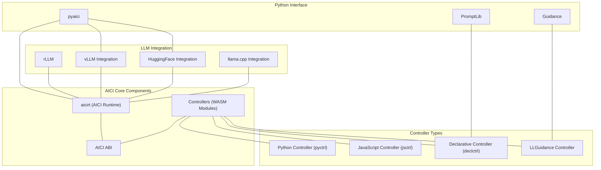
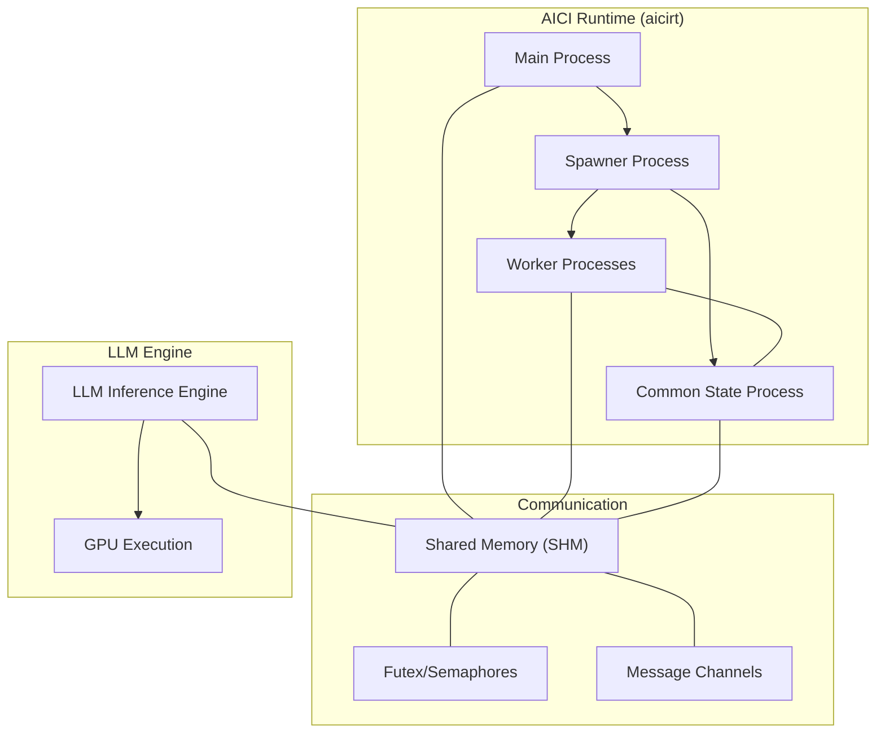
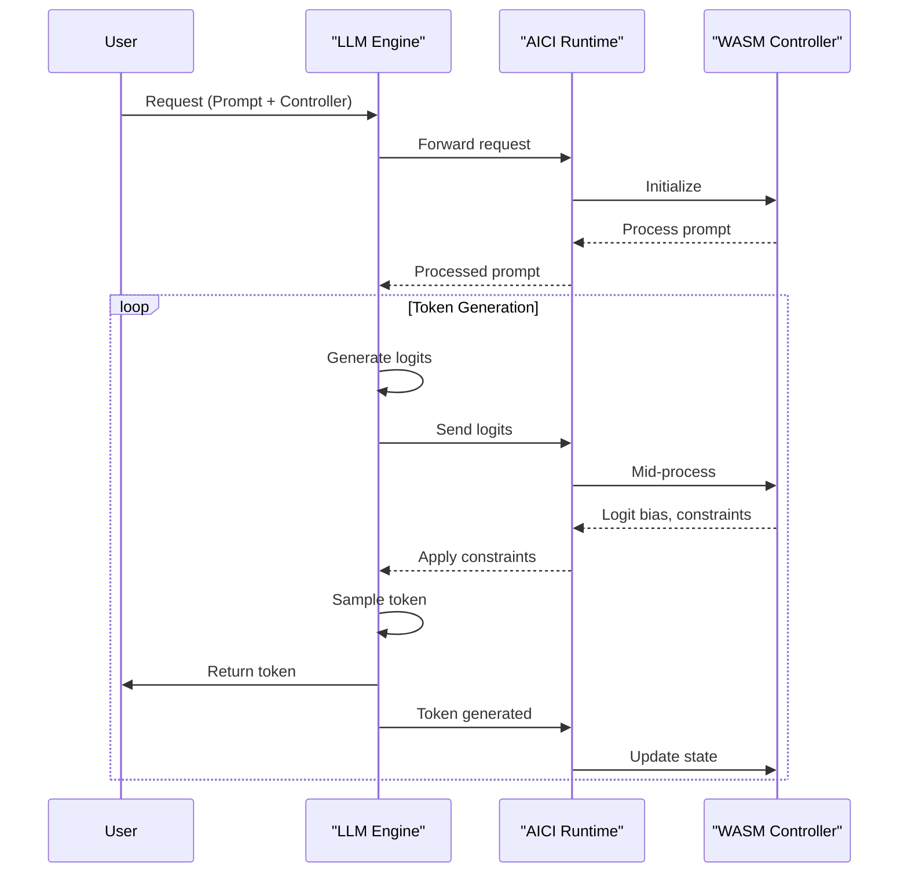
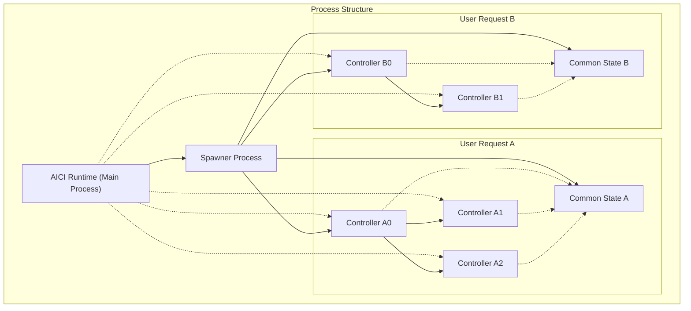

<!-- source: DeepWiki mcp.deepwiki.com · repo microsoft/aici · page 1 Overview · fetched 2026-10-26 -->

# Overview

Relevant source files

The following files were used as context for generating this wiki page:

- [.vscode/settings.json](.vscode/settings.json)
- [README.md](README.md)
- [aicirt/README.md](aicirt/README.md)
- [aicirt/src/api.rs](aicirt/src/api.rs)
- [aicirt/src/hostimpl.rs](aicirt/src/hostimpl.rs)
- [aicirt/src/main.rs](aicirt/src/main.rs)
- [aicirt/src/moduleinstance.rs](aicirt/src/moduleinstance.rs)
- [aicirt/src/worker.rs](aicirt/src/worker.rs)

The Artificial Intelligence Controller Interface (AICI) is a system that enables fine-grained control over large language model (LLM) inference. It provides a framework for building Controllers that can constrain and direct the output of LLMs in real-time during the token generation process.

This document introduces the core architecture of AICI, its key components, and how they interact to provide controlled text generation. For detailed information about specific components, please refer to their respective wiki pages.

## What is AICI?

AICI is designed to be a layer in the LLM inference stack that separates the control logic from the inference engine. It allows developers to implement custom Controllers that can:

- Constrain token generation using various methods (regex, grammars, etc.)
- Maintain state during generation
- Backtrack to previous states
- Fork generation into multiple branches
- Fast-forward tokens when they are known in advance

Sources: [README.md:4-17](), [README.md:303-316]()

## System Architecture

Sources: [README.md:303-316](), [README.md:317-328]()

## AICI Runtime Architecture

The AICI Runtime (`aicirt`) is the central component that manages the execution of WebAssembly (WASM) controllers and communicates with LLM inference engines. It uses a multi-process architecture for isolation and security.

Sources: [aicirt/README.md:1-36](), [aicirt/src/main.rs:39-47]()

## Token Generation Flow

Sources: [aicirt/README.md:17-36](), [aicirt/src/main.rs:637-903]()

## Key Components

### AICI Runtime (aicirt)

The AICI Runtime is a multi-threaded runner for AICI Controllers, built on top of Wasmtime. It manages the lifecycle of controller instances, handles communication between the LLM and controllers, and provides isolation between different user requests.

Key features:
- Multi-process architecture for security and isolation
- Shared memory communication for efficiency
- Support for forking, backtracking, and fast-forwarding

Sources: [aicirt/README.md:1-16](), [aicirt/src/main.rs:5-18]()

### Controllers

Controllers are WebAssembly modules that implement custom logic for controlling token generation. They can be written in any language that compiles to WebAssembly (Rust, C, C++, etc.) or be interpreted inside WebAssembly (Python, JavaScript, etc.).

AICI provides several built-in controller types:
- **Python Controller (pyctrl)**: Allows writing controllers in Python
- **JavaScript Controller (jsctrl)**: Allows writing controllers in JavaScript
- **Declarative Controller (declctrl)**: Uses declarative specifications
- **LLGuidance Controller**: Grammar-based guidance

Sources: [README.md:19-26](), [README.md:145-147]()

### AICI ABI

The AICI Application Binary Interface (ABI) defines how controllers interact with the runtime. It provides functions for:
- Tokenization and detokenization
- Logit biasing
- State management
- Communication between controller instances

Sources: [aicirt/src/hostimpl.rs:418-539]()

### Module Registry

The Module Registry manages WASM modules, including their storage, compilation, and instantiation. It provides functions for:
- Creating and storing modules
- Tagging modules for easy reference
- Instantiating modules for execution

Sources: [aicirt/src/main.rs:173-447]()

## Process Model

Sources: [aicirt/README.md:38-82](), [aicirt/src/worker.rs:559-691]()

## Security Model

AICI is designed with security in mind:

- `aicirt` runs in a separate process from the LLM engine
- WebAssembly modules are sandboxed by Wasmtime
- Controllers only have access to explicitly exposed host functions
- Each WebAssembly module runs in a separate process for Spectre/Meltdown mitigation
- Controllers cannot access the filesystem, network, or other resources

Sources: [README.md:337-349](), [aicirt/src/moduleinstance.rs:30-98]()

## Performance Considerations

AICI is designed to be efficient:

- Most computation in Controllers occurs on the CPU, in parallel with logit generation on the GPU
- The generation process is divided into steps, with each step taking about 20-50ms on modern GPUs
- WebAssembly provides near-native performance (less than 2x overhead compared to native code)
- Constraints like regular expressions, grammars, and substring matching are highly optimized

Sources: [README.md:350-388](), [aicirt/src/main.rs:40-46]()

## Integration with LLM Engines

AICI can integrate with various LLM inference engines:

- rLLM (custom tch-based LLM inference engine)
- llama.cpp
- HuggingFace Transformers
- vLLM (in development)

The integration is done through a shared memory interface, allowing efficient communication between the LLM engine and AICI runtime.

Sources: [README.md:17-18](), [README.md:323-328]()

## Conclusion

AICI provides a flexible and efficient framework for controlling LLM generation. By separating the control logic from the inference engine, it enables developers to implement complex control strategies without modifying the underlying LLM code. The WebAssembly-based architecture ensures security, portability, and performance.

For more detailed information about specific components, please refer to their respective wiki pages:
- [AICI Runtime (aicirt)](#2)
- [Controllers](#3)
- [LLM Integration](#4)
- [Python Interface (pyaici)](#5)

---

