<!-- source: DeepWiki mcp.deepwiki.com · repo microsoft/aici · page 1.1 Key Concepts · fetched 2026-10-26 -->

# Key Concepts

<details>
<summary>Relevant source files</summary>

The following files were used as context for generating this wiki page:

- [.vscode/settings.json](.vscode/settings.json)
- [README.md](README.md)
- [aicirt/README.md](aicirt/README.md)
- [controllers/aici_abi/src/cfg.rs](controllers/aici_abi/src/cfg.rs)
- [controllers/aici_abi/src/dlex.rs](controllers/aici_abi/src/dlex.rs)
- [controllers/aici_abi/src/host.rs](controllers/aici_abi/src/host.rs)
- [controllers/aici_abi/src/lib.rs](controllers/aici_abi/src/lib.rs)
- [controllers/declctrl/src/declctrl.rs](controllers/declctrl/src/declctrl.rs)
- [controllers/jsctrl/src/jsctrl.rs](controllers/jsctrl/src/jsctrl.rs)
- [controllers/pyctrl/src/pyctrl.rs](controllers/pyctrl/src/pyctrl.rs)

</details>


This page introduces the core concepts of the Artificial Intelligence Controller Interface (AICI) system. AICI enables fine-grained control over Large Language Model (LLM) token generation through WebAssembly-based controllers that can constrain and direct LLM output in real-time.

For system requirements, see [System Requirements](#1.2). For details on the AICI runtime implementation, see [AICI Runtime](#2).

## AICI System Overview

AICI is designed to provide a layer between LLM inference engines and control libraries, allowing for flexible and efficient control over token generation while maintaining compatibility across different LLM backends.

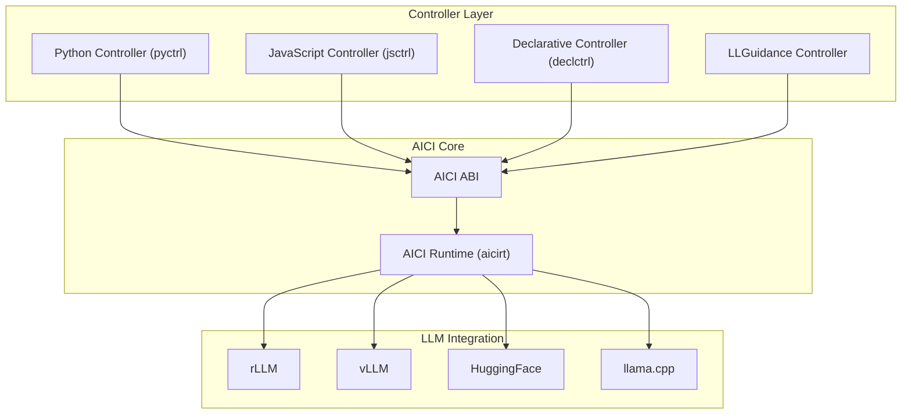

Sources: [README.md:1-18](), [README.md:303-328]()

## Controllers and the ABI

Controllers are WebAssembly modules that implement the AICI Application Binary Interface (ABI). They can influence token generation through various mechanisms:

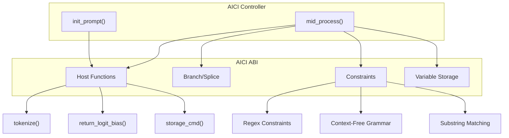

The core interface that controllers implement is defined in [controllers/aici_abi/src/lib.rs:135-176]():

```
pub trait AiciCtrl {
    /// Called with the initial prompt. ~1000ms time limit.
    fn init_prompt(&mut self, arg: InitPromptArg) -> InitPromptResult {
        InitPromptResult::from_arg(arg)
    }

    /// This is the main entry point for the module. ~20ms time limit.
    fn mid_process(&mut self, arg: MidProcessArg) -> MidProcessResult;
}
```

Sources: [controllers/aici_abi/src/lib.rs:135-176](), [controllers/aici_abi/src/host.rs:102-118]()

## Token Generation Flow

The token generation process in AICI follows a specific flow that allows controllers to influence each step:

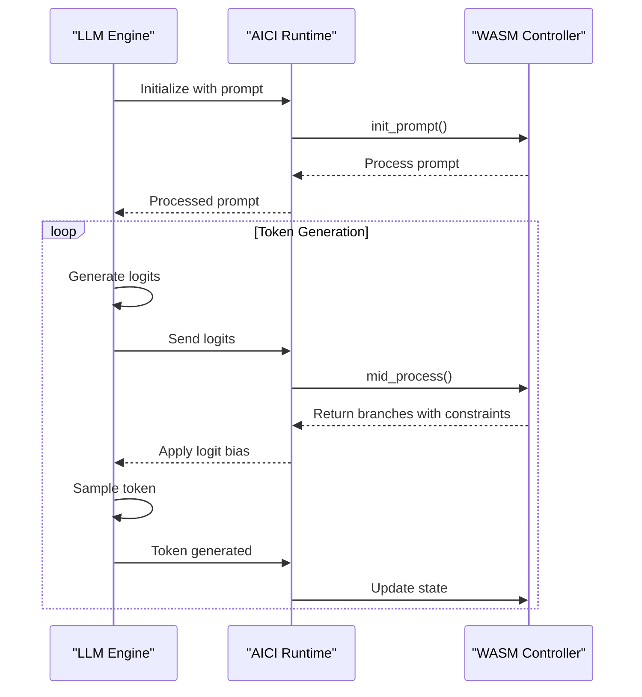

During each token generation step:

1. The LLM computes logits (token probabilities)
2. The controller is called via `mid_process()` to influence token selection
3. The controller returns a `MidProcessResult` containing branches with constraints
4. The AICI runtime applies these constraints to the LLM's token selection
5. The LLM samples a token based on the modified probabilities
6. The process repeats for the next token

Sources: [controllers/aici_abi/src/lib.rs:81-127](), [README.md:160-172]()

## Constraint System

AICI provides several types of constraints that controllers can use to restrict token generation:

| Constraint Type | Description | Implementation |
|----------------|-------------|----------------|
| Regex | Regular expression patterns | `RecRx` in [controllers/aici_abi/src/rx.rs]() |
| Context-Free Grammar | YACC-style grammars | `CfgParser` in [controllers/aici_abi/src/cfg.rs]() |
| Substring | Match specific substrings | `SubStrMatcher` in [controllers/aici_abi/src/substring.rs]() |
| Dynamic Lexer | Token-based lexical analysis | `DynamicLexer` in [controllers/aici_abi/src/dlex.rs]() |

All constraint types implement the `Recognizer` trait, which provides a common interface for determining which tokens are allowed at each step of generation.

Sources: [controllers/aici_abi/src/cfg.rs:459-501](), [controllers/aici_abi/src/dlex.rs:228-266]()

## Controller Types

AICI supports multiple controller implementations to accommodate different programming models:

### Python Controller (pyctrl)

Allows writing controllers in Python, which is interpreted inside the WebAssembly environment:

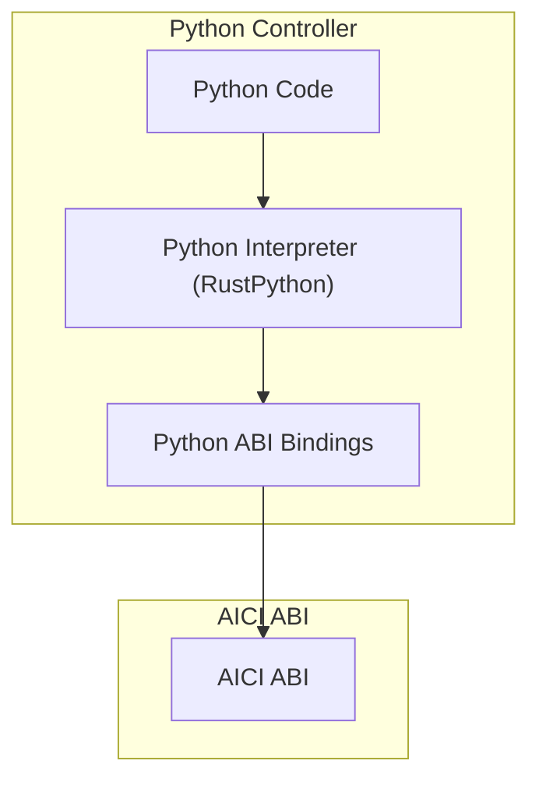

Sources: [controllers/pyctrl/src/pyctrl.rs:608-616](), [controllers/pyctrl/src/pyctrl.rs:46-360]()

### JavaScript Controller (jsctrl)

Similar to the Python controller but uses JavaScript:

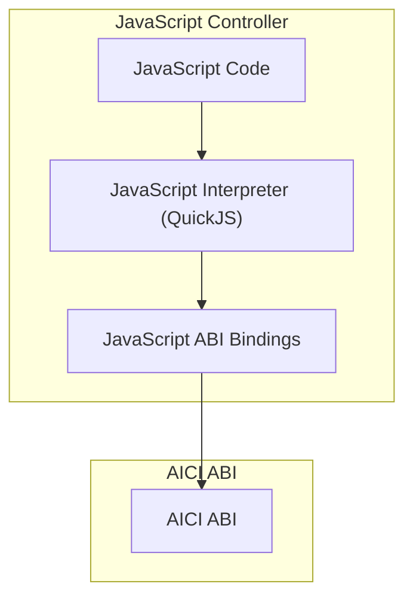

Sources: [controllers/jsctrl/src/jsctrl.rs:547-570](), [controllers/jsctrl/src/jsctrl.rs:247-439]()

### Declarative Controller (declctrl)

Provides a JSON-based declarative specification for controlling token generation:

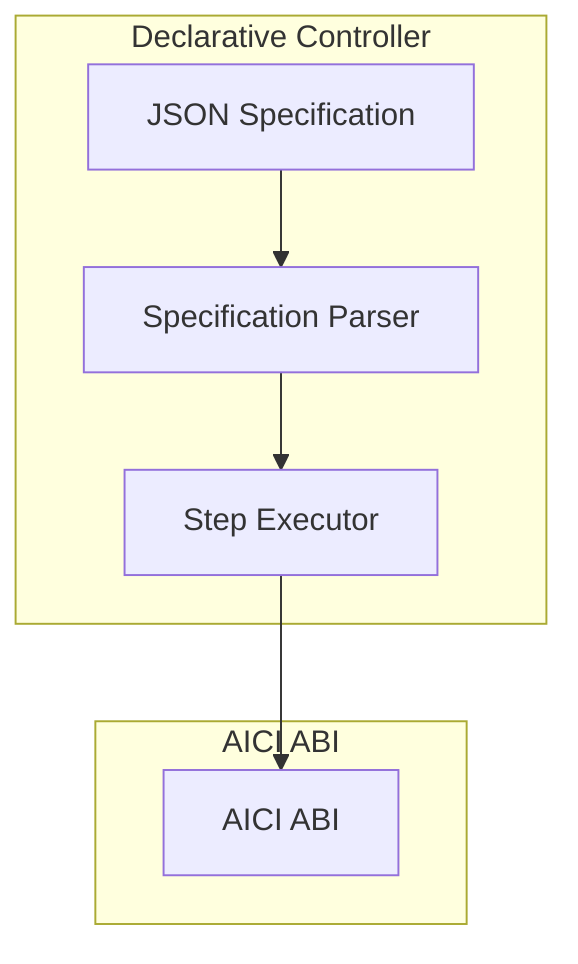

The declarative controller uses a structured JSON format to define steps for token generation, including fixed text, choices, regex constraints, and more.

Sources: [controllers/declctrl/src/declctrl.rs:50-370]()

## Advanced Features

### Branching and Forking

AICI supports branching and forking to explore multiple generation paths simultaneously:

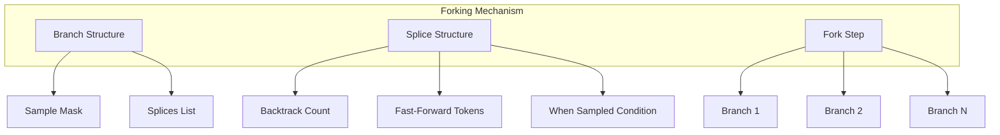

The `Branch` structure in [controllers/aici_abi/src/lib.rs:82-92]() allows controllers to:
- Specify a mask of allowed tokens
- Backtrack to a previous state
- Fast-forward multiple tokens at once
- Fork into multiple parallel generation paths

Sources: [controllers/aici_abi/src/lib.rs:82-127](), [controllers/declctrl/src/declctrl.rs:243-250]()

### Variable Storage

AICI provides a shared variable storage system that allows controllers to maintain state across generation steps and communicate between different controller instances:

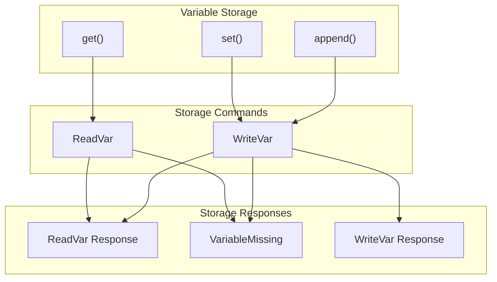

The variable storage system is implemented in [controllers/aici_abi/src/host.rs:269-358]() and provides:
- Reading and writing named variables
- Appending to existing variables
- Version tracking for concurrent access

Sources: [controllers/aici_abi/src/host.rs:269-358]()

## AICI Runtime Architecture

The AICI Runtime (aicirt) is responsible for managing the execution of controllers and communicating with LLM inference engines:

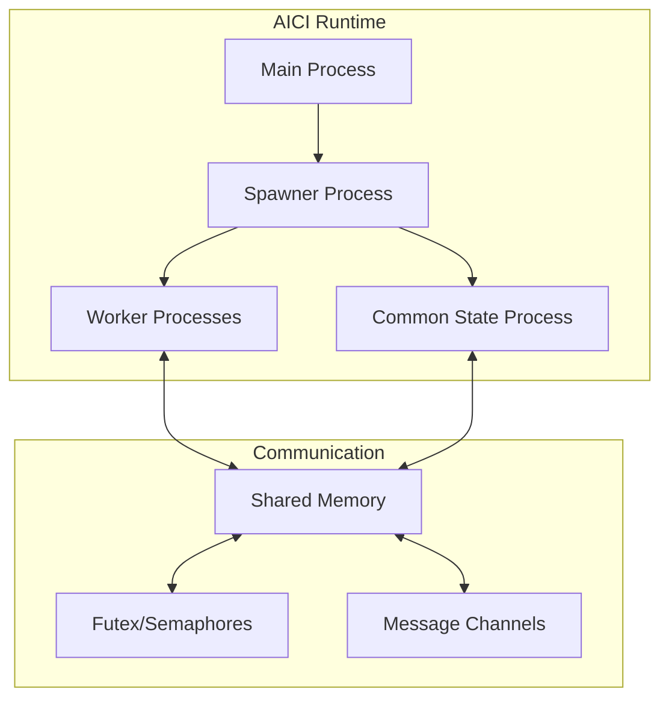

The runtime uses a multi-process architecture for isolation and security:
- Main process handles communication with the LLM engine
- Spawner process creates worker processes for each controller instance
- Worker processes execute the WebAssembly controllers
- Common state process manages shared state between controller instances

Sources: [aicirt/README.md:1-82](), [README.md:338-348]()

## Security Model

AICI implements a strong security model to ensure that controllers cannot access unauthorized resources:

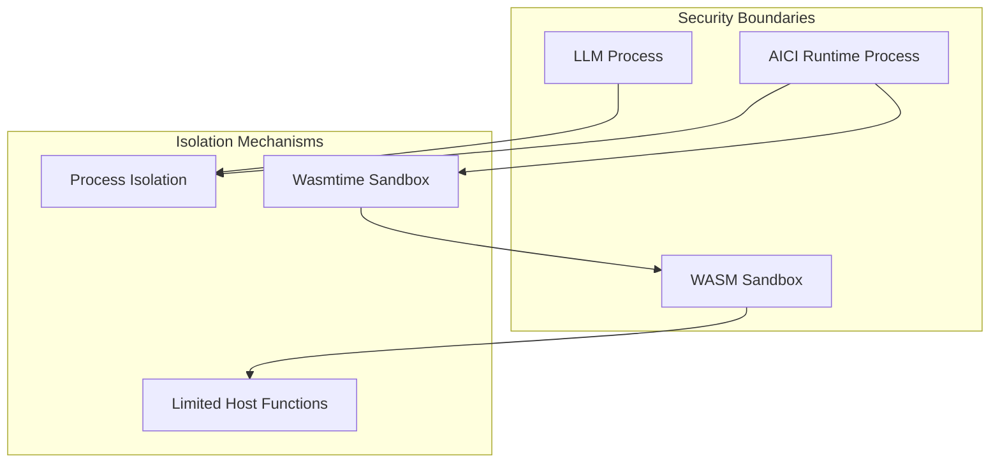

Key security features include:
- Process isolation between the LLM engine and AICI runtime
- WebAssembly sandboxing via Wasmtime
- Limited host functions exposed to controllers
- No filesystem or network access from controllers
- Process-level resource limits

Sources: [README.md:338-348]()

## Performance Considerations

AICI is designed to minimize overhead during token generation:

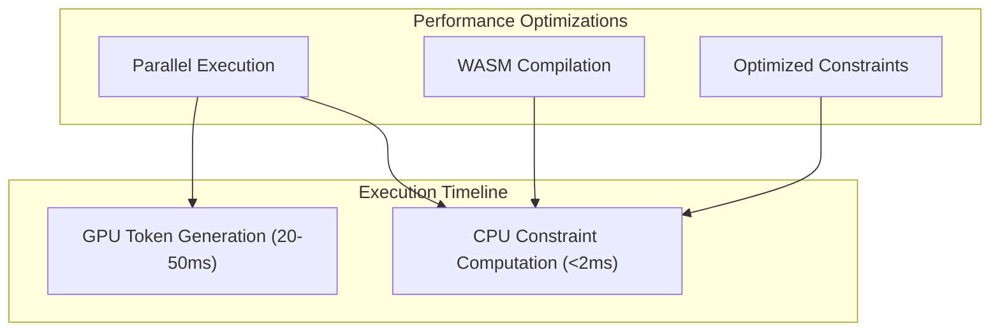

Performance characteristics:
- Controllers run on CPU in parallel with GPU token generation
- Typical GPU token generation takes 20-50ms per step
- Constraint computation typically takes <2ms
- WebAssembly execution is only ~2x slower than native code
- Multiple sequences can be processed in parallel on multi-core systems

Sources: [README.md:350-387]()

## Integration with LLM Engines

AICI can integrate with various LLM inference engines:

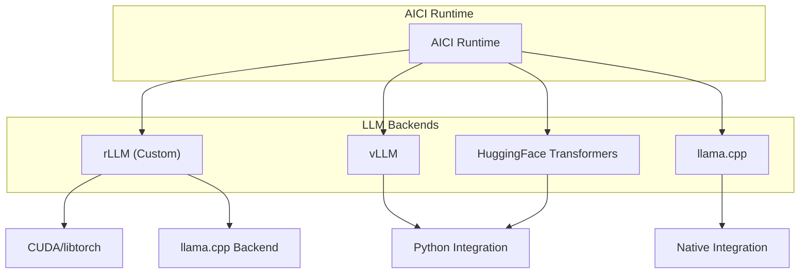

Integration methods:
- Direct integration via shared memory for rLLM
- Python-based integration for vLLM and HuggingFace
- Native integration for llama.cpp

Sources: [README.md:16-17](), [README.md:323-335]()

---

