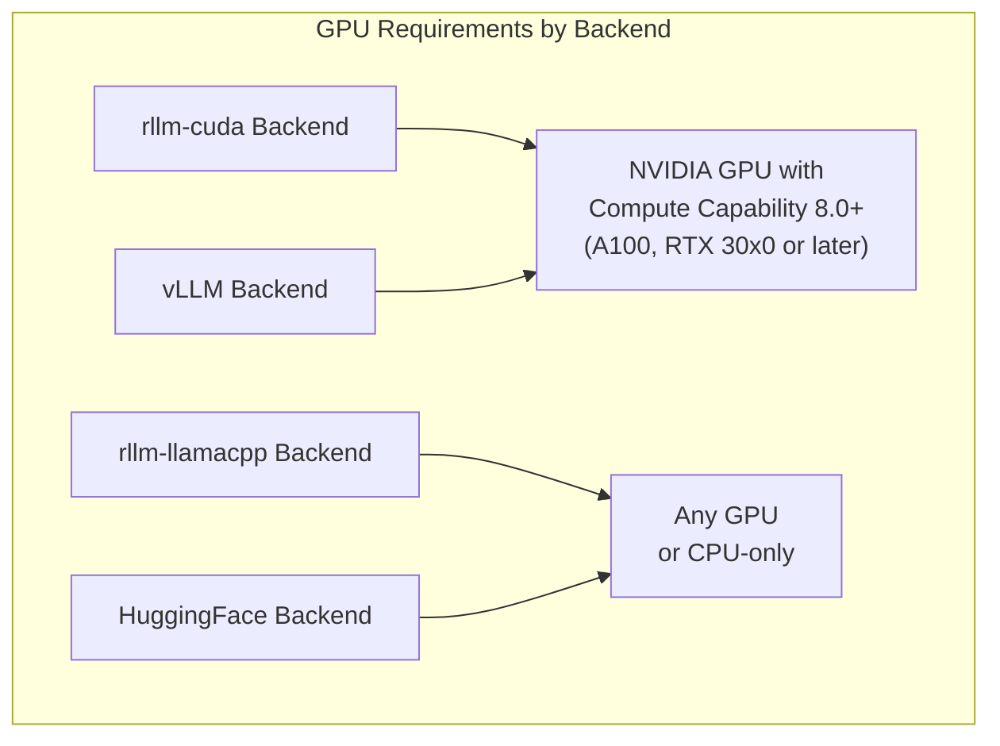
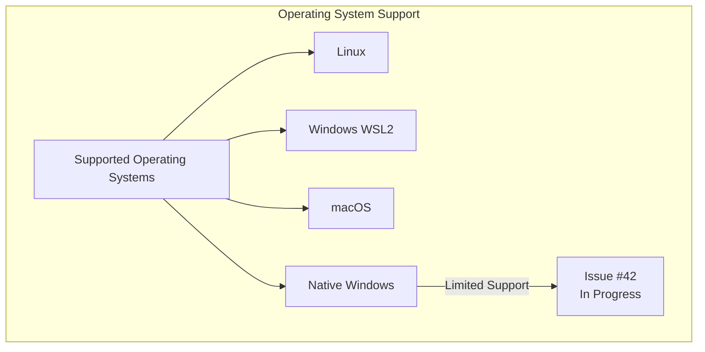
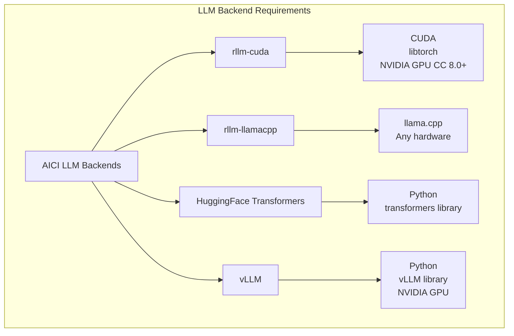
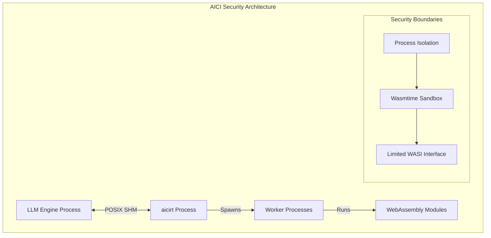
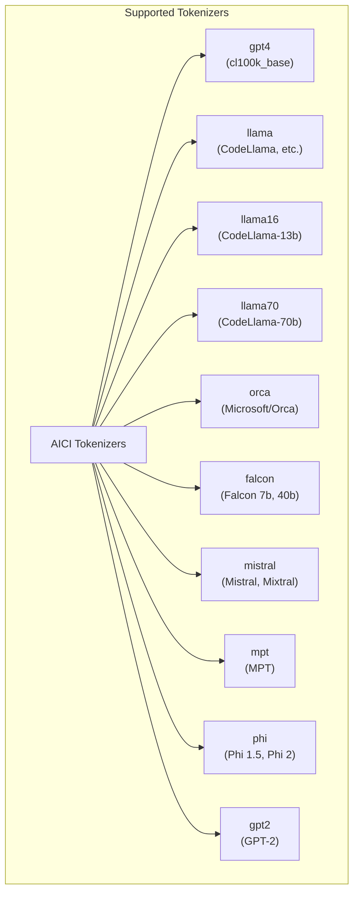

<!-- source: DeepWiki mcp.deepwiki.com · repo microsoft/aici · page 1.2 System Requirements · fetched 2026-10-26 -->

# System Requirements

<details>
<summary>Relevant source files</summary>

The following files were used as context for generating this wiki page:

- [.gitignore](.gitignore)
- [.vscode/settings.json](.vscode/settings.json)
- [Cargo.lock](Cargo.lock)
- [Cargo.toml](Cargo.toml)
- [README.md](README.md)
- [aicirt/README.md](aicirt/README.md)
- [controllers/aici_native/src/bintokens.rs](controllers/aici_native/src/bintokens.rs)

</details>


This document outlines the hardware and software requirements for running the Artificial Intelligence Controller Interface (AICI) system. It covers the minimum specifications needed for both development and deployment environments.

For information about the overall AICI architecture, see [Overview](#1).

## Hardware Requirements

AICI is designed to work with various hardware configurations, with specific requirements depending on the LLM backend being used.

### GPU Requirements



Sources: [README.md:100-107]()

### Memory Requirements

Memory requirements vary based on the model size and the number of parallel sequences being processed:

| Component | Minimum | Recommended | For Large Models |
|-----------|---------|-------------|-----------------|
| System RAM | 8GB | 16GB | 32GB+ |
| GPU VRAM | 8GB | 24GB | 80GB |

For optimal batch throughput, the model and KV caches should utilize a major fraction of the GPU memory. Reading the whole memory takes about 40ms on an A100 GPU with 80GB VRAM.

Sources: [README.md:356-358]()

### CPU Requirements

AICI controllers run on CPU while the LLM inference runs on GPU. For optimal performance:

| Scenario | CPU Recommendation |
|----------|-------------------|
| Development | 4+ cores |
| Production | 8+ cores |
| High-throughput | 16+ cores |

Each controller instance runs in a separate process, so having more CPU cores than the number of parallel sequences is beneficial for performance.

Sources: [README.md:371-373]()

## Software Requirements

### Operating System Support



Sources: [README.md:59-62]()

### Development Environment

For compiling AICI components, you need:

1. **Rust and Cargo**:
   - Latest stable version
   - wasm32-wasi target

2. **Build Tools**:
   - git
   - cmake
   - ccache
   - pkg-config (Linux)
   - libssl-dev (Linux)
   - libclang-dev (Linux)
   - clang (Linux)
   - llvm-dev (Linux)
   - git-lfs

3. **Python Requirements** (for Python controllers and scripts):
   - Python 3.11 or later
   - pytest
   - pytest-forked
   - ujson
   - posix_ipc
   - numpy
   - requests

Sources: [README.md:54-96]()

### System Dependencies

#### Linux (Ubuntu/Debian)

```bash
sudo apt-get install --assume-yes --no-install-recommends \
    build-essential cmake ccache pkg-config libssl-dev libclang-dev clang llvm-dev git-lfs
```

#### macOS

```bash
brew install git cmake ccache
```

Additionally, macOS users need to have XCode command line tools installed:

```bash
xcode-select --install
```

Sources: [README.md:72-78]()

## LLM Backend Requirements

AICI supports multiple LLM backends, each with specific requirements:



Sources: [README.md:17](), [README.md:100-107]()

### rllm-cuda Backend

The `rllm-cuda` backend requires:
- NVIDIA GPU with compute capability 8.0 or later (A100, RTX 30x0 series or newer)
- CUDA toolkit
- libtorch with specific configuration (recommended to use the included devcontainer)

Sources: [README.md:100-107]()

### rllm-llamacpp Backend

The `rllm-llamacpp` backend is more flexible and can run on:
- Any NVIDIA GPU
- AMD GPUs
- CPU-only mode

It requires the llama.cpp library, which is included in the AICI repository.

Sources: [README.md:100-107](), [README.md:121-122]()

### HuggingFace and vLLM Backends

These backends require:
- Python 3.11+
- Respective Python libraries (transformers, vLLM)
- For vLLM: NVIDIA GPU

Sources: [README.md:17](), [README.md:330-334]()

## Deployment Requirements

### Docker Support

AICI provides Docker-based deployment options for all backends. Using the included devcontainer is recommended, especially for the `rllm-cuda` backend which requires specific libtorch setup.

Sources: [README.md:64]()

### Network Requirements

The AICI system exposes HTTP interfaces for configuration and request processing:

| Component | Default Port | Protocol |
|-----------|--------------|----------|
| rLLM Server | 4242 | HTTP |
| AICI Runtime | Internal | POSIX SHM |

Sources: [README.md:125-139](), [aicirt/README.md:11]()

### Storage Requirements

Storage requirements depend on the models being used:

| Component | Storage Requirement |
|-----------|---------------------|
| AICI Codebase | ~500MB |
| Each LLM Model | 2GB - 100GB |
| Runtime Cache | ~1GB |

## Performance Considerations

### Token Generation Performance

AICI is designed to have minimal impact on token generation performance:

- Each step of generation takes approximately 20-50ms on an A100 GPU
- Computing allowed token sets takes:
  - ~2.0ms for a Yacc grammar of the C programming language
  - ~0.3ms for a regular expression
  - ~0.2ms for a substring constraint from a 4kB string

These operations run in parallel with GPU token generation and typically do not affect overall generation time.

Sources: [README.md:357-376]()

### Overhead

There is some overhead in the critical path of sampling:
- ~0.3ms per generation step when executing 10 sequences in parallel
- ~0.7ms for 40 sequences

WebAssembly execution is typically less than 2x slower than native code when running optimized Rust code in Wasmtime.

Sources: [README.md:377-387]()

## Security Requirements

AICI implements several security measures:



Security requirements include:
- `aicirt` runs in a separate process from the LLM engine
- WebAssembly modules are sandboxed by Wasmtime
- Modules only have access to `aici_host_*` functions
- Limited WASI interface (only stdout/stderr for debugging)
- Each WebAssembly module runs in a separate process for Spectre/Meltdown mitigation
- No filesystem, network, or other resource access for WebAssembly modules
- No threading or timer access for WebAssembly modules

Sources: [README.md:338-349]()

## Tokenizer Requirements

AICI supports multiple tokenizers for different models:



Tokenizers can be specified by name, HuggingFace model path, or local file path.

Sources: [controllers/aici_native/src/bintokens.rs:13-76]()

## Controller Requirements

Controllers are implemented as WebAssembly modules and can be written in:
- Any language that compiles to WebAssembly (Rust, C, C++, etc.)
- Interpreted languages running inside WebAssembly (Python, JavaScript)

The repository provides several pre-built controllers:
- PyCtrl (Python)
- JsCtrl (JavaScript)
- DeclCtrl (Declarative)
- LLGuidance Controller

Sources: [README.md:21-22](), [README.md:275-282]()

---

