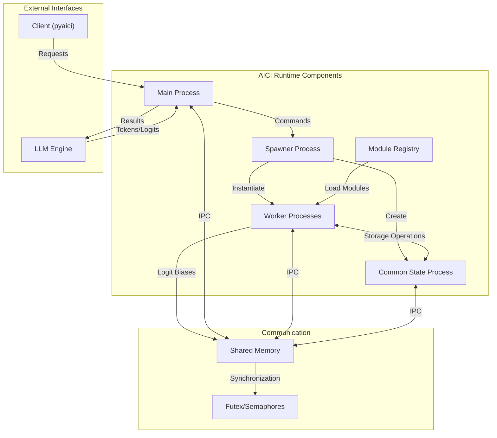
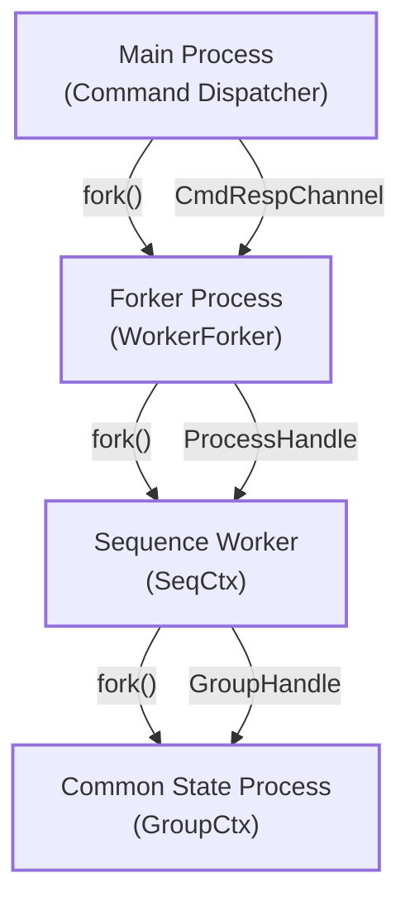
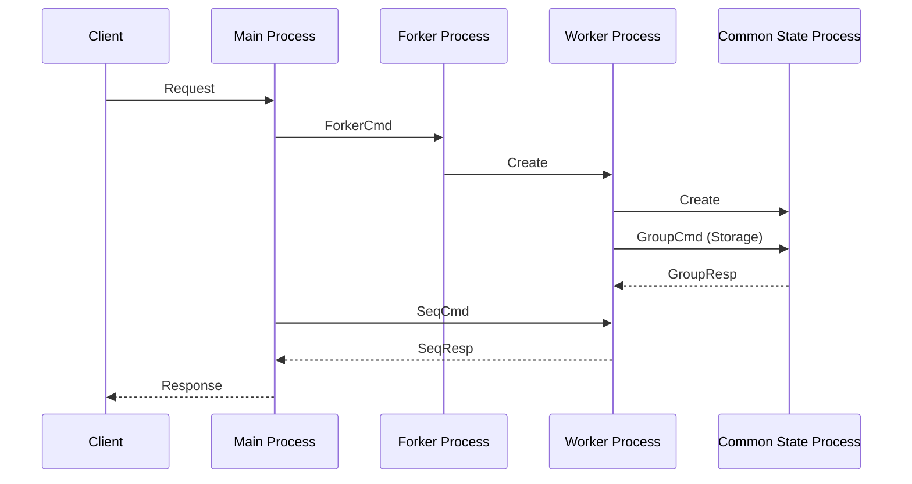
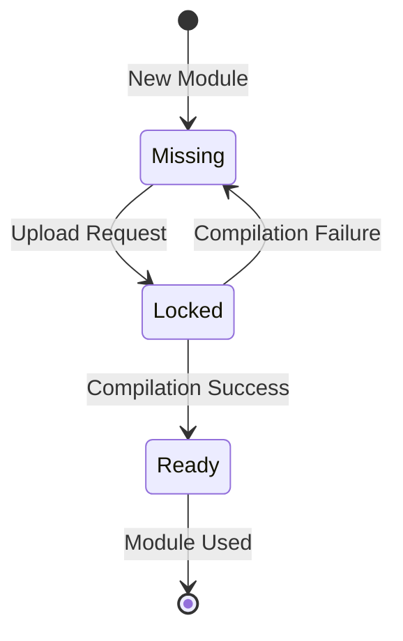
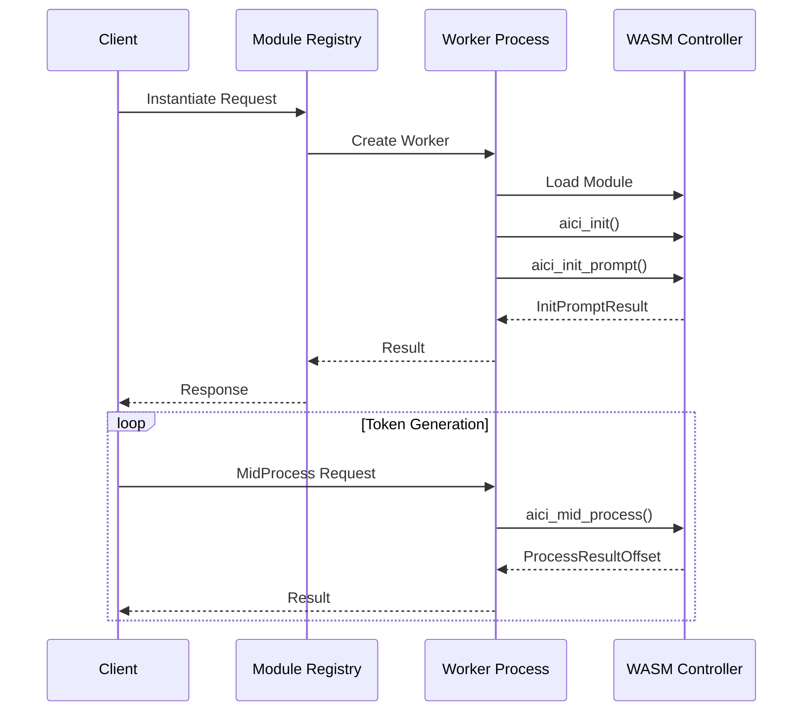
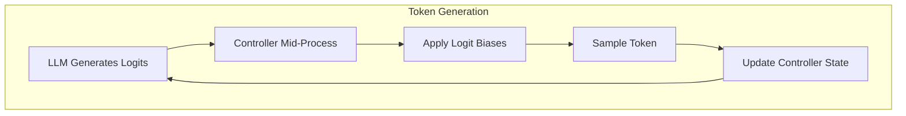
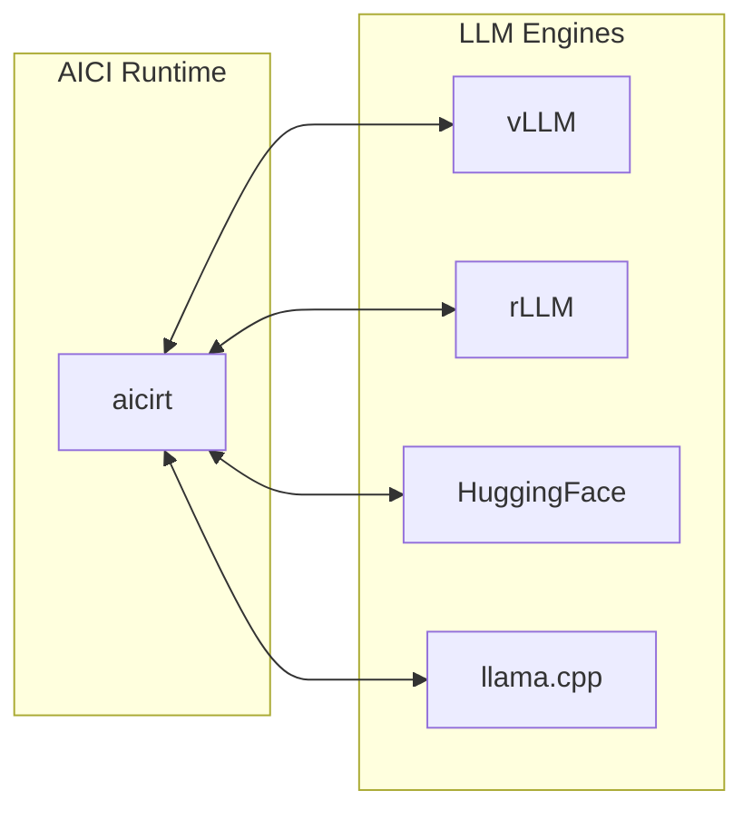

<!-- source: DeepWiki mcp.deepwiki.com · repo microsoft/aici · page 2 AICI Runtime (aicirt) · fetched 2026-10-26 -->

# AICI Runtime (aicirt)

<details>
<summary>Relevant source files</summary>

The following files were used as context for generating this wiki page:

- [aicirt/Cargo.toml](aicirt/Cargo.toml)
- [aicirt/src/api.rs](aicirt/src/api.rs)
- [aicirt/src/hostimpl.rs](aicirt/src/hostimpl.rs)
- [aicirt/src/lib.rs](aicirt/src/lib.rs)
- [aicirt/src/main.rs](aicirt/src/main.rs)
- [aicirt/src/moduleinstance.rs](aicirt/src/moduleinstance.rs)
- [aicirt/src/worker.rs](aicirt/src/worker.rs)

</details>


The AICI Runtime (aicirt) is the core execution environment for the Artificial Intelligence Controller Interface (AICI) system. It manages the lifecycle of WebAssembly (WASM) controllers, facilitates communication between controllers and LLM inference engines, and provides a secure, isolated execution environment for controlling token generation.

For information about the overall AICI system architecture, see [Overview](#1). For details on specific controller implementations, see [Controllers](#3).

## Purpose and Architecture

The AICI Runtime serves as the bridge between LLM inference engines and WASM controllers. It provides:

1. A multi-process architecture for security and isolation
2. Shared memory communication for efficient data transfer
3. A module registry for managing WASM controllers
4. Process management for controller execution
5. Token processing and logit bias application



Sources: [aicirt/src/main.rs:1-157](), [aicirt/src/moduleinstance.rs:1-39]()

## Process Model

The AICI Runtime uses a multi-process architecture to provide isolation and security. This design prevents controllers from interfering with each other and ensures that failures in one controller don't affect others.

### Process Hierarchy



Sources: [aicirt/src/worker.rs:560-635](), [aicirt/src/main.rs:635-643]()

The process hierarchy consists of:

1. **Main Process**: Handles client requests, dispatches commands, and manages the module registry
2. **Forker Process**: Creates worker processes for each controller instance
3. **Sequence Worker**: Executes the WASM controller code and processes tokens
4. **Common State Process**: Manages shared state between controller instances (e.g., variables)

Each process has specific responsibilities:

| Process | Responsibility | Implementation |
|---------|----------------|----------------|
| Main | Command dispatch, module registry | `ModuleRegistry`, `Exec` trait |
| Forker | Worker creation, compilation | `WorkerForker` |
| Sequence Worker | WASM execution, token processing | `SeqCtx`, `ModuleInstance` |
| Common State | Variable storage, shared state | `GroupCtx`, `Variables` |

Sources: [aicirt/src/worker.rs:446-554](), [aicirt/src/main.rs:159-207]()

## Inter-Process Communication

The AICI Runtime uses shared memory and synchronization primitives for efficient inter-process communication.

### Communication Channels



Sources: [aicirt/src/worker.rs:34-54](), [aicirt/src/main.rs:1026-1057]()

The runtime uses two primary communication mechanisms:

1. **Shared Memory (SHM)**: Used for bulk data transfer, including logit biases
2. **Message Channels**: Used for command and response passing between processes

Communication is implemented through:

- `CmdRespChannel`: Abstracts over different IPC mechanisms (semaphores or futexes)
- `ProcessHandle`: Represents a handle to a child process with typed command/response channels
- `TypedServer`/`TypedClient`: Typed message passing over shared memory

Sources: [aicirt/src/main.rs:1026-1057](), [aicirt/src/worker.rs:204-286]()

### Shared Memory Management

The runtime uses shared memory for efficient data transfer, particularly for logit biases which can be large. The `ShmAllocator` manages allocation and deallocation of shared memory regions.

Key shared memory operations:

1. Allocation of memory for logit biases
2. Transfer of token data between processes
3. Synchronization of state between processes

Sources: [aicirt/src/hostimpl.rs:462-485](), [aicirt/src/main.rs:898-904]()

## Module Registry

The Module Registry manages WASM modules, including their storage, compilation, and instantiation.

### Module Lifecycle



Sources: [aicirt/src/main.rs:165-169](), [aicirt/src/main.rs:209-238]()

The Module Registry handles:

1. **Module Upload**: Receiving and storing WASM modules
2. **Compilation**: Compiling WASM to native code for faster execution
3. **Tagging**: Associating human-readable tags with module IDs
4. **GitHub Integration**: Downloading modules from GitHub repositories

Sources: [aicirt/src/main.rs:301-365](), [aicirt/src/main.rs:449-573]()

### Module Storage

Modules are stored on disk with several associated files:

| File | Purpose |
|------|---------|
| `{module_id}.wasm` | Original WASM binary |
| `{module_id}.elf` | Compiled native code |
| `{module_id}-sys.json` | Metadata about the module |
| `tags/{tagname}.json` | Tag information linking to module ID |

Sources: [aicirt/src/main.rs:240-260](), [aicirt/src/main.rs:402-422]()

## Controller Execution

The AICI Runtime executes WASM controllers in a controlled environment with resource limits and security boundaries.

### Execution Flow



Sources: [aicirt/src/moduleinstance.rs:224-321](), [aicirt/src/worker.rs:517-531]()

### Resource Limits

The runtime enforces several resource limits on controllers:

| Limit | Purpose | Default |
|-------|---------|---------|
| `wasm_max_memory` | Maximum WASM memory size | 64 MB |
| `wasm_max_step_time` | Maximum execution time per step | 25 ms |
| `wasm_max_timeout_steps` | Maximum consecutive timeouts | 10 |
| `wasm_max_init_time` | Maximum initialization time | 1000 ms |
| `wasm_max_forks` | Maximum concurrent forks | 16 |

Sources: [aicirt/src/main.rs:130-148](), [aicirt/src/hostimpl.rs:20-36]()

## Token Processing

The AICI Runtime processes tokens and applies logit biases during token generation.

### Mid-Process Flow



Sources: [aicirt/src/main.rs:637-926](), [aicirt/src/moduleinstance.rs:264-321]()

The mid-process step allows controllers to:

1. Examine generated tokens
2. Apply constraints through logit biases
3. Request backtracking when needed
4. Fork execution to explore multiple paths
5. Fast-forward tokens to skip generation

Sources: [aicirt/src/main.rs:774-864](), [aicirt/src/api.rs:35-54]()

### Logit Bias Application

Logit biases are applied through shared memory for efficiency. The runtime supports several bias types:

| Bias Type | Description | Memory Usage |
|-----------|-------------|--------------|
| `f32` | 32-bit floating point | 4 bytes per token |
| `f16` | 16-bit floating point | 2 bytes per token |
| `bf16` | Brain floating point | 2 bytes per token |
| `bool` | Boolean mask | 1 bit per token |

Sources: [aicirt/src/api.rs:172-276](), [aicirt/src/hostimpl.rs:462-485]()

## Host Functions

The AICI Runtime provides several host functions that controllers can call:

| Function | Purpose |
|----------|---------|
| `aici_host_read_blob` | Read data from host memory |
| `aici_host_tokenize` | Tokenize text using the host tokenizer |
| `aici_host_return_logit_bias` | Apply logit biases |
| `aici_host_storage_cmd` | Access variable storage |
| `aici_host_return_process_result` | Return processing result |

Sources: [aicirt/src/hostimpl.rs:418-535]()

These functions allow controllers to interact with the host environment in a controlled manner.

## Command Line Interface

The AICI Runtime can be configured through command line arguments:

```
aicirt [OPTIONS]
```

Key options include:

| Option | Purpose | Default |
|--------|---------|---------|
| `--tokenizer` | Tokenizer to use | llama |
| `--module` | Path to WASM module | None |
| `--server` | Run with POSIX shared memory interface | false |
| `--cap-fork` | Allow fork() in controllers | false |
| `--cap-backtrack` | Allow backtracking in controllers | false |
| `--cap-ff-tokens` | Allow fast-forward tokens | false |
| `--wasm-max-memory` | Maximum WASM memory in MB | 64 |
| `--wasm-max-step-time` | Maximum step time in ms | 25 |

Sources: [aicirt/src/main.rs:52-156]()

## Integration with LLM Engines

The AICI Runtime integrates with various LLM engines through a standardized interface. For more details on specific integrations, see [LLM Integration](#4).



Sources: [aicirt/src/main.rs:1-50](), [aicirt/Cargo.toml:1-35]()

## Conclusion

The AICI Runtime (aicirt) provides a secure, efficient execution environment for WASM controllers to guide LLM token generation. Its multi-process architecture ensures isolation and security, while its shared memory communication enables high-performance token processing.

For more information on writing controllers that run in the AICI Runtime, see [Controllers](#3).

---

