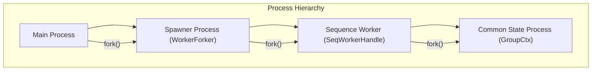
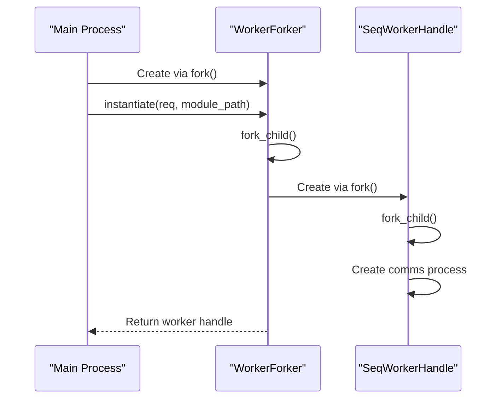
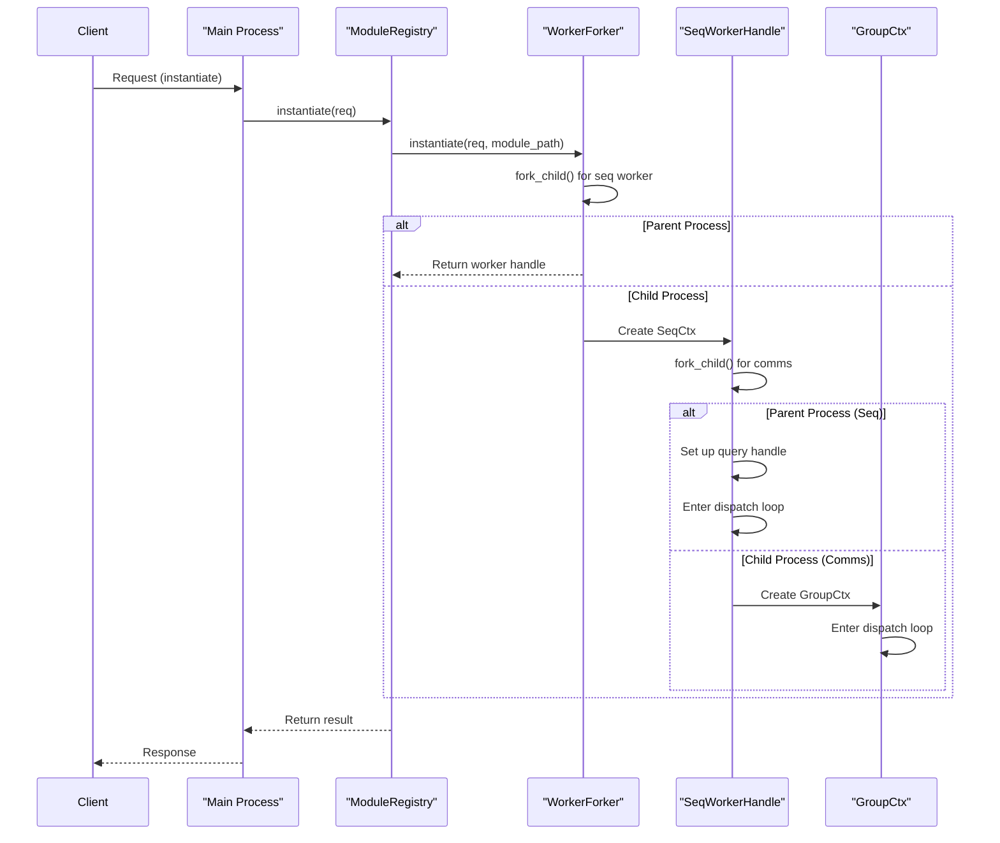
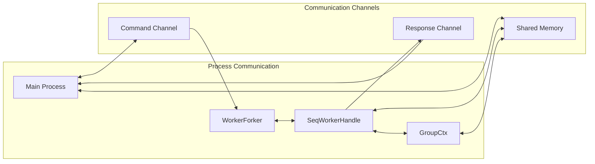
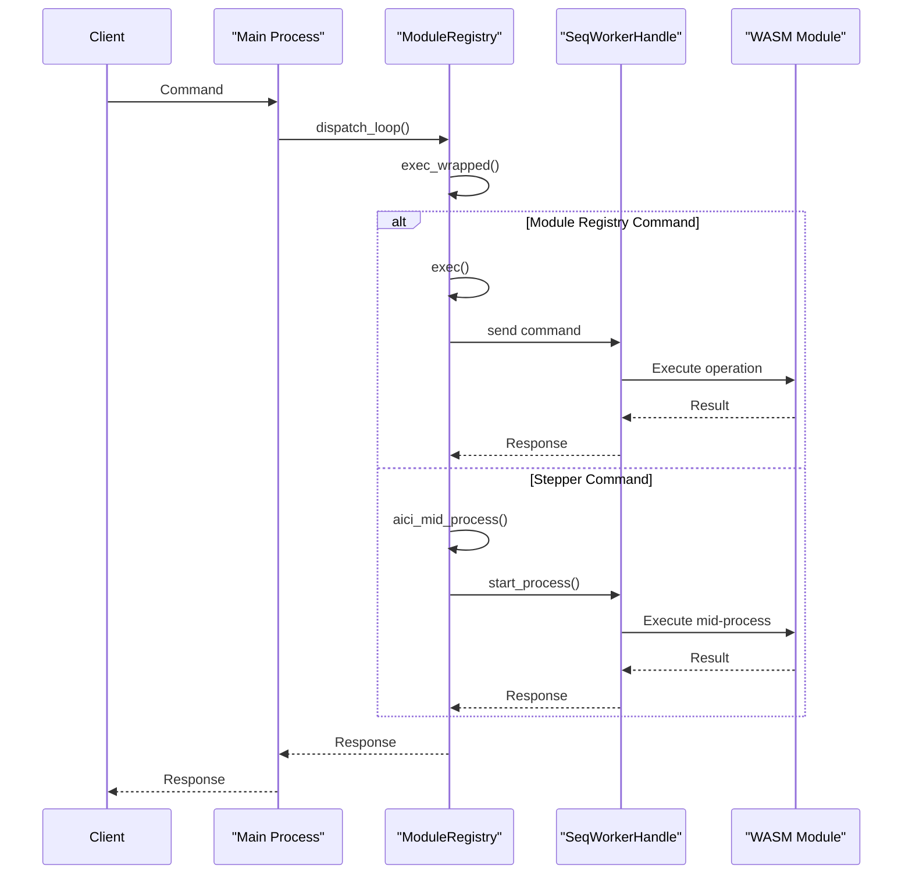
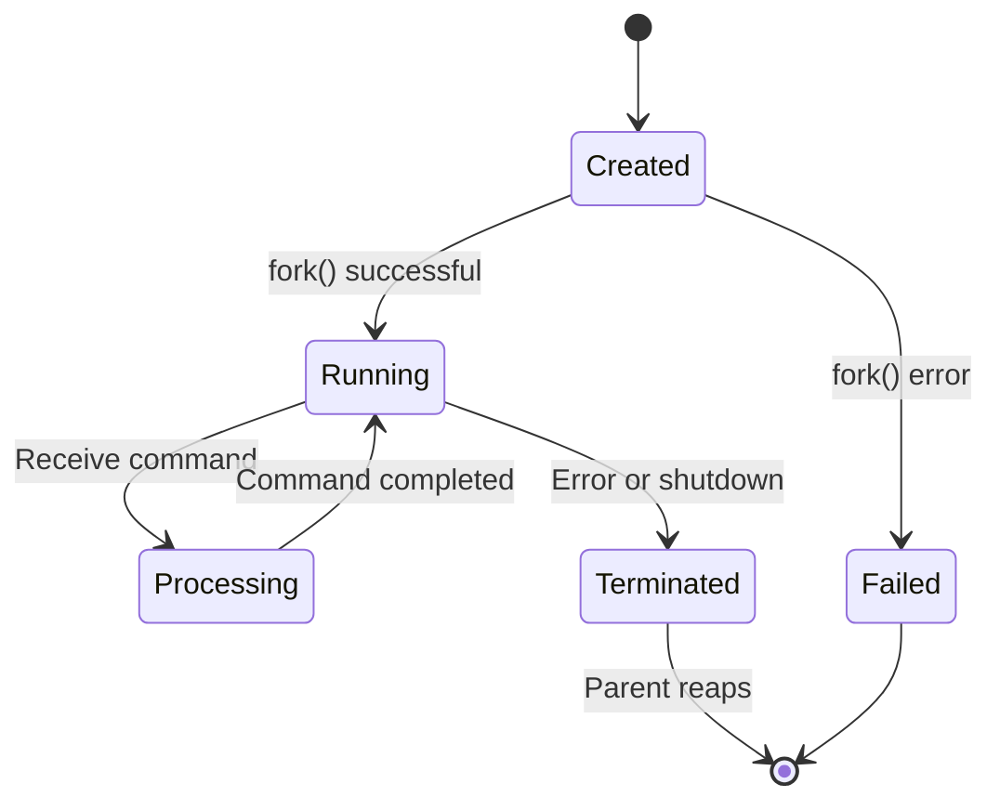
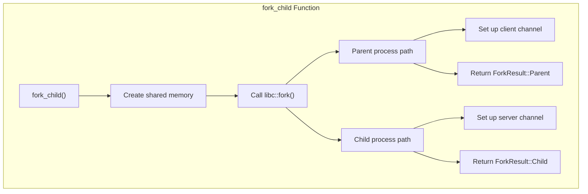
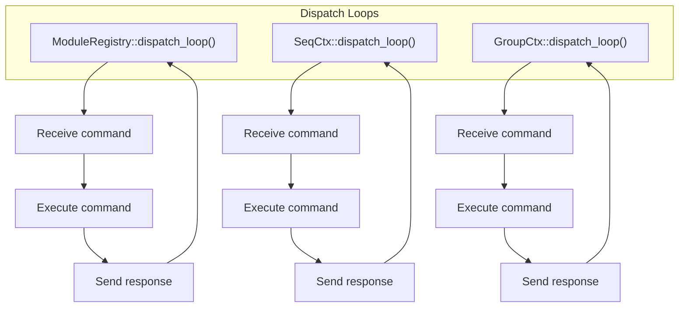

<!-- source: DeepWiki mcp.deepwiki.com · repo microsoft/aici · page 2.1 Process Model · fetched 2026-10-26 -->

# Process Model

Relevant source files

The following files were used as context for generating this wiki page:

- [aicirt/src/api.rs](aicirt/src/api.rs)
- [aicirt/src/hostimpl.rs](aicirt/src/hostimpl.rs)
- [aicirt/src/main.rs](aicirt/src/main.rs)
- [aicirt/src/moduleinstance.rs](aicirt/src/moduleinstance.rs)
- [aicirt/src/worker.rs](aicirt/src/worker.rs)

This document explains the multi-process architecture of the AICI Runtime (aicirt), including the spawner, worker, and common state processes. It details how these processes are created, managed, and communicate with each other to enable controlled LLM inference.

For information about inter-process communication mechanisms, see [Inter-Process Communication](#2.2).

## Overview

The AICI Runtime uses a multi-process architecture to isolate different components of the system, providing security, stability, and clean resource management. This approach allows for controlled execution of WebAssembly (WASM) modules that implement custom logic for token generation.

The process model consists of several key components:
- A main process that manages the overall system
- A spawner process that creates and manages worker processes
- Worker processes that execute WASM modules
- Common state processes that maintain shared state between workers

Sources: [aicirt/src/main.rs:1-50](), [aicirt/src/worker.rs:1-30]()

## Process Hierarchy

The AICI Runtime uses a hierarchical process structure where each level forks to create the next level. This allows for clean isolation and resource management.

Sources: [aicirt/src/worker.rs:556-692](), [aicirt/src/main.rs:159-169]()

## Process Types and Responsibilities

### Main Process

The main process is the entry point for the AICI Runtime. It:
- Parses command-line arguments
- Sets up the tokenizer and other global resources
- Creates the module registry
- Forks to create the spawner process
- Handles incoming requests and dispatches them to appropriate handlers

Sources: [aicirt/src/main.rs:52-157]()

### Spawner Process (WorkerForker)

The spawner process, implemented as `WorkerForker`, is responsible for:
- Creating worker processes on demand
- Managing the lifecycle of worker processes
- Handling compilation of WASM modules
- Cleaning up terminated worker processes to prevent zombies

Sources: [aicirt/src/worker.rs:556-692](), [aicirt/src/worker.rs:671-758]()

### Sequence Worker Process (SeqWorkerHandle)

The sequence worker process, represented by `SeqWorkerHandle`, is responsible for:
- Loading and executing WASM modules
- Processing token generation requests
- Handling mid-process operations
- Managing forking and backtracking operations
- Communicating with the common state process

Sources: [aicirt/src/worker.rs:474-532](), [aicirt/src/worker.rs:429-445]()

### Common State Process (GroupCtx)

The common state process, implemented as `GroupCtx`, maintains shared state between worker processes:
- Manages variable storage
- Processes storage commands
- Provides a communication channel for workers to access shared state

Sources: [aicirt/src/worker.rs:447-554]()

## Process Creation Flow

The process creation flow involves multiple fork operations to establish the process hierarchy. Each process has a specific role and communicates with others through defined channels.

Sources: [aicirt/src/worker.rs:584-634](), [aicirt/src/main.rs:584-600]()

## Process Communication Model

Processes in the AICI Runtime communicate through a combination of:
- Shared memory for data exchange
- Message channels for command/response patterns
- Futexes and semaphores for synchronization

The communication model uses typed channels to ensure type safety when passing messages between processes.

Sources: [aicirt/src/main.rs:1026-1057](), [aicirt/src/worker.rs:204-286]()

## Command Execution Flow

When a command is received by the main process, it follows this execution flow:

The command execution flow involves dispatching commands to the appropriate handler, executing them in worker processes, and returning the results.

Sources: [aicirt/src/main.rs:602-634](), [aicirt/src/main.rs:944-956]()

## Process Lifecycle Management

The AICI Runtime carefully manages the lifecycle of processes to ensure proper resource cleanup:

1. **Process Creation**: Processes are created using `fork()` and initialized with appropriate context
2. **Process Execution**: Processes execute their specific tasks in a loop
3. **Process Termination**: Processes are terminated when no longer needed or on error
4. **Zombie Prevention**: The spawner process periodically waits for child processes to prevent zombies

Sources: [aicirt/src/worker.rs:566-583](), [aicirt/src/worker.rs:637-646]()

## Error Handling and Process Recovery

The AICI Runtime includes mechanisms for handling errors and recovering from process failures:

- **Timeout Handling**: Worker processes have configurable timeouts to prevent infinite loops
- **Error Propagation**: Errors are propagated back to the client with appropriate context
- **Process Isolation**: Process isolation ensures that failures in one process don't affect others
- **Clean Shutdown**: Signal handlers ensure clean shutdown of processes

Sources: [aicirt/src/worker.rs:637-646](), [aicirt/src/main.rs:796-903]()

## Process Resource Limits

The AICI Runtime enforces resource limits on processes to ensure stability and security:

| Resource | Limit | Configuration |
|----------|-------|--------------|
| Memory | Configurable | `--wasm-max-memory` |
| Execution Time | Configurable | `--wasm-max-step-time` |
| Number of Forks | Configurable | `--wasm-max-forks` |
| Timeout Steps | Configurable | `--wasm-max-timeout-steps` |
| Initialization Time | Configurable | `--wasm-max-init-time` |

These limits are enforced at various levels of the system to prevent resource exhaustion.

Sources: [aicirt/src/main.rs:52-157](), [aicirt/src/hostimpl.rs:21-36]()

## Process Model Implementation Details

### Process Forking

The AICI Runtime uses a custom `fork_child` function to create new processes with appropriate communication channels:

The `fork_child` function creates shared memory before forking to ensure both parent and child have access to it.

Sources: [aicirt/src/worker.rs:88-120]()

### Process Context

Each process type has its own context structure that contains the state and resources needed for that process:

- **ModuleRegistry**: Contains the registry of WASM modules and handles module-related operations
- **SeqCtx**: Contains the state for a sequence worker process
- **GroupCtx**: Contains the state for a common state process

Sources: [aicirt/src/main.rs:172-181](), [aicirt/src/worker.rs:447-462](), [aicirt/src/worker.rs:453-462]()

### Process Dispatch Loops

Each process type has its own dispatch loop that receives commands, processes them, and sends responses:

These dispatch loops run continuously, processing commands as they arrive.

Sources: [aicirt/src/main.rs:602-634](), [aicirt/src/worker.rs:429-445](), [aicirt/src/worker.rs:547-554]()

## Conclusion

The AICI Runtime's multi-process architecture provides a robust foundation for executing WASM modules in a controlled environment. By isolating different components of the system into separate processes, it ensures stability, security, and clean resource management. The process model enables complex operations like forking and backtracking while maintaining a clean separation of concerns.

---

