<!-- source: DeepWiki mcp.deepwiki.com · repo microsoft/aici · page 2.2 Inter-Process Communication · fetched 2026-10-26 -->

# Inter-Process Communication

Relevant source files

The following files were used as context for generating this wiki page:

- [aicirt/src/bench.rs](aicirt/src/bench.rs)
- [aicirt/src/futexshm.rs](aicirt/src/futexshm.rs)
- [aicirt/src/macos.rs](aicirt/src/macos.rs)
- [aicirt/src/msgchannel.rs](aicirt/src/msgchannel.rs)
- [aicirt/src/semaphore.rs](aicirt/src/semaphore.rs)
- [aicirt/src/shm.rs](aicirt/src/shm.rs)

This document describes the inter-process communication (IPC) mechanisms used in the AICI runtime system. It covers the shared memory, futexes, semaphores, and message channels that enable efficient communication between the various processes in the AICI architecture.

For information about the overall process model architecture, see [Process Model](#2.1).

## Overview

The AICI runtime uses a multi-process architecture for isolation and security. These processes need to communicate efficiently with minimal overhead. The system implements several IPC mechanisms:

1. **Shared Memory (SHM)** - Fast, direct memory access shared between processes
2. **Futexes/Semaphores** - Synchronization primitives for coordinating access to shared resources
3. **Message Channels** - Higher-level abstractions for passing messages between processes

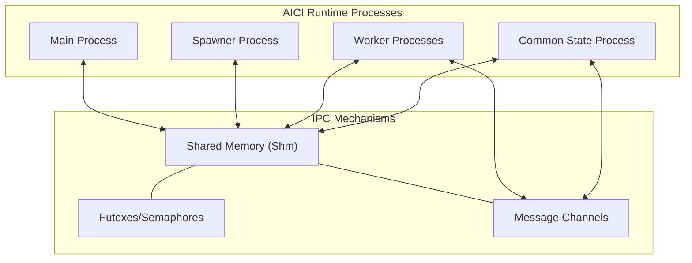

Sources: [aicirt/src/shm.rs:8-11](), [aicirt/src/futexshm.rs:20-23](), [aicirt/src/msgchannel.rs:5-9]()

## Shared Memory (SHM)

Shared memory is the foundation of AICI's IPC system, providing a way for processes to directly access the same memory region. This avoids the overhead of copying data between processes.

### Core Implementation

The `Shm` struct represents a shared memory region:

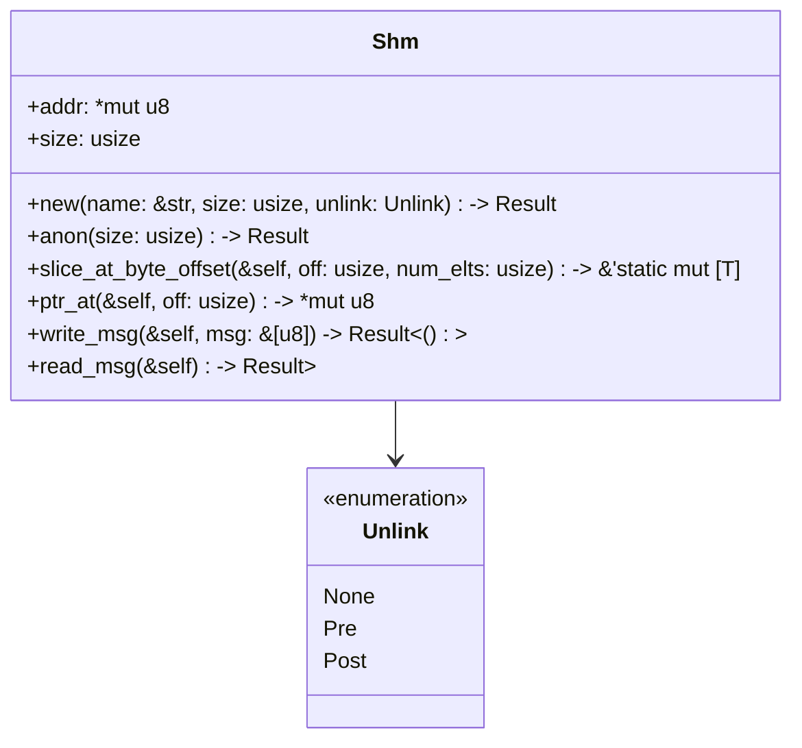

Sources: [aicirt/src/shm.rs:8-11](), [aicirt/src/shm.rs:16-21](), [aicirt/src/shm.rs:23-56](), [aicirt/src/shm.rs:58-81]()

### Creating Shared Memory

Shared memory can be created in two ways:

1. **Named Shared Memory** - Created with a name that other processes can use to access it
2. **Anonymous Shared Memory** - Created without a name, typically for use within a single process

The `Unlink` enum controls when the shared memory object is unlinked from the filesystem:
- `None`: Never unlink
- `Pre`: Unlink before creating (useful for cleaning up previous instances)
- `Post`: Unlink after creating (the memory remains accessible to processes that have already opened it)

Sources: [aicirt/src/shm.rs:16-21](), [aicirt/src/shm.rs:24-28](), [aicirt/src/shm.rs:58-81]()

### Memory Operations

The `Shm` struct provides methods for:

1. **Direct Memory Access** - Using `ptr_at` and `slice_at_byte_offset` to access specific regions
2. **Message Passing** - Using `write_msg` and `read_msg` for simple message passing

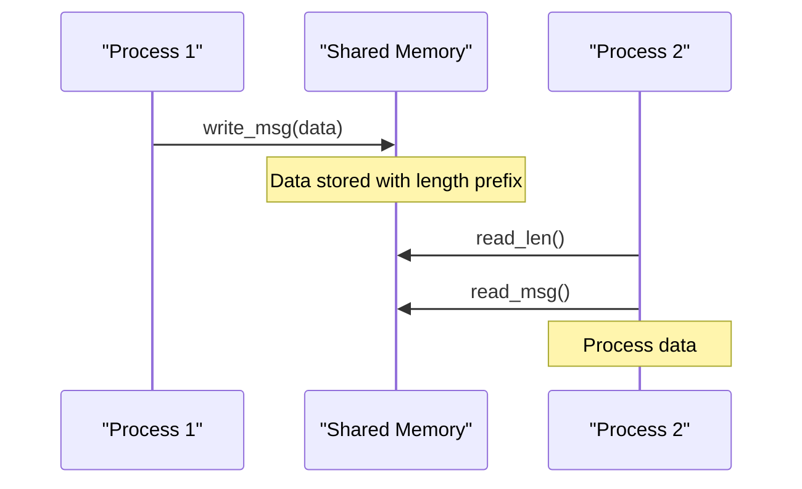

Sources: [aicirt/src/shm.rs:88-93](), [aicirt/src/shm.rs:95-97](), [aicirt/src/shm.rs:106-117](), [aicirt/src/shm.rs:119-144]()

### Memory Allocation

The `ShmAllocator` provides a simple allocation system on top of shared memory, allowing processes to allocate and free blocks of memory within the shared region.

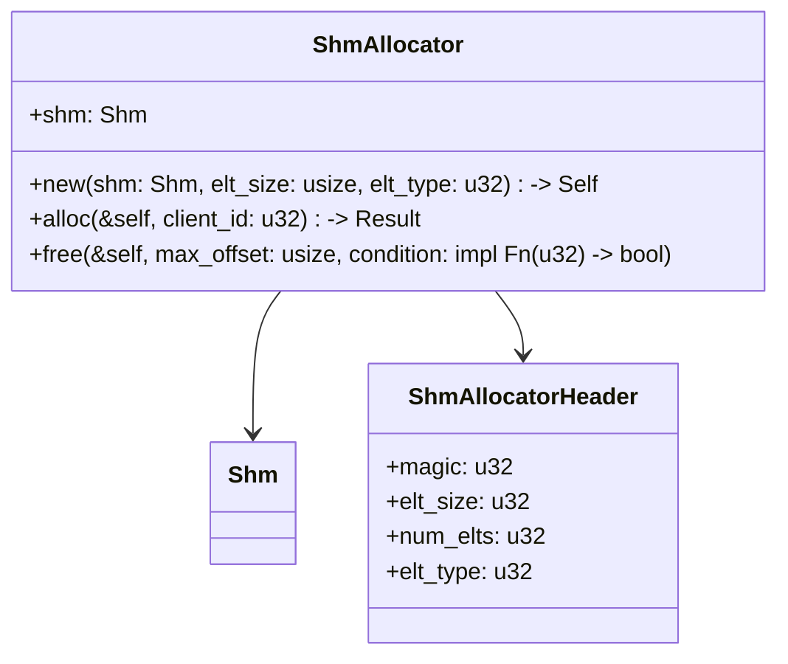

Sources: [aicirt/src/shm.rs:155-157](), [aicirt/src/shm.rs:159-165](), [aicirt/src/shm.rs:172-184](), [aicirt/src/shm.rs:251-270]()

## Synchronization Primitives

AICI uses two types of synchronization primitives:

1. **Semaphores** - POSIX-style semaphores for process synchronization
2. **Futexes** - Fast user-space mutexes for efficient thread synchronization

### Semaphores

Semaphores provide a way to control access to shared resources. The `Semaphore` struct wraps the POSIX semaphore API:

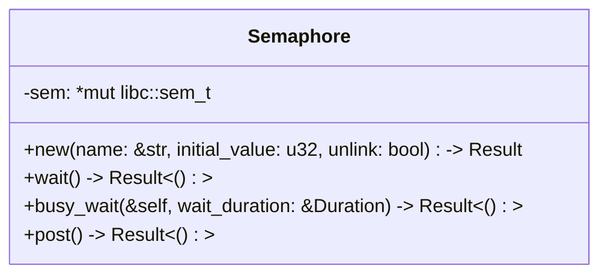

The semaphore implementation supports:
- **Named semaphores** - Created with a name that other processes can use to access it
- **Busy waiting** - Spinning for a short duration before blocking, which can reduce latency

Sources: [aicirt/src/semaphore.rs:8-10](), [aicirt/src/semaphore.rs:17-32](), [aicirt/src/semaphore.rs:34-73]()

### Futexes

Futexes (Fast User-space Mutexes) provide a more efficient synchronization mechanism than semaphores for many use cases. The implementation differs between Linux and macOS:

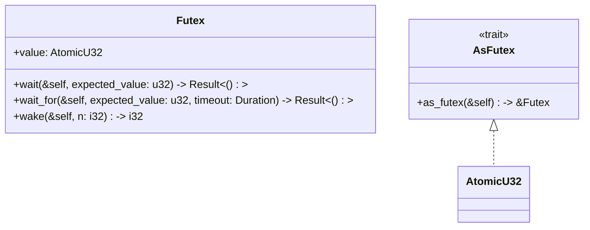

The `AsFutex` trait allows converting an `AtomicU32` into a futex, enabling atomic operations and efficient waiting.

Sources: [aicirt/src/futexshm.rs:10-18](), [aicirt/src/macos.rs:7-17](), [aicirt/src/macos.rs:19-79]()

## Message Channels

Message channels provide a higher-level abstraction for passing messages between processes. AICI implements two types of message channels:

1. **MessageChannel** - A simple channel using shared memory and semaphores
2. **FutexShm Channels** - More efficient channels using futexes for synchronization

### MessageChannel

The `MessageChannel` combines shared memory with semaphores to create a synchronized message passing channel:

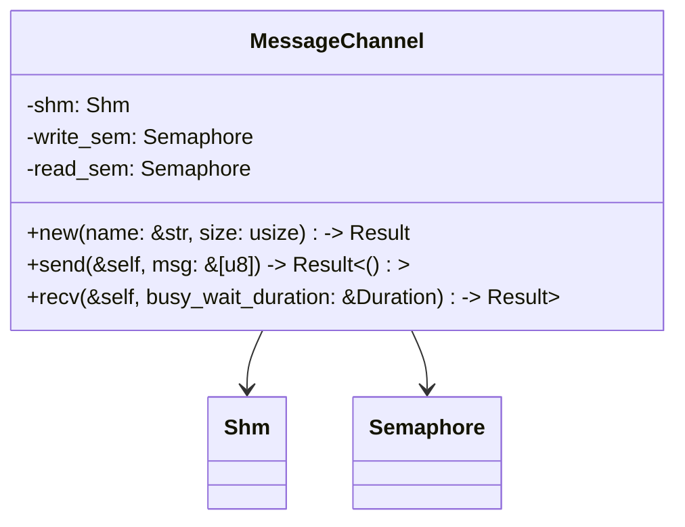

The message flow in a `MessageChannel` is:

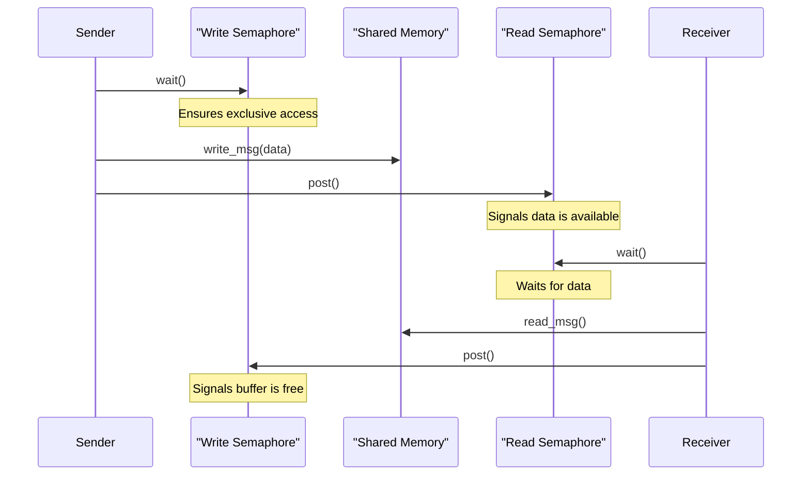

Sources: [aicirt/src/msgchannel.rs:5-9](), [aicirt/src/msgchannel.rs:22-42](), [aicirt/src/msgchannel.rs:44-50](), [aicirt/src/msgchannel.rs:83-88]()

### FutexShm Channels

The `futexshm` module implements more efficient channels using futexes instead of semaphores:

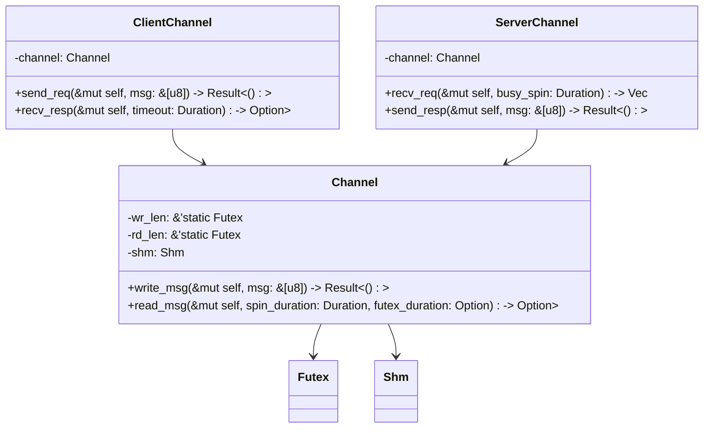

These channels are optimized for client-server communication patterns and support:
- **Typed channels** - For serializing and deserializing structured data
- **Efficient waiting** - Using a combination of spinning and futex waiting to minimize latency

Sources: [aicirt/src/futexshm.rs:25-171](), [aicirt/src/futexshm.rs:173-199](), [aicirt/src/futexshm.rs:201-233]()

### Typed Channels

For higher-level communication, AICI provides typed channels that automatically handle serialization and deserialization:

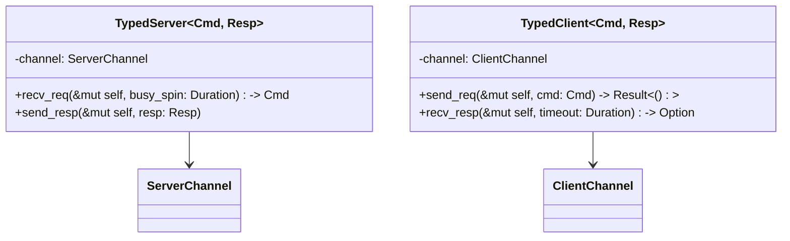

These typed channels use the `bincode` serialization format to convert between Rust types and raw bytes.

Sources: [aicirt/src/futexshm.rs:235-262](), [aicirt/src/futexshm.rs:264-296](), [aicirt/src/futexshm.rs:299-325]()

## Performance Considerations

The AICI IPC system is designed for high performance with several optimizations:

1. **Busy Waiting** - Short spin loops before blocking to reduce latency
2. **Memory Layout** - Careful alignment and padding to avoid false sharing
3. **Minimal Copying** - Direct access to shared memory where possible

The system includes benchmarking tools to measure and optimize IPC performance:

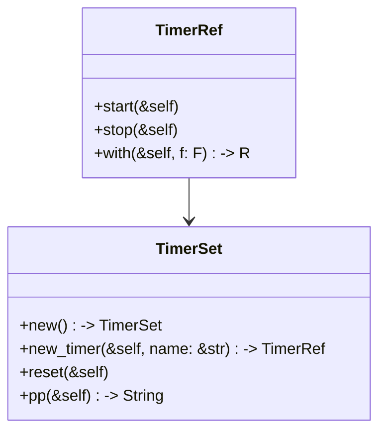

Sources: [aicirt/src/bench.rs:14-83](), [aicirt/src/bench.rs:20-24](), [aicirt/src/bench.rs:134-161]()

## Platform Compatibility

The IPC system is designed to work on both Linux and macOS, with platform-specific implementations where necessary:

- **Linux** - Uses native Linux futexes
- **macOS** - Uses a custom implementation based on ulock primitives

This abstraction ensures consistent behavior across platforms while leveraging platform-specific optimizations.

Sources: [aicirt/src/futexshm.rs:10-18](), [aicirt/src/macos.rs:7-17](), [aicirt/src/macos.rs:19-79]()

## Usage Patterns

The IPC mechanisms are used in several key patterns throughout the AICI system:

### Client-Server Communication

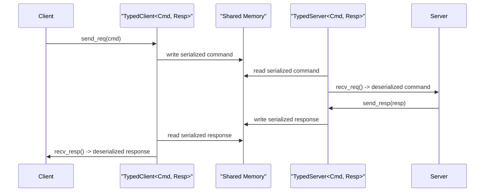

### Worker Coordination

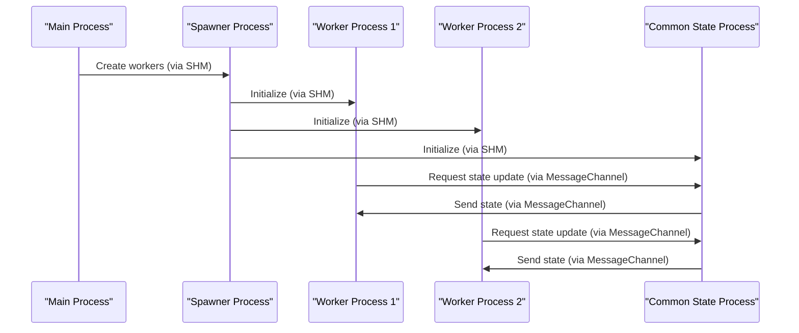

Sources: [aicirt/src/futexshm.rs:235-262](), [aicirt/src/futexshm.rs:264-296](), [aicirt/src/msgchannel.rs:44-50](), [aicirt/src/msgchannel.rs:83-88]()

## Summary

The AICI inter-process communication system provides a robust and efficient foundation for the multi-process architecture of the AICI runtime. By combining shared memory with appropriate synchronization primitives, it enables high-performance communication between processes while maintaining isolation and security.

Key components include:
- **Shared Memory (Shm)** - For direct memory access between processes
- **Semaphores and Futexes** - For synchronization
- **Message Channels** - For structured communication
- **Typed Channels** - For type-safe serialized communication

These components work together to support the complex interactions required by the AICI controller system while minimizing overhead.

---

