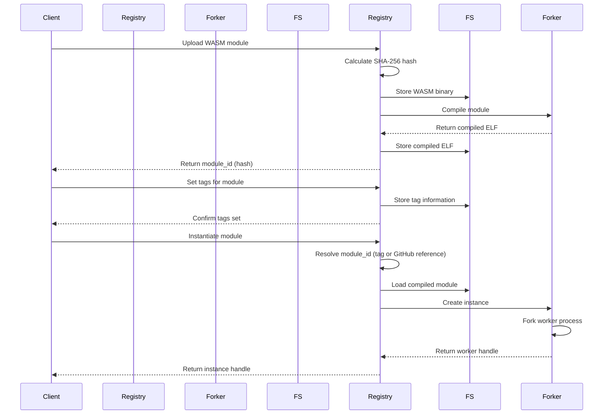
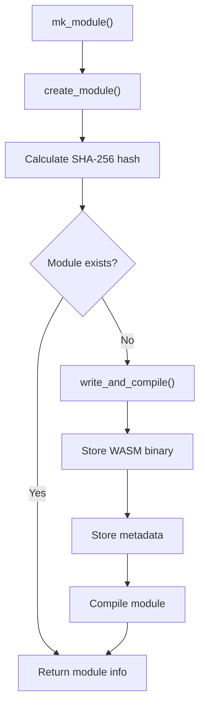
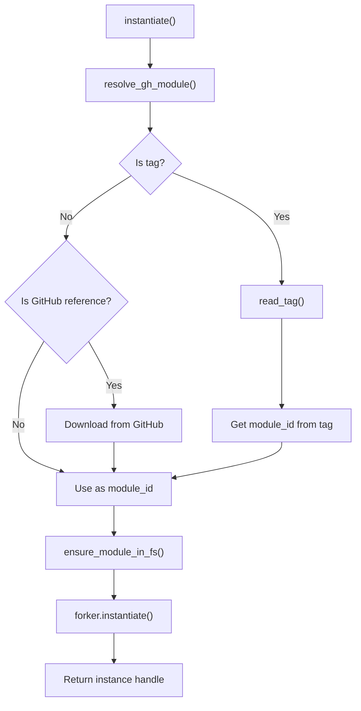

<!-- source: DeepWiki mcp.deepwiki.com · repo microsoft/aici · page 2.3 Module Registry · fetched 2026-10-26 -->

# Module Registry

<details>
<summary>Relevant source files</summary>

The following files were used as context for generating this wiki page:

- [aicirt/src/api.rs](aicirt/src/api.rs)
- [aicirt/src/hostimpl.rs](aicirt/src/hostimpl.rs)
- [aicirt/src/main.rs](aicirt/src/main.rs)
- [aicirt/src/moduleinstance.rs](aicirt/src/moduleinstance.rs)
- [aicirt/src/worker.rs](aicirt/src/worker.rs)

</details>


The Module Registry is a core component of the AICI (Artificial Intelligence Controller Interface) system that manages WebAssembly (WASM) modules. It handles the storage, compilation, tagging, and instantiation of WASM controllers that are used to guide LLM token generation.

This document focuses on how WASM modules are stored, tagged, and instantiated within the AICI runtime. For information about the WASM controllers themselves, see [Controllers](#3).

Sources: [aicirt/src/main.rs:159-573]()

## Overview

The Module Registry maintains a repository of compiled WASM modules that can be loaded and instantiated to control LLM token generation. It provides functionality for:

1. Uploading and compiling WASM modules
2. Tagging modules with human-readable names
3. Resolving GitHub module references
4. Instantiating modules for use in token generation

The registry stores modules in a local cache directory, identified by their SHA-256 hash, and maintains metadata about each module.

Sources: [aicirt/src/main.rs:170-181](), [aicirt/src/main.rs:209-220]()

## Architecture

### Module Registry Structure

```mermaid
classDiagram
    class "ModuleRegistry" {
        +wasm_ctx: Arc<WasmContext>
        +cache_path: PathBuf
        +modules: Arc<Mutex<HashMap<String, ModuleStatus>>>
        +req_instances: Arc<Mutex<HashMap<String, SeqWorkerHandle>>>
        +forker: Arc<Mutex<WorkerForker>>
        +new(wasm_ctx, shm): ModuleRegistry
        +create_module(wasm_bytes, auth): MkModuleResp
        +set_tags(req, auth): Value
        +instantiate(req): Value
        +resolve_gh_module(module_id, wasm_override): String
    }

    class "ModuleStatus" {
        <<enumeration>>
        Missing
        Locked
        Ready
    }

    class "WasmContext" {
        +engine: wasmtime::Engine
        +linker: Arc<wasmtime::Linker<ModuleData>>
        +globals: GlobalInfo
        +limits: AiciLimits
        +timers: TimerSet
        +deserialize_module(path): wasmtime::Module
    }

    class "WorkerForker" {
        +limits: AiciLimits
        +fork_worker: ForkerHandle
        +instantiate(req, module_path): (SeqWorkerHandle, SequenceResult)
        +compile(wasm): Vec<u8>
    }

    "ModuleRegistry" --> "ModuleStatus" : tracks status
    "ModuleRegistry" --> "WasmContext" : uses
    "ModuleRegistry" --> "WorkerForker" : uses for instantiation
```

Sources: [aicirt/src/main.rs:172-181](), [aicirt/src/moduleinstance.rs:20-98](), [aicirt/src/worker.rs:556-781]()

### Module Lifecycle



Sources: [aicirt/src/main.rs:300-365](), [aicirt/src/main.rs:574-592](), [aicirt/src/worker.rs:671-758]()

## Key Components

### Module Storage

The Module Registry stores modules in a local cache directory with the following structure:

- `{cache_path}/{module_id}.wasm` - Original WASM binary
- `{cache_path}/{module_id}.elf` - Compiled module (serialized Wasmtime module)
- `{cache_path}/{module_id}-sys.json` - Module metadata
- `{cache_path}/tags/{tag_name}.json` - Tag information

Where `module_id` is the SHA-256 hash of the WASM binary content.

Sources: [aicirt/src/main.rs:240-260]()

### Module Status Tracking

The registry tracks the status of each module using a thread-safe hash map with the following states:

- `Missing`: Module is not in the registry
- `Locked`: Module is being compiled
- `Ready`: Module is compiled and ready for use

This status tracking prevents concurrent compilation of the same module and ensures thread safety.

Sources: [aicirt/src/main.rs:165-169](), [aicirt/src/main.rs:223-238]()

### Module Compilation

When a new module is uploaded or requested, the registry:

1. Checks if the module exists in the cache
2. If not, compiles the WASM module to a serialized Wasmtime module
3. Stores the compiled module in the cache

Compilation is performed in a separate process to isolate memory usage and prevent crashes.

Sources: [aicirt/src/main.rs:262-284](), [aicirt/src/worker.rs:759-781]()

## Module Operations

### Module Upload



Sources: [aicirt/src/main.rs:300-372]()

### Module Tagging

The registry supports tagging modules with human-readable names. Tags are stored as JSON files in the `tags` subdirectory of the cache. Each tag file contains:

- The module ID it points to
- When it was updated
- Who updated it
- Size information

Tags allow users to reference modules by name instead of their hash.

Sources: [aicirt/src/main.rs:374-447]()

### GitHub Module Resolution

The registry supports referencing modules hosted on GitHub using the format:

```
gh:owner/repo/selector[/version]
```

Where:
- `owner` is the GitHub username or organization
- `repo` is the repository name
- `selector` is used to filter WASM files in the release
- `version` is optional and can be "latest" or a version tag like "v1.0"

The registry will download the module from GitHub, cache it locally, and return the module ID.

Sources: [aicirt/src/main.rs:449-573]()

### Module Instantiation



Sources: [aicirt/src/main.rs:574-592](), [aicirt/src/worker.rs:694-758]()

## Implementation Details

### Module Compilation Process

The compilation process is isolated in a separate process to prevent memory issues:

1. The main process forks a worker process
2. The worker process compiles the WASM module using Wasmtime
3. The compiled module is serialized and stored in the cache
4. The worker process exits

This isolation prevents memory fragmentation and crashes in the main process.

Sources: [aicirt/src/worker.rs:759-781](), [aicirt/src/worker.rs:585-635]()

### Thread Safety

The Module Registry uses several synchronization mechanisms to ensure thread safety:

- `Arc<Mutex<HashMap<...>>>` for the modules status map
- `Arc<Mutex<HashMap<...>>>` for request instances
- `Arc<Mutex<WorkerForker>>` for the worker forker

These ensure that concurrent operations on the registry are properly synchronized.

Sources: [aicirt/src/main.rs:172-181]()

### Error Handling

The registry implements robust error handling:

- Compilation errors are captured and reported
- Missing modules trigger appropriate error responses
- Permission checks are enforced for module uploads and tagging
- Network errors during GitHub module resolution are handled gracefully

Sources: [aicirt/src/main.rs:285-299](), [aicirt/src/main.rs:961-1024]()

## API

### Module Creation

```
POST /api/mk_module
{
  "binary": "<base64-encoded WASM binary>"
}
```

Response:
```
{
  "module_id": "<SHA-256 hash>",
  "wasm_size": <size in bytes>,
  "compiled_size": <size in bytes>,
  "time": <compilation time in ms>
}
```

Sources: [aicirt/src/main.rs:367-372](), [aicirt/src/api.rs:99-110]()

### Tag Management

```
POST /api/set_tags
{
  "module_id": "<module_id>",
  "tags": ["tag1", "tag2", ...]
}
```

Response:
```
{
  "tags": [
    {
      "tag": "tag1",
      "module_id": "<module_id>",
      "updated_at": <unix timestamp>,
      "updated_by": "<username>",
      "wasm_size": <size in bytes>,
      "compiled_size": <size in bytes>
    },
    ...
  ]
}
```

Sources: [aicirt/src/main.rs:374-423](), [aicirt/src/api.rs:113-131]()

### Module Instantiation

```
POST /api/instantiate
{
  "req_id": "<request_id>",
  "prompt": "<prompt text>" or [<token_ids>],
  "module_id": "<module_id or tag or gh:reference>",
  "module_arg": <JSON argument to pass to module>
}
```

Response:
```
{
  "result": <initialization result>,
  "error": "<error message if any>",
  "storage": <storage commands>,
  "logs": "<module logs>",
  "micros": <execution time in microseconds>
}
```

Sources: [aicirt/src/main.rs:574-592](), [aicirt/src/api.rs:133-141](), [aicirt/src/api.rs:56-97]()

## Security Considerations

The Module Registry implements several security measures:

1. Module uploads can be restricted with the `--restricted` flag
2. GitHub downloads can be disabled
3. Tag names are validated and users can only set tags with their own prefix
4. Modules are executed in isolated processes with memory limits
5. Execution time limits are enforced

Sources: [aicirt/src/main.rs:374-400](), [aicirt/src/main.rs:490-497](), [aicirt/src/moduleinstance.rs:184-223]()

## Integration with AICI Runtime

The Module Registry is a core component of the AICI runtime and integrates with other components:

- It uses the `WasmContext` for module compilation and execution
- It interacts with the `WorkerForker` to create isolated worker processes
- It provides module instances to the `Stepper` for token generation control

Sources: [aicirt/src/main.rs:637-927](), [aicirt/src/worker.rs:671-693]()

---

