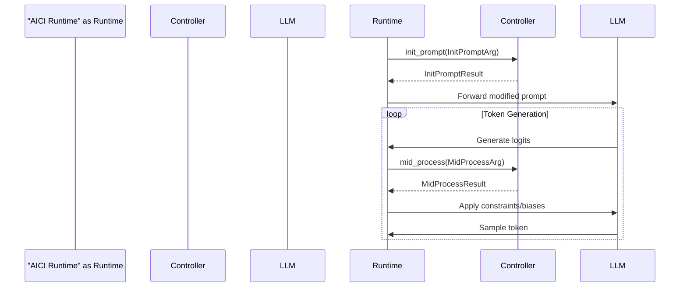
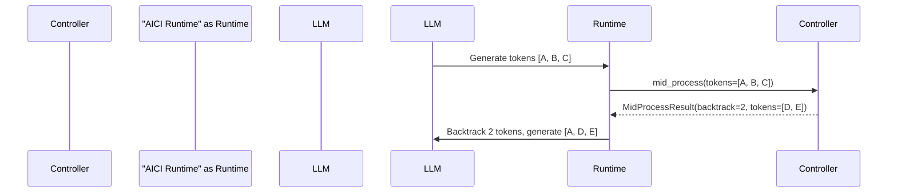
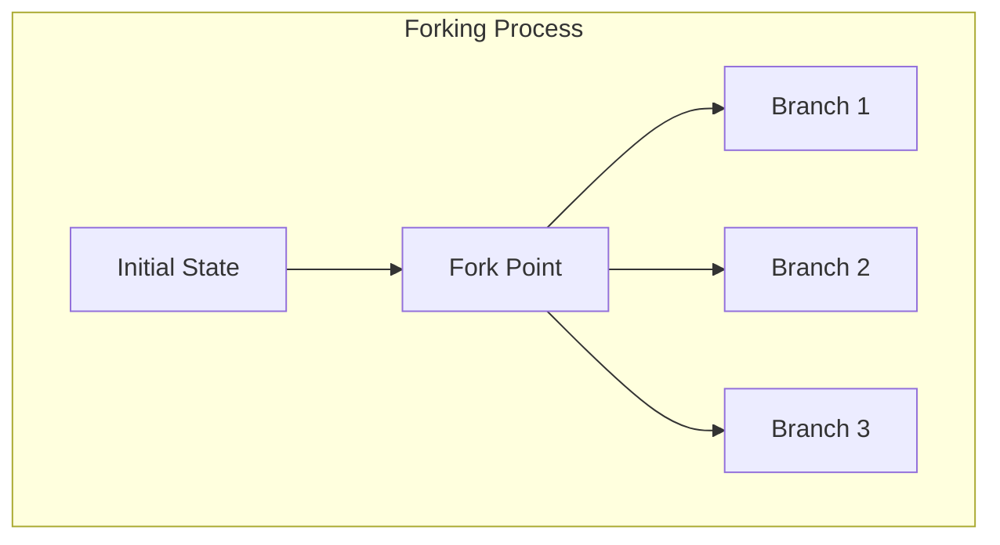

<!-- source: DeepWiki mcp.deepwiki.com · repo microsoft/aici · page 3 Controllers · fetched 2026-10-26 -->

# Controllers

<details>
<summary>Relevant source files</summary>

The following files were used as context for generating this wiki page:

- [controllers/aici_abi/src/cfg.rs](controllers/aici_abi/src/cfg.rs)
- [controllers/aici_abi/src/dlex.rs](controllers/aici_abi/src/dlex.rs)
- [controllers/aici_abi/src/host.rs](controllers/aici_abi/src/host.rs)
- [controllers/aici_abi/src/lib.rs](controllers/aici_abi/src/lib.rs)
- [controllers/declctrl/src/declctrl.rs](controllers/declctrl/src/declctrl.rs)
- [controllers/jsctrl/src/jsctrl.rs](controllers/jsctrl/src/jsctrl.rs)
- [controllers/pyctrl/src/pyctrl.rs](controllers/pyctrl/src/pyctrl.rs)

</details>


This page provides an overview of the controller system in AICI (Artificial Intelligence Controller Interface). Controllers are WebAssembly modules that implement custom logic for controlling token generation during LLM inference. They allow for fine-grained control over the generation process through constraints, backtracking, and other mechanisms.

For information about the AICI Runtime that executes these controllers, see [AICI Runtime (aicirt)](#2).

## Controller Architecture

Controllers in AICI are WebAssembly (WASM) modules that implement the `AiciCtrl` trait defined in the AICI ABI. This trait defines the interface that all controllers must implement to interact with the AICI runtime.

```mermaid
classDiagram
    class "AiciCtrl" {
        +init_prompt(arg: InitPromptArg) -> InitPromptResult
        +mid_process(arg: MidProcessArg) -> MidProcessResult
    }
    
    class "Controller" {
        +WebAssembly Module
        +Implements AiciCtrl
    }
    
    class "AICI Runtime" {
        +Loads controllers
        +Manages execution
        +Communicates with LLM
    }
    
    "Controller" --|> "AiciCtrl" : implements
    "AICI Runtime" --> "Controller" : executes
```

Sources: [controllers/aici_abi/src/lib.rs:135-176]()

The `AiciCtrl` trait defines two main methods:

1. `init_prompt`: Called with the initial prompt tokens. This allows the controller to modify the prompt before it's sent to the LLM.
2. `mid_process`: Called during token generation. This is where the controller can influence the generation process by applying constraints, biasing logits, or performing other operations.

## Controller Types

AICI supports several types of controllers, each with its own implementation approach and use cases.

```mermaid
graph TD
    subgraph "Controller Types"
        pyctrl["Python Controller (pyctrl)"]
        jsctrl["JavaScript Controller (jsctrl)"]
        declctrl["Declarative Controller (declctrl)"]
    end
    
    subgraph "AICI ABI"
        abi["AiciCtrl Trait"]
    end
    
    pyctrl --> abi : implements
    jsctrl --> abi : implements
    declctrl --> abi : implements
    
    subgraph "Features"
        constraints["Constraint System"]
        backtracking["Backtracking"]
        forking["Forking"]
        storage["Variable Storage"]
    end
    
    pyctrl --> constraints
    pyctrl --> backtracking
    pyctrl --> forking
    pyctrl --> storage
    
    jsctrl --> constraints
    jsctrl --> backtracking
    jsctrl --> forking
    jsctrl --> storage
    
    declctrl --> constraints
    declctrl --> backtracking
    declctrl --> forking
    declctrl --> storage
```

Sources: [controllers/pyctrl/src/pyctrl.rs:1-50](), [controllers/jsctrl/src/jsctrl.rs:1-50](), [controllers/declctrl/src/declctrl.rs:1-50]()

### Python Controller (pyctrl)

The Python controller allows writing control logic in Python. It embeds a Python interpreter (RustPython) and exposes an API for controlling token generation.

Key components:
- `Runner`: Implements the `AiciCtrl` trait and manages the Python interpreter
- `_aici` module: Exposes AICI functionality to Python code
- Constraint system: Allows defining constraints for token generation

Sources: [controllers/pyctrl/src/pyctrl.rs:384-669]()

### JavaScript Controller (jsctrl)

The JavaScript controller allows writing control logic in JavaScript. It embeds a JavaScript engine (QuickJS) and exposes an API similar to the Python controller.

Key components:
- `Runner`: Implements the `AiciCtrl` trait and manages the JavaScript engine
- `aici_mod` module: Exposes AICI functionality to JavaScript code
- Similar constraint system to the Python controller

Sources: [controllers/jsctrl/src/jsctrl.rs:477-577]()

### Declarative Controller (declctrl)

The declarative controller allows defining generation logic using a declarative JSON specification. It's designed for simpler use cases where a full programming language isn't needed.

Key components:
- JSON-based specification language
- Support for regex and context-free grammar constraints
- Variable storage and manipulation
- Backtracking and forking capabilities

Sources: [controllers/declctrl/src/declctrl.rs:1146-1252]()

## Controller Lifecycle

Controllers follow a specific lifecycle during LLM inference, with different methods called at different stages of the generation process.



Sources: [controllers/aici_abi/src/lib.rs:31-127]()

1. **Initialization**: The controller's `init_prompt` method is called with the initial prompt tokens. The controller can modify the prompt before it's sent to the LLM.

2. **Token Generation**: For each token generation step:
   - The controller's `mid_process` method is called with information about the current state
   - The controller returns a `MidProcessResult` containing constraints, biases, or other operations
   - The AICI runtime applies these constraints/biases to the LLM's logits
   - The LLM samples a token based on the modified logits

3. **Termination**: The generation process continues until the controller returns a stop signal or the LLM generates an EOS token.

## Controller ABI

The AICI ABI (Application Binary Interface) defines the interface between controllers and the AICI runtime. It provides structures and functions for controllers to interact with the runtime.

### Key Structures

```mermaid
classDiagram
    class "InitPromptArg" {
        +prompt: Vec<TokenId>
    }
    
    class "InitPromptResult" {
        +prompt: Vec<TokenId>
    }
    
    class "MidProcessArg" {
        +backtrack: u32
        +tokens: Vec<TokenId>
        +sampled: Option<TokenId>
        +fork_group: Vec<SeqId>
    }
    
    class "MidProcessResult" {
        +branches: Vec<Branch<SimpleVob>>
    }
    
    class "Branch" {
        +sample_mask: Option<SimpleVob>
        +temperature: Option<f32>
        +splices: Vec<Splice>
    }
    
    class "Splice" {
        +when_sampled: Vec<TokenId>
        +backtrack: u32
        +ff_tokens: Vec<TokenId>
    }
    
    MidProcessResult --> Branch : contains
    Branch --> Splice : contains
```

Sources: [controllers/aici_abi/src/lib.rs:31-127]()

### Host Interface

The AICI ABI provides a host interface for controllers to interact with the runtime. This includes functions for:

- Tokenization and detokenization
- Variable storage
- Configuration access
- Logit bias manipulation

```mermaid
classDiagram
    class "HostInterface" {
        +arg_bytes() -> Vec<u8>
        +trie_bytes() -> Vec<u8>
        +return_logit_bias(vob: &SimpleVob) -> u32
        +process_arg_bytes() -> Vec<u8>
        +return_process_result(res: &[u8])
        +storage_cmd(cmd: StorageCmd) -> StorageResp
        +tokenize_bytes(s: &[u8]) -> Vec<TokenId>
        +self_seq_id() -> SeqId
        +eos_token() -> TokenId
        +get_config(name: &str) -> i32
        +stop() -> !
    }
    
    class "WasmHost" {
        +Implements HostInterface for WASM
    }
    
    class "VariableStorage" {
        +get(name: &str) -> Option<Vec<u8>>
        +set(name: &str, value: Vec<u8>)
        +append(name: &str, value: Vec<u8>)
    }
    
    WasmHost --|> HostInterface : implements
    HostInterface --> VariableStorage : uses
```

Sources: [controllers/aici_abi/src/host.rs:106-118](), [controllers/aici_abi/src/host.rs:312-358]()

## Constraint System

One of the key features of AICI controllers is the constraint system, which allows controlling which tokens can be generated at each step.

### Constraint Types

```mermaid
graph TD
    subgraph "Constraint Types"
        regex["Regex Constraints"]
        cfg["Context-Free Grammar"]
        substring["Substring Matching"]
        dynamic["Dynamic Lexer"]
    end
    
    subgraph "Implementation"
        recognizer["Recognizer Trait"]
        stackrec["StackRecognizer"]
    end
    
    regex --> recognizer : implements
    cfg --> recognizer : implements
    substring --> recognizer : implements
    dynamic --> recognizer : implements
    
    recognizer --> stackrec : used by
```

Sources: [controllers/aici_abi/src/lib.rs:9-20](), [controllers/aici_abi/src/cfg.rs:459-501](), [controllers/aici_abi/src/dlex.rs:228-266]()

1. **Regex Constraints**: Allow defining valid token sequences using regular expressions.
2. **Context-Free Grammar**: Allow defining valid token sequences using context-free grammars in YACC format.
3. **Substring Matching**: Allow matching specific substrings in the generated text.
4. **Dynamic Lexer**: Allow building a lexer dynamically for token recognition.

### Constraint Application

Constraints are applied during the `mid_process` method call. The controller can:

1. Create a constraint object based on a regex, grammar, or other specification
2. Apply the constraint to the current token generation step
3. Return a `MidProcessResult` with the constraint applied

## Variable Storage

AICI controllers can store and retrieve variables, allowing them to maintain state across token generation steps.

```mermaid
classDiagram
    class "VariableStorage" {
        +get(name: &str) -> Option<Vec<u8>>
        +set(name: &str, value: Vec<u8>)
        +append(name: &str, value: Vec<u8>)
    }
    
    class "StorageCmd" {
        +ReadVar { name: String }
        +WriteVar { name: String, value: Vec<u8>, op: StorageOp, when_version_is: Option<u64> }
    }
    
    class "StorageResp" {
        +ReadVar { version: u64, value: Vec<u8> }
        +VariableMissing {}
        +WriteVar { version: u64 }
    }
    
    class "StorageOp" {
        +Set
        +Append
    }
    
    VariableStorage --> StorageCmd : uses
    StorageCmd --> StorageOp : uses
    StorageCmd --> StorageResp : receives
```

Sources: [controllers/aici_abi/src/host.rs:232-308]()

The variable storage system provides:
- Key-value storage for arbitrary binary data
- Versioning to detect concurrent modifications
- Set and append operations
- Access from any controller type

## Advanced Features

### Backtracking

Controllers can backtrack to previous states in the generation process. This is useful for exploring alternative generation paths or correcting errors.



Sources: [controllers/aici_abi/src/lib.rs:52-79]()

Backtracking is implemented using the `backtrack` field in the `MidProcessArg` structure and the `Splice` mechanism in `Branch`.

### Forking

Controllers can fork the generation process into multiple branches, each with its own state and constraints.



Sources: [controllers/declctrl/src/declctrl.rs:1239-1245]()

Forking is implemented using the `branches` field in the `MidProcessResult` structure and the `fork_group` field in `MidProcessArg`.

## Controller Development

To develop a new controller, you need to:

1. Choose a controller type (Python, JavaScript, or Declarative)
2. Implement the `AiciCtrl` trait methods
3. Compile to WebAssembly
4. Register the controller with the AICI runtime

### Example: Python Controller

```python
import pyaici.server as aici

class MyController:
    def init_prompt(self, prompt):
        # Modify prompt if needed
        return prompt
    
    def mid_process(self, backtrack, tokens, fork_group):
        # Apply constraints or other operations
        result = aici.MidProcessResult()
        branch = aici.Branch()
        # Set up constraints
        result.branches.append(branch)
        return result

aici.register(MyController())
```

Sources: [controllers/pyctrl/src/pyctrl.rs:608-616]()

## Integration with AICI Runtime

Controllers are loaded and executed by the AICI runtime. The runtime:

1. Loads the WebAssembly module
2. Calls the controller's methods at appropriate times
3. Applies the controller's constraints and operations to the LLM's logits
4. Manages the controller's state across token generation steps

For more details on the AICI runtime, see [AICI Runtime (aicirt)](#2).

---

