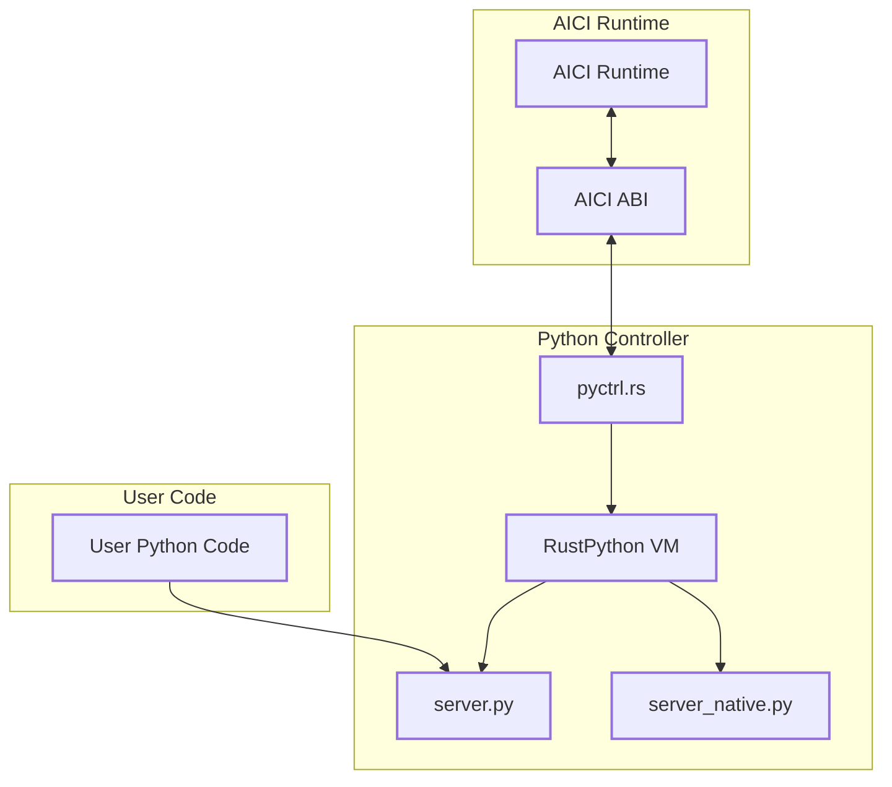
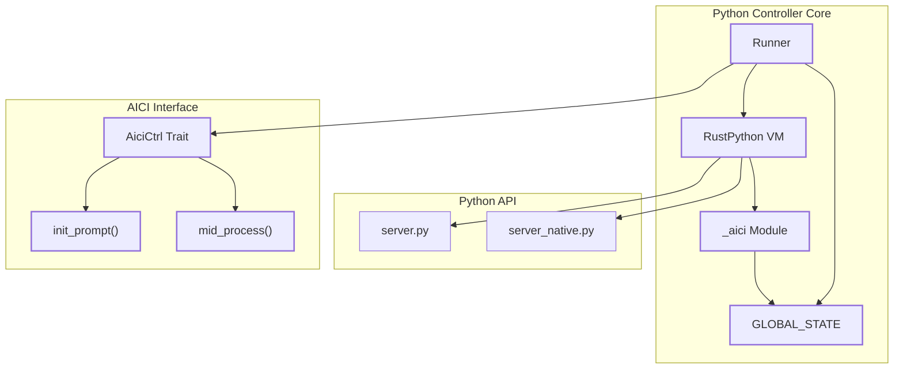
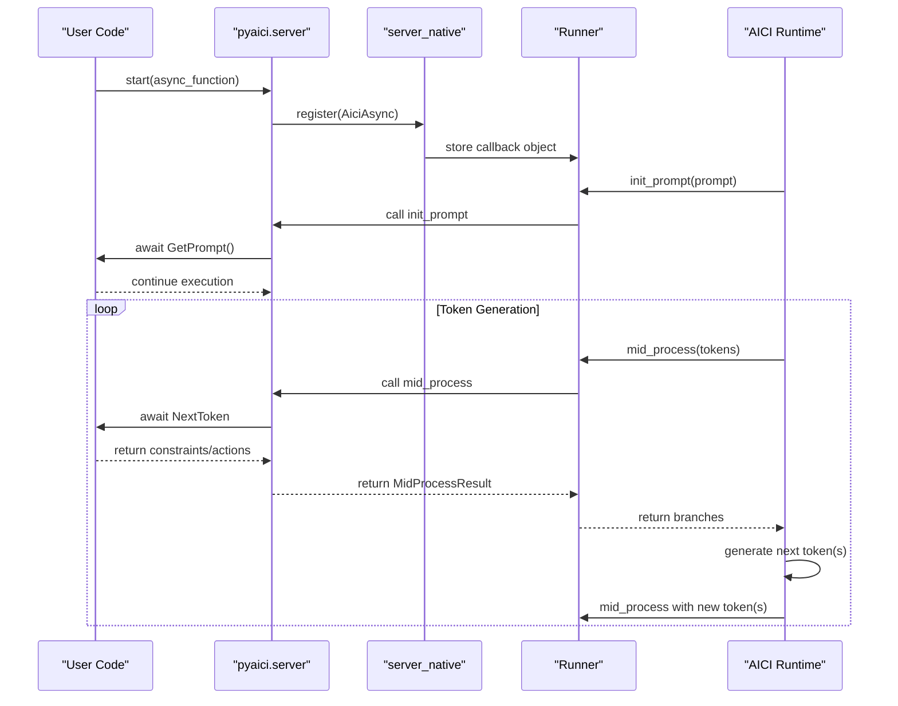
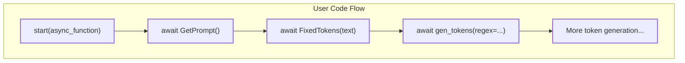
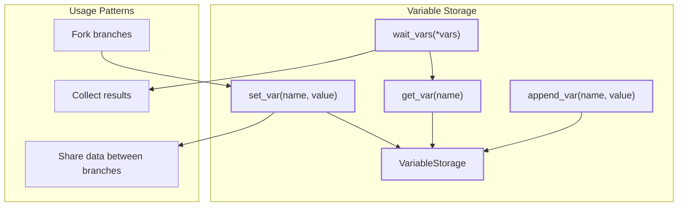
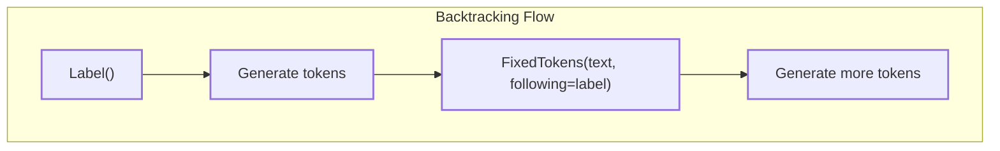
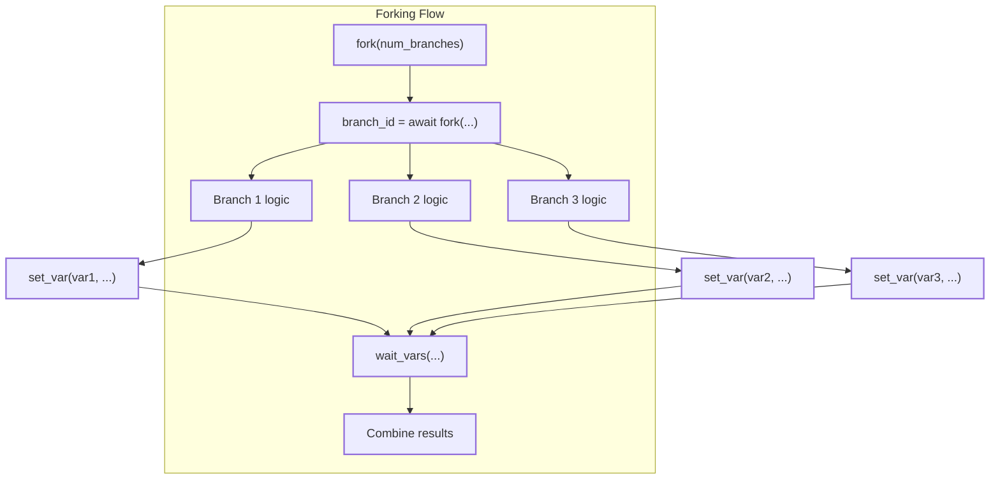
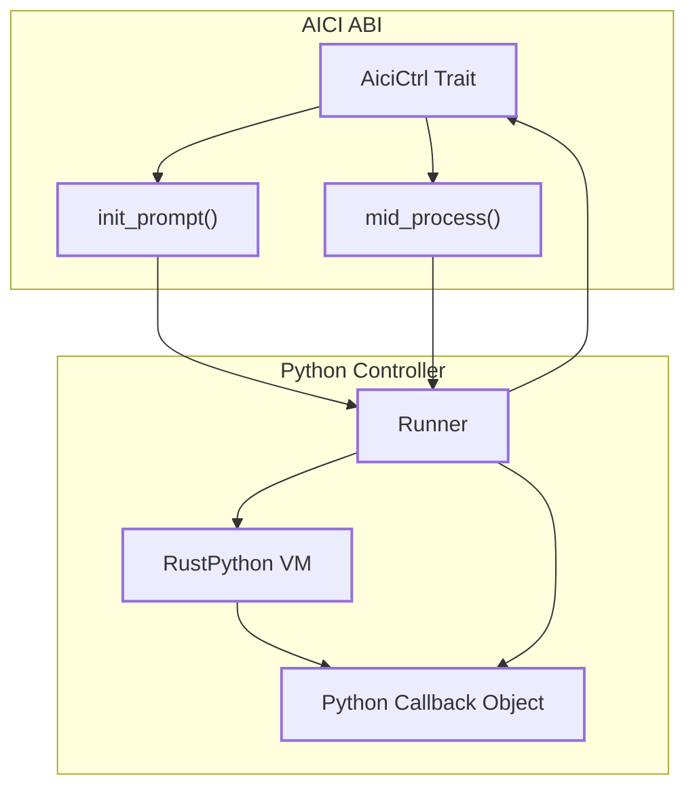

<!-- source: DeepWiki mcp.deepwiki.com · repo microsoft/aici · page 3.1 Python Controller (pyctrl) · fetched 2026-10-26 -->

# Python Controller (pyctrl)

<details>
<summary>Relevant source files</summary>

The following files were used as context for generating this wiki page:

- [controllers/aici_abi/src/cfg.rs](controllers/aici_abi/src/cfg.rs)
- [controllers/aici_abi/src/dlex.rs](controllers/aici_abi/src/dlex.rs)
- [controllers/aici_abi/src/host.rs](controllers/aici_abi/src/host.rs)
- [controllers/aici_abi/src/lib.rs](controllers/aici_abi/src/lib.rs)
- [controllers/declctrl/src/declctrl.rs](controllers/declctrl/src/declctrl.rs)
- [controllers/jsctrl/samples/aici-types.d.ts](controllers/jsctrl/samples/aici-types.d.ts)
- [controllers/jsctrl/src/jsctrl.rs](controllers/jsctrl/src/jsctrl.rs)
- [controllers/jsctrl/ts/aici.ts](controllers/jsctrl/ts/aici.ts)
- [controllers/jsctrl/ts/native.d.ts](controllers/jsctrl/ts/native.d.ts)
- [controllers/llguidance_ctrl/text_req.py](controllers/llguidance_ctrl/text_req.py)
- [controllers/pyctrl/samples/idents.py](controllers/pyctrl/samples/idents.py)
- [controllers/pyctrl/samples/test.py](controllers/pyctrl/samples/test.py)
- [controllers/pyctrl/src/pyctrl.rs](controllers/pyctrl/src/pyctrl.rs)
- [py/pyaici/jssrc.py](py/pyaici/jssrc.py)
- [py/pyaici/server.py](py/pyaici/server.py)
- [py/pyaici/server_native.py](py/pyaici/server_native.py)

</details>


The Python Controller (pyctrl) is a WebAssembly-based controller for the AICI (Artificial Intelligence Controller Interface) system that allows users to write token generation control logic in Python. It enables fine-grained control over LLM token generation through an asynchronous programming model.

For information about other controller types, see [Controllers](#3) or the specific implementations: [JavaScript Controller](#3.2), [Declarative Controller](#3.3), and [LLGuidance Controller](#3.4).

## Architecture Overview

The Python Controller embeds a Python interpreter (RustPython) within a WebAssembly module, allowing Python code to interact with the AICI runtime through a well-defined interface.



Sources:
- [controllers/pyctrl/src/pyctrl.rs:1-669]()
- [py/pyaici/server.py:1-633]()
- [py/pyaici/server_native.py:1-246]()

## Core Components

### RustPython Integration

The Python Controller uses RustPython, a Python interpreter implemented in Rust, to execute Python code within the WebAssembly environment. This allows Python code to be compiled to WebAssembly and run in the AICI runtime.



Sources:
- [controllers/pyctrl/src/pyctrl.rs:10-18]()
- [controllers/pyctrl/src/pyctrl.rs:384-450]()
- [controllers/pyctrl/src/pyctrl.rs:608-662]()

### Python API

The Python Controller provides a Python API through two main modules:

1. `pyaici.server` - The main module that user code interacts with
2. `pyaici.server_native` - A native module implemented in Rust that provides low-level functionality

These modules provide classes and functions for controlling token generation, including:

- Token constraints (regex, CFG, substring matching)
- Variable storage for sharing data between controller instances
- Backtracking and forking capabilities
- Asynchronous control flow

Sources:
- [py/pyaici/server.py:1-633]()
- [py/pyaici/server_native.py:1-246]()
- [controllers/pyctrl/src/pyctrl.rs:46-360]()

## Programming Model

The Python Controller uses an asynchronous programming model based on Python's `async`/`await` syntax. This allows for a natural expression of token generation control logic.



Sources:
- [py/pyaici/server.py:367-497]()
- [controllers/pyctrl/src/pyctrl.rs:608-662]()

### Asynchronous Control Flow

The Python Controller uses a coroutine-based approach where the user provides an asynchronous function that uses `await` to control token generation. The main components of this flow are:

1. `GetPrompt` - Used to receive the initial prompt
2. `NextToken` - Base class for token generation control
3. `FixedTokens` - Forces specific tokens to be generated
4. `ConstrainedToken` - Generates tokens that satisfy constraints

Example flow:



Sources:
- [py/pyaici/server.py:367-497]()
- [py/pyaici/server.py:138-162]()
- [py/pyaici/server.py:209-246]()
- [py/pyaici/server.py:252-286]()

## Key Classes and Functions

### Core Classes

| Class | Purpose |
|-------|---------|
| `Runner` | Implements the `AiciCtrl` trait and manages the Python VM |
| `AiciAsync` | Manages the asynchronous execution of user code |
| `NextToken` | Base class for token generation control |
| `FixedTokens` | Forces specific tokens to be generated |
| `ConstrainedToken` | Generates tokens that satisfy constraints |
| `TokenSet` | Represents a set of allowed tokens |
| `Constraint` | Base class for token constraints |

Sources:
- [controllers/pyctrl/src/pyctrl.rs:384-450]()
- [py/pyaici/server.py:367-497]()
- [py/pyaici/server.py:138-162]()
- [py/pyaici/server.py:209-246]()
- [py/pyaici/server.py:252-286]()

### Constraint Types

The Python Controller provides several types of constraints for controlling token generation:

| Constraint Type | Purpose |
|-----------------|---------|
| `RegexConstraint` | Constrains tokens to match a regular expression |
| `CfgConstraint` | Constrains tokens to match a context-free grammar |
| `SubStrConstraint` | Constrains tokens to be substrings of a template |
| `ChooseConstraint` | Constrains tokens to one of several options |
| `DynamicLexer` | Constrains tokens to be valid identifiers |

Sources:
- [controllers/pyctrl/src/pyctrl.rs:153-271]()
- [controllers/aici_abi/src/dlex.rs:1-266]()
- [controllers/aici_abi/src/cfg.rs:1-413]()
- [py/pyaici/server.py:522-552]()

### Key Functions

| Function | Purpose |
|----------|---------|
| `start(async_function)` | Starts the AICI loop with the given async function |
| `gen_tokens(...)` | Generates tokens with the given constraints |
| `gen_text(...)` | Generates text with the given constraints |
| `fixed(text)` | Forces next tokens to be exactly the given text |
| `fork(num_forks)` | Forks execution into multiple branches |
| `wait_vars(*vars)` | Waits for variables to be set |

Sources:
- [py/pyaici/server.py:479-497]()
- [py/pyaici/server.py:553-612]()
- [py/pyaici/server.py:309-323]()
- [py/pyaici/server.py:340-350]()

## Variable Storage

The Python Controller provides a variable storage system for sharing data between controller instances, particularly useful with forking.



Sources:
- [controllers/aici_abi/src/host.rs:312-358]()
- [controllers/pyctrl/src/pyctrl.rs:120-138]()
- [py/pyaici/server.py:340-350]()

## Advanced Features

### Backtracking

The Python Controller supports backtracking, which allows for modifying previously generated tokens. This is implemented through the `following` parameter of `FixedTokens`.



Sources:
- [py/pyaici/server.py:209-234]()
- [py/pyaici/server.py:500-520]()
- [controllers/pyctrl/samples/test.py:9-18]()

### Forking

The Python Controller supports forking, which allows for exploring multiple generation paths in parallel. This is implemented through the `fork` function.



Sources:
- [py/pyaici/server.py:309-323]()
- [controllers/pyctrl/samples/test.py:21-37]()

## Usage Examples

### Basic Example

```python
import pyaici.server as aici

async def main():
    # Get the initial prompt
    prompt = await aici.GetPrompt()
    
    # Generate fixed text
    await aici.FixedTokens("The answer is: ")
    
    # Generate text matching a regex
    answer = await aici.gen_text(regex=r"\d+")
    
    # Generate more fixed text
    await aici.FixedTokens(f"\nThe answer plus one is: {int(answer) + 1}")

# Start the AICI loop
aici.start(main())
```

Sources:
- [controllers/pyctrl/samples/test.py:177-212]()

### Constraint Example

```python
import pyaici.server as aici

async def main():
    await aici.FixedTokens("Here's a list of prime numbers: ")
    
    # Use regex constraint to generate numbers
    await aici.gen_tokens(regex=r"\d+(, \d+)*", max_tokens=20)
    
    # Use options constraint to choose from specific options
    await aici.FixedTokens("\nMy favorite number is ")
    await aici.gen_text(options=["42", "7", "3.14159"])

aici.start(main())
```

Sources:
- [controllers/pyctrl/samples/test.py:177-212]()

### Backtracking Example

```python
import pyaici.server as aici

async def main():
    await aici.FixedTokens("3+")
    
    # Create a label at the current position
    label = aici.Label()
    
    # Generate "2" and then a calculation result
    await aici.FixedTokens("2")
    await aici.gen_tokens(regex=r"=\d+\.", store_var="result1")
    
    # Backtrack to the label and generate "4" instead
    await aici.FixedTokens("4", following=label)
    await aici.gen_tokens(regex=r"=\d+\.", store_var="result2")

aici.start(main())
```

Sources:
- [controllers/pyctrl/samples/test.py:9-18]()

### Forking Example

```python
import pyaici.server as aici

async def main():
    await aici.FixedTokens("The word 'hello' in")
    
    # Fork into 3 branches
    branch_id = await aici.fork(3)
    
    if branch_id == 0:
        # Wait for variables from other branches
        french, german = await aici.wait_vars("french", "german")
        await aici.FixedTokens(f"{french} is the same as {german}.")
    elif branch_id == 1:
        # Generate German translation
        await aici.FixedTokens(" German is")
        await aici.gen_tokens(regex=r' "[^"\.]+"', store_var="german")
    elif branch_id == 2:
        # Generate French translation
        await aici.FixedTokens(" French is")
        await aici.gen_tokens(regex=r' "[^"\.]+"', store_var="french")

aici.start(main())
```

Sources:
- [controllers/pyctrl/samples/test.py:21-37]()

## Implementation Details

### AICI ABI Integration

The Python Controller implements the `AiciCtrl` trait from the AICI ABI, which defines the interface between controllers and the AICI runtime.



Sources:
- [controllers/aici_abi/src/lib.rs:135-176]()
- [controllers/pyctrl/src/pyctrl.rs:608-662]()

### Python VM Initialization

The Python Controller initializes the RustPython VM with the necessary modules and code:

1. Adds the native module `pyaici.server_native`
2. Adds the frozen module `pyaici.server`
3. Compiles and executes the user's Python code
4. Registers the callback object for AICI integration

Sources:
- [controllers/pyctrl/src/pyctrl.rs:384-450]()

### Token Generation Flow

The token generation flow in the Python Controller involves several steps:

1. The AICI runtime calls `mid_process` on the Runner
2. The Runner calls the Python callback object's `mid_process` method
3. The Python code processes the tokens and returns a `MidProcessResult`
4. The Runner converts the Python result to an AICI `MidProcessResult`
5. The AICI runtime uses the result to guide token generation

Sources:
- [controllers/pyctrl/src/pyctrl.rs:608-662]()
- [py/pyaici/server.py:444-467]()

## Limitations and Considerations

1. **Performance**: The Python Controller has higher overhead compared to other controllers due to the Python interpreter.
2. **Memory Usage**: The embedded Python VM requires more memory than native controllers.
3. **API Compatibility**: The Python API is designed to be similar to the JavaScript API, but there may be subtle differences.
4. **Error Handling**: Python exceptions are caught and printed, but may not provide detailed stack traces.
5. **Debugging**: Debugging Python code running in the WebAssembly environment can be challenging.

Sources:
- [controllers/pyctrl/src/pyctrl.rs:510-522]()
- [controllers/pyctrl/src/pyctrl.rs:443-447]()

## Conclusion

The Python Controller (pyctrl) provides a powerful and flexible way to control LLM token generation using Python. Its asynchronous programming model makes it intuitive to express complex token generation logic, while its integration with the AICI runtime enables fine-grained control over the generation process.

Key features include:
- Asynchronous control flow with `async`/`await`
- Various constraint types (regex, CFG, substring, options)
- Backtracking and forking capabilities
- Variable storage for sharing data between controller instances

For more complex use cases, consider using the Python Controller in combination with other AICI features like the [Declarative Controller](#3.3) or [LLGuidance Controller](#3.4).

---

