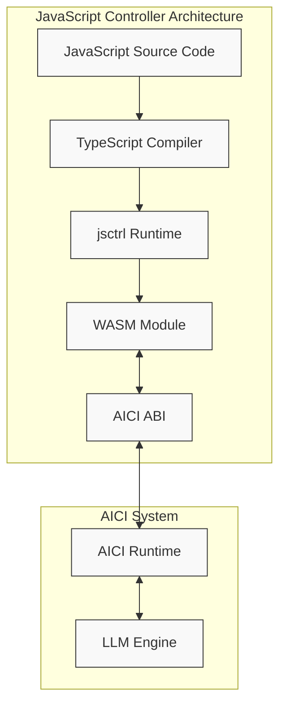
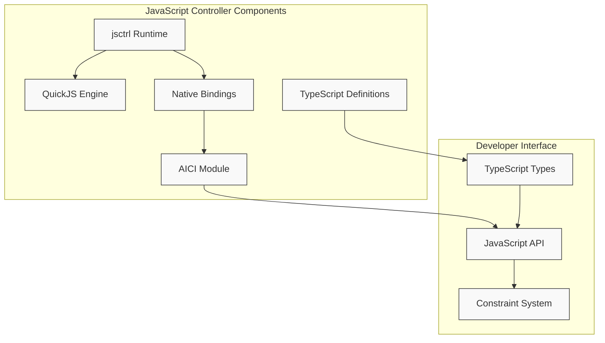
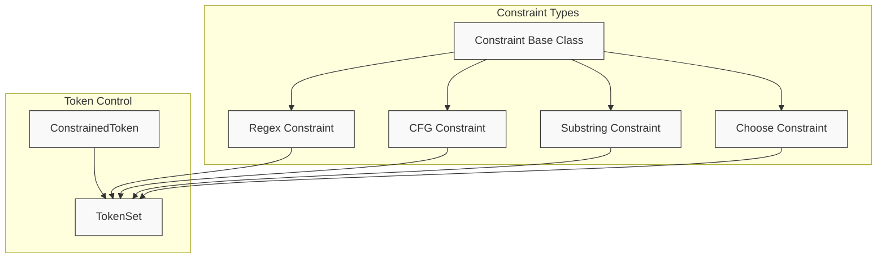
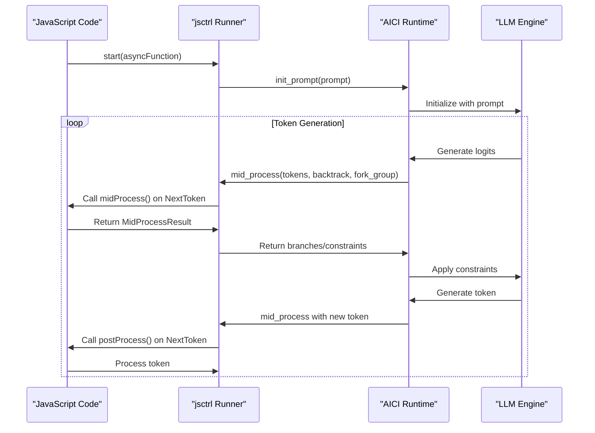
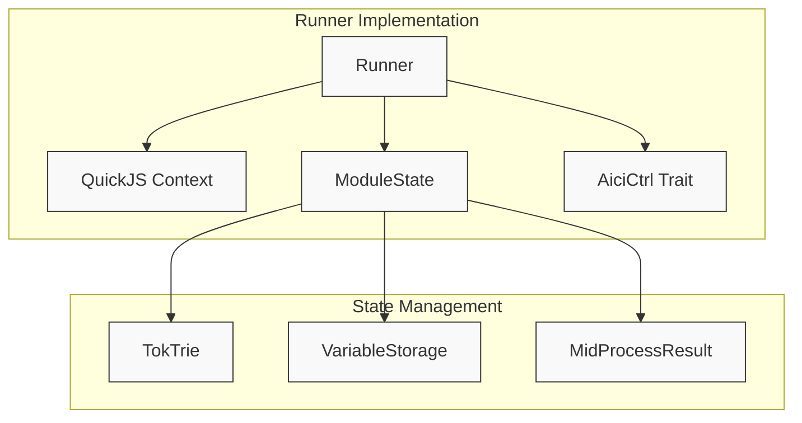
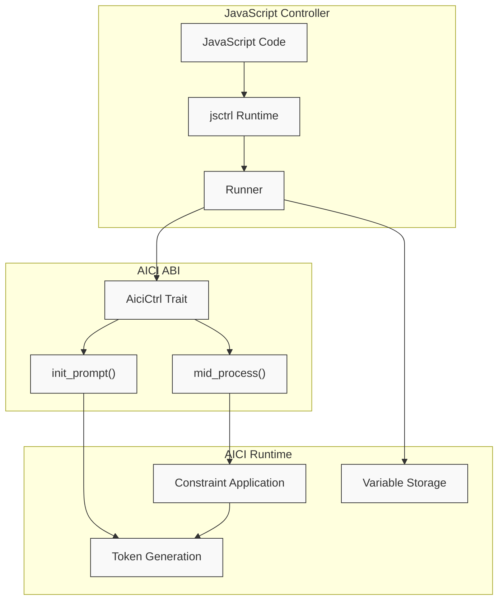

<!-- source: DeepWiki mcp.deepwiki.com · repo microsoft/aici · page 3.2 JavaScript Controller (jsctrl) · fetched 2026-10-26 -->

# JavaScript Controller (jsctrl)

<details>
<summary>Relevant source files</summary>

The following files were used as context for generating this wiki page:

- [controllers/aici_abi/src/cfg.rs](controllers/aici_abi/src/cfg.rs)
- [controllers/aici_abi/src/dlex.rs](controllers/aici_abi/src/dlex.rs)
- [controllers/aici_abi/src/host.rs](controllers/aici_abi/src/host.rs)
- [controllers/aici_abi/src/lib.rs](controllers/aici_abi/src/lib.rs)
- [controllers/declctrl/src/declctrl.rs](controllers/declctrl/src/declctrl.rs)
- [controllers/jsctrl/samples/aici-types.d.ts](controllers/jsctrl/samples/aici-types.d.ts)
- [controllers/jsctrl/src/jsctrl.rs](controllers/jsctrl/src/jsctrl.rs)
- [controllers/jsctrl/ts/aici.ts](controllers/jsctrl/ts/aici.ts)
- [controllers/jsctrl/ts/native.d.ts](controllers/jsctrl/ts/native.d.ts)
- [controllers/llguidance_ctrl/text_req.py](controllers/llguidance_ctrl/text_req.py)
- [controllers/pyctrl/samples/idents.py](controllers/pyctrl/samples/idents.py)
- [controllers/pyctrl/samples/test.py](controllers/pyctrl/samples/test.py)
- [controllers/pyctrl/src/pyctrl.rs](controllers/pyctrl/src/pyctrl.rs)
- [py/pyaici/jssrc.py](py/pyaici/jssrc.py)
- [py/pyaici/server.py](py/pyaici/server.py)
- [py/pyaici/server_native.py](py/pyaici/server_native.py)

</details>


The JavaScript Controller (jsctrl) is a WebAssembly-based controller for the AICI (Artificial Intelligence Controller Interface) system that allows developers to write token generation constraints in JavaScript. It provides a TypeScript/JavaScript API similar to the Python Controller (pyctrl) but with JavaScript syntax and semantics.

For information about other controller types, see:
- Python Controller [Python Controller (pyctrl)](#3.1)
- Declarative Controller [Declarative Controller (declctrl)](#3.3)
- LLGuidance Controller [LLGuidance Controller](#3.4)

## Overview

The JavaScript Controller enables fine-grained control over LLM token generation using JavaScript code. It compiles JavaScript/TypeScript code into a WebAssembly module that interfaces with the AICI runtime to guide token generation through constraints, token biasing, and direct token manipulation.



Sources: [controllers/jsctrl/src/jsctrl.rs:1-576](), [controllers/jsctrl/ts/aici.ts:1-1000]()

## Core Components

The JavaScript Controller consists of several key components:



Sources: [controllers/jsctrl/src/jsctrl.rs:1-100](), [controllers/jsctrl/ts/aici.ts:1-100](), [py/pyaici/jssrc.py:1-100]()

### QuickJS Engine

The JavaScript Controller uses the QuickJS JavaScript engine (via the rquickjs Rust bindings) to execute JavaScript code within the WebAssembly environment. This lightweight JavaScript engine provides ECMAScript 2020 compatibility while maintaining a small footprint suitable for embedding in WebAssembly.

Sources: [controllers/jsctrl/src/jsctrl.rs:11-14](), [controllers/jsctrl/src/jsctrl.rs:489-492]()

### Native Bindings

The controller provides native bindings to the AICI ABI through the `_aici` module, which exposes functionality for token manipulation, constraint creation, and variable storage.

Sources: [controllers/jsctrl/src/jsctrl.rs:247-438]()

### TypeScript Definitions

TypeScript type definitions provide code completion and type checking for developers writing JavaScript controllers. These definitions are automatically generated and included in the controller environment.

Sources: [py/pyaici/jssrc.py:22-558](), [controllers/jsctrl/samples/aici-types.d.ts:1-291]()

## JavaScript API

The JavaScript Controller provides an API similar to the Python Controller but with JavaScript syntax and idioms.

### Core Functions

| Function | Description |
|----------|-------------|
| `start(f)` | Starts the AICI loop with the provided async function |
| `fixed(text)` | Forces next tokens to be exactly the given text |
| `$(strings, ...values)` | Template literal for forcing exact tokens |
| `gen(options)` | Generates text matching constraints |
| `genTokens(options)` | Generates tokens matching constraints |
| `fork(numForks)` | Forks execution into multiple branches |
| `waitVars(...vars)` | Suspends execution until variables are available |

Sources: [controllers/jsctrl/ts/aici.ts:304-322](), [controllers/jsctrl/ts/aici.ts:424-447](), [controllers/jsctrl/ts/aici.ts:509-513]()

### Constraint System

The JavaScript Controller provides a constraint system for controlling token generation:



Sources: [controllers/jsctrl/src/jsctrl.rs:178-222](), [controllers/jsctrl/ts/aici.ts:374-406](), [controllers/jsctrl/src/jsctrl.rs:417-438]()

## Token Generation Flow

The JavaScript Controller follows a specific flow for token generation:



Sources: [controllers/jsctrl/src/jsctrl.rs:547-568](), [controllers/jsctrl/ts/aici.ts:466-503]()

## Implementation Details

### Runner Class

The `Runner` struct is the core of the JavaScript Controller implementation. It initializes the JavaScript environment, loads the controller code, and handles communication with the AICI runtime.



Sources: [controllers/jsctrl/src/jsctrl.rs:477-545](), [controllers/jsctrl/src/jsctrl.rs:16-30]()

### AiciCtrl Implementation

The JavaScript Controller implements the `AiciCtrl` trait to interface with the AICI runtime:

```rust
impl AiciCtrl for Runner {
    fn init_prompt(&mut self, arg: InitPromptArg) -> InitPromptResult {
        // Initialize with prompt
    }

    fn mid_process(&mut self, arg: MidProcessArg) -> MidProcessResult {
        // Process tokens and apply constraints
    }
}
```

Sources: [controllers/jsctrl/src/jsctrl.rs:547-568]()

### JavaScript Runtime Environment

The JavaScript runtime environment is set up with:

1. The QuickJS engine for executing JavaScript code
2. Native bindings to the AICI ABI through the `_aici` module
3. The AICI JavaScript library loaded from `aici.js`
4. The user's JavaScript code loaded and executed

Sources: [controllers/jsctrl/src/jsctrl.rs:486-508]()

## JavaScript API Details

### NextToken Class

The `NextToken` class is the core abstraction for token generation:

```typescript
export class NextToken {
    // Awaiting this will return generated token(s)
    run(): Promise<Token[]>;
    
    // Override to return bias, fast-forward tokens, backtrack, etc.
    midProcess(): MidProcessResult;
    
    // Override to process generated tokens
    postProcess(backtrack: number, tokens: Token[]): void;
    
    // If true, this is a fixed token generator
    isFixed(): boolean;
}
```

Sources: [controllers/jsctrl/ts/aici.ts:240-302]()

### Constraint Classes

Constraints control which tokens can be generated:

```typescript
// Base constraint class
class Constraint {
    eosAllowed(): boolean;
    eosForced(): boolean;
    tokenAllowed(t: Token): boolean;
    appendToken(t: Token): void;
    allowTokens(ts: TokenSet): void;
}

// Regex constraint
function regexConstraint(pattern: string): Constraint;

// Context-free grammar constraint
function cfgConstraint(yacc_grammar: string): Constraint;

// Substring constraint
function substrConstraint(template: string, stop_at: string): Constraint;
```

Sources: [controllers/jsctrl/src/jsctrl.rs:178-222](), [controllers/jsctrl/src/jsctrl.rs:417-438]()

### TokenSet Class

The `TokenSet` class represents a set of allowed tokens:

```typescript
class TokenSet {
    constructor();
    add(t: number): void;
    delete(t: number): void;
    has(t: number): boolean;
    clear(): void;
    setAll(value: boolean): void;
    numSet(): number;
    length: number;
}
```

Sources: [controllers/jsctrl/src/jsctrl.rs:114-176]()

## Usage Examples

### Basic Example

```javascript
async function main() {
    await $`Ultimate answer is to the life, universe and everything is `
    await gen({ regex: /\d\d/ })
}

start(main)
```

Sources: [py/pyaici/jssrc.py:560-566]()

### Constraint Example

```javascript
async function main() {
    // Force exact text
    await fixed("The word 'hello' in French is");
    
    // Generate text matching a regex
    const french = await gen({ regex: /' "[^"]+"/' });
    
    // Store in a variable
    setVar("french", french);
    
    await fixed(" and in German");
    
    // Generate one of the options
    await gen({ options: [" pounds", " euros", " dollars"] });
}

start(main)
```

Sources: [controllers/pyctrl/samples/test.py:177-200]() (adapted to JavaScript)

### Forking Example

```javascript
async function main() {
    await fixed("The word 'hello' in");
    
    const id = await fork(3);
    
    if (id === 0) {
        const [french, german] = await waitVars("french", "german");
        await fixed(`${french} is the same as ${german}.`);
    } else if (id === 1) {
        await fixed(" German is");
        await gen({ regex: /' "[^"]+"/', storeVar: "german" });
    } else if (id === 2) {
        await fixed(" French is");
        await gen({ regex: /' "[^"]+"/', storeVar: "french" });
    }
}

start(main)
```

Sources: [controllers/pyctrl/samples/test.py:21-37]() (adapted to JavaScript)

## Integration with AICI System

The JavaScript Controller integrates with the AICI system through the AICI ABI:



Sources: [controllers/aici_abi/src/lib.rs:135-176](), [controllers/jsctrl/src/jsctrl.rs:547-568]()

## Comparison with Python Controller

The JavaScript Controller provides functionality similar to the Python Controller but with JavaScript syntax and semantics:

| Feature | JavaScript Controller | Python Controller |
|---------|----------------------|-------------------|
| Language | JavaScript/TypeScript | Python |
| Runtime | QuickJS | RustPython |
| API Style | Promise-based async/await | Coroutine-based async/await |
| Constraint System | Similar constraint types | Similar constraint types |
| Variable Storage | Same underlying implementation | Same underlying implementation |
| Forking | Supported | Supported |
| Backtracking | Supported | Supported |

Sources: [controllers/jsctrl/src/jsctrl.rs:1-576](), [controllers/pyctrl/src/pyctrl.rs:1-669]()

## Development and Deployment

### TypeScript Support

The JavaScript Controller includes TypeScript definitions for better development experience:

1. Type checking for API functions
2. Code completion in IDEs
3. Documentation through JSDoc comments

Sources: [py/pyaici/jssrc.py:3-20](), [controllers/jsctrl/samples/aici-types.d.ts:1-291]()

### Building JavaScript Controllers

JavaScript controllers are compiled to WebAssembly modules that can be loaded by the AICI runtime:

1. Write JavaScript/TypeScript code
2. Compile with TypeScript compiler (if using TypeScript)
3. Package with the JavaScript Controller runtime
4. Deploy to the AICI system

Sources: [py/pyaici/jssrc.py:1-566]()

## Conclusion

The JavaScript Controller (jsctrl) provides a powerful way to control LLM token generation using JavaScript code. It offers similar capabilities to the Python Controller but with JavaScript syntax and semantics, making it accessible to developers familiar with JavaScript/TypeScript.

---

